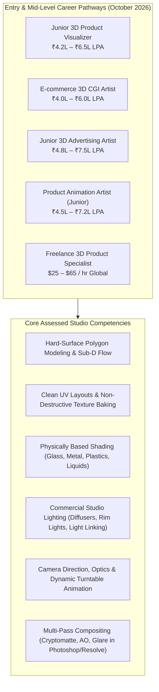
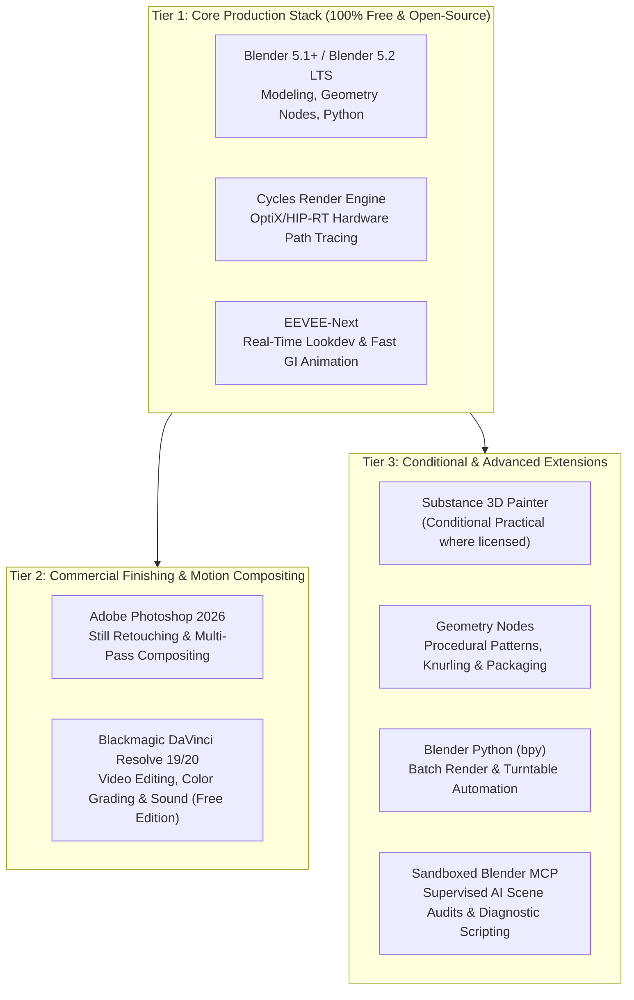
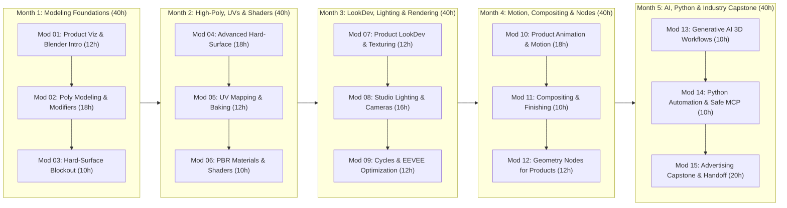
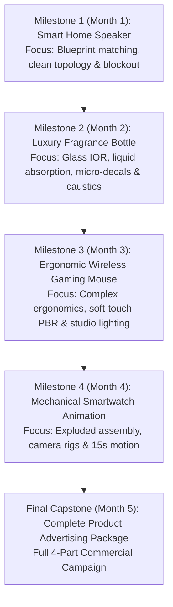
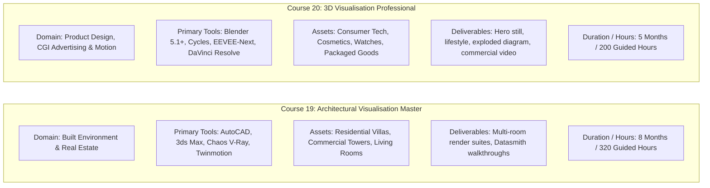

# Academic Specification & Industry Blueprint: 3D Visualisation Professional

> **Document Identifier:** `NOVA-3DVP-SPEC-2026-V1`  
> **Course Identifier (Canonical):** `3d-viz-pro`  
> **Program Title:** 3D Visualisation Professional  
> **Academy:** 3D Academy (`3d`)  
> **Program Level:** Professional Specialization (Career-Oriented Professional Diploma)  
> **Duration:** 5 Months (20 Academic Instructional Weeks)  
> **Guided Instructional Hours:** 200 Guided Hours (10 Hours / Week average: 6h Instructor-Led Laboratory + 4h Supervised Practical Studio)  
> **Recommended Independent Practice:** 100–120 Hours (Strictly demarcated from guided instructional hours)  
> **Specialization:** Commercial 3D Product Visualization, CGI Advertising, Studio Lighting & Motion  
> **Approved Tuition Fee:** **INR 39,900** + applicable statutory GST (18%)  
> **Pricing Policy:** 0% fake discounts, transparent statutory tax disclosure, zero artificial scarcity claims  
> **Authoritative Version:** 1.0.0 (October 2026 Production Standard)  
> **Target Production Toolchain:** Blender 5.1+ / Blender 5.2 LTS, Cycles, EEVEE-Next, Adobe Photoshop 2026, DaVinci Resolve 19/20  

---

## 1. Executive Summary & Strategic Positioning

### 1.1 Course Mission
The **3D Visualisation Professional** (`3d-viz-pro`) is a 5-month, 200-hour immersive professional diploma engineered to train students into production-ready **3D Product Visualizers, CGI Advertising Artists, and Commercial Motion Designers**. 

While Course 19 (*Architectural Visualisation Master*) is dedicated to the built environment—blueprints, interior architecture, residential/commercial exteriors, and Twinmotion/3ds Max walkthroughs—**Course 20 is dedicated entirely to product aesthetics, hard-surface industrial design, hyper-realistic PBR materials, commercial studio lighting, product cinematics, and e-commerce CGI marketing assets**.

Students learn to take physical industrial designs, consumer electronics, cosmetics, luxury timepieces, and packaged goods from conceptual CAD/blueprints into photo-studio-grade 4K still renders and 10–20 second commercial advertising animations using **Blender 5.1+ / 5.2 LTS, Cycles, EEVEE-Next, Adobe Photoshop, and DaVinci Resolve**.

### 1.2 Program Key Metrics
- **Canonical Course ID:** `3d-viz-pro`
- **Duration:** 5 Months (20 Instructional Weeks)
- **Guided Instructional Hours:** 200 Hours
- **Total Modules:** 15 Modules (Scaffolded across 5 progressive months)
- **Approved Selling Price:** ₹39,900 (Original Price: ₹39,900; 0% Fake Discount)
- **Statutory GST:** 18% (₹7,182; Total Payable: ₹47,082)
- **Dynamic Institutional Installment:** ₹9,416 / month across 5 months
- **Major Portfolio Capstone:** Complete 3D Product Advertising Package (Hero Stills, Lifestyle Context, Technical Exploded Assembly, and 10–20s Commercial Motion Animation)
- **Primary Open-Source Toolchain:** Blender 5.1+ / Blender 5.2 LTS (Zero student software licensing cost commitment)

---

## 2. Existing Course Audit & Gap Analysis

An exhaustive preflight audit of the legacy repository files ([`data/courses/3d-viz-pro.json`](file:///c:/Users/wasee/Desktop/NovaSkillsProject/NovaSkills%20Website/data/courses/3d-viz-pro.json) and [`data.js`](file:///c:/Users/wasee/Desktop/NovaSkillsProject/NovaSkills%20Website/data.js)) revealed severe legacy inconsistencies and cross-course contamination inherited from Course 19 (*Architectural Visualisation Master*).

### 2.1 Audit Findings & Contradiction Matrix

| Dimension | Legacy Repository State | Approved October 2026 Redesign | Forensic Classification |
| :--- | :--- | :--- | :---: |
| **Duration & Hours** | Contradiction: `data.js` had 3 Months / 120h; `3d-viz-pro.json` had 4 Months / 160h. | **5 Months / 200 Guided Instructional Hours** (20 weeks $\times$ 10h/week). | **REPOSITION** |
| **Tuition Fee** | Contradiction: `data.js` listed ₹14,999 (original ₹39,999); `3d-viz-pro.json` was `undefined`. | **INR 39,900** fixed selling fee; zero fake percentage discounts; 18% GST explicit. | **REPOSITION** |
| **Course Specialization** | Hybrid confusion: Syllabus taught headphones, but audience & deliverables taught residential villas! | **100% Product Visualization, 3D Advertising & Animation**. Zero architectural crossover. | **REPOSITION** |
| **Target Audience** | Contaminated: "Aspiring Architectural Visualizers... Architects wanting to create high-end presentations." | Industrial designers, 3D artists, e-commerce visualizers, advertising creative professionals. | **REPOSITION** |
| **Software Grab-Bag** | Bloated: `data.js` listed AutoCAD, 3ds Max, Cinema 4D, Unreal Engine 5, Twinmotion, Corona. | **Focused Mastery:** Blender 5.1+/5.2 LTS (Cycles/EEVEE), Photoshop, DaVinci Resolve. | **REPOSITION** |
| **V-Ray Dependency** | Legacy: Module 3 required V-Ray for Blender (outdated commercial barrier). | Native **Cycles** & **EEVEE-Next** path tracing with OptiX/HIP-RT and Light Linking. | **REMOVE** V-Ray; **EXPAND** Cycles |
| **Substance Painter** | Hard prerequisite: Module 2 required commercial Substance 3D Painter license. | Native Blender **Node-based PBR Shading** & Texture Baking; Substance conditional only. | **REPOSITION** |
| **Animation Coverage** | Zero animation: Legacy syllabus was 100% static stills with zero motion design. | **Module 10 (18h)** dedicated to product reveal animation, turntables, camera tracking & dynamics. | **ADD** |
| **What You Will Build** | Contaminated: "Modern Residential Exterior", "Luxury Interior Living Space", "Real-Time Walkthrough". | **Cosmetics, consumer electronics, luxury timepieces, beverage packaging, exploded tech.** | **REMOVE** ArchViz; **ADD** Product CGI |
| **Career Outcomes** | Contaminated: "Junior ArchViz Artist", "Freelance Architectural Renderer". | **Junior 3D Product Visualizer, Product CGI Artist, E-commerce 3D Content Creator**. | **REPOSITION** |
| **Procedural Workflows** | Completely missing in legacy course. | **Geometry Nodes (Module 12: 12h)** for knurling, product variations, procedural packaging. | **ADD** |
| **Python & AI Automation** | Completely missing in legacy course. | **Blender Python (`bpy`) & Sandboxed MCP (Module 14: 10h)** with strict security. | **ADD** |

### 2.2 Pedagogical Disposition Table

- **KEEP:** Core premise of hard-surface 3D modeling and studio lighting in Blender.
- **EXPAND:** 3D Modeling (expanded from 1 vague module to 3 dedicated modules: polygon foundations, topology/modifiers, and hard-surface blockout/detailing).
- **ADD:** Product motion design & commercial animation (18h), Geometry Nodes procedural packaging (12h), DaVinci Resolve color finishing (10h), Blender Python automation (10h), and 4 progressive commercial capstone projects.
- **REPOSITION:** Texturing shifted from paid Substance 3D Painter to native Blender PBR node shading with texture baking; commercial tuition realigned to ₹39,900.
- **REMOVE:** All architectural drafting, CAD blueprints, floor plans, residential interiors, exterior facade massing, Twinmotion, 3ds Max, and V-Ray references.
- **VERIFY:** Compatibility of Blender 5.1 / 5.2 LTS features (Cycles Texture Cache, HIP-RT, EEVEE-Next GI, Raycast nodes).

---

## 3. Industry Research & Job Market Analysis (October 2026)

### 3.1 Industry Demand Overview
In 2026, global consumer brands, e-commerce giants (Amazon, Flipkart, Shopify Plus, Myntra), consumer electronics manufacturers, and direct-to-consumer (D2C) cosmetic brands have transitioned from costly physical studio photography to **100% synthetic 3D Computer-Generated Imagery (CGI)**.

A physical photoshoot requires studio rental, product prototypes, lighting technicians, set dressers, and photographer fees ($3,000–$10,000 per shoot), and changes to packaging require re-shooting. A 3D CGI pipeline produces pixel-perfect, infinite-resolution digital twins that can be rendered in any lighting mood, exploded into technical assembly views, animated for social media ad reels, and exported as interactive 3D web configurators (glTF/USDZ).

### 3.2 Target Career Profiles & Hiring Expectations

### 3.3 Salary Benchmark Table (Indian & Global Remote Markets)

| Job Title | Experience Level | Annual Compensation (INR) | Global Remote ($ / hr) | Primary Hiring Sectors |
| :--- | :---: | :---: | :---: | :--- |
| **Junior 3D Product Visualizer** | 0–2 Years | ₹4,20,000 – ₹6,50,000 | \$20 – \$35 / hr | E-commerce brands, 3D studios, creative agencies |
| **E-commerce 3D CGI Artist** | 1–3 Years | ₹4,00,000 – ₹6,20,000 | \$25 – \$40 / hr | Amazon/Shopify partner agencies, D2C retail |
| **Junior 3D Advertising Artist** | 1–3 Years | ₹4,80,000 – ₹7,50,000 | \$30 – \$50 / hr | Digital ad agencies, commercial production houses |
| **Product Animation Artist (Junior)** | 1–3 Years | ₹4,50,000 – ₹7,20,000 | \$28 – \$45 / hr | Motion design studios, social media ad agencies |
| **Mid-Level 3D Product CGI Lead** | 3–5 Years | ₹7,50,000 – ₹12,50,000 | \$45 – \$75 / hr | Consumer tech (smartphones, audio, smart home), luxury |

---

## 4. Production Tool Hierarchy & Workstation Matrix

### 4.1 Software Licensing & Zero-Cost Student Policy
- **Primary Mastery (Blender 5.1+ / 5.2 LTS):** 100% free and open-source under GNU General Public License (GPL). Zero software licensing costs for enrolled learners.
- **Cycles & EEVEE-Next:** Included natively with Blender. Zero third-party plugin purchases required.
- **DaVinci Resolve 19/20:** Free version is 100% adequate for all course color grading, video timeline editing, and audio sync deliverables.
- **Adobe Photoshop 2026:** Provided via institutional lab access or standard student Creative Cloud plans. Fallback to GIMP / Krita documented.
- **Substance 3D Painter:** Positioned as an optional, conditional practical module. 100% of assessed deliverables can be achieved using native Blender PBR node shading and texture baking. Zero mandatory purchase.
- **Generative 3D Policy:** Image-to-3D AI services (Tripo, Meshy, Rodin) are taught strictly for conceptual rapid ideation and reference silhouette auditing. **AI 2D/3D generation NEVER substitutes for dimensionally accurate, production-clean hard-surface polygon modeling.**

### 4.2 Workstation Hardware Baseline

| Component | Minimum Specification (60 FPS Viewport) | Recommended Professional Workstation |
| :--- | :--- | :--- |
| **Processor (CPU)** | 6-Core CPU (Intel Core i5 12th/13th Gen / AMD Ryzen 5 5600) | 8–16 Core modern CPU (Intel Core i7 13th–15th Gen / AMD Ryzen 7/9 7000/9000) |
| **Memory (RAM)** | 16 GB DDR4/DDR5 | 32 GB DDR5 RAM (Allows multi-million polygon scenes with uncompressed 4K EXRs) |
| **Graphics (GPU)** | Dedicated NVIDIA RTX 3060 / 4060 (8 GB VRAM) with OptiX | Dedicated NVIDIA RTX 4070 / 4080 (12–16 GB VRAM) for ultra-fast Cycles path tracing |
| **Storage** | 512 GB NVMe M.2 SSD | 1 TB–2 TB NVMe PCIe 4.0 SSD for high-bandwidth texture caching |
| **Operating System** | 64-bit Windows 11 Pro / macOS 14+ (Apple Silicon M2/M3) | 64-bit Windows 11 Pro (Optimal NVIDIA OptiX Ray Tracing performance) |

---

## 5. Proposed 15-Module Curriculum Matrix (200 Guided Hours)

The curriculum is structured across 5 progressive calendar months (20 instructional weeks at 10 guided hours per week):

### Module Hours Distribution Invariant

$$\sum_{i=1}^{15} \text{Module}_i = 12 + 18 + 10 + 18 + 12 + 10 + 12 + 16 + 12 + 18 + 10 + 12 + 10 + 10 + 20 = 200 \text{ Guided Hours}$$

---

## 6. Comprehensive Module-by-Module Specification

---

### MODULE 01: Product Visualization & Blender Fundamentals
- **Guided Instructional Hours:** 12 Hours (Week 1)
- **Primary Toolchain:** Blender 5.1+ / 5.2 LTS, PureRef
- **Module Purpose:** Establish navigation fluidity in 3D coordinate space, master Blender's modern interface, customize hotkeys for industrial modeling, configure scene units and real-world dimensional measurement, and deconstruct commercial product reference packages.
- **Learning Objectives:**
  - Navigate Blender's 3D viewport, workspaces, Outliner, and Properties panels with keyboard-driven speed.
  - Configure metric scene units, scale tolerances, and world origin references for physical product manufacturing specifications.
  - Compile an organized, annotated PureRef reference moodboard capturing hero angles, material finish swatches, and lighting moods.
  - Execute non-destructive object transformations, pivot point alignment (3D Cursor, active element, bounding box center), and transform orientations.
- **Key Concepts:** Viewport Navigation, Transform Coordinates, 3D Cursor Precision, Scene Units (Millimeters/Inches), PureRef Canvas Organization, Object vs Edit Mode, Origin Points.
- **Main Topics:**
  1. *Commercial Product Visualization Overview:* Role of product visualizers in e-commerce, D2C brands, and advertising; photography replacement vs creative CGI; industrial design vs CGI asset pipelines.
  2. *Blender Interface & Navigation Mastery:* Modern Blender layout, Outliner collection hygiene, viewports, camera views, pie menus, custom hotkey setups, workspace tabs.
  3. *Precision Scene Units & Scale:* Setting millimeter/centimeter units, verifying dimensions via Measure tool, applying object scale (`Ctrl+A`), world origin placement.
  4. *Reference Curation & PureRef Workflows:* Deconstructing engineering tear-sheets, blueprints, orthographic photos, surface reflections, assembling multi-angle reference boards in PureRef.
- **Detailed Subtopics:**
  - Viewport navigation (orbit, pan, zoom, walk/fly navigation, numpad view snapping)
  - Object selection methods (box, lasso, circle, select linked, invert selection)
  - Pivot point modes (3D Cursor, Individual Origins, Median Point, Active Element)
  - Applying Object Transforms (Location, Rotation, Scale) to eliminate modifier distortion
  - Outliner hierarchy: Collections, sub-collections, color tagging, visibility/render toggles
  - Compiling reference boards: Hero perspective, macro details, material tear-sheets, competitor advertising references
- **Instructor Demonstrations:**
  - Setting up Blender from scratch for product design: unit scale, display settings, Matcaps, viewport clipping.
  - Building an industry-standard PureRef reference board for a consumer electronics product (wireless charging dock).
  - Demonstrating common beginner scale errors and how unapplied scale ruins bevel modifiers.
- **Hands-on Practical Labs:**
  - *Lab 01:* Blender Configuration Lab — Setup a production workspace template, configure unit scale to millimeters, and build a customized reference board in PureRef for an assigned consumer product.
- **Assessable Deliverables:**
  - Configured `.blend` workspace template with proper millimeter scaling and collection hierarchy.
  - Curated, categorized PureRef moodboard (`.pur` and high-res JPEG export).
- **Assessment Rubric:**
  - *Dimensional Scale Accuracy:* 100% correct unit configuration and origin alignment.
  - *Reference Thoroughness:* Minimum 10 annotated reference images covering orthographic views, material finishes, and lighting moods.

---

### MODULE 02: Polygon Modeling, Topology & Modifiers
- **Guided Instructional Hours:** 18 Hours (Weeks 2–3)
- **Primary Toolchain:** Blender 5.1+ (Edit Mode tools, Modifier Stack)
- **Module Purpose:** Master polygon modeling grammar, edge flow, vertex/edge/face manipulations, non-destructive modifier stacks, and topological purity (quads vs poles) required for flawless commercial product surfacing.
- **Learning Objectives:**
  - Manipulate mesh components (vertices, edges, faces) using industry-standard modeling operations (Extrude, Inset, Bevel, Knife, Loop Cut).
  - Stack non-destructive modifiers (Subdivision Surface, Bevel, Mirror, Solidify, Array, Lattice) in correct procedural evaluation order.
  - Maintain all-quad topology and control edge density around complex geometric intersections.
  - Resolve topological artifacts, pinching, non-planar polygons, and shading errors on curved organic-hard surfaces.
- **Key Concepts:** All-Quad Topology, Edge Flow, Sub-D Shading, Non-Destructive Modifiers, Inset Geometry, Support Loops, Normal Smoothing, Auto-Smooth / Weighted Normals.
- **Main Topics:**
  1. *Mesh Topology Foundations:* Quads, triangles, and N-gons; why N-gons fail under subdivision; edge loops, edge rings, and flow direction; poles (E-poles and N-poles).
  2. *Core Modeling Operations:* Extrude manifold (`Alt+E`), Inset (`I`), Bevel (`Ctrl+B`), Loop Cut (`Ctrl+R`), Knife tool (`K`), Vertex Connect (`J`), Bridge Edge Loops.
  3. *The Modifier Stack:* Procedural modeling hierarchy; Subdivision Surface (`Ctrl+1/2/3`), Bevel modifier (limit by Angle/Weight), Solidify, Mirror, Array with Object Offset.
  4. *Shading & Surface Quality:* Smooth Shading vs Flat Shading, Weighted Normal modifier, Mark Sharp, Angle-based auto-smooth, verifying surface curvature with Matcaps.
- **Detailed Subtopics:**
  - Edge flow redirection around circular cutouts on flat and curved surfaces
  - Preventing pinching on curved cylinders when cutting holes (Shrinkwrap helper technique)
  - Inset techniques: individual insets, boundary control, depth offsets
  - Bevel modifier profiles: shape controls (0.5 circular, super-elliptical), miter outer/inner types (Sharp, Patch, Arc)
  - Non-destructive thickness authoring via Solidify (Even Thickness, Complex mode)
  - Matcap zebra striping and red/green matcaps to detect surface dents and waviness
- **Instructor Demonstrations:**
  - Cutting a circular button hole into a curved cylindrical body without causing pinching or shading artifacts.
  - Step-by-step assembly of a parametric modifier stack: Mirror $\to$ Bevel $\to$ Subdivision Surface $\to$ Weighted Normal.
- **Hands-on Practical Labs:**
  - *Lab 02:* Curvature & Cutout Challenge — Model 3 complex geometric shapes containing circular and rectangular cutouts on compound curved surfaces with 100% clean quad topology and zero pinching under Sub-D Level 2.
- **Assessable Deliverables:**
  - Clean `.blend` file with 3 benchmark topology challenge meshes, displaying wireframe and smooth shading.
- **Assessment Rubric:**
  - *Topology Cleanliness:* Zero unmitigated N-gons; clean edge flow conforming to curvature.
  - *Shading Purity:* Zero visible pinching or shading distortion under Matcap reflection testing.

---

### MODULE 03: Hard-Surface Product Blockout
- **Guided Instructional Hours:** 10 Hours (Week 4)
- **Primary Toolchain:** Blender 5.1+, PureRef
- **Module Purpose:** Bridge 2D reference drawings and orthographic blueprints into proportional 3D volumetric primitive blockouts for physical consumer products, establishing verified form language, silhouette readability, and component separation.
- **Learning Objectives:**
  - Align orthographic blueprint background images (Top, Front, Side) to scale inside the 3D viewport.
  - Author volumetric primitive blockouts matching physical product proportions, silhouette balance, and ergonomics.
  - Structure product assemblies into discrete functional components (housings, dials, buttons, seams, glass covers).
  - Verify silhouette readability and primary form hierarchy from focal lengths representative of commercial camera lenses (50mm–85mm).
- **Key Concepts:** Primary Forms, Secondary Forms, Silhouette Readability, Blueprint Camera Matching, Volumetric Massing, Component Hierarchy, Scale Sanity.
- **Main Topics:**
  1. *Form Language & Industrial Design Principles:* Primary, secondary, and tertiary forms; dominant masses; visual weight; ergonomic balance.
  2. *Blueprint Alignment in 3D Space:* Importing orthographic image planes, matching physical dimensions via bounding box scaling, setting transparency and viewport display limits.
  3. *Low-Poly Volumetric Blockout:* Modeling using primitives (cubes, cylinders, spheres), blocking overall mass without bevels, establishing component relationships.
  4. *Component Separation:* Splitting solid bodies into manufactured parts (main casing, front bezel, interface buttons, rubber grips, lens covers) to mirror physical manufacturing assembly.
- **Detailed Subtopics:**
  - Calibrating background reference images to millimeter measurements
  - Low-poly silhouette auditing: using single-color silhouette viewports to evaluate form balance
  - Defining parting lines, panel gaps, and assembly tolerance gaps (0.2mm–0.5mm)
  - Naming conventions for sub-assemblies (`Casing_Upper`, `Knob_Volume_Rotary`, `Glass_Display_Front`)
  - Establishing camera angle proposals for commercial hero framing
- **Instructor Demonstrations:**
  - Setting up multi-view reference blueprints for an assigned industrial design product (portable Bluetooth speaker or mechanical dial).
  - Blocking out primary forms and separating acoustic grilles, volume knobs, and main chassis components in 45 minutes.
- **Hands-on Practical Labs:**
  - *Lab 03:* Milestone 1 Blockout Lab — Execute a dimensionally verified 3D blockout for assigned Project 1 (Smart Home Speaker / Portable Audio Device), establishing correct proportions, assembly separation, and hero camera alignment.
- **Assessable Deliverables:**
  - `.blend` file containing clean, proportional blockout assembly with organized Outliner hierarchy.
  - Viewport screenshot comparison against orthographic reference blueprints.
- **Assessment Rubric:**
  - *Proportional Fidelity:* $\pm 2\%$ dimensional accuracy compared to reference blueprints.
  - *Component Structure:* Correct functional separation of all major manufactured parts.

---

### MODULE 04: Advanced Hard-Surface Product Modeling
- **Guided Instructional Hours:** 18 Hours (Weeks 5–6)
- **Primary Toolchain:** Blender 5.1+ (Advanced Mesh Tools, Bevel Weights, Booleans)
- **Module Purpose:** Transform low-poly blockouts into studio-grade high-poly production assets featuring micro-chamfers, parting lines, knurling, embossed branding, functional ports, and manufacturing realism that hold up to extreme 4K macro camera close-ups.
- **Learning Objectives:**
  - Construct production-grade micro-bevels and rounded chamfers that catch realistic studio specular highlights.
  - Execute clean non-destructive Boolean workflows (Fast vs Exact) combined with Bevel and Weighted Normal cleanup.
  - Model complex manufacturing details: USB-C/Lightning ports, speaker perforations, knurled dials, screw recessed wells, and parted seams.
  - Apply subdivision surface edge-creasing and control loops to maintain crisp geometric transitions without distortion.
- **Key Concepts:** Micro-Chamfers, Specular Highlight Roll-off, Non-Destructive Booleans, Parting Lines, Knurling Patterns, Manufacturing Tolerances, Extreme Macro Detailing.
- **Main Topics:**
  1. *The Anatomy of Physical Edges:* Why razor-sharp CG edges destroy photorealism; specular highlight trapping on micro-bevels; physical radius measurement of real plastics and metals (0.2mm–1.5mm).
  2. *Advanced Bevel Workflows:* Vertex beveling, edge bevel weights, profile presets, beveling intersections, custom normals.
  3. *Production Boolean Pipelines:* Boolean modifier modes (Difference, Union, Intersect); cleaning post-boolean vertices; resolving co-planar face artifacts.
  4. *Industrial Detailing Execution:*
     - Speaker grille arrays and perforations
     - USB-C, HDMI, and audio jack cavities with internal contact pins
     - Knurling and textured grip patterns (diamond knurl, straight knurl)
     - Parting lines, split lines, and cosmetic snap-fit gaps (0.3mm–0.8mm)
     - Embossed and debossed product logos and typography
- **Detailed Subtopics:**
  - Building diamond knurled dials using face poke and dual-extrude operations
  - Creating acoustic speaker grilles using Array modifiers and curve deformers
  - Constructing USB-C port cutouts with interior chamfers and metal shell casing
  - Using Vertex Groups to drive selective Bevel and Subdivision weights
  - High-poly mesh inspection: verifying edge reflections under 85mm macro focal length
- **Instructor Demonstrations:**
  - Building an ultra-detailed, production-ready smartwatch casing or smartphone camera bump with micro-chamfered glass transitions and threaded screw fasteners.
  - Modeling clean USB-C and speaker cutouts with zero shading errors on curved metallic surfaces.
- **Hands-on Practical Labs:**
  - *Lab 04:* Production Detailing Lab — Finalize high-poly modeling for Project 1, adding all micro-bevels, parting lines, ports, buttons, and embossed regulatory text, achieving flawless macro-zoom surface quality.
- **Assessable Deliverables:**
  - Production-ready high-poly `.blend` model of Project 1, completely detailed and ready for UV mapping.
  - 4 High-resolution wireframe and shaded Matcap inspection renders showing macro details.
- **Assessment Rubric:**
  - *Manufacturing Detailing:* Inclusion of realistic parting lines, ports, buttons, and hardware chamfers.
  - *Highlight Quality:* Continuous, un-pinched specular highlight roll-offs across all beveled edges.

---

### MODULE 05: UV Mapping & Texture Baking
- **Guided Instructional Hours:** 12 Hours (Weeks 7–8)
- **Primary Toolchain:** Blender 5.1+ (UV Editor), Texture Baking Engine
- **Module Purpose:** Master seam placement logic, distortion-free UV unwrapping, uniform texel density management across multi-component assemblies, non-overlapping UV packing, and baking essential texture maps (Curvature, Ambient Occlusion, Normal, ID).
- **Learning Objectives:**
  - Place UV seams strategically along natural product parting lines and hidden crevices to conceal texture borders.
  - Calculate, normalize, and enforce consistent Texel Density (e.g., 20.48 px/cm for 2K/4K maps) across all product components.
  - Pack complex multi-object UV islands efficiently with optimal UV space utilization ($>75\%$) and adequate island padding (16–32 px).
  - Bake high-poly geometric details into low/mid-poly normal maps and ambient occlusion passes using Blender's native Cycles baking engine.
- **Key Concepts:** Seam Placement, UV Distortion, Texel Density, UV Packing Efficiency, Island Margin/Padding, Normal Map Baking, Ambient Occlusion Baking, Curvature Maps.
- **Main Topics:**
  1. *UV Unwrapping Fundamentals:* UV coordinate space (0–1 UV tile); Angle-Based vs Conformal unwrap; pinning vertices; unwrapping cylinders without distortion.
  2. *Strategic Seam Placement:* Placing seams along physical manufacturing joints, bottom plates, and hidden recesses; marking seams (`Ctrl+E`).
  3. *Texel Density Management:* Why mismatched texel density ruins realism; setting consistent pixel-per-centimeter values; using Texel Density Checker add-on.
  4. *Efficient UV Packing:* Rotating islands for pixel alignment; packing algorithms; setting island margins (preventing mipmap bleeding); multi-object shared UV layouts.
  5. *Texture Map Baking in Blender:* Setting up bake targets in Cycles; cage extrusion; baking 32-bit float Normal maps, Ambient Occlusion, and Cavity/Curvature passes.
- **Detailed Subtopics:**
  - Straightening UV strips for cables, seams, and circular rims
  - Preventing texture distortion on organic curved grips
  - Managing multi-material UV sets vs single-atlas layouts
  - Baking high-to-low poly normal maps without cage skewing
  - Identifying and fixing normal map bake errors (black fringes, inverted green channel)
- **Instructor Demonstrations:**
  - Unwrapping a complex multi-part consumer tech product in 30 minutes, achieving 80% packing efficiency and uniform texel density.
  - Setting up and executing a clean 4K 16-bit Normal map and Ambient Occlusion bake in Blender Cycles.
- **Hands-on Practical Labs:**
  - *Lab 05:* Production UV & Baking Lab — Unwrap the entire high-poly Project 1 assembly, enforce uniform 20.48 px/cm texel density, pack into organized 4K UV space with 32px padding, and bake clean AO and Normal maps.
- **Assessable Deliverables:**
  - `.blend` file with fully unwrapped, cleanly organized UV layouts.
  - Baked 4K 16-bit PNG Normal Map and 32-bit Ambient Occlusion Map.
- **Assessment Rubric:**
  - *UV Hygiene:* Zero overlapping islands; zero visible texture stretching on checkerboard test.
  - *Bake Quality:* Crisp, artifact-free Normal and AO maps without ray-miss black spots.

---

### MODULE 06: PBR Materials & Shader Fundamentals
- **Guided Instructional Hours:** 10 Hours (Week 8)
- **Primary Toolchain:** Blender 5.1+ (Shader Editor, Principled BSDF 2.0)
- **Module Purpose:** Master the physics of light-matter interaction, PBR (Physically Based Rendering) principles, the updated Principled BSDF shader architecture, and build foundational physical materials (dielectrics, metals, glass, clear plastics, and coated finishes).
- **Learning Objectives:**
  - Understand electromagnetic light physics: reflection, refraction, absorption, Fresnel equations, and conservation of energy.
  - Master all input parameters of Blender's modern Principled BSDF (Base Color, Metallic, Roughness, IOR, Transmission, Sheen, Coat, Emission).
  - Construct physically accurate metallic shaders (aluminum, brass, stainless steel, chrome) with correct anisotropic specular highlights.
  - Author realistic dielectric materials (matte plastics, soft-touch rubber, automotive clear coats, optical glass, tinted acrylics).
- **Key Concepts:** Physically Based Rendering (PBR), Conservation of Energy, Fresnel & IOR, Metallic vs Dielectric, Roughness Mapping, Anisotropy, Clearcoat Layering.
- **Main Topics:**
  1. *Physical Foundations of PBR:* The Fresnel effect; Index of Refraction (IOR); why true conductors have zero diffuse reflection; dielectric vs metallic behavior; roughness micro-facet theory.
  2. *Principled BSDF Deep Dive:* Base Color, Subsurface, Metallic (0 or 1 rule), Roughness, IOR (1.33 water, 1.45–1.55 plastics/glass, 2.42 diamond), Transmission, Clearcoat, Anisotropy, Sheen.
  3. *Essential Commercial Product Metals:* Brushed aluminum, shot-peened matte aluminum (MacBook finish), polished chrome, rose gold, brushed bronze; controlling anisotropic direction.
  4. *Essential Product Dielectrics & Glass:* Glossy polycarbonate, soft-touch matte TPU rubber, textured matte ABS casing, optical lens glass with dispersion, translucent colored acrylic.
- **Detailed Subtopics:**
  - The mathematics of IOR and why metallic materials don't use standard IOR in basic PBR
  - Authoring radial brushed anisotropic reflections for volume dials and watch bezels
  - Using Clearcoat and Clearcoat Roughness for lacquered wood and automotive coatings
  - Thin-film interference and chromatic dispersion in high-end optical lenses
  - Texture coordinate nodes: UV, Generated, Object, Camera, and Window mappings
- **Instructor Demonstrations:**
  - Building a photorealistic anodized brushed aluminum material from scratch with custom anisotropic tangent direction.
  - Creating realistic camera optical glass with multi-layer anti-reflective purple/green coating and chromatic dispersion.
- **Hands-on Practical Labs:**
  - *Lab 06:* Master Shader Library Lab — Construct a reusable, production-grade library of 8 core commercial materials (Anodized Aluminum, Polished Chrome, Matte ABS Plastic, Soft-Touch Rubber, Optical Glass, Frosted Acrylic, Clear Polycarbonate, Glossy Automotive Lacquer).
- **Assessable Deliverables:**
  - Reusable `.blend` Asset Browser library containing the 8 authored master materials with preview thumbnails.
- **Assessment Rubric:**
  - *Physical Accuracy:* 100% adherence to PBR physics (no metallic values between 0.05 and 0.95; accurate IORs).
  - *Visual Realism:* Convincing response under varying lighting angles.

---

### MODULE 07: Product Look Development & Advanced Texturing
- **Guided Instructional Hours:** 12 Hours (Weeks 9–10)
- **Primary Toolchain:** Blender 5.1+ (Shader Editor, Procedural Texturing), Photoshop 2026, [Substance 3D Painter Conditional]
- **Module Purpose:** Elevate pristine CG materials into tactile, authentic commercial reality by layering procedural imperfections (fingerprints, micro-scratches, dust, edge wear), graphics, labels, regulatory typography, and multi-layered surface variations.
- **Learning Objectives:**
  - Layer surface imperfections (roughness variation, smudges, dust flecks) to break uniform CG computer perfection.
  - Place crisp commercial graphics, product branding logos, screen UI displays, and regulatory text without bleeding or scaling artifacts.
  - Build advanced procedural shaders: carbon fiber weaves, textured leatherette grips, knurled metallic finishes, and cosmetic liquid droplets.
  - Evaluate conditional Substance 3D Painter texturing pipelines for smart materials and mask generators where studio software is available.
- **Key Concepts:** Imperfection Mapping, Roughness Variation, Decal Projection, Multi-UV Channels, Procedural Noise, Bump vs Normal vs Displacement, Screen Emissive UI.
- **Main Topics:**
  1. *Breaking CG Perfection:* Why clean CAD renders look fake; microscopic surface roughness; directional micro-scratches; skin oil/fingerprint smudges; dust distribution.
  2. *Graphic Decals & Label Integration:* UV mapping decals onto existing materials; using Mix Color nodes with Alpha masks; second UV channels for high-res logo placement; emissive OLED/LCD screen interfaces.
  3. *Advanced Procedural Shaders:*
     - Carbon fiber weave with procedural height and normal variation
     - Cosmetic bottle condensation and liquid droplets (Geometry Nodes / Particle distribution)
     - Textured leather and silicone grips
     - Woven speaker fabric with anisotropic sheen
  4. *Conditional Substance 3D Painter LookDev:* Setting up mesh maps; applying smart materials (worn metal, coated plastic); smart masks (edges, cavities, occlusion); exporting 8-bit/16-bit PBR texture sets to Blender.
- **Detailed Subtopics:**
  - Mapping multiple roughness maps using ColorRamp contrast adjustments
  - Adding subtle normal map bump for orange-peel paint texture
  - Creating glowing screen UI with scanlines and pixel sub-grids
  - Exporting transparent PNG graphics from Photoshop at exact print resolution (300 DPI equivalent)
  - Blending multiple PBR shaders using Vertex Colors and Ambient Occlusion masks
- **Instructor Demonstrations:**
  - Taking a clean headphone ear-cup and adding subtle soft-touch leatherette micro-wrinkles, edge wear, metallic foil logo branding, and faint handling smudges.
  - Demonstrating conditional Substance 3D Painter texturing workflow and automated texture set relinking in Blender.
- **Hands-on Practical Labs:**
  - *Lab 07:* LookDev & Branding Lab — Execute complete look development for Project 1, applying high-fidelity PBR materials, custom brand logos, regulatory serial badges, micro-imperfections, and emissive display graphics.
- **Assessable Deliverables:**
  - Fully textured `.blend` master scene for Project 1.
  - High-res material breakdown render sheet displaying diffuse, roughness, and normal map contributions.
- **Assessment Rubric:**
  - *Branding Integration:* Crisp, un-stretched product typography and graphics.
  - *Tactile Realism:* Naturalistic surface imperfection balance (subtle, non-distracting, commercially appealing).

---

### MODULE 08: Studio Lighting, HDRI & Commercial Cameras
- **Guided Instructional Hours:** 16 Hours (Weeks 11–12)
- **Primary Toolchain:** Blender 5.1+ (Cycles Light Linking, World Shader, Camera Optics)
- **Module Purpose:** Master commercial studio photography principles inside the 3D viewport, authoring high-impact physical lighting rigs (softboxes, rim lights, gobos, bounce cards, HDRI environments) and configuring cinematic camera optics to accentuate product design language.
- **Learning Objectives:**
  - Implement classic commercial studio lighting rigs (3-point lighting, rim/edge lighting, bottom up-lighting, gradient strip boxes) tailored to reflective products.
  - Utilize Blender Cycles Light Linking to include or exclude specific lights from illuminating individual product components.
  - Configure commercial camera optics: focal lengths (50mm, 85mm, 105mm macro), depth-of-field, sensor sizes, and vertical shift lenses.
  - Author custom studio HDRI environments and employ physical bounce cards and black flags to shape specular reflection ribbons.
- **Key Concepts:** Commercial Studio Lighting, Specular Highlights, Rim Lighting, Softbox Diffusion, Light Linking, Focal Length Compression, Depth of Field (DoF), White Balance, Bounce Cards.
- **Main Topics:**
  1. *Principles of Commercial Product Photography:* The physics of light reflection on glossy and metallic surfaces; why lighting a product is actually lighting its reflections; family of angles.
  2. *Physical Studio Light Types in Blender:* Area lights (Rectangular, Disk, Ellipse); light spread angles (beam control); softbox gradient textures on light sources; IES light profiles.
  3. *Cycles Light Linking & Shadow Linking:* Isolating lights to illuminate only the logo or metallic bezel without overexposing the plastic housing; shadow linking for clean contact shadows.
  4. *Camera Placement, Optics & Composition:* Focal length selection (35mm environmental, 50mm natural, 85mm portrait/product, 105mm macro); Sensor size (Full Frame 36x24mm); F-stop depth of field (`f/2.8` vs `f/8`); Golden ratio, rule of thirds, Dutch angles, dramatic low angles.
  5. *Studio Environments & Bounce Cards:* Constructing seamless studio infinity cyc-walls; colored gradient backdrops; placing white bounce boards and black negative fill cards to sculpt reflections.
- **Detailed Subtopics:**
  - Creating gradient falloff textures on Area lights using Emission and ColorRamp nodes
  - Eliminating hot spots on curved metallic surfaces using diffused double-bounce setups
  - Dark-field vs bright-field lighting techniques for transparent glassware and perfume bottles
  - Setting precise camera clipping and focus objects (`Empty` target tracking)
  - Color temperature in Kelvin: warm ambient accents (3200K) vs crisp daylight keys (5600K–6500K)
- **Instructor Demonstrations:**
  - Lighting a glossy black and chrome consumer product from scratch in Cycles, showing how black flags eliminate muddy reflections and strip lights create sharp highlight ribbons.
  - Demonstrating Cycles Light Linking to add a sparkling specular gleam to a camera lens element without blowing out the surrounding matte chassis.
- **Hands-on Practical Labs:**
  - *Lab 08:* Studio Lighting Master Lab — Author two distinct lighting moods for Project 1: (A) Clean Commercial White-Cyclorama E-Commerce Rig, and (B) Dramatic Moody Dark-Stage Advertising Rig with saturated rim lights and macro depth of field.
- **Assessable Deliverables:**
  - `.blend` scene containing both lighting rigs organized into switchable view layers / scene collections.
  - 4 High-resolution test renders demonstrating specular highlight shaping and camera focal length control.
- **Assessment Rubric:**
  - *Highlight Sculpting:* Sharp, continuous, well-defined reflection lines delineating product contours.
  - *Contrast & Exposure:* Balanced histogram with crisp darks, readable mid-tones, and un-clipped highlights.

---

### MODULE 09: Cycles, EEVEE & Render Optimization
- **Guided Instructional Hours:** 12 Hours (Weeks 12–13)
- **Primary Toolchain:** Blender 5.1+ / 5.2 LTS (Cycles, EEVEE-Next, AgX Color Management)
- **Module Purpose:** Master production rendering workflows in Blender Cycles and EEVEE-Next, optimizing sampling budgets, configuring AgX color science, applying hardware AI denoising (OptiX / OpenImageDenoise), and outputting multi-channel 32-bit OpenEXR files.
- **Learning Objectives:**
  - Configure Cycles path tracing parameters: Max Samples, Noise Threshold, Light Bounces (Diffuse, Glossy, Transmission, Transparent), and Clamping.
  - Leverage modern hardware acceleration: NVIDIA OptiX / AMD HIP-RT ray tracing and real-time AI viewport denoising.
  - Implement Blender 5.1/5.2 LTS AgX color management to preserve rich chromatic highlights without digital burnouts.
  - Evaluate and optimize render times using Blender 5.2 LTS Texture Caching, fast global illumination in EEVEE-Next, and render border cropping.
- **Key Concepts:** Path Tracing, Ray Bounces, Noise Threshold, OptiX / OIDN Denoising, AgX Color Science, Dynamic Range, EEVEE-Next GI, Texture Caching, Memory Profiling.
- **Main Topics:**
  1. *Cycles Path Tracing Deep Dive:* How rays propagate; direct vs indirect light; setting minimum light bounces; optimizing glass and transmission bounces without noise explosion; caustics controls.
  2. *Noise Threshold & Adaptive Sampling:* Setting realistic noise thresholds (0.01 for finals, 0.05 for draft lookdev); why cranking samples to 4096 is amateurish; time-vs-quality trade-offs.
  3. *AI Denoising Architectures:* OptiX (GPU accelerated for NVIDIA) vs OpenImageDenoise (OIDN - CPU/GPU high detail preservation); pre-filtering modes (Accurate vs Fast); eliminating denoising blur on fine textures.
  4. *Modern Color Management:* Why sRGB clipping destroys specular highlights; AgX color space vs Filmic vs ACES; AgX Base Contrast, Punchy, and High Contrast looks; exposure and gamma calibration.
  5. *EEVEE-Next Real-Time Engine:* Screen-space raytracing, fast screen-space global illumination, light limits, reflection probes, rendering rapid 60 FPS previews and client approval reels.
- **Detailed Subtopics:**
  - Diagnosing fireflies and speckles: Clamping Indirect light (e.g., 10.0) without losing dynamic range
  - Light Tree optimization in complex multi-light commercial scenes
  - Profiling VRAM usage: inspecting high-res texture memory footprint and using 5.2 LTS Texture Cache
  - Setting up Shadow Catchers for transparent ground shadows on clean white or transparent backgrounds
  - Configuring 16-bit TIFF and 32-bit OpenEXR output formats with compression (ZIP, PIZ)
- **Instructor Demonstrations:**
  - Benchmarking a heavy 4K product scene: reducing render time from 18 minutes down to 2 minutes 15 seconds through bounce optimization, adaptive sampling, and OptiX AI denoising without any perceptual loss in visual quality.
  - Side-by-side comparison of Filmic vs AgX color management on an overexposed specular highlight on a polished brass product.
- **Hands-on Practical Labs:**
  - *Lab 09:* Render Optimization Benchmark Lab — Profile an assigned un-optimized commercial product scene, reduce render time by at least 60% while maintaining crisp texture details and clean shadow penumbras, and deliver final calibrated 4K renders in AgX color space.
- **Assessable Deliverables:**
  - Optimized `.blend` scene with configured render settings.
  - Benchmark log detailing before/after render times, memory consumption, sample settings, and visual comparison crops.
- **Assessment Rubric:**
  - *Optimization Efficiency:* Minimum 50% render time reduction achieved without introduce denoising smearing.
  - *Color Fidelity:* Proper AgX configuration with zero highlight clipping on metallic reflections.

---

### MODULE 10: Product Animation & Advertising Motion
- **Guided Instructional Hours:** 18 Hours (Weeks 14–15)
- **Primary Toolchain:** Blender 5.1+ (Dope Sheet, Graph Editor, Non-Linear Animation, Camera Rigging)
- **Module Purpose:** Transition from static imagery into dynamic commercial product advertising, mastering camera choreography, smooth easing curves, 360-degree turntable loops, exploded mechanical assembly animations, and dynamic product reveals.
- **Learning Objectives:**
  - Animate seamless commercial camera trajectories using camera rigs, target empties, and custom Graph Editor Bézier curves.
  - Author mechanical exploded-view assembly and disassembly animations with staggered keyframe offsets.
  - Choreograph 10–20 second cinematic product commercial sequences featuring hero reveals, macro detail passes, and dynamic lighting sweeps.
  - Master depth-of-field rack focusing, focal length transitions, and animated material/lighting effects.
- **Key Concepts:** Keyframe Interpolation, Graph Editor Bézier Curves, Camera Rigs, Exploded Assembly, Staggered Timing, Turntable Loops, Depth-of-Field Pulls, Motion Blur, Product Choreography.
- **Main Topics:**
  1. *Commercial Advertising Motion Principles:* Timing, spacing, and anticipation in product CGI; luxury slow-motion pacing vs high-energy tech reveals; camera moves that accentuate form lines.
  2. *Camera Animation & Rigging:* Building a professional camera crane/dolly rig using parent empties; path constraint cameras; target tracking; avoiding gimbal lock; manual camera shake accents.
  3. *Graph Editor Mastery:* Working with Bézier handles, vector handles, and easing curves; dynamic acceleration and deceleration; creating fluid, weighted movement.
  4. *Mechanical Exploded Views:* Keyframing component separation; hierarchical parent-child animation; using staggered offsets (e.g., casing lifts first, internal chip reveals second, battery slides third).
  5. *Cinematic Storyboarding & Shot Sequencing:*
     - Shot 1: Mysterious macro silhouette / lighting sweep (3s)
     - Shot 2: Detailed component assembly / exploded join (4s)
     - Shot 3: Macro panning across textured logo with rack focus (3s)
     - Shot 4: Hero 360 rotation with final resting lock and logo reveal (4s)
- **Detailed Subtopics:**
  - Creating seamless 360-degree turntable loops for e-commerce web display
  - Animating depth-of-field focus distance to guide viewer attention across intricate details
  - Animating light positions to create dramatic sweeping specular glints
  - Enabling physical Motion Blur in Cycles and EEVEE with shutter speed calibration (0.5 shutter curve)
  - Outputting image sequences (PNG / EXR) vs direct video; why professional studios never render directly to MP4
- **Instructor Demonstrations:**
  - Building a multi-shot commercial sequence for a luxury mechanical watch: animating the spinning escapement wheel, casing exploded view, and a sweeping hero camera reveal.
  - Fine-tuning camera acceleration curves in the Graph Editor to transform stiff linear motion into smooth, premium advertising motion.
- **Hands-on Practical Labs:**
  - *Lab 10:* Commercial Motion Lab — Choreograph and keyframe a 15-second product reveal animation for Project 1 (or Project 2), featuring 3 distinct camera cuts (Macro Detail Rack Focus, Exploded Mechanical Assembly, Hero Dynamic Reveal), rendering a draft preview in EEVEE.
- **Assessable Deliverables:**
  - Fully keyframed `.blend` animation scene with configured camera rigs.
  - 15-Second 1080p 30fps EEVEE viewport animation preview (`.mp4`) demonstrating camera flow and timing.
- **Assessment Rubric:**
  - *Camera Fluidity:* Smooth Bézier transitions with zero jarring rotational snaps or gimbal flips.
  - *Choreographic Pacing:* Professional advertising timing with clear visual hierarchy and readable product features.

---

### MODULE 11: Render Passes, Compositing & Colour Finishing
- **Guided Instructional Hours:** 10 Hours (Week 16)
- **Primary Toolchain:** Blender Compositor, Adobe Photoshop 2026, Blackmagic DaVinci Resolve 19/20
- **Module Purpose:** Master multi-pass render compositing, extracting beauty passes, Cryptomatte object/material IDs, ambient occlusion, depth maps, and specular passes into Photoshop for high-end still retouching and DaVinci Resolve for video color grading and audio finishing.
- **Learning Objectives:**
  - Configure and output multi-layer OpenEXR files containing individual render passes (Diffuse, Glossy Direct/Indirect, Transmission, Cryptomatte, Depth, Normal, AO).
  - Reconstruct and balance beauty passes non-destructively in Adobe Photoshop, integrating glow effects, lens flares, and dust retouching.
  - Import animated image sequences into Blackmagic DaVinci Resolve, build node-based color grades, apply film grain, and perform audio synchronization.
  - Export final broadcast-ready advertising video deliverables (4K ProRes / high-bitrate H.265 MP4) with correct color space tags.
- **Key Concepts:** Multi-Pass Compositing, Beauty Pass Reconstruction, Cryptomatte Selection, Depth Maps (Mist Pass), DaVinci Resolve Node Tree, Color Grading (Lift/Gamma/Gain), Optical Retouching.
- **Main Topics:**
  1. *Multi-Pass Render Pipeline:* Setting up View Layer Passes in Blender; Combined, Diffuse Direct/Indirect/Color, Glossy Direct/Indirect/Color, Emission, Environment, Shadow, Ambient Occlusion, Mist.
  2. *Cryptomatte Isolation:* Why color ID masks are obsolete; using Cryptomatte Object and Material passes to isolate any component instantly in compositing with zero edge fringing.
  3. *Photoshop Still Retouching:* Importing multi-layer EXRs via EXR-IO; blending passes with linear light math; painting custom specular pop; non-destructive dodge and burn; frequency separation for micro-blemish cleanup.
  4. *DaVinci Resolve Commercial Finishing:* Setting up an ACES / DaVinci YRGB Color Managed timeline; importing rendered OpenEXR/PNG sequences; node-based grading (primary balancing, contrast curves, saturation); adding optical halation, film grain, and lens distortion.
  5. *Audio & Delivery Packaging:* Syncing dynamic commercial sound effects (whooshes, mechanical clicks, ambient synth pads); rendering final deliverables in Rec.709 / sRGB for web and broadcast.
- **Detailed Subtopics:**
  - Reconstructing Beauty: $\text{Combined} = (\text{DiffDir} + \text{DiffInd}) \times \text{DiffCol} + (\text{GlossDir} + \text{GlossInd}) \times \text{GlossCol} + \text{Trans} + \text{Emit}$
  - Using the Mist Pass to add subtle atmospheric depth and aerial perspective in macro scenes
  - Creating realistic optical glare and anamorphic streak flares using Blender's Glare compositor node
  - DaVinci Resolve delivery presets: YouTube 4K, Instagram Reels (9:16 vertical 1080x1920), and studio ProRes 422 HQ
- **Instructor Demonstrations:**
  - Deconstructing a raw 3D Cycles render pass in Photoshop and turning it into a glossy, publication-ready magazine advertisement with enhanced specular gleams and rich tonal contrast.
  - Color grading a 15-second product animation sequence in DaVinci Resolve, balancing skin tones in lifestyle shots and outputting a crisp 4K master.
- **Hands-on Practical Labs:**
  - *Lab 11:* Compositing & Grading Lab — Take the raw render passes from Module 08 and Module 10, execute full multi-pass still compositing in Photoshop for 2 hero stills, and perform color grading, sound synchronization, and final MP4 export in DaVinci Resolve for the 15-second animation.
- **Assessable Deliverables:**
  - Layered Master Photoshop `.psd` file with organized render passes, adjustment curves, and retouching layers.
  - Final color-graded 1080p/4K 30fps commercial video file (`.mp4`, H.264/H.265, stereo audio).
- **Assessment Rubric:**
  - *Compositing Cleanliness:* Flawless pass reconstruction without haloing, fringing, or crushed shadows.
  - *Color Grade Polish:* Cohesive color palette, professional contrast curves, and seamless audio synchronization.

---

### MODULE 12: Geometry Nodes for Product Visualization
- **Guided Instructional Hours:** 12 Hours (Weeks 16–17)
- **Primary Toolchain:** Blender 5.1+ / 5.2 LTS (Geometry Nodes Editor)
- **Module Purpose:** Leverage procedural node-based geometry to author complex parametric product patterns, knurling textures, packaging bubble wraps, cosmetic drop condensation, and automated multi-color product line variations without destructive manual modeling.
- **Learning Objectives:**
  - Build procedural Geometry Node networks utilizing points, curves, and mesh primitives.
  - Generate parametric surface details: diamond knurling, honeycomb speaker grilles, and woven textures.
  - Construct procedural packaging elements: blister packs, protective foam inserts, and cardboard carton folds.
  - Distribute realistic cosmetic condensation droplets with random scale and rotation over product surfaces using Raycast and Proximity nodes.
- **Key Concepts:** Procedural Modeling, Point Distribution, Mesh to Points, Raycast Node, Geometry Proximity, Instance on Points, Parametric Knurling, Condensation Systems.
- **Main Topics:**
  1. *Geometry Nodes Architecture:* Spreadsheet data inspection, Fields and Attributes, Domain types (Point, Edge, Face, Corner), Group Input and Output parameters.
  2. *Point Distribution & Surface Instancing:* `Distribute Points on Faces`, `Instance on Points`, randomizing rotation and scale using Random Value nodes, controlling density via vertex weight maps.
  3. *Procedural Product Detailing:*
     - Generating parametric knurling on circular volume dials
     - Building dynamic honeycomb speaker grilles with adjustable radius and hole spacing
     - Creating luxury packaging: protective custom-molded foam inserts using boolean geometry nodes
  4. *Cosmetic Water Droplet & Condensation Engine:* Distributing micro-mist droplets, medium beads, and large teardrop condensation runs on chilled beverage cans and perfume glass using Raycast nodes to prevent interpenetration.
  5. *Blender 5.2 LTS Simulation Nodes Preview:* Introduction to node-based particle flows and procedural cable/wire draping around consumer tech setups.
- **Detailed Subtopics:**
  - Exposing parameters to the Modifier panel for rapid client variation testing (e.g., slider for `Droplet_Density`, `Hole_Radius`)
  - Using Geometry Proximity to scale down instances near product seams and logos
  - Converting procedural curves into renderable tubing and cables with profile curves
  - Setting up multi-material assignments procedurally within node trees using `Set Material`
- **Instructor Demonstrations:**
  - Building a fully procedural beverage can condensation system that automatically scatters realistic water droplets, runs, and micro-sweat over any assigned geometry in 20 minutes.
  - Authoring a procedural speaker grille asset with interactive slider controls for grille curvature and hole diameter.
- **Hands-on Practical Labs:**
  - *Lab 12:* Procedural Product Asset Lab — Construct a reusable procedural Geometry Nodes asset: either (A) Dynamic Cosmetic Condensation Generator, or (B) Parametric Luxury Watch Bezel / Knurling Generator, exposing user-friendly slider controls in the Modifier stack.
- **Assessable Deliverables:**
  - Reusable `.blend` node group asset stored in the Asset Browser with annotated node layout.
  - Test render demonstrating the procedural system applied across 2 different product geometries.
- **Assessment Rubric:**
  - *Node Tree Cleanliness:* Logical node grouping, frame labeling, and clean attribute flow.
  - *Parameter Flexibility:* Exposed controls successfully modify density and scale without crashing or breaking topology.

---

### MODULE 13: Generative AI for 3D Product Workflows
- **Guided Instructional Hours:** 10 Hours (Week 18)
- **Primary Toolchain:** Midjourney / Adobe Firefly, Image-to-3D Services (Meshy / Tripo / Rodin - Educational Free Tiers), PureRef, Blender 5.1+
- **Module Purpose:** Integrate modern artificial intelligence responsibly into commercial 3D pipelines as a workflow accelerator for concept ideation, moodboard generation, texture synthesis, and rapid silhouette prototyping, while enforcing strict industry boundaries that AI outputs never substitute for manual high-precision hard-surface modeling.
- **Learning Objectives:**
  - Formulate structured AI image prompts to generate product design concepts, colorway variations, and commercial advertising backdrops.
  - Evaluate image-to-3D generative algorithms (NeRF / Gaussian Splatting / generative mesh tools), analyzing their current topological limitations (remeshing, polycount, non-manifold geometry).
  - Clean and retopologize AI-generated concept meshes into usable reference forms and proxy visual guides inside Blender.
  - Synthesize custom seamless surface textures, decals, and packaging artwork using ethical AI image generators.
- **Key Concepts:** AI Workflow Acceleration, Prompt Engineering for Industrial Design, Image-to-3D Mesh Evaluation, Retopology of AI Meshes, Ethical AI Governance, Texture Synthesis.
- **Main Topics:**
  1. *Responsible AI in 3D Production:* Where AI adds value (concept speed, moodboards, packaging ideation) vs where it fails (engineering tolerances, clean quad topology, micro-chamfer bevels); the non-negotiable rule of manual modeling mastery.
  2. *Concept Ideation & Visual Exploration:* Prompting Midjourney / Firefly for industrial design forms (e.g., "minimalist wireless noise-canceling headphones, matte obsidian black, brushed brass accents, studio lighting, industrial design sketch, CMF board").
  3. *Image-to-3D Exploration & Evaluation:* Running free-tier image-to-3D pipelines (Tripo, Meshy); inspecting exported OBJ/FBX files; diagnosing dense triangular soup, self-intersections, and non-manifold edges.
  4. *Using AI Meshes as 3D Reference:* Importing rough AI meshes into Blender, treating them strictly as 3D volumetric guides (similar to digital clay concept sketches), and re-modeling clean quad geometry over the forms.
  5. *AI-Assisted Texture & Pattern Generation:* Generating seamless patterns (carbon fiber variations, abstract packaging prints, sticker decals) in Photoshop AI and projecting them onto PBR materials.
- **Detailed Subtopics:**
  - Formulating Color, Material, Finish (CMF) moodboards using AI image synthesis
  - Automated remeshing tools: Quad Remesher vs Blender native Voxel Remesh
  - AI texture map generation: generating roughness and normal maps from AI diffuse images
  - Intellectual property, copyright considerations, and commercial safety guidelines when using AI reference imagery
- **Instructor Demonstrations:**
  - Rapid ideation session: Generating 4 product design variations in 10 minutes, generating an image-to-3D proxy, importing into Blender, and using it as a reference silhouette to model a clean quad-based cosmetic flacon.
  - Demonstrating why raw image-to-3D meshes cannot be used directly in commercial advertising (showing topology artifacts under specular lighting).
- **Hands-on Practical Labs:**
  - *Lab 13:* AI Ideation & Rapid Concept Lab — Use generative AI to conceptualize an innovative consumer accessory (e.g., ergonomic gaming mouse or luxury perfume bottle), generate a 3D proxy reference, model clean production geometry over the silhouette, and render a comparative proof of concept.
- **Assessable Deliverables:**
  - Concept presentation board (PDF) containing AI prompts, generated reference plates, and 3D silhouette overlay.
  - Clean quad-modeled `.blend` asset based on the generated concept.
- **Assessment Rubric:**
  - *Workflow Judgment:* Proper use of AI as ideation reference rather than raw mesh submission.
  - *Model Integrity:* Hand-authored clean quad topology adhering to commercial standards.

---

### MODULE 14: Blender Python, Automation & Secure MCP Workflows
- **Guided Instructional Hours:** 10 Hours (Weeks 18–19)
- **Primary Toolchain:** Blender 5.1+ (Scripting Workspace, Python `bpy` API), Visual Studio Code, Sandboxed Virtual Machine
- **Module Purpose:** Automate repetitive studio rendering tasks using Blender's embedded Python API (`bpy`) and observe modern supervised Model Context Protocol (MCP) scene audit workflows inside an isolated, secure lab environment with zero unreviewed code execution.
- **Learning Objectives:**
  - Write foundational Python scripts using Blender's `bpy` library to automate scene setup, batch material assignment, and multi-camera render queues.
  - Script automated 360-degree turntable keyframing and camera focal length adjustments.
  - Understand Model Context Protocol (MCP) concepts: AI agents querying scene metadata, inspecting polygon counts, and identifying unlinked textures.
  - Adhere to strict MCP safety protocols: containerized sandboxing, local loopback bindings, human code review, and zero privileged host execution.
- **Key Concepts:** Python for 3D (`bpy`), Scripting Automation, Batch Rendering, Scene Introspection, Model Context Protocol (MCP), Containerized Sandboxing, Loopback Isolation, Script Review.
- **Main Topics:**
  1. *Introduction to Blender Python (`bpy`):* The Scripting workspace; interactive Python console; `bpy.context`, `bpy.data`, `bpy.ops`; executing simple scripts to manipulate objects and materials.
  2. *Studio Automation Scripts:*
     - Batch renaming objects, materials, and collections according to studio naming conventions
     - Automated turntable creation: generating a camera rig and setting 120 keyframes across $360^\circ$ with one click
     - Automated scene health audit: printing polygon count, identifying N-gons, and checking for missing external texture files
     - Batch render queue: looping through all scene cameras and rendering 4K stills to designated output folders
  3. *Model Context Protocol (MCP) Architecture in 3D:* What MCP is; how an AI agent interacts with DCC tools via standardized JSON-RPC schemas; querying scene parameters without manual clicking.
  4. *Strict MCP Security & Lab Sandboxing Protocol:*
     - The critical danger of unguarded AI code execution (arbitrary system access, data exfiltration, socket hijacking)
     - Mandatory Docker container / virtualized sandbox isolation with locked filesystem boundaries
     - Loopback network restriction (`127.0.0.1`); zero outbound internet access
     - Human-in-the-loop review: Every Python snippet or MCP tool call must be inspected and approved by an instructor before running in Blender
     - Disposable test files: MCP exercises execute exclusively on throwaway geometric test scenes; zero live commercial assets connected
  5. *Graceful Offline Fallback Workflow:* Completing all course automation objectives using pre-validated, instructor-provided manual Python scripts and visual demonstration recordings if local virtualization is unavailable.
- **Detailed Subtopics:**
  - Registering custom Python operator scripts in the 3D Viewport sidebar (N-panel)
  - Handling file paths safely using Python's `os` and `pathlib` modules
  - Catching syntax and runtime exceptions in the Blender System Console
  - The 5 Golden Rules of 3D Agentic Safety (Zero unreviewed code, Zero client data exposure, Zero credentials in context, Zero outbound internet, Zero production workstation execution)
- **Instructor Demonstrations:**
  - Writing a 25-line Python script that builds a studio lighting setup (3 Area lights with ColorRamps and a target Empty) in 2 seconds.
  - Demonstrating a controlled, sandboxed MCP scene inspection on a disposable test mesh, showing real-time human code approval in VS Code.
- **Hands-on Practical Labs:**
  - *Lab 14:* Studio Automation Lab — Write and execute an automated Blender Python script (`turntable_batch_render.py`) that sets up a 360-degree camera spin, configures Cycles render settings, and exports a 60-frame image sequence.
- **Assessable Deliverables:**
  - Validated Python script file (`.py`) with complete docstrings and error handling.
  - Short screen recording demonstrating script execution inside Blender on a test asset.
- **Assessment Rubric:**
  - *Script Functionality:* Error-free execution; correct manipulation of scene objects and keyframes.
  - *Security Compliance:* Strict execution within approved sandbox guidelines.

---

### MODULE 15: Product Advertising Capstone & Client Delivery
- **Guided Instructional Hours:** 20 Hours (Weeks 19–20)
- **Primary Toolchain:** Blender 5.1+ / 5.2 LTS, Cycles, EEVEE-Next, Adobe Photoshop 2026, DaVinci Resolve 19/20
- **Module Purpose:** Synthesize all modeling, PBR lookdev, studio lighting, animation, compositing, and automation skills into an industry-grade commercial advertising package for a complex consumer product, delivering four publication-ready visual assets, technical documentation, and studio archive handoff.
- **Learning Objectives:**
  - Produce a publication-ready **Hero Advertising Still Render** (3840x2160) with master-level lighting, specular highlight sculpting, and multi-pass compositing.
  - Author an authentic **Lifestyle Context Render** demonstrating the product in its real-world environment with physically plausible material interactions.
  - Construct a technical **Exploded Assembly Diagram Still** showing internal components, engineering precision, and labeled typography callouts.
  - Choreograph, render, color-grade, and finish a **10–20 Second Commercial Motion Video** (4K / 1080p 60/30fps) with synchronized audio and motion graphics.
  - Package all source files, linked texture libraries, render passes, and delivery notes into a standardized commercial client handoff archive.
- **Key Concepts:** Capstone Synthesis, Hero Commercial Still, Lifestyle Staging, Exploded Engineering Assembly, Broadcast Video Delivery, Studio Packaging, Client Handoff.
- **Main Topics:**
  1. *Capstone Client Brief Interpretation:* Selecting an approved commercial product category (Premium Wireless Headphones, Smart Watch, Luxury Fragrance Flacon, High-Performance Consumer Drone); deconstructing design intent and target audience.
  2. *Production Schedule & Milestone Management:* Planning the 20-hour execution window: Modeling audit (4h), LookDev & Texturing (4h), Still Lighting & Hero/Lifestyle/Exploded Rendering (4h), Animation & Motion (4h), Compositing, Grading & Client Packaging (4h).
  3. *Execution of the 4 Mandatory Deliverables:*
     - Deliverable 1: Hero Advertising Still (Studio cyclorama, macro detail, perfect specular ribbons)
     - Deliverable 2: Lifestyle Context Still (Naturalistic environment, warm daylight/ambient lighting, complementary props)
     - Deliverable 3: Technical Exploded Assembly Still (Staggered mechanical components, callouts, dimensional graphics)
     - Deliverable 4: 10–20 Second Commercial Animation (Dynamic camera moves, lighting sweeps, component join, audio sync)
  4. *Studio Handoff Hygiene:* Consolidating external textures into relative directories (`//textures/`); purging unused data blocks and orphan meshes; generating high-res Behance/ArtStation breakdown sheets.
  5. *Final Commercial Presentation & Technical Assessment:* Presenting the completed portfolio package to an instructor evaluation panel simulating a creative agency creative director review.
- **Detailed Subtopics:**
  - Setting up multi-camera render queues for overnight batch execution
  - Non-destructive Photoshop master file organization with labeled layer groups and adjustment masks
  - Final video master encoding in DaVinci Resolve: ProRes 422 HQ master and web-optimized H.265 MP4
  - Compiling an ArtStation case study: Clay renders, wireframe overlays, material breakdown swatches, and lighting setups
- **Instructor Demonstrations:**
  - Comprehensive review of an award-winning commercial product portfolio on Behance, deconstructing breakdown presentation standards.
  - Studio archive packaging: running a file health check in Blender, packing resources, verifying relative paths, and assembling a clean ZIP handoff.
- **Hands-on Practical Labs:**
  - *Lab 15:* Capstone Studio Execution Lab — 20 hours of supervised studio production dedicated to finalizing, rendering, compositing, grading, and packaging the complete 4-part Product Advertising Package.
- **Assessable Deliverables (The Four Core Assets):**
  1. **Hero Commercial Still:** High-Resolution 4K still render (3840x2160, TIFF / PNG).
  2. **Lifestyle Context Still:** High-Resolution 4K still render showing product in authentic setting.
  3. **Technical Exploded View Still:** High-Resolution 4K still render displaying mechanical components and callout graphics.
  4. **Commercial Motion Animation:** 10–20 second 1080p/4K 30fps commercial video with synchronized audio (`.mp4`, H.264/H.265).
  5. **Master Source Archive:** Clean `.blend` file with packed/relative textures, layered master `.psd` files, and DaVinci Resolve project archive (`.dra`).
  6. **Portfolio Presentation Board:** Comprehensive ArtStation/Behance case study slides (PDF).
- **Assessment Rubric & Acceptance Criteria (100-Point Scale):**
  - *Modeling & Topology Quality (25 pts):* Clean quad topology, realistic micro-chamfers, correct scale, zero pinching under specular reflection.
  - *Shading & Material Realism (25 pts):* PBR physical correctness, realistic roughness variation, un-stretched UVs, crisp branding graphics.
  - *Studio Lighting & Composition (20 pts):* Clear visual hierarchy, sculptural specular highlights, balanced contrast, pleasing focal length optics.
  - *Animation & Motion Design (15 pts):* Fluid camera easing curves, compelling choreography, seamless audio synchronization.
  - *Post-Production & File Delivery (15 pts):* Clean compositing, professional color grade, organized Outliner/PSD layers, relative file paths.
  - **Passing Threshold:** Minimum 75/100 points required for professional diploma certification.

---

## 7. Progressive Milestone Projects (Months 1–4)

To guarantee that students build steady technical mastery before undertaking the 20-hour Module 15 Capstone, four structured milestone projects are embedded throughout the curriculum:

1. **Milestone Project 1 (Month 1): Smart Home Audio Device**
   - *Core Competency:* Blueprint calibration, primary form massing, non-destructive modifier stacks, acoustic grille perforation, and clean quad topology.
   - *Deliverable:* Watertight high-poly 3D model with Matcap wireframe inspection renders.
2. **Milestone Project 2 (Month 2): Luxury Cosmetic Flacon / Fragrance Bottle**
   - *Core Competency:* Complex glass modeling, liquid mesh interface, metallic foil label decaling, micro-chamfered glass edges, and UV unwrapping.
   - *Deliverable:* Unwrapped 3D asset with baked Normal/AO maps and procedural condensation droplets.
3. **Milestone Project 3 (Month 3): High-Performance Wireless Ergonomic Mouse**
   - *Core Competency:* Sculpted ergonomic curvature, multi-material lookdev (matte plastic, glossy accents, rubber knurled wheel, PTFE feet), and dual studio lighting setups (Clean Commercial vs Moody Dark Stage).
   - *Deliverable:* 2 Studio-grade 4K still renders showcasing highlight sculpting and material contrast.
4. **Milestone Project 4 (Month 4): Mechanical Smartwatch Assembly Animation**
   - *Core Competency:* Multi-part mechanical modeling (bezel, sapphire glass, rotary crown, internal circuit chassis, wristband), keyframe interpolation, camera rigging, and 15-second commercial motion design.
   - *Deliverable:* 15-Second 1080p animated sequence with synchronized sound effects and camera rack focusing.

---

## 8. Course Differentiation & Identity Boundaries

To eliminate the copy-paste contamination discovered in the legacy repository, the academic boundaries between Course 19 and Course 20 are strictly defined:

### 8.1 Forbidden Competencies for Course 20
The following topics belong exclusively to other Nova Skills programs and are **strictly excluded** from Course 20:
- **No 2D Architectural CAD Drafting:** No floor plans, structural sections, elevations, or AutoCAD DWG cleanup (Belongs to Course 19).
- **No Architectural Space Visualization:** No interior design layouts, architectural daylighting studies, residential villa massing, or MEP coordination (Belongs to Course 19).
- **No Real-Time Walkthrough Engines:** No Twinmotion scene authoring or Unreal Engine architectural walkthroughs (Belongs to Course 19 & Course 27).
- **No Character Rigging & Organic Sculpting:** No human anatomical character sculpting, facial blendshapes, or bipedal character rigging (Belongs to 3D Character tracks).
- **No High-End Cinematic Destruction VFX:** No Houdini pyrotechnics, building demolition, or fluid flood simulations (Belongs to VFX Specialization).

---

## 9. AI and Model Context Protocol (MCP) Safety Specification

Module 14 incorporates supervised Model Context Protocol (MCP) and Python automation. To ensure institutional safety and protect student workstations, strict governance controls are established:

### 9.1 The Five Golden Rules of 3D Agentic Safety
1. **Zero Unreviewed Code Execution:** Every Python script (`bpy`) or JSON-RPC tool call generated by an AI assistant must be manually inspected, reviewed, and approved by an instructor before execution in Blender. No autonomous background execution loops are permitted.
2. **Zero Confidential Client Data Exposure:** No commercial client drawings, proprietary CAD files, confidential 3D assets, or studio credentials may be exposed to external LLM agent contexts.
3. **Zero Host Credential Storage:** No system passwords, API keys (AWS, GitHub, Stripe), or institutional credentials may reside within the agent workspace.
4. **Mandatory Containerized / Virtualized Sandboxing:** MCP server-agent processes must run inside an isolated Docker container or virtualized lab virtual machine with locked filesystem boundaries. Outbound network traffic is blocked, and communications are restricted strictly to the local loopback interface (`127.0.0.1`).
5. **Zero Production Workstation Installation:** Experimental MCP daemons and listener servers are strictly prohibited from being installed on primary studio workstations running commercial client-facing production software.

### 9.2 Graceful Fallback Protocol
If container virtualization is unavailable on a student laptop, teaching for Module 14 defaults seamlessly to **instructor-led offline demonstrations, pre-compiled safe Python snippet libraries, and non-executable MCP architectural flow diagrams**. Students achieve 100% of automation learning outcomes without running untrusted background agents.

---

## 10. Commercial, Financial & Governance Notice

### 10.1 Tuition & Commercial Pricing Structure
- **Approved Active Selling Tuition:** **INR 39,900**
- **Catalog Original Reference Price:** **INR 39,900**
- **Discount Percentage:** **0% (Zero fake discounts or artificial strike-throughs)**
- **Statutory Taxation:** 18% Goods and Services Tax (GST) applied in full compliance with Indian tax law (GST: ₹7,182; Total Payable: ₹47,082).
- **Flexible Institutional Installment:** Easy 5-month institutional installment plan starting at **₹9,416 / month** (18% GST included). Zero hidden financing charges.

### 10.2 Ethical Career Support & Placement Governance
- Nova Skills provides comprehensive **Career Preparation & Placement Assistance**, including 1-on-1 portfolio reviews, resume/LinkedIn optimization, Behance/ArtStation curation, freelance pricing strategy, and interview coaching.
- **Zero Fake Job Guarantees:** Nova Skills maintains strict ethical advertising standards. The institute makes **zero false promises of "100% Job Guarantees" or "Guaranteed ₹10 Lakh Salaries"**. Career placement outcomes depend entirely on individual student diligence, portfolio aesthetic quality, and commercial interview performance.

---

## 11. Website Migration & Implementation Roadmap

The table below outlines the changes that will be applied in subsequent development tasks (`NOVA-3DVP-02` through `NOVA-3DVP-16`):

| File Path | Current Content | Target Content Post-Approval |
| :--- | :--- | :--- |
| [`data/courses/3d-viz-pro.json`](file:///c:/Users/wasee/Desktop/NovaSkillsProject/NovaSkills%20Website/data/courses/3d-viz-pro.json) | 4 un-timed modules, contaminated with ArchViz audience/projects, ₹undefined fee | Complete 15 modules (200h), Product CGI audience, 4 capstones, ₹39,900 fee |
| [`data.js`](file:///c:/Users/wasee/Desktop/NovaSkillsProject/NovaSkills%20Website/data.js) (`NS_COURSES`) | 3 Months / 120h, ₹14,999, generic 10-software grab-bag, 4 legacy modules | 5 Months / 200h, ₹39,900, Blender/Cycles/EEVEE focus, 15 modules |
| [`data.js`](file:///c:/Users/wasee/Desktop/NovaSkillsProject/NovaSkills%20Website/data.js) (`NS_ACADEMIES['3d']`) | Duplicate legacy record with 3 Months / 120h and ₹14,999 | Synchronized 5 Months / 200h, ₹39,900, 15 modules |
| [`nova-skills-109-course-content.json`](file:///c:/Users/wasee/Desktop/NovaSkillsProject/NovaSkills%20Website/nova-skills-109-course-content.json) | 4 un-timed modules, contaminated ArchViz outcomes | Exact JSON synchronization with `3d-viz-pro.json` |
| [`js/data.min.js`](file:///c:/Users/wasee/Desktop/NovaSkillsProject/NovaSkills%20Website/js/data.min.js) | Minified legacy bundle | Rebuilt production bundle via `node scripts/build_min_js.js` |

---

## 12. Document Approval & Sign-Off

- **Academic Lead:** Nova Skills 3D Curriculum Review Board
- **Technical Reviewer:** Senior 3D CGI & Product Visualization Lead
- **Security Auditor:** Agentic Safety & Sandboxed Toolchain Governance Committee
- **Date:** October 26, 2026
- **Status:** **SUBMITTED FOR OWNER APPROVAL — ALL WEBSITE SOURCE CODE EDITS BLOCKED PENDING SIGN-OFF**
