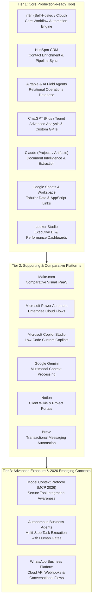

# AI for Business Professional — Authoritative Academic Specification

**Program Title:** AI for Business Professional  
**Course Identifier:** `ai-for-business-pro`  
**Academy:** AI Academy (`ai`)  
**Credential Awarded:** Professional Diploma in Business AI Implementation & Workflow Automation  
**Governing Standard:** ISO 9001:2015 Verified Curriculum Standard | Nova Skills Academic Board  
**Duration:** 4 Months (16 Calendar Weeks)  
**Total Guided Instructional Hours:** 160 Hours (~10 Hours / Week)  
**Recommended Independent Practice:** 50–80 Hours  
**Commercial Tuition:** INR 39,900 (Exclusive of 18% GST; Total: INR 47,082; No-Cost EMI: INR 3,924 / Month for 12 Months, INR 5,231 / Month for 9 Months, or INR 11,771 / Month for 4 Months)  
**Target Level:** Intermediate Professional (Business Leaders, Consultants, Operations Managers & Agency Founders; Zero Python/Coding Prerequisite)  
**Authoritative Document Version:** 2.0.0 (October 2026 Production Standard)  

---

## 1. Executive Summary & Program Positioning

### 1.1 Course Positioning & Commercial Value
By late 2026, enterprise adoption of artificial intelligence reached an unmistakable divide: while individual knowledge workers adopted chatbots for personal drafting, modern organizations faced a crippling shortage of professionals who could **architect, automate, and deploy connected AI business systems**. 

The modern enterprise does not merely need prompts; it demands connected operational infrastructure where:
1. Web inquiries and lead forms are instantly enriched, scored with AI, and routed through **HubSpot CRM** without human data entry.
2. Complex multi-step business processes are orchestrated reliably using self-hosted or cloud **n8n** workflow engines.
3. Operational databases in **Airtable** run autonomous AI field agents to categorize, summarize, and trigger transactional notifications.
4. Unstructured customer support inquiries are resolved via grounded knowledge bases with verified human escalation gates.
5. Invoices, receipts, contracts, and vendor statements are ingested, parsed, and logged directly into financial accounting sheets.
6. Leadership teams monitor real-time business performance through automated **Looker Studio** decision dashboards.
7. AI initiatives are backed by defensible financial ROI calculations, enterprise data privacy governance, and strict PII safeguards.

**AI for Business Professional** is Nova Skills' flagship 4-month (160 guided hours) vocational qualification designed for business leaders, management consultants, operations directors, marketing/sales automation leads, and agency founders. It bridges the gap between high-level executive strategy and hands-on, no-code/low-code operational implementation, equipping students to design, deploy, and scale enterprise AI systems that deliver verified operational efficiency and revenue expansion.

```
      MONTH 1                           MONTH 2                           MONTH 3                           MONTH 4
┌─────────────────────────┐       ┌─────────────────────────┐       ┌─────────────────────────┐       ┌─────────────────────────┐
│ STRATEGY & N8N CORE     │       │ CRM, SUPPORT & OPS      │       │ ANALYTICS, AGENTS & MCP │       │ GOVERNANCE & CAPSTONE   │
│ • Module 01: AI Strategy│       │ • Module 04: CRM, Sales │       │ • Module 07: Dashboards │       │ • Module 09: Governance,│
│   & Opportunity Audit   │       │   & Marketing Auto (20h)│       │   & Analytics (12h)     │       │   Security & ROI (12h)  │
│   (12h)                 │       │ • Module 05: Customer   │       │ • Module 08: Business AI│       │ • Module 10: Industry   │
│ • Module 02: Process    │       │   Support & Knowledge   │       │   Agents & MCP (12h)    │       │   Capstone & Client     │
│   Mapping & Design (16h)│  ───> │   Assistants (16h)      │  ───> │                         │  ───> │   Implementation (16h)  │
│ • Module 03: n8n Auto   │       │ • Module 06: Operations │       │                         │       │                         │
│   Engineering (24h)     │       │   & Document Automation │       │                         │       │                         │
│                         │       │   (20h)                 │       │                         │       │                         │
└─────────────────────────┘       └─────────────────────────┘       └─────────────────────────┘       └─────────────────────────┘
                Total Guided Instructional Schedule: Exactly 160 Hours Across 10 Modules (16 Weeks)
```

---

### 1.2 Program Differentiation & Non-Goals

To maintain high vocational focus on business implementation, process optimization, and no-code/low-code systems, the program establishes strict boundaries across the AI Academy catalog:

| Dimension | AI Productivity Professional (`ai-productivity`) | AI for Business Professional (`ai-for-business-pro`) | AI Solutions Engineering (`ai-mastery`) |
| :--- | :--- | :--- | :--- |
| **Duration & Hours** | 3 Months / 120 Guided Hours | **4 Months / 160 Guided Hours** | 9 Months / 360 Guided Hours |
| **Primary Learner Profile** | Individual office workers, admins, analysts | **Business consultants, operations leads, agency owners, managers** | Software engineers, full-stack developers, AI builders |
| **Technical Focus** | Desktop productivity, prompting, slides, spreadsheets | **Enterprise workflow automation, CRM sync, business AI systems** | Python backend engineering, custom vector databases, multi-agent code |
| **Automation Engine** | Power Automate Desktop / lightweight Zapier | **Production n8n workflows, webhooks, Airtable automations, Make** | Programmatic LangGraph state graphs, FastAPI, Docker |
| **Programming Level** | Zero coding | **No-Code / Low-Code (JSON, Webhooks, Regex, Basic Logic)** | Advanced Python 3.12, AsyncIO, SQL, Docker, Git |
| **Primary Outcome** | 40–60% personal clerical time savings | **Automated departmental operations, client delivery, verified ROI** | Production cloud-deployed autonomous AI applications |

---

### 1.3 Target Audience & Career Personas

1. **Management Consultants & Business Analysts:** Advisors seeking to deliver high-margin AI feasibility audits, workflow automation implementations, and operational modernization projects to corporate clients.
2. **Operations Managers & Department Heads:** Leaders across sales, marketing, customer support, and administrative operations tasked with reducing turnaround times and headcount bottlenecks.
3. **Agency Owners & Freelance Solution Providers:** Founders expanding service offerings from basic digital marketing or web design into high-ticket enterprise AI automation retainers ($2,000–$5,000/mo).
4. **CRM & Growth Automation Specialists:** Marketers and RevOps practitioners seeking to connect lead capture forms, AI qualification agents, and CRM pipeline triggers into frictionless customer journeys.
5. **Corporate Transformation Leads:** Internal enterprise champions tasked with deploying AI ethically, securely, and with measurable financial ROI across cross-functional business units.

---

### 1.4 Verified Target Career Outcomes

Graduates of this program are qualified for the following high-demand commercial and consulting job roles:
* **AI Business Implementation Consultant**
* **Business AI Solutions Specialist**
* **Workflow Automation Consultant (n8n / Make / Airtable)**
* **RevOps & AI Automation Lead**
* **Business Process Automation Manager**
* **Digital Transformation & Operations Specialist**

*(Note: In accordance with Nova Skills truth-in-education standards, this business program does not promise software engineering roles such as AI Software Architect, Full-Stack AI Engineer, or Deep Learning Researcher, which require advanced computer science degrees or completion of `ai-mastery`).*

---

## 2. Comprehensive Tool & Software Architecture

The curriculum utilizes an enterprise-grade software ecosystem classified into four verified tiers based on industry adoption, license requirements, and classroom accessibility as of October 2026.



### 2.1 Tool Competency & Licensing Matrix

| Software / Tool | Curriculum Role | Practical Applications in Course | License / Account Requirement | Verified Zero-Cost / Supported Fallback | Vendor Documentation Reference |
| :--- | :--- | :--- | :--- | :--- | :--- |
| **n8n** | Tier 1: Core Primary | Webhook intake, multi-step logic, CRM updates, LLM node chaining, error workflows | n8n Cloud trial OR Self-hosted community edition (Free) | Free n8n Cloud Trial / Free Local Desktop Runner | [docs.n8n.io](https://docs.n8n.io/) |
| **HubSpot CRM** | Tier 1: Core Primary | Lead capture forms, contact enrichment, automated deal stages, marketing triggers | Free HubSpot CRM tier | 100% Free HubSpot CRM Tier | [developers.hubspot.com](https://developers.hubspot.com/) |
| **Airtable** | Tier 1: Core Primary | Operational relational databases, interfaces, automations, Airtable AI fields | Airtable Free / Team trial with Airtable AI credits | Airtable Free tier + standard formula fields | [support.airtable.com](https://support.airtable.com/) |
| **ChatGPT** | Tier 1: Core Primary | Business problem framing, structured data extraction, Advanced Data Analysis, Custom GPTs | Free account or ChatGPT Plus ($20/mo recommended) | Free ChatGPT tier (GPT-4o mini / limited GPT-4o) | [openai.com](https://openai.com/) |
| **Claude** | Tier 1: Core Primary | Long-form contract analysis, SOP authoring, Claude Projects for client workspaces | Free account or Claude Pro ($20/mo recommended) | Free Claude tier with file uploads | [docs.anthropic.com](https://docs.anthropic.com/) |
| **Looker Studio** | Tier 1: Core Primary | Automated executive KPI dashboards, client reporting portals, data blending | 100% Free with Google Account | Completely Free | [support.google.com/looker-studio](https://support.google.com/looker-studio/) |
| **Google Sheets** | Tier 1: Core Primary | Tabular data logging, webhook endpoint destinations, formula audits | 100% Free with Google Account | Completely Free | [workspace.google.com](https://workspace.google.com/) |
| **Make.com** | Tier 2: Supporting | Comparative scenario building, visual branching, multi-system routing | Make Free Tier (1,000 operations/month) | 100% Free Tier (1,000 ops/mo) | [www.make.com/en/help](https://www.make.com/en/help) |
| **Microsoft Power Automate** | Tier 2: Supporting | Enterprise cloud flows, scheduled email triggers, Teams notifications | Free with Microsoft account / M365 trial | Free Power Automate Desktop / Web free tier | [learn.microsoft.com/power-automate](https://learn.microsoft.com/power-automate/) |
| **Microsoft Copilot Studio** | Tier 2: Supporting | Low-code custom copilot creation, knowledge upload, topic triggers | M365 Business Trial with Copilot Studio | Guided instructor live demonstration & video walkthrough | [learn.microsoft.com/copilot-studio](https://learn.microsoft.com/copilot-studio/) |
| **Brevo** | Tier 2: Supporting | Automated transactional email notifications, customer onboarding sequences | Free Tier (300 emails/day) | 100% Free Tier | [help.brevo.com](https://help.brevo.com/) |
| **Notion** | Tier 2: Supporting | Client project portals, deliverable documentation, shared operational wikis | Free Notion Account | Completely Free | [www.notion.so/help](https://www.notion.so/help) |
| **Model Context Protocol (MCP)** | Tier 3: Exposure | Conceptual understanding of connecting business tools to frontier models safely | Exposure Only (Zero coding required) | Architecture diagrams & instructor live demo | [modelcontextprotocol.io](https://modelcontextprotocol.io/) |
| **WhatsApp Business API** | Tier 3: Exposure | Webhook routing, automated business messaging, conversational commerce | Meta Developer Account test number (Free) | Sandbox test environment | [developers.facebook.com/docs/whatsapp](https://developers.facebook.com/docs/whatsapp) |

---

## 3. Sixteen-Week / Ten-Module Academic Curriculum Matrix

```
┌────────────────────────────────────────────────────────────────────────────────────────┐
│                        160-HOUR CURRICULUM MODULE MAP                                  │
├─────────┬──────────────────────────────────────────────────────────────┬───────────────┤
│ Module  │ Title                                                        │ Guided Hours  │
├─────────┼──────────────────────────────────────────────────────────────┼───────────────┤
│ Mod 01  │ Business AI Strategy & Opportunity Discovery                 │ 12 Hours      │
│ Mod 02  │ Business Process Mapping & Automation Design                 │ 16 Hours      │
│ Mod 03  │ n8n Workflow Automation Engineering                          │ 24 Hours      │
│ Mod 04  │ CRM, Sales & Marketing Automation                            │ 20 Hours      │
│ Mod 05  │ AI Customer Support & Knowledge Assistants                   │ 16 Hours      │
│ Mod 06  │ Business Operations & Document Automation                    │ 20 Hours      │
│ Mod 07  │ AI Business Analytics & Decision Dashboards                  │ 12 Hours      │
│ Mod 08  │ Business AI Agents & MCP Integrations                        │ 12 Hours      │
│ Mod 09  │ Governance, Testing, Security & ROI                          │ 12 Hours      │
│ Mod 10  │ Industry Capstone & Client Implementation                    │ 16 Hours      │
├─────────┴──────────────────────────────────────────────────────────────┼───────────────┤
│ TOTAL GUIDED INSTRUCTIONAL HOURS                                       │ 160 Hours     │
└────────────────────────────────────────────────────────────────────────┴───────────────┘
```

---

### Module 01: Business AI Strategy & Opportunity Discovery
* **Duration:** 12 Guided Hours (Weeks 1–2)  
* **Recommended Independent Practice:** 5 Hours  
* **Pedagogical Goal:** Master the strategic frameworks required to evaluate enterprise operations, identify high-value AI opportunities, deconstruct business bottlenecks, and formulate a viable, revenue-generating AI transformation roadmap.

#### Main Topics & Subtopics
1. **The 2026 Enterprise AI Landscape:**
   * Transition from casual chat tools to embedded enterprise business systems.
   * Classifying enterprise AI: Deterministic automation vs predictive analytics vs generative workflows vs autonomous agents.
   * Build vs Buy vs Partner: When to deploy no-code tools (n8n/Make) vs SaaS solutions vs custom development.
2. **The Business Opportunity Discovery Framework:**
   * Identifying operational friction: High-frequency, rule-based, data-heavy clerical workflows.
   * The Feasibility-Impact Matrix: Prioritizing AI initiatives by business value, technical risk, and implementation speed.
   * Calculating baseline operational costs: Quantifying labor hours, error rates, and turnaround delays.
3. **Structuring the Business AI Roadmap:**
   * Scoping client discovery workshops: Stakeholder interviews, pain point extraction, and capability audits.
   * Authoring an Executive Business AI Strategy Brief: Executive summary, problem statement, proposed AI architecture, and target KPIs.
   * Change management: Addressing employee anxiety, leadership skepticism, and setting realistic adoption expectations.

#### Software & Tools
* ChatGPT (Plus / Team), Claude (Projects), Google Docs / Notion.

#### Learning Outcomes
* Conduct an enterprise AI readiness assessment across an organization’s core functional departments.
* Evaluate and rank candidate AI initiatives using the Feasibility-Impact Matrix.
* Author an executive-grade Business AI Strategy Brief articulating measurable operational outcomes.

#### Classroom Practicals & Hands-On Labs
* **Lab 1.1:** Departmental AI Discovery Audit: Evaluate a simulated mid-sized logistics company; identify 5 operational bottlenecks across customer onboarding, invoice processing, and shipment dispatch.
* **Lab 1.2:** Feasibility vs Impact Workshop: Score 10 candidate AI automation projects and plot them on an interactive Feasibility-Impact 2x2 grid.
* **Lab 1.3:** Authoring the Business AI Strategy Brief: Use Claude Projects to compile a formal 6-page Business AI Transformation Roadmap for C-suite review.

#### Assessment Evidence
* Submitted Business AI Transformation Roadmap & Opportunity Scoring Matrix.

---

### Module 02: Business Process Mapping & Automation Design
* **Duration:** 16 Guided Hours (Weeks 2–4)  
* **Recommended Independent Practice:** 6 Hours  
* **Pedagogical Goal:** Deconstruct messy, informal human workflows into structured, machine-readable business process maps with clear triggers, conditions, data schemas, and human-in-the-loop validation checkpoints.

#### Main Topics & Subtopics
1. **Business Process Decomposition (BPMN Fundamentals):**
   * Process discovery: Shadowing workflows, reviewing email chains, and documenting tacit operational knowledge.
   * Visualizing business processes: Swimlanes, trigger events, decision gates, subprocesses, and termination endpoints.
   * The "As-Is" vs "To-Be" workflow transformation methodology.
2. **Data Flow Architecture & Schema Design:**
   * Understanding structured vs unstructured business data: Emails, PDFs, JSON, CSVs, and web forms.
   * Designing standardized operational data schemas: Defining primary keys, required fields, and standardized data types.
   * Data validation rules: Catching missing fields, invalid email addresses, and corrupted numerical formats.
3. **Designing for Reliability & Human-in-the-Loop (HITL):**
   * Defining automated execution boundaries: What should execute automatically vs what requires human sign-off.
   * Designing escalation paths: Managing exceptions, system timeouts, low confidence model scores, and edge cases.
   * Drafting formal Business Automation Specifications (BAS): Technical blueprint connecting visual flowcharts to automation nodes.

#### Software & Tools
* Whimsical / Lucidchart / Miro (Process Mapping), Airtable, ChatGPT.

#### Learning Outcomes
* Map end-to-end "As-Is" and "To-Be" business processes using standardized swimlane diagrams.
* Design robust JSON data schemas connecting disparate business applications.
* Specify human-in-the-loop approval gates that mitigate automated operational risks.

#### Classroom Practicals & Hands-On Labs
* **Lab 2.1:** As-Is to To-Be Process Redesign: Take an unstructured 7-step client onboarding process conducted via messy emails; map the current state and redesign it into an automated To-Be architecture.
* **Lab 2.2:** Operational Schema Definition: Construct a standardized customer intake JSON schema in Airtable capturing customer details, document attachments, and verification status.
* **Lab 2.3:** Business Automation Specification Blueprint: Write a comprehensive 5-page technical specification document detailing triggers, API payloads, decision logic, and human approval gates.

#### Assessment Evidence
* **Assessed Workplace Deliverable 1 (Part B):** Complete Business Process Map & Technical Automation Blueprint.

---

### Module 03: n8n Workflow Automation Engineering
* **Duration:** 24 Guided Hours (Weeks 4–7)  
* **Recommended Independent Practice:** 12 Hours  
* **Pedagogical Goal:** Master n8n as the primary open, secure, enterprise-grade workflow automation engine; build resilient multi-step workflows utilizing webhooks, conditional routing, data transformation, LLM node chaining, and automated error handling.

#### Main Topics & Subtopics
1. **n8n Core Architecture & Setup:**
   * Cloud vs Self-Hosted n8n: Infrastructure, costs, data privacy, and enterprise deployment options.
   * Navigating the n8n canvas: Triggers (Webhook, Schedule, App Event), Nodes, Connections, and Execution Logs.
   * Managing credentials safely: Environment variables, OAuth2 integrations, and API key security.
2. **Data Manipulation & Flow Control in n8n:**
   * JSON payload handling in n8n: Items, arrays, paired items, and data pinning for deterministic testing.
   * Flow control nodes: If, Switch, Loop Over Items, Filter, and Merge nodes.
   * The Code Node (JavaScript basics for non-programmers): Simple text splitting, date formatting, and array manipulation without complex programming.
3. **AI Nodes & Language Model Integration in n8n:**
   * The n8n AI ecosystem: AI Agent node, OpenAI/Anthropic model connectors, Output Parsers, and Tools.
   * Building structured prompt nodes: Transforming freeform customer emails into clean, validated JSON records.
   * Implementing fallbacks and retries: Managing rate limits, model timeouts, and API connection failures.
4. **Error Handling, Testing & Production Monitoring:**
   * Error Trigger workflows: Catching failed executions and dispatching instant alert messages to Slack/Teams.
   * Execution history inspection, debugging failed nodes, and mock data injection.
   * Versioning, exporting, and importing n8n workflow JSON configurations across environments.

#### Software & Tools
* n8n (Cloud / Self-Hosted), Postman (Webhook Testing), Slack (Alerts), OpenAI / Anthropic APIs.

#### Learning Outcomes
* Construct multi-step, event-driven workflows in n8n connecting webhooks to external business tools.
* Process, filter, and transform complex JSON payloads using core n8n manipulation nodes.
* Integrate frontier LLMs into n8n to perform automated classification, extraction, and structured output formatting.
* Build automated error-handling pipelines that catch node failures and notify engineering leads.

#### Classroom Practicals & Hands-On Labs
* **Lab 3.1:** First Multi-Step n8n Pipeline: Build a workflow that receives a test webhook payload, validates input fields, formats data using the Code node, and dispatches a confirmation message.
* **Lab 3.2:** AI Extraction & Parsing Node: Integrate an OpenAI/Anthropic model node into an n8n pipeline to ingest raw customer inquiries and output a structured JSON schema `{category, urgency, sentiment, key_requests}`.
* **Lab 3.3:** Production Error-Handling Flow: Create a dedicated Error Workflow in n8n that captures failed executions, logs error stack traces to Google Sheets, and sends an urgent alert to a Slack channel.

#### Assessment Evidence
* Exported n8n workflow JSON files for a 5-step automated intake and processing engine with verified test execution logs.

---

### Module 04: CRM, Sales & Marketing Automation
* **Duration:** 20 Guided Hours (Weeks 7–9)  
* **Recommended Independent Practice:** 10 Hours  
* **Pedagogical Goal:** Connect customer-facing touchpoints directly to enterprise CRM infrastructure; automate lead qualification, contact enrichment, personalized sales outreach, dynamic deal stage tracking in HubSpot, and transactional email messaging in Brevo.

#### Main Topics & Subtopics
1. **HubSpot CRM Architecture & Lead Management:**
   * Core CRM objects: Contacts, Companies, Deals, Tickets, and Custom Properties.
   * Ingesting leads via webhooks: Connecting landing page forms directly to HubSpot contact records.
   * Lifecycle stages and deal pipelines: Lead, MQL, SQL, Opportunity, and Customer transitions.
2. **AI-Powered Lead Enrichment & Automated Scoring:**
   * Extracting corporate domains and querying external intelligence to enrich company profiles.
   * AI Lead Scoring: Evaluating lead fit and intent based on job title, company size, and inquiry text.
   * Routing high-value enterprise leads to sales reps via Slack alerts while sending automated nurturing to lower-tier inquiries.
3. **Automated Sales Outreach & Follow-up Sequences:**
   * Context-aware personalization: Generating bespoke sales follow-up email drafts based on prospect inquiry details.
   * Integrating transactional messaging with **Brevo**: Triggering dynamic onboarding sequences, quotation emails, and confirmation SMS.
   * Comparative CRM automation: Building matching sales pipeline flows in **Airtable Interfaces** for small businesses.

#### Software & Tools
* HubSpot CRM, n8n, Brevo, Airtable, Claude.

#### Learning Outcomes
* Automate the ingestion, deduplication, and creation of contact records in HubSpot CRM via n8n.
* Implement AI-based lead scoring and qualification logic that automatically assigns deal stages.
* Deploy personalized sales communication sequences that adapt dynamically to lead attributes.

#### Classroom Practicals & Hands-On Labs
* **Lab 4.1:** HubSpot Contact Ingestion Flow: Build an n8n workflow that captures form submissions, checks for existing contacts in HubSpot, updates or creates records, and assigns a sales owner.
* **Lab 4.2:** AI Lead Qualification Engine: Configure an AI node in n8n that evaluates incoming lead inquiries, scores them (1–100), generates a 2-sentence sales briefing, and writes it directly to the HubSpot deal record.
* **Lab 4.3:** Multi-Channel Outreach Pipeline: Build an automated follow-up flow that generates a personalized introductory email draft in Claude, logs it in HubSpot, and dispatches an instant Slack notification to the assigned account executive.

#### Assessment Evidence
* **Assessed Workplace Deliverable 2:** End-to-End n8n Lead Capture & CRM Enrichment Engine (Working n8n flow connecting web forms, AI lead scoring, HubSpot updates, and sales notifications).

---

### Module 05: AI Customer Support & Knowledge Assistants
* **Duration:** 16 Guided Hours (Weeks 9–11)  
* **Recommended Independent Practice:** 8 Hours  
* **Pedagogical Goal:** Transform customer service operations by building grounded AI support assistants, automated ticket triage engines, and knowledge base retrieval systems with clear human escalation boundaries.

#### Main Topics & Subtopics
1. **The Architecture of Modern AI Support Systems:**
   * Customer support operational metrics: First Response Time (FRT), Resolution Time, Customer Satisfaction (CSAT), and Ticket Deflection Rate.
   * Ticket classification and sentiment analysis: Tagging urgency, issue category, customer frustration, and language.
   * Routing tickets dynamically: Dispatching billing inquiries to finance, bugs to engineering, and simple queries to automated deflection.
2. **Grounded Knowledge Base Retrieval:**
   * Ingesting corporate knowledge: Product manuals, refund policies, FAQs, and company terms into structured formats.
   * Using retrieval-augmented generation (RAG) concepts in no-code tools (n8n Vector Store node / Notion Q&A / Copilot Studio).
   * Restricting AI responses: Enforcing zero-hallucination boundaries and mandating direct policy citations in customer replies.
3. **Escalation Protocols & Human-in-the-Loop Operations:**
   * Defining failure states: Detecting when a customer is angry, when the query is out-of-scope, or when confidence scores fall below 80%.
   * Seamless agent handoff: Compiling a 3-bullet summary of the issue and routing the customer to a live human agent via HubSpot Tickets or Zendesk.
   * Continuous learning: Auditing resolved tickets to identify knowledge base gaps and refine automated responses.

#### Software & Tools
* n8n (AI Agent Node & Knowledge Stores), HubSpot Service Hub / Tickets, Notion, ChatGPT Team.

#### Learning Outcomes
* Build an automated support ticket classification and sentiment routing pipeline in n8n.
* Connect a grounded knowledge base to an AI assistant to generate cited, policy-compliant customer answers.
* Design and test automated escalation workflows that safely transfer complex tickets to human support staff.

#### Classroom Practicals & Hands-On Labs
* **Lab 5.1:** Automated Support Ticket Triage: Build a workflow that ingests customer support emails, categorizes them into 5 departmental queues, flags critical complaints with high priority, and creates tickets in HubSpot.
* **Lab 5.2:** Grounded Policy Q&A Assistant: Upload a 20-page corporate refund and shipping policy into an n8n AI knowledge node; test its responses against 10 ambiguous customer refund requests.
* **Lab 5.3:** Human Escalation & Summary Handoff: Build an escalation trigger that activates when a customer expresses extreme dissatisfaction, automatically generating an executive incident summary for the support manager.

#### Assessment Evidence
* **Assessed Workplace Deliverable 3:** Multichannel AI Support Assistant & Knowledge Base (Grounded customer service triage system with policy verification and human escalation gates).

---

### Module 06: Business Operations & Document Automation
* **Duration:** 20 Guided Hours (Weeks 11–13)  
* **Recommended Independent Practice:** 10 Hours  
* **Pedagogical Goal:** Eliminate administrative overhead by automating transactional document processing; extract structured financial data from invoices, receipts, and vendor contracts using multimodal AI; and update Airtable operational databases automatically.

#### Main Topics & Subtopics
1. **Intelligent Document Processing (IDP) Architecture:**
   * The cost of clerical manual entry: Keystroke errors, processing delays, and lost invoice discounts.
   * Multimodal vision models in business: Using GPT-4o and Claude 3.5 Sonnet to parse scanned documents, irregular layouts, and mobile photos.
   * Pre-processing document inputs: Managing file size, PDF conversions, and image contrast.
2. **Invoice & Receipt Parsing Pipelines:**
   * Ingesting documents via Google Drive, Dropbox, or email attachments.
   * Extracting structured data: Vendor name, invoice number, line items, tax breakdowns, currencies, and total amounts.
   * Writing parsed transactions directly into **Airtable** or **Google Sheets** relational databases.
3. **Contract Auditing & Vendor Compliance:**
   * Ingesting 30-page vendor contracts and master service agreements (MSAs).
   * Extracting key legal parameters: Payment terms, termination notice windows, liability caps, and renewal dates.
   * Setting up automated calendar alerts 60 days before contract renewal deadlines.

#### Software & Tools
* n8n, Airtable, Google Drive, Claude 3.5 Sonnet (Vision), ChatGPT (Vision).

#### Learning Outcomes
* Build an automated document ingestion pipeline extracting tabular data from PDF invoices.
* Implement structured relational database schemas in Airtable for vendor and expense tracking.
* Deploy an automated contract auditing system that flags non-standard commercial terms and renewal dates.

#### Classroom Practicals & Hands-On Labs
* **Lab 6.1:** PDF Invoice Extraction Pipeline: Build an n8n flow that monitors a Google Drive folder for new invoice uploads, extracts line items via Claude Vision, and logs the records into Airtable.
* **Lab 6.2:** Duplicate & Anomaly Detection: Implement validation logic that checks incoming invoice numbers against existing Airtable records, flagging duplicates and unauthorized price increases.
* **Lab 6.3:** Contract Term Extraction & Renewal Tracker: Ingest 3 vendor service agreements; extract payment terms, liability limits, and renewal dates into a centralized compliance dashboard.

#### Assessment Evidence
* Working automated invoice and receipt extraction pipeline logging verified line-item data into an Airtable relational database.

---

### Module 07: AI Business Analytics & Decision Dashboards
* **Duration:** 12 Guided Hours (Weeks 13–14)  
* **Recommended Independent Practice:** 6 Hours  
* **Pedagogical Goal:** Bridge operational automation with executive intelligence; connect automated business databases to Looker Studio; build interactive real-time KPI dashboards; and generate automated C-suite performance summaries.

#### Main Topics & Subtopics
1. **Connecting Operations to Business Intelligence:**
   * The modern business reporting architecture: Automated operational records (Airtable/Sheets) -> BI Visualization (Looker Studio).
   * Data preparation and hygiene: Establishing clean date dimensions, currency formatting, and calculated metrics.
   * Data blending: Combining CRM sales pipeline metrics with operational fulfillment data.
2. **Designing Executive Dashboards in Looker Studio:**
   * Visual hierarchy and dashboard design principles: KPI scorecards, time-series trends, bar breakdowns, and geo-maps.
   * Creating interactive filters: Date ranges, sales representative, product category, and region slicers.
   * Automating report distribution: Scheduling weekly PDF executive snapshots delivered directly to leadership inboxes.
3. **AI-Assisted Executive Insights & Anomaly Summaries:**
   * Using conversational AI to analyze dashboard datasets and generate qualitative executive narratives.
   * Automated variance commentary: Identifying why revenue dropped in Region B or why support resolution time spiked in Week 3.
   * Translating dashboard metrics into actionable leadership recommendations.

#### Software & Tools
* Looker Studio, Google Sheets, Airtable, ChatGPT Advanced Data Analysis.

#### Learning Outcomes
* Connect operational Airtable and Google Sheets databases directly to Looker Studio.
* Build interactive executive dashboards featuring KPI scorecards, trend charts, and filter controls.
* Generate automated qualitative executive summaries explaining performance anomalies.

#### Classroom Practicals & Hands-On Labs
* **Lab 7.1:** Looker Studio Data Source Connection: Connect an operational sales and customer support dataset from Google Sheets to Looker Studio; configure data types and calculated fields.
* **Lab 7.2:** Executive Sales & Operations Dashboard: Design a 1-page C-suite dashboard featuring 4 core KPI cards, a monthly revenue trend chart, and a lead status breakdown.
* **Lab 7.3:** Automated Executive Variance Narrative: Upload monthly dashboard performance data to ChatGPT; generate a 1-page Executive MIS Brief highlighting key drivers and recommendations.

#### Assessment Evidence
* **Assessed Workplace Deliverable 4:** Automated Operations & Financial Intelligence Dashboard (Live Looker Studio dashboard connected to an automated data source with an accompanying executive narrative memo).

---

### Module 08: Business AI Agents & MCP Integrations
* **Duration:** 12 Guided Hours (Weeks 14–15)  
* **Recommended Independent Practice:** 6 Hours  
* **Pedagogical Goal:** Understand the transition from static automation to autonomous business agents; explore how the Model Context Protocol (MCP 2026) securely connects language models to enterprise data; configure Airtable AI field agents; and explore low-code copilot creation in Microsoft Copilot Studio.

#### Main Topics & Subtopics
1. **The Evolution from Automations to Autonomous Business Agents:**
   * Deterministic automation (if this, then that) vs Agentic AI (goal-directed reasoning and multi-step tool use).
   * When to use an automation vs when an agent is required.
   * Agent execution loops: Observation, Thought, Action, Verification (ReAct pattern at a business level).
2. **Model Context Protocol (MCP 2026) for Business Leaders:**
   * What is MCP and why it is transforming enterprise AI adoption: Open standard for connecting LLMs to data and tools.
   * How MCP eliminates fragile custom API scripts by providing standardized context servers.
   * Enterprise security: Enforcing role-based permissions, data redaction, and access auditing within MCP connections.
3. **Low-Code Business Agents in Action:**
   * **Airtable AI Field Agents**: Configuring in-database autonomous classification, formula generation, and summary fields.
   * **Microsoft Copilot Studio Overview**: Creating custom enterprise copilots, connecting SharePoint knowledge, and defining business topics.
   * Managing agent unpredictability: Bounding agent actions with strict execution guardrails and mandatory human approvals.

#### Software & Tools
* Airtable (Airtable AI), Microsoft Copilot Studio (Overview), Claude Desktop (MCP Awareness), n8n AI Agent Nodes.

#### Learning Outcomes
* Articulate the architectural difference between deterministic automations and autonomous AI agents.
* Explain the business benefits and security controls of the Model Context Protocol (MCP).
* Configure in-database autonomous AI field agents in Airtable to enrich corporate operational data.

#### Classroom Practicals & Hands-On Labs
* **Lab 8.1:** Airtable AI Field Agent Configuration: Configure three automated AI field agents inside an Airtable database: sentiment analyzer, executive summary generator, and category classifier.
* **Lab 8.2:** MCP Architecture Mapping: Review an enterprise scenario; design an MCP connectivity blueprint detailing how an executive AI assistant connects to CRM, ERP, and calendar systems safely.
* **Lab 8.3:** n8n Agentic Workflow with Tool Calling: Build an n8n workflow utilizing the AI Agent node equipped with a Google Sheets lookup tool and an email sending tool, bound by human confirmation.

#### Assessment Evidence
* Configured Airtable AI database and an MCP Enterprise Architecture Integration Blueprint.

---

### Module 09: Governance, Testing, Security & ROI
* **Duration:** 12 Guided Hours (Weeks 15–16)  
* **Recommended Independent Practice:** 6 Hours  
* **Pedagogical Goal:** Establish bulletproof enterprise governance; audit business workflows for security, compliance, and PII protection; build systematic test suites; and calculate honest, verifiable financial Return on Investment (ROI) for AI implementations.

#### Main Topics & Subtopics
1. **Enterprise AI Governance & Regulatory Compliance:**
   * Enterprise data protection: GDPR, DPDP Act (India), SOC2, and corporate acceptable use policies.
   * Preventing data leakage: Ensuring proprietary corporate data is never utilized for public model training.
   * PII redaction pipelines: Stripping credit cards, national IDs, and medical records before routing data to AI models.
2. **Testing, Reliability & Failure Mode Auditing:**
   * Building automated workflow test suites: Creating synthetic test cases for edge-case scenarios.
   * Handling API changes and third-party breaking updates.
   * Monitoring system uptime, execution latency, and token consumption budgets.
3. **Financial ROI Calculation & Client Business Case Formulation:**
   * The AI ROI Formula: Calculating Net Financial Benefit = (Labor Hours Saved × Hourly Rate + Error Reduction Value + Revenue Uplift) - (Software Licenses + API Costs + Maintenance Overhead).
   * Establishing before-and-after baselines: Documenting time-motion studies and error rate reductions.
   * Authoring the Client AI Implementation Pitch: Packaging automation services into high-ticket enterprise proposals ($5,000–$25,000 implementation + monthly retainers).

#### Software & Tools
* ROI Calculation Frameworks, Postman, n8n Testing Workflows, Google Sheets, Claude.

#### Learning Outcomes
* Conduct a data privacy and security audit on an automated business pipeline.
* Build automated regression test cases that validate workflow reliability across edge cases.
* Formulate a mathematically sound financial ROI business case for an enterprise AI implementation.

#### Classroom Practicals & Hands-On Labs
* **Lab 9.1:** PII Sanitization Flow: Build an n8n pre-processing sub-workflow that identifies and masks customer phone numbers, credit card strings, and emails before sending text to LLMs.
* **Lab 9.2:** Automated Workflow Test Battery: Construct a test harness running 10 synthetic edge-case inquiries through an automated support pipeline; document pass/fail rates.
* **Lab 9.3:** The Client ROI Model: Build a comprehensive spreadsheet model calculating 3-year net ROI, payback period, and internal rate of return (IRR) for an enterprise automation project.

#### Assessment Evidence
* Complete Enterprise AI Governance Checklist & 3-Year Financial ROI Business Case Model.

---

### Module 10: Industry Capstone & Client Implementation
* **Duration:** 16 Guided Hours (Week 16)  
* **Recommended Independent Practice:** 15 Hours  
* **Pedagogical Goal:** Synthesize all program competencies into an end-to-end, enterprise-grade AI transformation project for a realistic corporate client; deliver working automations, live dashboards, governance documentation, and an executive business defense before an industry evaluation panel.

#### Main Topics & Subtopics
1. **Capstone Project Architecture & Client Scoping:**
   * Selecting an industry domain: E-commerce, Professional Services, Healthcare Operations, Financial Advisory, or Real Estate.
   * Establishing the client problem statement, operational baseline, and transformation goals.
   * Assembling the multi-system architecture: Form Intake -> n8n Workflow -> AI Extraction -> HubSpot CRM -> Airtable Operations -> Looker Studio Dashboard.
2. **Execution & Rigorous Integration Testing:**
   * Deploying live n8n workflows with active webhook endpoints.
   * Validating end-to-end data integrity across HubSpot, Airtable, and Google Workspace.
   * Implementing error alerting, human approval checkpoints, and PII protection.
3. **Documentation, Packaging & Executive Defense:**
   * Compiling the Master Standard Operating Procedure (SOP) Manual for client handoff.
   * Creating a 5-minute video walkthrough demonstrating live end-to-end execution.
   * Delivering a live 10-minute executive presentation pitching the solution to an evaluation panel.

#### Software & Tools
* Full Course Tool Ecosystem: n8n, HubSpot CRM, Airtable, Looker Studio, Claude, ChatGPT, Google Workspace, Brevo.

#### Learning Outcomes
* Architect, build, and deploy an end-to-end multi-system AI automation solution for a corporate business.
* Author client-ready technical documentation, Standard Operating Procedures, and maintenance guides.
* Present and defend an enterprise AI transformation project before an industry assessment panel.

#### Classroom Practicals & Hands-On Labs
* **Lab 10.1:** End-to-End Workflow Integration: Connect live form intake, n8n orchestration, AI enrichment, CRM creation, and database logging into a seamless automated loop.
* **Lab 10.2:** Client SOP & Handoff Package: Compile a 15-page client documentation manual detailing architecture diagrams, credential management, and step-by-step troubleshooting.
* **Lab 10.3:** Live Executive Defense Sprint: Present the working system in a 10-minute live demonstration and defend technical, security, and ROI decisions.

#### Assessment Evidence
* **Final Industry Capstone Project:** Comprehensive Client AI Transformation Implementation (Working multi-system deployment, live database/dashboard, client SOP manual, and live panel defense).

---

## 4. Assessment Architecture & Required Portfolio Deliverables

Graduation requires successful completion and verification of **Four Assessed Enterprise Deliverables** and **One Comprehensive Final Capstone Project**, evaluated against an objective, five-category scoring rubric:

```
┌────────────────────────────────────────────────────────────────────────────────────────┐
│                        ASSESSMENT & DELIVERABLE ROADMAP                                │
├──────────────┬─────────────────────────────────────────────────────────┬───────────────┤
│ Assessment   │ Project Title & Scope                                   │ Weighting     │
├──────────────┼─────────────────────────────────────────────────────────┼───────────────┤
│ Build 01     │ Enterprise AI Strategy & Opportunity Audit (Mod 01–02)  │ 15%           │
│ Build 02     │ End-to-End n8n Lead Capture & CRM Engine (Mod 03–04)    │ 20%           │
│ Build 03     │ Multichannel AI Support Assistant & Knowledge Base (M05)│ 15%           │
│ Build 04     │ Automated Operations & BI Decision Dashboard (Mod 06–07)│ 15%           │
│ Capstone     │ Comprehensive Client AI Transformation Overhaul (M08–10)│ 25%           │
│ Labs/Defense │ Continuous Lab Execution & Live Technical Defense       │ 10%           │
├──────────────┴─────────────────────────────────────────────────────────┴───────────────┤
│ TOTAL ASSESSMENT WEIGHT                                                │ 100%          │
└────────────────────────────────────────────────────────────────────────┴───────────────┘
```

### 4.1 Detailed Specifications of Assessed Projects

#### Project 01: Enterprise AI Strategy & Opportunity Audit (Modules 01–02)
* **Objective:** Conduct a comprehensive operational diagnosis of a mid-sized business; identify manual bottlenecks, evaluate technical feasibility, and map the "To-Be" automated process.
* **Deliverables:**
  1. A 6-page Business AI Transformation Roadmap.
  2. A scored Feasibility-Impact Matrix evaluating 10 candidate processes.
  3. A detailed BPMN swimlane process map detailing triggers, decision nodes, and data schemas.
* **Verification Criteria:** Defensible business logic, realistic technical scoping, clear data schemas, zero generic buzzwords.

#### Project 02: End-to-End n8n Lead Capture & CRM Enrichment Engine (Modules 03–04)
* **Objective:** Build a production-grade lead ingestion, qualification, and sales routing engine.
* **Deliverables:**
  1. Working n8n workflow JSON handling web form intake via webhooks.
  2. AI enrichment node scoring leads (1–100) and generating sales briefings.
  3. Direct integration creating and updating contact/deal objects in HubSpot CRM.
  4. Real-time Slack notifications dispatched to sales representatives with human approval buttons.
* **Verification Criteria:** 100% execution pass rate on 10 synthetic test leads, correct HubSpot property mapping, zero unhandled errors.

#### Project 03: Multichannel AI Support Assistant & Knowledge Base (Module 05)
* **Objective:** Deploy a customer support triage and deflection system backed by verified corporate policies.
* **Deliverables:**
  1. Automated ticket classification pipeline categorizing inquiries into 5 departmental queues.
  2. Grounded knowledge retrieval assistant generating cited policy answers.
  3. Automated sentiment-based human escalation gate that routes frustrated customers to human agents with an executive summary.
* **Verification Criteria:** 100% policy-accurate responses, zero hallucinations on ambiguous queries, reliable escalation triggers.

#### Project 04: Automated Operations & BI Decision Dashboard (Modules 06–07)
* **Objective:** Automate transactional invoice extraction and connect the operational data to an executive BI dashboard.
* **Deliverables:**
  1. Document extraction pipeline using vision models to parse PDF invoices into structured records.
  2. Operational Airtable database storing line-item transactions with duplicate detection.
  3. Interactive Looker Studio dashboard featuring KPI scorecards, trend charts, and automated monthly executive narrative summaries.
* **Verification Criteria:** Mathematical accuracy of parsed totals, seamless Looker Studio data refresh, clear executive narrative.

#### Final Capstone Project: Comprehensive Client AI Transformation Implementation (Modules 08–10)
* **Objective:** Deliver a full-scale operational AI transformation for a realistic corporate enterprise.
* **Deliverables:**
  1. Multi-system architecture integrating form intake, n8n orchestration, HubSpot CRM, Airtable databases, and Looker Studio.
  2. Documented AI governance checklist and PII sanitization sub-workflow.
  3. Client-ready Standard Operating Procedure (SOP) Manual and troubleshooting guide.
  4. 3-Year Financial ROI Model demonstrating net monetary savings.
  5. Live 10-minute executive presentation and tool demonstration before an evaluation panel.
* **Verification Criteria:** End-to-end execution without manual intervention, robust error handling, documented compliance, professional client presentation.

---

### 4.2 Five-Dimension Assessment Rubric

| Assessment Dimension | Unsatisfactory (0–59%) | Competent (60–79%) | Advanced Mastery (80–100%) |
| :--- | :--- | :--- | :--- |
| **1. Strategic Alignment & Problem Framing** | Scopes trivial or unrealistic projects; lacks business metrics; over-engineers simple tasks. | Solves genuine operational pain points; realistic scoping; identifies core KPIs. | Executive-level problem formulation; rigorous Feasibility-Impact matrix; clear financial justification. |
| **2. n8n Architecture & Automation Reliability** | Brittle workflows; hardcoded values; lacks error handling; crashes on irregular data. | Functional n8n workflows; handles standard payload variations; basic error alerts. | Production-grade n8n pipelines; modular sub-workflows; robust error-catching; data pinning and logging. |
| **3. CRM & Operational Data Integrity** | Corrupted records; duplicate contacts created; missing schema validations. | Accurate data mapping in HubSpot and Airtable; handles standard data types. | Flawless relational database schemas; automated deduplication; bi-directional status synchronization. |
| **4. Governance, Privacy & Security** | Pastes PII to public models; exposes API keys in plain text; lacks approval gates. | Basic privacy toggles enabled; masks common PII; defines basic human gates. | Comprehensive data governance checklist; automated PII redaction; robust role-based access and audit logs. |
| **5. Business ROI & Client Presentation** | Unsubstantiated "10x" claims; poor documentation; unable to explain workflow mechanics. | Clear before-and-after time savings; useful client SOPs; competent presentation. | Mathematically verified 3-year ROI model; publication-grade client SOP manual; persuasive C-suite defense. |

---

## 5. Gap Analysis: Legacy Placeholder vs. October 2026 Specification

| Evaluation Metric | Legacy Placeholder (`ai-for-business-pro`) | Approved October 2026 Specification | Pedagogical Impact |
| :--- | :--- | :--- | :--- |
| **Duration & Hours** | 3 Months / 80 Hours (discrepancy with 120h in JSON) | **4 Months / Exactly 160 Guided Instructional Hours** | Establishes a rigorous, comprehensive 16-week professional curriculum. |
| **Tuition & Commercials**| INR 14,999 (with fake INR 42,999 / 65% OFF claims) | **INR 39,900** (Clean pricing, 18% GST itemized, No-Cost EMI) | Reflects professional vocational depth; complies with truth-in-advertising. |
| **Module Count** | 4 generic modules (16 short lessons total) | **10 structured modules** (40 comprehensive lessons) | Expands from superficial overview to deep operational engineering. |
| **Workflow Engine** | Superficial mention of n8n | **Dedicated 24-hour Module 03 on n8n automation engineering** | Equips students with the #1 open-source enterprise automation skill. |
| **CRM Integration** | None (generic marketing notes) | **Dedicated 20-hour Module 04 on HubSpot CRM & RevOps automation** | Connects AI directly to corporate revenue generation. |
| **Document Processing**| Unstructured prompts | **Module 06: Automated invoice/receipt parsing into Airtable** | Solves high-frequency clerical bottlenecks in finance and operations. |
| **BI & Analytics** | Missing entirely | **Module 07: Looker Studio executive decision dashboards** | Teaches students to communicate automated performance to leadership. |
| **Modern 2026 Tech** | Generic chatbot mentions | **n8n AI nodes, Airtable AI agents, MCP 2026 awareness, Copilot Studio** | Aligns student competencies directly with current enterprise demand. |
| **Portfolio & Capstone**| Undefined "projects: 8" claim (only 2 in detail) | **4 assessed workplace builds + 1 comprehensive industry capstone** | Delivers an auditable, client-ready professional digital portfolio. |

---

## 6. Implementation Dependencies & Repository Roadmap

Upon stakeholder sign-off of this specification, subsequent transformation tasks will synchronize all components across the repository:

1. **Central Course Inventory ([`data.js`](file:///c:/Users/wasee/Desktop/NovaSkillsProject/NovaSkills%20Website/data.js)):**
   * Update `price: 39900`, `originalPrice: 39900`, `discount: "0%"`.
   * Update `duration: "4 Months"`, `durationMonths: 4`, `learningHours: 160`.
   * Expand `curriculum` array from 4 to 10 modules matching the 160-hour specification.
   * Update `tools` array: `["n8n", "HubSpot CRM", "Airtable", "ChatGPT", "Claude", "Google Sheets", "Looker Studio", "Make", "Power Automate", "Copilot Studio"]`.
   * Update `projects: 5`, `liveProjects: 5`.
2. **Authoritative Course Record ([`data/courses/ai-for-business-pro.json`](file:///c:/Users/wasee/Desktop/NovaSkillsProject/NovaSkills%20Website/data/courses/ai-for-business-pro.json)):**
   * Synchronize pricing, 10 modules, 40 lessons, 24 comprehensive FAQs, 5 portfolio specifications, and verified career pathways.
3. **Consolidated Master Catalog ([`nova-skills-109-course-content.json`](file:///c:/Users/wasee/Desktop/NovaSkillsProject/NovaSkills%20Website/nova-skills-109-course-content.json)):**
   * Synchronize record index 16 (`course_id: "ai-for-business-pro"`) while guaranteeing all other 108 records remain 100% byte-for-byte untouched.
4. **Build & Assets ([`js/data.min.js`](file:///c:/Users/wasee/Desktop/NovaSkillsProject/NovaSkills%20Website/js/data.min.js) & [`sitemap.xml`](file:///c:/Users/wasee/Desktop/NovaSkillsProject/NovaSkills%20Website/sitemap.xml)):**
   * Recompile client bundles and regenerate sitemap.
5. **Preservation Guarantees:**
   * Prior redesigns preserved: `ai-mastery` (9 Months, 360 Hours, ₹89,900), `ai-productivity` (3 Months, 120 Hours, ₹19,900), `dm-mastery` (₹44,900), `performance-marketing-specialist` (₹34,900).
   * Total courses: Exactly 109 across 12 academies.
