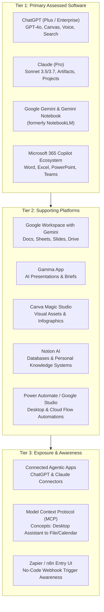

# AI Productivity Professional — Authoritative Academic Specification

**Program Title:** AI Productivity Professional  
**Course Identifier:** `ai-productivity`  
**Academy:** AI Academy (`ai`)  
**Credential Awarded:** Professional Certificate in Workplace AI Productivity & Connected Workflows  
**Governing Standard:** ISO 9001:2015 Verified Curriculum Standard | Nova Skills Academic Board  
**Duration:** 3 Months (12 Calendar Weeks)  
**Total Guided Instructional Hours:** 120 Hours (10 Hours / Week)  
**Recommended Independent Practice:** 40–60 Hours  
**Commercial Tuition:** INR 19,900 (Exclusive of 18% GST; INR 23,482 Total; No-Cost EMI: INR 2,609 / Month for 9 Months or INR 7,827 / Month for 3 Months)  
**Target Level:** Beginner to Advanced Workplace Practitioner (Zero Coding Assumed; Complete Office & Knowledge Worker Context)  
**Authoritative Document Version:** 2.0.0 (October 2026 Production Standard)  

---

## 1. Executive Summary & Program Positioning

### 1.1 Program Purpose & Workplace Context
Between 2023 and 2026, the nature of desk-based professional work underwent a fundamental restructuring. Generative AI transitioned from a novelty chatbot used for ad-hoc queries into an operating system for daily knowledge work. In 2026, proficiency with modern productivity AI tools is no longer an optional resume enhancement—it is the baseline qualification across administrative, operations, sales, finance, human resources, project management, and executive support functions.

However, a critical skills gap has emerged:
1. **The "Prompt-and-Pray" Trap:** Most office workers use conversational models casually without structured prompting frameworks, resulting in generic outputs, unverified factual errors, and time lost in manual rewriting.
2. **Tool Fragmentation:** Knowledge workers bounce haphazardly between disconnected apps without establishing coherent workflows that link research, synthesis, presentation design, data analysis, and email execution.
3. **Data Security & Privacy Naivety:** Employees paste sensitive corporate data, confidential PII, and financial records into publicly trained model interfaces without understanding enterprise privacy boundaries or data retention toggles.
4. **Lack of Integrated Automation:** Workers fail to harness connected AI capabilities—such as Gemini Notebook (formerly NotebookLM), Claude Projects, Microsoft 365 Copilot agents, and no-code connectors—to eliminate recurring clerical overhead.

**AI Productivity Professional** is Nova Skills' focused, intensive 3-month (120 guided hours) vocational program designed to transform knowledge workers, team leads, office administrators, and professionals into high-efficiency AI power users. Students learn to orchestrate frontier language models, enterprise workplace suites (Microsoft 365 Copilot and Google Workspace with Gemini), grounded research notebooks, visual storytelling platforms, AI-augmented spreadsheets, and no-code connectors to systematically compress 40-hour workweeks into high-impact, verifiable deliverables.

```
       MONTH 1                                MONTH 2                                MONTH 3
┌─────────────────────────────────┐    ┌─────────────────────────────────┐    ┌─────────────────────────────────┐
│ CORE PROMPTING & RESEARCH       │    │ DOCUMENTS, DECKS & DATA         │    │ WORKFLOWS & PORTFOLIO           │
│ • Module 01: Prompt Engineering │    │ • Module 04: Docs & Slide Decks │    │ • Module 06: Meeting Intel & PKM│
│   & Context Architecture (12h)  │    │   (Word, Copilot, Gamma) (18h)  │    │   (Teams, Meet, Notion) (12h)   │
│ • Module 02: Grounded Research  │    │ • Module 05: Excel, Analytics   │    │ • Module 07: Connected Apps     │
│   & Fact-Checking (16h)         │    │   & Business Reporting (18h)    │    │   & Automations (12h)           │
│ • Module 03: Professional Comms │    │                                 │    │ • Module 08: Workplace Capstone │
│   & Executive Writing (16h)     │    │                                 │    │   & Portfolio Defense (16h)     │
└─────────────────────────────────┘    └─────────────────────────────────┘    └─────────────────────────────────┘
                Total Guided Instructional Schedule: Exactly 120 Hours Across 8 Modules
```

---

### 1.2 Non-Goals & Program Differentiation

To prevent scope creep and ensure rigorous, practical mastery for non-technical office professionals, this course enforces strict pedagogical boundaries:

| Course Characteristic | AI Productivity Professional (`ai-productivity`) | AI Solutions Engineering (`ai-mastery`) |
| :--- | :--- | :--- |
| **Primary Learner Profile** | Knowledge workers, executives, analysts, ops leads | Software developers, system engineers, technical architects |
| **Programming / Coding** | **Zero coding.** No Python, SQL, Git, or terminal commands. | Python 3.12+, AsyncIO, PostgreSQL, FastAPI, Docker, Git. |
| **AI Access Layer** | Front-end web interfaces, desktop apps, office suites. | REST APIs, SDKs, JSON Schema tool calling, microservices. |
| **Automation Depth** | Personal no-code automation (Power Automate, Zapier, n8n UI). | Self-hosted n8n workflows, custom webhook nodes, code blocks. |
| **Knowledge Systems** | Gemini Notebook (formerly NotebookLM), Notion AI, Claude Projects. | Custom pgvector embeddings, hybrid BM25 search, LangGraph RAG. |
| **Primary Outcome** | 40–60% reduction in daily administrative/office task duration. | Production cloud-deployed autonomous AI applications and agents. |

---

### 1.3 Target Audience & Career Personas

1. **Executive Assistants & Administrative Officers:** Professionals tasked with scheduling, high-volume inbox triage, multi-stakeholder meeting minutes, confidential briefings, and travel logistics who need to reclaim 15+ hours weekly.
2. **Operations & Project Coordinators:** Managers tracking cross-functional status updates, standard operating procedures (SOPs), resource planning, and compliance documentation.
3. **Business Analysts & Financial Associates:** Knowledge workers spending hours cleaning tabular data, writing nested Excel formulas, building variance reports, and translating raw spreadsheets into executive slide summaries.
4. **Marketing, Communications & HR Generalists:** Practitioners drafting job descriptions, employee policy handbooks, internal newsletters, client memos, and visual pitch decks under tight turnarounds.
5. **Mid-Career Professionals & Department Leads:** Managers seeking to lead AI transformation across their immediate teams by demonstrating ethical, privacy-compliant, measurable efficiency gains.

---

## 2. Comprehensive Tool & Software Architecture

The software architecture is categorized into four distinct pedagogical tiers: **Primary Assessed Software**, **Supporting Platforms**, **Exposure / Emerging Concepts**, and **Zero-Cost / Freemium Fallbacks**.



### 2.1 Software Matrix & Access Requirements

| Tool Name | Role in Curriculum | Primary Applications | Account / License Requirement | Alternative / Zero-Cost Fallback |
| :--- | :--- | :--- | :--- | :--- |
| **ChatGPT** | Tier 1: Primary | Iterative drafting, Canvas editing, data interpreter, web search, custom GPTs | Free account or ChatGPT Plus ($20/mo recommended) | ChatGPT Free tier (GPT-4o mini / limited GPT-4o) + Microsoft Copilot Free |
| **Claude** | Tier 1: Primary | High-precision writing, Claude Artifacts (documents, interactive tables), Claude Projects | Free account or Claude Pro ($20/mo recommended) | Claude Free tier with document uploads |
| **Google Gemini** | Tier 1: Primary | Multimodal document analysis, 1M+ token context window reading, Google ecosystem link | Free Google Account (Gemini standard) | 100% Free with Google Account |
| **Gemini Notebook** *(formerly NotebookLM)* | Tier 1: Primary | Grounded source research, zero-hallucination document synthesis, Audio Overview briefings | Free Google Account | 100% Free with standard Google Account |
| **Microsoft 365 Copilot** *(Word, Excel, PowerPoint)* | Tier 1: Primary Assessed Suite | In-app document drafting, formula synthesis, presentation storyboard generation | M365 Business Standard + Copilot OR M365 Personal/Family with Copilot Pro | Free Office Online + ChatGPT/Claude prompt templates for Excel/PowerPoint |
| **Google Workspace with Gemini** | Tier 2: Supporting (Comparative) | Comparative cloud productivity in Google Docs, Sheets, Slides | Google Workspace with Gemini add-on or Google One AI Premium | Standard Google Workspace / Google Docs + Gemini side panel |
| **Gamma** | Tier 2: Supporting | Automated presentation deck and one-pager generation | Free tier (400 initial credits) | Free tier or PowerPoint Copilot templates |
| **Canva Magic Studio** | Tier 2: Supporting | AI image editing, Magic Design, social and executive visual banners | Canva Free / Canva Pro 30-day trial | Canva Free tier |
| **Notion AI** | Tier 2: Supporting | Team wikis, meeting transcript summaries, database auto-filling, task management | Free Notion workspace + Notion AI trial | Free Notion databases + Claude/ChatGPT summary prompts |
| **Power Automate** *(or Google Workspace Studio)* | Tier 2: Supporting | Desktop file sorting, scheduled email dispatch, automated form-to-sheet logging | Windows 10/11 built-in Power Automate Desktop (Free) | Free Power Automate Desktop or Zapier Free Tier (100 tasks/mo) |
| **Model Context Protocol (MCP)** | Tier 3: Exposure | Conceptual understanding of how desktop LLMs read local files and Outlook/Google Calendar safely | Exposure only (Instructor Demonstration) | Conceptual walk-through & architectural diagrams |

> [!NOTE]
> **Gemini Notebook Naming Standard:** Google officially rebranded *NotebookLM* to *Gemini Notebook* in 2026. To ensure zero student confusion during public searches and enterprise operations, all course literature and UI references specify **Gemini Notebook (formerly NotebookLM)**.

---

## 3. Detailed Fourteen-Week / Eight-Module Curriculum Matrix

```
┌────────────────────────────────────────────────────────────────────────────────────────┐
│                        120-HOUR CURRICULUM MODULE MAP                                  │
├─────────┬──────────────────────────────────────────────────────────────┬───────────────┤
│ Module  │ Title                                                        │ Guided Hours  │
├─────────┼──────────────────────────────────────────────────────────────┼───────────────┤
│ Mod 01  │ AI Fundamentals, Prompting & Context Engineering             │ 12 Hours      │
│ Mod 02  │ AI Research, Fact-Checking & Knowledge Management            │ 16 Hours      │
│ Mod 03  │ Professional Communication & Content Workflows               │ 16 Hours      │
│ Mod 04  │ AI Documents, Presentations & Visual Communication           │ 18 Hours      │
│ Mod 05  │ Excel, Data Analysis & Business Reporting with AI            │ 18 Hours      │
│ Mod 06  │ Meetings, Collaboration & Personal Knowledge Systems         │ 12 Hours      │
│ Mod 07  │ AI Workflow Automation & Connected Apps                      │ 12 Hours      │
│ Mod 08  │ Workplace Productivity Portfolio & Assessment                │ 16 Hours      │
├─────────┴──────────────────────────────────────────────────────────────┼───────────────┤
│ TOTAL GUIDED INSTRUCTIONAL HOURS                                       │ 120 Hours     │
└────────────────────────────────────────────────────────────────────────┴───────────────┘
```

---

### Module 01: AI Fundamentals, Prompting & Context Engineering
* **Duration:** 12 Guided Hours (Weeks 1–2)  
* **Recommended Independent Practice:** 6 Hours  
* **Pedagogical Goal:** Demystify generative models and establish structured prompting frameworks that yield predictable, professional results on the first attempt without conversational rambling.

#### Main Topics & Subtopics
1. **The Modern Workplace AI Landscape (2026 Standards):**
   * Evolution from autocomplete to reasoning models: GPT-4o, Claude 3.5/3.7, Gemini 2.0.
   * Model strengths, token boundaries, hallucination mechanics, and temperature settings.
   * Commercial AI security: Data privacy, training opt-outs, enterprise data retention policies, and PII anonymization.
2. **The PREP & CREATE Prompting Frameworks:**
   * Persona, Role, Context, Task, Constraints, and Output Format.
   * Few-shot prompting: Providing explicit exemplary input-output pairs.
   * Chain-of-Thought prompting: Forcing step-by-step reasoning for complex business logic.
   * Negative prompting: Banning filler phrases, cliches, and ungrounded assumptions.
3. **Context Engineering & System Instructions:**
   * Writing persistent Custom Instructions in ChatGPT and Claude.
   * Creating and managing **Claude Projects** with project-level knowledge libraries.
   * Building personal **Custom GPTs** with tailored action instructions and uploaded style guides.
   * Utilizing **ChatGPT Canvas** and **Claude Artifacts** for real-time document co-authoring.

#### Software & Tools
* ChatGPT, Claude, Google Gemini.

#### Learning Outcomes
* Craft structured, constraint-bounded business prompts with zero conversational filler.
* Configure custom instructions and project knowledge repositories to maintain consistent tone.
* Apply enterprise privacy controls to safeguard sensitive business intelligence.

#### Classroom Practicals & Hands-On Labs
* **Lab 1.1:** The Prompt Refactoring Clinic: Take 10 vague workplace prompts ("write an email", "summarize this") and rewrite them using the PREP framework with strict output schemas.
* **Lab 1.2:** Building an Executive Assistant Custom GPT: Configure a private custom GPT loaded with company brand guidelines, formatting constraints, and preferred response archetypes.
* **Lab 1.3:** Claude Project Setup: Build a persistent Claude Project loaded with industry-specific reference documents and test its recall across multi-step inquiries.

#### Assessment Evidence
* Submitted Personal Prompt Library (15+ reusable, parameterized prompt templates) and a verified Custom GPT or Claude Project link with evaluation test cases.

#### Fallback Exercises (Free Tier)
* Use ChatGPT Free tier or Microsoft Copilot Free using inline context headers instead of paid Claude Projects.

---

### Module 02: AI Research, Fact-Checking & Knowledge Management
* **Duration:** 16 Guided Hours (Weeks 2–4)  
* **Recommended Independent Practice:** 8 Hours  
* **Pedagogical Goal:** Transform unstructured web documents, 100-page corporate PDFs, and competitive intelligence into verified, source-grounded executive summaries with zero hallucinations.

#### Main Topics & Subtopics
1. **Grounded Synthesis with Gemini Notebook (formerly NotebookLM):**
   * Uploading multi-source documents: PDFs, Google Docs, URLs, YouTube transcripts, and notes.
   * Source-grounded Q&A: Querying source files with strict attribution citations.
   * Generating study guides, briefing documents, FAQs, and Audio Overviews (deep-dive conversational podcast briefings).
   * Verifying citation anchors: Tracing AI assertions directly back to original page coordinates.
2. **Frontier AI Search & Competitive Intelligence:**
   * Real-time search tools: ChatGPT Search, Perplexity AI, Google Gemini with web grounding.
   * Boolean operators, source domain filters, date-bounded querying, and academic paper retrieval.
   * Competitive benchmarking: Analyzing competitor product lines, pricing matrices, and press releases.
3. **Fact-Checking, Hallucination Auditing & Source Verification:**
   * Identifying subtle hallucinations: Plausible statistics, fake citations, and misattributed quotes.
   * The Reverse-Verification Protocol: Cross-examining model outputs using independent primary sources.
   * Synthesizing contradictory reports into balanced, multi-perspective executive briefs.

#### Software & Tools
* Gemini Notebook (formerly NotebookLM), ChatGPT Search, Perplexity AI, Claude.

#### Learning Outcomes
* Synthesize large document libraries (up to 50 sources) into grounded briefs with explicit citations.
* Generate and evaluate automated Audio Overview briefings for rapid executive stakeholder review.
* Execute thorough fact-checking workflows that identify and correct statistical and factual discrepancies.

#### Classroom Practicals & Hands-On Labs
* **Lab 2.1:** Industry Sector Grounded Audit in Gemini Notebook: Ingest 5 annual financial reports (PDFs) into Gemini Notebook; extract comparable operational metrics with clickable source anchors.
* **Lab 2.2:** Fact-Checking Red-Team Exercise: Identify and annotate 5 deliberate statistical and factual errors seeded inside an AI-generated market intelligence brief.
* **Lab 2.3:** Executive Audio Briefing Production: Generate and critically review a 5-minute Audio Overview briefing in Gemini Notebook from a 40-page regulatory compliance update.

#### Assessment Evidence
* **Assessed Workplace Deliverable 1:** Complete Executive Intelligence Dossier (10-page synthesized report with 100% verified citation anchors, competitor matrix, and accompanying audio briefing summary).

#### Fallback Exercises (Free Tier)
* Gemini Notebook is completely free with any standard Google account; Perplexity Free and ChatGPT Search Free tier utilized.

---

### Module 03: Professional Communication & Content Workflows
* **Duration:** 16 Guided Hours (Weeks 4–5)  
* **Recommended Independent Practice:** 8 Hours  
* **Pedagogical Goal:** Master high-volume, nuanced written communication—from high-stakes crisis communications and delicate executive emails to omnichannel customer newsletters and policy memos.

#### Main Topics & Subtopics
1. **High-Stakes Workplace Email & Tone Calibration:**
   * Nuanced tone shifting: De-escalation, executive assertiveness, diplomacy, urgency, and empathy.
   * The 3-Draft Email Strategy: Drafting for clarity, refining for brevity, and polishing for executive impact.
   * Handling difficult conversations: Constructive feedback, contract renegotiations, and deadline extensions.
2. **Executive Memos, Proposals & Standard Operating Procedures (SOPs):**
   * Structuring business proposals using the Minto Pyramid Principle and Executive Summary architecture.
   * Drafting step-by-step Standard Operating Procedures (SOPs) with clear role matrices and decision trees.
   * Transforming fragmented meeting transcripts into polished, accountable decision logs.
3. **Multichannel Content Repurposing & Editorial Pipelines:**
   * One-to-Many content cascade: Turning a 2,000-word corporate whitepaper into an internal memo, a LinkedIn thought-leadership post, a newsletter snippet, and an FAQ sheet.
   * Maintaining brand voice, editorial guidelines, and corporate vocabulary across diverse deliverables.
   * AI-assisted proofreading, readability scoring (Flesch-Kincaid), and eliminating bureaucratic jargon.

#### Software & Tools
* Claude (Artifacts), ChatGPT (Canvas), Microsoft Word with Copilot, Google Docs with Gemini.

#### Learning Outcomes
* Draft multi-stakeholder emails that de-escalate conflicts and establish clear accountability.
* Formulate clear, structured executive memos and SOPs aligned with corporate governance standards.
* Cascade core business announcements across five distinct communications channels without losing fidelity.

#### Classroom Practicals & Hands-On Labs
* **Lab 3.1:** High-Stakes Negotiation Drafting: Draft a 3-part email sequence resolving a critical vendor billing dispute while preserving the long-term supplier relationship.
* **Lab 3.2:** The 1-to-5 Content Cascade: Ingest an approved corporate sustainability report and generate: 1 internal staff memo, 1 CEO LinkedIn article, 1 customer newsletter, 1 press statement, and 1 slide outline.
* **Lab 3.3:** SOP Generation in Claude Artifacts: Transform messy voice notes describing a complex client onboarding process into an ISO-compliant Standard Operating Procedure.

#### Assessment Evidence
* Submitted Professional Communications Kit containing 1 high-stakes executive email sequence, 1 detailed SOP document, and a 4-channel repurposed communications campaign.

#### Fallback Exercises (Free Tier)
* Use Claude Free with Artifacts or ChatGPT Canvas Free tier.

---

### Module 04: AI Documents, Presentations & Visual Communication
* **Duration:** 18 Guided Hours (Weeks 5–7)  
* **Recommended Independent Practice:** 10 Hours  
* **Pedagogical Goal:** Bridge textual intelligence with compelling visual storytelling, producing publication-grade corporate reports, AI-generated slide decks, and branded visual collateral in minutes.

#### Main Topics & Subtopics
1. **AI-Powered Presentation Decks with Gamma & PowerPoint Copilot:**
   * Prompting for presentations: Specifying slide counts, audience persona, visual theme, and key takeaways.
   * Storyboard generation: Outlining slide narrative flow before generating visual layouts.
   * Generating slide decks in **Gamma**: Interactive web presentations, document cards, and export to PDF/PPTX.
   * **Microsoft 365 Copilot in PowerPoint**: Creating slides from Word documents, reformatting layouts, and adding speaker notes.
2. **Document Formatting & Publishing in Microsoft Word & Google Docs:**
   * Copilot in Microsoft Word: Real-time drafting, document summarization, table formatting, and styling.
   * Google Docs with Gemini: Side-panel prompts, expanding bullet points into narrative prose, and formatting.
   * Converting unstructured markdown outputs into styled corporate templates with cover pages and TOCs.
3. **Visual Collateral & Diagramming with Canva Magic Studio:**
   * Canva Magic Studio: Magic Design for presentations, Magic Media (image generation for business contexts), and Magic Switch (resizing for multiple formats).
   * Creating data infographics, process flowcharts, social graphics, and executive report cover art.
   * Maintaining brand color palettes, typography rules, and corporate visual identity.

#### Software & Tools
* Gamma, Microsoft PowerPoint (Copilot), Microsoft Word (Copilot), Google Docs (Gemini), Canva Magic Studio.

#### Learning Outcomes
* Convert raw text briefs into 12-slide structured presentations in Gamma and PowerPoint within 15 minutes.
* Format long-form executive reports in Word/Docs with professional styling, tables, and callouts.
* Generate branded visual diagrams and infographic collateral using Canva Magic Studio.

#### Classroom Practicals & Hands-On Labs
* **Lab 4.1:** The 15-Minute Pitch Deck Sprint: Ingest an executive summary into Gamma; generate an 8-slide investment pitch deck; edit copy, adjust layout, and export to PowerPoint.
* **Lab 4.2:** Word Document Polish with Copilot: Take a messy 5-page draft and use Copilot to generate a 1-page executive summary, convert data lists into formatted tables, and apply corporate styling.
* **Lab 4.3:** Visual Process Flow in Canva: Design an infographic workflow diagram illustrating a multi-step customer journey using Canva Magic Design tools.

#### Assessment Evidence
* **Assessed Workplace Deliverable 2:** Complete Multimodal Business Proposal Package (Formatted 8-page Word/Docs proposal, professional 10-slide Gamma/PowerPoint pitch deck, and branded Canva visual summary infographic).

#### Fallback Exercises (Free Tier)
* Gamma Free tier (400 credits provided on signup); Canva Free tier; standard PowerPoint / Google Slides using ChatGPT-generated structured VBA / markdown outlines.

---

### Module 05: Excel, Data Analysis & Business Reporting with AI
* **Duration:** 18 Guided Hours (Weeks 7–9)  
* **Recommended Independent Practice:** 10 Hours  
* **Pedagogical Goal:** Remove the technical barrier to sophisticated data analysis by using conversational AI to generate complex Excel formulas, clean messy datasets, perform pivot analysis, and extract actionable business insights.

#### Main Topics & Subtopics
1. **AI-Assisted Formula Generation & Spreadsheet Logic:**
   * Generating advanced Excel formulas with ChatGPT and Copilot: `XLOOKUP`, `INDEX/MATCH`, nested `IF/IFS`, `SUMIFS`, and dynamic arrays (`FILTER`, `UNIQUE`, `SORT`).
   * Debugging spreadsheet calculation errors: Resolving `#N/A`, `#VALUE!`, circular references, and formula mismatches.
   * Translating business questions into spreadsheet calculations (e.g., "calculate 90-day rolling customer churn rate").
2. **Data Cleaning & Transformation:**
   * Automated text extraction, split columns, date standardization, and eliminating duplicate records.
   * Writing Excel Power Query M-code and simple VBA scripts using ChatGPT prompts.
   * Google Sheets with Gemini: Formula suggestions, table building, and smart data categorization.
3. **Advanced Data Analysis with ChatGPT Advanced Data Analysis / Copilot:**
   * Uploading CSV/XLSX files directly into ChatGPT for automated statistical analysis and anomaly detection.
   * Generating interactive charts: Trend lines, Pareto charts, cohort retention curves, and waterfall charts.
   * **Microsoft 365 Copilot in Excel**: Analyzing tables, highlighting trends, adding calculated columns, and creating pivot tables via conversational queries.
   * Translating tabular findings into an Executive Variance Memo for C-suite decision-makers.

#### Software & Tools
* Microsoft Excel (Desktop/Online), Microsoft 365 Copilot in Excel, ChatGPT Advanced Data Analysis (Code Interpreter), Google Sheets.

#### Learning Outcomes
* Generate, audit, and debug multi-condition Excel formulas via plain-language prompting.
* Clean and standardize corrupted business datasets in under 10 minutes using AI assistance.
* Conduct exploratory data analysis on raw sales/operational spreadsheets and author a verified executive variance report.

#### Classroom Practicals & Hands-On Labs
* **Lab 5.1:** Advanced Formula Challenge: Use conversational prompts to construct a multi-criteria dynamic sales commission calculator in Excel with tiered bonus thresholds.
* **Lab 5.2:** Corrupted Data Cleaning Clinic: Take an unstructured, 2,000-row customer database with missing formats, mixed dates, and inconsistent capitalization; clean and normalize the data completely.
* **Lab 5.3:** End-to-End Sales Variance Analysis: Upload a 12-month departmental expenditure spreadsheet to ChatGPT/Copilot; identify top 3 cost overruns, generate visualization charts, and write a 1-page financial narrative.

#### Assessment Evidence
* **Assessed Workplace Deliverable 3:** Complete AI-Driven Business Analytics Dossier (Audited Excel workbook with dynamic formulas and pivot charts, accompanied by a 2-page executive financial variance memo).

#### Fallback Exercises (Free Tier)
* Free Excel Online, Google Sheets with free GPT add-ons, and free ChatGPT Advanced Data Analysis file uploads (limited daily quota).

---

### Module 06: Meetings, Collaboration & Personal Knowledge Systems
* **Duration:** 12 Guided Hours (Weeks 9–10)  
* **Recommended Independent Practice:** 6 Hours  
* **Pedagogical Goal:** Eliminate the friction of unstructured workplace collaboration by automating meeting documentation, action-item delegation, and personal knowledge management.

#### Main Topics & Subtopics
1. **AI Meeting Intelligence & Transcription Systems:**
   * Microsoft Teams Intelligent Recap & Google Meet with Gemini: Real-time captioning, speaker attribution, and automated minutes.
   * Third-party meeting recorders (Otter.ai, Fireflies.ai, Fathom) overview and enterprise compliance considerations.
   * The Action-Item Extraction Formula: Converting messy 60-minute verbal transcripts into clear `[Owner] - [Action Item] - [Deadline] - [Dependency]` matrices.
2. **Personal Knowledge Management (PKM) with Notion AI:**
   * Designing an AI-augmented workspace: Projects, Tasks, Notes, and Resources (P.A.R.A. method).
   * Notion AI features: Q&A across private workspaces, auto-populating database properties, and writing summaries.
   * Building an automated company wiki and personal productivity dashboard.
3. **Daily Routine Design & Workplace Time Blocking:**
   * Structuring the AI-Augmented Workday: The 80/20 rule of automated clerical tasks vs deep work.
   * Daily morning briefing generation: Synthesizing overnight emails, calendar events, and task backlogs into a priority agenda.
   * End-of-day retrospectives and automated handoff notes for remote team members.

#### Software & Tools
* Microsoft Teams (Intelligent Recap), Google Meet, Notion AI, Claude, ChatGPT.

#### Learning Outcomes
* Transform unstructured raw meeting audio/text transcripts into actionable, assigned task matrices.
* Build a structured personal knowledge repository in Notion AI with cross-database search capabilities.
* Architect a daily routine that shaves 2+ hours off routine administrative and coordination tasks.

#### Classroom Practicals & Hands-On Labs
* **Lab 6.1:** Raw Transcript to Action Matrix: Ingest a noisy 45-minute multi-stakeholder strategy meeting transcript; generate an executive summary, key decisions log, and an accountable RACI matrix.
* **Lab 6.2:** Building a Team Knowledge Wiki in Notion AI: Construct a 4-page departmental wiki (onboarding, SOPs, FAQs, vendor contacts) and utilize Notion AI Q&A to query internal policies.
* **Lab 6.3:** Morning Briefing System: Build a reusable prompt template that digests daily calendar schedules, pending email items, and to-do lists into a 5-minute prioritized daily action plan.

#### Assessment Evidence
* Submitted Operational Knowledge System (Live Notion workspace link with meeting notes database, automated action item templates, and personal daily executive planning dashboard).

#### Fallback Exercises (Free Tier)
* Standard free Notion workspace with Claude/ChatGPT prompts for meeting transcription summaries (using free transcript exports from Google Meet/Teams).

---

### Module 07: AI Workflow Automation & Connected Apps
* **Duration:** 12 Guided Hours (Weeks 10–11)  
* **Recommended Independent Practice:** 6 Hours  
* **Pedagogical Goal:** Move beyond manual copy-pasting by connecting AI models directly to cloud drives, email inboxes, calendar systems, and lightweight desktop automation flows.

#### Main Topics & Subtopics
1. **ChatGPT & Claude Connected Applications:**
   * Understanding connected tools and extensions: Google Drive, Microsoft OneDrive, Slack, and web integrations.
   * Querying cloud document storage directly from conversational interfaces.
   * Setting up safe permissions, API access keys, and understanding tool execution boundaries.
2. **No-Code Automations with Power Automate & Zapier:**
   * Introduction to event-driven business workflows: Triggers, Actions, and Filters.
   * Building personal email triage flows: Flagging urgent client emails, auto-generating draft responses, and routing alerts to Teams/Slack.
   * Automated file organization: Saving email attachments into date-stamped OneDrive/Google Drive folders with AI-generated filenames.
   * Introduction to n8n / Zapier: Concept of multi-step connectors and webhook triggers (non-programmer UI level).
3. **Emerging 2026 Concepts: AI Agents & Model Context Protocol (MCP) Awareness:**
   * The shift from passive chatbots to active agents: Tool use, web browsing, and multi-step reasoning.
   * What is the Model Context Protocol (MCP)? Conceptual explanation of how desktop LLMs can safely read local calendars, contacts, and spreadsheets without uploading files to public clouds.
   * Ethical boundaries, governance, and safeguarding against unintended autonomous actions.

#### Software & Tools
* Microsoft Power Automate Desktop, Zapier (Free tier), ChatGPT Connected Apps, Claude, Google Drive / OneDrive.

#### Learning Outcomes
* Configure connected apps in ChatGPT/Claude to query personal cloud storage directly.
* Build functional desktop and cloud automations that triage incoming emails and organize attachments automatically.
* Explain modern agentic concepts and the Model Context Protocol (MCP) in clear business terms.

#### Classroom Practicals & Hands-On Labs
* **Lab 7.1:** Cloud Drive Document Querying: Connect Google Drive/OneDrive to ChatGPT/Claude; prompt the model to extract and compare pricing from three contracts stored in separate folders.
* **Lab 7.2:** Automated Email Triage Flow: Build a Power Automate or Zapier flow that monitors incoming emails for keywords ("Urgent", "Proposal", "Invoice"), drafts an AI acknowledgement, and logs the task.
* **Lab 7.3:** MCP & Agent Governance Case Study: Review an enterprise deployment scenario; draft a 1-page governance checklist identifying permission risks before enabling autonomous email dispatch.

#### Assessment Evidence
* **Assessed Workplace Deliverable 4:** Deployed Personal Workflow Automation System (Recorded screencast and documentation of a working 3-step automation connecting email/calendar, cloud storage, and AI processing).

#### Fallback Exercises (Free Tier)
* Built-in Windows Power Automate Desktop (free on Windows 10/11) or Zapier Free tier (100 free tasks/month).

---

### Module 08: Workplace Productivity Portfolio & Assessment
* **Duration:** 16 Guided Hours (Weeks 11–12)  
* **Recommended Independent Practice:** 12 Hours  
* **Pedagogical Goal:** Synthesize all course competencies into a comprehensive, enterprise-grade capstone project and defend a workplace productivity portfolio before an academic and industry assessment panel.

#### Main Topics & Subtopics
1. **Portfolio Synthesis & Professional Presentation:**
   * Curating the Four Core Deliverables into a unified professional digital showcase.
   * Documenting before-and-after efficiency metrics: Time saved, error reduction, and speed-to-delivery ROI.
   * Crafting the Executive Defense Presentation: Pitching AI workflow overhauls to senior leadership.
2. **Enterprise AI Ethics, Compliance & Governance:**
   * Corporate acceptable use policies: Copyright considerations, data confidentiality, and disclosure standards.
   * Spotting algorithmic bias and ensuring human oversight in all automated business pipelines.
   * Navigating enterprise change management: Helping resistant colleagues adopt AI workflows safely.
3. **Comprehensive Capstone Project Execution & Defense:**
   * Executing the 360° AI-Augmented Department Operations System.
   * Peer review, faculty inspection, and live technical defense.

#### Software & Tools
* Full Course Tool Ecosystem: ChatGPT, Claude, Gemini Notebook, M365 Copilot / Google Workspace, Gamma, Canva, Excel, Notion AI.

#### Learning Outcomes
* Deliver an integrated, end-to-end departmental AI productivity overhaul demonstrating 40%+ efficiency gains.
* Present a polished, professional portfolio demonstrating mastery across research, writing, design, data, and automation.
* Articulate enterprise AI governance, privacy compliance, and human-in-the-loop validation principles.

#### Classroom Practicals & Hands-On Labs
* **Lab 8.1:** Portfolio Compilation: Assemble Deliverables 1–4, SOPs, and prompt libraries into an interactive digital showcase using Notion or Gamma.
* **Lab 8.2:** Change Management & Governance Roleplay: Defend an enterprise AI adoption proposal against common objections (data security, job replacement fears, accuracy concerns).
* **Lab 8.3:** Capstone Dress Rehearsal: Deliver a 7-minute presentation of the Capstone project with live tool demonstrations and peer critique.

#### Assessment Evidence
* **Final Integrated Capstone Project:** The 360° AI-Augmented Department Operations Overhaul (comprehensive project submission + live 10-minute presentation and defense).

---

## 4. Assessment Architecture & Required Portfolio Deliverables

Graduation requires successful completion and verification of **Four Assessed Workplace Deliverables** and **One Integrated Final Capstone Project**, evaluated against an objective, five-category scoring rubric:

```
┌────────────────────────────────────────────────────────────────────────────────────────┐
│                        ASSESSMENT & DELIVERABLE ROADMAP                                │
├──────────────┬─────────────────────────────────────────────────────────┬───────────────┤
│ Assessment   │ Project Title & Scope                                   │ Weighting     │
├──────────────┼─────────────────────────────────────────────────────────┼───────────────┤
│ Build 01     │ Executive Intelligence Dossier (Gemini Notebook)        │ 15%           │
│ Build 02     │ Multimodal Business Proposal Package (Word, Gamma, Canva│ 15%           │
│ Build 03     │ AI-Driven Business Analytics Dossier (Excel & Memo)     │ 20%           │
│ Build 04     │ Personal Workflow Automation System (Power Automate)    │ 15%           │
│ Capstone     │ 360° AI-Augmented Department Operations Overhaul        │ 25%           │
│ Practical    │ Continuous Lab Execution & Prompt Engineering Portfolio │ 10%           │
├──────────────┴─────────────────────────────────────────────────────────┴───────────────┤
│ TOTAL ASSESSMENT WEIGHT                                                │ 100%          │
└────────────────────────────────────────────────────────────────────────┴───────────────┘
```

### 4.1 Detailed Specifications of Assessed Projects

#### Project 01: Executive Intelligence & Research Dossier (Module 02)
* **Objective:** Produce a publication-grade competitive or market intelligence dossier from raw, uncurated corporate filings.
* **Deliverables:**
  1. A 10-page synthesized intelligence report generated in Gemini Notebook (formerly NotebookLM) and Claude.
  2. 100% verified source citation anchors linking every factual assertion to underlying source coordinates.
  3. A 5-minute Audio Overview briefing generated in Gemini Notebook, evaluated for accuracy and nuance.
* **Verification Criteria:** Zero unverified assertions, clean executive summary, balanced competitive breakdown.

#### Project 02: Multimodal Business Proposal Package (Module 04)
* **Objective:** Create a unified, multi-asset client business proposal spanning text, slides, and infographics.
* **Deliverables:**
  1. Formatted 8-page client proposal document in Microsoft Word or Google Docs with executive styling and tables.
  2. 10-slide interactive pitch deck produced in Gamma or PowerPoint Copilot with consistent visual themes.
  3. Branded summary visual infographic created in Canva Magic Studio summarizing the proposed solution.
* **Verification Criteria:** Narrative coherence across all three formats, professional visual hierarchy, zero generic filler text.

#### Project 03: AI-Driven Business Analytics & Executive Dashboard (Module 05)
* **Objective:** Transform a complex, noisy business dataset into an audited, formula-rich spreadsheet and C-suite briefing.
* **Deliverables:**
  1. Audited Excel workbook containing dynamic formulas (`XLOOKUP`, `SUMIFS`, dynamic arrays) and pivot analysis.
  2. Data visualization charts created with AI assistance highlighting performance outliers and seasonal trends.
  3. A 2-page Executive Financial Variance Memo translating numbers into strategic recommendations.
* **Verification Criteria:** Mathematical accuracy, formula integrity, clear executive narrative without technical jargon.

#### Project 04: Connected Personal Workflow Automation (Module 07)
* **Objective:** Build and deploy a multi-step automation eliminating a routine administrative bottleneck.
* **Deliverables:**
  1. Working Power Automate Desktop flow or Zapier/n8n integration connecting email/calendar, cloud storage, and AI processing.
  2. Video screencast demonstrating end-to-end execution from trigger event to final output.
  3. System architecture diagram and 1-page SOP explaining how to maintain the automation.
* **Verification Criteria:** Reliable execution without error, appropriate exception handling, data privacy safeguards.

#### Capstone Project: 360° AI-Augmented Department Operations Overhaul (Module 08)
* **Objective:** Conduct a comprehensive operational overhaul of a designated business department (e.g., Human Resources, Customer Operations, Sales Enablement, or Procurement).
* **Deliverables:**
  1. **Department Workflow Diagnostic:** Identification of 5 manual bottlenecks with baseline time measurements.
  2. **AI-Powered SOP Manual:** 5 complete SOPs incorporating specific prompt templates and AI tool checkpoints.
  3. **Operational Knowledge Wiki:** Live Notion or cloud workspace containing reference templates and document repositories.
  4. **Automated Triage / Routing Flow:** Deployed automation handling incoming departmental requests.
  5. **Executive Defense Slide Deck & ROI Presentation:** Live 10-minute presentation demonstrating a measured 40–60% reduction in processing time while adhering to enterprise compliance standards.

---

### 4.2 Five-Category Assessment Rubric

| Assessment Dimension | Unsatisfactory (0–59%) | Competent (60–79%) | Advanced Mastery (80–100%) |
| :--- | :--- | :--- | :--- |
| **1. Prompt Precision & Framework Rigor** | Uses vague, unstructured prompts; conversational rambling; accepts first output blindly. | Employs PREP/CREATE frameworks; specifies roles and constraints; iterates 2–3 times. | Highly disciplined prompt engineering; parameterized templates; exact output schemas; zero filler. |
| **2. Factual Verification & Accuracy** | Contains hallucinations, unverified statistics, or fabricated source links. | Cross-checks major statistics; minor factual discrepancies caught upon review. | 100% verified source citation anchors; rigorous reverse-verification protocol applied; zero hallucinations. |
| **3. Analytical Depth & Business Context** | Surface-level summaries; repeats prompt inputs; lacks strategic business relevance. | Provides actionable insights; structures arguments logically; useful workplace context. | Executive-level synthesis; identifies subtle nuances, financial variance drivers, and strategic risks. |
| **4. Multimodal Presentation & Polish** | Poor visual layout; inconsistent formatting; generic stock visuals; typographical errors. | Clean formatting; coherent slide structure; appropriate charts and Canva visuals. | Publication-grade polish; seamless narrative alignment across Word, Gamma, and Canva assets. |
| **5. Workflow Reliability & Compliance** | Broken automations; ignores data privacy rules; exposes PII to publicly trained models. | Functional automation; basic privacy opt-outs enabled; handles standard edge cases. | Flawless end-to-end automated flows; strict data anonymization; robust enterprise governance SOPs. |

---

## 5. Gap Analysis: Legacy Course vs. October 2026 Specification

| Dimension | Legacy Placeholder (`ai-productivity`) | Modern 2026 Specification (`ai-productivity`) | Pedagogical Impact |
| :--- | :--- | :--- | :--- |
| **Duration & Hours** | 3 Months / Unstructured 120h | 3 Months / Exactly 120 Guided Instructional Hours (10h/week × 12 weeks) | Establishes a predictable, accredited academic calendar. |
| **Module Structure** | 4 generic modules (4 lessons each, 16 lessons total) | 8 comprehensive modules with structured lessons, labs, and evidence | Eliminates superficial overviews; provides deep vocational competence. |
| **Pricing & Value** | INR 13,999 (with fake INR 39,999 / 65% discount) | INR 19,900 (Transparent fee; 18% GST itemized; No-Cost EMI) | Complies with modern advertising standards; reflects professional rigor. |
| **Software Stack** | Generic repeat of "ChatGPT, Claude, Gemini" | ChatGPT Plus, Claude Projects, Gemini Notebook (formerly NotebookLM), M365 Copilot, Gamma, Canva, Excel, Notion AI | Equips students with current, enterprise-standard commercial tools. |
| **Grounded Research** | Not taught (generic summarizing only) | Full Module 02 dedicated to Gemini Notebook (formerly NotebookLM), citation verification, and Audio Overviews | Solves the #1 enterprise barrier to generative AI adoption: hallucinations. |
| **Data & Spreadsheets** | Completely missing | Full Module 05 dedicated to Excel, advanced formulas (`XLOOKUP`, arrays), data cleaning, and variance memos | Addresses the single highest-value daily task in business operations. |
| **Visual Communication** | Brief mention of Canva and Gamma | In-depth Module 04: Word Copilot styling, Gamma deck generation, and Canva Magic Studio collateral | Enables students to produce C-suite ready presentations in minutes. |
| **Workflows & Agents** | Basic browser extensions | Connected apps, Power Automate desktop flows, Zapier/n8n awareness, and MCP concepts | Transitions workers from prompt-typing to automated systems. |
| **Assessment** | No formal rubric; undefined projects | 4 Assessed Workplace Deliverables + 1 Integrated Capstone evaluated via 5-dimension rubric | Yields a tangible, verifiable digital portfolio for career advancement. |

---

## 6. Implementation Dependencies & System Synchronizations

Following stakeholder approval of this academic specification, the subsequent transformation phases must execute targeted synchronizations across the Nova Skills codebase:

1. **Central Course Inventory ([`data.js`](file:///c:/Users/wasee/Desktop/NovaSkillsProject/NovaSkills%20Website/data.js)):**
   * Update `price` to `19900`.
   * Purge `originalPrice: 39999` and fake discount badges.
   * Update `shortDesc` and `fullDesc` to eliminate "10x output" hyperbole and emphasize enterprise workplace workflows.
   * Update `tools` array: `["ChatGPT", "Claude", "Google Gemini", "Gemini Notebook", "Microsoft 365 Copilot", "Microsoft Excel", "Gamma", "Canva", "Notion AI", "Power Automate"]`.
   * Expand `curriculum` array from 4 to 8 modules matching the 120-hour specification.
2. **Authoritative Course Record ([`data/courses/ai-productivity.json`](file:///c:/Users/wasee/Desktop/NovaSkillsProject/NovaSkills%20Website/data/courses/ai-productivity.json)):**
   * Populate `price: 19900`, `duration: "3 Months"`, `learning_hours: 120`.
   * Replace the 4 legacy module stubs with 8 detailed modules containing granular lessons, subtopics, practical labs, and assessment evidence.
   * Synchronize `career_paths`, `target_audience`, `prerequisites`, and 24 comprehensive, realistic FAQs.
   * Document the 4 core portfolio deliverables and the final department operations capstone.
3. **Consolidated Master Catalog ([`nova-skills-109-course-content.json`](file:///c:/Users/wasee/Desktop/NovaSkillsProject/NovaSkills%20Website/nova-skills-109-course-content.json)):**
   * Synchronize record `course_id: "ai-productivity"` with updated curriculum, tools, and pricing while preserving all other 108 course records byte-for-byte.
4. **Client Bundles & Web Assets ([`js/data.min.js`](file:///c:/Users/wasee/Desktop/NovaSkillsProject/NovaSkills%20Website/js/data.min.js)):**
   * Recompile minified client dataset using authoritative build scripts.
   * Verify dynamic course schema injection on [`course-detail.html?id=ai-productivity`](file:///c:/Users/wasee/Desktop/NovaSkillsProject/NovaSkills%20Website/course-detail.html).
5. **Preservation Guarantees:**
   * Zero mutations to `ai-mastery` (9 Months, 360 Hours, INR 89,900) or Digital Marketing records.
   * Total active course count remains strictly `109` across `12` academies.
