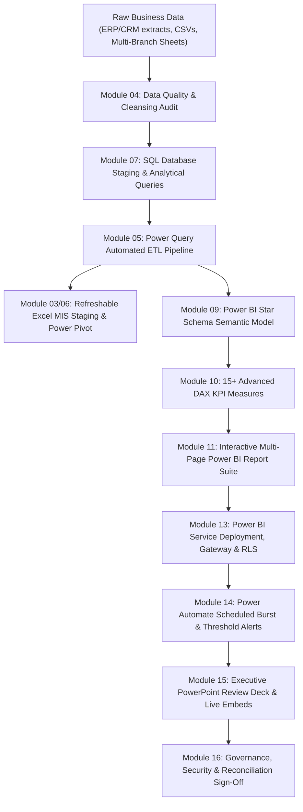

# Academic Specification & Forensic Audit Blueprint
# MIS & Business Intelligence Professional (Course 29)

**Document Identifier:** `NOVA-MISBI-SPEC-2027-V1`  
**Academic Sequence:** Course 29 (Catalog Sequence Number 29; NOT the website slug)  
**Existing Canonical Identifier:** `biz-productivity`  
**Course Slug:** `business-productivity-mastery` (Canonical Route: `/course-detail.html?id=biz-productivity`)  
**New Program Title:** MIS & Business Intelligence Professional  
**Old Program Title:** Business Productivity Mastery  
**Academic Positioning:** Business Productivity & Analytics  
**Governing Website Academy:** Office Productivity Academy (`office`)  
**Curriculum Edition:** 2027 Professional Edition  
**Academic Level:** Professional Specialization  
**Target Learner Profile:** Aspiring MIS Executives, Business Intelligence Analysts, Operations Reporting Specialists, Financial Analysts, Data-Driven Business Managers  
**Program Duration:** 6 Academic Months (24 Instructional Weeks)  
**Total Guided Instructional Hours:** **210 Guided Hours** (8.75 Hours/Week: 25% Theory/Demo, 50% Production Labs, 15% Review/QC, 10% Assessment)  
**Source-Confirmed Hours (Months 1–5):** **175 Guided Hours** (Modules 01–15)  
**Proposed Unapproved Hours (Month 6):** **35 Guided Hours** (Modules 16–18; Pending Academic Sign-Off)  
**Independent Lab & Practice Hours:** 3–4 Hours Weekly (~70–90 Hours total, strictly demarcated from guided hours)  
**Commercial Standard Fee:** **INR 29,900** + applicable statutory GST (18%: INR 5,382; Total: INR 35,282)  
**Truth-in-Pricing Policy:** 0% Artificial Discounts, Zero Fabricated Original Pricing (INR 44,999 deactivated)  
**Program Tagline:** *Turn Business Data into Insights. Automate Reporting. Drive Better Decisions.*  
**Marketing Headline:** *Master Modern MIS, SQL, Power Query, Power BI & Automated Reporting for Executive Decision Support.*  
**Core Capstone Deliverable:** Automated Sales & Operations MIS and Business Intelligence Reporting System (Proposed 15 Portfolio Evidence Deliverables)  
**Document Status:** Complete Forensic Repository Audit, Authoritative Months 1–5 Specification, and Month 6 Academic Proposal (Task NOVA-MISBI-01)  

---

## 1. Executive Summary & Educational Mandate

### The Need for Modernization
The modern corporate enterprise does not lack data; it lacks structured, trustworthy, automated reporting that translates transactional chaos into actionable decision support. Traditional office productivity programs frequently confuse routine secretarial word processing, consumer project management tools, or introductory bookkeeping with institutional Management Information Systems (MIS) and Business Intelligence (BI).

The **MIS & Business Intelligence Professional** program is engineered to fill the critical talent void between basic spreadsheet users and full-scale data engineers. This program equips learners to ingest raw, messy operational data from enterprise databases and file systems, clean and model that data using modern ETL engines (Power Query and SQL), establish unified semantic models in Excel and Power BI, engineer robust analytical KPI measures using DAX, automate scheduled refresh and dissemination workflows via Power Automate, and communicate strategic findings directly to senior leadership via high-impact executive management reviews.

### Core Pedagogical Architecture
1. **Production-Grade Data Hygiene & Integrity:** Every report starts with clean data. Students learn systematic data validation, schema auditing, outlier detection, and reconciliation controls before any KPI calculation occurs.
2. **Modern Microsoft 365 Calculation Foundations:** Moving decisively beyond legacy volatile formulas, training centers on dynamic array formulas (`XLOOKUP`, `FILTER`, `UNIQUE`, `SORT`), algorithmic encapsulation (`LET`, `LAMBDA`), and structured table referencing.
3. **Dual-Tier ETL Competency (Power Query & SQL):** Students master relational database querying using ANSI SQL (joins, window functions, CTEs) and visual data transformation pipelines in Power Query (M code, unpivoting, query folding against relational backends).
4. **Relational Semantic Modeling & DAX:** Rather than relying on fragile flat tables, students architect formal Star Schemas (Fact and Dimension tables), master filter context, context transition, Time Intelligence, and business variance measures in DAX.
5. **Operational Automation & Governance:** MIS is not a one-time manual file export; it is a recurring pipeline. Students configure automated scheduled data refresh, on-premises gateways, Row-Level Security (RLS), and Power Automate report distribution flows.
6. **Executive Business Communication:** Data is worthless without management action. Students master executive presentation architecture, variance waterfall bridges, narrative callouts, and structured management review decks in PowerPoint.

---

## 2. Forensic Audit of Legacy Baseline vs. 2027 Modernization

### Baseline Discrepancies
The pre-redesign baseline in `data.js` and `data/courses/biz-productivity.json` presents substantial structural, positioning, and commercial deficiencies:
- **Title Mismatch:** Legacy name `"Business Productivity Mastery"` suggests generic consumer office administration rather than high-value technical MIS and Business Intelligence.
- **Commercial Inflation:** Legacy pricing lists `INR 16,999` against an inflated original fee of `INR 44,999` with a misleading `62% OFF` badge, violating institutional truth-in-pricing standards.
- **Hour & Module Ambiguity:** Legacy `data.js` claims `240 Hours` while JSON lists `"200 hrs"`, supported by only 5 superficial modules devoid of granular lesson structures, guided hour allocations, or industry projects.
- **Grab-Bag Tool Stack:** The legacy stack includes Notion, ClickUp, Tally with GST, generic Word templates, Slack, and Tableau, scattering student focus across project management, basic accounting, and competing BI engines.
- **Unverified Placement Claims:** Legacy metadata marks `placementSupport: true`, violating strict institutional guidelines against guaranteed job placement promises.

### 20-Dimension Forensic Classification Matrix

| Dimension | Legacy Repository Baseline | 2027 Approved Specification | Classification | Strategic Action |
| :--- | :--- | :--- | :--- | :--- |
| **1. Program Title** | Business Productivity Mastery | MIS & Business Intelligence Professional | **REPLACE** | Align title with corporate MIS/BI roles. |
| **2. Canonical ID** | `biz-productivity` | `biz-productivity` | **KEEP** | Preserve exact canonical identifier. |
| **3. Permalinks & URL** | `business-productivity-mastery` | `business-productivity-mastery` | **KEEP** | Maintain backwards compatibility. |
| **4. Academy Association**| Office Productivity Academy (`office`) | Office Productivity Academy (`office`) | **KEEP** | Maintain repository academy routing. |
| **5. Academic Positioning**| Generic Business Operations | Business Productivity & Analytics | **REPOSITION**| Focus on technical MIS & BI analytics. |
| **6. Duration** | 6 Months | 6 Months (24 Instructional Weeks) | **KEEP** | Preserve 6-month academic calendar. |
| **7. Total Guided Hours** | 240 Hours (unsubstantiated) | Exactly 210 Guided Training Hours | **REPLACE** | $6\text{ Months} \times 35\text{ Hours} = 210\text{h}$. |
| **8. Module Count** | 5 Generic Modules | 18 Detailed Modules (15 Confirmed + 3 Proposed) | **REPLACE** | Expand to complete professional curriculum. |
| **9. Base Selling Fee** | INR 16,999 (discounted) | INR 29,900 + applicable statutory GST | **REPLACE** | Standardize institutional professional fee. |
| **10. Discount Claims** | 62% OFF (Original INR 44,999) | 0% Discount (Transparent Net Tuition) | **REMOVE** | Eliminate deceptive discount marketing. |
| **11. Primary Spreadsheet**| Generic Excel | Excel for Microsoft 365 (Dynamic Arrays, LET, LAMBDA) | **REPOSITION**| Advance to modern calculation engine. |
| **12. ETL Architecture** | Basic Power Query mention | Power Query (M code, query folding) + ANSI SQL | **REPLACE** | Provide robust dual-tier ETL pipeline. |
| **13. BI Engine** | Surface-level Power BI & Tableau | Power BI Desktop & Service (Star Schema, DAX) | **REPLACE** | Deepen Power BI; remove redundant Tableau. |
| **14. Notion & ClickUp** | Notion databases & ClickUp tasks | Excluded from core curriculum | **REMOVE** | Eliminate consumer project management tools. |
| **15. Tally with GST** | Basic bookkeeping & GST entries | Excluded from core curriculum | **REMOVE** | Delegate Tally to dedicated accounting tracks. |
| **16. Word Processing** | Basic MS Word operations | Excluded from core curriculum | **REPOSITION**| Preserve in Course 30 (Office Productivity). |
| **17. Reporting Automation**| None | Power Automate Cloud Flows (Scheduled MIS) | **REPLACE** | Introduce automated reporting dissemination. |
| **18. Executive Reviews** | Generic PowerPoint | Executive Management PowerPoint & Variance Bridges | **REPOSITION**| Align presentation with C-suite reporting. |
| **19. Capstone Framework**| Unspecified "Business Dashboards" | End-to-End Automated Sales & Ops MIS System | **REPLACE** | Establish 15-category portfolio archive. |
| **20. Placement Claims** | `placementSupport: true` | `placementSupport: false` | **REMOVE** | Provide career mentorship; no fake guarantees. |

---

## 3. 2026–2027 Technology Research & Governance

### A. Excel for Microsoft 365: Modern Calculation Engine
Modern enterprise spreadsheet architecture has evolved beyond legacy VLOOKUP and CSE (Ctrl+Shift+Enter) array formulas. The curriculum strictly enforces modern standards:
- **Dynamic Array Functions:** Mastery of `XLOOKUP`, `XMATCH`, `FILTER`, `UNIQUE`, `SORT`, `SORTBY`, `SEQUENCE`, `VSTACK`, `HSTACK`, `TOCOL`, `CHOOSEROWS`, and `TAKE`.
- **Calculation Encapsulation (`LET` & `LAMBDA`):** Using `LET` to assign names to calculation results, dramatically improving calculation performance and formula readability. Authoring custom reusable business logic using `LAMBDA` and helper functions (`BYROW`, `MAP`).
- **Structured Referencing:** Mandatory use of formatted Excel Tables (`ListObject`), eliminating brittle A1-style cell range references in enterprise templates.
- **Excel Data Model & Power Pivot:** Utilizing the internal VertiPaq engine within Excel for million-row data modeling without spreadsheet bloat.

### B. Power Query (M Language) & Relational Query Folding
Power Query serves as the primary visual and programmatic ETL tool for business analysts:
- **ETL Transformation Pipelines:** Ingesting multi-source data (CSV, Excel workbooks, SQL Server databases, SharePoint folders, Web APIs).
- **Query Folding Governance:** Understanding when M transformations fold back to the underlying relational SQL database (delegating processing to the server) versus when transformations break folding (forcing client-side evaluation).
- **M Code Scripting:** Modifying generated M code in the Advanced Editor to handle dynamic parameterization, custom column logic, and resilient error trapping.

### C. ANSI SQL for Business Reporting
Enterprise MIS specialists must be capable of extracting raw data directly from corporate relational databases without relying on IT gatekeepers:
- **Data Filtering & Aggregations:** `SELECT`, `WHERE`, `GROUP BY`, `HAVING`, complex multi-condition boolean logic.
- **Relational Joins:** `INNER JOIN`, `LEFT OUTER JOIN`, `RIGHT JOIN`, `FULL OUTER JOIN`, handling unmatched keys and Cartesian product traps.
- **Advanced Query Architecture:** Common Table Expressions (`WITH CTE AS ...`), correlated subqueries, and window functions (`ROW_NUMBER()`, `DENSE_RANK()`, `LEAD()`, `LAG()`, running totals `SUM(...) OVER (PARTITION BY ... ORDER BY ...)`).

### D. Power BI Desktop, Semantic Modeling & DAX Intelligence
Power BI is the enterprise visualization and semantic modeling engine:
- **Star Schema Architecture:** Enforcing strict separation of Fact tables (accumulating transactional metrics) and Dimension tables (business context), avoiding Snowflake schemas and bi-directional cross-filtering hazards.
- **Evaluation Context Mastery:** Explicit distinction between Row Context (iteration) and Filter Context (active filters). Mastering Context Transition using `CALCULATE`.
- **Time Intelligence DAX:** Building dedicated Date tables and implementing robust measures (`TOTALYTD`, `SAMEPERIODLASTYEAR`, `DATEADD`, `DATESYTD`) accounting for non-standard fiscal calendars.
- **Interactive Report UX:** Implementing bookmarks, selection panes, dynamic tooltips, drill-through hierarchies, and conditional visual formatting.

### E. Power BI Service, Gateways & Row-Level Security (RLS)
Reporting transitions from personal desktop files to institutional enterprise assets:
- **Workspace Architecture & Distribution:** Managing Pro workspaces, separating semantic models from reporting layers, and packaging Power BI Apps.
- **Data Refresh Infrastructure:** Distinguishing cloud data sources from on-premises sources; configuring On-Premises Data Gateways (Standard vs Personal) and scheduling automated daily/weekly refresh pipelines.
- **Row-Level Security (RLS):** Creating static security roles and implementing dynamic security using `USERPRINCIPALNAME()` and organizational hierarchy lookup tables.

### F. Power Automate for Scheduled MIS Reporting
- **Cloud Flows:** Constructing automated scheduled flows to trigger daily/weekly MIS summaries, burst exported PDF/Excel snapshots to leadership distribution lists, and issue automated alerts when KPI thresholds are breached.

### G. Advanced & Governed AI Integration (Proposed Month 6)
- **Copilot in Excel & Power BI:** Natural language formula suggestions, Python code assistance, and DAX measure drafting. Explicitly documented as a tool accelerator subject to mandatory human validation.
- **Python in Excel:** Anaconda-curated cloud execution for exploratory data analysis, correlation heatmaps, and statistical distributions directly inside spreadsheet cells.
- **Power BI MCP Servers (Model Context Protocol):**
  - *Power BI Authoring MCP Server:* Local `stdio` and hosted endpoints allowing AI agents to inspect, author, and modify semantic models and calculation groups in `.pbix` and `.pbip` files.
  - *Fabric IQ MCP Server:* Generally available remote MCP server linking AI clients to published reports and models while strictly enforcing Azure/Fabric authentication, RLS, and OLS.
- **Licensing Clarity:** Nova Skills provides supervised lab demonstrations of Copilot, Python in Excel, and MCP servers. Students are informed that enterprise Microsoft 365 Copilot and Fabric F64+ capacities require paid institutional subscriptions and are not personal course entitlements.

---

## 4. Program Structure & Module Pacing (210 Guided Hours)

The curriculum is structured across 6 monthly instructional blocks of exactly 35 guided hours each ($6 \times 35\text{h} = 210\text{ Guided Hours}$), delivered at 8.75 guided hours per week across 24 instructional weeks:

```
Month 1: MIS Fundamentals, Business Data & Advanced Excel          — 35 Hours (Confirmed)
Month 2: Data Quality, Power Query ETL & Automated Excel MIS       — 35 Hours (Confirmed)
Month 3: SQL for Reporting, KPI Architecture & Power BI Modeling   — 35 Hours (Confirmed)
Month 4: DAX Intelligence, Interactive Dashboards & Storytelling  — 35 Hours (Confirmed)
Month 5: Power BI Governance, Refresh, Power Automate & Executive  — 35 Hours (Confirmed)
-----------------------------------------------------------------------------------------
Source-Confirmed Subtotal (Modules 01–15)                          — 175 Guided Hours
=========================================================================================
Month 6: MIS Governance, Governed AI/MCP & Final Industry Capstone — 35 Hours (PROPOSED)
=========================================================================================
Total Curriculum Progression (Modules 01–18)                       — 210 Guided Hours
```

---

## 5. Comprehensive 15-Module Approved Syllabus Specification (Months 1–5)

### MONTH 1: MIS FUNDAMENTALS, BUSINESS DATA & ADVANCED EXCEL (35 GUIDED HOURS)

#### Module 01: MIS Fundamentals, Business Data & Reporting Requirements (7 Hours)
- **Guided Hours:** 7 Hours
- **Module Purpose:** Establish the foundational role of Management Information Systems (MIS) in corporate operations, governance, and management reporting.
- **Primary Tools:** Microsoft Excel 365, Business Requirements Documentation, Process Flowcharts.
- **Main Topics & Detailed Subtopics:**
  1. *Corporate MIS Architecture:* Role of MIS in operational monitoring, tactical management, and executive strategy; operational vs analytical data pipelines; centralized vs decentralized reporting models.
  2. *Business Data Types & Sources:* Transactional records (ERP, POS), customer databases (CRM), inventory logs, financial ledgers, and operational tracking sheets.
  3. *Stakeholder Reporting Requirements:* Conducting reporting discovery interviews; defining reporting frequency (daily flash, weekly operational, monthly management, quarterly board); translating business questions into quantifiable metrics.
  4. *MIS Report Design Principles:* Visual ergonomics, data density, grid alignment, standard corporate color palettes, executive summary layout, and zero-clutter formatting.
  5. *Data Governance Foundations:* Document version control, master data management concepts, and handling sensitive business data (PII, salary, margin data).
- **Instructor Demonstrations:** Deconstructing an enterprise MIS operational pack; drafting a standard Business Reporting Requirements Document (BRD).
- **Practical Labs:** Reverse-engineering a flawed operational report; drafting a reporting requirements specification for a multi-branch retail operation.
- **Student Assignment:** Comprehensive MIS Reporting Needs Assessment and report layout wireframe for an assigned corporate case study.
- **Deliverables & Portfolio:** Completed Business Reporting Requirements Specification (BRD) and visual report layout wireframe.
- **Evaluation Rubric:** Accuracy of stakeholder requirement mapping (40%), clarity of metric definitions (30%), report layout ergonomics (30%).
- **Governance Safeguard:** Ensuring data confidentiality agreements and simulated anonymized datasets are utilized in all classroom exercises.

#### Module 02: Advanced Excel Formulas & Business Analysis (18 Hours)
- **Guided Hours:** 18 Hours
- **Module Purpose:** Master modern dynamic array calculation engines, formula encapsulation, and complex analytical logic in Excel for Microsoft 365.
- **Primary Tools:** Microsoft Excel for Microsoft 365.
- **Main Topics & Detailed Subtopics:**
  1. *Modern Lookup & Reference Architecture:* `XLOOKUP` multi-criteria lookups, two-way matrix lookups, default value handling, binary search performance; `XMATCH` indexing; deprecation analysis of legacy `VLOOKUP`/`HLOOKUP`.
  2. *Dynamic Array Transformation Engine:* `FILTER` with complex AND/OR boolean criteria; `SORT` and `SORTBY` multi-level sorting; `UNIQUE` extraction; `SEQUENCE` dynamic indexing.
  3. *Matrix Shaping & Resizing:* `VSTACK` and `HSTACK` combining disparate tabular extracts; `TOCOL` and `TOROW` table flattening; `CHOOSEROWS` and `CHOOSECOLS` selective column extraction; `TAKE` and `DROP` dynamic top-N and trailing window analysis.
  4. *Calculation Optimization with `LET`:* Local variable declarations; memory efficiency; eliminating redundant sub-calculations; structuring complex multi-step financial formulas.
  5. *Reusable Logic with `LAMBDA`:* Authoring custom functions; testing with name manager; deploying dynamic helpers (`BYROW`, `BYCOL`, `MAP`, `SCAN`, `REDUCE`) for row-wise variance calculations.
  6. *Conditional Business Aggregations:* Multi-condition aggregations (`SUMIFS`, `COUNTIFS`, `AVERAGEIFS`, `MAXIFS`, `MINIFS`) with dynamic dates, wildcards, and logical operators.
  7. *Auditing & Error Handling:* Formula auditing tools (Trace Precedents/Dependents), `IFERROR`, `IFNA`, handling `#SPILL!`, `#CALC!`, `#VALUE!`, and circular reference resolution.
- **Instructor Demonstrations:** Building a dynamic multi-criteria financial reconciliation model using `XLOOKUP`, `FILTER`, and `LET`.
- **Practical Labs:** Converting legacy nested IF/VLOOKUP workbooks into optimized `LET`/`LAMBDA` dynamic array models; building an automated top-10 customer variance engine using `FILTER`, `SORT`, and `TAKE`.
- **Student Assignment:** High-Performance Sales & Inventory Analysis Model featuring zero volatile legacy formulas and full dynamic array reactivity.
- **Deliverables & Portfolio:** Fully audited, dynamic Excel workbook containing custom `LAMBDA` functions and multi-condition dynamic array reports.
- **Evaluation Rubric:** Calculation efficiency and dynamic formula design (40%), formula readability via `LET` (30%), error resilience (30%).
- **Governance Safeguard:** Elimination of hardcoded constants inside calculation formulas; all assumptions mapped to visible input cells.

#### Module 03: PivotTables, Power Pivot Basics & Excel MIS Dashboards (10 Hours)
- **Guided Hours:** 10 Hours
- **Module Purpose:** Construct robust interactive Excel MIS dashboards leveraging advanced PivotTables, the Excel Data Model, and Power Pivot.
- **Primary Tools:** Microsoft Excel 365, Power Pivot Add-In.
- **Main Topics & Detailed Subtopics:**
  1. *Advanced PivotTable Engineering:* PivotTables from formatted tables; tabular layout display; custom grouping (fiscal dates, custom numeric buckets); calculated fields vs calculated items limitations.
  2. *Power Pivot & The Excel Data Model:* Introduction to VertiPaq in-memory engine inside Excel; creating relationships between multiple tables without `XLOOKUP`/`INDEX-MATCH`; Star Schema concepts in Excel.
  3. *Basic DAX in Power Pivot:* Explicit vs implicit measures; authoring core measures (`SUM`, `DIVIDE`, `CALCULATE`, `RELATED`) inside the Power Pivot window.
  4. *Interactive Dashboard Interactivity:* Multi-Pivot Slicer connections; Slicer cache settings; Timeline controls; dynamic header labeling referencing active slicers.
  5. *Visual Dashboard Construction:* Dynamic KPI metric cards; sparklines; conditional formatting data bars and icon sets; charting best practices (bar, line, combo charts); eliminating visual clutter.
  6. *Workbook Protection & Distribution Prep:* Protecting worksheet formulas, locking cell ranges, hiding calculation tabs, full-screen view optimization.
- **Instructor Demonstrations:** Assembling a multi-entity Corporate Operations MIS Dashboard in Excel backed by a 3-table Power Pivot Data Model.
- **Practical Labs:** Building an executive regional performance dashboard with cross-filtering slicers, dynamic KPI cards, and trend sparklines.
- **Student Assignment:** Complete Executive Excel MIS Dashboard Pack analyzing multi-territory business operational performance.
- **Deliverables & Portfolio:** Interactive Excel MIS Dashboard (.xlsx) powered by Power Pivot with synchronized slicers and custom DAX measures.
- **Evaluation Rubric:** Data modeling integrity (35%), interactive dashboard ergonomics and visual design (35%), analytical depth (30%).
- **Governance Safeguard:** Enforcing explicit measure definitions in Power Pivot; avoiding fragile implicit drag-and-drop measure aggregations.

---

### MONTH 2: DATA QUALITY, POWER QUERY ETL & AUTOMATED EXCEL MIS (35 GUIDED HOURS)

#### Module 04: Business Data Quality, Cleaning & Validation (7 Hours)
- **Guided Hours:** 7 Hours
- **Module Purpose:** Master business data quality auditing, systematic cleaning protocols, and Excel data validation mechanisms to prevent reporting errors.
- **Primary Tools:** Microsoft Excel 365, Excel Data Validation Tools.
- **Main Topics & Detailed Subtopics:**
  1. *Data Quality Dimensions:* Accuracy, completeness, consistency, validity, uniqueness, and timeliness in corporate reporting.
  2. *Common Data Defects:* Trailing whitespace, non-breaking spaces (`CHAR(160)`), mixed date formats, numbers stored as text, inconsistent casing, duplicate transaction records, and orphaned foreign keys.
  3. *Data Cleansing Functions:* `TRIM`, `CLEAN`, `TEXTSPLIT`, `TEXTBEFORE`, `TEXTAFTER`, `PROPER`, `VALUE`, `DATEVALUE`, and nested string substitution techniques.
  4. *Excel Data Validation Controls:* Restricting input via dynamic drop-down lists (`OFFSET` / dynamic arrays); date boundaries; custom formula validation rules; input messages and hard error stops.
  5. *Data Quality Auditing Framework:* Developing an automated Data Hygiene Audit Checklist to flag anomalous entries, null values, and out-of-range transactions before reporting ingestion.
- **Instructor Demonstrations:** Auditing and remediating a corrupted 50,000-row enterprise customer extract containing formatting anomalies and ghost duplicates.
- **Practical Labs:** Building an automated pre-flight data auditing tab that calculates data quality scores across incoming transactional sheets.
- **Student Assignment:** Data Cleansing & Validation Pipeline for an unstandardized multi-vendor procurement ledger.
- **Deliverables & Portfolio:** Documented Data Quality Audit Report and remediated, validated Excel data workbook with input controls.
- **Evaluation Rubric:** Defect detection thoroughness (40%), cleaning logic efficiency (30%), validation safeguard robustness (30%).
- **Governance Safeguard:** Never altering raw source data files; maintaining strict separation between raw input copies and cleaned production outputs.

#### Module 05: Power Query for Business ETL (20 Hours)
- **Guided Hours:** 20 Hours
- **Module Purpose:** Implement scalable, repeatable data extraction, transformation, and loading (ETL) pipelines using Power Query and the M language.
- **Primary Tools:** Microsoft Excel Power Query, Power Query Editor.
- **Main Topics & Detailed Subtopics:**
  1. *Power Query Architecture & Interface:* The Power Query engine; query dependencies; the Applied Steps pane; data types and type coercion rules.
  2. *Data Ingestion Workflows:* Connecting to flat files (CSV, Delimited Text), Excel workbooks, relational SQL databases, Web URLs, and consolidating multi-file folder directories.
  3. *Core Data Transformation Operations:* Column splitting, replacing values, extracting text patterns, mathematical transformations, date and time extractions (fiscal quarter, week number, start of month).
  4. *Reshaping Tabular Structures:* Transposing vs unpivoting; unpivoting cross-tabulated reporting matrices into normalized relational tall tables; pivoting operational logs.
  5. *Combining & Merging Queries:* Append Queries for multi-period stacking; Merge Queries (Left Outer, Right Outer, Full Outer, Inner, Anti-Joins); fuzzy matching for supplier/customer entity resolution.
  6. *Query Optimization & Query Folding:* Identifying folded steps; understanding folding breakages; minimizing local memory bottlenecks during large dataset ingestion.
  7. *Introduction to M Code Scripting:* Anatomy of an M query (`let ... in`); modifying formula bar expressions; dynamic parameters; authoring custom M functions for repetitive file cleanup.
  8. *Error Handling in ETL Pipelines:* Handling missing columns, schema drift, unexpected data types, and configuring fallback replacement values.
- **Instructor Demonstrations:** Building a zero-touch Folder Ingestion Pipeline that automatically imports, standardizes, and consolidates monthly regional sales workbooks.
- **Practical Labs:** Unpivoting complex legacy multi-header financial matrices; merging disparate ERP transaction logs with CRM customer master files using key matching.
- **Student Assignment:** Automated Enterprise ETL Pipeline consolidating 12 monthly transactional extracts into a unified, normalized analytical table.
- **Deliverables & Portfolio:** Documented Power Query ETL Workbook (.xlsx) with clean M scripts, zero manual refresh steps, and parameterized folder paths.
- **Evaluation Rubric:** Transformation efficiency and schema normalization (40%), query organization and step naming (30%), resilience against schema drift (30%).
- **Governance Safeguard:** Eliminating hardcoded local file paths through the use of dynamic Excel named ranges or Power Query parameters.

#### Module 06: Automated Excel MIS & Refreshable Reporting (8 Hours)
- **Guided Hours:** 8 Hours
- **Module Purpose:** Synthesize Power Query ETL, the Data Model, and dynamic presentation layers into fully automated, single-click refreshable Excel MIS reporting systems.
- **Primary Tools:** Microsoft Excel 365, Power Query, Power Pivot.
- **Main Topics & Detailed Subtopics:**
  1. *End-to-End Automated Pipeline Architecture:* Structuring the workbook: Raw Data staging, Power Query transformation, Data Model loading, and Presentation Dashboard decoupling.
  2. *Automated Refresh Configuration:* Background refresh settings; refresh-on-open configurations; query dependency execution ordering; optimizing recalculation speed.
  3. *Dynamic Title & Header Management:* Linking report headers, KPI cards, and commentary blocks to dynamic date formulas and active filter contexts.
  4. *Exception Reporting & Data Alerts:* Implementing conditional formatting rules to highlight negative variances, stock-outs, budget overruns, and margin erosions automatically upon refresh.
  5. *Source-to-Report Reconciliation Controls:* Engineering automated control totals (hash totals, row counts, financial reconciliation checks) confirming zero data loss between source files and dashboard outputs.
  6. *Monthly Rollover Operations:* Standard operating procedure (SOP) for rolling reporting periods forward with zero template redesign or formula rewriting.
- **Instructor Demonstrations:** Executing a complete month-end rollover simulation: dropping new raw files into a monitored directory, hitting "Refresh All", and verifying automated reconciliation balances.
- **Practical Labs:** Building an automated Monthly Operations Flash Report that updates all executive summary cards, variance tables, and trend lines upon source file replacement.
- **Student Assignment:** Automated Month-End Financial & Operations MIS Reporting System featuring single-click refresh and built-in reconciliation checks.
- **Deliverables & Portfolio:** Fully automated, refreshable Excel MIS Reporting Workbook with documented SOP and variance reconciliation sheet.
- **Evaluation Rubric:** Automation reliability (40%), reconciliation control integrity (30%), dashboard visual polish and ease of rollover (30%).
- **Governance Safeguard:** Mandatory inclusion of a visible "Data As Of [Timestamp]" and reconciliation status indicator on the primary dashboard tab.

---

### MONTH 3: SQL FOR REPORTING, KPI ARCHITECTURE & POWER BI MODELING (35 GUIDED HOURS)

#### Module 07: SQL for MIS & Business Reporting (12 Hours)
- **Guided Hours:** 12 Hours
- **Module Purpose:** Equip MIS professionals with essential ANSI SQL skills to extract, filter, aggregate, and join business data directly from enterprise relational databases.
- **Primary Tools:** SQL Server Management Studio (SSMS) / Azure Data Studio / PostgreSQL.
- **Main Topics & Detailed Subtopics:**
  1. *Relational Database Architecture:* Tables, primary keys, foreign keys, constraints, data types, indexes, and relational normalization (1NF, 2NF, 3NF).
  2. *Data Extraction & Filtering:* `SELECT`, column aliasing, `DISTINCT`; filtering with `WHERE`, `AND`, `OR`, `IN`, `BETWEEN`, `LIKE`; handling `NULL` values with `IS NULL` / `COALESCE`.
  3. *Business Aggregations & Grouping:* Aggregate functions (`SUM`, `COUNT`, `AVG`, `MIN`, `MAX`); grouping transactions with `GROUP BY`; filtering grouped results with `HAVING`.
  4. *Multi-Table Relational Joins:* Combining normalized business entities using `INNER JOIN`, `LEFT JOIN`, `RIGHT JOIN`, and `FULL OUTER JOIN`; identifying and preventing Cartesian explosion traps (`CROSS JOIN`).
  5. *Subqueries & Common Table Expressions (CTEs):* Single-row and multi-row subqueries; structuring readable, modular data extraction pipelines using `WITH CTE AS (...)`.
  6. *Analytical Window Functions:* Row numbering with `ROW_NUMBER()`; ranking entities with `RANK()` and `DENSE_RANK()`; trend and period-over-period comparison using `LEAD()` and `LAG()`; calculating cumulative running totals using `SUM(...) OVER (PARTITION BY ... ORDER BY ...)`.
  7. *Exporting & Integrating SQL with Power BI & Excel:* Writing clean reporting views; parameterizing SQL queries; importing native SQL query extracts into Power Query.
- **Instructor Demonstrations:** Writing a production SQL reporting query extracting customer order cohorts with running totals and prior-period sales comparisons.
- **Practical Labs:** Authoring SQL scripts to answer business questions: finding top 5 customers per region, identifying dormant accounts, and calculating monthly rolling revenue.
- **Student Assignment:** Complete Enterprise SQL Extraction Script Suite generating clean analytical datasets from an un-aggregated retail database.
- **Deliverables & Portfolio:** Documented `.sql` query script repository solving 8 complex business reporting requirements with output verification tables.
- **Evaluation Rubric:** SQL syntax accuracy and query performance (40%), proper use of CTEs and window functions (35%), output data validation (25%).
- **Governance Safeguard:** Restricting classroom database permissions to read-only `SELECT` access; teaching query timeouts and avoiding non-sargable `WHERE` clauses on production servers.

#### Module 08: Business KPI Design, MIS Analysis & Reporting Logic (10 Hours)
- **Guided Hours:** 10 Hours
- **Module Purpose:** Bridge the gap between technical data extraction and strategic business management by mastering Key Performance Indicator (KPI) architecture, mathematical formulation, and variance analysis.
- **Primary Tools:** KPI Design Frameworks, Business Case Models, Excel / Power BI.
- **Main Topics & Detailed Subtopics:**
  1. *Strategic KPI Frameworks:* Balanced Scorecard principles; Leading vs Lagging indicators; input, process, output, and outcome metrics across Sales, Operations, Finance, and HR.
  2. *Financial & Sales KPIs:* Revenue growth %, Gross/Net Margin %, Average Order Value (AOV), Customer Acquisition Cost (CAC), Customer Lifetime Value (LTV), Sales Conversion Rate, Pipeline Velocity.
  3. *Operational & Supply Chain KPIs:* On-Time In-Full (OTIF) delivery rate, Inventory Turnover Ratio, Days Sales of Inventory (DSI), Capacity Utilization %, Defect Rate, Order Fulfillment Cycle Time.
  4. *Variance Analysis Methodology:* Actual vs Budget, Actual vs Prior Year (YoY), Actual vs Prior Month (MoM); absolute variance vs percentage variance; favorable vs unfavorable variance logic.
  5. *Root-Cause Decomposition:* Drill-down trees; decomposing variance into Price, Volume, and Mix effects; identifying operational drivers behind financial variances.
  6. *KPI Governance & Data Dictionaries:* Formulating a standard Corporate KPI Dictionary: metric name, mathematical formula, business owner, data source, reporting frequency, target threshold, and operational interpretation.
- **Instructor Demonstrations:** Designing an enterprise Sales & Profitability KPI framework from an executive business brief; constructing a Price-Volume-Mix variance decomposition model.
- **Practical Labs:** Drafting formal KPI calculation definitions and building variance waterfall models for an underperforming regional territory.
- **Student Assignment:** Complete Corporate KPI Dictionary & Analytical Variance Framework for an assigned B2B manufacturing and distribution business.
- **Deliverables & Portfolio:** Standard Corporate KPI Dictionary document (.xlsx/.pdf) containing 20 standardized business metrics and variance analysis models.
- **Evaluation Rubric:** Strategic relevance of metric selection (35%), mathematical formulation accuracy (35%), business interpretation clarity (30%).
- **Governance Safeguard:** Ensuring every metric includes explicit boundary conditions (e.g., handling zero denominators in percentage calculations).

#### Module 09: Power BI Foundations & Semantic Data Modeling (13 Hours)
- **Guided Hours:** 13 Hours
- **Module Purpose:** Establish professional semantic data modeling standards inside Power BI Desktop, transforming raw data into an optimized, high-performance Star Schema.
- **Primary Tools:** Microsoft Power BI Desktop, DAX Studio (Introductory).
- **Main Topics & Detailed Subtopics:**
  1. *Power BI Architecture & Workflow:* Power BI Desktop environment; Power Query engine in Power BI; the Semantic Model layer; Report view; Model view; Data view.
  2. *Data Ingestion & Preparation:* Ingesting multi-table databases (SQL, Excel, Web); managing query dependencies; establishing clean data naming conventions and hiding key columns.
  3. *Star Schema Modeling Fundamentals:* Fact tables (transactions, events) vs Dimension tables (people, places, things, time); the dangers of flat "one big table" (OBT) and complex Snowflake schemas.
  4. *Relationship Cardinality & Cross-Filtering:* One-to-Many ($1:*$) single-direction relationships; risks and performance penalties of Many-to-Many ($*:*$) and Bi-directional cross-filtering; resolving ambiguous relationship paths.
  5. *Role-Playing Dimensions & Inactive Relationships:* Managing multiple dates (Order Date, Ship Date, Due Date) using active vs inactive relationships and the `USERELATIONSHIP` DAX function.
  6. *Building a Standard Date Dimension Table:* Generating a robust Date table using DAX (`CALENDARAUTO`, `CALENDAR`); adding calendar year, fiscal year, month name, month sort, quarter, week number, and day-of-week; marking table as Date Table.
  7. *Model Hygiene & Organization:* Display folders, formatting data types, setting default summarizations to "Do Not Summarize" for IDs, configuring sort-by columns (e.g., sorting Month Name by Month Number).
- **Instructor Demonstrations:** Designing and assembling an enterprise Retail Sales Star Schema in Power BI Model View with 2 Fact tables and 5 Dimension tables.
- **Practical Labs:** Diagnosing and refactoring a broken, circularly linked Snowflake model into a high-performance Star Schema; creating a dedicated Fiscal Calendar Date Table.
- **Student Assignment:** Production-Ready Power BI Semantic Model for a multi-channel commercial enterprise.
- **Deliverables & Portfolio:** Fully configured Power BI template (.pbix) containing an optimized Star Schema, custom Date table, and organized measure folders.
- **Evaluation Rubric:** Star Schema modeling adherence (40%), relationship direction and cardinality correctness (35%), model formatting and organization hygiene (25%).
- **Governance Safeguard:** Strict prohibition of Bi-directional cross-filtering on Fact-to-Dimension relationships to avoid unpredictable filter propagation.

---

### MONTH 4: DAX INTELLIGENCE, INTERACTIVE DASHBOARDS & STORYTELLING (35 GUIDED HOURS)

#### Module 10: DAX Calculations & Business Intelligence Measures (16 Hours)
- **Guided Hours:** 16 Hours
- **Module Purpose:** Master Data Analysis Expressions (DAX) to build sophisticated, high-performance business intelligence measures, KPIs, and analytical metrics.
- **Primary Tools:** Microsoft Power BI Desktop, DAX Studio.
- **Main Topics & Detailed Subtopics:**
  1. *DAX Fundamentals & Execution Engine:* Calculated Columns vs Explicit Measures; when to calculate at ETL (Power Query) vs DAX; storage engine vs formula engine basics; memory implications.
  2. *Evaluation Context Deep-Dive:* The core foundation of DAX: Row Context (iterators: `SUMX`, `AVERAGEX`, `COUNTX`, `FILTER`) vs Filter Context (active visual slicers, page filters, visual coordinates).
  3. *Context Transition & `CALCULATE`:* Transforming Row Context into Filter Context; mastering `CALCULATE` as the primary engine for modifying and overriding filter context.
  4. *Advanced Filter Manipulation:* Using `ALL`, `ALLEXCEPT`, `ALLSELECTED` for percentage-of-total calculations; `KEEPFILTERS` for respectful filtering; `REMOVEFILTERS` for baseline comparisons.
  5. *Time Intelligence Calculations:* Standard Time Intelligence prerequisites; `TOTALYTD`, `TOTALQTD`, `TOTALMTD`; Period-over-Period comparisons (`SAMEPERIODLASTYEAR`, `DATEADD`, `PARALLELPERIOD`); moving averages and rolling 12-month aggregations (`DATESINPERIOD`, `DATESBETWEEN`).
  6. *Semi-Additive & Snapshot Measures:* Handling balance sheet balances, bank balances, and closing inventory levels using `LASTDATE`, `LASTNONBLANK`, and `CLOSINGBALANCEMONTH`.
  7. *Logical & Conditional Measures:* `SWITCH(TRUE(), ...)`, `IF`, nested conditions; dynamic formatting strings based on selected currency or scale (Thousands vs Millions).
  8. *DAX Formatting & Documentation:* Commenting code, indentation standards, using variables (`VAR ... RETURN`) for calculation speed, readability, and debugging.
- **Instructor Demonstrations:** Deconstructing the evaluation context of a complex YoY Sales Growth % measure step-by-step; engineering a dynamic 3-month rolling average inventory measure.
- **Practical Labs:** Authoring 15 foundational business measures including MTD/YTD Sales, YoY Growth %, % Share of Total, and Rolling 90-Day Churn Rate; testing performance in DAX Studio.
- **Student Assignment:** Production DAX Measure Library covering commercial revenue, profitability, customer retention, and budget variance.
- **Deliverables & Portfolio:** Documented Power BI model containing a dedicated `_Measures` table with at least 15 production-grade DAX measures with structured comments.
- **Evaluation Rubric:** DAX logic accuracy and context handling (40%), time intelligence implementation (30%), use of `VAR/RETURN` and measure readability (30%).
- **Governance Safeguard:** Total ban on implicit drag-and-drop aggregations in visual buckets; all visual metrics must reference explicit DAX measures.

#### Module 11: Power BI Dashboard Design & Interactive Reporting (13 Hours)
- **Guided Hours:** 13 Hours
- **Module Purpose:** Design professional, user-centric, interactive executive dashboards in Power BI Desktop adhering to cognitive ergonomics, accessibility, and visual storytelling best practices.
- **Primary Tools:** Microsoft Power BI Desktop, Custom JSON Themes, Figma/PowerPoint for visual canvas wireframes.
- **Main Topics & Detailed Subtopics:**
  1. *Visual Hierarchy & Page Ergonomics:* The "F-Pattern" of executive reading; visual real estate allocation (KPI summary top/left, dimensional breakdowns center, detailed tabular ledger bottom); reducing cognitive load.
  2. *Core & Advanced Visual Selection:* Proper visual selection: Bar/Column charts for comparisons; Line/Area charts for continuous trends; Matrix visuals with stepped hierarchy drill-down; Decomposition Tree for root-cause analysis; Scatter plots for correlation analysis.
  3. *Modern Card Visuals:* Utilizing the new Card visual (multi-card) with integrated reference labels, accent bars, and sparklines for executive headline KPIs.
  4. *Interactive Navigation Architecture:* Bookmarks and Selection Pane; creating slide-out filter panels, tabbed visual switches (Chart view vs Table view), and clear-all-filters buttons.
  5. *Drill-Through & Dynamic Tooltips:* Designing dedicated detail drill-through pages (e.g., clicking a store drills to store-level invoice ledger); custom report-page tooltips displaying contextual trend sparklines on hover.
  6. *Corporate Theming & Accessibility:* Developing custom corporate JSON theme files (standard brand hex palettes, font typography scale, consistent padding); color-blind accessible palettes; contrast ratio compliance.
  7. *Mobile Layout Optimization:* Designing responsive, vertically stacked mobile layouts in Power BI Mobile view for smartphone consumption by executives on the go.
- **Instructor Demonstrations:** Assembling a multi-tab Executive Commercial BI Report featuring slide-out slicer drawers, dynamic tooltips, and drill-through navigation.
- **Practical Labs:** Converting an overcrowded, visually jarring legacy report into an executive-ready dashboard following UI/UX grid rules and corporate styling.
- **Student Assignment:** Multi-Page Interactive Executive Power BI Report Suite (Executive Summary, Regional Sales Performance, Product & Margin Diagnostics).
- **Deliverables & Portfolio:** Polished, interactive Power BI Report (.pbix) featuring customized themes, bookmarks, tooltips, drill-through pages, and mobile layouts.
- **Evaluation Rubric:** Visual design polish and visual selection accuracy (35%), interactive navigation robustness (35%), data clarity and insight speed (30%).
- **Governance Safeguard:** Avoiding visual clutter (3D charts, pie charts with >4 slices, unformatted decimal numbers) that obscure business insights.

#### Module 12: Business Analysis, Data Storytelling & Decision-Making (6 Hours)
- **Guided Hours:** 6 Hours
- **Module Purpose:** Transform analytical metrics into compelling management narratives that explain the "Why" behind the numbers and drive concrete corporate decision-making.
- **Primary Tools:** Microsoft Power BI Desktop, Executive Commentary Frameworks.
- **Main Topics & Detailed Subtopics:**
  1. *The Data Storytelling Framework:* Context, Climax, and Resolution; moving from descriptive analytics ("What happened") to diagnostic analytics ("Why it happened") and prescriptive recommendations ("What we should do").
  2. *Audience Persona Adaptation:* Tailoring narrative granularity to executive levels: C-Suite (strategic bottom-line, market share, risk), Operations Heads (efficiency, bottlenecks, SLA compliance), Field Managers (targets, tactical actions).
  3. *Visual Anomaly & Trend Highlighting:* Using conditional visual formatting, reference bands, target goal lines, and forecast projections to direct executive attention immediately to areas requiring intervention.
  4. *Variance Explanation Frameworks:* Structuring written and visual variance commentary; quantifying operational drivers (e.g., "70% of margin decline driven by raw material freight spike in West region").
  5. *Scenario & What-If Modeling:* Implementing Power BI What-If Parameters to simulate pricing changes, discount impacts, and volume shifts interactively during management reviews.
  6. *Action-Oriented Executive Summaries:* Synthesizing complex multi-page dashboards into a concise 1-page executive takeaway brief with specific action items.
- **Instructor Demonstrations:** Walking through an executive management review meeting: presenting an underperforming business unit, diagnosing the drivers live on dashboard, and formulating strategic recommendations.
- **Practical Labs:** Authoring diagnostic commentary and building a What-If Price Elasticity simulation model on an active Power BI report page.
- **Student Assignment:** Executive Business Insight Brief & Scenario Simulation Report diagnosing an operational downturn and proposing three data-backed interventions.
- **Deliverables & Portfolio:** Written Executive Brief (.pdf) and accompanying Power BI scenario page with What-If parameter integration.
- **Evaluation Rubric:** Diagnostic depth and analytical rigor (40%), clarity of business recommendations (35%), presentation storytelling impact (25%).
- **Governance Safeguard:** Distinguishing verified historical facts from probabilistic scenario projections; labeling all simulated data clearly.

---

### MONTH 5: POWER BI GOVERNANCE, REFRESH, POWER AUTOMATE & EXECUTIVE REVIEWS (35 GUIDED HOURS)

#### Module 13: Power BI Publishing, Refresh, Access & Reporting Governance (12 Hours)
- **Guided Hours:** 12 Hours
- **Module Purpose:** Deploy, govern, and secure enterprise reporting assets within the Power BI Service cloud environment, establishing automated refresh pipelines and role-based data security.
- **Primary Tools:** Microsoft Power BI Service, On-Premises Data Gateway, Microsoft 365 Admin Center (Concepts).
- **Main Topics & Detailed Subtopics:**
  1. *Power BI Service Architecture:* Cloud tenant structure, capacities (Pro vs Premium Per User vs Fabric); Workspaces (My Workspace vs Collaboration Workspaces); separating Semantic Models from Report files ("Thin Reports").
  2. *Publishing & Lifecycle Management:* Publishing reports from Desktop; managing workspace access roles (Admin, Member, Contributor, Viewer); semantic model sharing and endorsement (Promoted vs Certified).
  3. *On-Premises Data Gateway Architecture:* Cloud vs on-premises data connectivity; Standard Gateway (multi-user, enterprise) vs Personal Gateway (single user); gateway installation, cluster configuration, and data source credential management.
  4. *Scheduled Data Refresh Configuration:* Setting up automated refresh schedules (daily, weekly, hourly); configuring refresh failure email notifications; troubleshooting common refresh errors (credentials, timeout, schema mismatch).
  5. *Row-Level Security (RLS) Implementation:* Defining security roles in Power BI Desktop using DAX filter rules; Static RLS (e.g., Region = "North"); Dynamic RLS using `USERPRINCIPALNAME()` and security mapping tables; testing security roles in Desktop ("View as") and in the Service.
  6. *Power BI Apps & Distribution:* Packaging reports and dashboards into corporate Power BI Apps; managing audience permissions; distributing apps across organizational departments.
  7. *Usage Metrics & Audit Governance:* Monitoring report adoption, view counts, user frequency, and rendering performance via Power BI Service built-in usage metrics.
- **Instructor Demonstrations:** Configuring a Standard Data Gateway, establishing an automated daily refresh schedule, and validating Dynamic Row-Level Security for regional sales directors.
- **Practical Labs:** Deploying a report to Power BI Service, configuring automated scheduled refresh with alert triggers, and testing RLS role restrictions across three user profiles.
- **Student Assignment:** Enterprise Deployment & Governance Pack including deployed Power BI App, documented Gateway refresh schedule, and validated Dynamic RLS configuration.
- **Deliverables & Portfolio:** Published Power BI Service workspace URL, gateway configuration documentation, and RLS test audit sign-off sheet.
- **Evaluation Rubric:** Gateway and refresh configuration accuracy (35%), RLS security implementation and verification (35%), workspace organization and app packaging (30%).
- **Governance Safeguard:** Strict adherence to data privacy and access control; zero sharing of administrative credentials; validating that unauthorized users cannot view restricted dimensional data.

#### Module 14: Power Automate & Scheduled MIS Reporting (13 Hours)
- **Guided Hours:** 13 Hours
- **Module Purpose:** Automate the distribution of periodic MIS reports, exception alerts, and operational data snapshots using Microsoft Power Automate cloud workflows.
- **Primary Tools:** Microsoft Power Automate, Microsoft 365 (Outlook, SharePoint, OneDrive, Teams).
- **Main Topics & Detailed Subtopics:**
  1. *Power Automate Architecture for MIS:* Cloud flows vs desktop flows; triggers (scheduled recurrence, automated event-driven, instant button); connectors, actions, and dynamic content.
  2. *Scheduled Report Bursting Workflows:* Building scheduled flows (e.g., every Monday at 8:00 AM) that trigger report distribution; integrating with Power BI Service and Excel on SharePoint/OneDrive.
  3. *Automated Report Exporting:* Using the "Export to File for Power BI Reports" action (PDF, PPTX, PNG); configuring page filters and bookmark state exports programmatically.
  4. *Dynamic Email Distribution Systems:* Constructing HTML email bodies featuring dynamic date fields, executive summary metrics, and attached PDF/Excel reports; managing distribution lists via SharePoint or Excel tables.
  5. *Automated KPI Threshold Alerts:* Creating event-driven flows triggered when a Power BI data alert is activated (e.g., factory inventory falls below safety stock); sending urgent notifications to Teams channels and SMS/email.
  6. *Data Ingestion & Archive Automation:* Automatically extracting email attachments from vendors/branches, saving them to monitored SharePoint folders, and triggering downstream Power Query refreshes.
  7. *Flow Error Handling & Monitoring:* Configuring "Run after" failure paths; building notification flows that alert MIS administrators if an automated report burst fails.
- **Instructor Demonstrations:** Building an automated flow from scratch that exports a Power BI executive summary page to PDF on the 1st of every month and emails it to senior management with personalized greeting and KPIs in the body.
- **Practical Labs:** Authoring an automated flow that monitors an operational mailbox, archives incoming branch sales sheets into SharePoint, and dispatches a Teams channel notification upon completion.
- **Student Assignment:** End-to-End Automated MIS Distribution Pipeline executing scheduled multi-format report exports and threshold alerting.
- **Deliverables & Portfolio:** Documented Power Automate Flow package (.zip export or detailed flow architecture diagram with action steps) and execution run history proof.
- **Evaluation Rubric:** Flow logic and error-handling resilience (40%), automated export configuration (30%), distribution ergonomics and message formatting (30%).
- **Governance Safeguard:** Preventing accidental email loops or spamming executive mailboxes during testing; all test flows routed to controlled instructor/student test inboxes.

#### Module 15: Executive PowerPoint, Business Storytelling & Management Reviews (10 Hours)
- **Guided Hours:** 10 Hours
- **Module Purpose:** Translate complex analytical findings, Power BI visuals, and Excel models into polished, persuasive executive PowerPoint presentations tailored for corporate board and management reviews.
- **Primary Tools:** Microsoft PowerPoint for Microsoft 365, Power BI PowerPoint Add-In / Live Embeds.
- **Main Topics & Detailed Subtopics:**
  1. *Executive Presentation Architecture:* Structuring the monthly management review deck: Executive Summary, Macro Performance, Segment Deep-Dives, Variance Decomposition, Forward Outlook, and Required Management Decisions.
  2. *The "So What?" Principle:* Moving beyond descriptive chart titles (e.g., "Q3 Sales by Region") to actionable insight headlines (e.g., "West Region Q3 Sales Dropped 14% Due to Supplier Fulfillment Bottlenecks").
  3. *Bridge & Waterfall Variance Presentation:* Visualizing budget-to-actual and YoY financial walks using waterfall charts; isolating Volume, Price, and Mix variances for executive clarity.
  4. *Power BI to PowerPoint Integration:* Static high-resolution snapshot exports vs live interactive Power BI visual embedding using the official Microsoft Power BI PowerPoint add-in; presenting live drill-downs inside slide mode.
  5. *Visual Polish & Cognitive Clutter Reduction:* Aligning elements to corporate slide grids; typography hierarchy (32pt titles, 18pt body, 12pt footnotes); color-coding variances consistently (Green = favorable, Red = unfavorable, Neutral grey = background).
  6. *Executive Q&A Defense & Rehearsal:* Preparing appendix backup slides for granular drill-downs; anticipating executive objections; defending methodology and data reconciliation under pressure.
- **Instructor Demonstrations:** Converting a dense 10-page tabular MIS report into a high-impact 6-slide Monthly Executive Business Review (MBR) presentation.
- **Practical Labs:** Building an executive deck featuring an interactive live-embedded Power BI visual, waterfall variance bridge, and structured management action items.
- **Student Assignment:** Comprehensive Executive Management Business Review (MBR) Presentation Deck for an annual corporate performance review.
- **Deliverables & Portfolio:** Polished Executive Presentation Deck (.pptx and .pdf) containing live Power BI embeds, variance analysis commentary, and strategic recommendations.
- **Evaluation Rubric:** Executive narrative structure and "So What?" clarity (40%), visual design and typography polish (30%), live data integration and appendix rigor (30%).
- **Governance Safeguard:** Ensuring all numbers presented in PowerPoint slides reconcile 100% back to source Excel MIS workbooks and Power BI semantic models.

---

## 6. Unapproved Academic Proposal: Month 6 (35 Guided Hours)

> [!WARNING]
> ### ACADEMIC STATUS: UNAPPROVED PROPOSAL — PENDING OWNER SIGN-OFF
> The following curriculum for **Month 6 (Modules 16, 17, and 18 = 35 Guided Hours)** represents an academic recommendation formulated to complete the 6-Month / 210-Hour specialization. The owner-supplied blueprint concluded with Module 15.  
> **Modules 16–18 are NOT approved, MUST NOT be implemented in website production files, and require explicit review and sign-off by the curriculum council.**

### Why Month 6 is Essential for Career Competency
A 5-month / 175-hour program leaves learners with strong technical execution skills (Excel, SQL, Power BI, Automate) but without institutional governance capabilities, modern AI-assisted workflow awareness, or an integrated multi-tier capstone project that proves end-to-end employability. Month 6 bridges the gap from "software operator" to "strategic business intelligence professional":
1. **Module 16 (Governance & Quality Assurance):** Real-world corporate MIS requires data governance, PII data masking, SOC/ISO compliance awareness, and rigorous reconciliation auditing.
2. **Module 17 (Governed AI & MCP Exposure):** 2026–2027 enterprise workflows heavily integrate Copilot in Excel/Power BI, Python in Excel, and Model Context Protocol (MCP) servers (Fabric IQ MCP and Power BI Authoring MCP).
3. **Module 18 (Integrated Industry Capstone):** Employers do not hire based on isolated homework exercises; they hire candidates who can present a complete, multi-tiered enterprise reporting architecture built from scratch.

---

### PROPOSED MODULE SPECIFICATIONS (MONTH 6)

#### Module 16: MIS Governance, Data Security & Production Quality Assurance (10 Hours) — PROPOSED
- **Guided Hours:** 10 Hours (Unapproved Proposal)
- **Module Purpose:** Inculcate enterprise-grade data governance, data masking, access control, reconciliation frameworks, and standard operating procedures (SOPs) for production reporting environments.
- **Primary Tools:** Excel, Power BI Service, Governance & Audit Frameworks.
- **Proposed Main Topics & Detailed Subtopics:**
  1. *Enterprise Data Governance Frameworks:* Master Data Management (MDM), data stewardship, data dictionaries, and cataloging reporting assets.
  2. *Data Security & Privacy Compliance:* PII identification (identifiable personal information, financial data, healthcare data); anonymization, pseudonymization, and data masking techniques in Power Query.
  3. *Production Quality Assurance & Reconciliation Protocols:* Establishing mandatory pre-release audit checkpoints: Source-to-Stage row counts, Hash Total reconciliations, financial ledger cross-checks, and sign-off workflows.
  4. *Version Control & Change Management:* Managing reporting templates in SharePoint/OneDrive with version history; documenting changelogs; managing DEV/TEST/PROD report lifecycle stages.
  5. *Disaster Recovery & Redundancy:* Backing up semantic models, recovering deleted reports, handling gateway host machine failures, and documenting operational fallback procedures.
  6. *Authoring Standard Operating Procedures (SOPs):* Drafting comprehensive SOP documentation so any analyst can execute, refresh, and troubleshoot the monthly MIS reporting pack without knowledge gaps.
- **Proposed Deliverables:** Comprehensive MIS Governance, Security & Quality Assurance Manual (.pdf) including reconciliation audit checklists and production SOPs.

#### Module 17: AI-Assisted MIS, Copilot, Python in Excel & Governed MCP Exposure (10 Hours) — PROPOSED
- **Guided Hours:** 10 Hours (Unapproved Proposal)
- **Module Purpose:** Provide guided, supervised exposure to next-generation AI accelerators within the Microsoft ecosystem, focusing on ethical productivity, code generation, Python analytics, and Model Context Protocol (MCP) server architectures.
- **Primary Tools:** Microsoft 365 Copilot (Demo/Supervised), Python in Excel, Fabric IQ MCP (Reference), Power BI Authoring MCP (Reference).
- **Proposed Main Topics & Detailed Subtopics:**
  1. *The Governed AI Reporting Paradigm:* The role of generative AI in analytics: accelerating ideation, syntax troubleshooting, and narrative generation while maintaining human accountability and mathematical verification.
  2. *Copilot in Modern Excel:* Natural language querying; prompting Copilot for complex multi-condition formula generation; automated formula explanation; AI-assisted trend detection.
  3. *Python in Excel Analytics:* The Anaconda cloud execution environment; pandas DataFrames inside Excel cells; cleaning unstructured strings; generating advanced exploratory visuals (Seaborn heatmaps, pairplots, distribution curves) natively in Excel.
  4. *Copilot in Power BI:* Drafting initial DAX measures; generating narrative executive summaries; requesting automated report page outlines; reviewing AI-suggested measures for context correctness.
  5. *Model Context Protocol (MCP) in Modern BI:* Understanding the MCP architecture; how AI agents connect to enterprise data layers:
     - *Power BI Authoring MCP Server:* Local `stdio` and hosted endpoints allowing agents to inspect semantic models, author calculation groups, and enforce modeling best practices.
     - *Fabric IQ MCP Server:* General Availability remote MCP server enabling natural language queries over governed semantic models while strictly respecting enterprise Row-Level Security (RLS) and Object-Level Security (OLS).
  6. *AI Security, Privacy & Commercial Limitations:* Ensuring zero corporate data leakage; distinguishing public consumer LLMs from enterprise tenant-protected AI; understanding token costs, capacity requirements (F64+), and subscription tiers.
- **Proposed Deliverables:** AI-Assisted Analytics & Python in Excel Exploratory Report (.xlsx/.pdf) demonstrating verified formula generation, pandas analysis, and an architectural critique of Power BI MCP servers.

#### Module 18: Integrated MIS & Business Intelligence Industry Capstone (15 Hours) — PROPOSED
- **Guided Hours:** 15 Hours (Unapproved Proposal)
- **Module Purpose:** Synthesize the entire 6-month curriculum into an exhaustive, production-ready, automated enterprise reporting system executed for an approved corporate industry scenario.
- **Primary Tools:** Complete Curriculum Tool Stack (Excel 365, SQL, Power Query, Power Pivot, Power BI Desktop & Service, Power Automate, PowerPoint).
- **Proposed Capstone Structure:** Detailed in Section 7 below.
- **Proposed Deliverables:** 15-category comprehensive portfolio archive, source files, automated refresh evidence, and executive presentation defense.

---

## 7. Proposed Capstone Direction: Automated Sales & Operations MIS System



### Proposed Mandatory 15 Portfolio Evidence Categories

1. **Business Requirements Document (BRD) & Architecture Spec:** Stakeholder interview notes, reporting scope, refresh SLAs, user personas, and technical architecture diagram.
2. **Raw Dataset Inventory & Data Dictionary:** Schema documentation, field data types, primary/foreign key mappings, and business definitions for all operational tables.
3. **Data Quality Audit & Remediation Workbook:** Automated data hygiene tab identifying anomalies, null values, and applied validation rules (.xlsx).
4. **Relational Database SQL Script Repository:** Formatted, documented ANSI SQL scripts containing CTEs, joins, and window functions used for data extraction (.sql).
5. **Reusable Power Query ETL Pipeline:** Production `.xlsx` or `.pbix` with clean, documented M code transformations, zero hardcoded paths, and parameter support.
6. **Refreshable Excel Operational MIS Staging Model:** Automated single-click refreshable Excel workbook with Power Pivot integration, dynamic array formulas, and reconciliation totals.
7. **Power BI Star Schema Semantic Model:** Documented relationship diagram adhering to 100% Star Schema architecture with zero bi-directional filter ambiguities (.pbix).
8. **Enterprise DAX KPI Measure Library:** At least 15 verified, documented explicit DAX measures covering Time Intelligence, YoY Growth %, and variance calculations.
9. **Interactive Multi-Page Executive Power BI Dashboard Suite:** Executive Summary, Operational Performance, and Customer/Product Diagnostics featuring custom JSON themes, bookmarks, tooltips, and drill-throughs.
10. **Mobile-Optimized Power BI Layouts:** Ergonomically designed vertical smartphone reporting views for executive consumption.
11. **Power BI Service Deployment & Gateway Documentation:** Proof of cloud workspace deployment, on-premises gateway configuration, and automated scheduled refresh run logs.
12. **Row-Level Security (RLS) Implementation & Test Matrix:** Configured static/dynamic RLS roles with audit proof demonstrating data isolation across three user tiers.
13. **Automated Power Automate Distribution Flow Package:** Exported flow package or detailed step-by-step architecture demonstrating scheduled PDF report bursting and threshold alerts.
14. **Executive Management Business Review (MBR) Slide Deck:** High-impact PowerPoint presentation (.pptx) featuring live Power BI embeds, variance waterfall bridges, and "So What?" commentary.
15. **Production Governance, Security & Reconciliation Sign-Off Report:** Formal SOP document, PII data-masking verification, source-to-report hash total reconciliation, and portfolio defense presentation.

---

## 8. Academic & Commercial Boundaries

### Strict Program Scope Demarcations
To preserve educational integrity and prevent false market expectations, the **MIS & Business Intelligence Professional** course is strictly bounded:

- **NOT a General Office or Word Processing Course:** Basic typing, document drafting, consumer mail merge, and simple spreadsheets belong exclusively in Course 30 (`Office Productivity Professional`).
- **NOT an Accounting or Tally Bookkeeping Course:** Double-entry journal entries, Tally Prime vouchers, GST filing, and daybook maintenance belong in specialized accounting credentials.
- **NOT a Consumer Project Management Administration Course:** Setup and administration of Kanban tools like Notion, ClickUp, or Trello are excluded to maintain analytical depth.
- **NOT a Full Data Science or Machine Learning Course:** The course does not cover advanced statistical modeling, training machine learning models from scratch, scikit-learn, deep learning, or big data distributed computing (Hadoop/Spark).
- **NOT an Enterprise Data Engineering or Fabric Infrastructure Course:** The course focuses on BI analyst workflows. It does not train students as enterprise Azure Data Engineers, Fabric Capacity Administrators, or Lakehouse Spark developers.
- **NOT an Autonomous AI Agent Development Course:** While modern AI assistants and MCP servers are reviewed from an analyst perspective, students are not building autonomous LLM agents or full-stack software.

### Truth-in-Pricing & Commercial Ethics
- **Approved Base Selling Fee:** Exactly **INR 29,900** net institutional tuition.
- **Statutory GST:** Standard statutory 18% GST (INR 5,382) applies extra, bringing total payable tuition to **INR 35,282**.
- **Zero Fake Discounts:** The legacy claimed fee of INR 16,999 and fake original price of INR 44,999 (62% OFF) are permanently eradicated. No artificial countdown timers, flash sales, or fabricated strikethrough pricing.
- **No Unrealistic Guarantees:**
  - *No Guaranteed Job Placement:* Nova Skills provides robust career portfolio coaching, resume reviews, and interview prep, but explicitly does NOT guarantee corporate employment, placement, or starting salaries.
  - *No Free Enterprise Licenses:* Instruction utilizes Microsoft educational access, desktop software, and lab demonstrations. Nova Skills does not provide perpetual personal licenses to paid Microsoft 365 Copilot or Fabric F64 capacities.
  - *No Guaranteed External Microsoft Certifications:* Preparation aligns with Microsoft PL-300 (Power BI Data Analyst) skills, but external Microsoft certification exam vouchers are not included in the standard course fee.

---

## 9. Missing Documentation Register & Approval Decisions Required

### Register of Missing Blueprint Sections
The owner-provided Course 29 document concluded abruptly midway through Month 5. The following elements were missing from the authoritative input:
1. **Completion of Module 15:** Granular breakdown of management review defense and live embed workflows.
2. **Entire Month 6 Curriculum:** Modules 16, 17, and 18 were entirely absent from the supplied source text.
3. **Formal Assessment Model:** Exact domain percentage weightings and passing score threshold were not defined.
4. **Official Capstone Specification:** Deliverables for the final integrated project were unstated in the source.
5. **Student-Facing FAQ & Learning Outcomes:** Formal student-facing FAQ set and granular outcome statements were unwritten.

### Decisions Required from Curriculum Council & Owner
To transition from this Phase 01 Audit/Specification to Phase 02/03 implementation, the following decisions are formally requested:
1. **Decision 1 (Month 6 Acceptance):** Does the owner formally approve the proposed Month 6 curriculum (Module 16: Governance & QA [10h], Module 17: Governed AI/MCP [10h], Module 18: Integrated Capstone [15h]) to complete the 210-hour total?
2. **Decision 2 (18-Module vs Alternative Architecture):** Is the 18-module structure accepted as the official catalog schema for Course 29?
3. **Decision 3 (7-Domain Assessment Model Approval):** Is a 70% passing threshold across Strategy (15%), Excel (20%), SQL/ETL (20%), Power BI/DAX (20%), Automation (10%), Governance (5%), and Capstone Defense (10%) approved?
4. **Decision 4 (Capstone Scope Sign-Off):** Is the Automated Sales & Operations MIS System accepted as the primary capstone project?

---

> **Academic Specification Status:** **PHASE 01 SPECIFICATION COMPLETE — AWAITING OWNER APPROVAL OF MONTH 6 & CAPSTONE**  
> **Course Sequence:** Course 29 | **Canonical ID:** `biz-productivity` | **Edition:** 2027 Professional Edition  
> **Governance Authority:** Nova Skills Quality & Curriculum Governance Council
