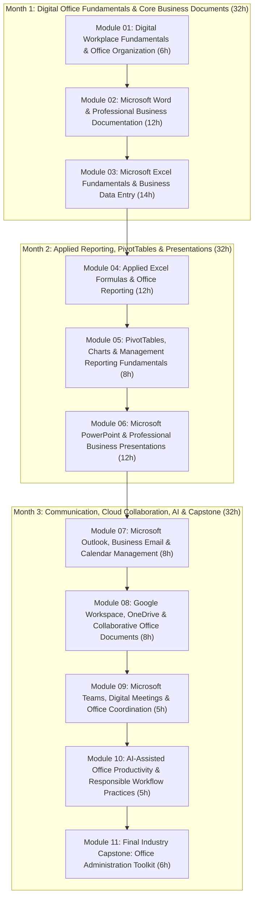

# Academic Course Specification: Office Productivity Professional
## Modern Digital Workplace Operations, Microsoft 365 & Google Workspace Specialization

```
Course Number:            30 (Academic Catalog Sequence)
Course Name:              Office Productivity Professional
Canonical Website ID:     office-pro
Website Slug:             office-productivity-professional
Canonical URL Route:      /course-detail.html?id=office-pro
Governing Website Academy:Office Productivity Academy (office-productivity-academy / office)
Academic Label:           Business Productivity & Analytics
Curriculum Edition:       2027 Professional Foundation Edition
Program Level:            Professional Foundation
Program Specialization:   Microsoft 365, Google Workspace & AI-Assisted Digital Office Operations
Approved Selling Fee:     INR 15,900 + applicable statutory 18% GST (INR 2,862; Total: INR 18,762)
Academic Duration:        3 Months (12 Instructional Weeks)
Total Guided Training:    96 Hours (8 Hours/Week: 2h Concepts + 4h Hands-On + 1h QA + 1h Review)
Curriculum Architecture:  11 Modular Units across 3 Thematic Months
Portfolio Architecture:   Integrated Office Administration Toolkit with 15 Evidence Categories
Official Tagline:         Work Smarter. Communicate Better. Deliver Professionally.
Approved Target Branch:   transformation/nova-course-redesign
```

---

## 1. Executive Summary & Program Purpose

The modern corporate workplace demands administrative, operations, and support professionals who operate with exceptional digital proficiency, absolute data accuracy, and professional communication standards. The **Office Productivity Professional** (Course 30) program is designed as a foundational, highly practical 3-month specialization that equips learners with end-to-end competencies across the world's two primary enterprise cloud ecosystems: **Microsoft 365** and **Google Workspace**, complemented by responsible, governed **AI-assisted productivity tools**.

Unlike generic introductory computer literacy courses that teach fragmented features without workplace context, this curriculum is built around real-world office operational workflows: executive correspondence drafting, formal multi-page corporate report structuring, high-volume automated mail merging, spreadsheet data hygiene and validation, operational expense and attendance tracking, executive dashboard reporting using PivotTables and charts, board-ready presentation design, business email etiquette and calendar scheduling, cloud document co-authoring and permission governance, and digital task coordination.

### Core Value Proposition & Positioning
- **Target Audience:** Administrative Assistants, Executive Assistants, Office Managers, Operations Coordinators, Front-Desk Executives, Departmental Clerks, Customer Support Leads, Virtual Assistants, Fresh Graduates, and Professionals seeking digital office re-skilling.
- **Pedagogical Philosophy:** *Hands-On, Evidence-Based, Workplace-Simulated.* Every module requires students to author, calculate, format, and audit tangible business deliverables. Artificial Intelligence (Microsoft Copilot Chat, Google Gemini) is integrated strictly as a supplementary drafting and cognitive acceleration tool, paired with mandatory human-in-the-loop verification to eliminate errors and hallucinations.
- **Zero-Tolerance Quality Standards:** Mathematical accuracy in spreadsheets, zero unverified AI data claims, professional typography and layout consistency, and strict enterprise link-sharing security.

---

## 2. Forensic Audit of Legacy Course Data

A comprehensive forensic audit of existing course records across [data.js](file:///c:/Users/wasee/Desktop/NovaSkillsProject/NovaSkills%20Website/data.js), [data/courses/office-pro.json](file:///c:/Users/wasee/Desktop/NovaSkillsProject/NovaSkills%20Website/data/courses/office-pro.json), and the public website revealed significant structural, commercial, and academic discrepancies that must be rectified.

```
========================================================================================
                               LEGACY COURSE AUDIT MATRIX
========================================================================================
  Audit Dimension        Legacy Record State        Target Spec State          Action
----------------------------------------------------------------------------------------
  Course Name            Office Productivity Prof.  Office Productivity Prof.  KEEP
  Canonical ID           office-pro                 office-pro                 KEEP
  Academy Mapping        Office Productivity Acad.  Office Productivity Acad.  KEEP
  Academic Label         Generic Office Skill       Business Productivity & An.EXPAND
  Duration               3 Months (data.js) vs      3 Months (12 Weeks)        REPLACE
                         4 Months (office-pro.json)
  Guided Hours           120 hrs (data.js) vs       Exactly 96 Guided Hours    REPLACE
                         160 hrs (office-pro.json)  (32h/Month × 3 Months)
  Selling Price          INR 9,999                  INR 15,900 (+ 18% GST)     REPLACE
  Reference Price        INR 24,999 (60% fake OFF)  Deactivated (0% Fake OFF)  REMOVE
  Program Level          Beginner vs Intermediate   Professional Foundation    REPLACE
  Module Count           4 Generic Modules          11 Exhaustive Modules      REPLACE
  Curriculum Depth       High-level bullet points   30-field production schema EXPAND
  Toolchain Claims       Included Power BI, Tableau,Focused on Microsoft 365,  REPLACE
                         Tally GST, Python, ClickUp Google Workspace & Safe AI
  Project Claims         "2 Live Projects" / 8 generic1 Integrated Office Admin REPLACE
                         unstructured projects      Toolkit (15 Categories)
  Vanity Metrics         4.8 Rating, 160 Reviews,   Zero unverified metrics    REMOVE
                         980 Students enrolled
  Placement Claims       Unverified guarantee       Institutional assistance   REPLACE
========================================================================================
```

### Detailed 23-Dimension Forensic Audit Classification

1. **Digital Office Fundamentals:** *REPLACE / EXPAND.* Legacy data treated computer literacy as generic hardware definitions. Replaced with modern digital workplace operating procedures, cloud storage synchronization, operating system navigation, file naming taxonomies, and cybersecurity hygiene.
2. **File Management & Directory Architecture:** *EXPAND.* Previously omitted. Now established as a core Week 1 competency covering nested folder structures, versioning nomenclature (`v1.0`, `v1.1_Final`), and local-to-cloud backup workflows.
3. **Microsoft Word Fundamentals:** *EXPAND.* Legacy coverage was superficial. Expanded to deep paragraph formatting, page setup, margin standards, section breaks, and multi-column layouts.
4. **Business Documentation & Corporate Reports:** *EXPAND.* Added professional corporate report authoring: cover pages, automated Tables of Contents (TOC), custom Styles (Heading 1, 2, 3), headers/footers with dynamic page numbers, captions, and callout callboxes.
5. **Mail Merge & Automated Bulk Operations:** *REPLACE.* Previously mentioned in passing. Now formalized into a practical high-volume correspondence workflow linking Excel customer databases to Word letter and envelope templates.
6. **Excel Essentials & Data Entry:** *EXPAND.* Legacy syllabus jumped directly to formulas. Replaced with rigorous spreadsheet ergonomics: cell data types (Text, Number, Date, Currency), grid navigation shortcuts, autofill sequences, Freeze Panes, and data hygiene rules.
7. **Applied Excel Formulas:** *EXPAND.* Expanded from basic sum/average to standard business logic: mathematical (`SUM`, `PRODUCT`, `ROUND`), statistical (`COUNT`, `COUNTA`, `COUNTBLANK`), logical (`IF`, `AND`, `OR`, nested `IF`), lookup (`XLOOKUP`, `VLOOKUP`), and text functions (`TRIM`, `PROPER`, `CONCAT`, `TEXTSPLIT`).
8. **Data Validation & Error Prevention:** *REPLACE.* Completely missing in legacy data. Added dropdown list creation, numerical range limits, custom input messages, error alert dialogs, and auditing formulas (`Trace Precedents`, `Trace Dependents`).
9. **PivotTables for Office Reporting:** *EXPAND.* Legacy data mentioned PivotTables without analytical structure. Replaced with systematic tabular data preparation, Field List mechanics, value summarization, grouping by date/month, and slicers.
10. **Business Charts & Visual Communication:** *EXPAND.* Added chart selection principles: Column/Bar for category comparisons, Line for time trends, Pie/Doughnut for proportional splits. Standardized chart formatting, eliminating clutter.
11. **Microsoft PowerPoint:** *EXPAND.* Replaced unstructured slide creation with professional Slide Master engineering, 16:9 widescreen layout grids, typography hierarchies (32pt/18pt), slide layout consistency, and executive presentation delivery.
12. **Microsoft Outlook & Business Email:** *REPLACE.* Legacy data had near-zero email instruction. Built a complete 8-hour module covering Classic vs New Outlook, professional email anatomy, subject line conventions, CC/BCC governance, professional email signatures, out-of-office autoreplies, rules, and folder management.
13. **Calendar Management & Scheduling:** *REPLACE.* Omitted previously. Formalized into executive scheduling: meeting invitations, recurrence patterns, scheduling assistants, timezone management, focus time booking, and shared calendar visibility.
14. **Google Workspace Ecosystem:** *EXPAND.* Legacy JSON paired Docs/Sheets carelessly with Office. Formalized into a dedicated module covering Google Docs collaborative tools, Google Sheets cloud tracking, Google Slides deck design, and Google Forms integration.
15. **Microsoft Teams & Digital Meetings:** *REPLACE.* Omitted previously. Now covers channel communication etiquette, chat vs post threads, video meeting controls, screen-sharing hygiene, meeting recording, and Teams file sharing.
16. **OneDrive & Cloud Storage Architecture:** *EXPAND.* Replaced generic "cloud" bullet with specific OneDrive for Business workflows: Selective Sync, Files On-Demand, version history rollbacks, sharing link permissions (Specific People, Anyone with link), and expiration dates.
17. **Digital Forms & Surveys:** *EXPAND.* Added Microsoft Forms and Google Forms design: building employee surveys, office supply request forms, event RSVP collectors, branching questions, and exporting clean response data to Excel/Sheets.
18. **Task Coordination & Digital Planning:** *REPLACE.* Legacy listed ClickUp and Notion without curriculum backing. Replaced with officially supported Microsoft 365 task tools: Microsoft To Do (personal daily planning) and Microsoft Planner / Tasks in Teams (kanban departmental task tracking).
19. **Copilot & Gemini AI Assistance:** *REPLACE.* Legacy made vague claims about "Microsoft Copilot AI". Replaced with a governed, responsible AI curriculum: prompt engineering for office correspondence, drafting meeting summaries, text proofreading, formula assistance, paired with mandatory human verification against source facts.
20. **Security, Privacy & Link Governance:** *EXPAND.* Added strict enterprise link-sharing protocols: avoiding unrestricted public edit links, principle of least privilege, password protection on sensitive files, and zero transmission of plain-text passwords.
21. **Student Practical Portfolio:** *REPLACE.* Replaced 3 vague, unvalidated projects with **One Integrated Office Administration Toolkit containing 15 Auditable Evidence Categories**.
22. **Assessment & Grading Framework:** *REPLACE.* Replaced arbitrary 80% passing rule with a weighted, multi-milestone academic assessment model: Word (20%), Excel (30%), PowerPoint (15%), Outlook/Cloud (15%), AI (10%), Capstone (10%); 70% passing threshold.
23. **Commercial & Certification Claims:** *REPLACE.* Removed misleading 60% discount (INR 9,999 vs 24,999); established approved base fee of **INR 15,900 + statutory 18% GST**; removed claims of external Microsoft-issued certifications and placement guarantees; established Nova Skills institutional certificate of completion.

---

## 3. Strict Course Differentiation: Course 30 vs. Course 29

To prevent catalog cannibalization and maintain clear academic pathways, **Course 30** (`office-pro`) and **Course 29** (`biz-productivity`) maintain strict boundaries:

```
========================================================================================
                          ACADEMIC BOUNDARY & DIFFERENTIATION
========================================================================================
  Dimension              Course 30: Office Productivity   Course 29: MIS & BI
----------------------------------------------------------------------------------------
  Academic Focus         Day-to-day digital workplace     Enterprise business data
                         administration, documentation,   engineering, relational reporting,
                         communication, and coordination  and semantic BI dashboards.
  Duration               3 Months (12 Weeks)              6 Months (24 Weeks)
  Guided Hours           96 Guided Hours                  210 Guided Hours
  Target Audience        Office assistants, executive     MIS executives, business analysts,
                         assistants, coordinators, clerks commercial finance leads, data techs.
  Approved Selling Fee   INR 15,900 + 18% GST             INR 29,900 + 18% GST
  Core Word Processing   Microsoft Word (Styles, TOC,     Basic documentation only.
                         Mail Merge, Templates, Forms)
  Core Spreadsheets      Excel Foundations & Applied      Advanced Excel, Dynamic Arrays,
                         Formulas (IF, XLOOKUP, Text,     Complex Financial/Ops MIS Models,
                         Data Validation, PivotTables)    VBA / Power Pivot.
  Relational Database    NOT COVERED.                     SQL (PostgreSQL/MySQL), Joins,
                         Strictly prohibited.             Aggregations, CTEs, Window Funcs.
  ETL Data Pipeline      NOT COVERED.                     Power Query (20 Guided Hours),
                         Strictly prohibited.             M code, multi-source ingestion.
  Business Intelligence  NOT COVERED.                     Microsoft Power BI Desktop & Service
                         No Power BI, DAX, or Star Schema.(42+ Hours), DAX Measures, Star Schema.
  Office Communication   Outlook (Email & Calendars),     PowerPoint Executive MBR Reporting
  & Collaboration        Teams, Google Workspace Suite    only.
  Task & Cloud Tools     OneDrive, Google Drive, Forms,   Power Automate Cloud Flows, Gateway
                         Microsoft To Do, Planner, Canva  Clustering, Service Workspaces.
  AI Positioning         Copilot Chat & Gemini for text   Copilot for formula critique, Fabric
                         drafting & proofreading.         IQ MCP, Power BI Authoring MCP.
========================================================================================
```

> [!IMPORTANT]
> **Curriculum Boundary Rule for Course 30:** Under no circumstances should Course 30 incorporate mandatory Power BI desktop authoring, complex DAX expressions, SQL query writing, Power Query ETL pipelines, or enterprise BI workspace governance. Course 30 is strictly focused on digital office operations, workplace communication, and professional document/spreadsheet administration.

---

## 4. Software Stack, Licensing & Technology Standards

Course 30 utilizes officially supported, modern office technology suites. All classroom exercises and student labs are calibrated to work on standard consumer or educational licenses without requiring expensive enterprise infrastructure.

```
========================================================================================
                          SOFTWARE & LICENSING SPECIFICATION
========================================================================================
  Software Application    Version / Edition              Access & Licensing Model
----------------------------------------------------------------------------------------
  Microsoft Word          Microsoft 365 Desktop / Web    Free Web Apps / Office 365 Student
  Microsoft Excel         Microsoft 365 Desktop / Web    Free Web Apps / Office 365 Student
  Microsoft PowerPoint    Microsoft 365 Desktop / Web    Free Web Apps / Office 365 Student
  Microsoft Outlook       Classic & New Outlook for Win  Free Outlook.com / Institutional
  Microsoft OneDrive      OneDrive for Business / Pers.  5 GB Free / 1 TB Educational
  Microsoft Teams         Teams Free / Educational       Free Desktop / Web Client
  Microsoft Forms         Microsoft Forms Web            Free Personal / School Account
  Microsoft To Do         Microsoft To Do Web / App      Free with Microsoft Account
  Microsoft Planner       Planner in Teams Web           Included in M365 School / Business
  Microsoft Copilot       Copilot Chat (Web / Windows)   Free Personal / Bing AI Access
  Google Docs             Google Workspace Web           Free Google Account (@gmail.com)
  Google Sheets           Google Workspace Web           Free Google Account (@gmail.com)
  Google Slides           Google Workspace Web           Free Google Account (@gmail.com)
  Gmail                   Google Workspace Web           Free Google Account (@gmail.com)
  Google Calendar         Google Workspace Web           Free Google Account (@gmail.com)
  Google Meet             Google Workspace Web           Free Google Account (@gmail.com)
  Google Drive            Google Workspace Web           15 GB Free Personal Storage
  Google Forms            Google Workspace Web           Free Google Account (@gmail.com)
  Google Gemini           Gemini Web (gemini.google.com) Free Personal Google Account
  Canva                   Canva Free Web                 Free Account for Office Graphics
========================================================================================
```

### Desktop vs. Web Application Standards
- **Core Desktop Priority:** Microsoft Word, Excel, and PowerPoint are primarily taught on the **Microsoft 365 Desktop** version to ensure full exposure to advanced features (Mail Merge, custom Slide Masters, Data Validation dialogs, and advanced chart formatting).
- **Web App Parity:** Where students utilize web-only environments (Chromebooks, shared terminals), instructors demonstrate equivalent workflows using **Microsoft 365 Online** and **Google Workspace**, explicitly noting any desktop-specific limitations.
- **Zero Paid Barrier:** All mandatory student projects and assignments can be completed using free personal accounts (Google @gmail.com and Microsoft @outlook.com) combined with standard classroom lab workstations. No student is forced to purchase commercial enterprise software licenses.

---

## 5. Master 11-Module Curriculum Architecture (96 Guided Hours)



---

### Detailed Module Specifications

#### Module 01: Digital Workplace Fundamentals & Office Organization
- **Guided Hours:** 6 Hours (Week 1)
- **Primary Software:** Windows 11 / macOS Operating Systems, File Explorer / Finder, Cloud Sync Clients (OneDrive, Google Drive for Desktop).
- **Supporting Tools:** Snipping Tool, 7-Zip, Browser Workspace Profiles (Chrome / Edge).
- **Module Purpose:** Establish professional computer operating standards, structured digital filing systems, ergonomic workstation hygiene, and data security habits required in modern office environments.
- **Main Topics:**
  1. *The Modern Digital Workplace:* Evolution of office administration; desktop vs hybrid vs cloud workspaces; essential hardware components (dual displays, scanners, printers); workstation ergonomics and typing efficiency standards.
  2. *Operating System Navigation & Keyboard Productivity:* Windows/macOS navigation; taskbar and window management; essential global keyboard shortcuts (`Ctrl+C/V/X/Z`, `Win+E`, `Alt+Tab`, `Win+Shift+S`); virtual desktops; clipboard history management.
  3. *Enterprise File Organization & Taxonomies:* Designing standardized corporate folder hierarchies (Department -> Year -> Quarter -> Project); file naming conventions (`YYYY-MM-DD_DocName_v1.0`); avoiding forbidden characters; file extensions awareness (`.docx`, `.xlsx`, `.pptx`, `.pdf`, `.csv`).
  4. *File Operations & Compression:* File search techniques using wildcards and metadata filters; bulk renaming; file compression (`.zip`) for email attachments; extracting archives safely; managing local storage limits.
  5. *Browser Productivity & Digital Security:* Multi-profile setup in Google Chrome and Microsoft Edge (Work vs Personal); bookmark organization; clearing cache; password security habits; identifying phishing attempts and malicious email attachments.
- **Instructor Demonstrations:**
  - Structuring a disorganized desktop with 50+ mixed files into a clean corporate directory structure with standardized versioning nomenclature in under 5 minutes.
  - Setting up dual browser profiles, password managers, and multi-factor authentication (MFA) prompts.
- **Hands-On Classroom Labs:**
  - *Lab 1.1: File Taxonomy Implementation:* Given a raw archive of 40 unorganized office documents, students create a corporate directory tree and classify all files using the standard naming formula.
  - *Lab 1.2: Shortcut Speed Drill:* Navigating between multiple applications, capturing screenshot snippets, and managing clipboard history entirely via keyboard shortcuts.
- **Student Assignment:** Setup and document a personal cloud-synchronized office workspace directory, including an archive folder, active project folders, and an automated backup configuration.
- **Portfolio Contribution:** **Evidence 01: Structured Digital Office Workspace** — Documented screenshot and folder tree export demonstrating standardized corporate naming taxonomies and backup settings.

#### Module 02: Microsoft Word & Professional Business Documentation
- **Guided Hours:** 12 Hours (Weeks 2–3)
- **Primary Software:** Microsoft Word for Microsoft 365 (Desktop Edition).
- **Supporting Tools:** Adobe Acrobat Reader (PDF export/review), Microsoft Font Library.
- **Module Purpose:** Master the creation of polished, corporate-standard business letters, memos, formal multi-page reports, automated tables of contents, and high-volume mail-merged correspondence.
- **Main Topics:**
  1. *Word Interface & Typography Hierarchy:* Ribbons, Quick Access Toolbar, rulers, margins; font selection guidelines (Calibri, Aptos, Arial, Georgia); font sizing standards (Title 24-28pt, Heading 1 16-18pt, Body 11-12pt); line spacing (1.15 to 1.5) and paragraph spacing before/after.
  2. *Paragraph & Page Layout Architecture:* Page orientation (Portrait vs Landscape); margins (Normal, Narrow, Custom); Section Breaks (Next Page, Continuous) vs Page Breaks; creating independent headers/footers in different document sections; page numbering formats (Roman numerals for front matter, Arabic for body).
  3. *Custom Styles & Automated Tables of Contents (TOC):* Applying and modifying built-in Styles (`Heading 1`, `Heading 2`, `Heading 3`, `Normal`); benefits of style-based formatting; generating and updating automated TOCs; navigating long documents via the Navigation Pane.
  4. *Tables, Graphical Elements & Layout Alignment:* Inserting and styling corporate tables; adjusting column widths, cell margins, and text alignment; repeating header rows across page breaks; inserting company logos, shape callouts, and icons; text wrapping (`In Line with Text` vs `Top and Bottom` vs `Square`).
  5. *Reviewing, Collaboration & Proofing Tools:* Spell-check and grammar proofing; custom dictionaries; Track Changes (All Markup, Simple Markup); inserting and resolving comments; document comparison; restricting editing permissions; exporting password-protected PDFs.
  6. *Automated Mail Merge Operations:* The Mail Merge architecture: Main Document, Data Source (Excel spreadsheet), and Merged Output; creating dynamic letter templates with merge fields (`<<FirstName>>`, `<<Company>>`, `<<AmountDue>>`); setting up conditional merge rules (`IF ... THEN ... ELSE`); generating individualized bulk letters and mailing labels.
- **Instructor Demonstrations:**
  - Formatting an ugly, raw 8-page unstyled corporate report into an executive publication with custom heading styles, an automated table of contents, landscape financial table sections, and dynamic headers/footers.
  - Executing a live Mail Merge of 50 individualized customer payment reminder letters from an Excel ledger in under 3 minutes.
- **Hands-On Classroom Labs:**
  - *Lab 2.1: Corporate Memorandum & Letterhead:* Designing an official corporate letterhead template and drafting an executive memorandum following standard business layout rules.
  - *Lab 2.2: Multi-Page Corporate Annual Report:* Assembling a 6-page corporate report featuring a cover page, executive summary, automated TOC, section-broken financial table in landscape, and bulleted recommendations.
  - *Lab 2.3: Bulk Mail Merge Execution:* Connecting an Excel client database (50 records) to a Word notice template, inserting address blocks, testing preview records, and generating merged PDF documents.
- **Student Assignments:**
  - *Assignment 2A:* Formal Corporate Offer Letter with customized styling and corporate footer.
  - *Assignment 2B:* 5-Page Standard Operating Procedure (SOP) manual with automated TOC and custom styles.
- **Portfolio Contributions:**
  - **Evidence 02: Formal Word Business Documents** (Letterhead memo and formal offer letter).
  - **Evidence 03: Professionally Formatted Multi-Page Report** (Report with automated TOC and section breaks).

#### Module 03: Microsoft Excel Fundamentals & Business Data Entry
- **Guided Hours:** 14 Hours (Weeks 3–4)
- **Primary Software:** Microsoft Excel for Microsoft 365 (Desktop Edition).
- **Supporting Tools:** Windows Calculator, CSV Data Imports.
- **Module Purpose:** Establish absolute spreadsheet proficiency, rigorous data entry hygiene, cell formatting standards, basic mathematical formulas, and spreadsheet error-checking mechanics.
- **Main Topics:**
  1. *Excel Grid Ergonomics & Interface:* Workbook vs Worksheet; cell addressing (A1 notation); formula bar and name box; selecting ranges, entire rows, and columns; grid navigation shortcuts (`Ctrl+Arrow Keys`, `Ctrl+Home/End`); inserting and deleting rows/columns; renaming and color-coding worksheet tabs.
  2. *Data Types & Strict Entry Hygiene:* Distinct data types: Text, Numeric, Date, Time, Boolean; the importance of correct alignment (text left, numbers right); common data entry errors (numbers stored as text, trailing spaces, inconsistent date formats like MM/DD vs DD/MM); autofill sequences and flash fill.
  3. *Professional Cell & Number Formatting:* Number formats: General, Number, Currency (₹ / $), Accounting, Percentage, Date (Short and Long Date), Text; custom number formatting; border styles and corporate fill colors; text wrapping and cell merging hazards (why merging breaks sorting); Freeze Panes (Top Row, First Column, Custom Panes).
  4. *Basic Mathematical Formulas & Operator Precedence:* Syntax of formulas (`=`); standard operators (`+`, `-`, `*`, `/`, `^`); order of operations (BODMAS / PEMDAS); relative cell referencing vs absolute cell referencing (`$A$1` vs `A$1` vs `$A1`); locking cells with `F4` to prevent formula distortion during autofill.
  5. *Fundamental Statistical & Mathematical Functions:* Basic functions: `SUM()`, `AVERAGE()`, `MIN()`, `MAX()`, `COUNT()`, `COUNTA()`, `COUNTBLANK()`; using the AutoSum feature; calculating subtotals; checking formula results with status bar statistics.
  6. *Page Setup & Professional Print Formatting:* Preparing spreadsheets for physical printing and PDF export; Page Break Preview; setting Print Areas; scaling sheets to fit 1 page wide; repeating title rows (`Print Titles`); inserting headers and footers with page numbers and timestamps.
- **Instructor Demonstrations:**
  - Building a monthly department petty cash log from scratch: setting up headers, validating data types, writing relative and absolute formulas, formatting currency, and locking freeze panes.
  - Fixing common print disasters: converting a 10-column spilled spreadsheet into a perfectly scaled, professional single-page landscape PDF.
- **Hands-On Classroom Labs:**
  - *Lab 3.1: Employee Attendance & Timesheet Log:* Designing a 30-day employee attendance tracker, utilizing autofill for dates, calculating total days present and absent using `COUNT()` and `COUNTA()`.
  - *Lab 3.2: Monthly Office Expense Ledger:* Building a categorized departmental expense sheet, calculating category totals, sales tax calculations with absolute tax rate cell references, and applying accounting currency formats.
  - *Lab 3.3: Print Layout Optimization:* Taking a raw 500-row inventory sheet, configuring print titles, adding page numbers, and generating an auditable multi-page PDF.
- **Student Assignment:** Create an annual department operational budget workbook with 12 monthly tabs and an automated summary tab summing expenses using 3D cell references (`=SUM(Jan:Dec!B5)`).
- **Portfolio Contributions:**
  - **Evidence 04: Excel Attendance & Timesheet Tracker** (Structured 30-day tracker with formulas).
  - **Evidence 05: Excel Expense or Sales Tracker** (Categorized expense ledger with absolute tax cell references).

#### Module 04: Applied Excel Formulas & Office Reporting
- **Guided Hours:** 12 Hours (Weeks 5–6)
- **Primary Software:** Microsoft Excel for Microsoft 365 (Desktop Edition).
- **Supporting Tools:** Formula Auditing Toolbar, Name Manager.
- **Module Purpose:** Transition from basic math to intermediate business spreadsheet logic, incorporating conditional functions, text manipulation, data validation rules, and lookup formulas for automated office reporting.
- **Main Topics:**
  1. *Logical & Decision-Making Functions:* Syntax and business logic of `=IF(Logical_Test, Value_if_True, Value_if_False)`; nested `IF` statements; multi-condition logic using `AND()` and `OR()`; testing pass/fail grades, bonus eligibility, and payment status flags (Paid vs Overdue).
  2. *Conditional Aggregation Functions:* Summing and counting with business criteria: `SUMIF()`, `SUMIFS()`, `COUNTIF()`, `COUNTIFS()`, `AVERAGEIF()`, `AVERAGEIFS()`; calculating total sales by department or total expenses for a specific vendor.
  3. *Modern & Classical Lookup Functions:* Purpose of lookup functions; classical `VLOOKUP()` mechanics (lookup value, table array, col index, exact match `FALSE`); limitations of `VLOOKUP` (left-lookup weakness); modern `XLOOKUP()` syntax (`=XLOOKUP(lookup_value, lookup_array, return_array, [if_not_found])`); retrieving employee designations, product prices, and vendor details automatically.
  4. *Text Cleansing & Transformation Formulas:* Cleaning raw data extracts: `TRIM()` (removing stray spaces), `PROPER()`, `UPPER()`, `LOWER()`; extracting substrings with `LEFT()`, `RIGHT()`, and `MID()`; concatenating text using `&` and `TEXTJOIN()`; splitting full names into First and Last names using `TEXTSPLIT()`.
  5. *Data Validation & Dropdown Guardrails:* Creating in-cell dropdown lists using List validation; restricting numerical entries (e.g., age between 18 and 65, dates within current year); custom input prompts; custom error alert dialogs (Stop, Warning, Information); clearing invalid data.
  6. *Conditional Formatting & Visual Status Flags:* Applying conditional formatting rules: Highlight Cell Rules (Greater Than, Less Than, Equal To), Top/Bottom Rules, Data Bars, Color Scales, and Icon Sets; formatting entire rows based on cell values using formula rules (`=$D2="Overdue"`).
  7. *Formula Auditing & Troubleshooting:* Common Excel errors and diagnostic meanings: `#N/A`, `#VALUE!`, `#REF!`, `#DIV/0!`, `#####`; wrapping formulas in `IFERROR()` for clean reporting; using Trace Precedents and Trace Dependents to audit complex calculations.
- **Instructor Demonstrations:**
  - Building a dynamic employee payroll register: looking up salary bands with `XLOOKUP`, calculating overtime pay with `IF`, calculating gross-to-net deductions, and applying conditional formatting to highlight overdue tax filings.
  - Setting up an ironclad data entry template with dropdown lists, preventing duplicate employee IDs, and masking formula errors with `IFERROR()`.
- **Hands-On Classroom Labs:**
  - *Lab 4.1: Customer Order Register with XLOOKUP:* Building an automated sales ordering sheet where entering a Product ID automatically populates Description and Unit Price via `XLOOKUP`, and calculates line item totals with discounts.
  - *Lab 4.2: Data Cleansing & Normalization:* Cleaning a messy 200-row customer contacts extract: stripping trailing spaces, standardizing phone numbers, fixing capitalization, and splitting full names into separate columns.
  - *Lab 4.3: Controlled Data Entry Form with Validation:* Designing an equipment check-out form equipped with dropdown asset categories, date validation rules, and automated overdue alert flags.
- **Student Assignment:** Build a comprehensive Client Invoicing & Payment Tracker that tracks invoice dates, calculates due dates (`=InvoiceDate + 30`), flags payment statuses (Paid / Pending / Overdue), and calculates total outstanding balances using `SUMIF`.
- **Portfolio Contribution:** **Evidence 06: Excel Formulas & Data Validation Exercise** (Verified workbook demonstrating `IF`, `SUMIF`, `XLOOKUP`, text functions, dropdowns, and error handling).

#### Module 05: PivotTables, Charts & Management Reporting Fundamentals
- **Guided Hours:** 8 Hours (Weeks 7–8)
- **Primary Software:** Microsoft Excel for Microsoft 365.
- **Supporting Tools:** Excel Chart Tools, Slicers, Timeline Filters.
- **Module Purpose:** Transform granular transactional data into executive summary reports, dynamic PivotTables, and clear business charts to support management decision-making.
- **Main Topics:**
  1. *Tabular Data Architecture for PivotTables:* The golden rules of tabular data: single row header, no blank rows/columns, consistent data types per column, no merged cells, no subtotal rows in source data; converting ranges to official Excel Tables (`Ctrl+T`).
  2. *PivotTable Foundations & Field List Mechanics:* Inserting a PivotTable; navigating the Field List quadrants: Filters, Columns, Rows, Values; summarizing numeric values (Sum, Count, Average); sorting and filtering PivotTable rows; changing number formats inside Value Field Settings.
  3. *Grouping, Hierarchies & Percent Calculations:* Grouping transactional dates by Year, Quarter, and Month; grouping numerical ranges; displaying values as `% of Grand Total`, `% of Column Total`, and `Difference From`; building two-dimensional matrix summaries (e.g., Region vs Product Line).
  4. *Interactive Report Controls (Slicers & Timelines):* Inserting Slicers for quick category filtering; formatting Slicers with multi-column buttons; inserting Timeline controls for visual date filtering; connecting a single Slicer to multiple PivotTables via Report Connections.
  5. *Business Chart Selection & Construction:* Visual communication principles: selecting the right chart for the data story; Column/Bar charts for discrete category comparisons; Line charts for time-series trends; Pie/Doughnut charts for part-to-whole splits (and when to avoid them); Combo charts (Clustered Column + Line on secondary axis) for comparing volume and margins.
  6. *Executive Chart Formatting & De-Cluttering:* Removing visual noise (unnecessary gridlines, redundant legends, 3D effects); formatting data series colors; adding clear chart titles and data labels; aligning charts to worksheet gridlines (`Alt+Drag`); assembling a clean single-page Excel Management Summary Dashboard.
- **Instructor Demonstrations:**
  - Taking a raw 2,000-row company sales ledger, converting it to an Excel Table, building 3 connected PivotTables (Monthly Trend, Category Breakdown, Regional Performance), and adding synchronized Slicers in under 10 minutes.
  - Converting an unreadable default Excel chart into a clean, presentation-grade executive graphic with tailored titles and highlighted variance series.
- **Hands-On Classroom Labs:**
  - *Lab 5.1: Sales & Operations PivotTable Summary:* Building a multi-dimensional PivotTable summarizing sales volume, revenue, and average transaction size by regional sales representative.
  - *Lab 5.2: Date Hierarchy & Margin Analysis:* Grouping daily transaction dates into quarterly trends and displaying product category margins as a percentage of total revenue.
  - *Lab 5.3: Single-Page Excel Management Dashboard:* Assembling 2 PivotTables, 2 synchronized Slicers (Department, Quarter), a column chart, and a trend line chart into an executive summary layout.
- **Student Assignment:** Create an Executive Headcount & Payroll Summary Dashboard from an HR employee master sheet, analyzing employee distribution by department, gender, tenure, and average salary using PivotTables, Slicers, and charts.
- **Portfolio Contribution:** **Evidence 07: PivotTable & Chart Management Report** (Interactive Excel workbook with clean PivotTables, synchronized Slicers, and presentation-grade charts).

#### Module 06: Microsoft PowerPoint & Professional Business Presentations
- **Guided Hours:** 12 Hours (Weeks 8–9)
- **Primary Software:** Microsoft PowerPoint for Microsoft 365 (Desktop Edition).
- **Supporting Tools:** Microsoft 365 Stock Image Library, Color Palette Generators (Coolors.co), Screen Presenter View.
- **Module Purpose:** Design polished, persuasive, and visually engaging corporate presentation decks tailored for management briefings, company profiles, and departmental operational reviews.
- **Main Topics:**
  1. *Presentation Architecture & Slide Ergonomics:* Understanding the presentation objective: inform, update, persuade; the 10/20/30 guideline; structuring presentation agendas (Executive Summary, Problem, Evidence, Recommendations, Next Steps); slide real estate and cognitive white space.
  2. *Slide Master Engineering & Corporate Templates:* Accessing and customizing the Slide Master view; creating custom slide layouts; setting standardized corporate fonts (Title font vs Body font); configuring corporate color themes (Primary brand, secondary accent, neutral dark/light); locking background graphics and logo watermarks to prevent accidental editing.
  3. *Typography & Content Formatting:* Eliminating "wall-of-text" syndrome; applying the 6x6 guideline (maximum 6 bullet points, 6 words per bullet); converting bullet points into visual containers and cards; text box margins, line spacing, and horizontal/vertical text alignment.
  4. *Visual Graphics, Shapes & SmartArt:* Drawing and formatting shapes; alignment tools (Distribute Horizontally/Vertically, Align Center/Middle); grouping objects; converting raw lists into structured SmartArt process flows and hierarchy trees; inserting corporate icons and high-resolution stock imagery.
  5. *Tables & Charts in PowerPoint:* Inserting and formatting corporate tables; pasting live-linked Excel charts vs static image snapshots (understanding data link refresh risks); formatting chart elements within PowerPoint to match corporate slide themes.
  6. *Transitions, Animations & Media Integration:* Professional animation discipline: avoiding distracting spinning effects; using subtle Appear and Fade animations to reveal talking points sequentially; Slide Transitions (Fade, Push, Smooth); inserting corporate video clips and audio recordings; setting up hyperlink action buttons.
  7. *Slide Show Delivery & Presenter Tools:* Presenter View navigation; using speaker notes; laser pointer and annotation pens; hiding slides for appendix Q&A; rehearsing timings; setting up custom slide shows; exporting decks as PDF handouts and MP4 video recordings.
- **Instructor Demonstrations:**
  - Re-engineering an overcrowded, ugly 10-bullet corporate slide into a sleek 3-column executive card layout with icons and clear typography in under 4 minutes.
  - Demonstrating Presenter View dual-screen setup, reading private speaker notes while displaying clean slides to the audience.
- **Hands-On Classroom Labs:**
  - *Lab 6.1: Corporate Template & Slide Master Setup:* Designing a branded 4-layout PowerPoint master template containing Cover, Section Header, Two-Column Comparison, and Conclusion layouts.
  - *Lab 6.2: Company Profile Presentation:* Building a 6-slide corporate introduction deck covering Vision, Leadership Team (using shapes/photos), Service Offerings, and Global Locations.
  - *Lab 6.3: Quarterly Departmental Performance Deck:* Designing an 8-slide operational review deck incorporating imported Excel charts, table summaries, and subtle animation builds.
- **Student Assignment:** Create an 8-slide New Employee Orientation (Onboarding) presentation deck incorporating company policies, organizational hierarchy, office amenities, and a welcome checklist.
- **Portfolio Contribution:** **Evidence 08: Professional PowerPoint Presentation** (Polished 8-slide executive review deck adhering to corporate visual standards and Slide Master rules).

#### Module 07: Microsoft Outlook, Business Email & Calendar Management
- **Guided Hours:** 8 Hours (Weeks 9–10)
- **Primary Software:** Microsoft Outlook for Windows (Classic & New Outlook) / Outlook on the Web.
- **Supporting Tools:** Microsoft 365 Exchange Online, Microsoft To Do.
- **Module Purpose:** Master corporate business email communication, inbox zero management, calendar scheduling, meeting coordination, and task tracking within Microsoft Outlook.
- **Main Topics:**
  1. *Corporate Email Anatomy & Professional Etiquette:* Understanding professional email structure: informative Subject Lines, formal Salutations, concise Body Copy, clear Call to Action (CTA), and professional Signatures; CC vs BCC governance (when to use, when to avoid "Reply All"); tone and register in corporate correspondence.
  2. *Outlook Navigation & Account Architecture:* Outlook interface: Mail, Calendar, People, To Do; Classic Outlook vs New Outlook interface toggles; configuring IMAP/Exchange accounts; cached mode vs online mode; navigating reading panes and conversation views.
  3. *Email Signatures, Templates & Quick Parts:* Designing standardized corporate HTML email signatures with contact details, company disclaimers, and logos; creating reusable Quick Parts for frequently typed text blocks; saving email templates (`.oft`).
  4. *Inbox Organization, Rules & Zero-Inbox Strategy:* The 4D methodology (Do, Delegate, Defer, Delete); creating hierarchical email folders; setting up automated Outlook Rules (sorting vendor invoices, filing team updates, moving CC emails); categorization with color flags; flagging emails for follow-up and setting reminders.
  5. *Out-of-Office Autoreplies & Delivery Options:* Configuring Automatic Replies (Out of Office) for internal colleagues vs external clients; delivery tracking: Request a Delivery Receipt and Read Receipt; marking message importance (High vs Low); scheduling delayed email delivery.
  6. *Executive Calendar Management & Scheduling:* Outlook Calendar views (Day, Work Week, Month); creating appointments vs meeting requests; inviting attendees and booking meeting rooms; scheduling recurrence patterns; using the Scheduling Assistant to resolve attendee availability conflicts.
  7. *Meeting Polling, Focus Time & Calendar Sharing:* Utilizing Outlook meeting polls to identify consensus meeting times; booking dedicated Focus Time blocks; sharing calendar visibility (Free/Busy vs Full Details) with executive colleagues; managing shared team calendars.
- **Instructor Demonstrations:**
  - Demonstrating the setup of an automated Outlook Rule that files all emails with "Invoice" in the subject into an Accounts folder and assigns a red category tag.
  - Resolving a scheduling conflict between 5 busy executives using the Scheduling Assistant and sending a coordinated meeting invite with an attached agenda.
- **Hands-On Classroom Labs:**
  - *Lab 7.1: Professional Email & Signature Suite:* Drafting 3 distinct business emails (Formal proposal submission, Vendor follow-up, Internal meeting request) equipped with a formatted corporate email signature.
  - *Lab 7.2: Inbox Rules & Categorization Simulation:* Creating 4 automated inbox rules to organize an incoming mailbox stream and establishing a follow-up task list.
  - *Lab 7.3: Executive Multi-Calendar Scheduling:* Setting up a recurring weekly executive team meeting, checking attendee availability, reserving a virtual room, and configuring an automated Out-of-Office responder.
- **Student Assignment:** Prepare a comprehensive Email & Calendar Operational Playbook detailing standard email communication protocols, subject line formulas, out-of-office templates, and a simulated 5-day executive meeting schedule.
- **Portfolio Contribution:** **Evidence 09: Business Email & Calendar Simulation** (Documented email drafts with professional signatures, rule configuration records, and an executive calendar schedule).

#### Module 08: Google Workspace, OneDrive & Collaborative Office Documents
- **Guided Hours:** 8 Hours (Weeks 10–11)
- **Primary Software:** Google Workspace (Google Docs, Google Sheets, Google Slides, Google Drive), Microsoft OneDrive for Business.
- **Supporting Tools:** Google Workspace Version History, Microsoft 365 Co-Authoring.
- **Module Purpose:** Operate seamlessly within cloud collaboration environments, mastering real-time document co-authoring, cloud file storage, version history recovery, and secure enterprise link sharing.
- **Main Topics:**
  1. *The Cloud Office Ecosystem:* Comparing Microsoft 365 Cloud and Google Workspace; browser-based office applications; cloud auto-save mechanisms; cross-platform collaboration advantages.
  2. *Google Docs Collaborative Document Authoring:* Google Docs interface; real-time multi-user co-authoring; suggesting mode vs editing mode vs viewing mode; adding comments, assigning action items (`@name`), and resolving feedback; document outline navigation; Smart Chips (inserting dates, people, files, dropdowns).
  3. *Google Sheets Cloud Data Tracking:* Cloud spreadsheet mechanics; sharing permissions; creating collaborative data loggers; collaborative filter views (filtering data without disrupting other active viewers); basic Google Sheets functions (`SUM`, `AVERAGE`, `COUNTIF`, `XLOOKUP`).
  4. *Google Slides Collaborative Decks:* Multi-user slide development; inserting speaker notes; managing version history; presenting directly to Google Meet from Slides.
  5. *Google Drive Cloud File Architecture:* Google Drive structure: "My Drive" vs "Shared Drives"; organizing team folders; moving and shortcutting files; Google Drive search operators (`type:spreadsheet`, `owner:me`, `modified:today`); offline access configuration.
  6. *Microsoft OneDrive Architecture & Synchronization:* OneDrive for Business client; Selective Sync; Files On-Demand (Online-only vs Locally available vs Always keep on this device); cloud storage quota management.
  7. *Cloud Security, Permissions & Version Governance:* Enterprise link-sharing protocols: Specific People vs Anyone with the link; view-only vs comment-only vs edit permissions; setting link expiration dates and download restrictions; inspecting Version History; restoring prior document versions to recover from data loss or accidental overwrites.
- **Instructor Demonstrations:**
  - Initiating a live multi-user co-authoring session in Google Docs, demonstrating real-time suggestion tracking, tagging an action item to a colleague, and restoring a version from 24 hours prior.
  - Configuring secure OneDrive sharing links with passwords and view-only restrictions to safely distribute confidential price lists.
- **Hands-On Classroom Labs:**
  - *Lab 8.1: Collaborative Google Doc Co-Authoring:* Students pair up to co-author an event planning brief in Google Docs, exchanging comments, assigning tasks with `@mentions`, and accepting revision suggestions.
  - *Lab 8.2: Google Sheets Live Tracker:* Building a shared project asset inventory in Google Sheets, configuring dropdown status chips, and establishing personal Filter Views.
  - *Lab 8.3: Secure Cloud Share & Version Rollback:* Setting up a restricted folder in OneDrive/Google Drive, sharing with granular permissions, simulating accidental data deletion, and executing an exact version history rollback.
- **Student Assignment:** Create a collaborative Google Workspace Team Portal containing a shared project brief (Docs), budget tracker (Sheets), and presentation overview (Slides) with documented permission settings.
- **Portfolio Contributions:**
  - **Evidence 10: Collaborative Google Workspace Document** (Live co-authored document with comments and version history).
  - **Evidence 11: Secure OneDrive / Google Drive Sharing Record** (Documented access permissions, link security settings, and folder hierarchy).

#### Module 09: Microsoft Teams, Digital Meetings & Office Coordination
- **Guided Hours:** 5 Hours (Week 11)
- **Primary Software:** Microsoft Teams (Desktop & Web), Microsoft Forms, Google Forms.
- **Supporting Tools:** Microsoft Planner, Microsoft To Do, Google Meet.
- **Module Purpose:** Master internal team communication, virtual meeting management, digital survey creation, and task coordination in modern hybrid office setups.
- **Main Topics:**
  1. *Microsoft Teams Architecture & Communication Channels:* Teams ecosystem: Activity, Chat, Teams, Calendar, Calls, Files; 1-on-1 direct chats vs group chats vs Channel posts; creating Teams and Channels (Standard vs Private); channel post formatting (Subject line, rich text, announcements, `@mentions` etiquette).
  2. *Digital Meeting Coordination & In-Meeting Etiquette:* Scheduling Teams and Google Meet video calls; meeting invitation links; pre-meeting audio/video testing; virtual meeting etiquette (mute protocol, virtual backgrounds); in-meeting controls: screen sharing (window vs desktop vs PowerPoint Live), chat box moderation, raising hands, and breakout rooms.
  3. *Digital Meeting Minutes & Follow-Up Protocols:* Capturing structured Meeting Minutes (Date, Attendees, Agenda, Key Decisions, Action Items with Owners and Deadlines); uploading meeting notes to shared Teams channel tabs; post-meeting follow-up communications.
  4. *Digital Surveys & Forms Creation (Microsoft & Google Forms):* Use cases for online forms: office supply requests, employee satisfaction surveys, event registrations; question types: Multiple Choice, Text, Rating, Likert Scale, Date; setting up required questions; question branching logic (skip logic); theme customization.
  5. *Form Response Analysis & Data Export:* Configuring form settings: accepting responses, restricting to organizational users, one response per person; reviewing real-time summary analytics; exporting clean response data to Excel / Google Sheets for reporting.
  6. *Task Coordination with To Do & Planner:* Managing personal daily to-do lists in Microsoft To Do; creating shared project boards in Microsoft Planner / Tasks in Teams; Kanban board mechanics: Buckets, Tasks, Due Dates, Priority flags, and Checklist sub-tasks; moving tasks across Progress columns (Not Started, In Progress, Completed).
- **Instructor Demonstrations:**
  - Setting up a department Microsoft Teams channel, posting an official announcement with `@team` tagging, uploading a shared file, and pinning a Planner tab.
  - Building an employee lunch feedback survey in Microsoft Forms with branching logic and exporting live responses to an Excel table in under 5 minutes.
- **Hands-On Classroom Labs:**
  - *Lab 9.1: Teams Communication & Channel Setup:* Creating a mock department Team, establishing private and public channels, and simulating an office communication workflow.
  - *Lab 9.2: Corporate Survey Creation in Forms:* Designing an Office Supply Requisition Form with branching questions, custom confirmation messages, and testing submission responses.
  - *Lab 9.3: Meeting Coordination & Minutes Packaging:* Conducting a mock 5-minute team video meeting, recording decisions, and publishing a formal Meeting Minutes summary document.
- **Student Assignment:** Create a digital Event Planning Package: a Microsoft/Google Form registration survey, a Teams channel coordination thread, a structured Meeting Minutes document, and a Microsoft Planner task board.
- **Portfolio Contribution:** **Evidence 12: Online Meeting & Task Follow-Up Evidence** (Documented meeting minutes, Teams coordination thread, and published survey form with exported responses).

#### Module 10: AI-Assisted Office Productivity & Responsible Workflow Practices
- **Guided Hours:** 5 Hours (Week 12)
- **Primary Software:** Microsoft Copilot (Web / Windows Chat), Google Gemini Web.
- **Supporting Tools:** Canva (Free Office Graphics), Grammarly / Microsoft Editor.
- **Module Purpose:** Harness generative AI tools responsibly to accelerate drafting, proofreading, research, and formula creation, while enforcing strict fact-checking, privacy boundaries, and ethical office guidelines.
- **Main Topics:**
  1. *Generative AI in Modern Office Operations:* AI capabilities: text generation, summarization, tone adjustment, idea brainstorming, basic formula assistance; understanding how Large Language Models (LLMs) operate; the critical distinction between generative suggestions and verified business facts.
  2. *Effective Prompt Engineering for Office Tasks:* The PREP prompting framework: Persona, Request, Context, Parameters; writing effective prompts for: drafting executive emails, rephrasing blunt messages into diplomatic corporate tone, summarizing long memos into 3 bullet points, and creating meeting agendas.
  3. *AI for Spreadsheet & Document Assistance:* Asking AI for Excel and Google Sheets formula explanations (e.g., "Explain how XLOOKUP works with an example"); generating dummy data for spreadsheet testing; drafting document outlines and presentation talking points.
  4. *Strict Fact-Checking, Hallucination Detection & Verification:* The phenomenon of AI hallucinations (plausible-sounding fabricated statistics, false dates, non-existent formulas); the non-negotiable golden rule: **Never paste AI-generated numbers, financial figures, or factual claims into business reports without 100% manual verification against source documents**.
  5. *Data Privacy, Security & Corporate AI Policies:* Strict prohibitions: never entering confidential company data, employee PII (Personal Identifiable Information), customer phone numbers, credit card details, or proprietary financial ledgers into public AI chatbots; understanding organizational data boundaries.
  6. *Visual Content Creation with Canva:* Utilizing Canva Free for basic office visual assets: designing corporate event flyers, training certificates, office notice board announcements, and simple presentation title slides adhering to brand colors.
- **Instructor Demonstrations:**
  - Prompting Microsoft Copilot to draft a diplomatic customer payment reminder, followed by side-by-side editing to tailor the tone, verify invoice dates, and insert corporate branding.
  - Asking AI to generate an Excel formula for a complex condition, auditing the formula syntax in Excel, and catching an edge-case logic error made by the AI.
- **Hands-On Classroom Labs:**
  - *Lab 10.1: Prompt Engineering for Executive Correspondence:* Writing structured prompts to generate a formal resignation acceptance letter, a vendor renegotiation request, and a project status update, refining each output.
  - *Lab 10.2: AI Formula Explanation & Validation:* Submitting an unfamiliar nested formula to an AI assistant, reviewing the step-by-step breakdown, and testing its validity in a spreadsheet.
  - *Lab 10.3: Fact-Checking & Hallucination Audit Challenge:* Analyzing an AI-generated business market summary, identifying 3 factual discrepancies or fabricated figures, and producing an audited, corrected version.
- **Student Assignment:** Complete an AI-Assisted Productivity Dossier containing: 3 prompt-and-output iterations for office tasks, an audit log showing manual corrections made to AI drafts, and a corporate flyer designed in Canva.
- **Portfolio Contribution:** **Evidence 13: AI-Assisted Productivity Verification Record** (Documented prompts, AI outputs, and manual audit logs proving human-in-the-loop verification).

#### Module 11: Final Industry Capstone: Office Administration Toolkit
- **Guided Hours:** 6 Hours (Week 12)
- **Primary Software:** Full Microsoft 365 Suite, Google Workspace Suite, Canva.
- **Supporting Tools:** PDF Compiler, ZIP Utility.
- **Module Purpose:** Synthesize all 10 preceding modules into a unified, professional, and auditable corporate administration portfolio—the **Office Administration Toolkit**—and defend the deliverables in a final presentation.
- **Main Topics:**
  1. *Capstone Architecture & Business Scenario Brief:* Reviewing the simulated enterprise scenario: a fast-growing regional commercial enterprise ("Apex Enterprise Solutions") requiring a complete digital office operational setup across administration, finance tracking, executive correspondence, and team coordination.
  2. *Portfolio Asset Assembly & Integration:* Consolidating and refining all 15 portfolio evidence items; verifying naming conventions; ensuring consistent typography, branding, and color palettes across Word, Excel, and PowerPoint files.
  3. *Comprehensive Data & Quality Audit:* Auditing all spreadsheet calculations for formula errors (`#REF!`, `#VALUE!`); verifying cell formatting; auditing Word documents for style consistency and table of contents alignment; verifying PowerPoint slide transitions and Presenter View readiness.
  4. *Cloud Repository Packaging & Link Security:* Uploading the complete toolkit to a structured cloud folder (OneDrive / Google Drive); configuring secure, view-only submission links with expiration dates; assembling a master PDF portfolio index.
  5. *Executive Capstone Presentation & Professional Defense:* Preparing a 10-minute capstone walkthrough presentation; articulating administrative decisions; explaining spreadsheet formula logic; defending data verification habits; answering instructor/panel questions.
- **Classroom Defense & Evaluation:**
  - Students deliver an executive walkthrough of their completed Office Administration Toolkit, demonstrating live navigation across Word, Excel, PowerPoint, Outlook, and Google Workspace assets.
- **Portfolio Contributions:**
  - **Evidence 14: Final Office Administration Toolkit** (Master compiled repository containing all 15 auditable evidence assets).
  - **Evidence 15: Professional Capstone Presentation** (Live oral walkthrough and defense of the administrative suite).

---

## 6. The 15 Mandatory Portfolio Evidence Categories

Rather than 15 disjointed, unmanageable commercial projects, Course 30 organizes practical work into **One Integrated Office Administration Toolkit** containing **15 auditable evidence categories**:

```
========================================================================================
                     THE 15 MANDATORY PORTFOLIO EVIDENCE CATEGORIES
========================================================================================
  #   Evidence Category                 Primary Tool     Key Output Description
----------------------------------------------------------------------------------------
  01  Structured Digital Office Space   Windows / OS     Folder taxonomy, backup setup,
                                                         standardized naming conventions.
  02  Formal Word Business Documents    MS Word          Corporate letterhead memorandum and
                                                         formal executive offer letter.
  03  Professionally Formatted Report   MS Word          6-page corporate annual report with
                                                         automated TOC, custom styles, breaks.
  04  Excel Attendance & Timesheet      MS Excel         30-day employee attendance register
                                                         utilizing autofill, COUNT, COUNTA.
  05  Excel Expense / Sales Tracker     MS Excel         Categorized monthly office expense sheet
                                                         with absolute tax formula references.
  06  Excel Formulas & Data Validation  MS Excel         Client order register with XLOOKUP,
                                                         IF, dropdowns, and IFERROR handling.
  07  PivotTable & Chart MIS Report     MS Excel         Dynamic sales/HR report with connected
                                                         PivotTables, Slicers, and charts.
  08  Professional PowerPoint Deck      MS PowerPoint    8-slide executive review deck built on
                                                         Slide Master, 16:9 grids, animations.
  09  Business Email & Calendar Record  MS Outlook       Professional email suite, email signa-
                                                         tures, inbox rules, calendar schedule.
  10  Collaborative Google Workspace    Google Docs      Live co-authored project brief with
                                                         comments, @mentions, version history.
  11  Secure Cloud Sharing Record       OneDrive / Drive Documented access permissions, link
                                                         security restrictions, version restore.
  12  Online Meeting & Task Follow-Up   Teams / Forms    Meeting minutes, Teams channel thread,
                                                         published survey with exported data.
  13  AI Productivity Verification      Copilot / Gemini Documented prompts, AI outputs, and
                                                         manual fact-checking audit logs.
  14  Final Office Admin Toolkit        Integrated Suite Complete compiled digital repository
                                                         containing all 15 validated assets.
  15  Professional Capstone Walkthrough Slide Deck & Oral10-minute executive presentation and
                                                         defense of the completed toolkit.
========================================================================================
```

---

## 7. 12-Week Academic Instructional Schedule

Each instructional week provides **8 guided training hours** structured across 4 pedagogical blocks:
- **Guided Concepts & Demonstrations:** 2 Hours
- **Hands-On Software & Workplace Labs:** 4 Hours
- **Accuracy Auditing & Problem-Solving:** 1 Hour
- **Peer Review, Feedback & Remediation:** 1 Hour
*(Independent homework and assignment practice are supplementary).*

```
========================================================================================
                           12-WEEK ACADEMIC SCHEDULE MATRIX
========================================================================================
  Wk  Month   Module & Focus Area                                  Weekly Guided Hours
----------------------------------------------------------------------------------------
  01  Month 1 M01: Digital Workplace Fundamentals, File Taxonomies 8 Hours (6h M01 + 2h M02)
  02  Month 1 M02: Word Typography, Layouts, Styles & TOC          8 Hours
  03  Month 1 M02: Word Tables, Mail Merge; M03: Excel Grid & Entry8 Hours (2h M02 + 6h M03)
  04  Month 1 M03: Excel Formatting, Basic Math, AutoSum, Printing 8 Hours
----------------------------------------------------------------------------------------
  MONTH 1 MILESTONE REVIEW: Word Documents & Excel Data Entry Complete (32 Guided Hours)
----------------------------------------------------------------------------------------
  05  Month 2 M04: Excel Applied Logic: IF, AND, OR, Conditional   8 Hours
  06  Month 2 M04: Excel Lookups: XLOOKUP, VLOOKUP, Text, Clean    8 Hours
  07  Month 2 M05: PivotTables, Field Mechanics, Grouping, Slicers 8 Hours
  08  Month 2 M05: Charts & Dashboards; M06: PowerPoint Slide Master8 Hours (4h M05 + 4h M06)
----------------------------------------------------------------------------------------
  MONTH 2 MILESTONE REVIEW: Advanced Excel Reporting & PowerPoint Deck (32 Guided Hours)
----------------------------------------------------------------------------------------
  09  Month 3 M06: PowerPoint Graphics, Animations, Delivery       8 Hours
  10  Month 3 M07: Outlook Email Etiquette, Rules; Calendars       8 Hours
  11  Month 3 M08: Google Docs/Sheets Co-Authoring; OneDrive       8 Hours
  12  Month 3 M09: Teams & Forms (5h); M10: AI Tools (5h); Capstone8 Hours (Split Across
              M11: Final Portfolio Defense (6h)                    M09, M10 & M11)
----------------------------------------------------------------------------------------
  MONTH 3 MILESTONE REVIEW: Complete Office Admin Toolkit Defense (32 Guided Hours)
========================================================================================
  TOTAL GUIDED TRAINING VOLUME: 12 Weeks × 8 Hours/Week = Exactly 96 Guided Hours
========================================================================================
```

---

## 8. Academic Assessment Framework & Evaluation Rubrics

### Assessment Weighting Model

```
========================================================================================
                          ACADEMIC ASSESSMENT WEIGHTING MATRIX
========================================================================================
  Component                           Core Focus Areas                      Weighting
----------------------------------------------------------------------------------------
  1. Professional Word Documentation  Typography, Styles, TOC, Mail Merge      20%
  2. Excel Accuracy & Reporting       Formulas, Lookups, Validation, Pivots    30%
  3. PowerPoint Presentations         Slide Master, Visual Layouts, Delivery   15%
  4. Outlook & Cloud Collaboration    Email, Calendar, OneDrive, Google Suite   15%
  5. Responsible AI Productivity      Prompt Engineering, Fact-Checking Audit   10%
  6. Final Capstone Toolkit & Defense Comprehensive Toolkit & Oral Walkthrough 10%
----------------------------------------------------------------------------------------
  TOTAL EVALUATION SCORE                                                       100%
========================================================================================
```

### Passing Threshold & Completion Standards
- **Minimum Passing Grade:** 70% cumulative score across all 6 assessment components.
- **Mandatory Competencies:**
  1. 100% mathematical accuracy on all graded Excel spreadsheets (zero formula errors like `#REF!` or `#VALUE!`).
  2. Proof of manual fact-checking verification on all AI-assisted deliverables.
  3. Verified completion and defense of the **Office Administration Toolkit** (all 15 evidence categories).
- **Institutional Certification:** Successful students receive the **Nova Skills Certificate of Completion: Office Productivity Professional (2027 Edition)**. No external Microsoft or Google vendor certifications are falsely promised or claimed.

### Standard Evaluation Rubric

```
========================================================================================
                               STANDARD EVALUATION RUBRIC
========================================================================================
  Grade Band         Score Range  Performance Description
----------------------------------------------------------------------------------------
  Distinction        90% – 100%   Flawless execution. Workbooks feature zero errors,
                                  elegant formatting, and defensive formulas. Word docs
                                  adhere strictly to corporate style grids. PowerPoint
                                  decks are board-ready. AI outputs are rigorously audited.
  Proficient         70% – 89%    Meets corporate standards. Spreadsheet formulas calculate
                                  accurately with minor formatting blemishes. Documents
                                  have proper styles and TOC. Presentations are clean and
                                  structured. Cloud sharing links are secure.
  Needs Improvement  50% – 69%    Substandard output. Spreadsheet contains formula errors or
                                  unprotected text entry. Cluttered documents lacking styles.
                                  Unverified AI statistics present. Requires remediation.
  Unsatisfactory     Below 50%    Failing grade. Broken calculations, missing evidence items,
                                  unformatted raw files, or unaddressed data errors.
========================================================================================
```

---

## 9. Data Security, Privacy & AI Governance Protocols

All learners are trained to uphold strict corporate cybersecurity and data governance standards:
1. **Zero-Credential Policy:** Student project submissions, repositories, and documentation must **NEVER** contain real corporate database passwords, personal credit card numbers, or live banking credentials. Sanitized mock data must be utilized exclusively.
2. **Link Governance & Least Privilege:** Students are taught to avoid open public edit links ("Anyone with link can edit"). Corporate sharing must default to "Specific People" or view-only with expiration dates.
3. **AI Confidentiality Boundary:** Students must never enter confidential business plans, unreleased financial statements, or customer PII into public chatbots (Copilot Chat, Google Gemini).
4. **Mandatory Human-in-the-Loop Verification:** Any document incorporating AI drafting must include an explicit verification footnote: *"Drafted with AI assistance; audited and verified by [Student Name] on [Date]."*

---

## 10. Student-Facing Marketing, FAQs & Commercial Policy

### Approved Marketing Copy
- **Course Title:** Office Productivity Professional
- **Tagline:** *Work Smarter. Communicate Better. Deliver Professionally.*
- **Short Description:** *Master everyday digital workplace operations with Microsoft 365 (Word, Excel, PowerPoint, Outlook, Teams) and Google Workspace. Build practical business reports, automate mail merges, analyze operational data, and leverage governed AI tools to deliver professional office results.*
- **Commercial Selling Fee:** **INR 15,900** + applicable statutory 18% GST (INR 2,862; Total: INR 18,762). 0% fake discounts.
- **Deactivated Legacy Claims:** The old INR 9,999 selling price, INR 24,999 reference price, 60% discount badge, 120/160 hour conflicts, and claims of Power BI / Tableau / Tally GST inclusion are completely purged.

### Authoritative Student FAQs (16 Questions)
1. **Who is this course for?** Ideal for administrative assistants, office managers, coordinators, virtual assistants, fresh graduates, and career changers seeking digital office fluency.
2. **What are the prerequisites?** Basic familiarity with operating a computer and browsing the web. No prior advanced software knowledge required.
3. **What software will I learn?** Microsoft Word, Excel, PowerPoint, Outlook, Teams, OneDrive, Microsoft Forms, Google Docs, Sheets, Slides, Drive, Forms, and safe AI tools (Copilot, Gemini).
4. **Is this course theoretical or practical?** 100% practical and workplace-simulated. You will build an integrated 15-asset Office Administration Toolkit.
5. **How long is the course?** Exactly 3 Months (12 instructional weeks, 8 guided hours per week, 96 total guided training hours).
6. **Will I learn Advanced Excel?** You will master essential and applied Excel: formulas (`IF`, `XLOOKUP`, `SUMIF`), data validation dropdowns, PivotTables, and executive charts. (For enterprise data modeling, SQL, and Power BI, see Course 29).
7. **Is Power BI included in this course?** No. Power BI, DAX, and SQL belong to Course 29 (*MIS & Business Intelligence Professional*). Course 30 focuses strictly on core office productivity.
8. **Do I need to buy expensive software?** No. All exercises are designed to work on free web apps, standard student accounts, and classroom lab workstations.
9. **Will I learn business email etiquette?** Yes. Module 07 is entirely dedicated to Microsoft Outlook, email writing etiquette, inbox zero management, and calendar coordination.
10. **How is Artificial Intelligence covered?** Module 10 teaches prompt engineering for drafting and research using Microsoft Copilot and Google Gemini, with mandatory human fact-checking.
11. **What is the Capstone Project?** The *Office Administration Toolkit*, a complete digital operational suite featuring 15 verified administrative deliverables.
12. **What certificate will I receive?** A verified Nova Skills Certificate of Completion: *Office Productivity Professional (2027 Edition)*.
13. **Are jobs or salaries guaranteed?** No. Nova Skills provides career preparation, resume building, and placement assistance, but does not make misleading salary guarantees.
14. **What is the course fee?** INR 15,900 + applicable statutory 18% GST.
15. **How does Course 30 differ from Course 29?** Course 30 (3M, 96h, INR 15,900) covers day-to-day office administration (Word, Excel, PPT, Outlook, Teams, Google Workspace). Course 29 (6M, 210h, INR 29,900) covers advanced MIS reporting, Power Query ETL, SQL databases, Power BI, and DAX modeling.
16. **Can I take this course online?** Yes, available via live online instructor-led sessions with recorded lab walkthroughs.

---

## 11. Implementation & Release Roadmap (Tasks NOVA-OPP-02 to 06)

```
========================================================================================
                         IMPLEMENTATION & RELEASE ROADMAP
========================================================================================
  Task ID      Scope & Objectives                                Target File(s)
----------------------------------------------------------------------------------------
  NOVA-OPP-01  Forensic Audit & Academic Specification           docs/course-redesign/.../
               (Current Task — Spec authored, STOP for approval) office-productivity...md
  NOVA-OPP-02  Metadata, Commercial Fields & Software Sync       data.js &
               (Update name, INR 15900, 96h, 11 mods, tools)     data/courses/office-pro.json
  NOVA-OPP-03  Curriculum Month 1 (Modules 01–03, 32 Hours)      data/courses/office-pro.json
               (Digital workplace, Word, Excel entry)
  NOVA-OPP-04  Curriculum Month 2 (Modules 04–06, 32 Hours)      data/courses/office-pro.json
               (Applied Excel, PivotTables, PowerPoint)
  NOVA-OPP-05  Curriculum Month 3 & Capstone (M07–M11, 32 Hours) data/courses/office-pro.json
               (Outlook, Google Suite, Teams, AI, Toolkit)
  NOVA-OPP-06  Full Forensic QA, Catalog Sync & Dev Release      data.js, master JSON,
               (Minified build, regression QA, push to dev branch)data.min.js, git push
========================================================================================
```

---

## 12. Document Sign-Off & Verification

```
Specification Author:   Antigravity Academic Architecture Team
Academic Discipline:    Business Productivity & Analytics
Approved Course Code:   Course 30 (Academic Sequence) / office-pro (Canonical Website ID)
Curriculum Volume:      96 Guided Instructional Hours (12 Weeks × 8 Hours/Week)
Approved Selling Price: INR 15,900 + statutory 18% GST (Total: INR 18,762)
Status:                 COMPLETE & PENDING OWNER ACADEMIC APPROVAL
Action Rule:            STOPPED. No website source files modified. No Git commits.
```
