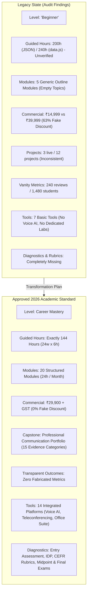
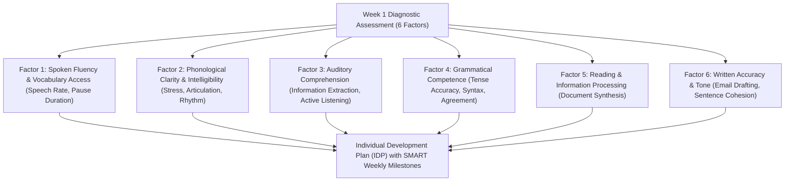
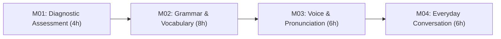
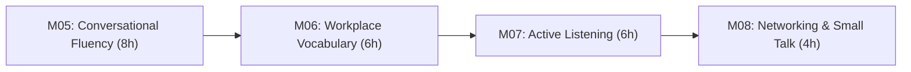
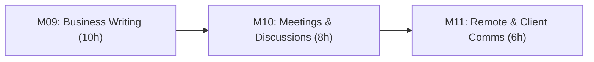
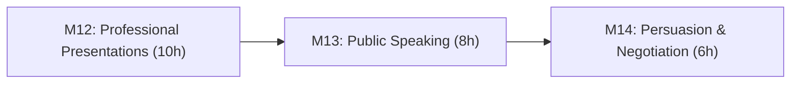
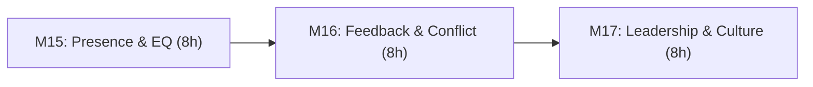
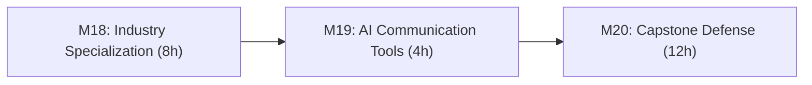
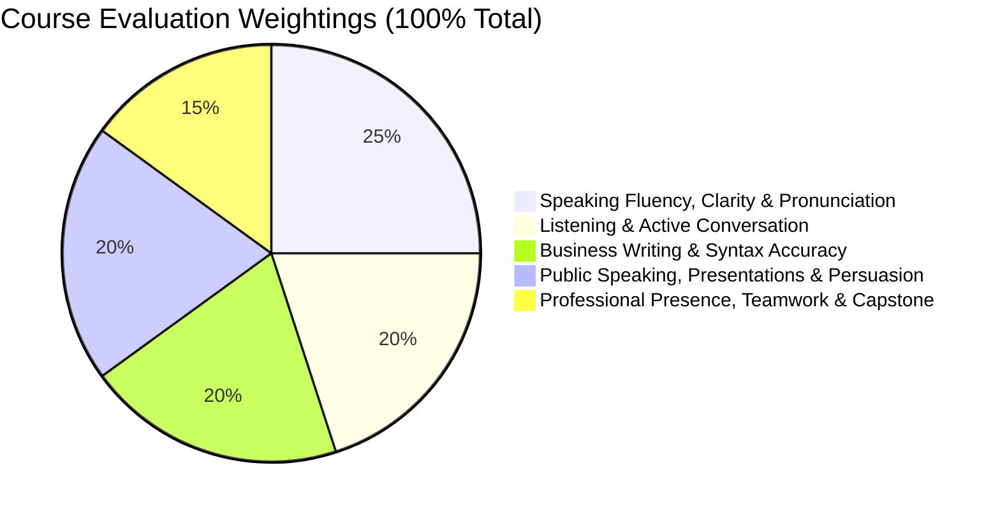
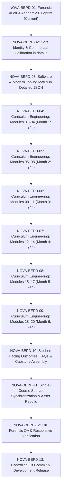

# Academic Specification & Curriculum Blueprint
# Business English & Personality Development

> **Document Identifier:** `NOVA-BEPD-SPEC-2026-V1`
> **Course Identifier:** `business-english`
> **Course Slug:** `business-english-personality-development`
> **Program Title:** Business English & Personality Development
> **Academy Category:** Communication Academy (`communication`)
> **Academic Classification:** Career Mastery
> **Governing Framework:** Nova Skills Quality & Academic Governance Framework | Modern Workplace Communication Benchmark 2026
> **Program Duration:** 6 Months (24 Academic Instructional Weeks)
> **Total Guided Instructional Hours:** 144 Guided Hours (6 Hours / Week: 1.5h Concepts & Demonstrations + 3.0h Interactive Speaking Labs + 1.5h Writing, Coaching & Assessment)
> **Recommended Independent Practice:** 72–96 Hours (Strictly Demarcated from Guided Instructional Hours)
> **Commercial Tuition Standard:** **INR 29,900** + applicable statutory GST (18%: INR 5,382; Total Payable: INR 35,282)
> **Pricing Policy:** 0% Artificial Discounts, Transparent Statutory Tax Disclosure, Truth-in-Education Standard
> **Program Tagline:** *Speak with Confidence. Communicate with Impact. Grow Professionally.*
> **Document Status:** Complete Forensic Audit & Approved Implementation Blueprint (Task NOVA-BEPD-01)

---

## 1. Executive Summary & Strategic Positioning

### 1.1 Course Mission & Rationale
In the modern international knowledge economy, technical competence alone does not guarantee career advancement. Professionals across engineering, digital marketing, creative design, sales, finance, and management frequently encounter an invisible ceiling caused not by a deficit of functional skill, but by communication apprehension, inconsistent grammatical accuracy, limited professional vocabulary, hesitation in spontaneous speech, and unrefined interpersonal presence.

The **Business English & Personality Development** program at Nova Skills is engineered as a rigorous, 6-month, 144-guided-hour **Career Mastery** specialization designed to transform non-native and developing English speakers into articulate, persuasive, culturally intelligent, and confident workplace communicators.

Unlike conventional academic English courses that prioritize passive reading comprehension, abstract linguistic theory, or rote memorization of idioms, this program is structured around **active workplace performance**:
- Spoken fluency, pronunciation clarity, and voice modulation
- High-stakes business writing, technical correspondence, and document hygiene
- Interpersonal listening, collaborative discussion, and conflict negotiation
- Public speaking, visual presentation architecture, and executive storytelling
- Emotional intelligence, professional etiquette, body language, and cross-cultural adaptability

### 1.2 Program Key Metrics

| Metric | Approved Specification |
| :--- | :--- |
| **Course ID** | `business-english` |
| **Course Slug** | `business-english-personality-development` |
| **Academy** | Communication Academy (`communication`) |
| **Program Level** | Career Mastery (Upgraded from Beginner) |
| **Duration** | 6 Months (24 Calendar Weeks) |
| **Total Guided Hours** | **144 Guided Hours** (24 weeks $\times$ 6 hours/week) |
| **Weekly Schedule** | 1.5h Theory & Modeling + 3.0h Live Speaking Labs + 1.5h Writing & Coaching |
| **Independent Study** | 72–96 Hours recommended self-directed practice |
| **Total Curriculum Modules** | Exactly **20 Modules** (Balanced at 24 hours per instructional month) |
| **Active Selling Price** | **INR 29,900** |
| **Reference / Regular Fee** | **INR 29,900** (0% fake discount policy strictly enforced) |
| **Statutory Taxation** | Applicable statutory GST extra (18%: INR 5,382; Total: INR 35,282) |
| **Capstone Project** | **Professional Communication Portfolio** (15 Mandatory Evidence Categories) |
| **Assessment Milestones** | Baseline Diagnostic (Week 1), Midpoint Review (Week 12), Final Exam (Week 24) |
| **Passing Score** | 70% Composite Score across 5 Evaluative Weighted Domains |

---

## 2. Repository Preflight & File Architecture

### 2.1 Git Development Environment
- **Active Branch:** `transformation/nova-course-redesign`
- **Remote Origin:** `https://github.com/waseeullahmansoori/nova-skills-website.git`
- **Tracking Branch:** `origin/transformation/nova-course-redesign`
- **Preflight Commit State:** Cleanly aligned at `625e2eb` (`feat(career-academy): redesign career launch and placement readiness professional`).
- **Unstaged Work Preservation:** Preserved 4 unrelated course files (`agency-building.json`, `fiverr-success.json`, `proposal-writing.json`, `upwork-success.json`) without modification or staging.

### 2.2 Institutional File Locations

| File / Component | Path in Repository | Role in Course Architecture |
| :--- | :--- | :--- |
| **Academic Specification** | `docs/course-redesign/communication/business-english-personality-development-spec.md` | Primary authoritative academic blueprint (this document). |
| **Detailed Course JSON** | `data/courses/business-english.json` | Comprehensive course content file with full module trees, FAQs, and outcomes. |
| **Consolidated Catalog** | `data.js` (`NS_COURSES` & `NS_ACADEMIES`) | Master frontend catalog registry powering directory, cards, search, and academy listings. |
| **Master 109 JSON** | `nova-skills-109-course-content.json` (Index 78) | Comprehensive institutional course content array used for dynamic deep rendering. |
| **Minified Runtime Asset** | `js/data.min.js` | Authoritative minified distribution generated by `scripts/build_min_js.js`. |
| **Dynamic Page Controller**| `course-detail.js` | Controller managing course metadata, SEO schema, accordions, and price cards. |
| **Academy Portal** | `academies/communication/index.html` | Communication Academy landing page dynamically rendering academy programs. |
| **XML Sitemap** | `sitemap.xml` | Production search engine index generated by `scripts/generate-sitemap.js`. |

---

## 3. Forensic Audit of Existing Course (`business-english`)

### 3.1 Existing Data Discrepancies & Deficiencies

An exhaustive audit of the existing repository files revealed severe structural, pedagogical, and commercial discrepancies between the legacy entry and the approved 2026 standard:

### 3.2 Action Classification Matrix (KEEP / EXPAND / ADD / REMOVE / VERIFY)

| Element | Existing Repository Value | Planned Action | Target Standard & Justification |
| :--- | :--- | :---: | :--- |
| **Course ID** | `business-english` | **KEEP** | Preserves existing canonical identifier and backward routing compatibility. |
| **Academy ID** | `communication` | **KEEP** | Retains correct institutional membership in Communication Academy. |
| **Program Title** | Business English & Personality Development | **KEEP** | Accurate, widely recognized market title with high search intent. |
| **Program Level** | `Beginner` | **REMOVE / REPLACE** | Replace with **Career Mastery** to reflect 6-month executive depth. |
| **Duration** | 6 Months (`durationMonths: 6`) | **KEEP** | Preserves 6-month academic calendar across 24 instructional weeks. |
| **Guided Hours** | 200h (JSON) / 240h (`data.js`) | **REMOVE / REPLACE** | Replace with mathematically verified **144 Guided Hours** ($24\text{w} \times 6\text{h}$). |
| **Selling Price** | INR 14,999 | **REMOVE / REPLACE** | Upgrade to approved regular tuition of **INR 29,900** + applicable GST. |
| **Original Price** | INR 39,999 | **REMOVE** | Purge obsolete INR 39,999 reference price; eliminate 63% artificial discount. |
| **Discount Badge** | `63% OFF` | **REMOVE** | Enforce institutional 0% fake discount policy (`price: 29900 === originalPrice: 29900`). |
| **Curriculum Structure** | 5 high-level modules | **REMOVE / REPLACE** | Replace with locked **20-Module** curriculum architecture (24h/month). |
| **Topics & Subtopics** | 0 topics in JSON | **ADD** | Engineer comprehensive, granular topic and subtopic trees for all 20 modules. |
| **Diagnostic Model** | None | **ADD** | Add Week 1 6-factor English proficiency assessment and Individual Development Plan. |
| **Speaking Labs** | None structured | **ADD** | Mandate 3.0 hours/week of live speaking labs, role-play, and spontaneous speech drills. |
| **Voice AI Practice** | Superficial ChatGPT note | **ADD** | Integrate ChatGPT Voice, ELSA Speak, and Cambridge Speak & Improve with ethics rules. |
| **Capstone Project** | 3 generic projects | **REMOVE / REPLACE** | Replace with **Professional Communication Portfolio** (15 mandatory evidence items). |
| **Evaluation Model** | None | **ADD** | Add 5-domain weighted grading model (25% speak, 20% listen, 20% write, 20% present, 15% capstone). |
| **Student Reviews** | 240 reviews / 1,480 students | **REMOVE** | Purge unverified vanity metrics in compliance with truth-in-advertising guidelines. |
| **Tools Mapping** | 7 generic tools | **EXPAND** | Expand to 14 tools covering AI voice, document tools, presentation software, and LMS. |

---

## 4. Modern Workplace Communication Benchmark (2026–2027)

### 4.1 Industry Communication Requirements Across Professional Roles
Modern workplaces operate across hybrid, asynchronous, and cross-cultural environments. Communication is no longer confined to face-to-face interaction or standard formal letters; it occurs continuously across video conferencing, asynchronous video updates, instant messaging, collaborative document commenting, live presentation decks, and multi-stakeholder sprint reviews.

Communication requirements vary across professional archetypes:
1. **College Graduates & Job Seekers:** Need foundational confidence, structured self-introductions, telephone/video interview etiquette, and grammatically accurate resumes and cover letters.
2. **Early-Career Corporate Executives:** Need functional email hygiene, meeting participation etiquette, spontaneous speaking in daily standups, and concise progress reporting.
3. **Technical & Creative Specialists (Developers, Designers, Analysts):** Must translate complex technical concepts into accessible business language, justify architectural decisions, and participate actively in client demos.
4. **Freelancers & Independent Consultants:** Require client discovery skills, persuasive proposal writing, consultative negotiation, and assertive boundary management.
5. **Customer-Facing Professionals (Sales, Support, Account Management):** Need active empathetic listening, de-escalation vocabulary, objection-handling frameworks, and rapport-building small talk.
6. **Entrepreneurs & Team Leaders:** Must master executive presence, visionary storytelling, constructive feedback delivery, and high-stakes investor/client presentations.

### 4.2 Speech Intelligibility vs. Accent Elimination Ethics
A foundational principle of the Nova Skills Communication Academy is **clarity and intelligibility over accent erasure**.

Linguistic research confirms that non-native regional accents are natural markers of identity and do not inherently impede communication. The true barriers to workplace understanding are:
- Inconsistent syllable stress and unnatural word grouping
- Slurred consonant clusters and dropped word endings
- Monotone pitch contour and lack of vocal projection
- Rushed speech rate caused by nervous cognitive overload
- Filler word proliferation (*um*, *uh*, *like*, *you know*, *basically*, *actually*)
- Grammatical ambiguity and incorrect tense shifting

Therefore, the program evaluates learners strictly on **intelligibility, grammatical control, vocal energy, active listening, and communicative impact**—never on conformity to a native British or American accent.

---

## 5. Entry Proficiency & Assessment Architecture

### 5.1 Target Learner Profile & Recommended Baseline
- **Recommended Minimum Ability:** Approximately **CEFR A2** (Elementary / Pre-Intermediate) or higher.
- **Literacy Baseline:** Functional English reading comprehension and basic sentence composition.
- **Target Exit Level:** Confident **CEFR B2 / C1-equivalent operational proficiency** in corporate contexts.

### 5.2 Six-Factor Diagnostic Assessment Model (Week 1)
During the first instructional week (Module 01: 4 Hours), each enrolled student undergoes a standardized diagnostic evaluation:

### 5.3 Differentiated Learning & Foundational Bridge Support
- **Learners with Foundational Gaps (Below A2):** Provided with targeted grammar micro-modules, phoneme listening tracks, and structured sentence starters before progressing to advanced spontaneous speaking drills.
- **Advanced Learners (B1+ at Entry):** Accelerated into executive persuasion, extemporaneous speech, and complex multi-party negotiation scenarios.
- **Truth-in-Education Guarantee Policy:** Nova Skills provides structured, measurable, rubric-scored skill development, but **does not promise or guarantee an external CEFR band certificate or automated language score**.

---

## 6. Training Delivery Model & 24-Week Timetable

### 6.1 Weekly Instructional Formula (6 Guided Hours / Week)
Each week across the 24-week calendar is structured around an active learning split:
- **1.5 Hours: Guided Concepts, Demonstrations & Vocabulary Modeling**
  Instructor-led breakdown of linguistic principles, business communication psychology, professional vocabulary, and visual/audio demonstrations.
- **3.0 Hours: Live Speaking Labs, Role-Play & Interactive Drills ($\ge 50\%$ Active Student Participation)**
  Small-group breakout rooms, paired role-plays, impromptu speaking rounds, teleconference simulations, and voice feedback. Every student speaks in every session.
- **1.5 Hours: Business Writing, Individual Coaching & Feedback Review**
  Supervised drafting of emails, reports, meeting minutes, speech outlines, peer reviews, and recorded video speech self-evaluations.

### 6.2 24-Week Master Schedule Calendar (144 Guided Hours)

| Week | Module | Module Title | Guided Hours | Core Focus & Weekly Deliverable |
| :---: | :---: | :--- | :---: | :--- |
| **W01** | **M01** | English Proficiency Assessment & Personal Development Plan | **4h** | Diagnostic speaking/writing test & Individual Development Plan (IDP). |
| **W02** | **M02** | Functional English Grammar & Vocabulary (Part 1) | **4h** | Sentence architecture, subject-verb agreement, and professional verb tenses. |
| **W03** | **M02** | Functional English Grammar & Vocabulary (Part 2) | **4h** | Modal verbs for workplace politeness and common Indian-English error audits. |
| **W04** | **M03** | Pronunciation, Voice Clarity & Listening Foundations | **6h** | Phoneme articulation, syllable stress, pacing, and auditory decoding. |
| **W05** | **M04** | Everyday Conversation & Confidence Building | **6h** | Overcoming speaking anxiety, introductions, and active small talk labs. |
| **W06** | **M05** | Conversational Fluency & Spontaneous Speaking (Part 1) | **4h** | PREP framework (Point, Reason, Example, Point) for structured thinking. |
| **W07** | **M05** | Conversational Fluency & Spontaneous Speaking (Part 2) | **4h** | 60-second impromptu speech drills and eliminating cognitive stalling. |
| **W08** | **M06** | Professional Vocabulary & Workplace Situations | **6h** | Idiomatic business English, collocations, and cross-departmental lingo. |
| **W09** | **M07** | Active Listening & Interpersonal Communication | **6h** | Empathetic listening, summarizing, clarifying, and non-verbal cues. |
| **W10** | **M08** | Networking, Small Talk & Social Confidence | **4h** | Corporate mixers, elevator pitches, and professional conversational transitions. |
| **W11** | **M09** | Professional Business Writing (Part 1: Emails & Messages) | **5h** | High-impact subject lines, bottom-line-up-front (BLUF), and tone modulation. |
| **W12** | **M09** | Professional Business Writing (Part 2: Formal Docs) | **5h** | Proposals, project status updates, and **Midpoint Practical Assessment**. |
| **W13** | **M10** | Meetings, Discussions & Collaborative Communication (Part 1) | **4h** | Meeting preparation, agenda design, opening statements, and taking the floor. |
| **W14** | **M10** | Meetings, Discussions & Collaborative Communication (Part 2) | **4h** | Tactful disagreement, managing interruptions, and formal minutes of meeting. |
| **W15** | **M11** | Remote Communication & Client Interaction | **6h** | Virtual teleconference etiquette, async Loom updates, and international clients. |
| **W16** | **M12** | Professional Presentations & Business Storytelling (Part 1) | **5h** | Presentation narrative structures, hook creation, and visual slide pairing. |
| **W17** | **M12** | Professional Presentations & Business Storytelling (Part 2) | **5h** | Slide delivery, managing audience attention, and mastering live Q&A sessions. |
| **W18** | **M13** | Public Speaking & Impromptu Communication | **8h** | Stage fright management, podium stance, voice projection, and extempore drills. |
| **W19** | **M14** | Persuasion, Negotiation & Influential Communication | **6h** | Principled negotiation, framing value, objection handling, and closing deals. |
| **W20** | **M15** | Professional Presence, Confidence & Emotional Intelligence | **8h** | Executive body language, self-regulation under pressure, and micro-expressions. |
| **W21** | **M16** | Feedback, Conflict Resolution & Difficult Conversations | **8h** | Delivering constructive feedback (SBI model), receiving critique, and de-escalation. |
| **W22** | **M17** | Teamwork, Leadership & Cross-Cultural Communication | **8h** | Cross-cultural sensitivity, asynchronous team coordination, and leadership voice. |
| **W23** | **M18** | Industry-Specific Business Communication | **8h** | Domain-tailored simulations (Tech, Marketing, Design, Sales, Management). |
| **W24** | **M19/20**| AI Communication Tools (4h) & Capstone Defense (12h) | **16h** | AI prompting ethics, final examination, and **15-Category Portfolio Defense**. |

---

## 7. Master Curriculum: Detailed 20-Module Specification

### MONTH 1: FOUNDATIONS OF ACCURACY, VOICE & EVERYDAY CONFIDENCE (24 HOURS)

#### MODULE 01: ENGLISH PROFICIENCY ASSESSMENT & PERSONAL DEVELOPMENT PLAN
- **Guided Hours:** 4 Hours
- **Primary Tool:** Zoom / Google Meet, Loom, Google Docs, Diagnostic Recording Matrix
- **Learning Objectives:**
  - Execute a comprehensive baseline diagnostic across spoken fluency, grammar, phonological clarity, auditory comprehension, reading extraction, and written cohesion.
  - Formulate an Individual Development Plan (IDP) with customized weekly milestones targeting personal communication bottlenecks.
  - Record an initial 90-second video self-introduction to establish an unvarnished benchmark for before-and-after proficiency measurement.
- **Main Topics:**
  1. Diagnostic Framework & Assessment Protocols
  2. Spoken Fluency & Phonological Baseline Analysis
  3. Auditory Decoding & Written Syntax Screening
  4. Individual Development Plan (IDP) Engineering
- **Detailed Subtopics:**
  - Standardized diagnostic rubric criteria (pronunciation clarity, speech rate, grammatical error frequency, lexical variety, conversational ease)
  - Administering spoken response prompts under timed observation
  - Auditory comprehension test: identifying key factual details and intent in spoken dialogues
  - Written syntax screening: drafting a short professional response to an everyday workplace dilemma
  - Conducting a self-critique using an objective communication scoring sheet
  - Establishing SMART linguistic milestones (vocabulary goals, filler-word reduction targets, speaking-rate benchmarks)
  - Designing a personal weekly speaking practice schedule (independent self-talk, shadow reading, AI conversational drills)
- **Classroom Activities & Speaking Exercises:**
  - Live 1-on-1 diagnostic speaking interviews with instructor evaluation.
  - Peer pairing: introducing your partner to the cohort in 60 seconds without filler words.
  - Diagnostic reading passage: reading aloud a business article paragraph to evaluate sentence rhythm and phoneme articulation.
- **Writing Assignments:**
  - Written diagnostic submission: 150-word email explaining a project delay to a client.
  - Finalized Individual Development Plan (IDP) signed by learner and mentor.
- **Assessment Evidence & Rubrics:**
  - Diagnostic Speech Rubric (0–100 scaled across clarity, fluency, syntax, vocabulary, comprehension).
  - Baseline Video Self-Introduction stored in personal student drive.
- **Portfolio Contribution:** Portfolio Deliverable #1 (Baseline Diagnostic Assessment & Self-Critique) & #2 (Individual Improvement Plan).

---

#### MODULE 02: FUNCTIONAL ENGLISH GRAMMAR & VOCABULARY
- **Guided Hours:** 8 Hours
- **Primary Tool:** Grammarly, Google Docs, Interactive Syntax Worksheets
- **Learning Objectives:**
  - Master the 6 essential verb tenses used in 90% of business interactions (Simple Present, Present Continuous, Simple Past, Present Perfect, Past Continuous, Future Forms).
  - Eliminate habitual Indian-English grammatical interference (e.g., incorrect continuous tense usage, subject-verb agreement slips, dangling prepositions).
  - Deploy modal verbs to calibrate nuance, politeness, diplomacy, and firmness in professional correspondence.
- **Main Topics:**
  1. Professional Verb Tenses & Timeline Accuracy
  2. Subject-Verb Agreement & Structural Integrity
  3. Modal Verbs for Workplace Politeness & Diplomacy
  4. Common Linguistic Interference & Error Audit
- **Detailed Subtopics:**
  - Simple Present for routine workflows and permanent facts vs. Present Continuous for active, temporary initiatives
  - Present Perfect for completed tasks with current relevance ("I have sent the report") vs. Simple Past for specific past timeframes ("I sent the report yesterday at 3 PM")
  - Correcting "I am having" vs. "I have", "revert back" vs. "reply", "prepone" vs. "advance", "discuss about" vs. "discuss"
  - Agreement with collective nouns, compound subjects, and indefinite pronouns ("Each team member has submitted", "The committee decides")
  - Modal auxiliary verbs: *can*, *could*, *may*, *might*, *should*, *would*, *must*
  - Framing polite requests: "Could you please review..." vs. blunt demands: "You must review..."
  - Prepositional accuracy: *in*, *on*, *at*, *by*, *for*, *during*, *within* in business scheduling and project timelines
- **Classroom Activities & Speaking Exercises:**
  - "Timeline Challenge": Explain yesterday's accomplishments, today's current sprint, and tomorrow's upcoming deliverables using exact verb tenses.
  - Politeness transformation drills: Converting rude/blunt demands into diplomatic executive requests.
  - Rapid-fire error identification: Spotting and correcting deliberate grammar mistakes in displayed workplace slides.
- **Writing Assignments:**
  - Professional status summary (150 words) utilizing exact past, present, and future verb forms.
  - Revision exercise: Rewriting 10 grammatically flawed corporate emails into polished business prose.
- **Assessment Evidence & Rubrics:**
  - Grammar & Syntax Accuracy Rubric (measured on tense consistency, agreement, and prepositional accuracy).
- **Portfolio Contribution:** Syntax & Politeness Reference Sheet with self-audited writing samples.

---

#### MODULE 03: PRONUNCIATION, VOICE CLARITY & LISTENING FOUNDATIONS
- **Guided Hours:** 6 Hours
- **Primary Tool:** ELSA Speak / Cambridge Speak & Improve, Audacity / Voice Recorder, Google Meet
- **Learning Objectives:**
  - Correct high-frequency phoneme confusions common among non-native speakers (e.g., /v/ vs. /w/, /p/ vs. /b/, /s/ vs. /sh/, /t/ vs. /th/).
  - Apply standard English syllable stress and word stress to avoid miscommunication in technical terminology.
  - Develop vocal breath support, resonant projection, and pace regulation (130–150 words per minute) to project authority.
- **Main Topics:**
  1. Consonant & Vowel Phoneme Articulation
  2. Word Stress & Syllable Architecture
  3. Sentence Rhythm, Linking & Intonation Contours
  4. Auditory Decoding & Active Listening Foundations
- **Detailed Subtopics:**
  - Minimal pair distinction drills: *vine* vs. *wine*, *project* (noun) vs. *project* (verb), *ship* vs. *sheep*
  - The neutral schwa sound (/ə/) in unstressed syllables (*com-PU-ter*, *a-BOUT*, *MAN-a-ger*)
  - Word stress rules for nouns vs. verbs vs. adjectives (*PRE-sent* vs. *pre-SENT*, *RE-cord* vs. *re-CORD*)
  - Sentence intonation: falling intonation for statements and commands; rising intonation for yes/no questions; non-rising declarative statements (eliminating "uptalk")
  - Vocal breath control: diaphragmatic breathing vs. shallow chest breathing; using strategic pauses instead of vocalized fillers
  - Decoding fast connected speech: understanding elision, assimilation, and weak forms in international accents
- **Classroom Activities & Speaking Exercises:**
  - Shadowing practice: Listening to 15-second native and clear international executive audio clips and repeating simultaneously to match cadence and stress.
  - Pacing meter: Reading a 150-word paragraph with a metronome set to 140 WPM to calibrate speech velocity.
  - Phoneme mirror lab: Practicing lip, tongue, and jaw placement for /v/, /w/, and /th/ sounds.
- **Listening Exercises:**
  - Fast-speech transcription: Listening to varied regional English speakers and noting exact facts despite accents.
- **Assessment Evidence & Rubrics:**
  - Phonological Intelligibility Rubric (evaluated on consonant clarity, vowel distinction, stress accuracy, and filler absence).
- **Portfolio Contribution:** Audio recording of a 60-second speech excerpt demonstrating calibrated stress and pace.

---

#### MODULE 04: EVERYDAY CONVERSATION & CONFIDENCE BUILDING
- **Guided Hours:** 6 Hours
- **Primary Tool:** Zoom Breakout Rooms, Loom, Conversational Prompt Cards
- **Learning Objectives:**
  - Overcome psychological communication apprehension, fear of making grammatical errors, and social inhibition in English.
  - Deliver a confident, authentic, and engaging 90-second professional self-introduction tailored to corporate and networking environments.
  - Master conversational turn-taking, open-ended question formulation, and conversational flow in everyday workplace encounters.
- **Main Topics:**
  1. Psychology of Communication Confidence & Overcoming Anxiety
  2. The 90-Second Professional Self-Introduction (Elevator Pitch)
  3. Conversational Turn-Taking & Active Dialogue Maintenance
  4. Everyday Social Interactions in Professional Spaces
- **Detailed Subtopics:**
  - Deconstructing the "perfection trap": communicative competence vs. grammatical obsession
  - Managing physiological stress signals: rapid heartbeat, dry throat, trembling voice, eye-contact avoidance
  - The 3-part Elevator Pitch formula: Who I am + What value I deliver / solve + What I am looking to achieve / learn
  - Open-ended questioning techniques using the 5W1H framework (Who, What, When, Where, Why, How)
  - Verbal transition cues: passing the conversational ball smoothly ("What has your experience been with...", "I'd love to get your perspective on...")
  - Casual office interactions: pantry conversations, elevator small talk, welcoming new colleagues, casual morning greetings
- **Classroom Activities & Speaking Exercises:**
  - "Speed Networking Sprint": 2-minute 1-on-1 breakout rounds where students introduce themselves to 5 different peers sequentially.
  - "Keep the Ball Rolling": Two students must keep a spontaneous conversation going on a random workplace topic (e.g., commute, coffee, weekend project) for 3 full minutes without awkward pauses.
- **Writing Assignments:**
  - Draft and refine 3 variants of personal introduction: Casual colleague version, Formal client version, and Networking mixer version.
- **Assessment Evidence & Rubrics:**
  - Conversational Confidence & Delivery Rubric (eye contact, posture, vocal energy, question responsiveness).
  - High-definition recorded video of 90-second self-introduction.
- **Portfolio Contribution:** Portfolio Deliverable #3 (Recorded Video: Professional 90-Second Self-Introduction).

---

### MONTH 2: FLUENCY, INTERPERSONAL LISTENING & WORKPLACE CONTEXTS (24 HOURS)

#### MODULE 05: CONVERSATIONAL FLUENCY & SPONTANEOUS SPEAKING
- **Guided Hours:** 8 Hours
- **Primary Tool:** Impromptu Speech Timer, Zoom / Google Meet, PREP Framework Matrix
- **Learning Objectives:**
  - Eliminate cognitive stalling and eliminate crutch filler words (*um*, *uh*, *you know*, *like*, *basically*) during impromptu speech.
  - Deploy the PREP framework (Point, Reason, Example, Point) to deliver structured, articulate answers to unexpected workplace questions within 5 seconds of prompt delivery.
  - Master spontaneous speaking under pressure during standup meetings, rapid Q&A sessions, and unplanned client queries.
- **Main Topics:**
  1. The Mechanics of Fluency & Mental Structuring
  2. The PREP Thought Architecture Framework
  3. Extemporaneous Speaking Drills & Filler Elimination
  4. Managing Unplanned Questions Under Pressure
- **Detailed Subtopics:**
  - The cognitive loop: translation in mother tongue vs. thinking directly in English
  - Structural thinking models: PREP (Point, Reason, Example, Point), PAST-PRESENT-FUTURE, PROBLEM-CAUSE-SOLUTION
  - Using deliberate 2-second silent pauses to replace vocalized fillers (*um*, *ah*)
  - Signposting language for impromptu speech: "The main reason is...", "To give you an example...", "What this means is..."
  - Handling questions when you do not know the answer: buying time gracefully, clarifying scope, and acknowledging limits without losing credibility
  - 60-second extemporaneous speaking sprints on business scenarios
- **Classroom Activities & Speaking Exercises:**
  - "Hot Seat Impromptu": Random prompt revealed on screen; student has 5 seconds of silence before delivering a structured 60-second PREP response.
  - "Filler Word Penalty Box": Paired practice where the listener raises a visual flag every time the speaker uses a filler word.
  - Daily Standup Simulation: Delivering a crisp 90-second sprint update (What I finished, What I am doing today, What blockers exist) with zero stalling.
- **Assessment Evidence & Rubrics:**
  - Spontaneous Fluency Rubric (speech continuity, pause duration, filler word count per minute, structural adherence).
- **Portfolio Contribution:** Portfolio Deliverable #7 (Recorded Spontaneous Speaking Sprint: 2 Unplanned Workplace Prompts).

---

#### MODULE 06: PROFESSIONAL VOCABULARY & WORKPLACE SITUATIONS
- **Guided Hours:** 6 Hours
- **Primary Tool:** Notion Vocabulary Tracker, Google Docs, Real-World Case Snippets
- **Learning Objectives:**
  - Replace vague, conversational vocabulary (*do*, *make*, *good*, *bad*, *get*, *problem*) with precise corporate terminology and executive action verbs.
  - Understand and accurately deploy high-frequency business idioms and collocations without sounding unnatural or archaic.
  - Navigate cross-functional discussions across marketing, technical, financial, and management domains with contextual fluency.
- **Main Topics:**
  1. Precision Vocabulary & Executive Action Verbs
  2. Business Collocations & Contemporary Corporate Idioms
  3. Nuanced Adjectives & Adverbs for Qualitative Evaluation
  4. Cross-Functional Workplace Terminology
- **Detailed Subtopics:**
  - Elevating everyday verbs: *facilitate*, *streamline*, *execute*, *mitigate*, *leverage*, *optimize*, *spearhead*, *expedite*, *consolidate*
  - Business collocations: *reach a consensus*, *conduct due diligence*, *meet a tight deadline*, *manage expectations*, *allocate resources*, *deliverable scope*
  - Contextual idioms: *bring to the table*, *touch base*, *drill down*, *circle back*, *move the needle*, *ballpark figure*, *on the same page*
  - Eliminating clichéd or outdated business phrases: replacing "kindly do the needful" and "as per our discussion yesterday" with crisp modern alternatives
  - Descriptive language for progress reports: *marginal increase*, *substantial growth*, *preliminary findings*, *critical bottlenecks*
- **Classroom Activities & Speaking Exercises:**
  - "Vocabulary Upgrade Lab": Rewriting and verbally restating boring status summaries into executive-level briefings.
  - Contextual role-play: Using 5 newly introduced business collocations naturally in a simulated client progress check-in.
- **Writing Assignments:**
  - 200-word corporate project brief utilizing at least 8 target executive verbs and 5 business collocations.
- **Assessment Evidence & Rubrics:**
  - Lexical Resource & Contextual Precision Rubric.
- **Portfolio Contribution:** Personal Executive Lexicon & Collocations Dossier.

---

#### MODULE 07: ACTIVE LISTENING & INTERPERSONAL COMMUNICATION
- **Guided Hours:** 6 Hours
- **Primary Tool:** Audio Podcasts / Case Interviews, Zoom Breakout Pairs, Mirror Feedback Forms
- **Learning Objectives:**
  - Distinguish between passive hearing and strategic active listening in high-stakes corporate interactions.
  - Apply reflective listening techniques (paraphrasing, summarizing, validating) to confirm mutual understanding and prevent project errors.
  - Interpret subtle non-verbal cues, micro-expressions, vocal pitch changes, and hesitation to decode client and stakeholder sentiment.
- **Main Topics:**
  1. The Psychology & Mechanics of Active Listening
  2. Reflective Paraphrasing & Clarifying Question Protocols
  3. Non-Verbal Decoding: Body Language & Vocal Acoustics
  4. Overcoming Internal Distraction & Cognitive Biases
- **Detailed Subtopics:**
  - The 4 stages of listening: Receiving, Interpreting, Evaluating, Responding
  - Paraphrasing stems: "What I am hearing is...", "If I understand correctly, your main priority is...", "So to make sure we are aligned..."
  - Asking high-yield clarifying questions: probing questions vs. leading questions vs. closed verification questions
  - Decoding vocal cues: what tone, pause frequency, and pitch inflection reveal about urgency, skepticism, or agreement
  - Body language alignment: open posture, nodding, eye contact, and head tilts that signal engagement
  - Common listening failures: interrupting, premature solution-offering, rehearsing your rebuttal while the other speaks
- **Classroom Activities & Speaking Exercises:**
  - "Back-to-Back Briefing": Student A describes a complex 3-step workflow; Student B must listen without taking notes and paraphrase accurately back to Student A before actioning.
  - Client Complaint Simulation: Listening to an upset client's 2-minute monologue, validating their emotional frustration, and summarizing their exact core issue without defensiveness.
- **Listening Exercises:**
  - Audio comprehension test: Extracting subtle subtext, unspoken concerns, and action items from a simulated multi-speaker conference call.
- **Assessment Evidence & Rubrics:**
  - Active Listening & Paraphrase Accuracy Rubric.
- **Portfolio Contribution:** Case Analysis & Paraphrase Reflection Document.

---

#### MODULE 08: NETWORKING, SMALL TALK & SOCIAL CONFIDENCE
- **Guided Hours:** 4 Hours
- **Primary Tool:** Virtual Networking Simulator, Google Meet, Networking Interaction Log
- **Learning Objectives:**
  - Initiate, sustain, and gracefully conclude small talk conversations with senior executives, clients, and new colleagues.
  - Leverage the FORD model (Family/Friends, Occupation, Recreation, Dreams) to maintain effortless conversation flow at industry events.
  - Navigate social transitions smoothly—from casual chat to professional opportunity, and from conversation to polite exit.
- **Main Topics:**
  1. Small Talk Strategy & Cultural Icebreakers
  2. The FORD Conversation Framework
  3. Professional Social Etiquette & Rapport Building
  4. Graceful Conversational Exits & Follow-Up Protocols
- **Detailed Subtopics:**
  - Why small talk is critical: establishing likability, trust, and psychological safety before business transactions
  - Safe vs. risky conversational topics in corporate networking (weather, travel, event themes, industry trends vs. politics, salary, personal gossip)
  - The FORD conversational model: asking engaging questions that invite elaboration
  - Reading disengagement cues: recognizing when a networking partner needs to move on
  - Graceful conversational exit lines: "It was great learning about your project, I don't want to monopolize your time...", "I see someone I need to say hello to, let's connect on LinkedIn"
  - Post-event digital follow-up: crafting a concise, memorable LinkedIn or email follow-up within 24 hours
- **Classroom Activities & Speaking Exercises:**
  - "Cocktail Party Simulation": Students enter a virtual networking room, introduce themselves to a stranger, engage in small talk for 3 minutes, pivot to professional synergy, and exit gracefully within 4 minutes.
  - Cultural icebreaker lab: Adapting small talk topics for domestic vs. European vs. North American colleagues.
- **Writing Assignments:**
  - Drafting 3 customized LinkedIn connection request notes referencing a shared conference or networking encounter.
- **Assessment Evidence & Rubrics:**
  - Social Rapport & Networking Confidence Rubric.
- **Portfolio Contribution:** Networking Log & 3 Tailored Post-Event Follow-up Templates.

---

### MONTH 3: BUSINESS WRITING, MEETINGS & REMOTE CLIENT COLLABORATION (24 HOURS)

#### MODULE 09: PROFESSIONAL BUSINESS WRITING
- **Guided Hours:** 10 Hours (5h Week 11 + 5h Week 12: Includes Midpoint Assessment)
- **Primary Tool:** Grammarly, Google Docs, Corporate Email Corpus
- **Learning Objectives:**
  - Structure executive emails using the BLUF framework (Bottom Line Up Front) to secure rapid executive action.
  - Modulate tone across the full professional spectrum—from formal legal/client correspondence to collaborative internal messaging.
  - Draft bulletproof business deliverables: meeting briefs, status memos, incident reports, and escalation emails.
- **Main Topics:**
  1. The Architecture of High-Impact Business Correspondence
  2. The BLUF Writing Framework & Scannable Formatting
  3. Tone Calibration: Diplomatic, Assertive & Formal Registers
  4. Project Memos, Incident Reports & Escalation Protocols
- **Detailed Subtopics:**
  - Subject line engineering: action-oriented, clear, and searchable subject lines ("URGENT", "ACTION REQUIRED", "FOR REVIEW", "FYI")
  - Opening lines that eliminate cognitive clutter: stating purpose immediately in sentence one
  - Scannable document formatting: using bold keywords, structured bullet points, numbered action items, and white space
  - Managing email tone: eliminating passive-aggressive idioms ("As per my previous email", "Re-attaching for your convenience")
  - Drafting polite but unyielding follow-ups for overdue deliverables
  - The Bad News formula: Buffer + Clear Explanation + Alternative Solution + Forward-looking Close
  - Incident post-mortem & escalation writing: neutral, non-accusatory factual summaries
- **Classroom Activities & Writing Labs:**
  - Email Teardown: Dissecting 5 poorly structured, rambling 500-word corporate emails and rewriting them into 120-word crisp executive communications.
  - The Escalation Drill: Drafting an email to a senior stakeholder reporting a critical project delivery bottleneck caused by another team, maintaining political neutrality while securing immediate intervention.
- **Midpoint Practical Assessment (Week 12):**
  - Timed 45-minute writing examination: Composing 2 complex workplace emails (1 client negotiation, 1 internal crisis escalation).
- **Assessment Evidence & Rubrics:**
  - Business Writing Precision Rubric (clarity, conciseness, tone modulation, structural cohesion, zero grammatical errors).
- **Portfolio Contribution:** Portfolio Deliverable #4 (Business Correspondence Dossier: 5 Diverse Workplace Email Scenarios) & #13 (Business Writing Workplace Assessment Submission).

---

#### MODULE 10: MEETINGS, DISCUSSIONS & COLLABORATIVE COMMUNICATION
- **Guided Hours:** 8 Hours
- **Primary Tool:** Zoom / Google Meet, Google Docs (Meeting Templates), Live Role-Play Engine
- **Learning Objectives:**
  - Prepare professional meeting agendas, facilitate discussions, manage time allocations, and record actionable Minutes of Meeting (MoM).
  - Interject tactfully into fast-paced corporate discussions without appearing rude or timid.
  - Express diplomatic disagreement, defend project proposals constructively, and build consensus among competing viewpoints.
- **Main Topics:**
  1. Meeting Facilitation, Agenda Design & Pre-Meeting Alignment
  2. Interjections, Voice Projection & Claiming the Floor
  3. Diplomatic Disagreement & Constructive Rebuttal
  4. Minutes of Meeting (MoM) & Action Item Governance
- **Detailed Subtopics:**
  - Drafting an outcome-based meeting agenda with allocated time-boxes and pre-read materials
  - Welcoming participants, establishing meeting objectives, and setting ground rules
  - Interjection strategies in teleconferences: "If I could jump in here...", "Before we move on to point three, I'd like to add...", "To build on what Sarah mentioned..."
  - Disagreeing with tact: using the "Agree & Pivot" technique ("I see your point regarding budget, however if we look at the long-term timeline...", "That's a valid concern, have we considered...")
  - Neutralizing meeting hijackers, tangents, and circular debates politely
  - Capturing Minutes of Meeting: distinguishing between discussion chatter and recorded decisions/action items (Owner + Task + Deadline)
- **Classroom Activities & Speaking Exercises:**
  - "The Simulated Boardroom": 4 students run a 15-minute simulated project sprint review with conflicting priorities (Budget vs. Quality vs. Speed); instructor acts as an argumentative stakeholder.
  - Fast-take Minutes: Students take live minutes during a recorded corporate debate and publish the finalized MoM within 15 minutes of conclusion.
- **Writing Assignments:**
  - Creating a complete pre-meeting packet: Agenda, Background Brief, and post-meeting Action Item Tracker.
- **Assessment Evidence & Rubrics:**
  - Meeting Participation & Facilitation Rubric (verbal assertiveness, diplomatic phrasing, consensus building).
- **Portfolio Contribution:** Portfolio Deliverable #5 (Recorded Meeting Simulation Video) & #6 (Meeting Documentation Packet: Agenda, Minutes, Action Items).

---

#### MODULE 11: REMOTE COMMUNICATION & CLIENT INTERACTION
- **Guided Hours:** 6 Hours
- **Primary Tool:** Loom, Slack / Teams Simulator, Zoom / Google Meet
- **Learning Objectives:**
  - Master asynchronous communication etiquette across enterprise messaging tools (Slack, Teams) and video memos (Loom).
  - Optimize on-camera teleconference presence: lighting, eye contact, framing, background acoustic hygiene, and screen-sharing commentary.
  - Navigate high-stakes client communication across cultures: managing expectations, establishing rapport, and maintaining professional boundaries.
- **Main Topics:**
  1. Asynchronous Video Messaging (Loom) & Micro-Presentations
  2. Enterprise Chat Etiquette (Slack / Teams / WhatsApp)
  3. Video Conference Optimization & On-Camera Charisma
  4. Global Client Service & Expectation Management
- **Detailed Subtopics:**
  - The 3-minute Loom video architecture: Hook + Screen Walkthrough + Key Action Items + Call to Action
  - Slack/Teams etiquette: avoiding "wall-of-text" messages, using thread etiquette, formatting code/data blocks, and choosing emojis appropriately
  - Camera setup: positioning lens at eye level, 3-point lighting setup, avoiding backlighting, headset microphone selection
  - Screen-sharing vocal choreography: guiding the viewer's eyes verbally ("If you look at the top-right quadrant in column C...")
  - Client expectation management: under-promising and over-delivering in writing; communicating scope adjustments without apology language
  - Cross-cultural greeting and closing conventions for US, UK, Middle Eastern, and APAC business partners
- **Classroom Activities & Speaking Exercises:**
  - "The Async Demo": Recording a 2.5-minute Loom video explaining a project dashboard update to a busy overseas client.
  - Live Client Check-in: Simulated 5-minute video call where the client asks 3 tough questions regarding an upcoming deadline.
- **Writing Assignments:**
  - Writing 3 asynchronous Slack announcements: One project delay alert, one team celebration memo, and one cross-functional request.
- **Assessment Evidence & Rubrics:**
  - Remote Presentation & Teleconference Presence Rubric.
- **Portfolio Contribution:** Curated Async Video Demo (Loom) & Remote Messaging Protocol Guide.

---

### MONTH 4: PRESENTATIONS, PUBLIC SPEAKING & PERSUASIVE INFLUENCE (24 HOURS)

#### MODULE 12: PROFESSIONAL PRESENTATIONS & BUSINESS STORYTELLING
- **Guided Hours:** 10 Hours
- **Primary Tool:** PowerPoint / Google Slides / Canva, Loom / Zoom, Slide Presentation Clicker
- **Learning Objectives:**
  - Architect executive-level business presentations using narrative structures (The Hero's Journey, What Is vs. What Could Be, Problem-Solution-Payoff).
  - Eliminate text-heavy cognitive overload on slides by designing visual anchor points and speaking as the primary presenter.
  - Deliver dynamic, memorable slide presentations with commanding vocal pacing, vocal anchors, and masterful Q&A defense.
- **Main Topics:**
  1. Narrative Architecture & Executive Storytelling Frameworks
  2. Slide Design Psychology: Visual Anchors vs. Teleprompters
  3. Vocal Dynamics, Pauses & Presentation Delivery Mastery
  4. The 5-Step Executive Q&A Defense Methodology
- **Detailed Subtopics:**
  - Why data alone fails to persuade: the cognitive neuroscience of narrative resonance in business decision-making
  - Nancy Duarte's sparkline structure: contrasting the painful status quo with the rewarding future reality
  - Slide hygiene: The 5-second rule, high-contrast typography, data visualization hierarchy, eliminating bullet-point lists
  - Verbal signposting for presentations: "Now that we've covered the problem, let's turn to...", "This brings us to the critical inflection point..."
  - Stage movement and gesture orchestration: matching hand gestures to verbal concepts (expanding, contrasting, categorizing)
  - Handling hostile or challenging questions during Q&A: The 5-Step model (Listen $\rightarrow$ Acknowledge $\rightarrow$ Reframe $\rightarrow$ Answer concisely $\rightarrow$ Verify satisfaction)
- **Classroom Activities & Speaking Exercises:**
  - "The 5-Slide Executive Pitch": Students deliver a 7-minute business proposal presentation with slides to a panel of peers and mentor.
  - Q&A Cross-Examination: Each presentation is followed by 3 minutes of probing, unscripted questions from the cohort.
- **Writing Assignments:**
  - Complete presentation outline, speaker notes, and 5-slide visual deck for a business proposal.
- **Assessment Evidence & Rubrics:**
  - Executive Presentation Rubric (narrative structure, slide-speech synergy, vocal delivery, Q&A mastery).
- **Portfolio Contribution:** Portfolio Deliverable #8 (Business Presentation Video with Slide Deck & Live Q&A Defense).

---

#### MODULE 13: PUBLIC SPEAKING & IMPROMPTU COMMUNICATION
- **Guided Hours:** 8 Hours
- **Primary Tool:** Virtual Podium Simulator, Video Recording Studio, Teleprompter App
- **Learning Objectives:**
  - Overcome public speaking anxiety (glossophobia) through systematic desensitization, somatic grounding, and cognitive reframing.
  - Deliver commanding keynote-style speeches from a virtual or physical podium with strong physical posture and open body language.
  - Speak with authority on impromptu, high-visibility topics without notes, hesitation, or disfluency.
- **Main Topics:**
  1. Somatic Grounding & Anxiety Neutralization Techniques
  2. Podium Presence, Stance & Spatial Movement
  3. Vocal Projection, Resonance & Dramatic Pausing
  4. Extemporaneous Keynote Delivery Drills
- **Detailed Subtopics:**
  - Physiological management of stage fright: box breathing, power posing, progressive muscle relaxation
  - Cognitive reframing: shifting focus from self-judgment ("Will they like me?") to audience service ("How does this benefit them?")
  - Physical anchor stance: weight evenly distributed, chest open, hands resting in the "neutral recovery zone" at waist level
  - Vocal resonance exercises: chest voice vs. head voice, projection techniques that fill a room without shouting
  - The power of the 3-second dramatic pause: creating tension, signaling significance, and commanding absolute silence
  - The Extempore Speech Blueprint: Hook $\rightarrow$ 3 Supporting Pillars $\rightarrow$ Memorable Call to Action
- **Classroom Activities & Speaking Exercises:**
  - "Table Topics Marathon": 2-minute spontaneous speeches given from a virtual podium on challenging leadership and philosophical prompts.
  - The "Power of the Pause" Drill: Delivering a dramatic 2-minute speech where every sentence is separated by a mandatory 2-second silent pause.
- **Assessment Evidence & Rubrics:**
  - Public Speaking Delivery Rubric (stage presence, vocal projection, pause mastery, poise under pressure).
- **Portfolio Contribution:** High-definition video recording of a 3-minute standalone public speech.

---

#### MODULE 14: PERSUASION, NEGOTIATION & INFLUENTIAL COMMUNICATION
- **Guided Hours:** 6 Hours
- **Primary Tool:** Harvard Negotiation Model Worksheets, Zoom Breakout Pairs, Objection Bank
- **Learning Objectives:**
  - Apply principled negotiation frameworks (Fisher & Ury's Harvard Negotiation Project: BATNA, ZOPA, interests vs. positions).
  - Use persuasive linguistic framing (ethos, pathos, logos; loss aversion; social proof) to influence stakeholders without coercion.
  - Confidently counter objections, deflect aggressive tactics, and secure mutually beneficial agreements in professional negotiations.
- **Main Topics:**
  1. Principled Negotiation & The Harvard Model (BATNA / ZOPA)
  2. Aristotle's Rhetorical Persuasion Triangle in Modern Business
  3. Overcoming Objections & Deflecting Aggressive Tactics
  4. Closing Agreements & Securing Written Commitment
- **Detailed Subtopics:**
  - Separating the people from the problem: addressing structural issues without attacking personal identity
  - Identifying underlying interests behind rigid stated positions ("Why do you need that deadline?" vs. "The deadline is impossible")
  - Calculating your BATNA (Best Alternative to a Negotiated Agreement) and establishing walk-away boundaries
  - Persuasive framing techniques: Loss aversion ("What we risk losing if we delay...") vs. Opportunity gain
  - Handling objections with the Feel-Felt-Found and Clarify-Isolate-Resolve frameworks
  - Dealing with aggressive negotiators: using the tactical pause, labeling emotion ("It seems like the timeline pressure is creating significant stress..."), and setting verbal boundaries
  - Closing language: securing unequivocal mutual commitment in spoken dialogue and confirming via immediate written summary
- **Classroom Activities & Speaking Exercises:**
  - "The Salary / Scope Negotiation Lab": Paired role-play with asymmetric information; Student A negotiates project scope/compensation while Student B acts as an enterprise procurement manager.
  - The Objection Gauntlet: Facing 5 rapid-fire commercial objections from the instructor and neutralizing each within 45 seconds.
- **Writing Assignments:**
  - Post-negotiation memorandum of understanding (MoU) email confirming terms, deadlines, and reciprocal concessions.
- **Assessment Evidence & Rubrics:**
  - Persuasion & Principled Negotiation Rubric.
- **Portfolio Contribution:** Portfolio Deliverable #9 (Persuasion & Negotiation Dialogue Simulation Video / Script).

---

### MONTH 5: EXECUTIVE PRESENCE, EMOTIONAL INTELLIGENCE & CONFLICT RESOLUTION (24 HOURS)

#### MODULE 15: PROFESSIONAL PRESENCE, CONFIDENCE & EMOTIONAL INTELLIGENCE
- **Guided Hours:** 8 Hours
- **Primary Tool:** Video Playback Analysis, Emotional Intelligence Assessment Matrix, Posture Coaching Studio
- **Learning Objectives:**
  - Develop commanding executive presence: gravitas, emotional self-regulation under corporate stress, and physical poise.
  - Audit and optimize non-verbal communication signals: eye contact distribution, open hand gestures, vocal tone stability, and micro-expressions.
  - Apply Daniel Goleman's Emotional Intelligence (EQ) model (Self-Awareness, Self-Regulation, Motivation, Empathy, Social Skills) in workplace interactions.
- **Main Topics:**
  1. Executive Presence & The Gravitas Architecture
  2. Kinesics, Proxemics & Postural Alignment
  3. Emotional Self-Regulation & Stress Management Under Fire
  4. EQ In Action: Social Awareness & Relationship Management
- **Detailed Subtopics:**
  - Defining executive presence: the intersection of appearance, communication, and gravitas (Sylvia Ann Hewlett model)
  - Eliminating low-status non-verbal behaviors: self-touching, fidgeting, slouching, defensive arm folding, looking down when challenged
  - High-status non-verbal cues: purposeful movement, steady 3–5 second eye contact across audience sectors, open palm gestures
  - Regulating emotional hijack: recognizing physiological triggers (amygdala hijack) and applying emotional grounding techniques
  - Vocal acoustic presence: lowering pitch slightly, eliminating breathiness, speaking with chest resonance, projecting authority
  - Empathy in professional dialogue: cognitive empathy vs. emotional empathy vs. compassionate action in team environments
- **Classroom Activities & Speaking Exercises:**
  - "The Executive Interrogation": Student stands before cohort and delivers a controversial project decision; cohort members challenge the decision aggressively; student must maintain vocal poise, steady eye contact, and neutral body language for 4 minutes.
  - Video Mirror Playback: Analyzing a 2-minute recorded video of oneself with sound muted to evaluate purely non-verbal signals.
- **Assessment Evidence & Rubrics:**
  - Executive Presence & EQ Delivery Rubric (gravitas, poise under stress, non-verbal confidence).
- **Portfolio Contribution:** Executive Presence Self-Audit & Video Reflection Analysis.

---

#### MODULE 16: FEEDBACK, CONFLICT RESOLUTION & DIFFICULT CONVERSATIONS
- **Guided Hours:** 8 Hours
- **Primary Tool:** Situation-Behavior-Impact (SBI) Framework, Crucial Conversations Simulator, Role-Play Engine
- **Learning Objectives:**
  - Deliver clear, constructive, and actionable feedback using the Situation-Behavior-Impact (SBI) framework without triggering defensive hostility.
  - Receive critical, aggressive, or poorly delivered feedback with emotional composure and extract objective value.
  - Navigate difficult workplace conversations: addressing performance shortfalls, establishing boundaries, apologizing professionally, and resolving interpersonal disputes.
- **Main Topics:**
  1. The Psychology of Conflict & De-Escalation Dynamics
  2. The Situation-Behavior-Impact (SBI) Feedback Framework
  3. Receiving Tough Feedback with Emotional Maturity
  4. Crucial Conversations: Scripts for High-Stakes Workplace Scenarios
- **Detailed Subtopics:**
  - Why traditional feedback fails: vague generalizations ("You need to improve your attitude") vs. observable behavioral evidence
  - The 3-part SBI formula: Specify the exact Situation + Describe the observable Behavior + Explain the business/team Impact
  - The Feedforward approach: shifting dialogue from past blame to future operational improvement
  - De-escalation language: using "I" statements instead of accusatory "You" statements ("I felt concerned when the deadline passed without an update" vs. "You always miss deadlines")
  - Handling defensive reactions: tears, denial, anger, blame-shifting; using silence and reflective listening to de-escalate
  - Scripts for difficult scenarios: delivering bad news, declining an unrealistic executive request, confronting credit theft, professional apologies
- **Classroom Activities & Speaking Exercises:**
  - "The Underperforming Teammate": Role-play where a team lead delivers constructive feedback to an experienced colleague whose errors are impacting client deliverables.
  - "The Hostile Critique": Role-play where an aggressive client attacks a student's work; student must de-escalate, acknowledge concerns, and establish boundaries without apologizing for things not in their control.
- **Writing Assignments:**
  - Composing a formal constructive feedback memo following the SBI framework for a documented workplace case study.
- **Assessment Evidence & Rubrics:**
  - Conflict Resolution & Constructive Dialogue Rubric.
- **Portfolio Contribution:** Portfolio Deliverable #10 (Constructive Feedback & Conflict-Resolution Interaction Recording).

---

#### MODULE 17: TEAMWORK, LEADERSHIP & CROSS-CULTURAL COMMUNICATION
- **Guided Hours:** 8 Hours
- **Primary Tool:** Cross-Cultural Dimension Matrix (Erin Meyer's Culture Map), Multi-Party Collaboration Studio
- **Learning Objectives:**
  - Analyze and navigate cultural communication differences across global business partners (Erin Meyer's 8 Culture Map scales).
  - Adopt an inclusive, motivating leadership voice that inspires team action, fosters psychological safety, and aligns remote contributors.
  - Master collaborative discussion protocols across distributed, asynchronous, and multilingual teams.
- **Main Topics:**
  1. The 8 Scales of Cross-Cultural Business Communication (Culture Map)
  2. High-Context vs. Low-Context Communication Across Global Geographies
  3. Inclusive Team Facilitation & Building Psychological Safety
  4. The Voice of Leadership: Inspiring, Directing & Uniting Teams
- **Detailed Subtopics:**
  - Low-context (explicit, precise: US, Germany, Netherlands) vs. High-context (implicit, layered subtext: Japan, India, Middle East) communication
  - Direct vs. Indirect negative feedback cultures (Dutch/Israeli directness vs. British/Japanese diplomatic softening)
  - Egalitarian vs. Hierarchical leadership expectations across global corporate headquarters
  - Task-based vs. Relationship-based trust building in international account management
  - Creating psychological safety: soliciting dissent, acknowledging your own knowledge gaps, and praising intelligent risk-taking
  - The language of leadership: framing shared visions, rallying teams behind challenging sprint goals, and celebrating collective milestones
- **Classroom Activities & Speaking Exercises:**
  - "Cross-Cultural Crisis Simulation": A multinational team (representing US, German, Japanese, and Indian stakeholders) must resolve a missed product release date; students are assigned specific cultural communication profiles and must navigate friction to reach consensus.
  - "The Visionary Town Hall": Student delivers a 3-minute leadership address motivating a demoralized team through a corporate transition.
- **Writing Assignments:**
  - Cross-cultural collaboration charter: Drafting guidelines for a distributed international team covering communication channels, response times, and feedback norms.
- **Assessment Evidence & Rubrics:**
  - Cross-Cultural Agility & Leadership Communication Rubric.
- **Portfolio Contribution:** Global Team Communication Charter & Cross-Cultural Case Study.

---

### MONTH 6: INDUSTRY SPECIALIZATION, AI AUGMENTATION & CAPSTONE (24 HOURS)

#### MODULE 18: INDUSTRY-SPECIFIC BUSINESS COMMUNICATION
- **Guided Hours:** 8 Hours
- **Primary Tool:** Industry Case Briefs (Tech, Marketing, Design, Sales, Management), Domain Simulation Workspaces
- **Learning Objectives:**
  - Tailor communication style, terminology, and presentation artifacts to chosen professional domains (Tech/IT, Marketing/Growth, Creative Design, Sales/BD, Operations/HR).
  - Translate technical data, creative concepts, or marketing metrics into clear, compelling business value for non-specialist stakeholders.
  - Execute a comprehensive, multi-phase workplace simulation representing real-world commercial challenges in their domain.
- **Main Topics:**
  1. Domain-Tailored Communication Scenarios & Lingo
  2. The Translator's Skill: Converting Technical & Creative Work into Business Value
  3. Client Discovery, Stakeholder Pitching & Commercial Justification
  4. End-to-End Domain Communication Simulation
- **Detailed Subtopics:**
  - **Track A (Software & IT):** Communicating architecture, explaining technical debt to non-technical executives, conducting sprint retrospectives, writing user-friendly technical documentation
  - **Track B (Marketing & Growth):** Presenting CAC/LTV, conversion funnel leaks, marketing mix ROI, and pitching creative campaigns to CFOs and clients
  - **Track C (Creative Design & UI/UX):** Presenting design rationales, defending user experience decisions against subjective client preferences, conducting usability feedback sessions
  - **Track D (Sales & Business Development):** Consultative discovery calls, qualifying enterprise leads (BANT framework), commercial proposal defense, closing corporate accounts
  - **Track E (Operations, HR & Management):** Change management announcements, policy rollouts, stakeholder progress reports, performance reviews
- **Classroom Activities & Speaking Exercises:**
  - "The Non-Technical Board Pitch": Students explain their domain project (e.g., an API refactoring, a rebranding design, or a performance marketing overhaul) to an audience of non-technical C-suite executives in 5 minutes with zero jargon.
  - Live Domain Simulation Sprint: Paired stakeholder review where the student defends a realistic domain deliverable against critical feedback.
- **Writing Assignments:**
  - Domain-specific executive brief (300 words) summarizing project scope, resource requirements, ROI projection, and risk mitigation.
- **Assessment Evidence & Rubrics:**
  - Domain Translation & Commercial Justification Rubric.
- **Portfolio Contribution:** Portfolio Deliverable #11 (Industry-Specific Workplace Simulation Deliverable & Recorded Presentation).

---

#### MODULE 19: AI-ASSISTED COMMUNICATION PRACTICE & PROFESSIONAL DIGITAL SKILLS
- **Guided Hours:** 4 Hours
- **Primary Tool:** ChatGPT Voice, Claude / Gemini, Grammarly Premium, Otter.ai / Whisper, ELSA Speak
- **Learning Objectives:**
  - Leverage conversational AI tools (ChatGPT Voice) for continuous independent speaking practice, role-play simulation, and vocabulary expansion.
  - Deploy AI text models ethically as collaborative writing partners (brainstorming, tone checking, structural outlining) while retaining 100% human voice and authenticity.
  - Establish ethical communication guidelines: zero plagiarism, avoiding automated spam generation, data privacy protection, and transparent AI disclosure.
- **Main Topics:**
  1. AI as a Personalized Voice & Conversational Coach
  2. Ethical AI Writing Assistance & Prompt Engineering for Communication
  3. Transcription & Automated Meeting Documentation Tools
  4. Privacy, Academic Honesty & The Authenticity Standard
- **Detailed Subtopics:**
  - Setting up ChatGPT Voice as an on-demand conversation partner for simulated interview practice, debate sparring, and pronunciation drills
  - Advanced prompting for communication: prompting LLMs to critique business emails for tone, conciseness, and diplomatic framing
  - Automated transcription workflows (Otter.ai, Whisper) for speech rate analysis and self-critique
  - Ethical standards: why copying and pasting generic AI-generated emails damages credibility; using AI as an editor rather than a ghostwriter
  - Data security and confidentiality: strictly prohibiting the input of proprietary corporate data, client PII, or confidential financial numbers into public AI models
  - Developing a lifelong, post-course independent communication practice regimen leveraging digital tools
- **Classroom Activities & Interactive Labs:**
  - "AI Voice Sparring": Conducting a live 5-minute verbal negotiation or debate with ChatGPT Voice in front of the cohort, followed by analysis of speech flow.
  - AI Tone Audit: Running an email draft through an LLM tone analyzer to identify unintentional aggression or vagueness, then revising manually.
- **Assessment Evidence & Rubrics:**
  - AI Augmentation & Ethical Communication Proficiency Rubric.
- **Portfolio Contribution:** Portfolio Deliverable #15 (Post-Course Lifelong Communication Development Roadmap & AI Practice Protocol).

---

#### MODULE 20: INDUSTRY CAPSTONE & FINAL COMMUNICATION ASSESSMENT
- **Guided Hours:** 12 Hours
- **Primary Tool:** Master Capstone Evaluation Panel, High-Definition Recording Studio, Complete Portfolio Review Engine
- **Learning Objectives:**
  - Assemble, curate, and defend the 15-category **Professional Communication Portfolio** demonstrating verified 6-month growth.
  - Deliver a master 10–12 minute executive business presentation followed by a rigorous 5-minute panel cross-examination.
  - Complete the comprehensive exit examination comparing Week 1 baseline performance against Week 24 mastery to verify measurable progress.
- **Main Topics:**
  1. Capstone Portfolio Assembly & Evidence Curation
  2. The Master Executive Presentation (10–12 Minutes)
  3. Panel Defense & Live Cross-Examination
  4. Exit Proficiency Measurement & Lifelong Communication Trajectory
- **Detailed Subtopics:**
  - Reviewing and auditing the 15 mandatory portfolio evidence categories against institutional quality rubrics
  - Structuring the final master presentation: identifying a real-world strategic business problem, proposing an evidence-backed solution, and delivering an inspiring executive conclusion
  - Panel cross-examination protocols: answering probing technical, financial, and interpersonal questions with confidence, composure, and poise
  - Conducting the Before-and-After comparative analysis: evaluating the Week 1 diagnostic video against the Week 24 capstone video
  - Final composite scoring across the 5 weighted evaluative domains
  - Awarding of the Nova Skills Certificate of Completion in Business English & Personality Development (upon meeting 70% passing threshold)
- **Classroom Activities & Capstone Defense:**
  - Live Capstone Presentations: Each student presents their 10–12 minute executive business proposal to a panel of senior mentors and industry evaluators.
  - Live Q&A Cross-Examination: 5 minutes of intensive, unscripted inquiry from the panel testing poise, technical clarity, and spontaneous speech under pressure.
  - Cohort Peer Review: Comprehensive constructive peer feedback sessions.
- **Assessment Evidence & Rubrics:**
  - Master Capstone Evaluation Rubric (scoring all 5 weighted evaluative domains).
  - Complete, verified 15-category Professional Communication Portfolio dossier.
- **Portfolio Contribution:** Portfolio Deliverable #12 (Final Master Executive Presentation Recording), #14 (Before/After Proficiency Comparison Analysis), and Complete Final Portfolio Dossier.

---

## 8. Final Capstone: Professional Communication Portfolio

### 8.1 The 15 Mandatory Evidence Categories
To graduate and earn the **Nova Skills Certificate of Completion in Business English & Personality Development**, every learner must complete, curate, and submit a digital **Professional Communication Portfolio** containing verified artifacts across 15 mandatory evidence categories:

| Category # | Portfolio Evidence Category | Origin Module | Required Artifact & Description | Evaluation Standard |
| :---: | :--- | :---: | :--- | :--- |
| **01** | **Baseline Diagnostic Evaluation & Self-Critique** | **M01** | Scored Week 1 diagnostic assessment sheet analyzing initial pronunciation, fluency, grammar, and vocabulary. | Objectivity of self-critique, accuracy of gap identification. |
| **02** | **Individual Improvement Plan (IDP)** | **M01** | Formal personalized plan establishing SMART weekly milestones, target vocabulary counts, and practice regimens. | Specificity of targets, alignment with diagnostic findings. |
| **03** | **Recorded Video: Professional Self-Introduction** | **M04** | High-definition 90-second video elevator pitch tailored for corporate and professional networking. | Posture, eye contact, vocal clarity, absence of filler words, crisp 3-part value proposition. |
| **04** | **Business Correspondence Dossier** | **M09** | 5 complete workplace emails: Status Update, Action Request, Diplomatic Follow-Up, Bad-News Delivery, Crisis Escalation. | BLUF structure, tone modulation, scannable formatting, zero grammatical/punctuation errors. |
| **05** | **Recorded Meeting Simulation & Contributions** | **M10** | Video recording of student actively participating in a multi-stakeholder corporate meeting simulation. | Tactical interjections, voice projection, collaborative contributions, body language. |
| **06** | **Meeting Documentation Packet** | **M10** | Pre-meeting outcome-based Agenda + Post-meeting formal Minutes of Meeting (MoM) with Action Items (Owner + Task + Deadline). | Completeness, clarity of decisions recorded, scannable formatting, professional layout. |
| **07** | **Recorded Spontaneous Speaking Sprint** | **M05** | 2 unscripted, spontaneous 60-second responses to unexpected business prompts delivered under timed pressure. | PREP framework structure, mental composure, speech rate (130–150 WPM), zero cognitive stalling. |
| **08** | **Business Presentation Video with Slide Deck & Q&A** | **M12** | 7-minute recorded business proposal presentation using custom slides, followed by 3-minute unscripted Q&A defense. | Narrative storytelling structure, visual slide hygiene, vocal dynamics, authoritative handling of tough questions. |
| **09** | **Persuasion & Negotiation Dialogue Simulation** | **M14** | Recorded video or audio role-play demonstrating principled negotiation (BATNA/ZOPA) and commercial objection handling. | Separation of people from problem, interest-based bargaining, persuasive framing, mutual closing agreement. |
| **10** | **Constructive Feedback & Conflict Interaction** | **M16** | Recorded role-play demonstrating the Situation-Behavior-Impact (SBI) feedback delivery and emotional de-escalation. | Neutrality of tone, non-accusatory language, active listening under defensiveness, future-focused resolution. |
| **11** | **Industry-Specific Workplace Simulation Deliverable** | **M18** | Complete domain-tailored communication package (e.g., Tech Architecture Brief, Marketing Funnel Review, Creative Pitch, Sales Deck). | Domain vocabulary accuracy, translation of technical/creative concepts into executive business value. |
| **12** | **Final Master Executive Presentation Recording** | **M20** | Capstone 10–12 minute executive business proposal presentation delivered before a live evaluative panel. | Gravitas, commanding stage/camera presence, vocal resonance, seamless transitions, persuasive call to action. |
| **13** | **Business Writing Workplace Assessment Submission** | **M09/20**| Complete formal business report (500–700 words) or strategic executive memo demonstrating master-level writing accuracy. | Logical paragraph progression, executive summary clarity, analytical rigor, zero syntactic errors. |
| **14** | **Before/After Proficiency Comparison Analysis** | **M20** | Written reflective report (400 words) with side-by-side video clip comparisons of Week 1 vs. Week 24 performance. | Honest quantitative and qualitative evaluation of growth across fluency, pronunciation, grammar, and presence. |
| **15** | **Lifelong Communication Development Roadmap** | **M19/20**| Forward-looking 12-month autonomous learning plan detailing independent practice routines, AI tools, and reading habits. | Sustainability of practice regimen, practical tool utilization, realistic executive growth milestones. |

---

## 9. Comprehensive Tool-to-Module Matrix & Industry Review

### 9.1 Software Platform Matrix

| Software / Platform | Category | Primary Modules | Classroom Application & Learning Purpose | Student Licensing / Access Standard |
| :--- | :--- | :---: | :--- | :--- |
| **ChatGPT Voice** | Conversational AI | M01, M05, M19 | Real-time conversational sparring, spontaneous Q&A practice, accent modeling. | Free tier accessible on mobile; no paid requirement. |
| **Grammarly / LanguageTool** | Writing & Syntax AI | M02, M09, M13 | Real-time grammatical error detection, tone analysis, conciseness scoring. | Free browser extensions and web editors fully sufficient. |
| **ELSA Speak / Cambridge Speak & Improve** | Speech Articulation | M01, M03, M19 | Phoneme articulation analysis, syllable stress feedback, speech pace meters. | Free diagnostic modules and speech scoring tools utilized. |
| **Microsoft Teams / Zoom / Google Meet** | Teleconferencing | M04, M07, M10, M11 | Live teleconferences, breakout speaking labs, camera presence, screen sharing. | Free browser and desktop accounts provided/supported. |
| **Google Docs / Microsoft Word** | Document Authoring | M02, M09, M10, M18 | Collaborative drafting of emails, meeting agendas, minutes, and executive briefs. | Free Google Workspace cloud applications utilized. |
| **PowerPoint / Google Slides / Canva** | Presentation Design | M11, M12, M18, M20 | Visual slide architecture, high-contrast visual anchors, pitch deck formatting. | Free tiers of Google Slides and Canva fully sufficient. |
| **Google Workspace (Drive / Calendar)** | Cloud Storage & Org | M01–M20 | Housing student portfolio folders, recording archives, scheduling peer labs. | Included with free Google account. |
| **Loom / Video Recording Tools** | Async Video & Self-Audit | M01, M04, M11, M12, M20 | Recording asynchronous video memos, elevator pitches, and presentation rehearsals. | Free tier (up to 5-minute videos) perfectly aligned with curriculum. |
| **Transcription Tools (Otter.ai / Whisper)**| Speech-to-Text Analytics| M05, M07, M19 | Automated speech transcription for filler-word counting, pace tracking, and audit. | Free tiers of Otter.ai and browser speech typing utilized. |
| **Google Sheets / LMS Portal** | Progress Analytics | M01, M12, M20 | Recording weekly diagnostic scores, peer rubrics, and tracking portfolio items. | Provided through Nova Skills student portal. |

### 9.2 Tool Privacy, Licensing & Cost Neutrality Standard
- **Zero Mandatory Software Purchases:** All tools designated in this curriculum operate on robust free tiers or open web standards. No student is required to purchase paid software licenses or premium subscriptions.
- **Data Protection & PII Confidentiality:** In all exercises involving AI models (ChatGPT Voice, Claude, Grammarly) or transcription services (Otter.ai), students are strictly forbidden from inputting real corporate secrets, client contact details, or private financial records. Synthetic case data is provided for all practical simulations.
- **Recording Consent & Storage Protocol:** Audio and video recordings of student speeches, presentations, and mock discussions are captured solely for educational review, self-critique, and portfolio evidence. Recordings are stored in secure student-controlled Google Drive directories and are never published publicly without explicit written consent.

---

## 10. Performance Evaluation, Weightings & Milestones

### 10.1 Evaluative Domains & Weighting Model
Assessment in the Business English & Personality Development program is continuous, objective, and holistic. Final graduation standing is determined across 5 core competency domains:

| Domain Ref | Competency Domain | Weighting | Key Evaluation Criteria |
| :---: | :--- | :---: | :--- |
| **D1** | **Speaking Fluency, Clarity & Pronunciation** | **25%** | Speech rate (130–150 WPM), absence of cognitive stalling, syllable stress accuracy, clear consonant articulation, minimal filler words ($\le 2$ per minute). |
| **D2** | **Listening & Active Conversation** | **20%** | Accurate paraphrasing, extraction of subtext in complex dialogues, high-yield clarifying questions, smooth turn-taking, active non-verbal cues. |
| **D3** | **Business Writing & Syntax Accuracy** | **20%** | BLUF structure, conciseness, professional tone modulation, grammatical precision, correct verb tenses, zero dangling prepositions or formatting errors. |
| **D4** | **Public Speaking, Presentations & Persuasion** | **20%** | Narrative architecture, executive storytelling, slide visual hygiene, commanding vocal projection, structured handling of challenging Q&A inquiries. |
| **D5** | **Professional Presence, Teamwork & Capstone** | **15%** | Gravitas, posture, emotional self-regulation under stress, constructive feedback delivery (SBI), cross-cultural agility, completeness of 15-category portfolio. |

### 10.2 Assessment Milestones & Passing Standard
- **Week 1: Baseline Diagnostic Evaluation (Benchmark):** Establishes entry proficiency across 6 factors and generates the Individual Development Plan (IDP). Non-graded for course pass, but mandatory for enrollment validation.
- **Week 12: Midpoint Practical Examination (Formative Milestone):** Comprehensive evaluation consisting of a timed business writing test (45 minutes) and a live spontaneous speaking drill (PREP framework). Accounts for 30% of continuous assessment.
- **Week 24: Final Capstone Examination & Portfolio Defense (Summative Milestone):** Live master executive presentation (10–12 minutes), panel cross-examination (5 minutes), and audit of the 15-category Professional Communication Portfolio. Accounts for 50% of overall grade.
- **Passing Threshold:** A cumulative composite score of **70% or higher** across all 5 domains, with no individual domain scoring below 60%.
- **Institutional Credential Standard:** Students achieving $\ge 70\%$ are awarded the **Nova Skills Certificate of Completion in Business English & Personality Development**. In accordance with strict truth-in-education protocols, Nova Skills does not issue or claim external CEFR band certificates (e.g., Cambridge, IELTS, TOEFL) without independent testing authority affiliation.

---

## 11. Inclusion, Diversity & Privacy Policy

### 11.1 Anti-Accent Prejudice Charter
Nova Skills rejects the outdated and linguistically flawed notion that professional business communication requires erasing one's native regional accent or mimicking a specific foreign dialect (e.g., Received Pronunciation or General American).

The academic standard of this program is strictly anchored to **Communicative Intelligibility and Executive Impact**:
- Pronunciation coaching focuses exclusively on phonemic accuracy, word stress, rhythm, and pacing necessary to ensure mutual clarity among international speakers.
- Faculty, mentors, and peers are strictly prohibited from evaluating or judging students based on native dialect, cultural background, vocal pitch, appearance, or physical traits.
- The classroom environment is explicitly curated to foster psychological safety, encouraging developing speakers to embrace their authentic professional voice without fear of ridicule.

### 11.2 Recording Consent, Accessibility & Neurodiversity
- **Informed Consent for Recording:** All speaking labs, mock meetings, and video presentations are recorded solely for pedagogical critique. Students retain complete ownership of their recording files and may request redaction of specific segments from cohort review.
- **Neurodiversity & Communication Styles:** The program recognizes diverse personality archetypes—including introverted, highly analytical, and neurodivergent professionals. Training design separates quiet personality from communication incompetence, providing structured frameworks (such as written pre-briefs, silent brainstorming, and asynchronous video updates) that enable all personality types to communicate with commanding impact.

---

## 12. Commercial Integrity, Pricing Policy & Marketing Audit

### 12.1 Commercial Pricing Structure
To eliminate deceptive promotional practices and restore institutional transparency, all commercial disclosures for `business-english` are established as follows:

| Pricing Component | Approved Value | Policy & Compliance Standard |
| :--- | :--- | :--- |
| **Current Selling Fee** | **INR 29,900** | Approved regular tuition fee for the complete 6-month, 144-hour program. |
| **Regular Base Fee** | **INR 29,900** | Equal to selling fee. Stale reference price (INR 39,999) completely purged. |
| **Discount Percentage** | **0%** | Zero artificial discounts. Deceptive "63% OFF" badges permanently banned. |
| **Statutory Tax Disclosure**| **Applicable GST Extra** | 18% statutory GST (INR 5,382; Total: INR 35,282) clearly disclosed upfront. |
| **Zero Hidden Fees** | **Full Inclusivity** | Tuition covers all 20 modules, speaking labs, portfolio reviews, and certificates. |

### 12.2 Marketing Claims & Regulatory Compliance Audit

| Legacy Marketing Claim | Regulatory Finding | Action & Approved Replacement Standard |
| :--- | :---: | :--- |
| *"63% OFF — Limited Time Offer"* | **DECEPTIVE** | **PURGED.** Eliminated crossed-out INR 39,999 pricing; replaced with honest INR 29,900 tuition. |
| *"240 Hours of Training"* | **INACCURATE** | **CORRECTED.** Corrected to mathematically verified 144 Guided Hours ($24\text{w} \times 6\text{h}$). |
| *"240 Reviews / 1,480 Enrolled"* | **UNVERIFIED** | **PURGED.** Removed unverified vanity metrics; replaced with transparent curriculum standards. |
| *"Guaranteed Fluency in 30 Days"* | **MISLEADING** | **BANNED.** Replaced with evidence-based 6-month developmental milestone framework. |
| *"Eliminate Your Regional Accent"* | **UNETHICAL** | **BANNED.** Replaced with accent-neutral intelligibility and phonological clarity standard. |
| *"Placement Guaranteed"* | **FALSE** | **BANNED.** Explicitly states communication training provides career skills, not job guarantees. |

---

## 13. Step-by-Step Website Implementation Plan

The academic approval of this blueprint (NOVA-BEPD-01) unlocks the subsequent controlled implementation tasks across the website codebase:

1. **NOVA-BEPD-02 (Identity & Commercial):** Update `id`, `name`, `level: "Career Mastery"`, `duration: "6 Months"`, `learningHours: 144`, `price: 29900`, `originalPrice: 29900`, `regularPrice: 29900`, `discount: 0%` in `data.js`.
2. **NOVA-BEPD-03 (Software & Tools):** Update tools array in `data.js` and `data/courses/business-english.json` to 14 verified tools.
3. **NOVA-BEPD-04 through NOVA-BEPD-09 (Curriculum Modules):** Sequentially implement all 20 modules in `data/courses/business-english.json` across Months 1 through 6.
4. **NOVA-BEPD-10 (Student-Facing Content):** Align outcomes (18), FAQs (25+), and Capstone Portfolio (15 categories).
5. **NOVA-BEPD-11 (Synchronization & Builds):** Synchronize `data.js`, `data/courses/business-english.json`, `nova-skills-109-course-content.json` (index 78), run `scripts/build_min_js.js` and `scripts/generate-sitemap.js`.
6. **NOVA-BEPD-12 (Forensic QA):** Run automated test suite across all 8 domains.
7. **NOVA-BEPD-13 (Development Release):** Selective staging, commit, and push to `origin/transformation/nova-course-redesign`.

---

## 14. Academic Governance Sign-Off

> **Document Status:** Complete Forensic Audit & Approved Implementation Blueprint
> **Academic Review Board:** Nova Skills Quality & Curriculum Governance Council
> **Course Status:** Locked for Implementation
> **Next Step:** Awaiting explicit user approval to proceed to Task NOVA-BEPD-02.
