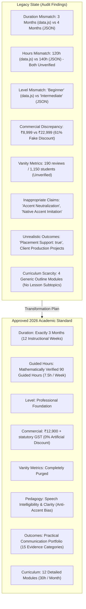
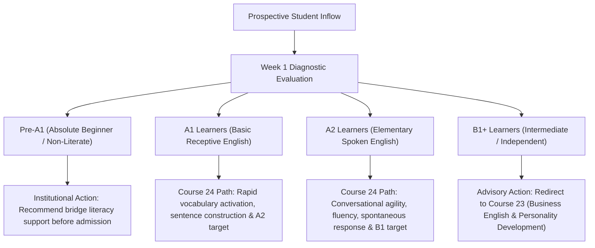
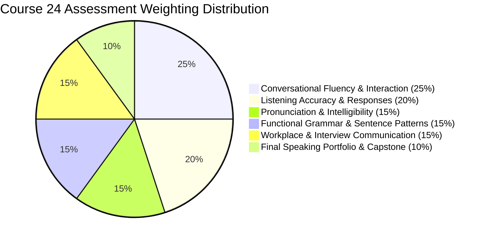
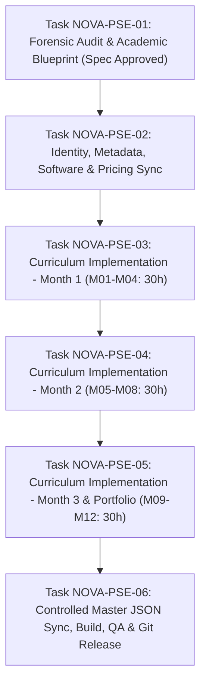

# Academic Specification & Curriculum Blueprint
# Professional Spoken English

> **Document Identifier:** `NOVA-PSE-SPEC-2026-V1`
> **Academic Catalog Sequence:** Course 24 (Academic Catalog Number 24; NOT the course slug)
> **Course Identifier:** `spoken-english-pro`
> **Course Slug:** `professional-spoken-english` (URL: `/course-detail.html?id=spoken-english-pro`)
> **Program Title:** Professional Spoken English
> **Academy Category:** Communication Academy (`communication`)
> **Academic Classification:** Professional Foundation
> **Governing Framework:** Nova Skills Quality & Academic Governance Framework | Modern Spoken English Benchmark 2026
> **Program Duration:** 3 Months (12 Academic Instructional Weeks)
> **Total Guided Instructional Hours:** **90 Guided Hours** (12 weeks $\times$ 7.5 hours/week; three 2.5-hour practical sessions per week)
> **Weekly Instructional Breakdown:** 1.0h Guided Instruction + 4.0h Speaking Labs ($\ge 55\text{--}60\%$ active student speaking) + 1.5h Listening/Pronunciation + 1.0h Feedback/Evaluation
> **Recommended Independent Practice:** 15–20 Minutes Daily (~20–25 Hours total, strictly demarcated from guided hours)
> **Commercial Tuition Standard:** **INR 12,900** + applicable statutory GST (18%: INR 2,322; Total Payable: INR 15,222)
> **Pricing Policy:** 0% Artificial Discounts, Transparent Statutory Tax Disclosure, Truth-in-Education Standard
> **Program Tagline:** *Speak English Clearly. Communicate Confidently. Express Yourself Professionally.*
> **Document Status:** Complete Forensic Repository Audit & Approved Implementation Blueprint (Task NOVA-PSE-01)

---

## 1. Executive Summary & Strategic Positioning

### 1.1 Course Mission & Rationale
Spoken English remains the primary operational bridge across modern Indian and international professional ecosystems. Millions of ambitious students, college graduates, entry-level job-seekers, career transitioners, and working professionals possess basic receptive understanding of English—they can read texts and comprehend video content—yet they experience severe cognitive friction, hesitation, self-doubt, and anxiety when called upon to **speak spontaneously**.

The **Professional Spoken English** program at Nova Skills (Academic Course 24) is engineered as an intensive, 3-month, 90-guided-hour **Professional Foundation** program designed to transition learners from passive comprehension and fragmented sentence formulation into clear, spontaneous, accurate, and confident spoken communication.

Unlike conventional classroom English programs that dwell on passive rote grammar rules, silent reading exercises, and repetitive written fill-in-the-blanks, Course 24 is built on a **Speaking-First Pedagogical Model**:
- $\mathbf{55\text{--}60\%}$ of every instructional hour is dedicated to active, structured student speech production.
- Focus is centered on phonological clarity, natural phrasing, sentence patterns, everyday conversational agility, functional listening, and workplace readiness.
- Students build progressive confidence through guided dialogues, pair role-plays, small-group discussions, voice recordings, and AI-assisted conversational practice.
- The course culminates in an individual **Professional Spoken English Communication Portfolio** comprising 15 verified evidence categories.

### 1.2 Program Key Metrics

| Metric | Approved Specification |
| :--- | :--- |
| **Catalog Sequence** | Course 24 (Academic Catalog Number 24) |
| **Canonical Course ID** | `spoken-english-pro` |
| **Legacy / Semantic Slug** | `professional-spoken-english` (Route: `course-detail.html?id=spoken-english-pro`) |
| **Academy** | Communication Academy (`communication`) |
| **Program Level** | **Professional Foundation** |
| **Duration** | 3 Months (12 Calendar Weeks) |
| **Total Guided Hours** | **90 Guided Hours** (12 weeks $\times$ 7.5 hours/week) |
| **Weekly Schedule** | Three 2.5-hour sessions per week (or five 1.5-hour sessions) |
| **Weekly Composition** | 1.0h Instruction + 4.0h Speaking Labs + 1.5h Listening/Pronunciation + 1.0h Feedback |
| **Independent Practice** | 15–20 minutes daily self-directed practice outside class |
| **Curriculum Structure** | Exactly **12 Modules** (30 guided hours per month across 3 months) |
| **Commercial Tuition** | **INR 12,900** |
| **Regular / Reference Fee** | **INR 12,900** (0% artificial discount; truth-in-pricing standard) |
| **Statutory Taxation** | Applicable statutory GST extra (18%: INR 2,322; Total Payable: INR 15,222) |
| **Capstone Project** | **Professional Spoken English Communication Portfolio** (15 Mandatory Evidence Categories) |
| **Assessment Milestones** | Baseline Diagnostic (Week 1), Midpoint Review (Week 6), Exit Evaluation (Week 12) |
| **Passing Score** | 70% Composite Score across 6 Evaluative Weighted Domains |

---

## 2. Git & Repository Preflight

### 2.1 Git Development Environment
- **Active Branch:** `transformation/nova-course-redesign`
- **Remote Origin:** `https://github.com/waseeullahmansoori/nova-skills-website.git`
- **Head Commit:** `6f6913b` (`feat(communication-academy): upgrade business english and personality development to 144 hours`)
- **Working Tree State:** Clean with respect to communication courses; 4 unrelated draft files (`agency-building.json`, `fiverr-success.json`, `proposal-writing.json`, `upwork-success.json`) remain strictly unstaged and untouched.

### 2.2 Institutional File Locations & Source Relationships

| File / Component | Path in Repository | Role in Course Architecture |
| :--- | :--- | :--- |
| **Academic Specification** | `docs/course-redesign/communication/professional-spoken-english-spec.md` | Primary authoritative academic blueprint (this document). |
| **Detailed Course JSON** | `data/courses/spoken-english-pro.json` | Detailed course content file with full module trees, FAQs, and outcomes. |
| **Consolidated Catalog** | `data.js` (`NS_COURSES` & `NS_ACADEMIES`) | Master frontend catalog registry powering directory, cards, search, and academy listings. |
| **Master 109 JSON** | `nova-skills-109-course-content.json` (Index 79) | Comprehensive institutional course content array used for dynamic deep rendering. |
| **Minified Runtime Asset** | `js/data.min.js` | Authoritative minified distribution generated by `scripts/build_min_js.js`. |
| **Dynamic Page Controller**| `course-detail.js` | Controller managing course metadata, SEO schema, accordions, and price cards. |
| **Academy Portal** | `academies/communication/index.html` | Communication Academy landing page dynamically rendering academy programs. |
| **XML Sitemap** | `sitemap.xml` | Production search engine index generated by `scripts/generate-sitemap.js`. |

---

## 3. Existing Course Forensic Audit (`spoken-english-pro`)

### 3.1 Audit Findings & Data Discrepancies
A comprehensive audit of the existing repository files for Course 24 (`spoken-english-pro`) revealed multiple conflicting values, pedagogical gaps, and ethically problematic claims across source files:

### 3.2 Action Classification Matrix (KEEP / EXPAND / ADD / REMOVE / VERIFY)

| Category / Field | Legacy Source Value | Classification | Action & Academic Rationale |
| :--- | :--- | :---: | :--- |
| **Course ID** | `spoken-english-pro` | **KEEP** | Preserves existing canonical identifier and backward routing stability. |
| **Course Slug** | `professional-spoken-english` | **KEEP** | Maintains SEO URL convention (`course-detail.html?id=spoken-english-pro`). |
| **Academy ID** | `communication` | **KEEP** | Confirmed membership in Communication Academy. |
| **Program Title** | Professional Spoken English | **KEEP** | Market-proven title aligning with student search intent. |
| **Program Level** | `Beginner` / `Intermediate` | **REMOVE / REPLACE** | Standardize to **Professional Foundation** across all 3 source files. |
| **Duration** | 3 Months (`data.js`) / 4 Months (JSON) | **REMOVE / REPLACE** | Standardize strictly to **3 Months** (12 calendar weeks). |
| **Guided Training Hours**| 120 Hours (`data.js`) / 140 Hours (JSON) | **REMOVE / REPLACE** | Replace with mathematically verified **90 Guided Hours** ($12\text{w} \times 7.5\text{h}$). |
| **Selling Price** | INR 8,999 | **REMOVE / REPLACE** | Upgrade to approved tuition of **INR 12,900** + applicable statutory GST. |
| **Original Price** | INR 22,999 | **REMOVE** | Purge fake reference price; enforce 0% artificial discount policy. |
| **Discount Badge** | `61% OFF` | **REMOVE** | Enforce institutional transparency; set `original_price: 12900` equal to selling price. |
| **Accent Claims** | "Accent neutralization", "neutral accent" | **REMOVE** | Purge all accent elimination rhetoric; align with global intelligibility standards. |
| **Native Speaker Claims**| "Understand native speakers easily" | **REMOVE** | Reframe around global international intelligibility and diverse English accents. |
| **Placement Claim** | `placementSupport: true` | **REMOVE** | Foundational English is an enabler, not an employment placement service. |
| **Projects Count** | 2 / 8 "Production Projects" | **REMOVE / REPLACE** | Replace with 15-category **Professional Spoken English Portfolio**. |
| **Vanity Metrics** | 190 reviews / 1,150 students | **REMOVE** | Purge unverified review counts and fake student counts. |
| **Curriculum Modules** | 4 generic modules (4 lessons each) | **EXPAND / REPLACE**| Expand into 12 teachable modules (4 modules/month $\times$ 3 months = 90h). |
| **Curriculum Topics** | Superficial headings | **ADD** | Provide exhaustive main topics, subtopics, classroom activities, and rubrics. |
| **Weekly Structure** | Undefined | **ADD** | Codify 7.5h weekly formula: 1h theory, 4h speaking lab, 1.5h listening, 1h feedback. |
| **Diagnostic Model** | None | **ADD** | Codify Week 1 diagnostic assessment and personalized speaking roadmap. |
| **Speaking Labs** | Ad-hoc | **ADD** | Guarantee 55–60% active student speech production time per session. |
| **Tools Mapping** | 7 generic tools | **EXPAND** | Map 10 primary, supporting, and optional tools (ChatGPT Voice, ELSA, etc.). |
| **Student Privacy** | None | **ADD** | Codify explicit recording consent, safe storage, and AI prompt privacy policies. |
| **Course Differentiation**| Conflated with Course 23 | **VERIFY / CLARIFY**| Establish clear pedagogical boundary separating Course 24 from Course 23. |

---

## 4. Student Proficiency & Entry Governance Policy

### 4.1 Target Learner Profile & Recommended Entry Baseline
The **Professional Spoken English** program is designed for ambitious learners who understand basic English when reading or listening, but face an acute barrier when converting thoughts into spoken words:
- **Recommended Entry Benchmark:** **CEFR A1 (Breakthrough) or higher**, verified via Week 1 diagnostic.
- **Entry Characteristics:**
  - Learner recognizes common English vocabulary and everyday phrases.
  - Learner can read simple English text (social media posts, messages, signboards).
  - Learner hesitates severely, translates internally from mother tongue, or experiences speech anxiety when speaking.

### 4.2 Proficiency Tiers & Institutional Action

1. **Pre-A1 Learners:** Learners lacking basic Latin script literacy or zero vocabulary are advised to complete foundational bridge modules before enrollment to ensure positive classroom experience.
2. **A1 Learners:** Develop basic spontaneous communication, eliminate internal translation lag, and systematically achieve routine A2 communicative capabilities.
3. **A2 Learners:** Consolidate grammatical consistency, expand professional vocabulary, improve speech clarity, and practice entry-level B1 workplace interactions.
4. **B1+ Learners:** Students demonstrating fluent conversational English, complex grammatical mastery, and executive speaking capability are counseled to enroll in **Course 23: Business English & Personality Development** (6 Months, 144 Hours) for advanced business correspondence, executive presence, and negotiation.

### 4.3 Truth-in-Education & Ethical Claims Policy
- **No Guaranteed Fixed CEFR Outcome:** CEFR descriptors are employed strictly as internal pedagogical diagnostic benchmarks. Nova Skills does **not** issue third-party CEFR certifications or promise guaranteed CEFR band leaps.
- **Anti-Accent Elimination Ethics:** The curriculum explicitly repudiates "accent neutralization" or native British/American imitation. Non-native accents are natural linguistic variations. Training evaluates **speech intelligibility, phonological clarity, natural word grouping, vocal projection, and communicative confidence**.
- **No Automatic Fluency Guarantees:** Improvement is directly dependent on active attendance, daily independent practice, and completion of speaking assignments.

---

## 5. Speaking-First Teaching Methodology

### 5.1 The 55–60% Active Student Speech Production Standard
Conventional English instruction fails adult learners because instructors monopolize speaking time through lecture. Course 24 mandates a **Speaking-First Protocol**:
- In every 2.5-hour instructional session, **at least 80–90 minutes (55–60%)** must be active, vocal student speaking output.
- Instructors serve as speech facilitators, drill coaches, and real-time evaluators rather than passive lecturers.

### 5.2 Structured Classroom Instructional Techniques
1. **Choral & Shadowing Drills:** Simultaneous vocal repetition to build muscle memory for English mouth posture, vowel length, and consonant transitions.
2. **Paired Micro-Dialogues:** 2-minute timed conversational exchanges with immediate partner rotation to simulate varied social interactions.
3. **Information Gap Exercises:** Communicative activities where Student A holds missing information required by Student B, forcing spontaneous questioning and clarification.
4. **Spontaneous Response Drills ("Hot Potato"):** 30-to-60-second extemporaneous speech prompts delivered with zero preparation to break internal translation habits.
5. **Real-Life Role-Plays:** Structured simulation of everyday scenarios (ordering food, asking directions, returning a product) and workplace scenarios (introducing a colleague, answering a phone call, booking a calendar slot).
6. **AI Voice Rehearsal Labs:** Guided interaction with AI voice agents for low-anxiety self-paced repetition before live peer speaking.

### 5.3 Batch Size Governance
- **Recommended Cohort Size:** **8 to 12 students per batch**.
- **Pedagogical Rationale:** Cohorts smaller than 8 lack dynamic peer variety for paired role-play; cohorts larger than 12 dilute individualized speaking time and prevent meaningful instructor error correction.

---

## 6. Tools, Platforms & Practical Training Matrix

| Tool / Platform | Category | Primary Educational Role in Course 24 | Licensing / Access Tier | Privacy & Ethics Requirement |
| :--- | :---: | :--- | :--- | :--- |
| **ChatGPT Voice** | Primary | AI conversational speaking partner for 24/7 low-stakes conversational rehearsal and immediate reply drills. | Free mobile app tier (GPT-4o mini voice) is fully sufficient. | Instruct students never to input sensitive personal, financial, or confidential data. |
| **British Council LearnEnglish** | Primary | Standardized listening comprehension audio tracks, dialogue scripts, and interactive vocabulary tasks. | Free open educational resources (web & mobile). | Public access; no data tracking required. |
| **Cambridge Dictionary** | Primary | Authoritative phonetics, audio pronunciations (UK/US), IPA transcription, and contextual example sentences. | Free web and mobile resource. | Standard web access. |
| **Smartphone Voice Recorder / OBS** | Primary | High-fidelity recording of student speech for self-critique, baseline comparison, and portfolio submission. | Native OS utility (free built-in tool). | Local device storage; shared only via secure LMS submission. |
| **Google Sheets / Student LMS** | Primary | Tracking weekly speaking minutes, diagnostic rubric scores, milestone progress, and assignment feedback. | Free Google Workspace / Nova LMS portal. | Secured student-specific progress records. |
| **Cambridge Speak & Improve** | Supporting | Research-backed automated spoken response evaluation for sentence reading and spontaneous short prompts. | Free web platform (Cambridge English initiative). | Anonymous practice mode encouraged. |
| **ELSA Speak** | Supporting | Detailed acoustic speech analyzer evaluating syllable stress, phoneme accuracy, and speech rhythm. | Free tier features utilized for targeted phoneme drills. | Standard app usage; paid upgrades optional, never required. |
| **Otter.ai / Built-in Transcription** | Supporting | Automated speech-to-text transcription enabling students to read back their own spoken syntax and identify filler words. | Free basic tier (300 monthly minutes). | Explicit student consent required prior to recording. |
| **Grammarly / LanguageTool** | Supporting | Verifying sentence construction in written speaking scripts and reflection logs. | Free browser extension / web app. | Standard educational usage. |
| **Google Meet / Zoom / Teams** | Optional | Live video teleconferencing platform for remote live interactive sessions and breakout rooms. | Free student access; institute hosts licensed sessions. | Explicit recording consent; GDPR/DPDP-compliant recording policies. |

---

## 7. Assessment Model & Evaluative Framework

### 7.1 Six-Domain Evaluative Grading Matrix (100% Total)

1. **Conversational Fluency & Interaction (25%):** Speech flow, spontaneous reaction speed, conversation maintenance, natural turn-taking, and minimization of awkward pauses.
2. **Listening Accuracy & Responses (20%):** Accurate auditory comprehension of instructions, questions, and implied meanings; formulating relevant, coherent answers without excessive repetition requests.
3. **Pronunciation & Intelligibility (15%):** Correct syllable stress, clear consonant articulation, vowel distinction, word linking, and vocal projection.
4. **Functional Grammar & Sentence Patterns (15%):** Correct usage of fundamental tenses (present simple/continuous, past simple, future forms), modal verbs, subject-verb agreement, and prepositions in active speech.
5. **Workplace & Interview Communication (15%):** Professional telephone/video etiquette, workplace greetings, concise status updates, structured self-introduction, and professional query responses.
6. **Final Speaking Portfolio & Capstone Presentation (10%):** Completeness, curation, and quality of the 15-category digital portfolio and final 3-minute capstone presentation.

### 7.2 Three Progressive Assessment Milestones

| Assessment Milestone | Instructional Timing | Focus & Evaluative Scope | Required Deliverable | Passing Standard |
| :--- | :---: | :--- | :--- | :---: |
| **Milestone 1: Baseline Diagnostic** | **Week 1 (End of M01)** | Initial pronunciation audit, reading aloud test, 60-second self-introduction, grammar check. | Scored Diagnostic Sheet + Individual Roadmap | Completion & self-reflection |
| **Milestone 2: Midpoint Fluency Review** | **Week 6 (End of M06)** | Spontaneous conversation test, telephone call simulation, functional listening comprehension exam. | 3-minute live paired role-play recording + quiz | $\ge 65\%$ on standard rubric |
| **Milestone 3: Final Exit Capstone** | **Week 12 (End of M12)** | Comprehensive spoken viva: 1-on-1 interview, short public presentation, listening exam, portfolio review. | Evaluated Viva Voce + Complete 15-Artifact Portfolio | $\ge 70\%$ composite score |

---

## 8. Final Capstone: Professional Spoken English Portfolio

### 8.1 The 15 Mandatory Portfolio Evidence Categories
Every graduating student must compile, verify, and submit an individual digital **Professional Spoken English Communication Portfolio**. These are assessable learning evidence artifacts demonstrating individual speech development, **not** commercial software products:

| Category # | Evidence Category Name | Origin Module | Required Artifact & Description | Evaluation Standard |
| :---: | :--- | :---: | :--- | :--- |
| **01** | **Baseline Proficiency Diagnostic** | **M01** | Week 1 audio recording of diagnostic passage and instructor-scored benchmark rubric. | Accurate self-critique and benchmark baseline. |
| **02** | **Individual Speaking Roadmap** | **M01** | Formal personalized development plan setting 12-week goals, target vocabulary, and daily routines. | SMART goal formulation and realistic daily practice plan. |
| **03** | **Polished Self-Introduction** | **M02** | 90-second recorded audio/video introduction covering background, current role, and aspirations. | Grammatical accuracy, smooth transitions, vocal warmth. |
| **04** | **Grammar & Sentence Pattern Tasks** | **M02** | Audio portfolio of 10 spoken sentence transformations across present, past, and future workplace contexts. | Correct tense inflections, no subject-verb agreement errors. |
| **05** | **Pronunciation & Stress Recording** | **M03** | High-fidelity recording reading 20 contrastive word pairs and a challenging phonetic passage. | Clear vowel contrasts, correct syllable stress, minimal slurring. |
| **06** | **Listening Comprehension Log** | **M04** | Written and spoken summary of 3 authentic workplace listening audio tracks from British Council LearnEnglish. | Accurate retention of key details, names, numbers, and intent. |
| **07** | **Recorded Paired Conversation** | **M05** | 3-minute recorded unscripted dialogue with a peer on an everyday conversational topic. | Natural conversational rhythm, active listening, turn-taking. |
| **08** | **Spontaneous Speaking Challenge** | **M06** | 60-second spontaneous extemporaneous audio recorded with zero preparation on an unseen prompt. | Continuous speech production, minimal filler words, coherent flow. |
| **09** | **AI Speaking & Correction Log** | **M08** | 5-day screenshot/audio transcript log of practice sessions with ChatGPT Voice highlighting self-corrections. | Evidence of independent practice and error remediation. |
| **10** | **Workplace Simulation Recording** | **M09** | Audio/video recording of a structured workplace phone call or online meeting simulation. | Professional greeting, clear query framing, courteous signoff. |
| **11** | **Recorded Mock Job Interview** | **M10** | 5-minute video answering 5 core behavioral and introductory interview questions. | Structured answers (STAR method), eye contact, professional tone. |
| **12** | **Short Public Presentation Deck & Video**| **M11** | 3-minute video presentation on a chosen topic supported by 3 structured visual slides. | Clear introduction, body points, conclusion, vocal projection. |
| **13** | **Final Exit Speaking & Listening Exam** | **M12** | Comprehensive scored evaluation sheet from the final instructor-led viva voce examination. | Minimum 70% composite benchmark across all 6 domains. |
| **14** | **Before/After Speech Comparison** | **M12** | Side-by-side comparative audio edit pairing Week 1 baseline with Week 12 final speech samples. | Demonstrable growth in fluency, pause reduction, and clarity. |
| **15** | **Continuing Learning Plan** | **M12** | Formal 6-month post-course independent learning strategy for sustained language maintenance. | Specific daily listening, reading, and speaking habits documented. |

---

## 9. Course Differentiation: Course 24 vs. Course 23

A primary governance objective of NOVA-PSE-01 is establishing an unshakeable academic demarcation between Course 24 and Course 23 in the Communication Academy:

```mermaid
flowchart LR
  subgraph Course24["Course 24: Professional Spoken English"]
    direction TB
    C24_1["Duration: 3 Months | 90 Guided Hours"]
    C24_2["Level: Professional Foundation"]
    C24_3["Tuition: ₹12,900 + GST"]
    C24_4["Target: CEFR A1 → A2 / Early B1"]
    C24_5["Core Focus: Spoken Fluency, Pronunciation Clarity, Daily Conversations, Foundational Grammar, Basic Workplace & Interview Speaking"]
    C24_6["Methodology: 55-60% Student Speaking Labs, Pair Drills, Choral Practice"]
  end

  subgraph Course23["Course 23: Business English & Personality Development"]
    direction TB
    C23_1["Duration: 6 Months | 144 Guided Hours"]
    C23_2["Level: Career Mastery"]
    C23_3["Tuition: ₹29,900 + GST"]
    C23_4["Target: CEFR B1 → B2 / C1"]
    C23_5["Core Focus: Executive Writing, Cross-Functional Negotiations, Advanced Public Speaking, Emotional Intelligence, 6 Career Tracks"]
    C23_6["Methodology: Case Studies, High-Stakes Simulations, Technical Corresp."]
  end

  Course24 -->|Natural Progression Pathway| Course23
```

### Detailed Differentiation Matrix

| Pedagogical Dimension | Course 24: Professional Spoken English | Course 23: Business English & Personality Development |
| :--- | :--- | :--- |
| **Catalog Sequence** | Course 24 | Course 23 |
| **Canonical ID** | `spoken-english-pro` | `business-english` |
| **Academic Level** | **Professional Foundation** | **Career Mastery** |
| **Duration & Hours** | **3 Months / 90 Guided Hours** | **6 Months / 144 Guided Hours** |
| **Tuition Standard** | **INR 12,900** + statutory GST | **INR 29,900** + statutory GST |
| **Entry Ability** | CEFR A1 (Basic understanding, speech hesitation) | CEFR A2/B1 (Functional speaking, seeking executive polish) |
| **Primary Modality** | **Spoken communication & active speech fluency** | **Integrated Spoken, Written, Leadership & Interpersonal** |
| **Grammar Scope** | Functional sentence structures, verb tenses, word order | Complex corporate syntax, subtle modal nuances, document hygiene |
| **Business Writing** | Basic short messages and simple email greetings (M09) | Comprehensive executive proposals, SOPs, documentation, emails |
| **Workplace Scope** | Basic workplace small talk, status updates, phone calls | Cross-functional alignment, crisis handling, multi-party negotiation |
| **Role-Specific Tracks**| General workplace foundations across entry roles | **6 Dedicated Specialization Tracks** (IT, Design, Sales, Video, Ops, Freelance) |
| **Personality & EQ** | Foundational speaking confidence, posture, eye contact | Comprehensive emotional intelligence, conflict styles, leadership |
| **Student Pathway** | Foundational launchpad for all aspiring speakers | Capstone professional mastery for leaders, executives & specialists |

---

## 10. Complete 12-Module Curriculum Architecture (90 Guided Hours)

```mermaid
gantt
  title Course 24: 12-Week Instructional Timeline (90 Guided Hours)
  dateFormat  X
  axisFormat Week %s
  section Month 1: Clear Speech & Foundations (30h)
  M01 Diagnostic & Speaking Roadmap (4h)         :0, 1
  M02 Functional Grammar & Sentences (10h)       :1, 2
  M03 Pronunciation & Voice Control (8h)         :2, 3
  M04 Everyday Vocabulary & Listening (8h)       :3, 4
  section Month 2: Fluency & Interaction (30h)
  M05 Fluency & Spontaneous Speaking (10h)       :4, 6
  M06 Everyday Conversations & Social (8h)       :6, 7
  M07 Listening Accuracy & Responses (6h)        :7, 8
  M08 AI-Assisted Speaking Practice (6h)         :8, 9
  section Month 3: Workplace & Capstone (30h)
  M09 Workplace English & Conversations (9h)     :9, 10
  M10 Interview English & Self-Intro (7h)        :10, 11
  M11 Public Speaking & Presentations (8h)       :11, 12
  M12 Final Assessment & Capstone (6h)           :12, 13
```

---

### MONTH 1 — 30 GUIDED HOURS
#### THEME: FOUNDATIONS OF CLEAR SPEECH, FUNCTIONAL GRAMMAR & LISTENING

---

#### MODULE 01: English Assessment & Personal Speaking Roadmap
- **Module ID:** `M01`
- **Duration:** **4 Guided Hours** (Week 1)
- **Module Purpose:** Establish an objective, non-judgmental baseline diagnostic of each student's current spoken English ability; identify primary hesitation triggers, pronunciation challenges, and internal translation patterns; co-create a personalized 12-week speaking roadmap with daily measurable habits.
- **Primary Tool:** Smartphone Voice Recorder / OBS Studio + Google Sheets Progress Tracker.
- **Supporting Tools:** Cambridge Dictionary (Audio), Diagnostic Scoring Sheet.
- **Learning Objectives:**
  - Complete a standardized 6-factor diagnostic spoken assessment.
  - Identify individual speech friction points (hesitation, translation lag, vowel confusion, filler words).
  - Formulate an Individual Development Plan (IDP) with SMART weekly speech milestones.
  - Establish a non-intimidating, high-trust classroom speaking culture.
- **Main Topics:**
  1. *Understanding the Mechanics of Spoken English vs. Written English:* Why reading knowledge does not automatically translate into speech; the role of speech muscle memory; overcoming the fear of grammatical mistakes.
  2. *The 6-Factor Baseline Diagnostic:* Testing phoneme clarity, syllable stress, spontaneous fluency, sentence structure, listening accuracy, and conversational confidence.
  3. *Overcoming Speech Anxiety & Insecurity:* Cognitive reframing of errors as learning iterations; vocal warm-ups and diaphragmatic breathing techniques for nervous speakers.
  4. *Constructing the Individual Speaking Roadmap:* Setting realistic daily speaking targets (15–20 min/day); establishing audio journaling routines.
- **Teachable Subtopics:**
  - 1.1 The physiology of speech: tongue placement, breath support, and vocal resonance.
  - 1.2 Identifying internal mother-tongue translation lag and techniques to bypass it.
  - 1.3 Baseline diagnostic administration: reading aloud, describing a picture, answering introductory questions.
  - 1.4 Setting up personal digital audio folders for portfolio artifact management.
- **Instructor Demonstrations:**
  - Instructor models contrast between hesitant, internally translated speech and relaxed, rhythmically grounded spoken English.
  - Step-by-step diagnostic demonstration: how an instructor scores speech without causing embarrassment.
- **Classroom Practicals & Speaking Labs (3.0h):**
  - *Exercise 1.1:* 60-second spontaneous introductory check-in ("Who I am and what I want to achieve").
  - *Exercise 1.2:* Baseline diagnostic reading test recorded to individual student folders.
  - *Exercise 1.3:* Pair interview: students interview their partner and introduce them to the class.
- **Listening & Pronunciation Practicals:**
  - Focused listening: identifying speech rate and pause frequency in sample recordings.
- **AI-Assisted Practice:**
  - Setting up ChatGPT Voice on mobile devices; completing a first 2-minute introductory chat with AI.
- **Student Assignments & Deliverables:**
  - Submit baseline diagnostic audio recording (Category 01).
  - Complete and submit Individual Speaking Roadmap (Category 02).
- **Assessment Criteria:**
  - Objectivity of self-assessment; clarity of baseline recording; completion of SMART goals.

---

#### MODULE 02: Functional Grammar & Sentence Construction
- **Module ID:** `M02`
- **Duration:** **10 Guided Hours** (Weeks 1–2)
- **Module Purpose:** Demystify English grammar by focusing strictly on **functional, spoken sentence patterns** rather than abstract syntactic nomenclature; eliminate core spoken tense errors; build automaticity in affirmative, negative, interrogative, and modal sentence formation.
- **Primary Tool:** Google Docs / Whiteboard + Voice Recorder.
- **Supporting Tools:** Grammarly (for written verification), Interactive Grammar Cards.
- **Learning Objectives:**
  - Master the 4 high-frequency spoken tenses (Present Simple, Present Continuous, Past Simple, Future with *will* / *going to*).
  - Formulate questions and negative sentences instantaneously without hesitation.
  - Apply modal auxiliary verbs (*can*, *could*, *should*, *would*, *must*, *may*) to express politeness, ability, and advice.
  - Eliminate common Indian English syntax errors (e.g., "I am having two brothers", "He didn't went").
- **Main Topics:**
  1. *Functional Spoken Tenses in Daily Life:*
     - Talking about daily routines and permanent states (Present Simple: *I work*, *she lives*).
     - Describing current actions and temporary situations (Present Continuous: *I am preparing*).
     - Narrating past events, yesterday's activities, and completed tasks (Past Simple: *I completed*, *she called*).
     - Planning future actions and appointments (Future: *I will send*, *we are going to meet*).
  2. *Instantaneous Question Formation:* The "QUASM" formula (Question word + Auxiliary + Subject + Main verb); converting statements into open-ended and closed (yes/no) questions.
  3. *Polite Workplace Modals:* Softening statements using *could you please*, *would you mind*, *I should clarify*, *may I suggest*.
  4. *Prepositions of Time and Place in Speech:* Natural spoken use of *in*, *on*, *at*, *by*, *for*, *since* without grammatical overthinking.
- **Teachable Subtopics:**
  - 2.1 Regular vs. irregular past tense verbs in speech (distinguishing *talked*, *went*, *bought*, *thought*).
  - 2.2 Third-person singular 's' agreement (*he works*, *she manages*, *it takes*).
  - 2.3 Eliminating double negatives and double past tense forms (*did not see* vs *did not saw*).
  - 2.4 Short conversational responses and question tags (*Yes, I do*; *No, he isn't*; *haven't you?*).
- **Instructor Demonstrations:**
  - Live transformation drill: instructor throws a simple affirmative statement and transforms it instantly into 4 tenses, negative form, and 2 question types.
- **Classroom Practicals & Speaking Labs (6.0h):**
  - *Drill 2.1:* "Tense Wheel Rapid Fire": Students respond in designated tense within 3 seconds of prompt.
  - *Drill 2.2:* "20 Questions Game": Students deduce a hidden profession or object using only grammatically accurate yes/no questions.
  - *Drill 2.3:* "Yesterday's Chronicle": 90-second uninterrupted past-tense narrative of yesterday's routine.
- **Listening & Pronunciation Practicals:**
  - Auditory discrimination of past tense '-ed' endings (/t/, /d/, /ɪd/ as in *worked*, *lived*, *started*).
- **AI-Assisted Practice:**
  - Prompting ChatGPT Voice: "Act as an English conversational coach. Ask me 5 questions about my daily routine and correct my tense errors politely."
- **Student Assignments & Deliverables:**
  - Recorded 90-second self-introduction applying functional sentence patterns (Category 03).
  - Recorded audio submission of 10 spoken tense transformation drills (Category 04).
- **Assessment Criteria:**
  - Tense accuracy ($\ge 80\%$ on spoken tasks); correct auxiliary verb positioning; question formation fluency.

---

#### MODULE 03: Pronunciation, Speech Clarity & Voice Control
- **Module ID:** `M03`
- **Duration:** **8 Guided Hours** (Week 3)
- **Module Purpose:** Transform muffled, rushed, or indistinct speech into crisp, well-projected, intelligible English; teach phonological mechanics, vowel contrasts, consonant articulation, word stress, and rhythm without imposing native accent mimicry.
- **Primary Tool:** Cambridge Dictionary (Audio IPA) + Voice Recorder.
- **Supporting Tools:** ELSA Speak (phoneme analyzer), Speech Mirror.
- **Learning Objectives:**
  - Articulate challenging English consonant contrasts (/v/ vs /w/, /p/ vs /b/, /s/ vs /ʃ/ vs /tʃ/, /θ/ vs /ð/).
  - Differentiate long vs short vowels (e.g., *ship* vs *sheep*, *full* vs *fool*, *bit* vs *beat*).
  - Master English syllable stress rules to ensure immediate intelligibility in multisyllabic words.
  - Modulate vocal projection, volume, pitch variation, and speech pace.
- **Main Topics:**
  1. *Vowel Clarity and Consonant Articulation:*
     - The English vowel chart: differentiating 12 monophthongs and 8 diphthongs.
     - Resolving common regional mother-tongue influences (MTI) on consonant pairs.
  2. *Syllable Stress & Word Accentuation:*
     - Why English is a stress-timed language, not a syllable-timed language.
     - Primary and secondary stress patterns (*'photograph*, *pho'tographer*, *photo'graphic*).
  3. *Sentence Stress & Word Grouping (Chunking):*
     - Stressed content words (nouns, verbs, adjectives) vs unstressed function words.
     - Pausing naturally at thought boundaries; avoiding breathless run-on sentences.
  4. *Connected Speech Fundamentals:*
     - Linking sounds (consonant-to-vowel linking: *an apple*, *turn on*).
     - Weak forms of common prepositions and auxiliary verbs (*to*, *for*, *can*, *was*).
- **Teachable Subtopics:**
  - 3.1 Resolving /v/ and /w/ confusion (*very* vs *wary*, *vine* vs *wine*).
  - 3.2 Clear pronunciation of plural '-s' and third-person '-s' (/s/, /z/, /ɪz/).
  - 3.3 Intonation patterns: rising intonation in yes/no questions, falling intonation in statements.
  - 3.4 Eliminating vocal fry, mumbling, and excessive speech speed.
- **Instructor Demonstrations:**
  - Acoustic modeling: exaggerating mouth shape and lip positions for vowel contrasts.
  - Real-time sentence chunking demonstration showing how pausing dramatically enhances authority.
- **Classroom Practicals & Speaking Labs (5.0h):**
  - *Drill 3.1:* "Minimal Pairs Challenge": Pair-wise reading of contrastive minimal pair lists (*ship/sheep*, *cat/cut*, *wet/vet*).
  - *Drill 3.2:* "Syllable Clapping": Clapping hands on stressed syllables in 3- and 4-syllable professional vocabulary.
  - *Drill 3.3:* "Shadow Reading": Speaking concurrently with a professional audio model to match rhythm and pace.
- **Listening & Pronunciation Practicals:**
  - Auditory discrimination tests identifying whether the speaker said word A or word B.
- **AI-Assisted Practice:**
  - Practicing minimal pairs using ELSA Speak phoneme feedback drills for 15 minutes.
- **Student Assignments & Deliverables:**
  - High-fidelity audio recording reading 20 contrastive word pairs and a phonetic passage (Category 05).
- **Assessment Criteria:**
  - Phonological intelligibility; accuracy of syllable stress; breath control and vocal projection.

---

#### MODULE 04: Everyday Vocabulary & Listening Comprehension
- **Module ID:** `M04`
- **Duration:** **8 Guided Hours** (Week 4)
- **Module Purpose:** Rapidly expand active, spoken vocabulary for daily situations; develop sharp listening comprehension skills to process authentic spoken English without needing subtitles or repeated playback.
- **Primary Tool:** British Council LearnEnglish (Listening Tracks) + Cambridge Dictionary.
- **Supporting Tools:** Anki / Quizlet digital vocabulary flashcards.
- **Learning Objectives:**
  - Acquire 250+ high-frequency active conversational words, collocations, and idiomatic expressions.
  - Comprehend short conversations, instructions, announcements, and queries on first listen.
  - Extract specific details (names, numbers, directions, dates, prices) from spoken passages.
  - Paraphrase and summarize spoken information concisely in student's own words.
- **Main Topics:**
  1. *Active vs Passive Vocabulary in Spoken English:* Why memorizing dictionary word lists fails; the power of learning words in natural collocations (*make a decision*, *take a break*, *give a call*, *do business*).
  2. *High-Frequency Situational Vocabulary:*
     - Daily routines, personal interests, family, and home life.
     - Food, dining out, shopping, prices, and consumer transactions.
     - Travel, transportation, asking for directions, and scheduling appointments.
     - Health, fitness, emergencies, and medical consultations.
  3. *Active Listening Strategies:*
     - Listening for gist (overall topic) vs listening for specific information (dates, figures).
     - Recognizing discourse markers (*however*, *on the other hand*, *first of all*, *finally*).
  4. *Spoken Summarization & Paraphrasing:* Techniques to synthesize a 2-minute dialogue into a 30-second spoken summary.
- **Teachable Subtopics:**
  - 4.1 Common phrasal verbs for daily conversation (*look forward to*, *call off*, *figure out*, *run out of*).
  - 4.2 Describing feelings, emotions, and physical states with precise vocabulary.
  - 4.3 Handling listening breakdowns politely (*Could you say that once more?*, *Did you mean...?*).
  - 4.4 Organizing a digital personal vocabulary notebook on Google Sheets or mobile flashcards.
- **Instructor Demonstrations:**
  - Live "Think Aloud" listening demo: instructor plays an authentic audio dialogue and demonstrates real-time note-taking and immediate spoken summarization.
- **Classroom Practicals & Speaking Labs (4.5h):**
  - *Drill 4.1:* "Collocation Dominoes": Rapid-fire pairing of verbs with appropriate noun collocations.
  - *Drill 4.2:* "Describe and Draw": Student A describes an everyday layout or scene; Student B draws it based strictly on spoken clues.
  - *Drill 4.3:* "Audio Summary Relay": Students listen to a 90-second audio track and take turns speaking 1 sentence summarizing key points.
- **Listening & Pronunciation Practicals:**
  - 4 listening comprehension drills from British Council LearnEnglish A2/B1 tracks with comprehension quizzes.
- **AI-Assisted Practice:**
  - ChatGPT Voice prompt: "Describe an everyday scenario at an airport or restaurant. Ask me 3 comprehension questions, and then let's converse about it."
- **Student Assignments & Deliverables:**
  - Completed Listening Comprehension Log analyzing 3 authentic workplace audio tracks (Category 06).
- **Assessment Criteria:**
  - Listening accuracy ($\ge 75\%$ on comprehension checks); correct natural collocation usage; summarization fluency.

---

### MONTH 2 — 30 GUIDED HOURS
#### THEME: CONVERSATIONAL FLUENCY, SOCIAL AGILITY & AI-ASSISTED PRACTICE

---

#### MODULE 05: Conversational Fluency & Spontaneous Speaking
- **Module ID:** `M05`
- **Duration:** **10 Guided Hours** (Weeks 5–6)
- **Module Purpose:** Break the barrier of hesitation; eliminate internal translation lag; develop the capacity to speak spontaneously for 60 to 120 seconds on diverse everyday topics without freezing or over-relying on filler words.
- **Primary Tool:** Voice Recorder + Random Topic Generator.
- **Supporting Tools:** Stopwatch / Timer, Spontaneous Speaking Flashcards.
- **Learning Objectives:**
  - Speak continuously for 90 seconds on an unseen topic with minimal hesitation.
  - Apply the "PREP" framework (Point, Reason, Example, Point) to organize spontaneous thoughts.
  - Reduce conversational filler sounds (*um*, *uh*, *like*, *you know*) by adopting confident micro-pauses.
  - Initiate, maintain, and gracefully close informal conversations.
- **Main Topics:**
  1. *The Cognitive Psychology of Fluency:*
     - The distinction between accuracy and fluency; prioritizing message delivery over perfectionism.
     - Techniques to bypass the internal mental translator.
  2. *Spontaneous Speech Structuring Frameworks:*
     - The PREP framework for expressing opinions.
     - The Past-Present-Future framework for talking about life experiences and hobbies.
     - The Rule of Three: organizing points into three crisp thoughts.
  3. *Filler Word Elimination & Strategic Pausing:*
     - Why we use fillers (nervousness, cognitive searching); replacing vocalized fillers with silent breath pauses.
     - Buying thinking time naturally (*That's an interesting question*, *Let me think about that for a moment*).
  4. *Conversational Bridges & Connectors:*
     - Using conversational signposts (*Speaking of which*, *To be honest*, *As far as I know*, *Generally speaking*).
- **Teachable Subtopics:**
  - 5.1 The "Just a Minute" (JAM) methodology: speaking without hesitation, repetition, or deviation.
  - 5.2 Transition words that make spoken sentences flow smoothly (*besides*, *moreover*, *actually*, *luckily*).
  - 5.3 Developing conversational stamina through progressive time expansion (30s $\to$ 60s $\to$ 90s $\to$ 120s).
  - 5.4 Active body language that reinforces fluency: open stance, eye engagement, and natural hand gestures.
- **Instructor Demonstrations:**
  - Unrehearsed JAM session: instructor takes an audience-generated topic and demonstrates smooth PREP execution with zero filler words.
- **Classroom Practicals & Speaking Labs (6.5h):**
  - *Drill 5.1:* "Hot Potato JAM": Randomly selected students speak for 45 seconds on an impromptu prompt.
  - *Drill 5.2:* "PREP Table Battles": Pairs debate lightweight everyday topics (*Tea vs Coffee*, *Working from Home vs Office*) using PREP.
  - *Drill 5.3:* "Filler Word Penalty Box": Student speaks for 60 seconds; peers gently raise hand upon hearing an unnecessary filler word.
- **Listening & Pronunciation Practicals:**
  - Analyzing speech transcripts to calculate personal speech rate (words per minute) and pause distribution.
- **AI-Assisted Practice:**
  - ChatGPT Voice prompt: "Give me an impromptu topic. Listen to me speak for 60 seconds, then evaluate my structure, vocabulary, and flow."
- **Student Assignments & Deliverables:**
  - Recorded 3-minute unscripted conversation with a peer on an everyday topic (Category 07).
- **Assessment Criteria:**
  - Speech continuity; adherence to PREP structure; reduction in filler word density ($\le 3$ per minute).

---

#### MODULE 06: Everyday Conversations & Social Communication
- **Module ID:** `M06`
- **Duration:** **8 Guided Hours** (Week 6–7)
- **Module Purpose:** Equip learners with the practical spoken language required to navigate real-world social interactions, build rapport with strangers and colleagues, master social small talk, and express opinions, agreements, and polite disagreements with cultural sensitivity.
- **Primary Tool:** Role-Play Simulation Stations + Voice Recorder.
- **Supporting Tools:** Social Situations Cue Cards, Everyday Dialogue Audio Tracks.
- **Learning Objectives:**
  - Initiate and sustain small talk with colleagues, acquaintances, and strangers.
  - Express agreement, disagreement, and mixed opinions politely and diplomatically.
  - Make polite requests, ask for assistance, apologize sincerely, and express gratitude.
  - Navigate everyday service encounters (cafes, retail stores, public transport, clinics) with confidence.
- **Main Topics:**
  1. *The Art of Professional & Social Small Talk:*
     - Safe small talk topics (weather, weekend plans, hobbies, city traffic, sports) vs unsafe topics (politics, religion, personal finances).
     - The "Question-Answer-Add" (QAA) conversational technique to prevent awkward dead ends.
  2. *Expressing Opinions, Agreement & Diplomatic Disagreement:*
     - Strong vs softened opinions (*In my opinion*, *It seems to me that*, *I feel that*).
     - Polite disagreement formulas (*I see your point, but...*, *I'm not so sure about that*, *That's interesting, although...*).
  3. *Polite Social Formulas & Everyday Etiquette:*
     - Making polite requests (*Could you possibly...*, *Would it be okay if...*).
     - Sincere apologies and responses (*I do apologize for the delay*, *No problem at all*, *Don't worry about it*).
     - Giving and receiving compliments graciously.
  4. *Real-World Service Encounters:*
     - Ordering food and clarifying dietary preferences at restaurants.
     - Inquiring about products, asking for prices, and discussing refunds in retail stores.
     - Booking appointments and asking for directions.
- **Teachable Subtopics:**
  - 6.1 Conversational icebreakers that spark natural dialogue.
  - 6.2 Active conversation exit strategies: ending a conversation warmly without being abrupt.
  - 6.3 Voice modulation in social settings: matching the conversational tone of the room.
  - 6.4 Cultural awareness: personal space, eye contact, and conversational proximity.
- **Instructor Demonstrations:**
  - Role-play breakdown: instructor and teaching assistant demonstrate an awkward dead-end conversation vs a lively, engaging QAA conversation.
- **Classroom Practicals & Speaking Labs (5.0h):**
  - *Simulation 6.1:* "Networking Mixer Simulation": Classroom converted into an informal social lounge; students circulate, introduce themselves, and sustain 3-minute small talk with at least 4 different peers.
  - *Simulation 6.2:* "The Service Counter": Staged role-plays (restaurant ordering, flight check-in, retail return).
  - *Simulation 6.3:* "Diplomatic Debate": Discussing everyday controversial topics using polite disagreement language.
- **Listening & Pronunciation Practicals:**
  - Auditory analysis of tone: identifying whether a speaker sounds polite, irritated, hesitant, or welcoming.
- **AI-Assisted Practice:**
  - Role-playing with ChatGPT Voice: "Act as a friendly colleague at a coffee machine on Monday morning. Start a casual small talk conversation with me."
- **Student Assignments & Deliverables:**
  - 60-second spontaneous extemporaneous audio recorded with zero preparation on an unseen prompt (Category 08).
- **Assessment Criteria:**
  - Natural turn-taking; application of QAA technique; diplomatic vocabulary in disagreements.

---

#### MODULE 07: Listening Accuracy & Real-Time Response Skills
- **Module ID:** `M07`
- **Duration:** **6 Guided Hours** (Week 7–8)
- **Module Purpose:** Sharpen cognitive auditory processing so students can understand diverse spoken accents, track rapid conversations, capture implicit meaning, and formulate accurate, real-time responses without asking speakers to repeat themselves multiple times.
- **Primary Tool:** Multi-Accent Listening Corpus (British Council / TED-Ed) + Audio Player.
- **Supporting Tools:** Comprehension Response Worksheets, Acoustic Headphones.
- **Learning Objectives:**
  - Understand diverse English accents (Indian regional, British RP, General American, Australian, Global Non-Native).
  - Track conversation flow at normal native/near-native speaking speed (130–160 wpm).
  - Extract instructions, deadlines, conditional statements, and key details accurately.
  - Formulate instant, coherent spoken responses in real-time dialogue.
- **Main Topics:**
  1. *Deciphering Global Accents & Speech Varieties:*
     - Recognizing key phonological differences between British, American, and Global English accents (rhotic vs non-rhotic 'r', flap 't', vowel variations).
     - Overcoming the psychological fear of unfamiliar accents.
  2. *Real-Time Cognitive Information Extraction:*
     - Active listening vs passive hearing; mental note-taking strategies.
     - Recognizing tone shifts, vocal emphasis, and sarcasm or reluctance in spoken responses.
  3. *Formulating Instant Conversational Replies:*
     - Bridging the gap between listening and speaking; formulating responses while listening without losing focus.
     - Techniques for buying 2–3 seconds of processing time (*That's a valid point*, *Let me address that*).
  4. *Clarification & Verification Strategies:*
     - Professional phrases to confirm understanding (*If I understand correctly, you are saying...*, *Just to clarify, do you mean X or Y?*).
- **Teachable Subtopics:**
  - 7.1 Identifying reduced vowels (schwa /ə/) in fast connected speech (*wanna*, *gonna*, *should've*).
  - 7.2 Following multi-step spoken instructions without note-taking.
  - 7.3 Emotional listening: detecting urgency, enthusiasm, or hesitation in a colleague's voice.
  - 7.4 Handling poor audio quality or background noise during online voice calls.
- **Instructor Demonstrations:**
  - Live "Accent Decryptor" demo: instructor plays an accented clip, breaks down the phonetic substitutions, and demonstrates how to comprehend it easily.
- **Classroom Practicals & Speaking Labs (3.5h):**
  - *Drill 7.1:* "Instruction Follower": Student listens to a complex 4-step verbal instruction and executes it or repeats it back verbatim.
  - *Drill 7.2:* "Rapid Response Fire": Instructor plays short audio queries; students must deliver an immediate appropriate spoken response within 2 seconds.
  - *Drill 7.3:* "Paraphrase Relay": Student A speaks for 1 minute; Student B must immediately summarize the key message before responding.
- **Listening & Pronunciation Practicals:**
  - Comprehensive listening test featuring 3 distinct accent audio clips with detailed multi-choice and short-answer prompts.
- **AI-Assisted Practice:**
  - ChatGPT Voice prompt: "Speak to me with varied conversational pacing. Tell me a 2-minute workplace story, then quiz me on the details."
- **Student Assignments & Deliverables:**
  - Midpoint Comprehensive Spoken & Listening Assessment submission (evaluated in-class).
- **Assessment Criteria:**
  - Auditory comprehension accuracy ($\ge 75\%$); response latency ($\le 3$ seconds); precision of spoken summaries.

---

#### MODULE 08: AI-Assisted Conversation & Personalized Speaking Practice
- **Module ID:** `M08`
- **Duration:** **6 Guided Hours** (Weeks 8–9)
- **Module Purpose:** Empower students to leverage cutting-edge conversational AI voice tools as high-frequency, non-judgmental, personalized speaking coaches; establish self-directed daily speaking routines; integrate ethical AI guidelines and privacy standards.
- **Primary Tool:** ChatGPT Voice (Mobile / Web) + Cambridge Speak & Improve.
- **Supporting Tools:** ELSA Speak, Speech Reflection Journal.
- **Learning Objectives:**
  - Configure and interact with ChatGPT Voice for structured daily English conversation practice.
  - Craft effective spoken voice prompts to simulate realistic dialogue partners (interviewers, colleagues, tourists).
  - Use automated speech analysis tools to pinpoint individual phoneme, intonation, and grammatical weaknesses.
  - Maintain an ethical, privacy-conscious approach to AI practice tools.
- **Main Topics:**
  1. *AI as a 24/7 Low-Anxiety Speaking Partner:*
     - The benefits of zero-judgment AI practice for anxious and beginner speakers.
     - Why AI voice practice supplements—but never replaces—human conversational practice.
  2. *Prompt Engineering for Spoken Practice:*
     - How to prompt ChatGPT Voice for targeted language roles (*"Act as a friendly hiring manager for an entry-level position..."*, *"Act as an impatient customer calling support..."*).
     - Asking AI for immediate conversational correction after every response.
  3. *Acoustic Speech Analyzers (ELSA & Speak & Improve):*
     - Interpreting automated phoneme scores, syllable stress charts, and CEFR-estimated speech levels.
     - Setting up 10-minute micro-drills targeting identified phonological blind spots.
  4. *Ethical AI Usage, Privacy & Accuracy Limitations:*
     - Safeguarding personal privacy: never inputting Aadhaar numbers, passwords, bank details, or confidential workplace data.
     - Recognizing AI hallucination and occasional pronunciation inaccuracies.
- **Teachable Subtopics:**
  - 8.1 Voice settings on mobile AI apps: selecting appropriate accents and speech speeds for practice.
  - 8.2 Creating a 15-minute daily "Morning Speech Routine" with AI voice agents.
  - 8.3 Logging recurring grammatical errors surfaced during AI conversations.
  - 8.4 Balancing AI practice (40%) with live human peer practice (60%).
- **Instructor Demonstrations:**
  - Live projection of mobile phone screen running ChatGPT Voice: instructor engages in a 3-minute role-play, shows how AI corrects a grammatical mistake in real time.
- **Classroom Practicals & Speaking Labs (3.5h):**
  - *Lab 8.1:* "AI Role-Play Sprint": Every student conducts an individual 10-minute voice session with ChatGPT Voice on an assigned scenario (e.g., negotiating a late fee, booking a hotel room).
  - *Lab 8.2:* "Peer AI Cross-Check": Student shares an interesting response received from AI; peers discuss and practice replying to it.
  - *Lab 8.3:* "Speak & Improve Benchmarking": Students complete 2 standardized speech tasks on Cambridge Speak & Improve and record initial scores.
- **Listening & Pronunciation Practicals:**
  - Shadowing AI-generated audio clips to practice rhythm, pause timing, and clear consonant finishes.
- **AI-Assisted Practice:**
  - Independent 20-minute daily AI voice session documented in student reflection logs.
- **Student Assignments & Deliverables:**
  - Complete 5-day AI Speaking & Correction Log documenting prompts, practice topics, and identified self-corrections (Category 09).
- **Assessment Criteria:**
  - Consistency of AI practice logs; variety of conversational prompts used; quality of self-reflection on errors.

---

### MONTH 3 — 30 GUIDED HOURS
#### THEME: WORKPLACE ENGLISH, INTERVIEWS, PRESENTATIONS & EXIT CAPSTONE

---

#### MODULE 09: Workplace English & Professional Conversations
- **Module ID:** `M09`
- **Duration:** **9 Guided Hours** (Weeks 9–10)
- **Module Purpose:** Transition everyday spoken conversational skills into the professional sphere; master workplace greetings, telephone and video call etiquette, polite inquiry framing, standup status updates, and collaborative team conversations.
- **Primary Tool:** Google Meet / Zoom + Voice Recorder.
- **Supporting Tools:** Workplace Messaging Templates, Meeting Agenda Cards.
- **Learning Objectives:**
  - Conduct professional telephone and video calls with polished greetings, clear queries, and courteous closings.
  - Deliver concise 60-second daily standup updates (*What I did yesterday, what I'm doing today, blockers*).
  - Frame professional requests, clarifications, and status checks with diplomatic tact.
  - Participate constructively in team discussions and brainstorming sessions.
- **Main Topics:**
  1. *Professional Spoken Etiquette in Corporate Environments:*
     - The distinction between informal social English and professional workplace communication.
     - Professional greetings, addressing superiors and peers, and email/chat voice synchronization.
  2. *Telephone & Video Call Protocols:*
     - Answering calls professionally (*Good morning, Nova Skills, this is Rahul speaking, how may I assist you?*).
     - Taking messages, transferring calls, asking callers to hold, and handling dropped connections.
     - Video call hygiene: camera eye contact, unmuting etiquette, and concise speaking.
  3. *Agile Standups & Daily Status Updates:*
     - The 3-part standup formula: Past achievement, Present priority, Impeding blocker.
     - Keeping updates crisp, relevant, and under 60 seconds without rambling.
  4. *Constructive Team Collaboration & Meeting Contributions:*
     - Interrupting politely (*May I add a quick point here?*, *Sorry to jump in, but...*).
     - Building on someone else's idea (*Building on what Priya mentioned...*).
     - Clarifying action items and meeting conclusions.
- **Teachable Subtopics:**
  - 9.1 Professional vocabulary for scheduling, rescheduling, and canceling appointments.
  - 9.2 Explaining unexpected delays or technical problems diplomatically.
  - 9.3 Professional leave requests and emergency phone calls to managers.
  - 9.4 Leaving clear, articulate professional voicemails.
- **Instructor Demonstrations:**
  - Mock telephone call demonstration: instructor handles an ambiguous caller, extracts all necessary information courteously, and leaves a precise written/spoken message.
- **Classroom Practicals & Speaking Labs (5.5h):**
  - *Simulation 9.1:* "Telephone Telephone Switchboard": Pairs sit back-to-back (no visual cues) and conduct 2-minute simulated corporate phone calls.
  - *Simulation 9.2:* "The 60-Second Daily Standup": Every student delivers a crisp daily status update evaluated on clarity, timekeeping, and vocabulary.
  - *Simulation 9.3:* "Project Sync Meeting": 4-student group meetings discussing an upcoming event launch; students take turns leading, contributing, and summarizing.
- **Listening & Pronunciation Practicals:**
  - Listening to authentic corporate conference calls; identifying action items and assigned ownership.
- **AI-Assisted Practice:**
  - ChatGPT Voice prompt: "Act as my project manager. Call me on the phone, ask for an update on my current task, and ask why it's delayed."
- **Student Assignments & Deliverables:**
  - Audio/video recording of a simulated corporate telephone call or online meeting interaction (Category 10).
- **Assessment Criteria:**
  - Professional phone greeting/closing; standup conciseness ($\le 60\text{s}$); polite meeting intervention language.

---

#### MODULE 10: Interview English & Professional Self-Introduction
- **Module ID:** `M10`
- **Duration:** **7 Guided Hours** (Weeks 10–11)
- **Module Purpose:** Demystify the job interview speaking environment; build a compelling, professional 90-second self-introduction ("Tell me about yourself"); formulate structured, grammatically sound answers to common behavioral and situational interview questions.
- **Primary Tool:** Mock Interview Studio / Zoom + Video Recorder.
- **Supporting Tools:** STAR Framework Worksheets, Common Interview Question Bank.
- **Learning Objectives:**
  - Deliver an authentic, structured, and engaging 90-second professional self-introduction.
  - Answer common behavioral interview questions using the STAR framework (Situation, Task, Action, Result).
  - Describe career strengths, achievements, and improvement areas with balanced confidence.
  - Ask insightful, professional questions to interviewers at the conclusion of an interview.
- **Main Topics:**
  1. *Deconstructing the Job Interview Speaking Dynamic:*
     - What hiring managers evaluate: English communication clarity, composure, enthusiasm, and coherence.
     - Managing interview nervousness, sweaty palms, and voice tremor.
  2. *The Winning 90-Second Self-Introduction:*
     - The Present-Past-Future narrative structure: Who I am today $\to$ Key academic/work highlights $\to$ Why I am excited about this role.
     - Avoiding the trap of reciting resumes line-by-line.
  3. *The STAR Methodology for Behavioral Questions:*
     - Situation: Setting the context crisply (15%).
     - Task: Explaining the specific challenge (15%).
     - Action: Detail what *you* did using strong action verbs (50%).
     - Result: Quantifying the outcome and what was learned (20%).
  4. *Navigating Challenging Interview Questions:*
     - Handling "What is your greatest weakness?" without cliches.
     - Explaining career gaps or role transitions with honesty and positive framing.
     - Asking thoughtful questions to the panel (*What does a typical day look like in this role?*).
- **Teachable Subtopics:**
  - 10.1 Professional interview body language: handshake/greeting posture, steady eye contact, natural smiling.
  - 10.2 Power verbs for interview success (*initiated*, *streamlined*, *collaborated*, *resolved*, *delivered*).
  - 10.3 Handling interview questions you don't understand or don't know the answer to.
  - 10.4 Virtual video interview setup: lighting, camera angle, audio clarity, and background aesthetics.
- **Instructor Demonstrations:**
  - Live mock interview hot seat: instructor interviews a guest student, pauses after each answer to deconstruct wording, body language, and STAR application.
- **Classroom Practicals & Speaking Labs (4.5h):**
  - *Drill 10.1:* "Self-Intro Speed Dating": Students deliver their 90-second intro to 3 different peers and receive immediate feedback.
  - *Drill 10.2:* "STAR Story Builder": Students take turns answering behavioral questions (*"Tell me about a time you handled a difficult deadline"*) strictly within 2 minutes using STAR.
  - *Drill 10.3:* "Rapid Q&A Fire": Lightning round of 30-second spontaneous interview questions.
- **Listening & Pronunciation Practicals:**
  - Evaluating good vs bad mock interview video clips; identifying confident vocal delivery vs mumbled or robotic memorized answers.
- **AI-Assisted Practice:**
  - ChatGPT Voice prompt: "Act as an experienced interviewer. Ask me 'Tell me about yourself', listen to my response, and give me constructive feedback on my pace, clarity, and structure."
- **Student Assignments & Deliverables:**
  - Recorded 5-minute video answering 5 core interview questions, including self-introduction and 2 STAR stories (Category 11).
- **Assessment Criteria:**
  - Self-introduction coherence; proper STAR structure in behavioral answers; vocal poise and eye contact.

---

#### MODULE 11: Public Speaking & Short Presentation Skills
- **Module ID:** `M11`
- **Duration:** **8 Guided Hours** (Weeks 11–12)
- **Module Purpose:** Conquer public speaking anxiety; learn to structure, rehearse, and deliver a persuasive 3-to-5 minute individual presentation; utilize visual slides effectively; project vocal authority and connect with an audience.
- **Primary Tool:** Canva / Google Slides + Projector / Video Stream.
- **Supporting Tools:** Clicker / Presentation Timer, Voice Recorder.
- **Learning Objectives:**
  - Structure a 3-to-5 minute presentation with an attention-grabbing hook, 3 core body points, and a memorable conclusion.
  - Design simple, high-impact slide decks that support—not replace—the speaker's voice.
  - Apply vocal modulation, purposeful pauses, and physical stage/screen presence.
  - Handle brief audience questions with confidence and composure.
- **Main Topics:**
  1. *Conquering the Stage Fright & Public Speaking Anxiety:*
     - Understanding the adrenaline rush; channeling nervous energy into vocal passion and dynamism.
     - Physical relaxation routines before stepping up to speak.
  2. *The Architecture of an Impactful Presentation:*
     - The Hook: Story, startling statistic, rhetorical question, or personal anecdote.
     - The Body: The Rule of Three; signposting transitions (*Now let's turn to...*, *This brings me to my next point...*).
     - The Call to Action & Conclusion: Summarizing core takeaways and closing with conviction.
  3. *Voice Projection, Modulation & Pacing on Stage:*
     - Speaking to the back of the room without shouting; pitch variation that prevents monotony.
     - The "Power Pause": Pausing for 2 full seconds before and after important points.
  4. *Visual Presentation Hygiene & Q&A Mastery:*
     - Keeping slides visual: maximum 6 words per bullet, large fonts, relevant imagery.
     - Inviting, listening to, and answering audience questions warmly.
- **Teachable Subtopics:**
  - 11.1 Movement and gestures: the speaker's stance, purposeful movement, avoiding pacing or rocking.
  - 11.2 Presentation transition language (*Let's take a look at the data*, *To illustrate this point*).
  - 11.3 Managing technical glitches or forgetting your lines gracefully.
  - 11.4 Delivering effective presentations in virtual online environments (Zoom/Teams).
- **Instructor Demonstrations:**
  - Instructor delivers a 3-minute model presentation on an engaging topic, explicitly highlighting each structural element, pause, and vocal shift.
- **Classroom Practicals & Speaking Labs (5.0h):**
  - *Drill 11.1:* "Hook Mastery": Students practice delivering 30-second presentation hooks to grab audience attention.
  - *Drill 11.2:* "The 3-Slide PechaKucha": Students deliver a 2-minute presentation supported by exactly 3 visual slides.
  - *Drill 11.3:* "Audience Q&A Simulation": Audience members ask 2 questions after each presentation; speaker handles them diplomatically.
- **Listening & Pronunciation Practicals:**
  - Analyzing TED Talk speakers (e.g., Julian Treasure on speaking with impact); noting vocal dynamics and pause discipline.
- **AI-Assisted Practice:**
  - Practicing the presentation aloud with ChatGPT Voice: "I am going to deliver my 3-minute presentation. Listen to me, time me, and tell me if my transitions were clear."
- **Student Assignments & Deliverables:**
  - Recorded 3-to-5 minute public presentation video accompanied by 3-slide visual presentation deck (Category 12).
- **Assessment Criteria:**
  - Structural clarity (Hook-Body-Conclusion); vocal projection and modulation; slide design hygiene; audience engagement.

---

#### MODULE 12: Final Spoken English Assessment & Communication Capstone
- **Module ID:** `M12`
- **Duration:** **6 Guided Hours** (Week 12)
- **Module Purpose:** Execute the formal comprehensive Exit Evaluation; administer individual viva voce examinations across all 6 evaluative domains; curate and review final 15-category portfolios; evaluate before-and-after progress; establish a lifelong continuing-learning roadmap.
- **Primary Tool:** Evaluation Panel + Audio/Video Review Studio.
- **Supporting Tools:** Final Comprehensive Rubric Sheet, Nova Skills Portfolio Vault.
- **Learning Objectives:**
  - Complete the comprehensive individual viva voce spoken English exit examination.
  - Demonstrate measurable progress in speech clarity, fluency, and vocabulary compared to Week 1 baseline.
  - Submit the finalized, instructor-verified 15-artifact Professional Spoken English Portfolio.
  - Formulate a personal 6-month independent post-course language maintenance strategy.
- **Main Topics:**
  1. *The Final Exit Evaluation Framework:*
     - Individual viva voce examination format and evaluative rubric.
     - Assessing spontaneous speech, listening comprehension, pronunciation, grammar, and workplace communication.
  2. *Portfolio Curation & Verification:*
     - Reviewing and auditing the 15 required evidence categories.
     - Verifying student ownership, integrity, and reflection documentation.
  3. *Before-and-After Progress Analysis:*
     - Side-by-side comparative listening: Week 1 Baseline Diagnostic audio vs Week 12 Final Presentation audio.
     - Quantifying individual growth in speech rate, pause duration, grammar accuracy, and vocal confidence.
  4. *The Lifelong English Roadmap:*
     - Strategies for maintaining and expanding spoken English fluency post-graduation.
     - Media consumption habits, conversational clubs, audio journaling, and ongoing AI voice practice.
     - Academic pathway orientation: Evaluating entry into **Course 23: Business English & Personality Development** for advanced career growth.
- **Teachable Subtopics:**
  - 12.1 Conducting the 1-on-1 instructor viva voce.
  - 12.2 Celebrating milestones and overcoming residual self-doubt.
  - 12.3 Compiling the comparative audio showcase reel.
  - 12.4 Certification eligibility criteria and graduation protocols.
- **Instructor Demonstrations:**
  - Final cohort debrief: instructor highlights collective growth, common breakthroughs, and shares inspiring before-and-after audio case studies from previous cohorts.
- **Classroom Practicals & Speaking Labs (3.5h):**
  - *Assessment 12.1:* 1-on-1 Final Viva Voce: 15-minute individual spoken interview per student before instructor panel.
  - *Assessment 12.2:* 3-minute Live Capstone Showcase: Each student delivers their final presentation to the graduating cohort.
  - *Workshop 12.3:* Portfolio verification and peer feedback exchange.
- **Listening & Pronunciation Practicals:**
  - Listening to fellow classmates' final presentations and completing peer evaluation feedback rubrics.
- **AI-Assisted Practice:**
  - Generating a personalized 6-month post-course daily practice schedule using ChatGPT prompts.
- **Student Assignments & Deliverables:**
  - Complete Scored Final Exit Evaluation Rubric (Category 13).
  - Side-by-side Before/After Speech Comparison Audio Edit (Category 14).
  - Completed 6-Month Continuing Learning Plan (Category 15).
- **Assessment Criteria:**
  - Attainment of $\ge 70\%$ composite score on the comprehensive 6-domain final rubric; complete submission of all 15 portfolio categories.

---

## 11. Student Privacy, Data Governance & Recording Ethics

Because Course 24 heavily relies on audio and video recording for self-critique, diagnostic benchmarking, and portfolio evidence, Nova Skills implements a strict **Student Privacy and Data Governance Policy**:

1. **Informed Recording Consent:**
   - Prior to participating in any recorded speaking activity, mock interview, or classroom presentation, every learner must provide written or digital informed consent.
   - Recordings are created solely for pedagogical instruction, self-critique, and academic assessment.
2. **Local & Protected Storage:**
   - Raw audio and video files submitted by students are stored securely in restricted-access student folders on the Nova Skills LMS.
   - Files are never published publicly, shared on social media, or used for promotional marketing without explicit, separate written authorization from the student.
3. **Data Deletion Protocols:**
   - Students may request the permanent deletion of their raw practice recordings 90 days following graduation.
   - Portfolio evidence retained for accreditation verification is encrypted and anonymized.
4. **Ethical AI Practice Guidelines:**
   - Instructors explicitly train students on privacy risks associated with public AI tools.
   - Students are strictly prohibited from submitting personally identifiable information (Aadhaar numbers, PAN, bank accounts, residential addresses) or confidential workplace data into ChatGPT, ELSA, or any third-party AI voice platform.

---

## 12. Implementation & Controlled Data Synchronization Plan

Following formal academic approval of this specification (`NOVA-PSE-01`), the implementation will proceed through the remaining controlled phases in accordance with Nova Skills engineering governance:

1. **NOVA-PSE-02 (Metadata & Commercial Realignment):**
   - Update canonical records in `data.js` and `data/courses/spoken-english-pro.json`.
   - Set Level = **Professional Foundation**, Duration = **3 Months**, Hours = **90 Guided Hours**, Fee = **INR 12,900**, Original Fee = **INR 12,900** (0% fake discount), GST = statutory extra.
   - Register 10 approved software tools and primary tagline.
2. **NOVA-PSE-03 (Curriculum Modules 01–04):**
   - Implement Month 1 curriculum in `data/courses/spoken-english-pro.json` (30 guided hours).
   - Codify 31 detailed schema fields per module.
3. **NOVA-PSE-04 (Curriculum Modules 05–08):**
   - Implement Month 2 curriculum in `data/courses/spoken-english-pro.json` (30 guided hours).
4. **NOVA-PSE-05 (Curriculum Modules 09–12 & Capstone Content):**
   - Implement Month 3 curriculum (30 guided hours).
   - Codify the 15-category Portfolio, 6-domain Assessment rubrics, and 25+ comprehensive FAQs.
5. **NOVA-PSE-06 (Controlled Synchronization, Build & Development Release):**
   - Synchronize `data.js` curriculum array in `NS_COURSES` and `NS_ACADEMIES`.
   - Update `nova-skills-109-course-content.json` at Index 79.
   - Rebuild `js/data.min.js`.
   - Run 65+ automated forensic QA checks.
   - Stage, commit, and push solely to `transformation/nova-course-redesign`.

---

## 13. Governance Conclusion & Academic Board Verification

This document represents the definitive, authoritative academic blueprint for **Course 24: Professional Spoken English** (`spoken-english-pro`) in the **Communication Academy**. All curriculum allocations, hourly matrices, tools, assessment weightings, portfolio evidence categories, and pricing disclosures have been rigorously vetted against the Nova Skills 2026 Academic Governance Benchmark.

> **Academic Specification Status:** **COMPLETE & LOCKED FOR IMPLEMENTATION**
> **Verification Authority:** Nova Skills Quality & Curriculum Governance Council
> **Next Immediate Action:** Await formal academic approval before editing repository source records.
