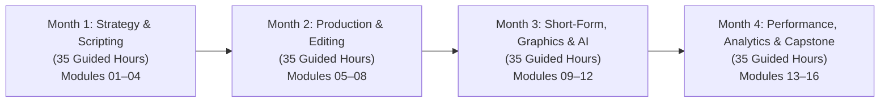
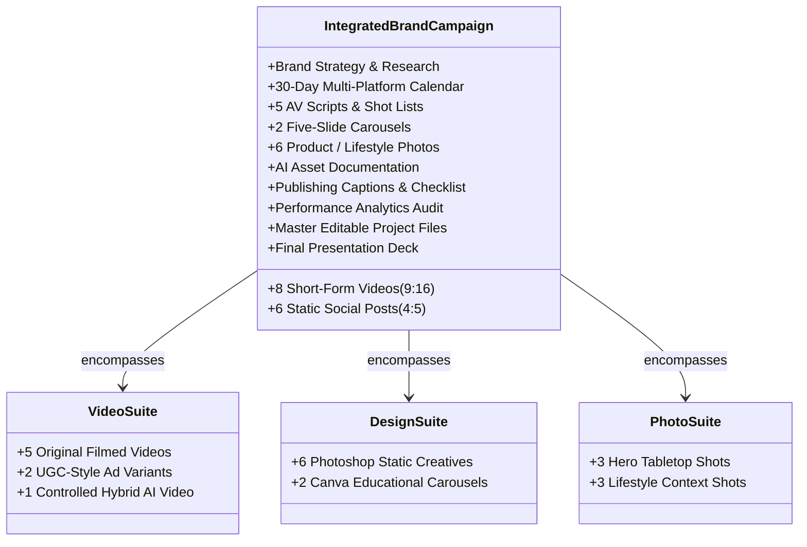

# Academic Specification & Forensic Audit Blueprint
# Content Creator Professional (Course 28)

**Document Identifier:** `NOVA-CCP-SPEC-2027-V1`
**Academic Sequence:** Course 28 (Catalog Sequence Number 28; NOT the website slug)
**Existing Canonical Identifier:** `content-creator-pro`
**Course Slug:** `content-creator-professional` (Canonical Route: `/course-detail.html?id=content-creator-pro`)
**Program Title:** Content Creator Professional
**Specialization:** AI-Assisted Brand Content Production
**Curriculum Edition:** 2027 Professional Edition
**Governing Academy:** Digital Content & Creator Economy (`Creator Academy`, ID: `creator`)
**Academic Classification:** Professional Program
**Target Learner Profile:** Aspiring Digital Content Creators, Social Media Video Producers, Brand Storytellers, UGC Creators, Creative Entrepreneurs
**Program Duration:** 4 Academic Months (16 Instructional Weeks)
**Guided Instructional Hours:** **140 Guided Hours** (8.75 Hours/Week: 25% Theory/Demo, 50% Production Labs, 15% Review/QC, 10% Assessment)
**Independent Production Hours:** 3–4 Hours Weekly (~50–60 Hours total, strictly demarcated from guided training)
**Commercial Standard Fee:** **INR 24,900** + applicable statutory GST (0% Artificial Discounts, Transparent Institutional Pricing)
**Program Tagline:** *Think Creative. Shoot Original. Edit Professionally. Create with AI.*
**Marketing Headline:** *Create Content That Captivates. Build Brands That Grow.*
**Core Capstone Deliverable:** Integrated Brand Content Campaign (15 Portfolio Deliverables: 8 Short-Form Videos, 6 Static Posts, 2 Carousels, 6 Product Photos, 30-Day Calendar, Strategy Brief)
**Document Status:** Complete Forensic Repository Audit & Approved Academic Specification (Task NOVA-CCP-01)

---

## 1. Executive Summary & Educational Mandate

The modern creator economy has evolved beyond casual amateur posting and generic Canva templates. In 2026–2027, professional brand content creators must operate as agile, full-stack multi-media production units capable of executing end-to-end commercial workflows: from brand positioning and psychographic audience profiling to cinematic smartphone/camera filming, studio lighting, broadcast audio capture, desktop non-linear editing (NLE), high-retention short-form pacing, professional graphic design in Photoshop, controlled AI asset integration, direct-response UGC advertising, and multi-platform distribution.

**Content Creator Professional (Course 28)** is specifically engineered to bridge the critical industry gap between amateur social media hobbyists and commercial content producers. While Course 27 (*YouTube Growth & Content Strategy Professional*) focuses on long-form episodic YouTube channel architecture, multi-tier monetization, and YouTube Studio analytics, Course 28 focuses on **cross-platform short-form brand storytelling, visual craftsmanship, and direct-response performance creatives** tailored for Instagram Reels, YouTube Shorts, TikTok, and brand marketing campaigns.

### Core Pedagogical Pillars
1. **Original Production Primacy:** Mandatory physical filming, real 3-point lighting setups, dedicated microphone calibration, and tabletop product photography. AI-generated video and image assets are integrated as supervised creative accelerators, strictly prohibited from replacing foundational physical production mastery.
2. **Dual-Toolchain Creative Mastery:** Students achieve deep fluency in professional desktop software (**Adobe Premiere Pro** for video editing, **Adobe Photoshop** for raster design and retouching) paired with rapid agile creator tools (**Canva Pro**, **Instagram Edits**, **Meta Business Suite**).
3. **Controlled & Responsible AI Integration:** Generative AI tools (**Adobe Firefly** with Firefly Partner Foundation Models, **Runway Gen-3 / Kling**, **ElevenLabs**) are deployed within ethical guardrails, enforcing upload disclosures, copyright licensing registers, and ASCI/FTC promotional transparency.
4. **Performance & Commercial Relevance:** Practical training centers on real commercial use cases: organic storytelling, educational carousels, and User-Generated Content (UGC) direct-response advertisements designed to drive brand engagement and conversion.

---

## 2. Forensic Audit of Legacy Baseline vs. 2027 Modernization

A comprehensive 20-dimension audit of the pre-redesign codebase reveals severe structural contradictions, obsolete pricing models, and shallow curricula across repository files:

### Baseline Discrepancies
- **Title & Slug:** Title in `data.js` is `Content Creator Professional`; slug is `content-creator-professional`; ID is `content-creator-pro`.
- **Duration Contradiction:** `data.js` listed `3 Months` (hours: undefined), while `data/courses/content-creator-pro.json` and `nova-skills-109-course-content.json` listed `4 Months / 160 Hours`.
- **Commercial Pricing Inflation:** `data.js` advertised an active fee of `INR 11,999` with an inflated reference fee of `INR 29,999` (a fake 60% discount).
- **Curriculum Architecture:** The existing JSON file featured a rudimentary 4-module shell (`Brand Strategy`, `Visual Design`, `Video Production`, `Growth`) heavily reliant on amateur tools (CapCut and Canva only), lacking any professional desktop NLE, Photoshop layer compositing, physical studio lighting, product photography, or UGC performance creative frameworks.

### 20-Dimension Forensic Gap Matrix

| # | Dimension | Legacy Website Baseline | 2027 Redesign Specification | Audit Classification | Operational Directive |
| :--- | :--- | :--- | :--- | :--- | :--- |
| **01** | **Course Name** | Content Creator Professional | Content Creator Professional | **KEEP** | Preserve name across catalogs. |
| **02** | **Canonical ID** | `content-creator-pro` | `content-creator-pro` | **KEEP** | Preserve exact ID for routing stability. |
| **03** | **Course Slug** | `content-creator-professional` | `content-creator-professional` | **KEEP** | Preserve backwards-compatible slug. |
| **04** | **Governing Academy** | Creator Academy (`creator`) | Creator Academy (`creator`) | **KEEP** | Preserve valid repository academy ID. |
| **05** | **Academic Label** | Generic Social Media | Digital Content & Creator Economy | **REPOSITION** | Formalize academic departmental identity. |
| **06** | **Program Level** | Beginner (in `data.js`) / Intermediate | Professional Program | **REPOSITION** | Position as rigorous professional career program. |
| **07** | **Duration** | 3 Months vs 4 Months Conflict | Exactly 4 Months (16 Weeks) | **REPLACE** | Standardize 4-month duration across all sources. |
| **08** | **Guided Hours** | Unspecified / 160h Conflict | Exactly 140 Guided Hours | **REPLACE** | Mathematically calibrate 8.75h/week over 16 weeks. |
| **09** | **Module Count** | 4 Generic Shell Modules | 16 Fully Specified Modules | **REPLACE** | Implement 16 deep modules ($35\text{h} \times 4$ months). |
| **10** | **Commercial Fee** | INR 11,999 (Fake 60% discount) | INR 24,900 + statutory GST | **REPLACE** | Enforce honest institutional fee (0% discount). |
| **11** | **Video Editing** | CapCut Desktop only | Adobe Premiere Pro (DaVinci Parity) | **EXPAND** | Elevate to broadcast-standard desktop NLE. |
| **12** | **Graphic Design** | Canva basics only | Adobe Photoshop + Canva Pro | **EXPAND** | Master layer compositing, typography & masking. |
| **13** | **Mobile Workflow** | Smartphone generic recording | Instagram Edits + Mobile Cine Apps | **EXPAND** | Integrate Meta's standalone video app & manual cine apps. |
| **14** | **Studio Production** | Casual handheld phone tips | 3-Point Studio Lighting & Audio | **EXPAND** | Require physical lighting, gain staging & acoustics. |
| **15** | **Photography** | Completely absent | Product & Lifestyle Photography | **REPLACE** | Add tabletop product lighting & RAW editing. |
| **16** | **AI Integration** | Casual ChatGPT prompt tips | Adobe Firefly, Runway/Kling, ElevenLabs | **EXPAND** | Structured generative workflows with disclosures. |
| **17** | **Performance Ads** | None (organic tips only) | UGC-Style Direct-Response Creatives | **REPLACE** | Implement hook-problem-solution UGC frameworks. |
| **18** | **Capstone Project** | Unspecified 8 mini projects | Integrated Brand Content Campaign | **REPLACE** | 15-deliverable multi-platform campaign dossier. |
| **19** | **Assessment Model** | Generic checklist | 7-Domain Weighted Model (70% Pass) | **REPLACE** | Rigorous academic rubric across 16 weeks. |
| **20** | **Commercial Claims** | Fake guarantees of virality/income | Strict Platform Truth-in-Marketing | **REMOVE** | Remove unverified placements, earnings & fake reviews. |

---

## 3. 2026–2027 Industry Research & Official Platform Governance

The 2027 curriculum is constructed directly upon current authoritative developer documentation, creator platform updates, and industry regulations:

### A. Meta "Edits" Standalone Video Creation App
- **Official Documentation Reference:** [Meta Newsroom: Introducing Edits — Streamlined Video Creation App](https://about.fb.com/news/2025/04/introducing-edits-streamlined-video-creation-app/)
- **Core Industry Context:** Meta launched "Edits" as a dedicated standalone creative tool to streamline short-form vertical video editing for Instagram Reels and Facebook, featuring native audio syncing, high-resolution timeline trimming, trending audio integration, and direct-to-Reels publishing.
- **Curriculum Implementation:** Module 11 incorporates Instagram Edits for rapid, mobile-first social editing, ensuring creators can cut high-energy Reels on mobile devices without desktop latency, while maintaining export quality standards.

### B. Adobe Firefly & Partner Foundation Models Integration
- **Official Documentation Reference:** [Adobe Help: Generate Videos Using Non-Adobe Foundation Models in Firefly](https://helpx.adobe.com/firefly/web/work-with-audio-and-video/work-with-video/generate-videos-using-non-adobe-models.html) and [Non-Adobe Models in Adobe Products](https://helpx.adobe.com/in/creative-cloud/apps/generative-ai/non-adobe-models-in-adobe-products.html).
- **Core Industry Context:** Adobe Creative Cloud and Firefly have expanded to natively support third-party foundation models (including Runway, Kling, Pika, and OpenAI), enabling creators to generate cinematic visual b-roll and AI video extensions directly within Adobe's commercially safe, content-credentialed environment.
- **Curriculum Implementation:** Module 12 teaches controlled generative asset creation using Adobe Firefly as the primary interface, training students to generate commercially cleared visual b-roll and use third-party partner models responsibly with Content Credentials (C2PA) provenance tracking.

### C. Instagram Professional Dashboard & "Trial Reels"
- **Platform Feature:** Instagram's "Trial Reels" feature allows creators to test short-form video performance with non-followers before sharing with their main follower graph.
- **Curriculum Implementation:** Module 14 covers performance experimentation using Instagram Professional Dashboard insights, analyzing reach vs non-follower discovery, retention drops, and Trial Reels testing protocols.

### D. ASCI Influencer Advertising Guidelines & Indian Regulatory Compliance
- **Regulatory Framework:** The Advertising Standards Council of India (ASCI) mandates prominent, unambiguous disclosures on all influencer marketing, brand collaborations, affiliate promotions, and virtual/AI influencers.
- **Curriculum Implementation:** Module 15 enforces statutory ASCI compliance: applying visible `#Ad`, `#Sponsored`, or `#Collaboration` disclosures within the first two lines of captions and utilizing platform native Paid Partnership tags across Instagram and YouTube.

### E. AI Voice Synthesis & Voice Cloning Governance (ElevenLabs)
- **Ethical Standards:** AI voice generation tools must comply with strict likeness consent policies. Cloning voices without explicit written legal authorization is strictly prohibited.
- **Curriculum Implementation:** Module 12 teaches ethical voiceover drafting, speech-to-speech cadence matching, and synthetic voice disclosure, establishing that students must only clone their own verified voice or use authorized commercial stock voices.

---

## 4. Program Structure & Module Pacing (16 Modules, 140 Guided Hours)

The program spans **4 Academic Months (16 Instructional Weeks)**, delivering **140 Guided Hours** (8.75 guided hours per week) and approximately **50–60 hours of independent studio production**.

### Weekly Instructional Breakdown (8.75 Guided Hours / Week)
- **Conceptual Lecture & Strategic Deconstruction:** 2.0 Hours (23%)
- **Hands-On Production & Software Labs:** 4.5 Hours (51%)
- **Editorial Review, Critique & Technical QC:** 1.25 Hours (14%)
- **Milestone Practical Assessments & Portfolio Assembly:** 1.0 Hour (12%)

---

## 5. Comprehensive 16-Module Syllabus Specification

### MONTH 1: CREATIVE STRATEGY, BRAND POSITIONING & PRE-PRODUCTION (35 GUIDED HOURS)

#### Module 01: Content Creation Industry & Creative Foundations (6 Hours)
- **Guided Hours:** 6 Hours (Week 1).
- **Purpose:** Establish a comprehensive foundation in the commercial content creator landscape, cross-platform audience consumption habits (Instagram, YouTube, TikTok, LinkedIn), brand creator archetypes, equipment taxonomy, and the business reality of digital media production.
- **Primary Tools:** Notion / Google Docs, Miro / Milanote.
- **Supporting Tools:** Google Workspace, Industry Creator Reports.
- **Main Topics:**
  1. *The Creator Economy Ecosystem:* Evolution from casual social posting to commercial brand media production; creator business models (ad revenue, brand sponsorships, UGC freelancing, digital commerce).
  2. *Cross-Platform Content Dynamics:* Deconstructing consumption behaviors across Instagram (lifestyle, aesthetic, community), YouTube (search, depth, authority), TikTok (velocity, trend-jacking), and LinkedIn (B2B thought leadership).
  3. *Creator Archetypes & Brand Personas:* The Educator, The Entertainer, The Reviewer, The Curated Lifestyle Brand, and The Commercial UGC Specialist.
  4. *Equipment & Studio Fundamentals:* Hardware tiers (smartphones, mirrorless cameras, lenses, lighting grids, audio capture, desktop editing rigs) and production ergonomics.
  5. *Creative Problem-Solving & Originality:* Avoiding derivative trend regurgitation; developing distinct visual and verbal creator signatures.
- **Teachable Subtopics:**
  - Macroeconomic scale of the digital creator economy and agency outsourcing trends.
  - Analyzing feed mechanics: algorithmic browse feeds vs graph-based follower feeds.
  - Selecting creator hardware based on budget, mobility, and client deliverable standards.
  - Ethical digital citizenship, intellectual property respect, and professional creator conduct.
- **Instructor Demonstration:** Deconstructing five commercial creator accounts across lifestyle, tech, beauty, and B2B sectors, analyzing their multi-platform distribution flywheels.
- **Practical Production Lab:** Students author a Creator Operational Diagnostic evaluating their personal creative direction, hardware audit, and niche feasibility.
- **Assessable Deliverable:** Creator Operational Diagnostic & Hardware Readiness Audit (.pdf / .md).
- **Portfolio Contribution:** Strategic Foundation Milestone: Creator Capability & Direction Brief.

#### Module 02: Audience Research, Brand Strategy & Content Positioning (8 Hours)
- **Guided Hours:** 8 Hours (Week 2).
- **Purpose:** Master market research, audience persona profiling, competitive gap analysis, and unique value proposition (UVP) formulation to position creator and client brands for sustainable organic growth.
- **Primary Tools:** Google Trends, Meta Ad Library, Social Blade.
- **Supporting Tools:** Google Sheets, Notion, AnswerThePublic.
- **Main Topics:**
  1. *Audience Persona Engineering:* Demographic, psychographic, and behavioral profiling; mapping viewer pain points, desires, and emotional triggers.
  2. *Market & Trend Intelligence:* Using Google Trends, Meta Ad Library, and platform search bars to uncover underserved audience inquiries.
  3. *Competitive Benchmarking:* Conducting forensic teardowns of 5 competitor creators; identifying content gaps, aesthetic fatigue, and comment section demand.
  4. *Brand Identity & Positioning:* Crafting an authentic Unique Value Proposition (UVP) and defining the "Onlyness" statement for a brand or personal channel.
  5. *Core Programming Pillars:* Designing balanced content pillars (Help/Educational, Hub/Community, Hero/Aspirational).
- **Teachable Subtopics:**
  - Mining competitor comment sections to extract customer objections and video inspiration.
  - Evaluating search intent vs browse curiosity in short-form content.
  - Formulating brand voice guidelines: tone, pacing, vocabulary, and visual aesthetic.
  - Structuring a content pillar matrix ensuring balanced audience acquisition and retention.
- **Instructor Demonstration:** Live teardown of a consumer brand's social presence using Meta Ad Library and TikTok Creative Center to discover winning creative angles.
- **Practical Production Lab:** Students develop a full Audience Persona Dossier and 5-Competitor Gap Analysis Matrix for an approved brand concept.
- **Assessable Deliverable:** Audience Persona Dossier & Competitive Gap Matrix (.pdf / .xlsx).
- **Portfolio Contribution:** Portfolio Deliverable 01: Brand Strategy & Audience Research Document.

#### Module 03: Creative Ideation, Hooks, Scriptwriting & Storyboarding (12 Hours)
- **Guided Hours:** 12 Hours (Weeks 3–4).
- **Purpose:** Master the art and science of high-retention video ideation, psychological opening hooks, 2-column Audio-Visual (AV) scriptwriting, and visual storyboarding for short-form video.
- **Primary Tools:** Notion / Google Docs, Milanote (Storyboarding).
- **Supporting Tools:** ChatGPT / Claude (Brainstorming Partner), Miro.
- **Main Topics:**
  1. *The 4-Stage Ideation Funnel:* Capturing, filtering, stress-testing, and validating 50+ video concepts before production.
  2. *The Psychology of the Hook:* First 3-second retention mechanics: visual disruption, auditory pattern interrupts, curiosity gaps, and bold counter-intuitive claims.
  3. *2-Column AV Scriptwriting:* Formatting scripts with synchronized Visual Cues (Camera movement, b-roll, text overlays) and Audio Cues (Spoken dialogue, sound effects, music shifts).
  4. *Short-Form Narrative Arcs:* The Problem-Agitation-Solution (PAS) framework, The Micro-Story Arc, and The Quick-Insight Structure for 30–60 second videos.
  5. *Visual Storyboarding & Shot Lists:* Mapping camera angles (Wide, Medium, Close-up, Macro), camera movements, and transition points prior to filming.
- **Teachable Subtopics:**
  - Deconstructing why 60% of short-form viewers swipe away within the first 2 seconds.
  - Writing spoken dialogue for the ear: eliminating complex prose in favor of punchy, conversational cadences.
  - Drafting hook variations: The Negative Hook ("Stop doing X"), The Visual Metaphor Hook, and The Secret Reveal Hook.
  - Designing shot lists that guarantee adequate B-roll coverage and prevent reshoots.
- **Instructor Demonstration:** Live script doctoring: taking a boring, wordy brand explanation and rewriting it into a high-energy 45-second 2-column AV script with storyboard sketches.
- **Practical Production Lab:** Students author 5 complete, approved 2-column AV scripts with synchronized visual shot plans for their upcoming video productions.
- **Assessable Deliverable:** Suite of 5 Production-Ready 2-Column AV Scripts with Storyboards (.pdf / .md).
- **Portfolio Contribution:** Portfolio Deliverable 03: Five Approved Scripts and Visual Shot Plans.

#### Module 04: Content Calendar, Production Planning & Creative Operations (9 Hours)
- **Guided Hours:** 9 Hours (Weeks 4–5).
- **Purpose:** Build systematic creative operations, scalable 30-day multi-platform publishing calendars, batch production workflows, equipment prep checklists, and digital asset management.
- **Primary Tools:** Notion (Creator Operating System), Google Sheets.
- **Supporting Tools:** Google Drive / Local Storage taxonomy, Trello.
- **Main Topics:**
  1. *The 30-Day Content Calendar:* Structuring an omnichannel publishing schedule across Instagram Reels, YouTube Shorts, and Carousel posts.
  2. *Batch Production Methodology:* Scripting in batches, shooting in dedicated production blocks, and editing in focused sprints to prevent creative burnout.
  3. *Pre-Production Checklists:* Location scouting, talent/model releases, prop sourcing, battery/storage management, and wardrobe styling.
  4. *Digital Asset Management (DAM):* Standardized folder taxonomies (`01_PreProd`, `02_Footage`, `03_Audio`, `04_Exports`), file naming conventions, and 3-2-1 backup protocols.
  5. *Production Budgeting & Resource Allocation:* Managing production expenses, software subscriptions, prop costs, and estimating client project budgets.
- **Teachable Subtopics:**
  - Building a dynamic Notion Content Pipeline tracking ideas from concept to live published URL.
  - Calculating creator capacity: determining sustainable weekly publishing volume.
  - Managing model release forms and commercial location agreements.
  - Checksum offload procedures for SD cards to ensure zero corrupted footage.
- **Instructor Demonstration:** Setting up an enterprise creator Notion workspace with relational databases linking content pillars, scripts, filming dates, and published analytics.
- **Practical Production Lab:** Students build an operational 30-Day Multi-Platform Content Calendar and complete the pre-production planning package for their Month 2 shoot.
- **Assessable Deliverable:** Operational 30-Day Content Calendar & Pre-Production Planning Package (.pdf + Notion / Sheets).
- **Portfolio Contribution:** Portfolio Deliverable 02: Thirty-Day Multi-Platform Content Calendar.

---

### MONTH 2: PRODUCTION: CAMERAS, STUDIO LIGHTING, AUDIO & VIDEO EDITING (35 GUIDED HOURS)

#### Module 05: Smartphone & Camera Video Production (10 Hours)
- **Guided Hours:** 10 Hours (Weeks 5–6).
- **Purpose:** Master professional camera operations on both advanced smartphones and mirrorless cameras, manual exposure controls, focal lengths, cinematic composition, camera movement, and frame rates for social video.
- **Primary Tools:** Advanced Smartphone (iOS / Android) with Blackmagic Camera App / Filmic Pro OR Mirrorless Camera (Sony / Canon / Fujifilm).
- **Supporting Tools:** Mobile Gimbals, Fluid Head Tripods, ND Filters, Lens Cleaning Kits.
- **Main Topics:**
  1. *Manual Exposure Fundamentals:* The Exposure Triangle (Aperture, Shutter Speed, ISO); mastering the 180-degree shutter rule for natural motion blur.
  2. *Smartphone Cinematography Apps:* Bypassing aggressive computational smartphone over-sharpening using manual apps (Blackmagic Camera App); setting manual white balance, locked focus, and flat color profiles.
  3. *Framing & Composition for Vertical Video (9:16):* Rule of thirds, leading lines, headroom, looking room, and depth of field in vertical orientations.
  4. *Camera Movement & Stabilization:* Handheld techniques (ninja walk), gimbal operations, whip pans, push-ins, and parallax tracking shots.
  5. *Frame Rates & Dynamic Motion:* Selecting 24fps (cinematic dialogue), 30fps (social standard), and 60fps/120fps (silky slow-motion b-roll).
- **Teachable Subtopics:**
  - Calibrating variable ND filters to shoot with wide apertures in bright outdoor sunlight.
  - Lens selection: utilizing 24mm (environmental context), 35mm/50mm (natural perspective), and 85mm (compression and portrait beauty).
  - Executing dynamic practical transitions in-camera (whip pan, object wipe, camera cover).
  - Managing storage and battery health during intensive multi-hour video shoots.
- **Instructor Demonstration:** Live shooting demonstration: comparing standard auto-mode smartphone video against manually tuned, ND-filtered, flat-profile smartphone footage.
- **Practical Production Lab:** Students execute a hands-on cinematic camera movement lab, capturing 15 distinct camera movement takes (push-in, pull-out, tracking, parallax, tilt).
- **Assessable Deliverable:** Cinematic Camera Movement & Framing Lab Reel (.mp4, 1080x1920, with technical slate annotations).
- **Portfolio Contribution:** Video Production Milestone: Raw Cinematography Reel.

#### Module 06: Lighting, Audio Recording & On-Camera Presentation (8 Hours)
- **Guided Hours:** 8 Hours (Weeks 6–7).
- **Purpose:** Master studio lighting engineering, microphone technology, sound recording hygiene, and natural, authoritative on-camera presentation for creator content.
- **Primary Tools:** 3-Point Lighting Kit (Key Light with Softbox, Fill/Reflector, Rim/Hair Light, RGB Practicals), Wireless Lavalier Mics (DJI / Rode) & Shotgun Microphones.
- **Supporting Tools:** Teleprompter Apps, Acoustic Panels / Sound Blankets, Audio Recorders.
- **Main Topics:**
  1. *3-Point Studio Lighting Design:* Key light placement (45-degree angle, diffused softbox), fill light ratios, hair/rim lighting for subject separation, and background practicals.
  2. *Color Temperature & Mood:* Balancing daylight (5600K) and tungsten (3200K); using colored RGB accent lights to establish branded creator aesthetics.
  3. *Microphone Selection & Audio Hygiene:* Lavalier vs Shotgun vs Dynamic microphones; polar patterns (cardioid vs omnidirectional); placement techniques to prevent clothing rustle.
  4. *Gain Staging & Acoustic Control:* Setting input levels to peak between -12dB and -6dB; eliminating room reverberation using soft furnishings and acoustic treatment.
  5. *On-Camera Presentation Mastery:* Eye contact with the lens, voice modulation, breathing, physical body language, and teleprompter workflows without sounding robotic.
- **Teachable Subtopics:**
  - The inverse square law: understanding how moving light closer increases softness and dramatic falloff.
  - Mitigating eye-glass glare and reflections through polarizers and high key positioning.
  - Recording dual-channel safety tracks (-6dB backup channel) to prevent audio clipping during sudden vocal spikes.
  - Overcoming camera shyness and executing natural, energetic delivery through the "one-friend" speaking method.
- **Instructor Demonstration:** Live lighting transformation: transforming a flat, unflattering fluorescent office into a moody, cinematic creator studio in 15 minutes.
- **Practical Production Lab:** Students set up a 3-point lighting grid, calibrate a wireless lavalier microphone, and record a 60-second talking-head delivery piece.
- **Assessable Deliverable:** Lighting & Audio Benchmark Production Video (.mp4, 1080x1920, with before/after setup documentation).
- **Portfolio Contribution:** Video Production Milestone: Studio Lighting & Audio Benchmark.

#### Module 07: Product Photography & Creative Image Production (7 Hours)
- **Guided Hours:** 7 Hours (Week 7).
- **Purpose:** Master tabletop product photography, creative lifestyle photography, composition, lighting reflection control, and RAW image capture for social media carousels and client brand campaigns.
- **Primary Tools:** Smartphone / Mirrorless Camera in RAW mode, Tabletop Photography Lights, Diffusers, Bounce Cards.
- **Supporting Tools:** Photography Backdrops, Acrylic Risers, Props, Lenspen.
- **Main Topics:**
  1. *Tabletop Product Photography Setup:* Choosing backdrops (seamless paper, textured slate, acrylic sheets); positioning props to reinforce brand narrative.
  2. *Managing Reflections & Specular Highlights:* Using diffusion panels, black flags, and polarizers on shiny surfaces (cosmetics, electronics, glass bottles).
  3. *Product Composition & Framing:* Hero angles, flat-lays (overhead 90-degree), 45-degree commercial product angles, and leading lines.
  4. *Lifestyle & In-Context Photography:* Capturing products in authentic human environments (hands holding product, desk lifestyle setups, outdoor usage).
  5. *RAW Image Capture & Mobile Preparation:* Exposing to the right (ETTR), white balance cards, and ingest into Lightroom / Photoshop.
- **Teachable Subtopics:**
  - Creating artificial sunlight shadows using hard mini-LEDs and window gobos.
  - Focus stacking principles for ultra-sharp product details in macro photography.
  - Sourcing budget-friendly styling props that elevate perceived commercial product value.
  - Capturing commercial image assets specifically framed for 4:5 Instagram feed aspect ratios and 9:16 story formats.
- **Instructor Demonstration:** Live tabletop commercial photoshoot: shooting a cosmetic bottle with water droplets, back-lighting, and acrylic reflections.
- **Practical Production Lab:** Students shoot a commercial product series capturing 6 distinct hero and lifestyle product photos across 3 lighting setups.
- **Assessable Deliverable:** Unedited RAW/DNG Product Photography Series (6 high-res shots with styling documentation).
- **Portfolio Contribution:** Portfolio Deliverable 10: Six Original Product/Lifestyle Photographs (Raw Capture Stage).

#### Module 08: Professional Video Editing Foundations (10 Hours)
- **Guided Hours:** 10 Hours (Week 8).
- **Purpose:** Master non-linear desktop video editing in Adobe Premiere Pro (with DaVinci Resolve lab parity), project setup, media bin organization, timeline assembly, rough-cutting, and rhythm.
- **Primary Tools:** **Adobe Premiere Pro** (Primary Desktop NLE) OR **DaVinci Resolve Studio** (Lab Parity Alternative).
- **Supporting Tools:** Media Encoder, Keyboard Shortcut Pads, External SSDs.
- **Main Topics:**
  1. *NLE Workspace Architecture:* Workspace layouts (Assembly, Editing, Color, Audio); scratch disk management; sequence settings (1080x1920 vertical at 30fps/60fps); bin taxonomies.
  2. *Ingest & Media Management:* Importing raw takes; proxy generation for smooth playback; timeline track patching and organization.
  3. *The "Radio Edit" Assembly:* Trimming dialogue based purely on audio rhythm; eliminating breaths, pauses, filler words, and narrative drag.
  4. *Essential Trimming Tools:* Razor, ripple edit, rolling edit, slip, and slide tools; mastering essential keyboard shortcuts (Q/W ripple trims, J-K-L shuttle).
  5. *Pacing & Structural Rhythm:* Cutting on action; establishing visual momentum; matching cut speed to content tone and emotional energy.
- **Teachable Subtopics:**
  - Diagnosing the rhythm of human speech to cut tight, engaging dialogue without sounding breathless.
  - Multi-camera and dual-system audio synchronization via automatic waveform matching.
  - Sequence nesting and sub-clip organization for complex multi-asset projects.
  - Setting up customized keyboard shortcuts to increase editing speed by 3x.
- **Instructor Demonstration:** Live rough-cut sprint: taking 15 minutes of messy raw takes in Premiere Pro and cutting it down into a razor-sharp 45-second rough cut in under 12 minutes.
- **Practical Production Lab:** Students import raw footage from Module 05/06, synchronize audio, and assemble an organized rough cut of their first short-form video.
- **Assessable Deliverable:** Packaged Premiere Pro Project File (.prproj) & Exported Rough Cut Video (.mp4).
- **Portfolio Contribution:** Video Editing Milestone: Rough Cut Assembly & Project Architecture.

---

### MONTH 3: POST-PRODUCTION: SHORT-FORM VIDEO, GRAPHICS & CONTROLLED AI (35 GUIDED HOURS)

#### Module 09: Short-Form Video Editing, Captions & Professional Finishing (10 Hours)
- **Guided Hours:** 10 Hours (Weeks 9–10).
- **Purpose:** Master advanced retention editing in Adobe Premiere Pro: kinetic auto-captions, J/L cuts, scale punches, sound effects layering, audio mastering (-14 LUFS), Lumetri color correction, and broadcast export.
- **Primary Tools:** Adobe Premiere Pro (with DaVinci Resolve parity).
- **Supporting Tools:** Splice / Epidemic Sound, HandBrake.
- **Main Topics:**
  1. *Retention Visual Dynamics:* Pattern interrupts; scale punches (100% to 112% push-in); match cuts; whip pan transitions; inserting B-roll every 2–4 seconds.
  2. *Kinetic Text & Auto-Captions:* Speech-to-Text transcription; word-by-word animated captions; custom styling, drop shadows, and high-contrast bounding boxes; mobile safe-zone compliance.
  3. *Sound Design & Foley Layering:* Dialogue cleanup (Parametric EQ, dynamic compressor, noise reduction); layering sound effects (whooshes, pops, risers, paper crunches, UI clicks); music ducking.
  4. *Color Correction & Skin Tone Grading:* Lumetri Color / Color Wheels; exposure normalization; vectorscope skin tone alignment along the I-line; subtle aesthetic grading.
  5. *Audio Loudness & Master Export:* Target loudness calibration (-14 LUFS integrated loudness, -1 dBTP true peak); H.264 / H.265 export settings; mobile compression quality control.
- **Teachable Subtopics:**
  - Designing branded Motion Graphics Templates (MOGRTs) for lower thirds, callouts, and subscribe animations.
  - Utilizing adjustment layers for global color passes and dynamic camera zoom simulations.
  - Eliminating harsh sibilance with de-essers and muddy low-end boom with high-pass filters at 80Hz.
  - Quality assurance pre-flight: checking exports on calibrated monitors and multiple smartphone screens.
- **Instructor Demonstration:** Live polish session in Premiere Pro: taking a flat rough cut, adding kinetic word-by-word captions, sound effects, music ducking, and skin tone grading to transform it into a viral-ready short.
- **Practical Production Lab:** Students polish, sound design, color grade, and master 3 complete original short-form videos to broadcast specifications.
- **Assessable Deliverable:** 3 Master Polished Short-Form Videos (.mp4, 1080x1920, -14 LUFS, color graded, kinetic captions).
- **Portfolio Contribution:** Core Portfolio Deliverable: Polished Master Short-Form Video Suite (Part of Portfolio Deliverable 04).

#### Module 10: Graphic Design & Social Media Creative Production (10 Hours)
- **Guided Hours:** 10 Hours (Weeks 10–11).
- **Purpose:** Master professional graphic design for digital content: raster manipulation, masking, and typography in Adobe Photoshop, paired with rapid multi-asset branding workflows in Canva Pro.
- **Primary Tools:** **Adobe Photoshop** (Primary Graphic Suite) & **Canva Pro** (Agile Layout Suite).
- **Supporting Tools:** Adobe Firefly (Generative Fill for canvas extension), Unsplash / Pexels.
- **Main Topics:**
  1. *Graphic Design Principles for Social Feeds:* Visual hierarchy, the 3-element composition rule, negative space, contrast theory, and mobile thumb-stopping power.
  2. *Photoshop Image Retouching & Compositing:* Pen tool and quick selection masking; subject cutouts; frequency separation skin retouching; color grading photo assets; Camera Raw filter.
  3. *Social Typography & Layout:* Font pairing (bold sans-serif headlines with legible body); kerning, leading, and tracking; contrast overlays and drop shadows.
  4. *High-Converting Instagram Carousels:* Designing seamless panoramic carousels; educational 5-slide structures (Hook -> Problem -> Insight -> Action -> Save/Share CTA).
  5. *Canva Pro Agile Brand Systems:* Setting up Brand Kits (brand colors, typography, logos); designing responsive social templates; rapid multi-format resizing.
- **Teachable Subtopics:**
  - Non-destructive image editing using Smart Objects, adjustment layers, and layer masks in Photoshop.
  - Creating realistic drop shadows and edge highlights to composite cutout subjects onto colored backgrounds.
  - Structuring slide-to-slide swipe momentum in carousels: visual arrows, progressive numbering, and split images spanning across slides.
  - Exporting web-optimized JPEGs/PNGs under 2MB with sRGB color profiles to prevent color shifting on mobile displays.
- **Instructor Demonstration:** Live design workshop: creating a high-impact promotional static post in Photoshop from raw assets, followed by building a 5-slide seamless carousel in Canva.
- **Practical Production Lab:** Students design 6 professional static social media posts in Photoshop and 2 five-slide educational carousels in Canva.
- **Assessable Deliverable:** 6 High-Res Static Posts (.png, 1080x1350) + 2 Five-Slide Seamless Carousels (.png / .pdf).
- **Portfolio Contribution:** Portfolio Deliverables 08 & 09: Six Professionally Designed Static Posts and Two Five-Slide Carousels.

#### Module 11: Mobile-First Reels, Creator Presentation & Introductory Motion (7 Hours)
- **Guided Hours:** 7 Hours (Weeks 11–12).
- **Purpose:** Master agile mobile-first short-form video creation using Meta's standalone **Instagram Edits** app, native Instagram Reels tools, on-the-go vertical workflows, and introductory motion graphics in Adobe After Effects.
- **Primary Tools:** **Instagram Edits** App, Instagram Mobile In-App Tools, Adobe After Effects (Introductory Motion).
- **Supporting Tools:** CapCut Mobile (Alternative), Giphy, Creative Cloud Libraries.
- **Main Topics:**
  1. *Meta's Instagram Edits Application:* Navigating the standalone Edits app interface; rapid timeline trimming; audio-to-beat synchronization; trending audio integration.
  2. *Native In-App Features & Trends:* Instagram green screen effects, interactive stickers (polls, questions, quiz stickers), audio remixing, and Trial Reels workflows.
  3. *Mobile-First Production Speed:* Solo shooting-to-posting sprints; capturing quick BTS (Behind-The-Scenes), trending sound interpretations, and rapid voiceover reactions.
  4. *Introductory After Effects for Creators:* Basic keyframing (Position, Scale, Rotation, Opacity); animating brand logos; kinetic lower-third callouts; ease-in/ease-out curves.
  5. *Platform Nuances:* Reformatting vertical content between Instagram Reels, YouTube Shorts, and TikTok; avoiding cross-platform watermark penalties.
- **Teachable Subtopics:**
  - Utilizing Instagram Edits' native audio tools to align visual cuts automatically with rhythm markers.
  - Designing animated call-to-action graphics (Follow, Save, Share buttons) in After Effects and exporting transparent ProRes 4444 / PNG sequences.
  - Understanding Instagram's algorithmic preference for native in-app audio over pre-baked audio tracks.
  - Mobile workflow hygiene: managing cloud storage between phone and desktop workstations.
- **Instructor Demonstration:** Fast mobile editing demonstration: assembling a 30-second lifestyle Reel entirely on a smartphone using Instagram Edits, adding trending audio, and exporting in 4K.
- **Practical Production Lab:** Students produce, edit, and export 2 mobile-first Reels using Instagram Edits, plus create 1 animated logo bumper in After Effects.
- **Assessable Deliverable:** 2 Mobile-First Polished Reels (.mp4) + 1 Animated Brand Logo Asset (.mov with alpha / .mp4).
- **Portfolio Contribution:** Core Portfolio Deliverable: Mobile-First Reels & Motion Assets.

#### Module 12: Controlled AI Image, Video & Voice Production (8 Hours)
- **Guided Hours:** 8 Hours (Weeks 12–13).
- **Purpose:** Master the ethical and controlled application of generative AI tools in creative production: Adobe Firefly (including non-Adobe partner foundation models), Runway Gen-3 / Kling video synthesis, ElevenLabs AI voice workflows, and platform Altered Content disclosures.
- **Primary Tools:** **Adobe Firefly** (Primary Generative Suite with Partner Models), **Runway Gen-3 / Kling** (Controlled Video Synthesis), **ElevenLabs** (Voice Engine).
- **Supporting Tools:** Midjourney (Alternative Image AI), ChatGPT / Claude, Content Credentials (C2PA).
- **Main Topics:**
  1. *Generative AI in Modern Commercial Production:* Shifting from novelty to practical production utility; generative fill, background replacement, and visual b-roll synthesis.
  2. *Adobe Firefly & Partner Foundation Models:* Prompt engineering for commercial realism; generating photorealistic b-roll; using Generative Expand for aspect ratio adaptation; leveraging non-Adobe partner models within Adobe's commercially safe environment.
  3. *Controlled AI Video Generation (Runway / Kling):* Image-to-video and text-to-video workflows; camera motion control; generating abstract, surreal, or impossible b-roll cutaways; avoiding uncanny artifacts.
  4. *AI Voice Synthesis & Ethics (ElevenLabs):* Text-to-speech voiceovers; voice cloning mechanics; voice emotion and cadence tuning; likeness consent laws.
  5. *Platform Disclosures & Synthetic Media Transparency:* Official YouTube and Meta Altered/Synthetic Content upload disclosure rules; C2PA Content Credentials; maintaining audience trust.
- **Teachable Subtopics:**
  - Formulating precise camera, lighting, and lens prompts in Firefly to match the aesthetic of original camera footage.
  - Hybrid AI editing: compositing real human presenter footage over AI-generated studio or fantasy backgrounds in Premiere Pro / Photoshop.
  - Ethical voiceover usage: strictly prohibiting unauthorized cloning of third-party voices; using verified commercial AI voice licenses.
  - Upload-time synthetic media checklists: identifying which assets legally trigger platform disclosure requirements.
- **Instructor Demonstration:** Live hybrid production: taking a real talking-head shot filmed against a plain wall, using Firefly to generate a futuristic studio background, compositing them in Premiere Pro, and adding an ElevenLabs ambient soundscape.
- **Practical Production Lab:** Students produce 1 controlled hybrid AI-assisted short-form video (integrating original human filming with AI b-roll or background generation) and maintain an AI Asset Disclosure Log.
- **Assessable Deliverable:** 1 Controlled Hybrid AI-Assisted Short-Form Video (.mp4) + AI Asset Prompt & Disclosure Log (.pdf / .md).
- **Portfolio Contribution:** Portfolio Deliverables 07 & 11: Controlled Hybrid AI Video & Approved AI-Enhanced Asset Documentation.

---

### MONTH 4: PERFORMANCE CREATIVES, ANALYTICS, DELIVERY & CAPSTONE (35 GUIDED HOURS)

#### Module 13: UGC-Style Ads, Performance Creatives & Brand Campaigns (12 Hours)
- **Guided Hours:** 12 Hours (Weeks 13–14).
- **Purpose:** Master User-Generated Content (UGC) advertising, direct-response performance creative architecture, paid social ad funnels, A/B creative testing, and commercial brand pitch decks.
- **Primary Tools:** Meta Ad Library, TikTok Creative Center, Premiere Pro, Notion.
- **Supporting Tools:** Google Sheets, Canva (UGC Pitch Decks).
- **Main Topics:**
  1. *The Architecture of High-Converting UGC Ads:* Organic vs paid creator content; why polished commercials fail and native, authentic-looking UGC converts on TikTok and Meta.
  2. *The Direct-Response Creative Framework:* The 3-second hook -> Problem agitation -> The product revelation -> Feature-benefit demonstration -> Social proof / reviews -> Strong Call-to-Action (CTA).
  3. *Creative Iteration & A/B Variation:* The 3x3 creative testing matrix (filming 3 different hooks, 2 body variations, and 2 CTAs to produce 12 ad combinations from one shoot).
  4. *UGC Creator Business Model:* Rate cards, portfolio decks, usage rights (organic posting vs 30/60/90-day paid ad whitelisting), deliverables, and revisions.
  5. *Writing High-Converting Direct-Response Scripts:* Scripting testimonial-style reviews, unboxing sequences, "TikTok made me buy it" formats, and problem-solution explainers.
- **Teachable Subtopics:**
  - Analyzing winning direct-response creative patterns across beauty, tech, food, and SaaS in Meta Ad Library.
  - Designing visual pattern interrupts: text popups, reverse clips, green-screen review overlays, and split screens.
  - Negotiating commercial usage rights: explaining why paid ad usage costs 30%–50% more than organic posting.
  - Structuring a professional UGC Creator Portfolio deck that lands paid brand deals without requiring millions of followers.
- **Instructor Demonstration:** Deconstructing a 7-figure e-commerce brand's UGC ad: analyzing the opening visual hook, the pacing of the problem-agitation phase, and the call-to-action urgency.
- **Practical Production Lab:** Students script, film, and edit 2 distinct UGC-style ad variants for an approved brand concept (testing two different opening hook angles).
- **Assessable Deliverable:** 2 Production-Ready UGC-Style Ad Video Variants (.mp4, 1080x1920) + Creative Script Matrix (.pdf / .md).
- **Portfolio Contribution:** Portfolio Deliverable 06: Two Creator-Led / UGC-Style Ad Variants.

#### Module 14: Social Publishing, Content Analytics & Optimization (9 Hours)
- **Guided Hours:** 9 Hours (Weeks 14–15).
- **Purpose:** Master multi-platform content distribution, Meta Business Suite scheduling, social media copywriting, hashtag strategy, content performance analytics, and retention diagnosis.
- **Primary Tools:** Meta Business Suite, Instagram Professional Dashboard, YouTube Studio Analytics.
- **Supporting Tools:** Google Sheets (Analytics Modeling), Google Trends.
- **Main Topics:**
  1. *Publishing Operations in Meta Business Suite:* Connecting Instagram and Facebook business assets; scheduling Reels, carousels, and stories; setting optimal posting times.
  2. *Social Media Copywriting & Metadata:* Writing engaging first-line captions; structuring micro-blogging captions; strategic hashtag categorization (Niche, Broad, Community); tagging collaborators.
  3. *Core Quantitative Performance Metrics:* Accounts reached, impressions, non-follower reach percentage, saves, shares, average watch time, and completion rates.
  4. *Evaluating the "Save & Share" Ratio:* Why saves and shares drive algorithmic viral distribution more effectively than simple passive likes.
  5. *Trial Reels & Performance Testing:* Utilizing Instagram Trial Reels to test audience interest with non-followers; interpreting retention drop-offs; iterative optimization.
- **Teachable Subtopics:**
  - Developing a pre-publish checklist ensuring correct audio attribution, thumbnail cover selection, and closed-caption verification.
  - Analyzing audience demographics (top cities, age ranges, active hours) to refine content release timing.
  - Building a centralized Content Analytics Tracker in Google Sheets to log video performance and calculate engagement velocity.
  - Diagnosing why a video failed: separating packaging failure (weak cover/title) from retention failure (slow opening hook).
- **Instructor Demonstration:** Navigating Meta Business Suite: scheduling a week's worth of multi-format content, reviewing Instagram Professional Dashboard metrics, and identifying the top-performing content pillar.
- **Practical Production Lab:** Students author a complete Social Publishing Package (captions, hashtags, covers) and analyze an authorized or verified sample analytics dataset.
- **Assessable Deliverable:** Social Media Publishing Package & Content Performance Audit Report (.pdf / .xlsx).
- **Portfolio Contribution:** Portfolio Deliverables 12 & 13: Publishing Checklist & Captions, and Analytics Evaluation Report.

#### Module 15: Client Production, Professional Delivery & Content Compliance (7 Hours)
- **Guided Hours:** 7 Hours (Week 15).
- **Purpose:** Master professional client operations, content handoff workflows, commercial contracts, copyright licensing registers, ASCI sponsorship disclosures, and client review systems.
- **Primary Tools:** Frame.io / Google Drive (Client Review), Notion (Client CRM & SOPs).
- **Supporting Tools:** DocuSign / Contract Templates, Excel (Licensing Register).
- **Main Topics:**
  1. *Client Production Workflows:* The creative brief; client onboarding; managing revision requests (limiting to 2 rounds of creative revisions); delivery timelines.
  2. *Professional Asset Delivery & Handoff:* Cloud file organization; exporting master uncompressed files vs web-optimized files; delivering clean textless b-roll and split-audio stems.
  3. *Commercial Contracts & Licensing:* Intellectual property transfer vs licensing; usage rights clauses (territory, duration, media type); payment milestones (50% deposit, 50% on delivery).
  4. *Statutory Advertising Compliance (ASCI):* Applying mandatory Indian influencer disclosures (`#Ad`, `#Sponsored`) in captions and using platform native Paid Partnership labels; substantiating product claims.
  5. *Asset Licensing Register & Copyright:* Documenting commercial licenses for background music, stock footage, sound effects, and fonts in a formal register.
- **Teachable Subtopics:**
  - Utilizing Frame.io or timestamped video review tools to collect precise, actionable client feedback without endless email chains.
  - Drafting a standard Creator Service Agreement protecting against scope creep and delayed payment.
  - Invoicing fundamentals, GST compliance for freelance creators, and tracking client accounts receivable.
  - Maintaining a bulletproof Commercial Asset Licensing Register that proves legal clearance for all third-party media assets.
- **Instructor Demonstration:** Reviewing a real commercial creator contract: annotating scope, payment terms, revision limits, and copyright indemnity clauses.
- **Practical Production Lab:** Students compile a verified Commercial Asset Licensing Register and design a Client Onboarding & Delivery SOP for their creative agency.
- **Assessable Deliverable:** Commercial Asset Licensing Register & Client Delivery SOP Dossier (.xlsx + .pdf).
- **Portfolio Contribution:** Portfolio Deliverable 14: Organized Editable Project Files & Licensing Documentation.

#### Module 16: Final Brand Content Campaign & Portfolio Showcase (7 Hours)
- **Guided Hours:** 7 Hours (Week 16).
- **Purpose:** Finalize, synthesize, and present the **Integrated Brand Content Campaign**, assembling all 15 portfolio deliverables into a cohesive digital showcase and defending the work before the academic review board.
- **Primary Tools:** Digital Portfolio Platform (Notion / Webflow / Behance / PDF Presentation Deck).
- **Supporting Tools:** Canva / Keynote / PowerPoint, Cloud Storage Repositories.
- **Main Topics:**
  1. *Capstone Portfolio Synthesis:* Quality control review of all 15 campaign deliverables; verifying visual coherence across video, static, carousel, and photographic assets.
  2. *Building the Digital Creator Portfolio:* Structuring case studies that prove business value (Objective -> Strategy -> Creative Execution -> Deliverables -> Simulated/Actual Impact).
  3. *The Pitch Presentation:* Structuring a 10-minute professional brand pitch deck defending creative choices, audience research, and production quality.
  4. *Oral Defense & Board Review:* Presenting the capstone before instructors and peers, answering strategic questions on production and compliance.
  5. *Career & Freelance Launch Strategy:* Positioning for roles as in-house Content Creators, Social Media Managers, Video Producers, or freelance UGC specialists.
- **Teachable Subtopics:**
  - Crafting an elevator pitch summarizing creator positioning and technical competencies in 60 seconds.
  - Presenting raw vs final editing workflows to prove hands-on technical software craft.
  - Packaging digital project files with relinked assets, fonts, and clean timelines for prospective employers or agency clients.
  - Transitioning course portfolio assets into active freelance outreach pitches on LinkedIn and email.
- **Instructor Demonstration:** Deconstructing an industry-standard creator portfolio that successfully secured ongoing corporate brand retainers.
- **Practical Production Lab:** Students assemble their final portfolio dossier, rehearse their presentation, and deliver their formal oral capstone defense.
- **Assessable Deliverable:** Integrated Brand Content Campaign Final Showcase & Oral Presentation (.pdf + live recording).
- **Portfolio Contribution:** Portfolio Deliverable 15: Final Brand Campaign Presentation Slide Deck & Portfolio Showcase.

---

## 6. Software & Toolchain Competency Mapping

To eliminate software fragmentation and establish rigorous professional standards, the toolchain is strictly defined across core competency tiers:

### Primary Desktop Video Editor Selection: Adobe Premiere Pro
- **Institutional Decision:** **Adobe Premiere Pro** is selected as the designated primary desktop NLE for Course 28.
- **Rationale:** Premiere Pro is the global corporate standard for creative agencies, digital marketing departments, and commercial production houses. Its seamless Dynamic Link integration with Adobe Photoshop, After Effects, and Adobe Firefly provides an integrated professional ecosystem.
- **Lab Alternative Parity:** For classroom environments utilizing **DaVinci Resolve Studio**, complete curriculum parity is maintained across all editing exercises, J/L cut techniques, Fairlight audio mixing, and color wheels.

### Comprehensive Software Competency Matrix

| Software / Tool | Competency Role | Primary Application in Course 28 | Mandatory Proficiency Level |
| :--- | :--- | :--- | :--- |
| **Adobe Premiere Pro** | Primary Desktop NLE | Full timeline assembly, rough cutting, J/L cuts, -14 LUFS audio mixing, color correction, kinetic typography, master export. | Advanced Operator |
| **Adobe Photoshop** | Professional Image Editor | Subject cutout masking, pen tool, frequency separation skin retouching, layer compositing, mobile feed contrast, typography. | Intermediate–Advanced |
| **Canva Pro** | Agile Social Design Suite | Rapid branded social media layouts, multi-slide seamless carousels, Brand Kit management, responsive format resizing. | Proficient User |
| **Instagram Edits** | Mobile-First Video Creation | Standalone mobile timeline cutting, audio-to-beat synchronization, rapid Reels assembly, native social finishing. | Proficient User |
| **Adobe Firefly** | Primary AI Generative Tool | Photorealistic b-roll generation, generative fill/expand, commercial asset creation with Content Credentials (C2PA) and partner models. | Supervised Operator |
| **Runway Gen-3 / Kling** | Selective Video Synthesis | Controlled exposure to text-to-video / image-to-video b-roll generation, camera motion controls, surreal cutaway synthesis. | Selective Exposure |
| **ElevenLabs** | AI Voice Engine | Synthetic text-to-speech voiceovers, ethical voice cloning, speech-to-speech cadence matching, audio cleanups. | Supervised Operator |
| **Adobe After Effects** | Motion Graphics Suite | Introductory kinetic typography, animated logo bumpers, ease curves, transparent alpha channel exports (ProRes 4444). | Introductory Operator |
| **Meta Business Suite** | Publishing & Operations | Instagram and Facebook business asset management, multi-platform scheduling, calendar operations. | Operational Competence |
| **Instagram Dashboard** | Performance Analytics | Professional dashboard navigation, accounts reached, non-follower reach, Trial Reels testing, save/share analysis. | Operational Competence |
| **Notion** | Creator Operating System | Pre-production planning, 30-day content calendar, sponsor CRM, asset taxonomy, client delivery SOPs. | Workflow Standard |

> [!IMPORTANT]
> **Production Hygiene Rule:** Original camera filming, physical 3-point lighting, and real microphone recording remain 100% mandatory throughout the course. AI generation tools (Firefly, Runway, ElevenLabs) are taught strictly as supplementary production accelerators and are never permitted to replace original filming assessments.

---

## 7. Master Production Plan: Integrated Brand Content Campaign

The centerpiece of Course 28 is the **Integrated Brand Content Campaign**, requiring students to produce an extensive, multi-format media package for an approved commercial brand (either a real client business or a rigorously developed fictional brand concept).

### Production Specifications Matrix

### Video Deliverables Accounting (Zero Duplicate Counts)
The curriculum mandates **exactly eight completed short-form videos (9:16 vertical, 15–60s each)**. These eight videos encompass:
1. **At least five videos primarily filmed from original physical footage** (talking-head educational, how-to demonstration, aesthetic brand teaser, behind-the-scenes).
2. **Two creator-led / UGC-style ad variants** produced within the eight videos (testing two distinct opening hook angles for the brand).
3. **One controlled hybrid AI-assisted video** produced within the eight videos (integrating original human filming with Firefly/Runway generated backgrounds or cutaway b-roll).

---

## 8. Mandatory Student Portfolio (15 Evidence Categories)

To graduate, students must submit a verified portfolio dossier containing evidence across all **15 Mandatory Portfolio Categories**:

1. **Brand Strategy & Audience Research Document:** Detailed brand positioning, UVP statement, audience persona profile, and 5-competitor gap analysis.
2. **Thirty-Day Multi-Platform Content Calendar:** Structured publishing schedule across Instagram Reels, YouTube Shorts, and Carousels.
3. **Five Approved 2-Column AV Scripts & Visual Shot Plans:** Production-ready scripts with synchronized visual and audio cues.
4. **Eight Completed Short-Form Videos:** Suite of 8 broadcast-finished vertical videos (1080x1920, -14 LUFS, kinetic captions).
5. **Original Footage Evidence:** Raw camera takes, slate logs, and project timelines proving at least 5 videos were physically filmed.
6. **Two UGC-Style Direct-Response Ad Variants:** Commercial ad variations testing two distinct psychological opening hooks.
7. **One Controlled Hybrid AI-Assisted Video:** Harmonious blend of physical filming and generative visual b-roll.
8. **Six Professionally Designed Static Posts:** High-contrast 4:5 social posts designed in Photoshop / Canva.
9. **Two Five-Slide Seamless Carousels:** Educational or storytelling carousels with swipe momentum.
10. **Six Edited Original Product/Lifestyle Photographs:** Retouched and color-graded product imagery.
11. **Approved AI-Enhanced Asset Documentation:** Prompt logs, tool references, and platform Altered Content disclosure records.
12. **Social Media Publishing Checklist & Captions:** Platform-optimized captions, hook lines, hashtags, and pre-publish QA checklists.
13. **Content Analytics Dashboard / Evaluation Report:** Performance analysis of reach, retention, and save/share velocity using studio or verified training data.
14. **Organized Master Editable Project Files:** Packaged Premiere Pro project archives, Photoshop layered PSDs, and raw asset taxonomy.
15. **Final Brand Campaign Presentation:** Executive pitch deck and oral defense presented before the academic review board.

---

## 9. Assessment, Evaluation & Milestone Architecture

The assessment framework evaluates students across seven distinct creative and technical domains, enforcing a **minimum passing standard of 70%** under approved institute academic policy.

### Assessment Domain Weights (100% Total)

| Assessment Domain | Weight | Core Evaluative Focus |
| :--- | :---: | :--- |
| **Audience Research, Strategy & Scripting** | **15%** | Market research depth, persona accuracy, UVP clarity, 2-column script formatting, hook strength. |
| **Camera, Photography, Lighting & Audio** | **20%** | Manual exposure accuracy, 3-point lighting contrast, audio clarity (-12dB to -6dB peak), product photo staging. |
| **Video Editing, Reels & Shorts** | **20%** | Narrative pacing, tight cuts, kinetic typography within safe zones, sound design layering, -14 LUFS mastering. |
| **Graphic Design & Brand Consistency** | **15%** | Photoshop compositing, visual hierarchy, mobile feed contrast, typography, seamless carousel layouts. |
| **AI Production & Responsible Use** | **10%** | Prompt precision in Firefly, controlled b-roll synthesis, human creative primacy, Altered Content disclosures. |
| **Publishing, Analytics & Optimization** | **10%** | Metadata quality, caption copywriting, analytics interpretation, Trial Reels testing, data-driven optimization. |
| **Final Campaign & Portfolio Defense** | **10%** | Professional presentation, campaign cohesion across all 15 deliverables, articulateness during oral defense. |
| **Total** | **100%** | **Minimum Passing Standard: 70% Cumulative Score** |

### Four Monthly Assessment Milestones

- **Milestone 1 (End of Month 1): Strategy & Pre-Production Gate**
  - *Submission:* Brand Strategy Brief, 5-Competitor Matrix, 30-Day Content Calendar, and 5 Approved 2-Column AV Scripts.
  - *Passing Criteria:* Complete strategic alignment and viable, unplagiarized production scripts.
- **Milestone 2 (End of Month 2): Physical Production & Raw Craft Gate**
  - *Submission:* Raw Video Cinematography Reel, Studio Lighting & Audio Benchmark, 6 Product Photos, and First Video Rough Cut.
  - *Passing Criteria:* Technical competence in manual exposure, clean audio recording, and intentional lighting.
- **Milestone 3 (End of Month 3): Post-Production, Design & AI Gate**
  - *Submission:* 3 Master Polished Short-Form Videos, 6 Photoshop Static Posts, 2 Carousels, and 1 Controlled Hybrid AI Video.
  - *Passing Criteria:* Flawless kinetic captions, -14 LUFS audio mix, sophisticated graphic design, and ethical AI integration.
- **Milestone 4 (End of Month 4): Final Campaign Defense & Showcase**
  - *Submission:* Complete 15-Deliverable Integrated Brand Content Campaign Dossier, Master Project Archives, and 10-Minute Oral Defense.
  - *Passing Criteria:* Achievement of 70%+ cumulative score across all 7 assessment domains and successful defense before the board.

### Fair Academic Evaluation Disclaimers
- **Zero Algorithmic Virality Quotas:** Students are evaluated strictly on their creative, technical, and operational mastery. No student is required to achieve minimum view counts, subscriber numbers, or algorithmic virality.
- **Zero Commercial Revenue Requirements:** Students are not required to secure paid client retainers or generate advertising revenue to pass the course.
- **Private Portfolio Parity:** Public publishing on personal social channels is completely optional. Students with privacy, employment, age, or copyright restrictions may submit their work via unlisted links, private screening rooms, or local file archives, evaluated with full academic parity.

---

## 10. Platform Eligibility, Ethical Safeguards & Safety Policies

Course 28 adheres strictly to published platform terms of service and statutory advertising laws:

1. **ASCI Influencer Guidelines (India):** All student mock and client campaign deliverables must visibly display statutory promotional labels (`#Ad`, `#Sponsored`, `#PaidPartnership`) within the first two lines of copy to ensure total consumer transparency.
2. **Altered & Synthetic Content Disclosures:** In compliance with YouTube and Meta policies, any video containing realistic AI-generated likenesses, cloned voices, or simulated real-world events must carry the mandatory platform synthetic media disclosure flag.
3. **Model & Location Releases:** Whenever human talent or private commercial venues are featured in student video shoots, formal signed Model and Location Release forms must be archived in project folders.
4. **Minor Student Protections:** The course is open to learners aged 16+. Students under 18 require parental or legal guardian consent and must operate in compliance with Google and Meta under-18 account and payment-gateway policies.

---

## 11. Commercial Integrity & Truth-in-Marketing Audit

The redesign completely eradicates legacy marketing exaggerations, obsolete pricing, and unverified claims:

- **Approved Commercial Fee:** **INR 24,900** regular selling fee (0% fake discounts; zero arbitrary countdown timers).
- **Statutory GST:** 18% statutory GST (INR 4,482) is clearly stated, bringing the total commercial payable to **INR 29,382**.
- **Removal of Obsolete Baseline Data:**
  - Complete elimination of the old `INR 11,999` active fee and `INR 29,999` reference fee.
  - Complete elimination of the contradictory `3 Months` vs `4 Months / 160 Hours` claims.
  - Complete elimination of CapCut-only positioning in favor of professional Adobe Premiere Pro / Photoshop standards.
- **Truth-in-Career Representation:** Course completion prepares students for potential career paths (Junior Content Creator, Social Video Producer, UGC Specialist, Digital Marketing Coordinator), explicitly disclaiming guaranteed placements or automatic salary promises.
- **Certification Authority:** The course awards the **Nova Skills Professional Certificate in Content Creation & Brand Production**, subject to authentic academic evaluation and institute approval.

---

## 12. Course Differentiation Matrix

To prevent internal catalog cannibalization between Nova Skills creator courses, clear curricular boundaries are established:

| Feature / Dimension | Course 26: Young Coders | Course 27: YouTube Growth Professional | Course 28: Content Creator Professional | Course 12: Video Editing Mastery |
| :--- | :--- | :--- | :--- | :--- |
| **Target Audience** | Kids & Teens (9–16 Years) | Serious YouTubers & Channel Managers | Multi-Platform Brand Creators & UGC Producers | Pure Post-Production Specialists |
| **Duration & Hours** | 4 Months / 64 Guided Hours | 5 Months / 150 Guided Hours | **4 Months / 140 Guided Hours** | 4 Months / 120 Guided Hours |
| **Primary NLE** | Scratch & Python (Thonny) | Adobe Premiere Pro (Long-Form focus) | **Adobe Premiere Pro + Instagram Edits** | Premiere Pro + DaVinci Resolve Studio |
| **Core Format Focus** | Playable Games & Apps | 16:9 Long-Form Video (8–10 min) | **9:16 Vertical Video (Reels/Shorts/TikTok)** | Broadcast Long-Form, Multicam & Film |
| **Design Suite** | Pixel Art & Turtle Graphics | Adobe Photoshop (YouTube Thumbnails) | **Adobe Photoshop + Canva Pro** | Photoshop + Illustrator (Assets) |
| **Photography** | None | Thumbnail facial stills | **Tabletop Product & Lifestyle Photography** | Film frame extraction |
| **AI Toolchain** | Supervised Coding AI | Ask Studio, Ideation, Disclosures | **Adobe Firefly, Runway/Kling, ElevenLabs** | AI rotoscoping & speech repair |
| **Monetization Focus**| None (Coding Foundation) | YPP (2027 rules), AdSense, Memberships | **Brand Sponsorships, UGC Performance Ads** | Freelance editing rates & client cuts |
| **Capstone Project** | 2 Playable Games + 1 App | 3 Long-Form Videos + Channel Launch | **Integrated Brand Content Campaign** | Complete Broadcast Post-Production Reel |

---

## 13. Website Data Implementation Plan (Phased Execution)

The redesign of Course 28 will proceed through the established six-phase governance protocol:
- **NOVA-CCP-01 (Current):** Forensic Repository Audit & Comprehensive Academic Specification.
- **NOVA-CCP-02:** Course Identity, Commercial Metadata (INR 24,900), Software Registry & Prerequisites.
- **NOVA-CCP-03:** Curriculum Month 1 (Modules 01–04 = 35 Guided Hours) full 30-field schema implementation.
- **NOVA-CCP-04:** Curriculum Months 2 & 3 (Modules 05–12 = 70 Guided Hours) full 30-field schema implementation.
- **NOVA-CCP-05:** Curriculum Month 4 (Modules 13–16 = 35 Guided Hours), Final Capstone, Assessment Rubrics, Outcomes & 30+ FAQs.
- **NOVA-CCP-06:** Master Repository Synchronization (`data.js`, `content-creator-pro.json`, `nova-skills-109-course-content.json`, `js/data.min.js`), Full Catalog Regression QA, and Controlled Git Release to `transformation/nova-course-redesign`.

---
> **Academic Specification Status:** **COMPLETE & LOCKED FOR IMPLEMENTATION**
> **Verification Authority:** Nova Skills Quality & Curriculum Governance Council
> **Course Sequence:** Course 28 | **Canonical ID:** `content-creator-pro` | **Edition:** 2027 Professional Edition
