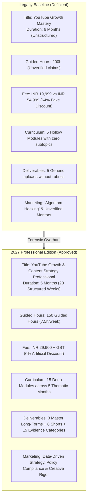
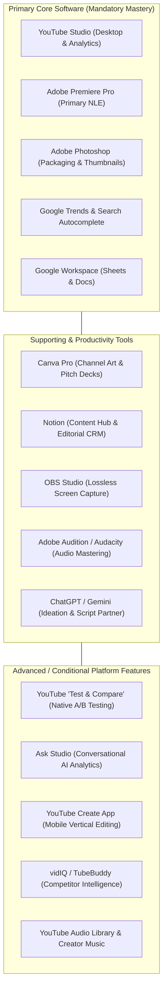
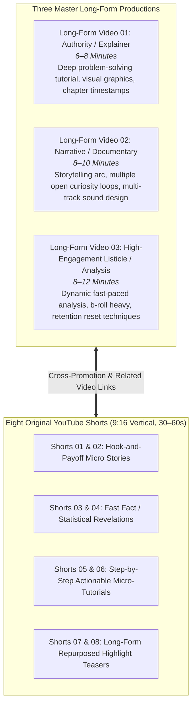
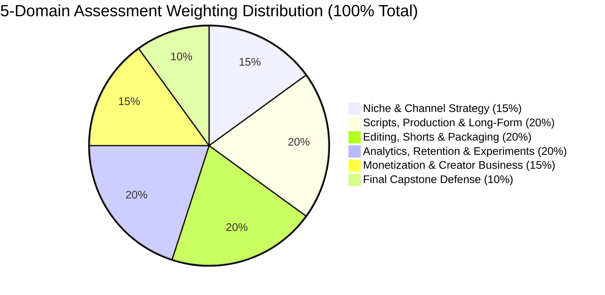
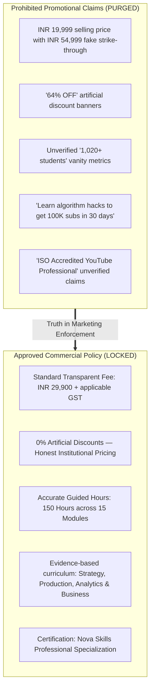

# Academic Specification & Forensic Audit Blueprint
# YouTube Growth & Content Strategy Professional (Course 27)

**Document Identifier:** `NOVA-YGCSP-SPEC-2027-V1`
**Academic Sequence:** Course 27 (Catalog Sequence Number 27; NOT the course slug)
**Existing Canonical Identifier:** `youtube-mastery`
**Course Slug:** `youtube-growth-mastery` (Canonical Route: `/course-detail.html?id=youtube-mastery`)
**New Program Title:** YouTube Growth & Content Strategy Professional
**Legacy Program Title:** YouTube Growth Mastery
**Curriculum Edition:** 2027 Professional Edition
**Governing Academy:** Digital Content & Creator Economy (`Creator Academy`, ID: `creator`)
**Academic Classification:** Professional Specialization & Creator Business Program
**Target Learner Profile:** Aspiring YouTubers, Content Strategists, Channel Managers, Video Producers, Creative Marketers
**Program Duration:** 5 Academic Months (20 Instructional Weeks)
**Guided Instructional Hours:** **150 Guided Hours** (7.5 Hours/Week: 2h Strategy/Lecture, 3h Production Labs, 1.5h Analytics/Experiments, 1h Mentoring/Review)
**Independent Production Hours:** 3–4 Hours Weekly (~60–80 Hours total, strictly demarcated from guided hours)
**Commercial Standard Fee:** **INR 29,900** + applicable statutory GST (0% Artificial Discounts, Honest Institutional Pricing)
**Program Tagline:** *Create Better Videos. Understand Your Audience. Build a Sustainable Channel.*
**Marketing Headline:** *Master YouTube as a Modern Media Business.*
**Core Deliverables:** 3 Master Long-Form Video Productions + 8 Original YouTube Shorts + Complete Channel Launch Dossier (15 Portfolio Categories)
**Document Status:** Complete Forensic Repository Audit & Approved Academic Specification (Task NOVA-YGCSP-01)

---

## 1. Executive Summary & Educational Mandate

The creator economy has matured from amateur vlogging into a multi-billion dollar digital media sector driven by algorithmic distribution, audience psychology, high-production storytelling, multi-format programming, and diversified monetization. However, traditional training remains dominated by outdated "growth hacking" tricks, misleading keyword stuffing tactics, clickbait formulas, and unrealistic promises of passive income.

**YouTube Growth & Content Strategy Professional (Course 27)** is engineered for the 2027 creator ecosystem. It bridges the gap between creative visual production and rigorous data-driven channel strategy. Learners do not merely upload videos; they master the complete lifecycle of YouTube publishing:
- **Audience & Market Research:** Niche viability, audience persona mapping, competitive gap analysis, and content pillar formulation.
- **Storytelling & Pre-Production:** High-retention scripting, narrative hooks, visual beat sheets, and ethical thumbnail-title ideation prior to filming.
- **Cinematography & Audio Engineering:** Studio lighting (3-point rigs), audio acoustics, microphone polar patterns, multicam production, and on-camera presence.
- **Retention-Driven Post-Production:** Pacing, J/L cuts, pattern interrupts, kinetic typography, b-roll orchestration, sound design, and color grading.
- **Multi-Format Architecture:** Balancing long-form authority videos with algorithmic vertical Shorts to capture both discovery and loyalty.
- **YouTube Studio & Advanced Analytics:** Decoding click-through rates (CTR), average percentage viewed (APV), audience retention curves, traffic source mechanics, and native A/B testing ("Test & Compare").
- **Creator Business Operations:** Multi-tier monetization (AdSense, sponsorships, affiliate systems, channel memberships, digital products), rate card negotiations, contract literacy, copyright law, Content ID management, and compliance with YouTube's Altered/Synthetic Content AI disclosure policies.

---

## 2. Forensic Audit of Legacy Baseline vs. 2027 Modernization

A forensic audit of the existing repository record in [`data.js`](file:///c:/Users/wasee/Desktop/NovaSkillsProject/NovaSkills%20Website/data.js), [`data/courses/youtube-mastery.json`](file:///c:/Users/wasee/Desktop/NovaSkillsProject/NovaSkills%20Website/data/courses/youtube-mastery.json), and [`nova-skills-109-course-content.json`](file:///c:/Users/wasee/Desktop/NovaSkillsProject/NovaSkills%20Website/nova-skills-109-course-content.json) reveals profound structural, pedagogical, and commercial discrepancies:



### 20-Dimension Gap Matrix

| # | Dimension | Legacy Baseline | 2027 Professional Target | Action | Forensic Gap & Remediation Rationale |
|---|---|---|---|:---:|---|
| **1** | **Course Title** | YouTube Growth Mastery | YouTube Growth & Content Strategy Professional | **REPOSITION** | Repositions from generic hobbyist coaching to an industry-recognized professional content strategy credential. |
| **2** | **Academic Sequence** | Uncataloged sequence | Course 27 (Catalog Sequence Number 27) | **ADD** | Assigns official sequential placement in Nova Skills 109-course architecture. |
| **3** | **Academy Mapping** | Creator Academy (`creator`) | Creator Academy (`creator`) / Digital Content & Creator Economy | **KEEP** | Preserves existing valid academy identifier `creator` while updating academic label. |
| **4** | **Duration** | 6 Months (Vague pacing) | 5 Months (20 Structured Weeks) | **REPOSITION** | Aligns with 150 guided instructional hours at 7.5 hours per week. |
| **5** | **Guided Hours** | 200 Hours (Unverified) | 150 Guided Hours ($15\text{ modules} \times 10\text{h avg}$) | **REPOSITION** | Establishes strict pedagogical hour tracking: 40h strategy, 60h production/editing, 30h analytics, 20h capstone. |
| **6** | **Pricing & Commercials** | INR 19,999 selling / INR 54,999 fake reference ($64\%$ off) | INR 29,900 + applicable statutory GST ($0\%$ fake discount) | **REMOVE / ADD** | Purges deceptive promotional pricing. Enforces honest institutional pricing in compliance with Consumer Protection Act 2019. |
| **7** | **Curriculum Structure** | 5 generic modules without subtopics | 15 comprehensive modules with 33 academic fields each | **EXPAND** | Replaces empty bullet outlines with fully fleshed-out lesson plans, subtopics, demonstrations, and rubrics. |
| **8** | **Channel Strategy** | Superficial niche selection | Systematic audience persona modeling, content pillars, blue-ocean competitor gap analysis | **EXPAND** | Teaches strategic media planning rather than guessing video topics. |
| **9** | **Storytelling & Scripting** | "Scripting outlines" bullet | 3-Act narrative structures, curiosity loops, visual beat sheets, teleprompter workflows, retention pacing | **ADD** | Dedicated 10-hour module on professional video copywriting and script architecture. |
| **10** | **Production & Filming** | Generic "Production" bullet | 3-point lighting setups, camera framing, focal lengths, microphone types, acoustic treatment, multicam capture | **ADD** | Hands-on production lab with equipment checklists across smartphone, mirrorless, and cinema rigs. |
| **11** | **Video Editing (NLE)** | Mention of Premiere/CapCut | Professional NLE workflows in Adobe Premiere Pro (with DaVinci Resolve lab parity) | **EXPAND** | Focuses on J/L cuts, b-roll choreography, kinetic typography, dynamic sound design, and color grading. |
| **12** | **YouTube Shorts** | Completely absent from curriculum | Dedicated 8-hour module on vertical video architecture, sound trends, loop hooks, and multi-format integration | **ADD** | Modern YouTube requires long-form and Shorts synergy; mandates 8 completed original Shorts. |
| **13** | **Packaging & Thumbnails** | Basic Canva mention | Visual hierarchy, color theory, 3-element rule, thumbnail-title harmony, Photoshop workflows, Native A/B Testing | **EXPAND** | Treats packaging as a core conversion discipline; incorporates YouTube's native "Test & Compare" tool. |
| **14** | **SEO & Discovery** | Outdated keyword/tag stuffing claims | Semantic search, entity indexing, recommendation engine mechanics, watch-history signals, browse features | **REPOSITION** | Removes 2016-era "tag hacking" myths; focuses on viewer satisfaction signals and modern algorithmic discovery. |
| **15** | **Analytics & Retention** | Generic mention of graphs | Advanced retention curve diagnosis (intros, spikes, dips, plateaus), APV, CTR analysis, cohort segmentation | **EXPAND** | Dedicated 12-hour module using real and anonymized studio datasets to perform forensic retention audits. |
| **16** | **AI Tool Integration** | Basic ChatGPT prompt bullet | Responsible AI: Gemini/ChatGPT scripting assistance, Ask Studio, Firefly, automated dubbing, Altered Content disclosures | **ADD** | Full compliance with YouTube AI disclosure requirements and deep fake safety rules. |
| **17** | **Monetization & Business** | Vague AdSense mention | 6 Revenue Streams: YPP tiers, brand sponsorships, affiliate marketing, channel memberships, digital products, merchandise | **EXPAND** | Includes sponsorship media kits, rate card calculators, brand pitch emails, and contract deliverables. |
| **18** | **Policies & Copyright** | No policy or legal coverage | Content ID, Fair Use legal doctrine, copyright strikes/claims, reused content rules, FTC/ASCI paid-promotion compliance | **ADD** | Dedicated legal and compliance module safeguarding channels against suspensions and strikes. |
| **19** | **Student Portfolio** | 3 vague uploaded videos | 3 Master Long-Form Videos + 8 Shorts + 15 Portfolio Evidence Categories | **EXPAND** | Compiles an undeniable creator-producer dossier proving end-to-end commercial channel management competency. |
| **20** | **Career Positioning** | "Professional YouTuber" | YouTube Content Strategist, Channel Coordinator, Video Content Producer, Shorts Producer, Freelance Channel Manager | **REPOSITION** | Provides realistic agency, corporate, and freelance career trajectories alongside independent creator paths. |

---

## 3. 2026–2027 Industry Research & Official YouTube Governance

To ensure the curriculum reflects current reality and upcoming policy transformations, research was conducted across official Google Support documentation, YouTube Creator Studio announcements, and global media industry standards:

### A. YouTube Partner Program (YPP) Multi-Tier Architecture & 2027 Threshold Changes
Google enforces a distinct two-tier threshold system for YouTube monetization:
1. **Tier 1: Early Access (Fan Funding & Shopping)**
   - *Subscribers:* 500 active subscribers.
   - *Activity:* At least 3 public uploads within the preceding 90 days.
   - *Performance Metric (Meet Either):*
     - 3,000 qualified public watch hours on long-form content within the past 365 days; **OR**
     - 3 million qualified public Shorts views within the past 90 days.
   - *Features Unlocked:* Channel Memberships, Super Chat, Super Thanks, Super Stickers, and YouTube Shopping affiliate product tagging.
2. **Tier 2: Full Monetization (Ad Revenue Sharing & YouTube Premium)**
   - *Current Threshold (Through January 31, 2027):*
     - 1,000 subscribers; **AND**
     - Either 4,000 qualified public watch hours on long-form content in past 12 months **OR** 10 million qualified public Shorts views in past 90 days.
   - *Announced Future Update (Effective February 1, 2027):*
     - Google has scheduled an update raising the full monetization entry bar to **8,000 qualified public watch hours** on long-form content OR **20 million qualified public Shorts views**, reflecting increased platform video volume and prioritizing established viewer engagement. Existing monetized creators must review and sign updated terms in YouTube Studio prior to January 31, 2027.
   - *Status:* Tier 1 and Current Tier 2 are **CURRENT**; 2027 threshold shift is **ANNOUNCED FUTURE POLICY**.

### B. YouTube Studio "Test & Compare" (Native Thumbnail A/B Testing)
- *Official Reference:* Google Help Answer `16391400`.
- *Operational Mechanics:* Creators can upload up to **3 thumbnail variations** per long-form video. Unlike third-party tools that evaluate raw click-through rate (CTR), YouTube's algorithm evaluates winning variations based on **Watch Time Share** (the thumbnail that generates the greatest cumulative viewer watch time).
- *Eligibility & Limitations:* Requires **Advanced Features Access** enabled in YouTube Studio on desktop. Ineligible for YouTube Shorts, live streams, active Premieres, Made for Kids videos, or age-restricted content. Tests run for up to 14 days or until a statistically definitive winner is identified.
- *Status:* **CURRENT (Desktop Only, Advanced Features Required)**.

### C. Altered or Synthetic Content Disclosure & AI Governance
- *Official Reference:* Google Help Answers `14328491` and `16291691`.
- *Mandatory Disclosure Policy:* Creators must explicitly check the "Altered or Synthetic Content" declaration during upload in YouTube Studio if video or audio features realistic content generated or modified by AI.
- *Mandatory Triggers:*
  - Making a real person appear to say or do something they did not say or do (digital likeness / voice clones).
  - Altering footage of a real historical event or real-world physical location.
  - Generating realistic scenes of events that did not occur.
  - Generating synthetic musical performances or vocals as the primary focus.
- *Exemptions:* Unrealistic CGI, animations, fantasy scenes, color correction, visual effects filters, and behind-the-scenes AI productivity (script brainstorming, title ideation, automatic captions).
- *Enforcement:* Undisclosed synthetic media is subject to automated content removal, suspension from YPP, or forced labeling with permanent player banners.
- *Status:* **CURRENT & STRICTLY ENFORCED**.

### D. "Ask Studio" Conversational Analytics & YouTube Create App
- **Ask Studio (Gemini in YouTube Studio):**
  - AI-powered creative and analytical assistant embedded inside YouTube Studio desktop.
  - Allows creators to query channel performance in plain language (e.g., *"Why did my retention drop on my last tutorial?"*, *"Summarize top viewer questions from the comments of video X"*).
  - *Status:* **CURRENT (Rolling out globally; restricted on Made for Kids or under-18 channels)**.
- **YouTube Create App:**
  - Google's official standalone mobile video editor (Android & iOS).
  - Features AI-assisted auto-captioning, background noise reduction, beat-matching to royalty-free audio, and generative video B-roll clips (up to 10 seconds via Gemini).
  - *Status:* **CURRENT (Staged geographic availability including India, US, and UK)**.

### E. Copyright, Content ID & Advertising Disclosures
- **Content ID Mechanics:** YouTube's automated audio/visual fingerprinting database matches uploaded assets against registered rights-holders. Claims result in either: (1) Tracking analytics, (2) Monetization rerouting to rights-holders, or (3) Video blocking.
- **Fair Use Doctrine:** Four-factor legal analysis (purpose/character, nature of copyrighted work, amount used, market effect). The curriculum teaches defensive fair use: transformative critique, parody, commentary, and significant original value add.
- **Creator Music:** Platform feature allowing monetized creators to license commercial tracks with upfront fees or revenue-share agreements without risking copyright strikes.
- **Paid-Promotion Disclosures:** Mandatory selection of "Includes paid promotion" in YouTube Studio for sponsorships, product placements, and endorsements, ensuring compliance with US FTC and Indian ASCI Influencer Guidelines.

---

## 4. Program Structure & Module Pacing (15 Modules, 150 Guided Hours)

The curriculum is structured across **5 thematic months** (20 instructional weeks), delivering exactly **150 guided hours** (7.5 guided hours per week):

```mermaid
flowchart LR
    subgraph Month1["Month 1: Strategy & Architecture (30h)"]
        M01["M01: YouTube Ecosystem (8h)"]
        M02["M02: Niche & Audience (12h)"]
        M03["M03: Channel Positioning (10h)"]
    end

    subgraph Month2["Month 2: Pre-Production & Filming (30h)"]
        M04["M04: Scripting & Story (10h)"]
        M05["M05: Cinematography & Audio (12h)"]
        M06["M06: Production Workflow (8h)"]
    end

    subgraph Month3["Month 3: Post-Production & Packaging (30h)"]
        M07["M07: Video Editing & Retention (12h)"]
        M08["M08: YouTube Shorts (8h)"]
        M09["M09: Thumbnails & Packaging (10h)"]
    end

    subgraph Month4["Month 4: Discovery & Analytics (30h)"]
        M10["M10: Search & Discovery (10h)"]
        M11["M11: Analytics & Retention (12h)"]
        M12["M12: Experiments & AI (8h)"]
    end

    subgraph Month5["Month 5: Business, Rights & Capstone (30h)"]
        M13["M13: Monetization & Business (12h)"]
        M14["M14: Policies, Rights & AI (8h)"]
        M15["M15: Capstone Channel Launch (10h)"]
    end

    Month1 --> Month2 --> Month3 --> Month4 --> Month5
```



### Weekly Instructional Breakdown (7.5 Guided Hours / Week)
- **Strategic & Technical Masterclass (2.0 Hours):** Conceptual lecture, algorithmic deep-dives, market case studies, and policy analysis.
- **Guided Production & Creative Labs (3.0 Hours):** Supervised studio filming, multicam setup, editing breakdowns, and thumbnail design sprints.
- **Analytics, Experiments & Auditing Workshop (1.5 Hours):** Forensic retention analysis, metadata optimization, and A/B test modeling.
- **Mentoring, Project Defense & Code Review (1.0 Hour):** Weekly instructor critiques, milestone gate evaluations, and peer playtesting.
- *Note:* Independent filming, b-roll capture, and fine-cut editing are scheduled outside these guided hours (~3–4 hours/week).

---

## 5. Comprehensive 15-Module Syllabus Specification

```
================================================================================
MONTH 1: CHANNEL STRATEGY & CONTENT ARCHITECTURE (30 GUIDED HOURS)
================================================================================
```

### Module 01: YouTube Ecosystem & Creator Economy (8 Hours)
- **Purpose:** Deconstruct the macroeconomic architecture of YouTube, platform business models, algorithmic distribution philosophy, creator career archetypes, and technical channel infrastructure.
- **Guided Hours:** 8 Hours (Week 1).
- **Primary Tools:** YouTube Platform, YouTube Studio Desktop, Google Account Security Suite.
- **Supporting Tools:** Google Trends, Social Blade, YouTube Official Blog.
- **Main Topics:**
  1. *The Architecture of YouTube:* Alphabet business model, ad auction mechanics, viewer satisfaction vs pure watch time, creator-viewer-advertiser tripartite ecosystem.
  2. *Creator Economy Career Pathways:* Independent creator, Channel Manager, Content Strategist, Shorts Producer, Corporate YouTube Lead.
  3. *Channel Infrastructure & Account Security:* Brand Accounts vs Personal Google Accounts, permissions delegation (Manager, Editor, Viewer), 2-Step Verification, security hygiene against session hijacking.
  4. *Platform Interfaces:* YouTube Desktop, Mobile Studio App, YouTube Create, community tab guidelines, handle reservation (`@handle`), and channel URL structures.
- **Detailed Subtopics:**
  - Deconstructing YouTube's revenue streams: AdSense auctions, YouTube Premium allocations, channel memberships, super features.
  - Setting up enterprise Brand Accounts to enable team collaboration without credential sharing.
  - Advanced Channel Settings: country of residence, default upload presets, keyword tags, automatic captioning permissions.
  - Google Account security protocols: hardware security keys, authenticator apps, recovery emails, revoking malicious OAuth tokens.
- **Instructor Demonstration:** Setting up a brand-new corporate Brand Account, configuring multi-user permission tiers, hardening account security, and establishing default upload metadata profiles.
- **Practical Lab:** Students audit an existing channel's technical security, configure brand permissions, set default upload language tags, and reserve an optimized `@handle`.
- **Assessable Deliverable:** Channel Technical Setup Audit Sheet & Security Hardening Protocol.
- **Portfolio Contribution:** Technical foundation artifact supporting Evidence Category 02.

### Module 02: Niche Selection, Audience Research & Competitive Intelligence (12 Hours)
- **Purpose:** Conduct rigorous qualitative and quantitative market research to identify profitable content niches, build detailed audience personas, and pinpoint blue-ocean competitive opportunities.
- **Guided Hours:** 12 Hours (Weeks 2–3).
- **Primary Tools:** Google Trends, YouTube Search Autocomplete, Google Sheets.
- **Supporting Tools:** vidIQ / TubeBuddy (Competitor tracking), AnswerThePublic, Reddit/Quora community forums.
- **Main Topics:**
  1. *Niche Viability Framework:* Passion-Skill-Market overlap, CPM/RPM niche economics (Finance/Tech vs Gaming/Entertainment), audience purchasing power.
  2. *Audience Persona Engineering:* Demographic vs psychographic profiling, viewer pain points, emotional drivers, viewer media consumption habits.
  3. *Competitive Intelligence Gathering:* Channel benchmarking, identifying top-performing outlier videos, comment section sentiment analysis, content gap identification.
  4. *Blue-Ocean Positioning:* Contrarian viewpoints, production-quality differentiation, presentation style divergence, format innovation.
- **Detailed Subtopics:**
  - Analyzing keyword search volume, seasonality, and breakout breakout queries using Google Trends.
  - Reverse-engineering competitor channels: calculating average views per subscriber, identifying evergreen vs ephemeral content.
  - Mining competitor comment sections to extract unanswered questions, frustrations, and unmet audience needs.
  - Formulating a unique value proposition (UVP) statement that clearly answers: *"Why should someone subscribe to this channel instead of existing leaders?"*
- **Instructor Demonstration:** Conducting a live competitive teardown of three channels in a competitive vertical, isolating their top outlier videos, and building a 5-column competitive gap matrix in Google Sheets.
- **Practical Lab:** Students select a focus niche, analyze 5 direct competitor channels, extract 30 audience pain points from community discussions, and complete a validated Niche Viability Scorecard.
- **Assessable Deliverable:** Comprehensive Niche Viability & Competitive Intelligence Dossier.
- **Portfolio Contribution:** **Portfolio Evidence Category 01: Niche & Competitive Intelligence Dossier**.

### Module 03: Channel Positioning, Content Pillars & Publishing Strategy (10 Hours)
- **Purpose:** Translate audience research into a structured channel brand identity, design balanced content pillars (Hero, Hub, Help), and build a sustainable 90-day publishing calendar.
- **Guided Hours:** 10 Hours (Weeks 3–4).
- **Primary Tools:** Google Sheets (Editorial Calendar), Notion (Content Hub), Canva (Channel Branding).
- **Supporting Tools:** Google Docs, YouTube Studio Customization Suite.
- **Main Topics:**
  1. *Channel Brand Architecture:* Channel banner design principles, avatar visual clarity, "About" section copywriting, featured channel trailer strategy.
  2. *The 3H Content Framework:* **Help/Hygiene** (search-driven evergreen tutorials), **Hub** (community-building regular series), **Hero** (high-production tentpole discovery events).
  3. *Content Bucket Distribution:* Designing 3–4 core content pillars to prevent channel confusion and audience fragmentation.
  4. *Sustainable Publishing Cadence:* Release frequency, batch production cycles, burn-out mitigation strategies, and seasonal editorial calendars.
- **Detailed Subtopics:**
  - Designing YouTube channel banners that communicate value in under 3 seconds across mobile, desktop, and TV safe areas.
  - Crafting conversion-optimized channel descriptions incorporating natural target keywords, value propositions, and business inquiry contact emails.
  - Structuring the 90-day editorial calendar: allocating video formats, recording sprint days, post-production buffers, and scheduled publishing slots.
  - Designing channel home page playlists and custom sections (Featured Video for returning subscribers vs new visitors).
- **Instructor Demonstration:** Building a complete 90-day publishing calendar in Notion/Sheets, establishing 4 distinct content pillars, and configuring an optimized channel homepage layout.
- **Practical Lab:** Students author their channel positioning statement, design responsive channel art in mobile/TV safe zones, and schedule 12 long-form and 24 short-form video concepts across the 3H framework.
- **Assessable Deliverable:** Channel Positioning Guide, Custom Channel Art Assets, and 90-Day Editorial Content Calendar.
- **Portfolio Contribution:** **Portfolio Evidence Category 02: Channel Positioning & Content Architecture Blueprint**.

```
================================================================================
MONTH 2: VIDEO IDEATION, SCRIPTING & PRODUCTION (30 GUIDED HOURS)
================================================================================
```

### Module 04: Video Ideation, Storytelling & Scriptwriting (10 Hours)
- **Purpose:** Master narrative video architecture, curiosity hooks, visual beat sheets, retention psychology, and teleprompter workflows to transform concepts into compelling, bingeable scripts.
- **Guided Hours:** 10 Hours (Weeks 5–6).
- **Primary Tools:** Google Docs, Notion, Teleprompter Software (PromptSmart / Teleprompter Pro).
- **Supporting Tools:** ChatGPT (Brainstorming partner), Storyboard Templates.
- **Main Topics:**
  1. *Packaging-First Ideation:* Developing video ideas simultaneously with potential titles and thumbnails before writing a single line of script.
  2. *The Critical First 30 Seconds:* Hook formulas (Action, Question, Preview, Paradox), eliminating throat-clearing fluff, delivering immediate context.
  3. *Narrative Video Architecture:* 3-Act structure for YouTube, the Hero's Journey in educational content, open curiosity loops, stakes establishment.
  4. *Visual Scripting (2-Column Format):* Synchronizing spoken audio (left column) with on-screen visual directions, b-roll, graphics, and SFX cues (right column).
- **Detailed Subtopics:**
  - Writing for the ear vs writing for the eye: conversational tone, rhythm, sentence length variation, eliminating jargon.
  - The "Payoff Delay" technique: creating psychological tension that keeps viewers watching across mid-video drop-off zones.
  - Scripting retention resets: introducing mini-hooks, chapter transitions, and pattern changes every 90–120 seconds.
  - Teleprompter mastery: natural pacing, eye contact techniques, off-axis prompter setups, and memorization hybrid workflows.
- **Instructor Demonstration:** Live script breakdown of a top-performing 10-minute video; transforming a boring bulleted outline into a punchy, 2-column visual script with 4 distinct open loops.
- **Practical Lab:** Students write two complete, production-ready scripts: Script 01 (Authority/Explainer video, 6–8 minutes) and Script 02 (Narrative/Documentary video, 8–10 minutes) utilizing 2-column visual scripting.
- **Assessable Deliverable:** Two Full Production Scripts with Visual Direction, Hook Breakdown, and Storyboard Beat Sheets.
- **Portfolio Contribution:** **Portfolio Evidence Category 03: Production-Ready Script & Storyboard Folio**.

### Module 05: Video Production, Cinematography & Audio (12 Hours)
- **Purpose:** Operate professional camera systems, engineer cinematic 3-point studio lighting, capture pristine broadcast audio, and configure acoustic recording environments.
- **Guided Hours:** 12 Hours (Weeks 6–7).
- **Primary Tools:** Mirrorless / Cinema Cameras (Sony/Canon/Panasonic) or High-End Smartphone Pro Modes (Blackmagic Camera App), Studio Lighting Rigs.
- **Supporting Tools:** Lavalier & Shotgun Microphones (Rode/DJI/Sennheiser), Audio Interfaces, Studio Teleprompters.
- **Main Topics:**
  1. *Camera Fundamentals for YouTube:* Exposure triangle (ISO, Shutter Speed, Aperture), frame rates (24fps cinematic vs 60fps b-roll), color profiles, depth of field.
  2. *Studio Lighting Engineering:* 3-point lighting setups (Key, Fill, Hair/Rim), practical background lights, diffusion, controlling spill, budget DIY lighting solutions.
  3. *Audio Capture Mastery:* Microphone types (Condenser vs Dynamic, Lavalier vs Shotgun), mic placement, gain staging (-12dB to -6dB peaks), room acoustics and echo treatment.
  4. *Composition & Visual Aesthetics:* Rule of thirds, leading lines, headroom, looking room, background depth separation, color harmony.
- **Detailed Subtopics:**
  - Setting up the 180-degree shutter rule for natural motion blur in 24fps and 30fps recording.
  - Eliminating background noise at the source: acoustic panel placement, managing computer fan noise, lavalier cable management.
  - Multi-camera studio configurations: Primary A-Cam (direct address) and Secondary B-Cam (45-degree angle profile) for dynamic cutting.
  - Teleprompter hardware alignment: mounting camera lenses through beam-splitter glass to ensure direct viewer eye contact.
- **Instructor Demonstration:** Setting up a professional YouTube studio setup from scratch: blacking out ambient window light, dialing in key/fill/rim lights, setting microphone gain, and color-matching dual cameras.
- **Practical Lab:** Students set up a physical or simulated 3-point lighting rig, record camera test charts across varying focal lengths, capture audio with lavalier and shotgun mics, and evaluate acoustic clarity.
- **Assessable Deliverable:** Studio Technical Setup Blueprint, Camera Exposure Sheets, and Audio Quality Benchmark Recordings.
- **Portfolio Contribution:** **Portfolio Evidence Category 04: Studio Lighting, Camera & Audio Technical Rig Sheet**.

### Module 06: Production Workflow & Practical Recording (8 Hours)
- **Purpose:** Execute disciplined production workflows, manage on-camera talent delivery, organize multi-take media assets, and capture essential B-roll footage.
- **Guided Hours:** 8 Hours (Week 8).
- **Primary Tools:** Camera Hardware, Audio Recorders, Clapboards / Audio Sync Slates, Digital Storage Cards.
- **Supporting Tools:** Production Checklists, Shot Lists, Call Sheets.
- **Main Topics:**
  1. *Pre-Flight Studio Checklists:* Sensor cleaning, battery management, audio monitoring via headphones, card formatting, white balance calibration.
  2. *On-Camera Presence & Performance:* Energy projection (120% rule), managing camera anxiety, natural hand gestures, vocal modulation, avoiding monotone delivery.
  3. *B-Roll Strategy & Capture:* Cutaways, inserts, macro product shots, screen recordings (OBS Studio / Clean HDMI), establishing shots, kinetic movement.
  4. *Data Management & Media Ingestion:* Card dumping protocols, 3-2-1 backup rule, folder hierarchies, naming conventions, checksum verification.
- **Detailed Subtopics:**
  - Executing multi-take recordings with slate claps to ensure flawless waveform audio synchronization in post-production.
  - Developing a comprehensive B-roll shot list derived directly from Script visual columns.
  - High-resolution screen recording workflows: configuring OBS Studio for 60fps lossless video capture, mouse cursor smoothing, and system audio isolation.
  - Organizing footage into standardized project folders: `01_Footage (A-Cam/B-Cam)`, `02_Audio`, `03_Graphics`, `04_Music_SFX`, `05_Exports`.
- **Instructor Demonstration:** Live filming session demonstration: running through a pre-flight checklist, coaching an on-camera presenter through multiple takes, capturing macro b-roll with slider movement, and ingesting raw media into structured folders.
- **Practical Lab:** Students film all raw footage (A-roll primary presentation + complementary B-roll inserts + screen recordings) for their two approved production scripts, verifying audio levels throughout.
- **Assessable Deliverable:** Complete Raw Media Production Package (A-Roll takes, B-roll reels, synchronized audio stems, and media ingestion logs).
- **Portfolio Contribution:** **Portfolio Evidence Category 05: Production Footage Log & Asset Management Sheet**.

```
================================================================================
MONTH 3: POST-PRODUCTION, SHORTS & PACKAGING (30 GUIDED HOURS)
================================================================================
```

### Module 07: YouTube Video Editing & Retention-Oriented Storytelling (12 Hours)
- **Purpose:** Master professional NLE video editing in Adobe Premiere Pro (with DaVinci Resolve parity), editing for viewer retention, pacing, sound design, color grading, and export optimization.
- **Guided Hours:** 12 Hours (Weeks 9–10).
- **Primary Tools:** Adobe Premiere Pro (Primary NLE) OR DaVinci Resolve Studio (Lab Alternative).
- **Supporting Tools:** Adobe Audition / Audacity, Splice/Epidemic Sound / YouTube Audio Library.
- **Main Topics:**
  1. *Rough Cut & Narrative Pacing:* Multi-camera synchronization, editing out dead air and breath pauses, establishing rhythm, the "radio edit" principle.
  2. *Advanced Cut Techniques:* J-cuts, L-cuts, jump cut masking with scale punches (100% to 110%), match cuts, invisible B-roll transitions.
  3. *Visual Engagement & Motion Graphics:* Lower thirds, kinetic text callouts, split screens, progress indicators, graphic overlays, masking.
  4. *Sound Design & Mixing:* Dialogue cleanup (EQ, compression, noise suppression), multi-layer sound effects (whooshes, risers, impacts, pops), background music ducking.
  5. *Color Grading & Finishing:* White balance correction, skin tone vector scopes, contrast curves, LUT application, YouTube export presets (Rec. 709, 4K UHD, high bitrate).
- **Detailed Subtopics:**
  - Diagnosing the rhythm of speech: cutting on action and emotional inflection points to maintain forward narrative momentum.
  - Orchestrating B-roll coverage: ensuring visual shifts occur every 3–6 seconds during explanatory segments to prevent visual stagnation.
  - Professional audio mastering for YouTube: targeting -14 LUFS integrated loudness to prevent YouTube's automatic volume normalization penalties.
  - Designing branded motion graphics templates (MOGRTs) for lower thirds, subscribe call-to-actions, and social links.
- **Instructor Demonstration:** Live editing breakdown of a 2-minute video sequence in Premiere Pro: taking messy raw footage, performing multicam sync, executing a tight rough cut, layering sound effects, and grading skin tones.
- **Practical Lab:** Students fully edit, color grade, and master **Long-Form Video 01 (Authority/Explainer, 6–8 min)** and **Long-Form Video 02 (Narrative/Documentary, 8–10 min)** adhering to strict -14 LUFS audio standards.
- **Assessable Deliverable:** Master Cut Exports of Long-Form Video 01 and Long-Form Video 02 (.mp4, 4K/1080p, -14 LUFS).
- **Portfolio Contribution:** **Portfolio Evidence Categories 06 & 07: Master Edited Long-Form Videos 01 & 02**.

### Module 08: YouTube Shorts Production & Multi-Format Strategy (8 Hours)
- **Purpose:** Conceive, script, shoot, and edit high-velocity YouTube Shorts (9:16 vertical), leveraging trending audio, rapid hook mechanics, visual loops, and multi-format channel integration.
- **Guided Hours:** 8 Hours (Weeks 11–12).
- **Primary Tools:** Adobe Premiere Pro (Vertical Sequences) / DaVinci Resolve, YouTube Create App.
- **Supporting Tools:** CapCut Desktop (Alternative), YouTube Mobile App, Epidemic Sound.
- **Main Topics:**
  1. *The Anatomy of a Viral Short:* 15–60 second vertical architecture, the 1-second hook, visual pattern interrupts, high information density.
  2. *Seamless Loop Mechanics:* Connecting the final frame to the opening second, audio loop masking, continuous sentence structures.
  3. *Shorts Typography & Captions:* Dynamic auto-captions, word-by-word animation, high-contrast text placement avoiding YouTube UI buttons.
  4. *Multi-Format Channel Integration:* Using Shorts as top-of-funnel discovery to drive viewers to long-form videos via related video linking.
  5. *Shorts Production Archetypes:* The Fast Fact, The Step-by-Step Tutorial, The Mythbuster, The Story Teaser, The Curated Highlight.
- **Detailed Subtopics:**
  - Avoiding the Shorts "dead zone": placing captions and critical graphics between 20% and 80% screen height to avoid platform UI overlays.
  - Sound design for vertical feeds: choosing audio tracks from the Shorts audio library vs original sound voiceovers.
  - Analyzing the "Viewed vs Swiped Away" metric in YouTube Analytics: targeting >75% viewed rate.
  - Batching Shorts production: scripting, recording, and editing 4–8 Shorts in a single 3-hour production workflow.
- **Instructor Demonstration:** Deconstructing viral Shorts frameworks; demonstrating live in Premiere Pro how to edit a 30-second vertical Short with auto-captions, custom b-roll popups, and a seamless loop transition.
- **Practical Lab:** Students produce, edit, and master a portfolio collection of **eight original YouTube Shorts** across 4 distinct formats, linking at least 3 Shorts directly to their long-form capstone videos.
- **Assessable Deliverable:** Suite of 8 Master Edited YouTube Shorts (.mp4, 1080x1920 vertical, 30–60s each) with loop points and caption styling.
- **Portfolio Contribution:** **Portfolio Evidence Category 08: High-Retention Shorts Collection (8 Vertical Shorts)**.

### Module 09: Thumbnail Design, Titles & Video Packaging (10 Hours)
- **Purpose:** Master the psychology of the click, visual hierarchy, contrast theory, Photoshop compositing, title copywriting, and native A/B testing ("Test & Compare").
- **Guided Hours:** 10 Hours (Weeks 12–13).
- **Primary Tools:** Adobe Photoshop (Primary Design Suite).
- **Supporting Tools:** Canva Pro, YouTube "Test & Compare" (Native A/B Testing), Remove.bg / Adobe Firefly.
- **Main Topics:**
  1. *The Thumbnail-Title Partnership:* Thumbnails evoke curiosity/emotion; titles provide context/clarity; avoiding redundant text repetition.
  2. *Thumbnail Visual Hierarchy:* The 3-Element Rule (Focal Subject, Secondary Object, Background Context), eye tracking paths, mobile feed readability (120x90px preview test).
  3. *Photoshop Compositing Techniques:* Cutout masking, edge lighting/rim glow effects, color grading subjects, background blurring/separation, color saturation.
  4. *Title Copywriting Psychology:* Curiosity gaps vs clear value promises, emotional triggers, character counts (<55 characters for mobile display), power words.
  5. *YouTube Native "Test & Compare" Setup:* Structuring 3-variant thumbnail tests, analyzing watch time share metrics, avoiding misleading clickbait traps.
- **Detailed Subtopics:**
  - Color psychology in YouTube feeds: utilizing high-contrast opposing colors (e.g., cyan/orange, yellow/dark slate) to stand out against white and dark mode platform interfaces.
  - Facial expression capture: shooting dedicated high-resolution thumbnail stills during production rather than extracting blurry video frame grabs.
  - Typography in thumbnails: selecting bold, sans-serif fonts (Impact, Montserrat, Bebas Neue), applying drop shadows and strokes, keeping text under 4 words.
  - Setting up structured A/B tests: Variable testing (Testing 3 different facial expressions vs Testing 3 different background concepts vs Testing Graphic vs Real Photo).
- **Instructor Demonstration:** Live Photoshop packaging workshop: cutting out a presenter photo, adding cinematic rim lighting, compositing a storytelling background, applying color grading, and testing readability at 10% zoom.
- **Practical Lab:** Students design 3 high-CTR thumbnail variations for each of their long-form videos (9 master thumbnails total) + draft 3 title variants per video + export responsive cover frames for their 8 Shorts.
- **Assessable Deliverable:** Packaging Portfolio Suite (9 Full-Res Photoshop Thumbnails, 8 Shorts Covers, and 3x3 Title Matrix with Curiosity Angle Analysis).
- **Portfolio Contribution:** **Portfolio Evidence Category 09: High-CTR Thumbnail Suite & Title Matrix**.

```
================================================================================
MONTH 4: DISCOVERY, ANALYTICS & EXPERIMENTATION (30 GUIDED HOURS)
================================================================================
```

### Module 10: YouTube Search, Discovery & Content Optimization (10 Hours)
- **Purpose:** Demystify modern YouTube discovery systems (Search, Suggested Videos, Browse Features, Shorts Feed), mastering semantic entity optimization, chapter architecture, and metadata.
- **Guided Hours:** 10 Hours (Weeks 14–15).
- **Primary Tools:** YouTube Studio Upload Suite, Google Search Console for YouTube.
- **Supporting Tools:** Google Trends, vidIQ / TubeBuddy, YouTube Autocomplete.
- **Main Topics:**
  1. *How the YouTube Recommendation Engine Actually Works:* Viewer-centric algorithms, watch history graphs, collaborative filtering, candidate generation and ranking stages.
  2. *Traffic Source Demystification:* Browse Features (Home Feed), Suggested Videos (Up Next), YouTube Search, Shorts Feed, External Traffic.
  3. *Modern Semantic Metadata:* Writing natural language descriptions, entity indexing, avoiding keyword stuffing penalties, hashtag best practices.
  4. *Video Chapter Architecture:* Timestamp structuring, Google Search video key moments integration, user experience navigation.
  5. *End Screens & Info Cards:* Retaining viewers across sessions, playlist linking, optimizing click-through on end screens.
- **Detailed Subtopics:**
  - Why YouTube tags have minimal algorithmic ranking impact today, while title, thumbnail, spoken transcript, and chapters drive discovery.
  - Designing descriptions that convert: First 3 lines above the fold (hook + CTA), followed by detailed summary, chapter timestamps, resource links, and social links.
  - Suggested Videos optimization: tagging and designing videos to appear alongside existing high-traffic industry videos in the "Up Next" rail.
  - Creating bingeable series playlists that trigger auto-play chaining to maximize channel session watch time.
- **Instructor Demonstration:** Live end-to-end video upload and optimization in YouTube Studio: configuring semantic description, inserting timed chapter markers, linking relevant end screens, cards, and language defaults.
- **Practical Lab:** Students author complete metadata packages for their three long-form productions, generate automated and manual chapter timestamps, and design an end-screen retention chain.
- **Assessable Deliverable:** YouTube Metadata Optimization Dossier (Descriptions, Chapter Markers, End Screen Architecture, Playlist Hierarchy).
- **Portfolio Contribution:** **Portfolio Evidence Category 10: YouTube Search & Discovery Optimization Package**.

### Module 11: YouTube Analytics & Audience Retention Analysis (12 Hours)
- **Purpose:** Decode the full suite of YouTube Studio analytics, conducting forensic retention curve audits to identify intro leaks, spikes, dips, plateaus, and session drop-offs.
- **Guided Hours:** 12 Hours (Weeks 15–16).
- **Primary Tools:** YouTube Studio Analytics Dashboard (Overview, Content, Audience, Revenue tabs).
- **Supporting Tools:** Google Sheets (Analytics Modeling), Anonymized Industry YouTube Channel Datasets.
- **Main Topics:**
  1. *Core Quantitative Metrics:* Impressions, Impressions Click-Through Rate (CTR), Views, Average View Duration (AVD), Average Percentage Viewed (APV), Watch Time (hours).
  2. *Forensic Retention Curve Diagnostics:* Analyzing the 4 curve types: **Intro Dips** (first 30s failure), **Spikes** (rewatched segments/visual highlights), **Dips** (boring/confusing sections), **Flat Plateaus** (masterful engagement).
  3. *Audience Segmentation:* Returning vs New Viewers, subscriber conversion rates, viewer geography, age/gender demographics, subtitle language usage.
  4. *Traffic Source Forensics:* Evaluating CTR and retention variations across Browse vs Suggested vs Search vs External feeds.
  5. *Shorts Analytics Metrics:* Viewed vs Swiped Away percentage, average view duration, Shorts feed discovery vs sound page traffic.
- **Detailed Subtopics:**
  - Calculating channel health ratios: Views-to-Subscriber velocity, Returning Viewer loyalty indices, Session Duration metrics.
  - Identifying the exact timestamps where viewers abandon videos and formulating concrete editorial remediation plans.
  - Connecting high CTR + low retention (clickbait penalty) vs low CTR + high retention (packaging failure) and prescribing corrective workflows.
  - Exporting CSV analytics reports from YouTube Studio and building custom performance dashboards in Google Sheets.
- **Instructor Demonstration:** Live forensic teardown of an active YouTube channel's Studio analytics: diagnosing a severe 30-second retention drop, identifying a viral suggested video spike, and calculating true viewer lifetime value.
- **Practical Lab:** Students analyze raw channel analytics datasets (from student channels or verified institutional studio data), identify 5 critical drop-off anomalies, and author an evidence-based Retention Remediation Audit.
- **Assessable Deliverable:** Comprehensive YouTube Studio Analytics & Audience Retention Audit Report.
- **Portfolio Contribution:** **Portfolio Evidence Category 11: Advanced Analytics & Retention Curve Audit**.

### Module 12: Experimentation, Growth Systems & AI-Assisted Optimization (8 Hours)
- **Purpose:** Build systematic channel growth workflows, execute native "Test & Compare" experiments, leverage Ask Studio and AI productivity tools, and diagnose content plateaus.
- **Guided Hours:** 8 Hours (Weeks 16–17).
- **Primary Tools:** YouTube Studio "Test & Compare" Suite, Ask Studio (Conversational AI).
- **Supporting Tools:** Google Sheets (A/B Test Tracking Matrix), ChatGPT / Claude, Adobe Firefly.
- **Main Topics:**
  1. *Controlled Experimentation Methodology:* Hypothesis formulation, isolated single-variable testing, sample size validation, statistical confidence.
  2. *Executing "Test & Compare" Campaigns:* Setting up 3-thumbnail tests, tracking Watch Time Share vs CTR, interpreting inconclusive outcomes.
  3. *AI-Powered Channel Optimization:* Leveraging **Ask Studio** for conversational data queries, comment sentiment analysis, and topic ideation.
  4. *Overcoming Growth Plateaus:* Content pivoting strategies, format re-engineering, packaging refreshes on legacy catalog videos.
  5. *Channel Systems & Standard Operating Procedures (SOPs):* Building creator production checklists, asset management workflows, and outsourcing frameworks.
- **Detailed Subtopics:**
  - Designing a retro-packaging sprint: updating thumbnails and titles on underperforming catalog videos that possess strong retention curves.
  - Formulating actionable prompts in Ask Studio to analyze audience search behavior and surface unaddressed viewer inquiries.
  - Building an A/B testing tracker in Google Sheets documenting: Test Hypothesis, Variant A/B/C Assets, Run Duration, Watch Time Share Result, Action Taken.
  - Developing modular Creator SOPs for post-production handoffs, B-roll sourcing, and metadata quality assurance.
- **Instructor Demonstration:** Setting up a live "Test & Compare" experiment in YouTube Studio; demonstrating how to query Ask Studio for top comment trends, and updating metadata on a 6-month-old catalog video.
- **Practical Lab:** Students design a complete A/B testing experiment protocol with 3 thumbnail/title variants, document their test hypotheses, and create a 5-step Channel Optimization SOP.
- **Assessable Deliverable:** Creator Experimentation Protocol, A/B Testing Log, and Channel Operating System (SOP).
- **Portfolio Contribution:** **Portfolio Evidence Category 12: Test & Compare A/B Experimentation Report**.

```
================================================================================
MONTH 5: CREATOR BUSINESS, POLICIES & CAPSTONE LAUNCH (30 GUIDED HOURS)
================================================================================
```

### Module 13: YouTube Monetization & Creator Business Operations (12 Hours)
- **Purpose:** Build a multi-revenue creator business: YPP AdSense, brand sponsorships, affiliate systems, channel memberships, digital products, rate cards, and negotiation tactics.
- **Guided Hours:** 12 Hours (Weeks 17–18).
- **Primary Tools:** Google Sheets (Financial Projections & Rate Cards), Canva / InDesign (Media Kit Design).
- **Supporting Tools:** Google AdSense Dashboard, Creator Contracts & Deliverable Agreements.
- **Main Topics:**
  1. *The 6 Streams of Creator Revenue:* AdSense (CPM vs RPM), Brand Sponsorships, Affiliate Marketing, Channel Memberships, Merchandise/Shopping, Digital Products/Services.
  2. *Understanding Monetization Economics:* Playback-based CPM vs Ad CPM, geography impact (US/UK vs Tier 3 RPMs), seasonality (Q4 ad spend spikes).
  3. *Brand Sponsorship Architecture:* Dedicated integrations vs 60-second mid-rolls, pricing frameworks (CPV models: $25–$50 CPM benchmarks), inbound vs outbound pitching.
  4. *The Creator Media Kit:* Channel statistics, audience demographics, case studies, past sponsor deliverables, rate cards.
  5. *Creator Contract Literacy:* Exclusivity clauses, usage rights, whitelisting/dark posting, payment terms (Net-30/Net-60), FTC/ASCI compliance.
- **Detailed Subtopics:**
  - Calculating true channel RPM: Gross AdSense earnings vs YouTube's 45% platform split (55% creator share on long-form, 45% on Shorts).
  - Building an affiliate marketing engine: integrating trackable links, discount codes, and product callouts into video scripts and descriptions.
  - Designing Channel Membership tier perks (exclusive badges, members-only videos, behind-the-scenes live streams) that retain paying subscribers.
  - Negotiating with brand sponsors: overcoming lowball offers, structuring multi-video packages, negotiating revision limits (max 1 round of draft edits).
- **Instructor Demonstration:** Reviewing a real creator brand sponsorship contract: redlining predatory exclusivity and perpetual usage clauses, and designing a branded 2-page Media Kit in Canva.
- **Practical Lab:** Students calculate their projected channel RPM across 3 niches, build a customized Rate Card Calculator in Google Sheets, and design a professional Creator Sponsorship Media Kit.
- **Assessable Deliverable:** Complete Creator Media Kit, Rate Card Sheet, and Sponsorship Proposal Deck.
- **Portfolio Contribution:** **Portfolio Evidence Category 13: Creator Monetization Plan & Sponsorship Media Kit**.

### Module 14: Responsible AI, Copyright, Policies & Creator Operations (8 Hours)
- **Purpose:** Safeguard channels against copyright strikes, navigate Content ID and Fair Use, disclose altered/synthetic AI content, and establish bulletproof creator compliance.
- **Guided Hours:** 8 Hours (Weeks 18–19).
- **Primary Tools:** YouTube Studio Copyright Match Tool, YouTube Audio Library.
- **Supporting Tools:** Creative Commons Search, ASCI Influencer Guidelines, FTC Disclosures Guide.
- **Main Topics:**
  1. *Copyright Law & Content ID Mechanics:* Copyright strikes vs Content ID claims, dispute processes, counter-notifications, avoiding channel termination (3-strike rule).
  2. *The Fair Use Defense:* The 4-factor legal framework, transformative use, commentary, critique, news reporting, avoiding copyright infringement.
  3. *YouTube Community Guidelines & Advertiser-Friendly Content:* Demonetization triggers (violence, profanity, sensitive topics), yellow dollar sign appeals, self-certification.
  4. *Altered & Synthetic Content Policy Compliance:* Mandatory AI disclosures in YouTube Studio, realistic likeness policies, privacy requests, avoiding synthetic misrepresentation.
  5. *Commercial Advertising Law:* FTC (US) and ASCI (India) endorsement disclosures, on-screen text rules, declaring paid promotions inside YouTube Studio.
- **Detailed Subtopics:**
  - Step-by-step procedure for disputing false Content ID claims: fair use documentation, royalty-free licensing proof, managing the 30-day dispute window.
  - Utilizing the YouTube Audio Library and Creator Music marketplace to legally license background music and commercial tracks.
  - The Yellow Dollar Sign Survival Guide: analyzing upload self-certification rubrics to ensure videos receive green monetization icons.
  - Auditing AI tools used in production: ensuring generative scripts or B-roll comply with altered content declarations and copyright ownership standards.
- **Instructor Demonstration:** Navigating a live Content ID dispute in YouTube Studio, drafting a formal legal fair-use dispute statement, and completing an Altered/Synthetic Content upload checklist.
- **Practical Lab:** Students perform a compliance audit on their 3 long-form productions, complete the YouTube AI Altered Content Disclosure Worksheet, and clear all background music licensing.
- **Assessable Deliverable:** Creator Legal & Compliance Audit File (Licensing Certificates, AI Disclosure Log, and ASCI/FTC Declaration Checklist).
- **Portfolio Contribution:** **Portfolio Evidence Category 14: Copyright Compliance & Altered/Synthetic Content Disclosure Log**.

### Module 15: Industry Capstone: YouTube Channel Launch & Growth Lab (10 Hours)
- **Purpose:** Consolidate the 5-month journey: launch/stage an optimized channel, present 3 completed master long-form videos, 8 Shorts, packaging suites, and defend the 90-day growth roadmap.
- **Guided Hours:** 10 Hours (Weeks 19–20).
- **Primary Tools:** YouTube Studio Suite, Video Presentation Deck, Video Player.
- **Supporting Tools:** Digital Portfolio Dossier Template, Capstone Review Rubric.
- **Main Topics:**
  1. *Final Portfolio Quality Assurance:* Cross-platform media playback verification, audio loudness validation (-14 LUFS), metadata verification, responsive art testing.
  2. *The 3-Long-Form / 8-Shorts Capstone Review:* Screening of student master video productions, evaluating visual hooks, narrative retention, and packaging synergy.
  3. *Channel Operations & Asset Handover:* Organizing project files, archiving master cuts, preparing client/employer deliverables.
  4. *The 90-Day Post-Launch Roadmap:* Scaling publishing cadence, community management protocols, planning Hero content tentpoles.
  5. *Oral Capstone Defense:* Presenting channel strategy, target audience economics, production workflows, and analytics hypotheses before an expert evaluation panel.
- **Detailed Subtopics:**
  - Conducting final technical checks: verifying 4K/1080p color rendering, audio balance between speech and music, chapter timestamp precision.
  - Structuring a professional 10-minute capstone presentation: (1) Niche & Audience Opportunity, (2) Channel Brand & Content Pillars, (3) Video Showcase & Retention Breakdown, (4) Packaging & Discovery Strategy, (5) Monetization Architecture & 90-Day Plan.
  - Compiling the complete 15-category digital portfolio dossier for industry client or agency hiring review.
- **Instructor Demonstration:** Example 10-minute capstone channel defense walkthrough: showcasing master videos, explaining retention decisions, demonstrating monetization rate cards, and answering panel inquiries.
- **Practical Lab:** Students finalize their 15-category digital portfolio dossier, stage or publish their channel assets, and deliver their formal live capstone defense.
- **Assessable Deliverable:** Final Capstone Presentation Deck, Complete Digital Portfolio Dossier (15 Categories), and 3 Master Videos + 8 Shorts Media Library.
- **Portfolio Contribution:** **Portfolio Evidence Category 15: Final Capstone Channel Launch & 90-Day Growth Roadmap**.

---

## 6. Software & Toolchain Competency Mapping



### Video Editor Selection & Institutional Recommendation
- **Primary Video Editor:** **Adobe Premiere Pro**.
  - *Rationale:* Industry standard across commercial production agencies, media companies, corporate content teams, and top creator studios worldwide. Direct Dynamic Link integration with Adobe Photoshop allows seamless thumbnail creation and frame extraction. Native multi-camera editing, Essential Graphics (MOGRTs), Essential Sound panel (automatic ducking, -14 LUFS mastering), and Lumetri Color scopes provide comprehensive professional preparation.
- **Supported Lab Parity Alternative:** **DaVinci Resolve Studio / Free**.
  - *Rationale:* DaVinci Resolve offers an extraordinary free tier without watermarks, featuring world-class Cut/Edit pages, Fairlight audio mastering, and industry-benchmark color grading. For students or computer labs operating without Adobe Creative Cloud subscriptions, DaVinci Resolve provides 100% curriculum parity.
  - *Pedagogical Policy:* We do not claim dual-editor mastery; instruction teaches core universal editing principles (J/L cuts, rhythm, multi-track audio mixing, color correction) demonstrated primarily in Adobe Premiere Pro with parallel DaVinci Resolve configuration guides.

---

## 7. Master Production Plan: 3 Long-Form Videos + 8 YouTube Shorts

Every graduate personally scripts, films, edits, packages, and optimizes an ambitious, original production library:



### Production Specifications Matrix

| Production Item | Format | Target Duration | Script Type | Audio Loudness | Required Packaging | Deliverable Files |
|---|:---:|:---:|---|:---:|---|---|
| **Long-Form Video 01** | 16:9 Landscape | 6–8 Minutes | 2-Column Visual Script (Authority / Explainer) | -14 LUFS | 3 Thumbnail Variations + 3 Title Variants | Master `.mp4`, Script `.pdf`, 3 Thumbnails `.psd/.jpg`, Metadata Sheet |
| **Long-Form Video 02** | 16:9 Landscape | 8–10 Minutes | 2-Column Visual Script (Narrative / Story Arc) | -14 LUFS | 3 Thumbnail Variations + 3 Title Variants | Master `.mp4`, Script `.pdf`, 3 Thumbnails `.psd/.jpg`, Metadata Sheet |
| **Long-Form Video 03** | 16:9 Landscape | 8–12 Minutes | 2-Column Visual Script (Analytical / Listicle) | -14 LUFS | 3 Thumbnail Variations + 3 Title Variants | Master `.mp4`, Script `.pdf`, 3 Thumbnails `.psd/.jpg`, Metadata Sheet |
| **Shorts Collection (8x)** | 9:16 Vertical | 30–60 Seconds | High-Velocity Hook & Loop Scripts | -14 LUFS | Custom 9:16 Cover Frames + Loop Transitions | 8x Master `.mp4` vertical videos, Captions styling, Sound attribution |

---

## 8. Mandatory Student Portfolio (15 Evidence Categories)

Every graduate compiles an individual digital portfolio dossier containing verified artifacts across exactly **15 required evidence categories**:

1. **Category 01: Niche & Competitive Intelligence Dossier (Month 1, Module 02)**
   - Niche viability scorecard, audience persona sheet, 5-competitor teardown matrix, and 30 audience pain points.
2. **Category 02: Channel Positioning & Content Architecture Blueprint (Month 1, Module 03)**
   - Channel UVP statement, responsive channel banner (mobile/desktop safe zones), avatar, and 90-day 3H editorial calendar.
3. **Category 03: Production-Ready Script & Storyboard Folio (Month 2, Module 04)**
   - Two complete 2-column visual scripts with hook formulations, open loops, and visual storyboard beat sheets.
4. **Category 04: Studio Lighting, Camera & Audio Technical Rig Sheet (Month 2, Module 05)**
   - Studio lighting diagrams (key/fill/rim), camera exposure sheets, microphone placement charts, and acoustic baseline test recordings.
5. **Category 05: Production Footage Log & Asset Management Sheet (Month 2, Module 06)**
   - Media ingestion logs, 3-2-1 backup verification, raw footage shot list (A-roll takes, B-roll reels, screen captures).
6. **Category 06: Master Edited Long-Form Video 01: Authority / Explainer (Month 3, Module 07)**
   - Fully edited master cut (6–8 min, 4K/1080p, -14 LUFS) featuring b-roll, kinetic graphics, and sound design.
7. **Category 07: Master Edited Long-Form Video 02: Narrative / Documentary (Month 3, Module 07)**
   - Fully edited master cut (8–10 min, 4K/1080p, -14 LUFS) featuring dramatic pacing, multi-track audio, and color grading.
8. **Category 08: High-Retention Shorts Collection (8 Vertical Shorts) (Month 3, Module 08)**
   - Suite of 8 completed vertical YouTube Shorts (9:16) with dynamic auto-captions, visual loops, and related video tags.
9. **Category 09: High-CTR Thumbnail Suite & Title Matrix (Month 3, Module 09)**
   - 9 master Photoshop thumbnails (3 variants per long-form video) tested at 10% mobile scale + 3x3 curiosity title matrix.
10. **Category 10: YouTube Search & Discovery Optimization Package (Month 4, Module 10)**
    - Semantic description blueprints, chapter timestamps, end-screen engagement chains, and playlist hierarchies.
11. **Category 11: Advanced Analytics & Retention Curve Audit (Month 4, Module 11)**
    - Forensic retention diagnostics report analyzing intro dips, spikes, and drop-offs with concrete editorial remediation plans.
12. **Category 12: Test & Compare A/B Experimentation Report (Month 4, Module 12)**
    - A/B testing experiment protocols, hypothesis documentation, Watch Time Share tracking, and Channel Operations SOP.
13. **Category 13: Creator Monetization Plan & Sponsorship Media Kit (Month 5, Module 13)**
    - 2-page branded Creator Media Kit, RPM financial projection model, sponsorship rate card, and pitch proposal deck.
14. **Category 14: Copyright Compliance & Altered/Synthetic Content Disclosure Log (Month 5, Module 14)**
    - Legal compliance file: music licensing certificates, fair use commentary defenses, and YouTube AI disclosure checklist.
15. **Category 15: Final Capstone Channel Launch & 90-Day Growth Roadmap (Month 5, Module 15)**
    - Master Capstone presentation deck, 3rd Long-Form Video master cut, and strategic 90-day post-launch channel growth roadmap.

---

## 9. Assessment, Evaluation & Milestone Architecture

Assessment is criteria-based, balancing technical production craftsmanship, analytical depth, strategic reasoning, and business readiness:



### Assessment Weights (100% Total)
1. **Niche & Channel Strategy (15%):** Quality of competitive gap analysis, audience persona depth, UVP clarity, and 90-day 3H editorial calendar rigor.
2. **Scripts, Production & Long-Form Creation (20%):** Script narrative hooks, 2-column visual scripting, cinematography exposure, studio 3-point lighting, and pristine -14 LUFS audio capture.
3. **Editing, Shorts & Packaging (20%):** Pacing, J/L cuts, sound design, color grading, vertical Shorts viral architecture, and high-CTR Photoshop thumbnail composition.
4. **Analytics, Audience Retention & Experiments (20%):** Diagnostic accuracy of retention curves, traffic source analysis, A/B test design, and Ask Studio optimization.
5. **Monetization & Creator Operations (15%):** Commercial viability of the sponsorship media kit, rate card mathematical validity, copyright compliance, and AI disclosure adherence.
6. **Final Capstone & Portfolio Defense (10%):** Live 10-minute presentation, strategic defense of creative decisions, and completeness of the 15-category portfolio dossier.

### Five Milestone Assessment Gates
- **Milestone 1 (End of Month 1): Channel Strategy & Content Architecture Gate** $\rightarrow$ Approved Niche Dossier, Channel Art, and 90-Day Calendar (Eligible to proceed to filming).
- **Milestone 2 (End of Month 2): Production & Raw Footage Asset Gate** $\rightarrow$ Approved 2-column scripts, lighting rig verification, and ingested raw A/B-roll media.
- **Milestone 3 (End of Month 3): Post-Production, Shorts & Packaging Gate** $\rightarrow$ Master edits of Long-Form 01 & 02, 8 vertical Shorts, and 9 Photoshop thumbnails.
- **Milestone 4 (End of Month 4): Analytics, Retention & Experimentation Gate** $\rightarrow$ Completed Retention Curve Audit, YouTube Studio metadata packages, and A/B test protocol.
- **Milestone 5 (End of Month 5): Capstone Defense & Creator Business Launch Gate** $\rightarrow$ Long-Form 03 master cut, Sponsorship Media Kit, AI legal compliance audit, and live oral defense.

### Completion & Certification Policy
- **Passing Threshold:** Minimum **70% cumulative score** across all 5 evaluation domains, subject to approved institutional policy.
- **Mandatory Production Minimum:** 3 completed long-form master videos + 8 completed vertical Shorts + 15 verified portfolio categories.
- **Certificate Issued:** `Nova Skills — YouTube Growth & Content Strategy Professional Certificate`.
- **Integrity Notice:** Nova Skills does not guarantee arbitrary view counts, viral fame, subscriber counts, or third-party YPP admission. Certification validates verified academic and practical competency in YouTube content strategy, video production, audience analytics, and channel operations.

---

## 10. Platform Eligibility, Ethical Safeguards & Safety Policies

1. **No Mandatory Public Publishing:**
   - Where personal privacy, professional conflicts, age constraints, or employer confidentiality apply, students may submit completed video productions and channel assets via **unlisted links** or private, secure cloud drives. Public publishing is encouraged for real-world feedback but is strictly optional for grading.
2. **No Guaranteed Views, Subscribers, or Income:**
   - Algorithmic performance depends on market dynamics, content quality, and viewer preferences. The program strictly prohibits false promises of guaranteed subscriber counts, viral videos, or overnight AdSense riches.
3. **Age & Account Compliance:**
   - Standard Google/YouTube accounts require users to be at least 13 years old (or applicable local age of consent). Learners under 18 must have parental/guardian oversight for Google AdSense account creation.
4. **Altered / Synthetic Media Integrity:**
   - In accordance with YouTube policy (`support.google.com/youtube/answer/14328491`), students must disclose any realistic AI-generated video, audio, or likenesses using YouTube Studio's declaration settings. Fabricating deceptive synthetic media is grounds for immediate project disqualification.
5. **Copyright & Community Guidelines Safety:**
   - Zero tolerance for pirated video re-uploads, unauthorized music, or scraped content. All student productions must utilize original footage, legally licensed audio (YouTube Audio Library / Creative Commons), or defensible fair-use commentary.

---

## 11. Commercial Integrity & Truth-in-Marketing Audit

The marketing copy, website metadata, and pricing presentation must undergo a forensic cleanup to eliminate legacy contradictions:



- **Approved Selling Price:** **INR 29,900**
- **Tax Policy:** Applicable statutory GST extra ($18\%$: INR 5,382; Total: INR 35,282).
- **Strike-Through Price:** None ($0\%$ discount). Original price equals regular fee (INR 29,900).
- **Commercial Disclaimers:** Institutional installment plans or third-party EMI options are subject to financial partner credit approval at enrollment and are not an automatic entitlement.

---

## 12. Website Data Implementation Plan

Upon academic specification approval (Task NOVA-YGCSP-01), implementation will execute across five controlled phases:

1. **NOVA-YGCSP-02 (Metadata & Tool Configuration):**
   - Update `youtube-mastery` in `data.js` (both `NS_COURSES` and `NS_ACADEMIES`).
   - Configure title, tagline, hero, 5-month duration, 150 guided hours, INR 29,900 fee, 0% discount, 15 modules, 3 projects, and updated 12-tool registry.
2. **NOVA-YGCSP-03 (Curriculum Month 1: Modules 01–03):**
   - Author detailed 33-field schema for Modules 01, 02, and 03 in `data/courses/youtube-mastery.json` ($30\text{ guided hours}$).
3. **NOVA-YGCSP-04 (Curriculum Months 2 & 3: Modules 04–09):**
   - Author detailed 33-field schema for Modules 04–09 in `data/courses/youtube-mastery.json` ($60\text{ guided hours}$).
4. **NOVA-YGCSP-05 (Curriculum Months 4 & 5 + Capstone + FAQs):**
   - Author detailed 33-field schema for Modules 10–15, Capstone, 15 Portfolio Categories, 5-Domain Assessment, and 25+ comprehensive FAQs in `data/courses/youtube-mastery.json`.
5. **NOVA-YGCSP-06 (Source Sync, Build & Controlled Release):**
   - Synchronize `data.js`, `youtube-mastery.json`, and `nova-skills-109-course-content.json`.
   - Run `npm run build:js` to rebuild `js/data.min.js`.
   - Execute forensic QA, stage approved files, commit, and push strictly to `origin/transformation/nova-course-redesign`.

---

> **Academic Specification Status:** **COMPLETE & LOCKED FOR IMPLEMENTATION**
> **Verification Authority:** Nova Skills Quality & Curriculum Governance Council
> **Course Sequence:** Course 27 | **Target ID:** `youtube-mastery` | **Duration:** 5 Months / 150 Guided Hours
