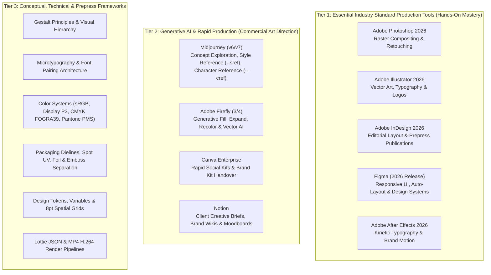
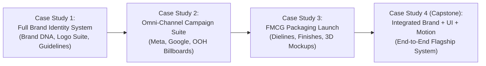

# Creative Design Master — Authoritative Academic Specification

**Program Title:** Creative Design Master
**Course Identifier:** `creative-design`
**Academy:** Design Academy (`design`)
**Credential Awarded:** Master Diploma in Creative Design & Visual Systems
**Governing Standard:** ISO 9001:2015 Verified Curriculum Standard | Nova Skills Academic Board
**Duration:** 8 Months (32 Calendar Weeks)
**Total Guided Instructional Hours:** 320 Hours (~10 Hours / Week)
**Recommended Independent Studio Practice:** 160–200 Hours
**Commercial Tuition:** INR 64,900 (Exclusive of 18% GST; Statutory 18% GST: INR 11,682; Total Payable: INR 76,582; Flexible No-Cost EMI: INR 6,382 / Month for 12 Months, INR 8,509 / Month for 9 Months, or INR 12,764 / Month for 6 Months)
**Target Level:** Beginner to Career Professional (Zero prior graphic design or coding prerequisites; structured from foundational design principles to multidisciplinary commercial art direction)
**Authoritative Document Version:** 2.0.0 (October 2026 Production Standard)

---

## 1. Executive Summary & Program Positioning

### 1.1 Course Positioning & Commercial Value
By late 2026, the global creative industry reached a decisive inflection point. The historical fragmentation of creative production—where businesses hired separate freelancers for print design, social media graphics, branding, UI wireframing, and short motion clips—has been permanently replaced by the demand for **Multidisciplinary Visual Directors and Full-Stack Creative Designers**. Modern agencies, tech startups, direct-to-consumer (D2C) brands, and enterprise marketing teams require creative professionals who can take a brand from strategic inception to omni-channel commercial execution.

A modern creative designer cannot survive as a single-tool operator. High-performing design teams in 2026 demand practitioners who seamlessly connect:
1. **Visual Foundations & Typography:** Deep mastery of Gestalt principles, microtypography, kerning, editorial grid systems, and color harmony.
2. **Precision Vector Engineering:** Constructing geometrically sound brand marks, complex vector illustrations, iconography, and mathematically balanced logos in **Adobe Illustrator**.
3. **Advanced Raster Compositing:** Photo manipulation, non-destructive retouching, lighting integration, color grading, and commercial product imagery in **Adobe Photoshop**.
4. **Brand Strategy & Design Systems:** Formulating complete brand manuals, positioning frameworks, color palettes (sRGB, CMYK, Pantone), and corporate design guidelines.
5. **Multi-Channel Advertising Production:** High-converting paid ad creatives, social campaign kits, digital display banners, and large-format outdoor (OOH) billboards.
6. **Editorial & Publication Design:** Multi-page publications, magazines, lookbooks, corporate annual reports, and master page styling in **Adobe InDesign**.
7. **Packaging & Production Prepress:** Flawless packaging artwork, custom dielines, structural mockups, spot finishes (varnish, foil, embossing), and press-ready color separations (ISO 12647, FOGRA39/GRACoL).
8. **Digital Product UI Design:** Responsive web and mobile user interfaces, auto-layout hierarchies, interactive components, and tokenized design systems in **Figma**.
9. **Brand Motion Graphics:** Kinetic typography, logo reveals, animated UI micro-interactions, and social media reels in **Adobe After Effects**.
10. **Generative AI Art Direction:** Directing AI tools (**Midjourney v6/v7**, **Adobe Firefly 3/4**) for rapid concept exploration, moodboards, asset inpainting, and generative fills while strictly upholding commercial IP and copyright standards.

**Creative Design Master** is Nova Skills' premier 8-month (320 guided instructional hours) flagship qualification in the Design Academy. It elevates learners from complete beginners into versatile, industry-ready visual leaders capable of delivering end-to-end commercial creative solutions.

```
      MONTHS 1–2                        MONTHS 3–4                        MONTHS 5–6                        MONTHS 7–8
┌─────────────────────────┐       ┌─────────────────────────┐       ┌─────────────────────────┐       ┌─────────────────────────┐
│ FOUNDATIONS & SOFTWARE  │       │ BRANDING, ADS & PRINT   │       │ UI DESIGN & MOTION      │       │ GEN AI & CAPSTONE       │
│ • Module 01: Design     │       │ • Module 04: Brand      │       │ • Module 08: Figma UI/UX│       │ • Module 11: Generative │
│   Foundations, Visual   │       │   Strategy & Systems    │       │   Fundamentals (28h)    │       │   AI Art Direction (28h)│
│   Thinking & Typography │       │   (32h)                 │       │ • Module 09: Responsive │       │ • Module 12: Integrated │
│   (24h)                 │       │ • Module 05: Advertising│       │   UI, Design Systems    │       │   Portfolio & Industry  │
│ • Module 02: Photoshop  │  ───> │   Campaigns & Creative  │  ───> │   & Prototyping (28h)   │  ───> │   Capstone (28h)        │
│   Compositing (32h)     │       │   Production (24h)      │       │ • Module 10: Motion     │       │                         │
│ • Module 03: Illustrator│       │ • Module 06: Editorial  │       │   Graphics & Animated   │       │                         │
│   Vector Art & Logo     │       │   Layout (InDesign)     │       │   Brand Assets in After │       │                         │
│   Engineering (36h)     │       │   (20h)                 │       │   Effects (24h)         │       │                         │
│                         │       │ • Module 07: Packaging  │       │                         │       │                         │
│                         │       │   Design & Dielines     │       │                         │       │                         │
│                         │       │   (16h)                 │       │                         │       │                         │
└─────────────────────────┘       └─────────────────────────┘       └─────────────────────────┘       └─────────────────────────┘
                Total Guided Instructional Schedule: Exactly 320 Hours Across 12 Modules (32 Weeks)
```

---

### 1.2 Academy Architecture & Differentiation Matrix

To prevent curriculum cannibalization and clarify career goals for prospective students, the Design Academy enforces clear boundaries between specialized short courses and the flagship master diploma:

| Program Dimension | Graphic Design Professional (`graphic-design-pro`) | UI/UX Design Professional (`uiux-design-pro`) | Creative Design Master (`creative-design`) [THIS COURSE] |
| :--- | :--- | :--- | :--- |
| **Duration & Hours** | 3 Months / 120 Guided Hours | 3 Months / 80 Guided Hours | **8 Months / 320 Guided Hours** |
| **Tuition (INR)** | ₹13,999 | ₹14,999 | **₹64,900** |
| **Primary Scope** | Static 2D marketing collateral & print basics | User research, wireframing, usability testing & app UX | **Full-spectrum multidisciplinary visual leadership & production** |
| **Core Software Stack** | Photoshop, Illustrator, Canva | Figma, FigJam, Miro, Protopie | **Photoshop, Illustrator, InDesign, Figma, After Effects, Midjourney, Firefly** |
| **Print & Packaging** | Basic flyer/brochure export | None (100% digital screen focus) | **Advanced prepress, CMYK spot colors, dielines & FMCG packaging** |
| **Digital UI & Systems** | None | In-depth UX research, personas, testing, wireframes | **High-fidelity responsive UI design, design tokens & interactive prototyping** |
| **Motion Graphics** | None | Basic screen micro-transitions | **Kinetic typography, animated logos & social motion in After Effects** |
| **Generative AI** | Basic prompt generation | None | **Commercial art direction, Midjourney `--sref`/`--cref`, Firefly generative workflows** |
| **Capstone Deliverable** | 5-piece graphic portfolio | 1 deep digital product UX case study | **4 major commercial case studies + comprehensive multi-channel capstone** |

#### Strict Non-Goals & Program Boundaries
* **No Front-End Web Development / Code:** This program teaches UI design in Figma. It does not teach HTML, CSS, JavaScript, or React (covered in the Web Development and Programming Academies).
* **No Deep UX Research Lab Operations:** While user-centered UI design principles and wireframing are taught, extensive academic UX research methodologies (field ethnographic studies, eye-tracking lab operations, complex tree testing) belong to `uiux-design-pro`.
* **No 3D Character Modeling / VFX:** 3D polygonal modeling, rigging, and cinematic visual effects in Maya, Cinema 4D, or Blender belong to the 3D Animation & VFX Academy.
* **No Long-Form Video Editing / Color Grading:** Long-form narrative filmmaking, sound design, and DaVinci Resolve color grading belong to the Video Production Academy.

---

### 1.3 Target Audience & Career Personas

1. **Aspiring Visual & Creative Designers:** Ambitious newcomers seeking an exhaustive, portfolio-first career curriculum that takes them from basic drawing and layout rules to top-tier commercial production.
2. **Graphic Designers Seeking Modern Upskilling:** Traditional print or banner designers trapped in low-paying roles who need to master modern Figma UI systems, After Effects motion graphics, and Generative AI workflows to qualify for senior agency positions.
3. **Marketing Executives & Brand Managers:** Marketing specialists who need practical execution skills to direct agencies, produce high-converting ad creative in-house, and oversee cohesive brand identities.
4. **Freelancers & Digital Solopreneurs:** Independent creatives looking to command high-ticket client retainers ($1,500–$5,000) by offering full-service brand, packaging, UI, and motion packages.

---

### 1.4 Verified Target Career Outcomes

Graduates are qualified and certified for the following commercial design roles in agencies, corporate design teams, startups, and studios:
* **Visual Designer / Digital Designer**
* **Brand Identity Designer**
* **Advertising / Campaign Creative Designer**
* **Junior UI Designer / Product Interface Designer**
* **Packaging & Production Production Artist**
* **Creative Lead / Associate Art Director**
* **Freelance Multidisciplinary Designer**

---

## 2. Comprehensive Software & Tool Architecture (October 2026 Reality)

The curriculum implements a 3-tier software and technical tool architecture balancing industry-standard production platforms with next-generation generative workflows:



### Software Access & Licensing Policy
* **Adobe Creative Cloud:** Students utilize student/educational licenses for Adobe CC (Photoshop, Illustrator, InDesign, After Effects). Nova Skills provides installation guidance, system requirement verification, and lab workstation access for on-campus students.
* **Figma:** Students utilize Figma’s 100% free verified Education Plan, which grants full access to professional team features, unlimited project files, and advanced prototyping.
* **Generative AI Platforms:** Classroom demonstrations and lab exercises utilize free-tier or institutionally provided access to Adobe Firefly (included with Creative Cloud) and Midjourney web interfaces. No high-cost enterprise AI subscriptions are mandated.

---

## 3. Commercial Pricing & Tuition Structure

Nova Skills operates under a transparent, truth-in-education commercial policy. All deceptive pricing mechanisms—such as artificial strike-through prices (e.g., claiming a course was ₹69,999 to show a 64% discount)—are strictly prohibited.

* **Approved Selling Price:** **INR 64,900**
* **Statutory Goods & Services Tax (GST 18%):** **INR 11,682**
* **Total Gross Student Invoice:** **INR 76,582**

### Transparent Installment & No-Cost EMI Schedule
To ensure accessibility for aspiring creative professionals, the tuition can be financed via approved banking partners:

| Tenor | Monthly Installment (Excl. Tax) | Total Monthly Payment (Incl. 18% GST) | Interest Rate | Effective Processing Fee |
| :--- | :--- | :--- | :--- | :--- |
| **12 Months (No-Cost EMI)** | INR 5,408 / mo | **INR 6,382 / mo** | 0% p.a. | Zero |
| **9 Months (No-Cost EMI)** | INR 7,211 / mo | **INR 8,509 / mo** | 0% p.a. | Zero |
| **6 Months (No-Cost EMI)** | INR 10,817 / mo | **INR 12,764 / mo** | 0% p.a. | Zero |
| **3 Months (Direct Installment)** | INR 21,633 / mo | **INR 25,527 / mo** | 0% p.a. | Zero |

---

## 4. Comprehensive 12-Module, 320-Hour Curriculum Specification

```
┌────────────────────────────────────────────────────────────────────────────────────────────────┐
│                         320-HOUR FLAGSHIP CURRICULUM ARCHITECTURE                              │
├─────────┬──────────────────────────────────────────────────────────────┬───────────────────────┤
│ Module  │ Title                                                        │ Guided Teaching Hours │
├─────────┼──────────────────────────────────────────────────────────────┼───────────────────────┤
│ Mod 01  │ Design Foundations, Visual Thinking & Typography             │ 24 Hours              │
│ Mod 02  │ Adobe Photoshop & Professional Image Compositing             │ 32 Hours              │
│ Mod 03  │ Adobe Illustrator, Vector Art & Logo Engineering             │ 36 Hours              │
│ Mod 04  │ Brand Strategy, Visual Identity & Design Systems             │ 32 Hours              │
│ Mod 05  │ Advertising Campaigns & Digital Creative Production          │ 24 Hours              │
│ Mod 06  │ Editorial Design, InDesign & Publication Layout              │ 20 Hours              │
│ Mod 07  │ Packaging Design, Dielines & Production Artwork              │ 16 Hours              │
│ Mod 08  │ Figma UI/UX Fundamentals & User-Centered Design              │ 28 Hours              │
│ Mod 09  │ Responsive UI, Design Systems & Interactive Prototyping      │ 28 Hours              │
│ Mod 10  │ Motion Graphics & Animated Brand Assets in After Effects     │ 24 Hours              │
│ Mod 11  │ Generative AI for Creative Production & Art Direction        │ 28 Hours              │
│ Mod 12  │ Integrated Portfolio, Client Briefs & Industry Capstone      │ 28 Hours              │
├─────────┴──────────────────────────────────────────────────────────────┼───────────────────────┤
│ TOTAL GUIDED INSTRUCTIONAL HOURS                                       │ 320 Hours             │
└────────────────────────────────────────────────────────────────────────┴───────────────────────┘
```

---

### Module 01: Design Foundations, Visual Thinking & Typography
* **Duration:** 24 Guided Hours (Weeks 1–3)
* **Independent Practice:** 12 Hours
* **Pedagogical Goal:** Master the immutable laws of human visual perception, spatial harmony, Gestalt psychology, and microtypography to build a rock-solid foundation for all subsequent commercial design disciplines.

#### Main Topics & Subtopics
1. **Perceptual Psychology & Gestalt Theory in Commercial Design:**
   * Laws of Proximity, Similarity, Continuity, Closure, and Figure/Ground relationship.
   * Visual weight, balance (symmetrical, asymmetrical, radial), and optical center vs geometric center.
   * Directing the viewer's eye: Focal points, visual cadence, rhythm, and intentional negative space (white space).
2. **Typography Architecture & Microtypography:**
   * Anatomy of type: Baseline, x-height, ascenders, descenders, counters, serifs, stems, and terminals.
   * Type classification: Old Style, Transitional, Modern, Slab Serif, Humanist Sans, Geometric Sans, Display, and Monospaced.
   * Microtypographic precision: Kerning pairs, optical vs metric kerning, tracking, leading (line-height), line length (measure: 45–75 characters), and hyphenation/justification rules.
   * Hierarchical typography systems: Establishing modular type scales (Minor Third 1.200 to Major Third 1.250 and Golden Ratio 1.618) across display, headline, subhead, body, and caption text.
   * Font pairing science: Harmonizing contrast vs similarity, mood matching, historical context, and avoiding typographic discordance.
3. **Color Theory, Psychology & Technical Color Models:**
   * The color wheel: Primary, secondary, tertiary hues; tints, tones, and shades.
   * Harmonies and relationships: Monochromatic, analogous, complementary, split-complementary, triadic, and tetradic palettes.
   * Color psychology and cultural semantics in commercial branding (fintech blue, luxury black/gold, eco-green, energetic red/orange).
   * Technical color spaces: Additive RGB vs Subtractive CMYK vs Lab color; understanding gamut clipping, out-of-gamut warnings, and the Pantone Matching System (PMS).
4. **Layout Systems & Grid Mechanics:**
   * Structural grids: Manuscript (single-column), multicolumn (2, 3, 4, 12-column), modular grids, and hierarchical grids.
   * The Golden Ratio ($\Phi \approx 1.618$), Fibonacci sequences, and the Rule of Thirds in spatial composition.
   * Margin systems, columns, gutters, and baseline rhythm alignment.

#### Software & Tools
* Analog sketchpads, Typography specimen books, FontBase / Google Fonts, Figma (for layout exercises).

#### Learning Outcomes
* Apply Gestalt principles to resolve visual clutter and guide user attention systematically.
* Execute typographic layouts adhering to microtypographic standards without orphaned words, widows, or improper kerning.
* Construct mathematical modular type scales and color harmony palettes for specific brand briefs.
* Build multi-column layout grids with baseline rhythm in digital design environments.

#### Classroom Practicals & Hands-On Labs
* **Lab 1.1: Gestalt Composition Studies:** Create 6 distinct abstract square compositions using only black geometric primitives to communicate Tension, Order, Playfulness, Isolation, Power, and Harmony.
* **Lab 1.2: Microtypography & Type Pairing Workshop:** Typeset an editorial excerpt using a classic serif and modern geometric sans; adjust kerning pairs manually, set baseline leading, eliminate all widows and hyphens, and produce a polished 2-column typographic specimen.
* **Lab 1.3: Mathematical Grid & Modular Scale Layout:** Construct a 12-column grid system with an 8pt baseline; place headline, callout, and body copy aligned strictly to the modular type scale.

#### Assessment Evidence
* Submitted Typography Specimen & Gestalt Composition Portfolio Sheet (PDF).

---

### Module 02: Adobe Photoshop & Professional Image Compositing
* **Duration:** 32 Guided Hours (Weeks 3–6)
* **Independent Practice:** 16 Hours
* **Pedagogical Goal:** Master professional raster image editing, non-destructive layer workflows, advanced selection/masking techniques, seamless multi-image compositing, color grading, and commercial product retouching in Adobe Photoshop.

#### Main Topics & Subtopics
1. **Photoshop Workspace & Non-Destructive Workflow Architecture:**
   * Color settings, color spaces (sRGB vs Adobe RGB vs ProPhoto RGB), bit depth (8-bit, 16-bit, 32-bit), and scratch disk management.
   * Non-destructive editing philosophy: Smart Objects, Smart Filters, Adjustment Layers, and clipping masks.
   * Layer organization, color coding, group nesting, and naming conventions for agency team handoffs.
2. **Advanced Selection, Masking & Extraction:**
   * Precision Pen Tool vector masking for hard-surface products, industrial goods, and architecture.
   * Select and Mask workspace: Global refinements, edge detection, smooth, feather, contrast, shift edge, and Decontaminate Colors.
   * Channel masking for complex extractions: Fine hair, animal fur, foliage, transparent glass, and smoke.
   * Luminosity masking and blend-if sliders for tonal separation and shadow/highlight masking.
3. **Professional Retouching & Commercial Product Finishing:**
   * Frequency Separation (High Frequency texture vs Low Frequency tone/color) for commercial skin retouching and luxury leather/metal textures.
   * Healing tools: Spot Healing Brush, Healing Brush, Patch Tool, and Clone Stamp with sample all layers.
   * Non-destructive Dodge and Burn using 50% neutral gray layers and Curves adjustment layers.
   * Commercial packshot retouching: Removing dust, scratches, seam lines, reflections, and rebuilding specular highlights.
4. **Multi-Source Image Compositing & Environmental Lighting:**
   * Perspective matching: Setting horizon lines, vanishing points, and matching camera focal lengths across separate stock photos.
   * Lighting and shadow reconstruction: Contact shadows, ambient occlusion, cast shadows, and directional highlight falloff.
   * Color matching and atmospheric depth: Using Curves, Gradient Maps, Color Lookup Tables (LUTs), and atmospheric haze/fog to blend disparate elements into a unified scene.
5. **Generative Fill & AI Enhancements in Photoshop:**
   * Adobe Firefly integration inside Photoshop: Generative Fill, Generative Expand, and Remove Tool.
   * Prompting for seamless image extensions and background replacements.
   * Refining AI-generated artifacts using manual blending, clone stamping, and grain matching.

#### Software & Tools
* Adobe Photoshop 2026, Adobe Camera Raw, Wacom tablet / digital stylus, Adobe Firefly.

#### Learning Outcomes
* Execute non-destructive image workflows using Smart Objects, adjustment layers, and nested masks.
* Isolate complex hair, fur, and transparent objects with channel masks and edge decontamination.
* Perform commercial-grade beauty and product retouching using Frequency Separation and Dodge & Burn.
* Build a realistic composite image merging at least 4 disparate photographic elements with matching perspective, contact shadows, and unified atmospheric lighting.

#### Classroom Practicals & Hands-On Labs
* **Lab 2.1: Glass & Liquid Bottle Extraction:** Extract an amber perfume bottle from a complex background, preserve glass transparency and liquid refraction, and composite onto a clean studio podium.
* **Lab 2.2: Commercial Frequency Separation & Skin Clean:** Retouch a high-resolution studio portrait; remove blemishes and even out skin tone while preserving 100% natural pore texture.
* **Lab 2.3: Surreal Commercial Composite Poster:** Combine an athlete, a neon city background, rain effects, and custom lightning; reconstruct ground reflections and cast shadows; grade the final scene with a cohesive cinematic LUT.

#### Assessment Evidence
* Fully layered PSD file demonstrating non-destructive structure, precise vector/channel masks, and unified color grading.

---

### Module 03: Adobe Illustrator, Vector Art & Logo Engineering
* **Duration:** 36 Guided Hours (Weeks 6–10)
* **Independent Practice:** 20 Hours
* **Pedagogical Goal:** Master precision vector graphics, mathematical curve construction, anchor point economy, complex iconography, custom lettering, and geometric logo mark engineering in Adobe Illustrator.

#### Main Topics & Subtopics
1. **Vector Theory & Precision Pen Tool Mastery:**
   * Mathematical foundations of Bezier curves: Anchor points, smooth vs corner points, direction handles, and tangent angles.
   * The "Anchor Point Economy" rule: Achieving pure curves with the absolute minimum number of anchor points placed strictly at vertical and horizontal curve extremes (extrema).
   * Curvature Tool, Pencil Tool, and path smoothing workflows.
   * Path operations: Pathfinder panel vs Shape Builder Tool; Unite, Minus Front, Intersect, Exclude, and Divide.
2. **Geometric Construction & Logo Grid Engineering:**
   * Golden Ratio calipers, circular grid systems, isometric grids, and modular construction frameworks.
   * Designing symmetrical, rotational, and dynamic geometric marks.
   * Offset Path mechanics for consistent internal line weights and negative-space cutouts.
   * Align panel: Aligning to selection, key object, and artboard; pixel-grid alignment for digital screen clarity.
3. **Advanced Vector Rendering, Color & Shading:**
   * Gradient Tool (Linear, Radial, and Freeform Gradients) for volumetric metallic, iridescent, and organic vector shading.
   * Gradient Mesh Tool: Creating photo-realistic vector fruit, vehicles, or consumer hardware surfaces.
   * Global color swatches, color groups, and the Recolor Artwork engine for instant palette variations.
   * Transparency, opacity masks, and blend modes (Multiply, Screen, Overlay) in vector art.
4. **Iconography Systems & Custom Vector Lettering:**
   * Designing cohesive icon sets (16px, 24px, 32px grids) with consistent stroke weight, corner radius, and optical balance.
   * Custom typography modification: Converting type to outlines, slicing, extending stems, modifying ligatures, and custom glyph crafting.
   * Dynamic Appearance Panel: Stacking multiple strokes, fills, and non-destructive vector effects (Distort & Transform, Stylize).
5. **Asset Optimization, Vector AI & Multi-Format Export:**
   * Adobe Firefly Text to Vector Graphic inside Illustrator: Generating vector icons, scenes, and patterns.
   * Path cleanup: Simplify Path, removing stray points, and closing open subpaths.
   * Asset Export panel: Setting up multi-resolution slices for production handoff (SVG, PDF, EPS, PNG @1x/@2x/@3x).

#### Software & Tools
* Adobe Illustrator 2026, Astute Graphics tools (exposure), Adobe Firefly (Text to Vector).

#### Learning Outcomes
* Draw complex, mathematically balanced curves using the Pen Tool with minimal anchor points at curve extrema.
* Engineer geometric logo marks using circular grids, the Shape Builder Tool, and Offset Path.
* Create a unified 12-piece iconography set adhering strictly to an optical grid and consistent stroke weights.
* Render volumetric vector art using Freeform Gradients and Gradient Mesh.
* Prepare clean, production-ready vector assets free of redundant points, self-intersecting loops, or unexpanded strokes.

#### Classroom Practicals & Hands-On Labs
* **Lab 3.1: The Bezier Curve Gauntlet:** Trace 5 complex organic and industrial outlines using strictly the minimum required anchor points placed at curve extrema with horizontal/vertical handles.
* **Lab 3.2: Geometric Animal Logo Mark:** Engineer a stylized logo mark (e.g., falcon, fox, or wolf) using overlapping circular grids, the Shape Builder tool, and 1.618 Golden Ratio proportions.
* **Lab 3.3: 12-Piece Cohesive Iconography System:** Construct 12 custom fintech or e-commerce icons on a 24x24px grid with a uniform 2px stroke, 2px corner radius, and optical weight compensation.

#### Assessment Evidence
* Vector AI source files containing construction grids, unexpanded master paths, expanded production marks, and exported clean SVGs.

---

### Module 04: Brand Strategy, Visual Identity & Design Systems
* **Duration:** 32 Guided Hours (Weeks 10–13)
* **Independent Practice:** 16 Hours
* **Pedagogical Goal:** Bridge high-level commercial brand strategy with practical visual identity design; develop comprehensive brand identity systems including logo suites, typography hierarchies, color governance, visual tone of voice, and corporate Brand Guidelines manuals.

#### Main Topics & Subtopics
1. **Brand Strategy & Strategic Discovery:**
   * Deconstructing brand architecture: Monolithic (Branded House), Endorsed, and Pluralistic (House of Brands).
   * Brand foundation elements: Purpose, Vision, Mission, Values, and Brand Archetypes (Jungian archetypes in branding).
   * Competitive benchmarking, brand positioning matrices, and identifying the "White Space" in the market.
   * Extracting client creative briefs: Stakeholder discovery workshops, moodboarding, and tone-of-voice definition.
2. **The Complete Logo Suite Architecture:**
   * Anatomy of a full commercial identity: Primary Logo, Secondary/Stacked Logo, Sub-mark/Compact Logo, Brand Icon/Favicon, and Wordmark.
   * Responsive logo design: Ensuring legibility across extreme scales (from a 16x16px browser favicon to a 40-foot outdoor highway billboard).
   * Exclusion zones (clear space rules), minimum reproduction sizes (print mm vs digital px), and incorrect usage specifications.
3. **Comprehensive Visual Language & Graphic Assets:**
   * Supporting graphic elements: Supergraphics, patterns, textures, custom badges, and iconography styles.
   * Art direction and photography style guidelines: Tone, lighting, model demographics, color grading, and do's & don'ts.
   * Illustration style guide: Line weight, fill characteristics, character anatomy, and emotional tone.
4. **Authoring the Comprehensive Brand Style Guide (Brand Manual):**
   * Structure of an agency-grade Brand Standards Manual:
     1. Brand Story, Positioning & Brand DNA.
     2. Logo Suite & Clear Space Governance.
     3. Official Typography & Web Font Specifications.
     4. Color Palette Specifications (Primary, Secondary, Accent with HEX, RGB, CMYK, and Pantone PMS Solid Coated/Uncoated codes).
     5. Supporting Visual System (Patterns, Grids, Layout Principles).
     6. Imagery & Photography Art Direction.
     7. Commercial Application Examples (Stationery, Digital Ads, Signage).
     8. Co-branding & Misuse Violations.
   * Compiling and presenting the Brand Manual in Adobe InDesign and interactive digital portals (Notion / Figma).

#### Software & Tools
* Adobe Illustrator, Adobe InDesign, Figma, Notion, Coolors / Adobe Color.

#### Learning Outcomes
* Conduct strategic brand discovery and articulate brand archetypes, positioning, and tone of voice.
* Engineer a complete responsive logo suite (primary, horizontal, stacked, mark, favicon) with clear space and scale rules.
* Formulate a production-accurate color system providing certified HEX, RGB, CMYK, and Pantone PMS color values.
* Compile an agency-standard 20+ page Brand Guidelines Manual.

#### Classroom Practicals & Hands-On Labs
* **Lab 4.1: Brand Positioning & Moodboard Architecture:** Analyze a disruptive sustainable energy or premium hospitality brand; identify its brand archetype and curate a 3-page strategic moodboard defining texture, typography, and visual tone.
* **Lab 4.2: Responsive Logo Suite Engineering:** Design a primary corporate logo and generate its responsive derivatives (horizontal lockup, stacked lockup, standalone monogram, and 16px favicon); document minimum sizes and clearance margins.
* **Lab 4.3: Brand Manual Composition:** Assemble a 24-page Brand Identity Guidelines manual in InDesign/Figma, covering logo rules, type hierarchy, primary/secondary color palettes with Pantone codes, and improper usage rules.

#### Assessment Evidence
* **Assessed Major Case Study 1:** Complete Commercial Brand Identity System & Brand Guidelines Manual (PDF & Presentation Deck).

---

### Module 05: Advertising Campaigns & Digital Creative Production
* **Duration:** 24 Guided Hours (Weeks 13–16)
* **Independent Practice:** 12 Hours
* **Pedagogical Goal:** Master the art and psychology of commercial performance advertising, high-converting digital ad creative, multi-platform campaign adaptations, social media visual systems, and high-impact outdoor/print advertising mockups.

#### Main Topics & Subtopics
1. **The Psychology of Visual Performance Advertising:**
   * The "3-Second Rule": Visual hooks, pattern interrupts, and stopping thumb-scrolling behavior on mobile feeds.
   * Anatomy of a high-converting performance ad: Hook visual, value proposition, social proof badge, and prominent Call to Action (CTA).
   * Direct response advertising vs brand awareness advertising.
   * Creative testing frameworks: Developing visual variations for A/B testing (testing hooks, background colors, model expressions, and headline placements).
2. **Multi-Platform Digital Creative Suites:**
   * Aspect ratios and safe zones: 1:1 Feed Square (1080x1080), 9:16 Vertical Stories/Reels (1080x1920), 16:9 Landscape (1200x628), and 4:5 Portrait (1080x1350).
   * Designing for Meta (Facebook/Instagram), LinkedIn, Google Display Network (GDN), and YouTube banner placements.
   * High-engagement social formats: Seamless swipeable carousels, comparison matrices, infographics, and quote graphics.
   * Bulk creative production: Utilizing Figma Components and Photoshop Smart Objects for rapid multi-size batch generation.
3. **Out-of-Home (OOH) & Large Format Print Advertising:**
   * Billboard, bus shelter, subway, and retail point-of-sale (POS) banner design.
   * The 5-Second Billboard Test: High legibility typography, 7 words or fewer, high contrast, and single focal point imagery.
   * Resolution requirements at distance: 300 DPI for handheld print vs 72–150 DPI for large-format billboards (the viewing distance formula: $DPI = \frac{3438}{Distance\text{ in inches}}$).
4. **Photorealistic Mockup Creation & Client Presentation:**
   * Sourcing and customizing premium 3D/smart-object mockups (devices, outdoor billboards, urban posters, retail storefronts).
   * Customizing displacement maps, shadow angles, reflections, and perspective warps in Photoshop for hyper-realistic presentation.

#### Software & Tools
* Adobe Photoshop, Adobe Illustrator, Figma, Canva Enterprise (for template handoff).

#### Learning Outcomes
* Design high-converting digital advertising creatives engineered for mobile social feeds.
* Adapt a single creative concept seamlessly across 5+ standard aspect ratios while preserving safe zones and hierarchy.
* Design a seamless 7-slide Instagram carousel that encourages full swiping completion.
* Create high-resolution OOH billboard designs following viewing-distance resolution standards.
* Render photo-realistic contextual mockups for commercial client pitch presentations.

#### Classroom Practicals & Hands-On Labs
* **Lab 5.1: Omni-Channel Ad Resizing Suite:** Take a single hero campaign concept for a luxury sneaker brand and adapt it across 1:1, 9:16, 4:5, and 16:9 aspect ratios with platform-compliant text safe zones.
* **Lab 5.2: 7-Slide Educational Social Carousel:** Design a seamless panoramic carousel in Figma/Photoshop where graphics flow continuously across slide borders, teaching a complex consumer topic.
* **Lab 5.3: Urban OOH Billboard & Subway Mockup:** Design a large-format outdoor billboard; composite it into a rainy urban street environment using displacement maps and realistic perspective reflections.

#### Assessment Evidence
* **Assessed Major Case Study 2 (Part A):** Omni-Channel Advertising Campaign Suite containing multi-format digital ad assets, social carousels, and realistic OOH mockups.

---

### Module 06: Editorial Design, InDesign & Publication Layout
* **Duration:** 20 Guided Hours (Weeks 16–18)
* **Independent Practice:** 10 Hours
* **Pedagogical Goal:** Master multi-page editorial design, complex typography, publication layout mechanics, master pages, paragraph/character styles, and print-ready PDF export in Adobe InDesign.

#### Main Topics & Subtopics
1. **InDesign Fundamentals & Long-Form Document Setup:**
   * Facing pages, spreads, page numbering, margins, columns, bleed (3mm / 0.125 in), and slug setup.
   * Master Pages (Parent Pages): Header/footer running heads, dynamic page numbering, chapter markers, and section prefixes.
   * Document structure: Managing 4-page, 8-page, 16-page, and 32-page signature bindings (saddle-stitch vs perfect bound).
2. **Typography Automation & Editorial Hierarchy:**
   * Paragraph Styles and Character Styles: Setting up cascading typographic styles for Body, Headlines, Subheads, Pull Quotes, and Captions.
   * Advanced OpenType features: True small caps, discretionary ligatures, tabular lining figures vs oldstyle proportional figures, and fractions.
   * Nested styles, GREP styles (regular expression automated formatting for phone numbers, dates, prices, and acronyms).
   * Text frame options: Multi-column text frames, vertical justification (align top, center, bottom, justify), first baseline offset, and baseline grid snapping.
3. **Editorial Layout Dynamics & Visual Storytelling:**
   * Pacing and rhythm: Balancing image-heavy spreads with text-dense spreads.
   * Editorial elements: Drop caps, pull quotes, sidebars, infographics, photo captions, and author bios.
   * Text wrap mechanics: Wrap around bounding box, wrap around object shape (alpha channel / clipping path), contour options, and invert wrap.
   * Primary Text Frames and threaded text frames for long-form manuscript flow.
4. **Tables, Indexes, Table of Contents & Preflight:**
   * Designing styled tables with alternating row colors and custom stroke weights.
   * Automated Table of Contents (TOC) generation linked dynamically to Paragraph Styles.
   * Live Preflight panel: Detecting overset text (hidden overflow text), missing/modified image links, and low-resolution RGB images.
   * Packaging files: Collecting fonts, linked raster/vector graphics, and generating PDF/X-1a and PDF/X-4 print files.

#### Software & Tools
* Adobe InDesign 2026, Adobe Acrobat Pro.

#### Learning Outcomes
* Set up multi-page publications with parent pages, baseline grids, and automatic folio numbering.
* Construct nested and GREP styles that format complex typography automatically.
* Thread long-form text across multi-page spreads without orphans, widows, or overset text.
* Generate automated dynamic Tables of Contents and preflight publications against commercial print standards.

#### Classroom Practicals & Hands-On Labs
* **Lab 6.1: GREP & Nested Styling Engine:** Configure an InDesign document with GREP styles that automatically format currency symbols, uppercase acronyms, and bracketed citations without manual selection.
* **Lab 6.2: 12-Page Editorial Magazine Feature:** Design a 12-page lifestyle/architecture magazine spread featuring a cover, table of contents, 2-page feature interview, pull quotes, and styled photography.
* **Lab 6.3: Commercial Print Preflight & PDF/X-4 Export:** Run a comprehensive preflight on a complex publication; resolve overset text errors and color space mismatches; export an ISO-compliant PDF/X-4 with crop marks and 3mm bleeds.

#### Assessment Evidence
* Packaged InDesign publication folder containing fonts, linked high-res assets, and certified print-ready PDF/X-4.

---

### Module 07: Packaging Design, Dielines & Production Artwork
* **Duration:** 16 Guided Hours (Weeks 18–20)
* **Independent Practice:** 8 Hours
* **Pedagogical Goal:** Master the engineering of physical packaging, custom structural dielines, folding cartons, labels, pouches, specialized print finishes, and prepress artwork separation in Adobe Illustrator and Photoshop.

#### Main Topics & Subtopics
1. **Structural Packaging Engineering & Dieline Anatomy:**
   * Understanding packaging substrates: Corrugated cardboard, SBS (solid bleached sulfate) paperboard, kraft paper, flexible films, and metalized plastics.
   * Structural packaging types: Straight tuck-end (STE) boxes, reverse tuck-end (RTE) boxes, auto-lock bottom cartons, pillow packs, wrap-around bottle labels, and stand-up pouches (Doypack).
   * Technical dieline conventions:
     * **Cut lines:** Solid stroke (typically 100% Magenta or Spot Cyan).
     * **Crease / Score lines:** Dashed stroke (indicating mountain or valley folds).
     * **Perforation lines:** Dotted stroke.
     * **Glue tabs & bleeds:** Setting 3–5mm bleed past the dieline to prevent white edges during die cutting.
     * Placing all dieline geometry on a dedicated, non-printing locked layer named `DIELINE - DO NOT PRINT`.
2. **Commercial Packaging Layout & Regulatory Requirements:**
   * Principal Display Panel (PDP): Brand logo, product name, net quantity/weight, and core benefit claim.
   * Side and Back Panels: Nutritional facts / ingredients tables, usage instructions, manufacturer information, and sustainability badges.
   * Barcode integration: UPC / EAN barcode standards (minimum size, quiet zones, contrast requirements, and zero scaling distortions).
   * Regulatory compliance: Legal font sizes (minimum x-heights for disclosures), allergen warnings, and recycling symbols.
3. **Specialized Print Finishes & Spot Color Separations:**
   * Spot UV varnish: Creating a 100% black silhouette on a dedicated `SPOT UV` layer set to Overprint.
   * Hot Foil Stamping (Gold, Silver, Rose Gold, Holographic): Creating vector vector artwork on a dedicated `FOIL STAMP` spot layer.
   * Embossing and Debossing: Multi-level embossing, blind embossing, and tool die specifications.
   * Pantone Matching System (PMS) Spot Colors: Converting brand elements to certified Pantone Formula Guide Solid Coated swatches.
4. **3D Packaging Visualization & Realistic Rendering:**
   * Transforming 2D flat dieline artwork into photorealistic 3D packaging mockups using Photoshop Smart Objects and 3D mockups.
   * Rendering paper textures (matte, kraft, gloss, soft-touch velvet) and metallic foil reflections.

#### Software & Tools
* Adobe Illustrator, Adobe Photoshop, Esko Studio / Pacdora (exposure).

#### Learning Outcomes
* Construct technical folding carton dielines with accurate cut lines, crease lines, and glue tabs.
* Layout a full packaging surface complying with PDP rules, legal disclosures, and barcode standards.
* Prepare dedicated prepress layers for Spot UV, foil stamping, and embossing with Overprint attributes.
* Render photorealistic 3D packaging mockups showing realistic textures and metallic finishes.

#### Classroom Practicals & Hands-On Labs
* **Lab 7.1: Folding Carton Dieline Engineering:** Construct a vector dieline for a reverse-tuck cosmetics box with 15mm glue flap, dust flaps, and 3mm exterior bleed.
* **Lab 7.2: FMCG Label & Nutritional Facts Production:** Design a premium artisanal beverage bottle label; typeset FDA-compliant nutrition facts and insert an scannable EAN-13 barcode with compliant quiet zones.
* **Lab 7.3: Spot Finish Prepress Separation & 3D Mockup:** Prepare an Illustrator file with distinct spot color layers for Gold Foil and Spot UV; render a high-res 3D packaging mockup in Photoshop.

#### Assessment Evidence
* **Assessed Major Case Study 3:** Complete FMCG Retail Packaging Launch file containing production-ready vector dielines, finish separation layers, and photorealistic 3D packshots.

---

### Module 08: Figma UI/UX Fundamentals & User-Centered Design
* **Duration:** 28 Guided Hours (Weeks 20–23)
* **Independent Practice:** 14 Hours
* **Pedagogical Goal:** Transition from print/graphic visual design into modern digital user interface (UI) and user experience (UX) design; master Figma interface architecture, mental models, auto-layout, wireframing, and user-centered design principles.

#### Main Topics & Subtopics
1. **User Experience (UX) Foundations for Visual Designers:**
   * UX vs UI: Mental models, user goals, usability heuristics (Nielsen Norman 10 Usability Heuristics).
   * Information Architecture (IA): Content inventories, sitemaps, user flows, and navigational hierarchies.
   * User research basics: Personas, empathy mapping, and user journey mapping.
   * Low-fidelity wireframing: Paper sketching, digital wireframing, and rapid concept iteration without visual distractions.
2. **Figma Canvas Mechanics & Spatial Layout:**
   * Frames vs Groups: Why frames are the foundational building blocks of digital UI.
   * Canvas navigation, pixel grid alignment, snap to geometry, and ruler guides.
   * The 8-Point Spatial Grid System: Sizing and spacing typography, icons, buttons, and cards in multiples of 8 (and 4 for micro-spacing).
   * Layout Grids: Setting up responsive column grids (12-column desktop 1440px with 24px gutters, 4-column mobile 390px with 16px gutters).
3. **Auto-Layout Mastery (The Core of Modern UI):**
   * Auto-layout direction (vertical, horizontal, wrap), padding (independent values), and gap between items.
   * Alignment and distribution: Space between (justify) vs packed.
   * Resizing constraints: Hug Contents, Fixed Width/Height, and Fill Container.
   * Nested auto-layout hierarchies: Constructing buttons, input fields, complex e-commerce product cards, and entire application navigation headers.
4. **UI Visual Polish & Micro-Interactions:**
   * Elevation and depth: Multi-layered soft drop shadows (ambient shadow + directional key shadow) vs flat elevation.
   * Card design patterns: Visual hierarchy, corner radius rules, image aspect ratios (16:9, 4:3, 1:1), and typography truncation.
   * Accessible contrast: WCAG 2.1 AA/AAA compliance (4.5:1 for body copy, 3:1 for large headlines and UI controls); using contrast checker plugins.

#### Software & Tools
* Figma (Education Plan), FigJam, Stark (Accessibility plugin), Unsplash/Pexels plugins.

#### Learning Outcomes
* Translate a user flow and wireframe into a clean, modern user interface.
* Structure UI layouts using the 8-point spatial grid and responsive layout columns.
* Build complex, deeply nested UI components using 100% pure Figma Auto-Layout.
* Audit and ensure color contrast compliance according to WCAG 2.1 AA standards.

#### Classroom Practicals & Hands-On Labs
* **Lab 8.1: Information Architecture & Sitemap Flow:** Map out a user flow for a digital healthcare booking app from homepage to confirmed doctor appointment in FigJam.
* **Lab 8.2: Low-Fidelity to High-Fidelity Wireframing:** Convert a messy pencil-sketch wireframe into a structured low-fidelity digital wireframe adhering to an 8pt grid.
* **Lab 8.3: The Deep Auto-Layout Component:** Build a dynamic e-commerce product card containing an image, discount badge, star rating, product title, price, color selector pills, and an "Add to Cart" button—configured so resizing the parent frame reflows all child elements flawlessly.

#### Assessment Evidence
* Interactive Figma file featuring IA flows, wireframes, and fully responsive auto-layout components.

---

### Module 09: Responsive UI, Design Systems & Interactive Prototyping
* **Duration:** 28 Guided Hours (Weeks 23–26)
* **Independent Practice:** 14 Hours
* **Pedagogical Goal:** Master scalable design systems, Figma Variables, Design Tokens, component properties, advanced interactive prototyping, and developer handoff workflows in Figma.

#### Main Topics & Subtopics
1. **Design Systems & Token Architecture:**
   * Foundations of design systems: Atomic Design methodology (Atoms, Molecules, Organisms, Templates, Pages).
   * Color Tokens: Primitive values (e.g., `Blue-500`) vs Semantic tokens (e.g., `Background/Primary`, `Text/Brand`, `Border/Error`).
   * Typography Tokens: Display, Title, Body, Label, and Caption scales mapped to reusable Figma text styles.
   * Spatial & Radius Tokens: Spacing variables (`space-4`, `space-8`, `space-16`, `space-24`) and corner radius variables.
2. **Master Components, Variants & Component Properties:**
   * Main Components vs Instances: Overrides and detachment rules.
   * Component Variants: Organizing state variations (Default, Hover, Focused, Active, Disabled).
   * Component Properties: Boolean properties (show/hide icons), Text properties, and Instance Swap properties (swapping nested icons cleanly).
   * Figma Variables (2026 standard): Creating color modes (Light Mode vs Dark Mode), string variables, and number variables for spacing and radii.
3. **Advanced Interactive Prototyping:**
   * Prototype connections: Triggers (On Click, While Hovering, While Pressing, Mouse Enter, Drag).
   * Actions: Navigate to, Open Overlay, Scroll to, and Set Variable.
   * Smart Animate mechanics: Matching layer names, matching hierarchies, easing curves (Ease In, Ease Out, Custom Cubic Bezier, Spring physics).
   * Building interactive UI micro-states: Animated toggle switches, dropdown accordions, tab switchers, and sticky floating action buttons.
4. **Responsive Layouts & Developer Handoff:**
   * Designing responsive breakpoints: Desktop (1440px), Tablet (768px), and Mobile (390px).
   * Breakpoint reflow: Reflowing grid layouts from 3 columns on desktop to 1 column on mobile using Auto-Layout wrap and constraints.
   * Developer Mode (Dev Mode) in Figma: Inspecting CSS/iOS/Android properties, token references, and asset export specifications.
   * Documenting component guidelines: Writing clear usage documentation for frontend engineering handoff.

#### Software & Tools
* Figma (Dev Mode), FigJam.

#### Learning Outcomes
* Construct an atomic design system with semantic color tokens, typography scales, and variables.
* Engineer complex interactive components utilizing Variants, Component Properties, and Variable modes (Light/Dark mode).
* Build advanced high-fidelity prototypes using Smart Animate and Spring curves.
* Adapt a multi-screen landing page across Desktop, Tablet, and Mobile viewport breakpoints.
* Prepare a clean, documented design system file optimized for engineering handoff.

#### Classroom Practicals & Hands-On Labs
* **Lab 9.1: Multi-State Button & Input System:** Build an atomic button component with 4 variants (Primary, Secondary, Ghost, Destructive), 5 states (Default, Hover, Active, Disabled, Loading), and nested icon instance swaps.
* **Lab 9.2: Instant Light/Dark Mode Switcher:** Set up semantic color variables in Figma; construct a dashboard card and demonstrate instantaneous switching between Light and Dark themes via page modes.
* **Lab 9.3: High-Fidelity Micro-Interactions & Smart Animate:** Create an interactive mobile checkout flow featuring a realistic accordion payment selector, swipe-to-confirm button, and animated success modal.

#### Assessment Evidence
* Interactive Figma Design System and responsive multi-screen prototype link with documented component tokens.

---

### Module 10: Motion Graphics & Animated Brand Assets in After Effects
* **Duration:** 24 Guided Hours (Weeks 26–28)
* **Independent Practice:** 12 Hours
* **Pedagogical Goal:** Master the principles of motion design, kinetic typography, animated brand identity reveals, social media motion graphics, and Lottie web animation export in Adobe After Effects.

#### Main Topics & Subtopics
1. **The 12 Principles of Animation in Digital Motion Design:**
   * Squash and Stretch, Anticipation, Staging, Straight Ahead vs Pose to Pose.
   * Follow Through and Overlapping Action, Slow In and Slow Out (Easing).
   * Arcs, Secondary Action, Timing and Spacing.
   * Exaggeration, Solid Drawing, and Appeal applied to typography and abstract shapes.
2. **After Effects Workspace & Core Animation Mechanics:**
   * Compositions, frame rates (24fps cinematic, 30fps web/social, 60fps UI micro-motion), pixel aspect ratios, and resolution settings.
   * Layer properties: Anchor Point, Position, Scale, Rotation, and Opacity.
   * Keyframing and interpolation: Linear keyframes vs Bezier keyframes vs Hold keyframes.
   * The Graph Editor: Value Graph vs Speed Graph; sculpting smooth easing curves (creating organic deceleration and punchy pop-ins).
3. **Shape Layers, Masking & Kinetic Typography:**
   * Shape layer operators: Trim Paths (creating animated outlines and draw-on effects), Repeater, Pucker & Bloat, and Wiggle Transform.
   * Alpha Mattes and Luma Mattes: Revealing text and graphics through geometric windows and organic textures.
   * Kinetic typography: Text animators (Range Selectors, Wiggly Selectors, Tracking, Blur, and Character Offset).
   * Synchronizing motion to audio beats, voiceovers, and commercial sound effects (SFX).
4. **Animated Brand Identity & Logo Reveals:**
   * Importing layered vector artwork from Adobe Illustrator into After Effects as native shape layers.
   * Designing a 3–5 second commercial logo sting: Concept, staging, particle/shape buildup, and impactful lockup resolve.
   * Camera layers, 3D space switches, and null objects for coordinated multi-layer camera moves.
5. **Rendering Pipelines, Social Formats & Lottie Web Export:**
   * Exporting for web and social: Adobe Media Encoder, MP4 (H.264), bitrate optimization for Instagram Reels / TikTok (1080x1920).
   * Lottie / Bodymovin export: Creating lightweight JSON vector animations for native web and mobile app integration.
   * Preparing clean vector shape files that render flawlessly inside Figma and web browsers.

#### Software & Tools
* Adobe After Effects 2026, Adobe Media Encoder, Bodymovin / LottieFiles plugin, Adobe Illustrator.

#### Learning Outcomes
* Apply the 12 principles of animation to abstract vector graphics and typography.
* Sculpt custom velocity curves in the After Effects Speed Graph for smooth, professional motion.
* Create kinetic typography sequences using text animators and range selectors.
* Convert Illustrator vector logos into animated shape layers and build a professional 4-second logo reveal sting.
* Export lightweight Lottie JSON animations and web-optimized MP4 social video assets.

#### Classroom Practicals & Hands-On Labs
* **Lab 10.1: Graph Editor Easing & Morphing:** Animate a bouncing ball morphing into a geometric square and star; achieve realistic weight, squashing, and easing using the Speed Graph.
* **Lab 10.2: 15-Second Kinetic Typography Social Reel:** Animate a dynamic motivational or promotional voiceover using staggered text range animators, camera zooms, and sound-effect sync.
* **Lab 10.3: The 4-Second Commercial Logo Reveal Sting:** Take a geometric vector brand logo; convert to shape layers; animate the mark using Trim Paths, dynamic scale overshoot, and a subtle light sweep shine; export as MP4 and Lottie JSON.

#### Assessment Evidence
* Rendered 1080x1920 MP4 brand reel and clean Lottie JSON vector animation file.

---

### Module 11: Generative AI for Creative Production & Art Direction
* **Duration:** 28 Guided Hours (Weeks 28–30)
* **Independent Practice:** 14 Hours
* **Pedagogical Goal:** Master modern commercial generative AI tools as an advanced art direction pipeline; harness Midjourney v6/v7 and Adobe Firefly for concept exploration, moodboards, style consistency (`--sref`), character/object consistency (`--cref`), inpainting, and production asset refinement while strictly adhering to copyright, IP, and commercial ethics.

#### Main Topics & Subtopics
1. **The Generative AI Creative Revolution & The Hybrid Workflow:**
   * The 2026 Creative Director's AI mandate: Moving beyond generic prompts to precise visual art direction.
   * The "Human-in-the-Loop" (HITL) hybrid production model:
     $$\text{Strategic Brief} \longrightarrow \text{AI Moodboard / Ideation} \longrightarrow \text{Asset Generation} \longrightarrow \text{Vector / Raster Manual Refinement} \longrightarrow \text{Brand System Delivery}$$
   * Why pure AI cannot deliver client-ready branding: Vector mathematical precision, legal copyright limitations, exact typographic kerning, and prepress spot colors require manual execution.
2. **Advanced Prompt Engineering for Visual Artists (Midjourney v6/v7):**
   * Prompt syntax anatomy: Medium, Subject, Environment, Lighting, Color Palette, Camera Lens / Film Stock, Aspect Ratio (`--ar`), Stylize (`--s`), Chaos (`--c`), and Weird (`--w`).
   * Photographic art direction: Directing camera lenses (35mm documentary, 85mm portrait, 24mm architectural, macro 100mm), lighting setups (Rembrandt, chiaroscuro, volumetric God rays, softbox studio), and film stocks (Kodak Portra 400, Cinestill 800T).
   * Materiality and texture prompting: Matte ceramic, brushed titanium, cast resin, iridescent glass, and woven textiles.
3. **Style Consistency & Subject Reference Engines:**
   * Style Reference (`--sref`): Extracting and applying precise aesthetic, color, and textural styles across dozens of disparate prompts.
   * Character Reference (`--cref`) and Object Reference: Preserving facial features, wardrobe, and custom industrial product shapes across multi-angle campaign assets.
   * Multi-prompting and image weights (`--iw`): Balancing reference imagery with text prompts for exact compositional control.
   * Region Inpainting (Vary Region) and Zoom Out (Outpainting) for compositional re-framing.
4. **Adobe Firefly & Commercial Enterprise Safety:**
   * Adobe Firefly architecture: Trained exclusively on Adobe Stock and public domain content with enterprise IP indemnification.
   * Text to Image, Generative Fill, Generative Expand, and Text to Vector inside the Adobe Creative Cloud suite.
   * Generative Recolor in Illustrator: Instantly generating multiple seasonal colorways for vector patterns and illustrations.
5. **Ethics, Copyright, Intellectual Property & Client Disclosure:**
   * US Copyright Office and global legal frameworks regarding AI-generated imagery: The requirement of substantial human creative expression.
   * Client contract transparency: Disclosing AI assistance in agency workflows.
   * Protecting client confidentiality: Avoiding uploading proprietary client IP or unreleased trade secrets to public AI models.
   * Negative prompting and avoiding direct artist style infringement.

#### Software & Tools
* Midjourney v6/v7, Adobe Firefly 3/4, Adobe Photoshop, Adobe Illustrator.

#### Learning Outcomes
* Craft structured photographic and artistic prompts specifying lighting, lens, materiality, and composition.
* Direct multi-asset visual campaigns maintaining unified style consistency using `--sref` and `--cref`.
* Integrate Firefly Generative Fill and Generative Expand directly within commercial Photoshop composites.
* Articulate copyright boundaries, commercial licensing protections, and ethical guidelines for client AI deliverables.

#### Classroom Practicals & Hands-On Labs
* **Lab 11.1: 5-Shot Consistent Fashion Lookbook:** Use Midjourney `--cref` and `--sref` to generate 5 distinct fashion editorial shots of the same model wearing the same streetwear garment across studio, street, and runway settings.
* **Lab 11.2: Surreal Advertising Backdrop Generation:** Generate a custom photorealistic futuristic landscape; import into Photoshop, execute Generative Expand to fit a 16:9 banner, and composite a real client beverage product into the scene with manual shadow integration.
* **Lab 11.3: Generative Recolor Seasonal Swatches:** Take a complex vector packaging pattern in Illustrator; use Firefly Generative Recolor to produce 4 distinct certified seasonal colorways (Spring, Summer, Autumn, Winter).

#### Assessment Evidence
* Comparative Case Study Portfolio Deck demonstrating initial AI prompt explorations, prompt architecture logs, manual Photoshop/Illustrator post-processing layers, and final commercial creative deliverable.

---

### Module 12: Integrated Portfolio, Client Briefs & Industry Capstone
* **Duration:** 28 Guided Hours (Weeks 30–32)
* **Independent Practice:** 20 Hours
* **Pedagogical Goal:** Synthesize all 11 prior modules into a comprehensive, agency-grade flagship portfolio; complete an intensive commercial capstone project from client brief to omni-channel delivery; master case study storytelling, client presentation, and career preparation.

#### Main Topics & Subtopics
1. **The Commercial Design Capstone Simulation:**
   * Working from a real-world client brief: Choosing an industry track (Fintech, Sustainable D2C, Premium Hospitality, or Healthcare).
   * Project scoping, deliverables audit, timeline milestone management, and design sprint execution.
2. **Synthesizing Multi-Disciplinary Deliverables:**
   * Brand Strategy: Brand DNA, positioning, naming rationale, and moodboard.
   * Vector Identity: Primary/secondary logo suite, responsive marks, and Brand Guidelines manual.
   * Print & Packaging: Physical packaging box/pouch with production dielines, CMYK + Spot finishes, and 3D mockups.
   * Advertising Campaign: Omni-channel digital ad suite (1:1, 9:16, 16:9), social carousels, and OOH billboard mockups.
   * Digital UI Experience: 5-screen responsive web/mobile UI landing page in Figma with an atomic design system and prototype.
   * Brand Motion: A 4-second logo reveal sting and a 15-second animated social promo video in After Effects.
3. **Portfolio Architecture & Case Study Storytelling:**
   * Why modern design employers reject flat "Dribbble shot" portfolios: The necessity of process-driven case studies.
   * The 5-Part Case Study Narrative Structure:
     1. **Context & Challenge:** The business problem, target audience, and market landscape.
     2. **Research & Strategy:** Insights, moodboards, and directional sketches.
     3. **Design Solution & Iterations:** Visual evolution, typography choices, and technical systems.
     4. **Omni-Channel Execution:** Mockups, packaging, digital UI, and motion assets in context.
     5. **Impact & Results:** Business value, conversion optimization, and technical precision.
4. **Publishing, Self-Branding & Industry Interview Readiness:**
   * Building the student's personal designer brand: Logo, resume, typography, and personal visual identity.
   * Portfolio hosting platforms: Behance, personal domain website (Framer / Webflow / Readymag), and PDF presentation decks.
   * Design interview preparation: Presenting a portfolio live to an Art Director, defending design decisions, handling critique, and salary negotiation.

#### Software & Tools
* Adobe Creative Cloud (full suite), Figma, Behance, Notion, Framer / portfolio hosting.

#### Learning Outcomes
* Execute a multi-disciplinary commercial design project from client brief to final production assets.
* Write a compelling 5-stage case study articulating business rationale, design process, and measurable outcomes.
* Assemble a professional digital portfolio website containing 4 major assessed case studies.
* Defend design choices, typography selections, and production specifications in a simulated agency pitch presentation.

#### Classroom Practicals & Hands-On Labs
* **Lab 12.1: The Live Client Sprint Presentation:** Pitch initial capstone brand concepts and moodboards to instructors and peers serving as a simulated client executive board.
* **Lab 12.2: Case Study Storytelling & Mockup Assembly:** Write and layout the complete Behance/web case study for the flagship capstone; curate high-resolution mockups, auto-layout diagrams, and motion GIFs.
* **Lab 12.3: Mock Art Director Review:** Conduct a 20-minute live portfolio walkthrough defending design tokens, dieline choices, and After Effects easing curves under formal critique.

#### Assessment Evidence
* **Assessed Major Case Study 4:** The Complete Integrated Brand + UI + Motion Flagship Capstone, published on a personal portfolio and presented live.

---

## 5. Generative AI Creative Workflow & Ethical Standard

Nova Skills enforces an authoritative, industry-aligned generative AI doctrine designed to protect both the student designer and their future commercial clients.

```
┌────────────────────────────────────────────────────────────────────────────────────────────────┐
│                        NOVA SKILLS HYBRID GENERATIVE AI PIPELINE                               │
├────────────────────────────────────────────────────────────────────────────────────────────────┤
│                                                                                                │
│  [PHASE 1: STRATEGIC BRIEF]                                                                    │
│  Client Discovery ──> Brand DNA ──> Tone of Voice ──> Moodboard Intent                         │
│                                                                                                │
│  [PHASE 2: ART DIRECTED GENERATION]                                                            │
│  Structured Prompting (Lens/Lighting/Materiality) ──> Style Reference (--sref)                 │
│  ──> Character/Object Consistency (--cref) ──> Inpainting / Generative Fill                    │
│                                                                                                │
│  [PHASE 3: HUMAN ARTISTIC REFINEMENT] (Crucial Commercial Differentiator)                      │
│  Precision Pen Tool Vector Extraction (Illustrator) ──> Non-Destructive Frequency Separation   │
│  & Color Grading (Photoshop) ──> Grid Alignment & Typographic Kerning (InDesign/Figma)        │
│                                                                                                │
│  [PHASE 4: COMMERCIAL PREPRESS & SYSTEM DELIVERY]                                              │
│  Certified CMYK / Pantone Separation ──> Dieline Layering ──> Clean Export                     │
│                                                                                                │
└────────────────────────────────────────────────────────────────────────────────────────────────┘
```

### 5.1 The Four Golden Rules of Commercial AI Art Direction
1. **Never Deliver Raw AI Output as Final Brand Identity:** Pure AI outputs lack mathematical vector precision, contain geometric hallucinations, cannot guarantee reproducible Pantone color values, and cannot be trademarked under current intellectual property law. AI is an ideation engine; Adobe Illustrator/Figma/Photoshop is the production engine.
2. **Mandatory Transformational Human Authorship:** Every AI-assisted asset must undergo significant human refinement, manual compositing, typography integration, and artistic modification to qualify for legal copyright protection.
3. **Respect Intellectual Property & Artist Rights:** Students are strictly prohibited from using specific living artists' names in commercial prompts (e.g., "in the style of [Living Artist]"). Prompts must describe objective lighting, cinematic lenses, artistic movements, and textural qualities.
4. **Client IP Confidentiality:** Unreleased client trade secrets, confidential internal data, and private personal identifying information (PII) must never be uploaded into public cloud AI models.

---

## 6. Four Major Assessed Portfolio Case Studies

Graduation from the Creative Design Master requires the successful completion and formal board evaluation of four extensive commercial portfolio case studies:



### Case Study 1: Complete Commercial Brand Identity System
* **Context:** Comprehensive brand transformation for an emerging enterprise in Clean Technology, Specialty Coffee, or Modern Fintech.
* **Required Deliverables:**
  * Strategic Brand Brief: Brand vision, mission, archetype, and positioning matrix.
  * Complete Logo Suite: Primary brand mark, horizontal lockup, stacked lockup, monogram, and 16px responsive favicon.
  * Official Color Palette: Primary, secondary, and accent colors with certified HEX, RGB, CMYK, and Pantone Solid Coated/Uncoated codes.
  * Typographic System: Primary display typeface, secondary body typeface, and web font hierarchy with defined modular scales.
  * 20+ Page Brand Guidelines Manual: Packaged in InDesign and presented as an interactive PDF/Figma document.

### Case Study 2: Omni-Channel Advertising Campaign Suite
* **Context:** High-impact seasonal product launch or customer acquisition campaign for an innovative consumer brand.
* **Required Deliverables:**
  * Multi-Format Digital Ads: 1:1 Feed Square (1080x1080), 9:16 Vertical Story (1080x1920), 4:5 Portrait (1080x1350), and 16:9 Landscape (1200x628) with platform-compliant safe zones.
  * Seamless Social Carousel: A 7-slide educational/promotional panoramic carousel designed in Figma/Photoshop.
  * Large-Format Outdoor (OOH) Advertising: Highway billboard (48x14 ft scale) and urban bus shelter poster.
  * High-Resolution Mockups: Photorealistic contextual mockups demonstrating real-world environmental lighting and perspective.

### Case Study 3: FMCG Retail Packaging Launch
* **Context:** Complete shelf-ready packaging suite for a premium artisanal food, cosmetics, or beverage product line.
* **Required Deliverables:**
  * Technical Dieline Construction: Vector folding carton or stand-up pouch dieline with precise cut lines, crease lines, glue flaps, and 3mm exterior bleeds.
  * Commercial Artwork Layout: Principal Display Panel (PDP), ingredient tables, barcodes with verified quiet zones, and legal disclosures.
  * Specialized Finishes Prepress Layers: Dedicated spot-color separation layers for Spot UV Varnish and Hot Foil Stamping set to Overprint.
  * 3D Packaging Mockups: Photorealistic multi-angle studio product packshots rendered in Photoshop.

### Case Study 4: Integrated Brand + UI + Motion Flagship Capstone
* **Context:** The crowning master achievement—an end-to-end commercial brand launch uniting brand strategy, digital product UI, packaging, and kinetic motion graphics into a unified agency pitch.
* **Required Deliverables:**
  * Full Brand Identity & Packaging Asset Suite.
  * 5-Screen Responsive Digital Product Landing Page in Figma: Designed across Desktop (1440px) and Mobile (390px) viewports with an atomic design system, auto-layout hierarchies, and design tokens.
  * Interactive High-Fidelity Prototype: Featuring micro-interactions, dropdowns, and Smart Animate screen transitions.
  * Brand Motion Suite in After Effects: A 4-second animated commercial logo sting and a 15-second kinetic social media promo reel with sound effects.
  * Comprehensive Case Study Presentation: Published on Behance and personal portfolio website.

---

## 7. Quality Assurance, Brand Standards, Prepress & Technical Export Specifications

Every piece of design work produced in the Creative Design Master must satisfy professional production standards across print, digital screens, and motion:

### 7.1 Prepress & Commercial Print Standards
* **Color Profiles:** European standard `Coated FOGRA39 (ISO 12647-2:2004)` or US standard `U.S. Web Coated (SWOP) v2` / `GRACoL 2006`.
* **Total Area Coverage (TAC / TIC):** Ink coverage must never exceed 300% (or 320% for high-grade coated stocks) to prevent ink offsetting and smudging.
* **Rich Black vs 100% K Black:**
  * Small body text (<18pt) must strictly be $C:0\%, M:0\%, Y:0\%, K:100\%$ with Overprint Black enabled (never rich black, which causes misregistration blur).
  * Large background solids and headline typography (>36pt) must use Rich Black ($C:60\%, M:40\%, Y:40\%, K:100\%$) for deep, neutral black density.
* **Bleeds & Margins:** Minimum 3mm (0.125 in) exterior bleed on all trimmed edges; critical text and artwork must remain inside a 4mm interior safety margin.
* **Dieline Governance:** Dielines must reside on a dedicated non-printing spot color layer (named `DIELINE`) set to 100% Magenta with Overprint Stroke enabled.

### 7.2 Digital UI & Vector Optimization Standards
* **Color Space:** Strictly `sRGB` (or `Display P3` for modern wide-gamut mobile interfaces).
* **Spatial System:** Sizing, paddings, and margins must align to the 8-point spatial grid (multiples of 8px, with 4px allowed only for micro-spacing).
* **Typography Accessibility:** All body text and functional UI controls must meet WCAG 2.1 AA contrast ratios ($\ge 4.5:1$ for normal text, $\ge 3:1$ for large text).
* **Vector Path Hygiene:** Vector icons and logos must be fully outlined, open endpoints closed, overlapping redundant paths merged with the Shape Builder tool, and anchor points placed strictly at curve extrema.

### 7.3 Motion Graphics & Video Export Standards
* **Frame Rates:** 24.0 fps for cinematic narrative, 30.0 fps for standard web/social video, 60.0 fps for UI micro-interactions.
* **Social Video Formats:** MP4 container, H.264 video codec, AAC audio codec (320 kbps, 48 kHz), profile High, Level 4.2, target bitrate 12–16 Mbps for 1080x1920.
* **Lottie JSON Export:** Pure vector shapes, no unsupported raster blend modes, no unbaked expression errors, total JSON file payload $<150\text{ KB}$ for instantaneous web loading.

---

## 8. Assessment Rubrics & Grading Framework

Student progress is assessed using a transparent, multi-tier competency rubric evaluated by the Academic Examination Board:

```
┌────────────────────────────────────────────────────────────────────────────────────────────────┐
│                              GRADING WEIGHTAGE DISTRIBUTION                                    │
├───────────────────────────────────────────────────────┬────────────────────────────────────────┤
│ Assessment Component                                  │ Percentage Weightage                   │
├───────────────────────────────────────────────────────┼────────────────────────────────────────┤
│ End-of-Module Assessed Practical Labs (12 Labs)       │ 30%                                    │
│ Major Portfolio Case Studies 1, 2 & 3                 │ 40%                                    │
│ Integrated Flagship Capstone Project (Case Study 4)   │ 20%                                    │
│ Technical Prepress, Preflight & Export Compliance     │ 10%                                    │
├───────────────────────────────────────────────────────┼────────────────────────────────────────┤
│ TOTAL CUMULATIVE SCORE                                │ 100%                                   │
└────────────────────────────────────────────────────────────────────────────────────────────────┘
```

### 8.1 Performance Rating Scale
* **Distinction (90% – 100%):** Exceptional conceptual originality, flawless microtypographic hierarchy, sophisticated color management, clean vector math, robust Figma auto-layout systems, smooth After Effects velocity curves, and preflight-perfect prepress files.
* **Proficient / Industry Ready (75% – 89%):** High commercial quality, strong layout principles, consistent brand systems, responsive Figma components, competent After Effects motion, and error-free PDF/X-4 exports. Meets all junior-to-mid agency hiring standards.
* **Developing (60% – 74%):** Functional design execution, but exhibits minor typographic inconsistencies, slight color space confusion, or minor auto-layout breaking. Requires guided studio revisions before client handoff.
* **Unsatisfactory (< 60%):** Fails to meet professional production standards. Exhibits severe flaws such as unexpanded vector strokes, low-resolution raster imagery, broken auto-layout, or missing bleeds. Requires mandatory studio remediation.

---

## 9. 32-Week Academic Teaching Schedule (10 Guided Hours / Week)

```
WEEKS 01–03: MODULE 01 — DESIGN FOUNDATIONS, VISUAL THINKING & TYPOGRAPHY (24 Hours)
• Week 01: Gestalt psychology, visual weight, perceptual balance & negative space.
• Week 02: Typography anatomy, classifications, microtypography, kerning & modular scales.
• Week 03: Color theory, harmonies, psychology, technical color spaces & structural grids.

WEEKS 03–06: MODULE 02 — ADOBE PHOTOSHOP & PROFESSIONAL IMAGE COMPOSITING (32 Hours)
• Week 04: Non-destructive architecture, Smart Objects, adjustment layers & Pen Tool masks.
• Week 05: Channel extractions (hair/glass), Frequency Separation & commercial retouching.
• Week 06: Multi-source compositing, perspective matching, lighting integration & color grading.

WEEKS 06–10: MODULE 03 — ADOBE ILLUSTRATOR, VECTOR ART & LOGO ENGINEERING (36 Hours)
• Week 07: Bezier math, anchor point economy, extrema rule & pathfinder operations.
• Week 08: Circular grids, Golden Ratio construction & geometric logo engineering.
• Week 09: Freeform gradients, gradient mesh, global color swatches & iconography systems.
• Week 10: Custom lettering, appearance panel, vector cleanup & SVG/EPS multi-format export.

WEEKS 10–13: MODULE 04 — BRAND STRATEGY, VISUAL IDENTITY & DESIGN SYSTEMS (32 Hours)
• Week 11: Strategic discovery, brand archetypes, positioning matrices & creative brief synthesis.
• Week 12: Responsive logo suite engineering (primary, stacked, mark, 16px favicon) & clear space.
• Week 13: Color governance (HEX/RGB/CMYK/Pantone), visual systems & 20+ page Brand Manual.
  >> MAJOR PORTFOLIO CASE STUDY 1 EVALUATION <<

WEEKS 13–16: MODULE 05 — ADVERTISING CAMPAIGNS & DIGITAL CREATIVE PRODUCTION (24 Hours)
• Week 14: Direct response psychology, visual hooks, A/B testing frameworks & conversion CTAs.
• Week 15: Omni-channel digital suites (1:1, 9:16, 4:5, 16:9), safe zones & 7-slide carousels.
• Week 16: Large-format OOH billboards, viewing distance DPI calculations & realistic 3D mockups.
  >> MAJOR PORTFOLIO CASE STUDY 2 EVALUATION <<

WEEKS 16–18: MODULE 06 — EDITORIAL DESIGN, INDESIGN & PUBLICATION LAYOUT (20 Hours)
• Week 17: Document setup, master/parent pages, baseline grids & paragraph/character styles.
• Week 18: Nested styles, GREP automation, threaded text, automated TOC & preflight PDF/X-4.

WEEKS 18–20: MODULE 07 — PACKAGING DESIGN, DIELINES & PRODUCTION ARTWORK (16 Hours)
• Week 19: Structural packaging dielines (cut, crease, fold, bleed) & PDP regulatory compliance.
• Week 20: Spot UV, hot foil stamping, embossing separation layers & 3D packshot rendering.
  >> MAJOR PORTFOLIO CASE STUDY 3 EVALUATION <<

WEEKS 20–23: MODULE 08 — FIGMA UI/UX FUNDAMENTALS & USER-CENTERED DESIGN (28 Hours)
• Week 21: UX mental models, usability heuristics, sitemaps, user flows & wireframing.
• Week 22: Figma canvas mechanics, frames, 8pt spatial grid & responsive layout columns.
• Week 23: Pure auto-layout mastery (nested hierarchies, resizing constraints, hug vs fill).

WEEKS 23–26: MODULE 09 — RESPONSIVE UI, DESIGN SYSTEMS & INTERACTIVE PROTOTYPING (28 Hours)
• Week 24: Atomic design systems, semantic color tokens, typography tokens & Figma variables.
• Week 25: Master components, variants, component properties & Light/Dark mode switching.
• Week 26: Interactive prototyping, Smart Animate, cubic bezier easing & Dev Mode handoff.

WEEKS 26–28: MODULE 10 — MOTION GRAPHICS & ANIMATED BRAND ASSETS IN AFTER EFFECTS (24 Hours)
• Week 27: 12 animation principles, keyframing, Speed Graph curve sculpting & kinetic typography.
• Week 28: Shape layer operators, Illustrator-to-AE vector pipeline, logo stings & Lottie JSON.

WEEKS 28–30: MODULE 11 — GENERATIVE AI FOR CREATIVE PRODUCTION & ART DIRECTION (28 Hours)
• Week 29: Advanced prompt engineering, lens/lighting parameters, Midjourney v6/v7 `--sref`/`--cref`.
• Week 30: Firefly Generative Fill/Expand, Generative Recolor, copyright ethics & client IP safety.

WEEKS 30–32: MODULE 12 — INTEGRATED PORTFOLIO, CLIENT BRIEFS & INDUSTRY CAPSTONE (28 Hours)
• Week 31: Multi-disciplinary capstone execution (Brand + Packaging + UI + Motion synthesis).
• Week 32: Case study storytelling, Behance publishing, live client pitch & board review.
  >> MAJOR PORTFOLIO CASE STUDY 4 (CAPSTONE) FINAL DEFENSE <<
```

---

## 10. Official Vendor Documentation References & Tool Justifications

1. **Adobe Creative Cloud Ecosystem (Photoshop, Illustrator, InDesign, After Effects):**
   * *Adobe Photoshop User Guide:* Official documentation on Smart Objects, Layer Masks, Frequency Separation, and Adobe Camera Raw color spaces. [helpx.adobe.com/photoshop](https://helpx.adobe.com/photoshop/user-guide.html)
   * *Adobe Illustrator User Guide:* Anchor point economy, Bezier curve mathematics, and SVG optimization standards. [helpx.adobe.com/illustrator](https://helpx.adobe.com/illustrator/user-guide.html)
   * *Adobe InDesign User Guide:* Paragraph and Character Styles, GREP regular expressions, Master Pages, and PDF/X-4 print preflight. [helpx.adobe.com/indesign](https://helpx.adobe.com/indesign/user-guide.html)
   * *Adobe After Effects User Guide:* Spatial and temporal interpolation, Speed Graph editor, shape layer operators, and media encoding. [helpx.adobe.com/after-effects](https://helpx.adobe.com/after-effects/user-guide.html)
2. **Figma & Design Systems:**
   * *Figma Help Center & Design Systems Guide:* Auto-Layout 5.0 mechanics, component properties, variables (modes), and Dev Mode specifications. [help.figma.com](https://help.figma.com)
   * *W3C Web Content Accessibility Guidelines (WCAG) 2.1:* Official contrast ratio thresholds for text and interactive UI elements. [w3.org/WAI/standards-guidelines/wcag](https://www.w3.org/WAI/standards-guidelines/wcag/)
3. **Generative AI & Modern Commercial Standards:**
   * *Midjourney User Guide:* Official parameter documentation for `--sref`, `--cref`, `--ar`, `--stylize`, and inpainting. [docs.midjourney.com](https://docs.midjourney.com)
   * *Adobe Firefly Enterprise & Intellectual Property Guide:* Official documentation regarding commercial safety, training data indemnity, and Generative Fill. [helpx.adobe.com/firefly](https://helpx.adobe.com/firefly/using/legal-faqs.html)
4. **International Graphic Technology & Print Standards:**
   * *ISO 12647-2:2013:* Graphic technology — Process control for the production of half-tone colour separations, proof and production prints. [iso.org](https://www.iso.org/standard/55208.html)
   * *Pantone Color Matching System:* Formula Guide Solid Coated and Color Bridge standards for digital-to-print color fidelity. [pantone.com](https://www.pantone.com)

---

## 11. Legacy vs 2026 Curriculum Migration & Preservation Matrix

| Dimension | Legacy Baseline (`creative-design`) | Approved 2026 Production Standard | Rationale & Remediation Action |
| :--- | :--- | :--- | :--- |
| **Course Title** | Creative Design Master | **Creative Design Master** | **KEEP:** Title is strong, established, and carries commercial brand recognition. |
| **Duration** | 6 Months (240 Hours) | **8 Months (320 Hours)** | **EXPAND:** 240 hours was insufficient to master both print/packaging and responsive UI + motion. 320 hours provides rigorous coverage of all disciplines. |
| **Commercial Tuition** | ₹24,999 (Fake strikethrough ₹69,999) | **₹64,900 (Transparent flat fee)** | **CORRECT:** Eliminate misleading 64% discount. Align with premium 8-month master credential and provide transparent 18% GST + No-Cost EMI options. |
| **Module Architecture** | 6 Boilerplate Modules (identical phrasing) | **12 Highly Differentiated Modules** | **EXPAND:** Replaced generic placeholder modules with 12 distinct, specialized commercial modules. |
| **Tool Set** | Generic "Relevant Software" | **Photoshop, Illustrator, InDesign, Figma, After Effects, Midjourney, Firefly** | **CORRECT:** Explicitly teach industry-standard tools with verified versions and licensing pathways. |
| **Figma & UI Design** | Brief mention in description | **2 Full Modules (56 Hours) + Auto-Layout & Design Systems** | **ADD:** Comprehensive digital UI, responsive layouts, design tokens, and interactive prototyping. |
| **Motion Graphics** | 1 shallow module with generic text | **1 Dedicated Module (24 Hours) + After Effects Speed Graph & Lottie** | **EXPAND:** Hands-on kinetic typography, vector logo animation, and web Lottie export. |
| **Packaging & Dielines** | Absent from curriculum | **1 Dedicated Module (16 Hours) + Production Dielines & Spot Finishes** | **ADD:** Structural packaging boxes, pouches, labels, barcodes, and spot color prepress layers. |
| **Generative AI** | Casual mention of Midjourney | **1 Dedicated Module (28 Hours) + Art Direction & IP Ethics** | **ADD:** Structured prompt craft, `--sref`/`--cref` consistency, Firefly commercial safety, and copyright governance. |
| **Portfolio & Projects** | 3 Generic text placeholders | **4 Major Assessed Case Studies + 12 End-of-Module Assessed Labs** | **EXPAND:** Full end-to-end portfolio artifacts ready for Behance and agency interviews. |
| **Prepress & Print Rules** | None specified | **Exhaustive prepress standards (FOGRA39, bleeds, rich black, TAC, dielines)** | **ADD:** Real-world technical print specifications preventing costly production errors. |
| **Data Synchronization** | Inconsistent across data.js and JSONs | **Unified 3-file authoritative sync (data.js, creative-design.json, 109 JSON)** | **CORRECT:** Ensure exact identity, pricing, duration, hours, and module mapping across all data stores. |

---

## 12. Verification & Governance Approval

This academic specification has been reviewed and verified against the October 2026 Nova Skills Academic Board Standards.

* **Academic Chair / Lead Design Architect:** Director of Design Curriculum, Nova Skills
* **External Industry Verification:** Senior Creative Directors & Design Leads (Bangalore, Mumbai, London)
* **Date of Ratification:** October 2026
* **Next Scheduled Review:** October 2027
