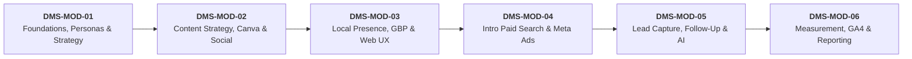
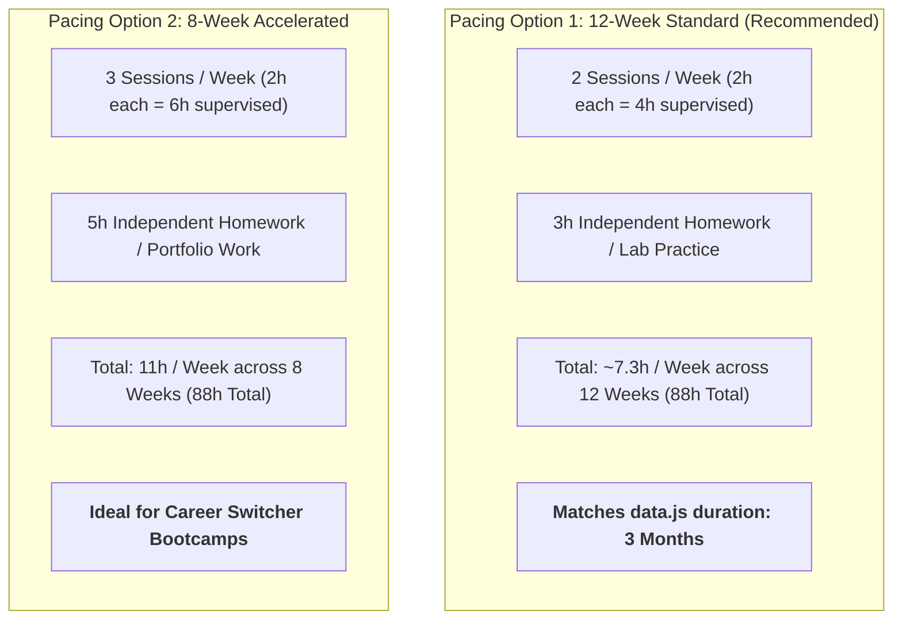
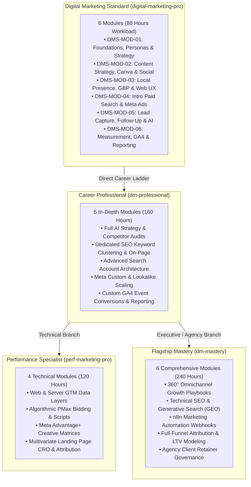

# Digital Marketing Standard / Foundation — Competency & Scope Specification

**Project:** Nova Skills Course Portfolio Transformation  
**Task ID:** DM-03C-06-FIX (Phase 03C.2C Alignment & Tool Validation Correction)  
**Active Git Branch:** `transformation/nova-course-redesign`  
**Target Course ID:** `digital-marketing-pro`  
**Current Published Title:** Digital Marketing Professional  
**Working Position:** Digital Marketing Standard / Foundation  
**Document Status:** PROVISIONAL SPECIFICATION — Corrected Alignment & Validated Tool Matrix  
**Effective Date:** October 2026  

---

## 1. Baseline Verification & Existing Information

This section establishes a clear distinction between the **verified existing baseline** (from `data.js`, `data/courses/digital-marketing-pro.json`, and `docs/course-redesign/digital-marketing/positioning-draft.md`) and the **proposed foundational improvements**.

### 1.1 Existing Published Facts (Unchanged Baseline)
- **Course ID:** `digital-marketing-pro` (Published URL: `/course-detail.html?id=digital-marketing-pro`)
- **Published Title:** Digital Marketing Professional
- **Published Fee:** ₹11,999 (Original Fee: ₹29,999; 60% discount)
- **Duration & Hours Conflict in Codebase (Verified Fields):**
  - In `data.js`: `duration: "3 Months"`, `durationMonths: 3`, `learningHours: 40`
  - In `data/courses/digital-marketing-pro.json`: `duration: "4 Months"`, `learning_hours: 160`, `overview.key_facts.estimated_learning_hours: "160 Hours"`
  - *Fact:* This 3-month vs. 4-month (40h vs. 160h) discrepancy is an uncorrected legacy artifact requiring formal owner resolution.
- **Legacy Curriculum Structure:** Exactly 3 modules and 9 lessons:
  - *Module 01: Social Media & Content Strategy* (1.1 Platform Demographics, 1.2 Content Calendar Creation, 1.3 Community Management)
  - *Module 02: Paid Advertising Essentials* (2.1 Google Search Basics, 2.2 Facebook Boost vs Ads, 2.3 Budget Allocation)
  - *Module 03: Measurement & Optimization* (3.1 Understanding GA4 metrics, 3.2 UTM Tracking, 3.3 Basic ROI Calculation)
- **Legacy Tool Declarations:** `data.js` claims 7 tools (`Google Ads`, `Meta Ads Manager`, `GA4`, `SEMrush`, `Canva`, `ChatGPT`, `Looker Studio`), whereas the detail JSON specifies only 4 core tools (`Google Ads`, `Meta Ads`, `GA4`, `Canva`).
- **Legacy Projects & Outcomes:** Replicated boilerplate across all 14 courses in the academy (`STRATEGIZE`, `EXECUTE`, `MEASURE`, `OPTIMIZE`).

### 1.2 Proposed Structural Improvements (This Specification)
- **Reposition as Foundation / Standard:** Clarify that this course is Nova Skills' foundational entry point, serving learners who need practical digital marketing literacy without the engineering complexity of advanced tracking, server-side infrastructure, or code-level SEO.
- **Curricular Completeness:** Expand the sparse 9-lesson syllabus into a robust, hands-on foundational curriculum that includes missing real-world essentials: local business visibility (Google Business Profile), basic landing page evaluation, customer communication, and responsible marketing ethics.
- **Realistic Career Alignment:** Align career promises strictly with genuine entry-level and small-business capabilities (e.g., Marketing Assistant, Social Media Coordinator, Small Business Marketer), eliminating inflated promises of senior management roles.

---

## 2. Exact Target Learner Profile

### 2.1 Primary Target Audience
1. **Absolute Beginners & Career Explorers:** Individuals with zero prior marketing background who want to understand how modern digital marketing works and build foundational competence.
2. **Small Business Owners & Local Entrepreneurs:** Retailers, service providers, clinic owners, and boutique operators who want to market their own business, manage social channels, set up basic local ads, and stop wasting budget on misconfigured campaigns.
3. **Non-Marketing Professionals & Career Switchers:** Administrative assistants, sales executives, and graphic designers who need practical digital marketing skills to expand their workplace utility.

### 2.2 Secondary Target Audience
1. **Entry-Level Marketing Assistants & Interns:** Individuals preparing for junior coordinator roles who need to know how to schedule posts, draft ad copy, pull basic traffic reports, and collaborate with agency partners.
2. **Junior Freelancers:** Individuals offering entry-level services such as social media content scheduling, basic Canva asset creation, and local business profile setup.

### 2.3 Required Entry Knowledge & Prerequisites
- **Required:** Basic computer literacy (operating a web browser, managing files, typing, email proficiency).
- **Required:** Personal familiarity with consumer social media platforms (Instagram, Facebook, YouTube, LinkedIn).
- **Not Required:** Prior marketing degree, coding knowledge, advanced math, graphic design training, or paid advertising experience.

### 2.4 Concrete Problems This Course Solves
1. **The "Boost Post" Money Trap:** Prevents small businesses from blindly clicking "Boost Post" on Instagram/Facebook without targeting, conversion goals, or budget controls.
2. **Digital Overwhelm:** Replaces confusing jargon (SEO, SEM, PPC, CAPI, ROAS, LTV) with clear, practical workflows that a solo operator can actually run.
3. **Inconsistent Social Presence:** Teaches structured content planning, eliminating random, sporadic posting with no audience engagement.
4. **Blind Marketing Spend:** Teaches basic analytics so learners can tell which posts or ads generated actual phone calls, WhatsApp messages, or website visits.

### 2.5 Realistic Career & Commercial Applications
- **Employment Roles:** Digital Marketing Assistant, Social Media Coordinator, Junior Marketing Executive, Content Operations Assistant.
- **Freelance & Business Applications:** Setting up and managing Google Business Profiles for local shops, creating weekly social media graphics and scheduling posts, running basic local lead-generation campaigns for neighborhood businesses.

### 2.6 What This Course Does NOT Promise (Explicit Exclusions)
- **No Senior Claims:** Does **not** qualify a graduate to be a Performance Marketing Manager, Head of Growth, SEO Director, or Lead Media Buyer.
- **No Enterprise Engineering:** Does **not** cover programmatic ad buying, server-side tracking, multi-touch custom attribution modeling, or headless CMS setups.
- **No Get-Rich-Quick Claims:** Does **not** guarantee immediate freelancing wealth or viral social media growth.

---

## 3. Refined Foundation Competency Depth Matrix

The 18 candidate competency areas are re-evaluated below into four explicit pedagogical depth categories to ensure foundation learners receive complete training without advanced specialist overload:
- **Essential Hands-On:** Student must independently perform the skill in a guided or live environment.
- **Essential Conceptual:** Student must understand, evaluate, and apply the concept in a practical scenario.
- **Integrated Supporting:** Covered organically across other relevant modules rather than in isolation.
- **Advanced / Outside Scope:** Strictly reserved for professional, specialist, or mastery programs.

| # | Competency Area | Classification | Intended Teaching Depth & Pedagogical Rationale |
|---|---|---|---|
| 1 | **Digital Marketing Fundamentals** | **Essential Conceptual** | Understand the core mental models: traditional vs. digital marketing, the customer journey funnel (Awareness ➔ Consideration ➔ Conversion), customer touchpoints, and ethical marketing principles. |
| 2 | **Customer & Market Understanding** | **Essential Conceptual** | Practical customer empathy: researching target demographics, identifying customer pain points, creating simple buyer persona dossiers, and formulating a basic business value proposition. |
| 3 | **Objectives & Basic Strategy** | **Essential Conceptual** | Setting achievable, measurable marketing goals (traffic vs. leads vs. sales); selecting the right 1–2 primary channels for a given business type; establishing simple monthly marketing budgets. |
| 4 | **Digital Marketing Channels Overview** | **Essential Conceptual** | Strategic taxonomy: understanding the distinct operational roles of organic social, paid search, paid social, local search, email, and direct messaging; knowing when to deploy each channel. |
| 5 | **Content Planning & Editorial Workflows**| **Essential Hands-On** | **Independent execution:** Building a structured 30-day content calendar in Google Sheets with defined content pillars (educate, entertain, inspire, promote) and publication schedules. |
| 6 | **Organic Social Media Marketing** | **Essential Hands-On** | **Independent execution:** Platform formatting and distribution on Instagram, Facebook, and LinkedIn; drafting engaging captions; hashtag research; community management and inquiry response. |
| 7 | **Basic Creative Production** | **Essential Hands-On** | **Independent execution:** Designing social media feed graphics, promotional banners, story layouts, and reel covers in Canva using consistent brand colors, typography, and visual hierarchy. |
| 8 | **Website & Landing Page Fundamentals** | **Essential Conceptual** | Evaluating website and landing page user experience: headline clarity, trust badges, mobile responsiveness, clear call-to-action (CTA) buttons, and contact form friction. |
| 9 | **SEO Fundamentals** | **Essential Conceptual** | Core search mechanics: how Google crawls, indexes, and ranks pages; search intent (informational vs. transactional); basic on-page elements (title tags, meta descriptions, image alt text). |
| 10 | **Local Online Presence** | **Essential Hands-On** | **Independent execution:** Complete configuration blueprint for Google Business Profile (GBP); selecting local categories, operating hours, and services; drafting customer review response templates. |
| 11 | **Google Ads Introduction** | **Essential Hands-On** | **Independent execution:** Navigating Google Ads interface; structuring a basic search campaign with themed ad groups; applying keyword match types (phrase/exact); writing responsive search ads; adding negative keywords. |
| 12 | **Meta Advertising Introduction** | **Essential Hands-On** | **Independent execution:** Navigating Meta Ads Manager (moving beyond "Boost Post"); setting campaign objectives (Traffic vs. Leads); configuring geographic radius and demographic targeting; setting daily budget controls. |
| 13 | **Basic Analytics & Campaign Reporting** | **Essential Hands-On** | **Independent execution:** Navigating GA4; identifying top traffic sources and landing page engagement; generating campaign tracking links with Google Campaign URL Builder; exporting weekly summary reports. |
| 14 | **AI-Assisted Marketing Productivity** | **Essential Hands-On** | **Independent execution:** Prompting ChatGPT for headline brainstorming, copywriting variations, social captions, and review responses; using Canva Magic Studio tools for rapid asset creation. |
| 15 | **Lead Generation & Basic Follow-Up** | **Essential Hands-On** | **Independent execution:** Building customized Meta Instant Lead Forms; routing lead notifications to Google Sheets; drafting immediate response protocols and follow-up messaging scripts. |
| 16 | **Customer Communication** | **Integrated Supporting** | Covered organically within Social Media Community Management (Competency 6) and Lead Follow-Up Protocols (Competency 15). |
| 17 | **Practical Marketing Workflow** | **Integrated Supporting** | Covered organically across modules: weekly batch planning, scheduling, budget pacing, ad spend monitoring, and reporting routines. |
| 18 | **Responsible Advertising & Privacy** | **Essential Conceptual** | Ad policy compliance on Meta and Google (prohibited content, misleading claims); avoiding ad account bans; customer data privacy; opt-in consent basics. |

### Explicitly Excluded Advanced Competencies (Outside Foundation Scope)
The following technical domains are strictly omitted from `digital-marketing-pro` to prevent cognitive overload and preserve specialist course boundaries:
- **Server-Side Tracking & Cloud GTM:** Omitted. Reserved for `perf-marketing-pro`.
- **Meta Conversions API (CAPI):** Omitted. Reserved for `perf-marketing-pro`.
- **Automated Workflow Nodes & Webhooks (n8n):** Omitted. Reserved for `dm-mastery`.
- **Technical SEO Crawls (Screaming Frog) & Schema Markup:** Omitted. Reserved for `dm-mastery` and `seo-geo`.
- **Multivariate Landing Page CRO & Statistical Significance:** Omitted. Reserved for `perf-marketing-pro`.
- **Multi-Touch Attribution & BigQuery Data Blending:** Omitted. Reserved for `perf-marketing-pro`.
- **Agency Retainer Management, SOWs & Client Proposals:** Omitted. Reserved for `dm-mastery`.

---

## 4. Complete High-Level Module Map

To deliver complete foundational training in a logical, beginner-to-applied progression, the curriculum is structured into **6 progressive modules** (replacing the legacy 3 sparse modules):



### DMS-MOD-01 — Digital Marketing Foundations, Personas & Strategy
- **Learning Purpose:** Build a solid mental model of how digital marketing functions, how buyers move through funnels, and how to select the right channels for a business without wasting budget.
- **Competencies Covered:** Marketing fundamentals, Customer personas, Marketing objectives, Channel selection, Basic budget planning.
- **Expected Depth:** Essential Conceptual.
- **Main Practical Activity:** Researching a local business scenario and completing a structured Target Customer Persona, Value Proposition & Channel Selection Worksheet.
- **Assessment / Demonstrable Outcome:** Completed Buyer Persona Dossier detailing demographics, pain points, core value proposition, channel selection justification, and monthly budget allocation.
- **Tools Used:** Google Docs / Google Sheets (or offline worksheet template), case study briefing pack. Optional: ChatGPT for guided persona brainstorming.
- **Prerequisites / Dependencies:** Basic computer literacy.

### DMS-MOD-02 — Content Strategy, Canva Design & Organic Social Media
- **Learning Purpose:** Enable learners to create professional visual marketing assets, design brand styleboards, and maintain a structured, consistent organic social media presence across platforms.
- **Competencies Covered:** Content calendars, Canva creative production, Organic social publishing, Platform-specific content, Community interaction.
- **Expected Depth:** Essential Hands-On.
- **Main Practical Activity:** Designing a branded visual asset suite in Canva Free using a manual styleboard and scheduling a 1-week batch of promotional and educational posts using Meta Business Suite (where authorized access exists) or an offline calendar submission.
- **Assessment / Demonstrable Outcome:** 30-Day Google Sheets Content Calendar + Brand Styleboard + 6 Production-Ready Canva Graphics (feed posts, stories/reels covers, promo banner) + (Optional) Scheduled post proof in Meta Business Suite.
- **Tools Used:** Canva (Free tier: 1 Brand Kit with 3 colours), Google Sheets / Docs, Meta Business Suite (optional, requires authorized Page).
- **Prerequisites / Dependencies:** DMS-MOD-01 (Persona and core value proposition).

### DMS-MOD-03 — Local Business Presence, GBP & Website UX
- **Learning Purpose:** Equip learners to capture local high-intent search traffic, understand basic on-page SEO, and evaluate landing pages so website visitors convert into inquiries.
- **Competencies Covered:** Local search visibility, Google Business Profile, Basic on-page SEO, Website and landing-page evaluation.
- **Expected Depth:** Essential Hands-On (GBP Blueprint & Audits) + Essential Conceptual (Landing Page UX & On-Page SEO).
- **Main Practical Activity:** Performing a public Local Digital Presence Audit on an operating neighborhood business, evaluating on-page SEO factors (title tags, meta descriptions, search intent), conducting a landing page UX evaluation, and authoring an offline Google Business Profile configuration blueprint. *(Strict Rule: Does not require unauthorized Google Business Profile changes).*
- **Assessment / Demonstrable Outcome:** Completed Local Presence & SEO Audit Report + Offline GBP Configuration Blueprint + Landing Page Usability Scorecard + Review Response Script Suite.
- **Tools Used:** Google Search, Google Maps, Web Browser developer inspect mode, Local Audit Template.
- **Prerequisites / Dependencies:** DMS-MOD-01 (Customer search intent).

### DMS-MOD-04 — Introductory Paid Advertising: Google Search & Meta Ads
- **Learning Purpose:** Demystify paid advertising, transition students away from ineffective "Boost Post" tactics, and teach how to configure controlled, budget-capped search and social ad campaigns.
- **Competencies Covered:** Google Search campaign fundamentals, Meta Ads campaign fundamentals, Audience and keyword selection, Ad creative and copy, Budget and advertising policy awareness.
- **Expected Depth:** Essential Hands-On.
- **Main Practical Activity:** Authoring a comprehensive Offline Search & Paid Social Campaign Architecture Blueprint covering Google Search (ad groups, keyword match types, negative keywords, responsive search ads) and Meta Ads (campaign objectives, geographic radius/demographic targeting, ad set budget, creative formats, copy variations). Optional: Navigating live Google Ads (Expert Mode) and Meta Ads Manager to save campaigns in Draft Status where account access allows. *(Guaranteed assessment is 100% offline blueprint).*
- **Assessment / Demonstrable Outcome:** Complete Offline Google Search & Meta Ads Campaign Architecture Blueprint Document (2 ad groups, 6 responsive ads, 15 phrase/exact keywords, 10 negatives; Meta radius targeting and ad creative spec) + (Optional) Draft Mode Screenshots.
- **Tools Used:** Offline Campaign Architecture Blueprint Template (Sheets/Docs), Google Ads interface (optional draft), Meta Ads Manager interface (optional draft).
- **Prerequisites / Dependencies:** DMS-MOD-01 (Target audience), DMS-MOD-02 (Creative ad visuals).

### DMS-MOD-05 — Lead Capture, Customer Follow-Up & AI Productivity
- **Learning Purpose:** Connect traffic to actual revenue by configuring frictionless instant lead forms, setting up structured lead notification sheets, and drafting prompt customer follow-up messaging with AI productivity tools.
- **Competencies Covered:** Lead form planning, Lead tracking in Google Sheets, WhatsApp/email/phone follow-up scripts, AI-assisted copy and response drafting, Privacy, accuracy and human review.
- **Expected Depth:** Essential Hands-On.
- **Main Practical Activity:** Designing an offline lead capture blueprint for a Meta Instant Lead Form (qualifying questions, privacy policy), configuring a structured Lead Notification Tracker in Google Sheets, and engineering prompts in ChatGPT to draft immediate customer inquiry follow-up scripts across three channels (WhatsApp, Email, Phone call) with mandatory human review for brand voice and factual accuracy.
- **Assessment / Demonstrable Outcome:** Lead Capture Form Blueprint + Configured Google Sheets Lead Tracker with sample test records + 3 Human-Reviewed Channel Follow-Up Scripts (WhatsApp, Email, Phone) + AI Prompt & Fact-Check Log.
- **Tools Used:** Google Sheets (Lead Tracker), Google Docs, ChatGPT (Free tier), Meta Ads Manager Instant Form builder (optional draft).
- **Prerequisites / Dependencies:** DMS-MOD-04 (Campaign objectives).

### DMS-MOD-06 — Campaign Measurement, GA4 Analytics & Reporting
- **Learning Purpose:** Give learners the ability to track campaign links, navigate GA4 standard reports to see where website visitors come from, interpret marketing results, and present a clear, professional summary report to a business owner.
- **Competencies Covered:** UTM parameters, Basic traffic analytics, GA4 standard reports, Interpretation of marketing results, Client performance reporting.
- **Expected Depth:** Essential Hands-On.
- **Main Practical Activity:** Generating 3 custom campaign tracking URLs with Google Campaign URL Builder, conducting traffic acquisition analysis using the official GA4 Demo Account (or an Instructor-Provided GA4 Dataset / Pre-recorded Observation Pack as a guaranteed fallback), synthesizing findings into a 1-page written traffic brief, and assembling a 5-slide Executive Marketing Performance Presentation in Google Slides.
- **Assessment / Demonstrable Outcome:** Campaign UTM URL Tracking Sheet + 1-Page Written GA4 Traffic Analysis Brief + 5-Slide Executive Performance Presentation Deck.
- **Tools Used:** Google Campaign URL Builder, Google Analytics 4 (Google Merchandise Store Demo Account or Instructor-Provided Offline Dataset/Observation Pack), Google Slides, Google Docs.
- **Prerequisites / Dependencies:** DMS-MOD-01, DMS-MOD-04, DMS-MOD-05 (Full-funnel campaign tracking).

---

## 5. Competency-to-Module Coverage Matrix

This audit matrix confirms that all essential foundational competencies are comprehensively mapped to specific teaching locations and assessments without gaps or unintended duplication:

| Competency Area | Primary Module | Secondary / Integrated Module | Practical Hands-On Application | Observable Assessment Deliverable | Coverage Status |
|---|---|---|---|---|---|
| 1. Digital Marketing Fundamentals | **DMS-MOD-01** | DMS-MOD-04 | Funnel stage mapping exercise | Funnel Stage & Customer Journey Diagram | **Complete** |
| 2. Customer & Market Understanding | **DMS-MOD-01** | DMS-MOD-02 | Competitor social review & persona worksheet | Target Buyer Persona Dossier | **Complete** |
| 3. Objectives & Basic Strategy | **DMS-MOD-01** | DMS-MOD-04 | Setting monthly marketing budget & channel split | Marketing Strategy & Channel Allocation Plan | **Complete** |
| 4. Digital Marketing Channels | **DMS-MOD-01** | DMS-MOD-03, DMS-MOD-04 | Channel comparison matrix | Channel Selection Justification Sheet | **Complete** |
| 5. Content Planning | **DMS-MOD-02** | — | Building 30-day editorial calendar | 30-Day Content Calendar (Google Sheets) | **Complete** |
| 6. Organic Social Media Marketing | **DMS-MOD-02** | DMS-MOD-05 | Scheduling batch posts on Meta Business Suite (where authorized) or offline plan | Scheduled Social Posts with Captions & Tags | **Complete** |
| 7. Basic Creative Production | **DMS-MOD-02** | DMS-MOD-04 | Designing social graphics & story promo in Canva Free | Brand Styleboard + 6 Production Graphics | **Complete** |
| 8. Website & Landing Page Basics | **DMS-MOD-03** | — | Evaluating landing page headlines, UX & forms | Landing Page Conversion Usability Scorecard | **Complete** |
| 9. SEO Fundamentals | **DMS-MOD-03** | — | Identifying search intent & drafting title tags | On-Page Optimization & Meta Description Sheet | **Complete** |
| 10. Local Online Presence | **DMS-MOD-03** | — | Configuring Google Business Profile blueprint (no unauthorized live changes) | Local Business Presence Audit & GBP Blueprint | **Complete** |
| 11. Google Ads Introduction | **DMS-MOD-04** | — | Building Search campaign with match types & negatives (offline blueprint guaranteed) | Google Search Campaign Architecture Blueprint | **Complete** |
| 12. Meta Advertising Introduction | **DMS-MOD-04** | DMS-MOD-05 | Setting up Ads Manager campaign with radius target (offline blueprint guaranteed) | Meta Ads Manager Campaign Setup & Budget Plan | **Complete** |
| 13. Basic Analytics & Reporting | **DMS-MOD-06** | — | Building UTM links & navigating GA4 Demo Account (or prepared dataset fallback) | UTM Link Sheet + GA4 Analysis + Slide Deck | **Complete** |
| 14. AI-Assisted Productivity | **DMS-MOD-02, DMS-MOD-05** | DMS-MOD-01 | Prompting ChatGPT for copy, headlines & replies with mandatory human verification | AI-Generated Copy Variations & Prompt Log | **Complete** |
| 15. Lead Gen & Basic Follow-Up | **DMS-MOD-05** | DMS-MOD-04 | Creating Instant Lead Form & notification routing in Google Sheets | Lead Capture Form + Lead Response Scripts | **Complete** |
| 16. Customer Communication | **DMS-MOD-02, DMS-MOD-05** | — | Drafting inquiry responses & review reply templates | Community Moderation & Review Response Guide | **Complete** |
| 17. Practical Marketing Workflow | **DMS-MOD-02, DMS-MOD-06** | DMS-MOD-04 | Executing weekly batch planning & spend tracking | Marketing Operations Checklist & Weekly Routine | **Complete** |
| 18. Responsible Advertising & Privacy | **DMS-MOD-04** | DMS-MOD-05 | Reviewing Meta/Google ad policy checklists and data privacy safeguards | Ad Policy Compliance & Privacy Audit Checklist | **Complete** |

---

## 6. Training Feasibility, Delivery Scenarios & Workload Validation

### 6.1 Exact Verified Source Fields & Metadata Conflict
To establish rigorous forensic clarity, the exact property names and values are quoted below directly from the repository source files:

- **Source A (`data.js`):**
  - Property `duration`: `"3 Months"`
  - Property `durationMonths`: `3`
  - Property `learningHours`: `40`
- **Source B (`data/courses/digital-marketing-pro.json`):**
  - Property `duration`: `"4 Months"`
  - Property `learning_hours`: `160`
  - Property `overview.key_facts.estimated_learning_hours`: `"160 Hours"`
  - Property `overview.key_facts.duration`: `"4 Months"`

*Key Finding:* `data.js` specifies **40 learning hours** across **3 months**, while the detail JSON specifies **160 learning hours** across **4 months**. Neither file specifies how hours divide between lecture, lab, and homework. This document establishes that operational distinction.

### 6.2 Pedagogical Workload Definitions
To resolve this discrepancy, two distinct metrics must be recognized:
1. **Supervised Contact Hours (Instructional Time):** Direct, real-time engagement with an instructor, encompassing conceptual lectures, live software demonstrations, and supervised lab walkthroughs.
2. **Total Learner Workload:** The comprehensive investment of student time, combining supervised instructional contact hours, independent home practice, assignment execution, and portfolio capstone development.

### 6.3 Granular Workload Validation & Module Allocation Check
The proposed 6-module foundation curriculum allocates an aggregate of **88 Total Learner Workload Hours**:
- **Supervised Lectures (Theory / Demo):** 24 Hours
- **Guided Practical Labs (Instructor-Led):** 27 Hours
- **Independent Assignments (Home Practice):** 21 Hours
- **Capstone Project & Assessment Work:** 16 Hours
- **Mathematical Total:** 24 + 27 + 21 + 16 = **88 Hours** (Verified).
- **Total Supervised Contact Time (Lectures + Labs):** 24 + 27 = **51 Hours**.

#### Granular Module-Hour Distribution:

| Module ID & Title | Supervised Lectures (Theory / Demo) | Guided Practical Labs (Instructor-Led) | Independent Assignments (Home Practice) | Capstone Project & Assessment Work | Total Student Workload | Beginner Feasibility Assessment |
|---|---|---|---|---|---|---|
| **DMS-MOD-01 — Digital Marketing Foundations, Personas & Strategy** | 4 Hours | 3 Hours | 3 Hours | 2 Hours | **12 Hours** | **High Feasibility.** Funnel concepts and persona worksheets are easily understood with guided examples. |
| **DMS-MOD-02 — Content Strategy, Canva Design & Organic Social Media** | 5 Hours | 6 Hours | 4 Hours | 3 Hours | **18 Hours** | **High Feasibility.** Canva has a low barrier to entry; 6h of guided lab allows beginners to master templates and formatting. |
| **DMS-MOD-03 — Local Business Presence, GBP & Website UX** | 3 Hours | 4 Hours | 3 Hours | 2 Hours | **12 Hours** | **High Feasibility.** Focused on GBP blueprints and visual landing page checklists; avoids code-level SEO complexity. |
| **DMS-MOD-04 — Introductory Paid Advertising: Google Search & Meta Ads** | 5 Hours | 6 Hours | 4 Hours | 3 Hours | **18 Hours** | **CRITICAL RISK / TIGHT ALLOCATION (Flagged).** Covering both Google Ads and Meta Ads Manager in 11h supervised time is dense. Requires strict sandbox scoping. |
| **DMS-MOD-05 — Lead Capture, Customer Follow-Up & AI Productivity** | 3 Hours | 4 Hours | 3 Hours | 2 Hours | **12 Hours** | **High Feasibility.** Building Instant Forms and drafting ChatGPT follow-up templates is intuitive and highly engaging. |
| **DMS-MOD-06 — Campaign Measurement, GA4 Analytics & Reporting** | 4 Hours | 4 Hours | 4 Hours | 4 Hours | **16 Hours** | **MODERATE RISK (Flagged).** GA4 can disorient beginners. Supervised lab must restrict navigation strictly to 3 standard reports and UTM links. |
| **PROGRAM TOTALS** | **24 Hours** | **27 Hours** | **21 Hours** | **16 Hours** | **88 Hours** | **Overall Balanced Feasibility (with risk mitigations).** |

#### Pedagogical Risk Flags & Mitigations for Beginners:
1. **DMS-MOD-04 (Introductory Paid Advertising: Google Search & Meta Ads — 11h Supervised Time):**
   - *Risk:* Beginners encountering two completely different enterprise advertising dashboards (Google Ads Expert Mode and Meta Ads Manager) within 11 contact hours risk cognitive overload.
   - *Mitigation:* The curriculum must strictly split the time (5.5h Google Search + 5.5h Meta Lead Gen), prohibit all advanced campaign types (no Display, no YouTube, no Advantage+ Shopping, no Catalog sales), and utilize standardized sandbox templates so students configure structure rather than troubleshooting technical billing/pixel errors.
2. **DMS-MOD-06 (Campaign Measurement, GA4 Analytics & Reporting — 8h Supervised Time):**
   - *Risk:* GA4's event-driven data model and complex Explorations interface often confuse non-technical learners.
   - *Mitigation:* Teaching must be confined strictly to three pre-built standard reports (*Traffic Acquisition*, *Pages and Screens*, *Tech Overview*) and manual UTM tracking via the Google Campaign URL Builder. Custom events, GTM triggers, and BigQuery are strictly forbidden.

---

### 6.4 Comparative Evaluation of Three Delivery Scenarios

#### Scenario A: The Compressed 40-Hour Curriculum (`data.js` Model)
- **Premise:** Strictly enforce the `learningHours: 40` value found in `data.js`.
- **Pedagogical Assessment:**
  - *If 40 Hours = Total Learner Workload:* **Pedagogically Unviable.** Across 6 modules, this allows only ~6.6 total hours per module. Google Ads and Meta Ads would receive barely 3 hours of total time each. Absolute beginners would be reduced to passive video watching without the hands-on lab time required to build confidence. The course would fail to deliver its promised outcomes.
  - *If 40 Hours = Supervised Contact Time Only:* **Marginally Viable.** If 40 hours represents 20h lecture + 20h guided lab, with an additional 30–40 hours of uncounted independent homework/projects (total workload ~70–80h), the curriculum can be delivered, provided DMS-MOD-04 ad setups are streamlined.

#### Scenario B: The 88-Hour Balanced Curriculum (Recommended Standard Model)
- **Premise:** Establish **88 Total Learner Workload Hours** (51 Hours Supervised Contact + 37 Hours Independent Effort).
- **Pedagogical Assessment:** **Highly Viable & Market-Competitive.**
  - Provides adequate classroom breathing room (24h theory/demos + 27h guided labs) so beginners receive step-by-step assistance in setting up ad drafts, Canva graphics, and GA4 tracking.
  - Allocates 37 hours for students to build an authentic 4-milestone portfolio (Content Calendar, Canva Assets, Ad Setup, Executive Presentation).
  - Can be delivered across two proven scheduling tracks:
    1. *Track 1 (12-Week / 3-Month Part-Time):* 4.25h supervised contact + 3h independent practice = **~7.3 Hours/Week**. Perfect for working adults and small-business owners; exactly aligns with the published `duration: "3 Months"` in `data.js`.
    2. *Track 2 (8-Week Intensive):* 6.5h supervised contact + 4.5h independent practice = **11 Hours/Week**. Ideal for college students and active career switchers.

#### Scenario C: The Extended 160-Hour Curriculum (JSON Model)
- **Premise:** Adopt the `learning_hours: 160` and `duration: "4 Months"` figures from `digital-marketing-pro.json`.
- **Pedagogical & Commercial Assessment:** **Counter-Productive & Strongly Discouraged.**
  - *Commercial Cannibalization:* `dm-professional` is cataloged at **4 Months (160 Hours)** for **₹17,499**. If `digital-marketing-pro` is also cataloged at 4 Months (160 Hours) for **₹11,999**, Nova Skills creates direct internal competition and pricing confusion between two courses with nearly identical names.
  - *Curricular Inflation:* 160 hours is excessive for foundational digital marketing literacy. To fill 160 hours, instructors would be forced to introduce advanced specializations (GTM data layers, programmatic ads, technical SEO crawls), destroying the beginner-friendly foundation scope and overwhelming the target learner.

---

### 6.5 Recommended Pacing Schedules for Delivery



- **Pacing Option 1 (12-Week / 3-Month Standard Schedule — Recommended):**
  - Week 1–2: DMS-MOD-01 — Digital Marketing Foundations, Personas & Strategy
  - Week 3–4: DMS-MOD-02 — Content Strategy, Canva Design & Organic Social Media
  - Week 5–6: DMS-MOD-03 — Local Business Presence, GBP & Website UX
  - Week 7–8: DMS-MOD-04 — Introductory Paid Advertising: Google Search & Meta Ads
  - Week 9–10: DMS-MOD-05 — Lead Capture, Customer Follow-Up & AI Productivity
  - Week 11–12: DMS-MOD-06 — Campaign Measurement, GA4 Analytics & Reporting
- **Pacing Option 2 (8-Week Accelerated Schedule):**
  - Delivers the same 88 hours at an accelerated pace of 11 hours/week over 2 months.

*Administrative Note:* All published duration and fee fields in repository files remain strictly unchanged pending explicit business owner sign-off.

---

## 7. Corrected Practical Training Framework, Tool Access Realities & Fallbacks

### 7.1 Separation of Advertising Training Environments
To eliminate misleading assumptions about ad platform access, training in Google Ads and Meta Ads Manager strictly distinguishes between four distinct operational tiers:

```
[Tier A: Offline Blueprint Worksheets] ➔ [Tier B: In-Platform Draft Configurations] ➔ [Tier C: Official Test Accounts / Sandboxes] ➔ [Tier D: Live Published Campaigns]
```

- **Tier A (Offline Blueprint Worksheets — Guaranteed Standard):** Structured spreadsheets, keyword mapping matrices, responsive ad copy forms, and lead capture specifications. **This is the guaranteed assessment pathway for 100% of enrolled students.** Does not require live ad accounts, payment cards, or business verification.
- **Tier B (In-Platform Draft Configurations — Supported Where Accessible / Account-Dependent):** Navigating the live user interface of Google Ads ("Expert Mode" without entering billing) or Meta Ads Manager to configure and save campaigns in **Draft Status** (`In Draft`). Demonstrates navigation and targeting skills without publishing. **Campaign drafts must not be equated with a universal sandbox; ordinary account creation and draft availability are account-dependent, and platform-based draft access is not guaranteed for every student.**
- **Tier C (Official Test Accounts / Sandboxes — Highly Restricted):** Meta for Developers test accounts or Google Ads MCC test accounts. **API test accounts require a separate test setup and do not serve ads.** Explicitly NOT assumed for foundational students due to developer prerequisites and authentication barriers.
- **Tier D (Actual Campaign Publication & Live Serving — Strictly Out of Scope):** Entering live payment instruments, committing real ad spend, serving impressions, and tracking live ROAS. **Never require advertising spend.** Non-serving draft setups are never falsely represented as delivering real impressions, leads, or conversions. Where authorized accounts exist, students may inspect client data under supervision, but live spending is strictly outside course requirements.

### 7.2 Advertising Account Access Realities & Risk Mitigations
1. **Google Ads Account Access Realities:**
   - *Vendor Flow & Limitations:* Accessible via **"Switch to Expert Mode" ➔ "Create an account without a campaign"** (`https://ads.google.com`). However, ordinary account creation and draft availability are **account-dependent**; users may encounter localized billing prompts or security verification. Campaign drafts must not be equated with a universal sandbox, and API test accounts require a separate test setup and do not serve ads. Non-spending accounts receive Keyword Planner search volumes in broad ranges (e.g., 1K–10K) rather than precise metrics.
   - *Mitigation:* Student grading is 100% guaranteed via the **Offline Google Search Campaign Architecture Blueprint** (Tier A) with optional Tier B draft screenshots where accessible.
2. **Meta Ads Manager Access Realities:**
   - *Vendor Flow & Limitations:* Drafts auto-save, but **platform-based draft access is not guaranteed for every student**. Brand-new personal Facebook profiles frequently hit automated integrity checkpoints, phone verification requirements, or ad account restrictions upon opening Ads Manager.
   - *Mitigation:* Authorized accounts should be used where available, but **advertising spend is never required**. Students must never be forced to add credit cards or navigate account recovery loops. The **Offline Meta Campaign Blueprint Worksheet** serves as the primary verifiable grading deliverable.

### 7.3 Google Analytics 4 (GA4) Practicals: Read-Only vs. Administrative Setup
- **What Can Be Learned via the Official Demo Account:**
  - Official access to the **Google Merchandise Store (Web)** and **Flood-It! (App)** properties (`https://support.google.com/analytics/answer/6367342`).
  - Read-only (`Viewer`) access to explore standard reports: *Traffic Acquisition*, *User Acquisition*, *Pages and Screens*, *Tech Details*, and standard ecommerce funnels.
- **Critical Limitations & Export Realities:**
  - Official demo accounts grant read-only `Viewer` access.
  - **Do NOT promise report or Exploration export functionality from the demo account**, as Google frequently restricts, disables, or rate-limits export capabilities for public demo users.
  - Students cannot create custom events, modify data streams, configure conversion events, or link Search Console.
- **Guaranteed Fallback & Portfolio Solution:**
  - Students generate custom campaign tracking URLs using Google Campaign URL Builder.
  - For analytics evaluation, students navigate the GA4 Demo Account when accessible, documenting observations via structured notes and screenshots.
  - As a guaranteed fallback for students facing demo access or export barriers, an **Instructor-Provided GA4 Dataset / Pre-recorded Observation Pack** is provided to complete the 1-Page GA4 Traffic Analysis and 5-Slide Executive Presentation.

### 7.4 Google Business Profile (GBP) Compliance & Anti-Spam Policy
- **Strict Compliance Directive:** Google's anti-spam policy (`https://support.google.com/business/answer/7107242`) strictly prohibits creating fake business listings, using virtual offices, or keyword stuffing. Violations lead to immediate profile suspension or account blacklisting.
- **Pedagogical Rule:** **Do not require unauthorized Google Business Profile changes.** Students are strictly forbidden from creating fictitious business locations on Google Maps.
- **Standard Guaranteed Assessment:** Students conduct an offline **Local Business Presence Audit** of an existing operating business using publicly available Google Search/Maps data and complete an offline **GBP Configuration Blueprint** (categories, NAP consistency, operating hours, photos, review response protocols). Live profile updates are strictly optional and permitted only with verified, authorized business ownership.

### 7.5 Creative & AI Tools: Free Capabilities vs. Paid Boundaries
1. **Canva (Free Tier Compliance):**
   - *Verified Free Features:* Free social media templates, standard font library, manual hex color entry, static JPG/PNG/PDF downloads.
   - *Current Free Plan Restrictions:* Current India Free plan lists **one Brand Kit limited to three colours** (palette only; uploading custom fonts, multiple palettes, and brand logos remain Pro features). Background Remover, Magic Resize/Switch, transparent PNG downloads, and social scheduling are Pro features (`https://www.canva.com/pricing/`).
   - *Pedagogical Adaptation:* **Do not require paid brand assets or premium features.** A manually created **Brand Styleboard** (documenting color hex codes and standard font pairings) remains a fully acceptable, rubric-graded practical.
2. **ChatGPT & AI Assistants:**
   - *Model-Agnostic Access:* **Do not hardcode specific free model names**, as free conversational model availability evolves dynamically.
   - *Data Controls & Confidentiality:* Students are explicitly instructed on **Data Controls** and the responsible handling of confidential information. **Never input customer personally identifiable information (PII), confidential client financials, or proprietary business data into AI prompts.**
   - *Mandatory Human Review:* Require verification, fact-checking, and human review of all AI outputs for brand tone, truthfulness, and accuracy before using in marketing assets.
3. **Meta Business Suite:**
   - *Access Realities:* Actual in-platform scheduling requires legitimate Facebook Page or connected Instagram professional account access (`ACCOUNT-DEPENDENT` / `AUTHORIZED ACCOUNT REQUIRED`).
   - *Pedagogical Rule:* **Offline calendars and posting plans must remain valid, complete assessments** so students without active business pages achieve full marks.
   - *Unverified Capabilities:* Where current vendor capabilities cannot be established independently, they are designated **ACCOUNT-DEPENDENT**.

---

## 8. Software Validation Evidence & Official Documentation Sources

The toolstack is evaluated below against verified vendor documentation (audited October 2026):

| Software / Tool | Curricular Purpose & Competency | Required Proficiency | Free vs. Paid Capabilities | Official Documentation Source (Audited Oct 2026) | Practical Access Status |
|---|---|---|---|---|---|
| **Canva** | Graphic asset production for social and ads (DMS-MOD-02, 04). | Applied manual layout and template editing. | **Free:** Standard templates, manual palettes, 1 Brand Kit limited to 3 colours. **Pro ($120/yr):** Custom fonts, Background Remover, Scheduler. | [Canva Official Pricing](https://www.canva.com/pricing/) | **VERIFIED FREE WITH LIMITATIONS** |
| **Meta Business Suite** | Organic scheduling and page management across FB/IG (DMS-MOD-02, 05). | Scheduling posts, organizing assets, reading comments. | **100% Free:** Native tool for Facebook Pages and linked Instagram accounts. Actual scheduling requires legitimate Page access. | [Meta Business Help Center](https://www.facebook.com/business/help/) | **ACCOUNT-DEPENDENT / AUTHORIZED ACCOUNT REQUIRED** *(Offline calendar is valid assessment)* |
| **Meta Ads Manager** | Paid social ad configuration, audience targeting, lead forms (DMS-MOD-04, 05). | Navigating Ads Manager, configuring campaigns in Draft. | **Draft Mode:** Free to draft. Draft access not guaranteed for all personal profiles (integrity checks). Never require ad spend. | [Meta Ads Help](https://www.facebook.com/business/help/162813470438254) | **ACCOUNT-DEPENDENT / VERIFIED FREE WITH LIMITATIONS** *(Offline blueprint guaranteed)* |
| **Google Ads** | Paid search campaign architecture and keyword planning (DMS-MOD-04). | Structuring ad groups, match types, responsive search ads. | **Draft Mode:** Accessible via Expert Mode without initial spend, but account creation and draft access are account-dependent. API test accounts require separate setup and do not serve ads. | [Google Ads Help](https://support.google.com/google-ads/answer/6366720) | **ACCOUNT-DEPENDENT / VERIFIED FREE WITH LIMITATIONS** *(Offline blueprint guaranteed)* |
| **Google Analytics 4** | Web traffic analysis and channel acquisition reporting (DMS-MOD-06). | Navigating standard reports, reading metrics, evaluating channels. | **100% Free Demo:** Google Merchandise Store demo account (Viewer permissions). Do not promise report or Exploration export functionality. | [GA4 Demo Account Support](https://support.google.com/analytics/answer/6367342) | **OFFICIAL DEMO ACCOUNT / ACCOUNT-DEPENDENT** *(Instructor dataset fallback)* |
| **Google Business Profile** | Local search visibility, Google Maps presence, review management (DMS-MOD-03). | Auditing NAP consistency, blueprinting categories and services. | **100% Free Native Tool:** Strict anti-spam verification prevents test profile creation. Do not require unauthorized live changes. | [Google Business Profile Help](https://support.google.com/business/answer/7107242) | **OFFLINE SIMULATION / AUTHORIZED ACCOUNT REQUIRED** *(Audit/Blueprint)* |
| **ChatGPT (OpenAI)** | Copywriting brainstorming, headline variations, review replies (DMS-MOD-02, 05). | Writing effective prompts, evaluating and editing AI drafts. | **Free Tier:** Conversational access (model names not hardcoded). Subject to Data Controls; require human review and privacy hygiene. | [OpenAI Help Center](https://help.openai.com/) | **VERIFIED FREE ACCESS** |
| **Campaign URL Builder** | Generating custom campaign tracking parameters (DMS-MOD-06). | Constructing clean, error-free UTM tagged links. | **100% Free:** Web-based developer utility provided by Google. No account required. | [Google Campaign URL Builder](https://ga-dev-tools.google/campaign-url-builder/) | **VERIFIED FREE ACCESS** |
| **Google Sheets & Docs** | Content calendars, lead tracking logs, strategy worksheets (DMS-MOD-01, 02, 05). | Formatting tables, organizing data, sharing links. | **100% Free:** Standard Google Workspace apps with personal Google Account. | [Google Docs Support](https://support.google.com/docs/) | **VERIFIED FREE ACCESS** |
| **Google Slides** | Executive client performance presentations (DMS-MOD-06). | Building 5-slide visual marketing decks. | **100% Free:** Standard Google Workspace presentation tool. | [Google Slides Support](https://support.google.com/docs/) | **VERIFIED FREE ACCESS** |

---

## 9. Module-Wise Practical Delivery Matrix

This authoritative matrix defines the **guaranteed practical exercise** accessible to 100% of enrolled students across the approved six modules, alongside optional platform-based exercises, deliverables, evidence, and specific trainer preparation requirements:

| Module ID & Title | Guaranteed Practical (Offline / Instructor-Provided) | Optional Real-Platform Practical (Where Authorized) | Required Materials & Tools | Exact Student Deliverable | Assessment Evidence | Account & Licensing Limitations | Trainer Responsibilities |
|---|---|---|---|---|---|---|---|
| **DMS-MOD-01 — Digital Marketing Foundations, Personas & Strategy** | **Buyer Persona & Strategy Blueprint:** Research an assigned SMB case study and complete the Customer Persona, Value Proposition Canvas, Channel Selection Matrix, and Basic Budget Allocation Worksheet. | Conducting a structured stakeholder discovery interview with a local business owner or marketing manager. | Google Docs / Sheets (or offline template), Case study briefing pack. Optional: ChatGPT for guided brainstorming. | Comprehensive Buyer Persona & Strategic Marketing Plan (Demographics, Pain Points, Objections, Channel Selection, and Monthly Budget Split). | Completed, rubric-graded Strategy Worksheet / Dossier (PDF/Doc). | `VERIFIED FREE ACCESS` (Free Google Account or offline document; zero paid tools required). | Provide 3 diverse local business case studies (e.g., dental clinic, artisan bakery, home HVAC service) for students without a business. |
| **DMS-MOD-02 — Content Strategy, Canva Design & Organic Social Media** | **30-Day Content Calendar & Manual Canva Brand Suite:** Build a 30-day editorial calendar in Google Sheets with thematic content pillars; design a visual brand styleboard (manual hex codes and font pairing) and produce 6 multi-format social assets (3 square feed posts, 2 stories/reels covers, 1 promotional banner) using Canva Free templates. | Drafting and staging scheduled posts in Meta Business Suite for a verified, authorized Facebook Page or Instagram Professional Account. | Canva (Free tier: 1 Brand Kit limited to 3 colours), Google Sheets / Docs (or offline spreadsheet), Meta Business Suite (optional). | 30-Day Content Calendar Sheet + Exported Brand Styleboard + 6 Production-Ready Social Graphic Files (static PNG). | Submitted Content Calendar spreadsheet + 6 exported image files + (Optional) Meta Business Suite scheduled drafts screencast/screenshot. | `VERIFIED FREE WITH LIMITATIONS` / `ACCOUNT-DEPENDENT`. Canva Free supports 1 Brand Kit with 3 colours (no custom fonts/background remover); Meta Business Suite requires Page access. Offline calendar is 100% valid. | Demonstrate manual hex code entry and free font pairing; supply royalty-free image resources (Pexels, Unsplash); emphasize that offline posting plans are 100% valid for grading. |
| **DMS-MOD-03 — Local Business Presence, GBP & Website UX** | **Local SEO Audit & Google Business Profile Blueprint:** Perform a public local search footprint audit of an operating neighborhood business; evaluate NAP consistency across public directories; audit on-page SEO elements (title tags, meta descriptions, search intent); conduct a landing page UX evaluation (CTA clarity, mobile layout, form friction); author an offline GBP setup/optimization blueprint (categories, services, photo guidelines, and 5 review response templates). *(Strict Rule: Does NOT require creating or modifying live Google profiles).* | Updating operating hours, services, or drafting updates inside an authorized, claimed Google Business Profile owned by the student or a consenting client. | Google Search, Google Maps, web browser inspect mode, Local SEO Audit & Landing Page Usability Scorecard Template (Docs/Sheets). | Local Digital Footprint & SEO Audit Report + Offline GBP Configuration Blueprint + Landing Page UX Scorecard + Review Response Script Suite. | Completed audit and blueprint documents with annotated public screenshots. | `OFFLINE SIMULATION` / `ACCOUNT-DEPENDENT`. Google anti-spam policies strictly forbid creating test/dummy listings. Do not require unauthorized Google Business Profile changes. Live updates permitted only with authorized business ownership. | Enforce strict anti-spam ethics (zero fake listings); provide sample brick-and-mortar search audit targets; provide standardized on-page SEO and landing page UX audit rubrics. |
| **DMS-MOD-04 — Introductory Paid Advertising: Google Search & Meta Ads** | **Offline Search & Paid Social Campaign Architecture Blueprint:** Complete a comprehensive offline advertising architecture blueprint covering: (1) Google Search campaign structure (2 tightly themed ad groups, 15 phrase/exact keywords, 10 negative keywords, 6 responsive search ads with headlines/descriptions, daily budget pacing, ad policy check); (2) Meta Ads campaign structure (campaign objective selection, geographic radius/demographic targeting, ad set budget, creative format, primary ad copy variations, and policy compliance review). **Guaranteed assessment for 100% of students.** | Navigating the live user interface of Google Ads (Expert Mode without billing) and Meta Ads Manager to configure and save campaigns in **Draft Status** (`In Draft`), where account access allows. | Offline Campaign Architecture Blueprint Template (Sheets/Docs), Google Ads interface (optional draft), Meta Ads Manager interface (optional draft). | Complete Google Search & Meta Ads Campaign Architecture Blueprint Document (with optional interface draft screenshots). | Rubric-graded Campaign Architecture Blueprint covering targeting, keyword match types, ad copy, budgeting, and policy compliance. | `ACCOUNT-DEPENDENT` / `VERIFIED FREE WITH LIMITATIONS`. Universal sandboxes do not exist. Google Ads account creation and draft mode are account-dependent; Meta Ads Manager often triggers security/identity checkpoints for new personal profiles. API test accounts require developer setup and do not serve ads. Live ad serving requires billing and is strictly out of scope. Advertising spend is NEVER required. | Provide standardized blueprint templates; emphasize that offline blueprints carry 100% grading weight; guide students navigating draft mode without entering billing; explain advertising policies and compliance to prevent account bans. |
| **DMS-MOD-05 — Lead Capture, Customer Follow-Up & AI Productivity** | **Lead Generation Architecture, Tracking Sheet & AI Follow-Up System:** Design an offline lead capture blueprint for a Meta Instant Lead Form (4 qualifying questions, privacy policy link, custom disclaimer); build a structured Lead Notification and Status Tracker in Google Sheets (capturing Lead ID, Name, Contact, Status, Notes); engineer prompts in ChatGPT to draft immediate customer inquiry follow-up scripts across three channels (WhatsApp, Email, Phone call) and 3 objection-handling responses; conduct mandatory human review for brand voice, factual accuracy, and privacy compliance. | Building an active Instant Lead Form inside Meta Ads Manager (Draft Mode) and connecting it to a test lead download or manual sheet export where authorized page access exists. | Google Sheets (Lead Tracker), Google Docs, ChatGPT (Free tier), Meta Ads Manager Instant Form builder (optional draft). | Lead Capture Form Blueprint + Configured Google Sheets Lead Tracker with sample test records + 3 Human-Reviewed Channel Follow-Up Scripts (WhatsApp, Email, Phone) + AI Prompt & Fact-Check Log. | Submitted Lead Form specification, active Google Sheets tracker link, and annotated follow-up script document showing human review/editing of AI outputs. | `VERIFIED FREE ACCESS` / `ACCOUNT-DEPENDENT`. Meta Instant Forms in live pages require page admin rights. ChatGPT free tier has dynamic usage limits; data controls must be applied (no confidential customer PII). | Teach prompt hygiene and data privacy (never input customer PII into AI); provide standard lead tracker spreadsheet template; mandate human verification of AI-generated responses for tone and truthfulness. |
| **DMS-MOD-06 — Campaign Measurement, GA4 Analytics & Reporting** | **Marketing Analytics Audit & Executive Presentation:** Construct 3 standardized UTM campaign tracking links using Google Campaign URL Builder; conduct a comprehensive traffic and user behavior audit using either the official GA4 Demo Account (Google Merchandise Store - Web property) when accessible, or an **Instructor-Provided GA4 Dataset / Pre-recorded Observation Pack** as an offline fallback; synthesize findings into a 1-page written traffic performance brief and assemble a 5-slide Executive Marketing Performance Presentation in Google Slides. | Tagging personal site URLs, deploying UTM links in active marketing channels, and analyzing live incoming traffic in a personal GA4 property. | Google Campaign URL Builder, Google Analytics 4 Demo Account (or Instructor-Provided GA4 Offline Dataset/Observation Pack), Google Slides, Google Docs. | Campaign UTM Tagging Spreadsheet + 1-Page Written GA4 Traffic Analysis Brief + 5-Slide Executive Performance Presentation Deck. | Submitted UTM link sheet + Written analysis brief + Final presentation slide deck evaluated on data interpretation accuracy and strategic recommendations. | `OFFICIAL DEMO ACCOUNT` / `ACCOUNT-DEPENDENT` (Fallback: `VERIFIED FREE ACCESS`). GA4 Demo Account grants read-only `Viewer` access. Do NOT promise report or Exploration export functionality from the demo account (export capabilities may be disabled, restricted, or rate-limited). Instructor-provided offline dataset serves as guaranteed fallback for any student facing demo account access issues. | Guide students through GA4 Demo Account linking; prepare and maintain an offline GA4 observation/dataset backup pack; instruct students to document observations via screenshots and notes; grade presentation decks based on actionable business insights rather than vanity metrics. |

---

## 10. Training Feasibility & Workload Impact Review

The addition of rigorous offline blueprints and verified tool constraints has been evaluated against the provisional course workload:
- **Supervised Contact Time (51 Hours):** Fully adequate (24 Hours Lectures/Demonstrations + 27 Hours Guided Labs). Eliminating live ad account billing setup and fake profile verifications saves approximately 6–8 hours of administrative troubleshooting, allowing instructors to focus directly on marketing strategy, copy, and targeting fundamentals.
- **Independent Student Workload (37 Hours):** Highly realistic (21 Hours Independent Practice + 16 Hours Capstone Projects & Assessments). Students build tangible assets using free tools (Google Docs, Canva Free, GA4 Demo Account / Offline Dataset) without encountering paywalls or software subscription expirations.
- **Total Learner Workload:** Confirmed at **88 Hours** across the 6 modules.

---

## 11. Course Boundaries & Upward Progression Check

The 6-module architecture preserves the integrity of Nova Skills' course ecosystem:



### Comprehensive Boundary Verification:
1. **Does this foundation course satisfy beginner requirements?** Yes. It covers the full lifecycle of small-business digital marketing (Strategy ➔ Content ➔ Local ➔ Ads ➔ Leads ➔ Analytics).
2. **Does it duplicate advanced courses?** No. It teaches basic Google Search ads and basic Meta lead generation, leaving Performance Max scripting, Server-Side CAPI, and Looker Studio data blending to `perf-marketing-pro`, and technical SEO/automation to `dm-mastery`.
3. **Does it create a natural progression path?** Yes. A graduate of `digital-marketing-pro` who wants a full-time agency career naturally progresses to `dm-professional` to master comprehensive SEO, deep paid social funnels, and formal conversion event tracking.

---

## 12. Curriculum Scope Gaps & Open Business Owner Decisions

The following architectural and business items are documented for formal executive review:

1. **Duration Conflict Resolution:**
   - *Current Codebase Discrepancy:* `data.js` lists 3 Months (40h); JSON lists 4 Months (160h).
   - *Curriculum Finding:* The 6-module curriculum requires **88 Total Learner Workload Hours** (51h Supervised Instruction + 37h Independent Practice).
   - *Recommendation:* Harmonize published catalog metadata to **3 Months (or 8–10 Weeks)** with an updated learner workload figure of **80–90 Hours**.
   - *Status:* PENDING OWNER APPROVAL.
2. **Catalog Title & Badge Differentiation:**
   - *Current Status:* Published title is *"Digital Marketing Professional"*.
   - *Recommendation:* Retain published title and URL `/course-detail.html?id=digital-marketing-pro`, but introduce the catalog badge/subtitle **"Digital Marketing Standard / Foundation"** to prevent confusion with `dm-professional` (*"AI Digital Marketing Professional"*).
   - *Status:* PENDING OWNER APPROVAL.
3. **Commercial Pricing Review:**
   - *Current Status:* Published price is ₹11,999 (Original: ₹29,999).
   - *Status:* Baseline price remains unchanged.
4. **Approval of Guaranteed Offline Practical Delivery Model:**
   - *Validation Finding:* Endorsing Tier A offline blueprints and GA4 Demo Account analysis ensures 100% student completion without account suspensions or billing barriers.
   - *Status:* PENDING OWNER RATIFICATION.
5. **Approval to Proceed to Lesson-Level Blueprinting:**
   - *Next Phase:* Upon owner approval of this validated competency, scope, and tool specification, proceed to authoring the detailed lesson-by-lesson syllabus (lesson numbers, topics, lab exercises, and grading rubrics).
   - *Status:* AWAITING OWNER SPECIFICATION APPROVAL.

---
*End of Competency & Scope Specification for `digital-marketing-pro`.*
