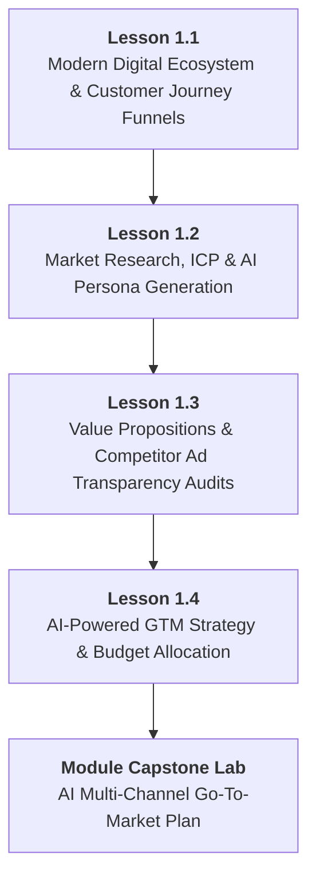

# DMP-MOD-01: Marketing Fundamentals, Consumer Psychology & AI Strategy
## Detailed Teaching Syllabus & Lesson Specifications

**Course ID:** `dm-professional`  
**Course Name:** AI Digital Marketing Professional  
**Module ID:** `DMP-MOD-01`  
**Module Title:** Marketing Fundamentals, Consumer Psychology & AI Strategy  
**Curriculum Version:** 1.0 (October 2026)  
**Parent Plan:** [`docs/course-redesign/digital-marketing/dm-professional-redesign-plan.md`](file:///c:/Users/wasee/Desktop/NovaSkillsProject/NovaSkills%20Website/docs/course-redesign/digital-marketing/dm-professional-redesign-plan.md)  
**Target Learner Profile:** Career Seekers, Junior Marketing Associates, Digital Marketing Executives  
**Total Workload:** 20.0 Hours (10.0h Supervised Instruction + 6.0h Guided Practical Labs & Assignments + 4.0h Comprehensive Capstone Project)  

---

## 1. Module Overview & Pedagogical Architecture

### 1.1 Module Objective
The objective of **DMP-MOD-01** is to establish an industry-grade foundation in marketing strategy, behavioral consumer psychology, and modern AI-augmented strategic planning. Unlike introductory programs that merely describe marketing vocabulary, this module equips learners to conduct rigorous customer research, reverse-engineer competitor campaigns across major ad transparency platforms, synthesize data-driven buyer persona dossiers using AI prompts, and formulate client-ready digital go-to-market strategies with realistic budget allocations.

### 1.2 Pedagogical Workload Breakdown (20.0 Total Hours)

```
┌────────────────────────────────────────────────────────────────────────┐
│                   DMP-MOD-01 TOTAL WORKLOAD: 20 HOURS                  │
├────────────────────────────┬────────────────────────────┬──────────────┤
│ Supervised Contact Time    │ Independent Practice Time  │ Capstone Lab │
│ 10.0 Hours Total           │ 6.0 Hours Total            │ 4.0 Hours    │
├────────────────────────────┼────────────────────────────┼──────────────┤
│ • Supervised Lecture: 5.0h │ • Independent Homework:    │ • Module 01  │
│ • Guided Lab: 5.0h         │   4.0h (4 x 1.0h)          │   Go-To-     │
│   (4 Lessons x 2.5h each)  │ • Formative Quizzes: 2.0h  │   Market Plan│
└────────────────────────────┴────────────────────────────┴──────────────┘
```

- **Lesson 1.1:** The Modern Digital Ecosystem & Customer Journey Architecture (2.5h Supervised Contact + 1.0h Independent Practice)
- **Lesson 1.2:** Market Research, Ideal Customer Profiles (ICP) & AI Persona Generation (2.5h Supervised Contact + 1.0h Independent Practice)
- **Lesson 1.3:** Value Proposition Design, Messaging Frameworks & Competitor Ad Audits (2.5h Supervised Contact + 1.0h Independent Practice)
- **Lesson 1.4:** AI-Powered Digital Go-To-Market (GTM) Strategy & Channel Budgeting (2.5h Supervised Contact + 1.0h Independent Practice)
- **Comprehensive Module Capstone:** Multi-Channel Strategic Marketing Dossier (4.0h Supervised Defense & Guided Lab)

---

## 2. Lesson-by-Lesson Syllabus Specifications



---

### Lesson 1.1: The Modern Digital Ecosystem & Customer Journey Architecture

#### 1. Lesson Identification
- **Lesson Number:** `DMP-1.1`
- **Lesson Title:** The Modern Digital Ecosystem & Customer Journey Architecture
- **Time Allocation:** Theory: 1.25 Hours | Supervised Lab: 1.25 Hours | Homework: 1.0 Hour

#### 2. Main Topics & Detailed Numbered Subtopics
- **1.1.1 The Evolution of Marketing Channels:**
  - Shift from broadcast advertising to bidirectional, interactive digital ecosystems.
  - Channel classification: Owned media (websites, email databases), Paid media (Google Search, Meta Ads, YouTube), Earned/Shared media (SEO rankings, organic shares, brand mentions).
- **1.1.2 High-Intent Search vs. Discovery-Based Paid Social:**
  - Pull marketing mechanics: Capturing existing demand on search engines (Google Ads, Bing, Local SEO).
  - Push marketing mechanics: Generating new demand and interest via algorithmic feed distribution (Instagram, Facebook, TikTok).
- **1.1.3 The Non-Linear Full-Funnel Architecture:**
  - Top-of-Funnel (TOFU / Awareness): Problem-aware discovery, educational content, symptom identification.
  - Middle-of-Funnel (MOFU / Consideration): Solution-aware comparison, feature teardowns, webinars, case studies.
  - Bottom-of-Funnel (BOFU / Conversion): Provider-aware decision making, demos, free trials, pricing calculators, risk reversal.
  - Post-Purchase Retention: Onboarding email sequences, customer success touchpoints, referral loops, repeat purchase triggers.
- **1.1.4 Touchpoint Friction Analysis & Multi-Touch Attribution Mental Models:**
  - Identifying digital leaks: Page latency, unclear value propositions, lack of contact channels, mobile checkout hurdles.
  - First-touch vs. Last-touch vs. Data-driven attribution models: Understanding how different channels contribute across the customer lifecycle.

#### 3. Teaching Explanations & Real Business Examples
- *Teaching Explanation:* Modern digital consumers rarely buy on first click. A buyer journey typically involves 6 to 12 distinct interactions across search, social, review sites, and direct messaging. Marketers who evaluate each channel in isolation make disastrous budget decisions.
- *Real Business Example:* **NexHealth Telehealth Platform**. A patient experiencing chronic back pain searches `"ergonomic lower back pain causes"` (TOFU: Search Engine). Two days later, an Instagram video from NexHealth illustrates 3 desk exercises and introduces their virtual physiotherapy service (MOFU: Paid Social). The patient reads clinic reviews on Google Maps (Consideration), and finally searches `"NexHealth consult booking discount"` on Google Search before scheduling an appointment (BOFU: Paid Search).

#### 4. Software & Relevant Features
- **Miro / Whimsical / Google Drawings:** Diagramming non-linear customer journey funnels and touchpoint maps.
- **Google Chrome DevTools (Network / Lighthouse Tab):** Inspecting live page load performance and identifying mobile conversion friction.

#### 5. Trainer Demonstration (45 Minutes)
1. Display the end-to-end customer journey map for an online B2B SaaS platform (*CloudBooks Accounting*).
2. Walk through each funnel stage: TOFU blog post, MOFU downloadable payroll compliance spreadsheet, BOFU 14-day free trial sign-up, and automated onboarding email.
3. Open Google Chrome DevTools on a live demo landing page and evaluate user friction: uncompressed imagery, missing call-to-action above the fold, and absent privacy reassurance on the lead form.

#### 6. Student Practical Exercise (45 Minutes)
- **Title:** *Multi-Touchpoint Customer Journey Mapping Lab*
- **Task:** Students are provided with a case scenario: *SwiftMove Electric Scooters (D2C Mobility Brand)*.
- **Requirements:**
  1. Map out a 4-stage funnel (Awareness, Consideration, Decision, Retention).
  2. Assign 2 distinct digital touchpoints per stage with exact channel designations (Paid Search, Organic Instagram, Email, WhatsApp).
  3. Identify 3 specific friction points where potential buyers could abandon the purchase and propose concrete optimizations for each.
- **Trainer Guidance:** Ensure students do not treat social media as an immediate conversion engine for high-ticket items without consideration touchpoints.

#### 7. Assignment (1.0 Hour)
- Select an existing regional e-commerce store or local service business. Produce a documented 2-page *Customer Journey & Friction Audit* mapping their existing touchpoints and recommending 3 structural conversion optimizations.

#### 8. Expected Learning Outcomes
- Distinguish between push and pull demand mechanics.
- Architect comprehensive full-funnel journeys across TOFU, MOFU, and BOFU stages.
- Pinpoint UX friction and conversion drop-off points on digital assets.

#### 9. Assessment Criteria
- Rigorous alignment between funnel stages and selected marketing channels.
- Practicality and feasibility of identified conversion friction solutions.

---

### Lesson 1.2: Market Research, Ideal Customer Profiles (ICP) & AI Persona Generation

#### 1. Lesson Identification
- **Lesson Number:** `DMP-1.2`
- **Lesson Title:** Market Research, Ideal Customer Profiles (ICP) & AI Persona Generation
- **Time Allocation:** Theory: 1.25 Hours | Supervised Lab: 1.25 Hours | Homework: 1.0 Hour

#### 2. Main Topics & Detailed Numbered Subtopics
- **2.1.1 B2B Ideal Customer Profiles (ICP) vs. B2C Audience Segmentation:**
  - B2B parameters: Firmographics, company size, revenue tier, technology stack, decision-maker hierarchy (Economic Buyer vs. End User).
  - B2C parameters: Demographics, psychographics, lifestyle values, purchasing power, behavioral triggers.
- **2.2.2 Qualitative & Quantitative Customer Research Workflows:**
  - Mining customer reviews (Amazon, Trustpilot, G2, Google Maps) to identify exact customer verbatim language and complaints.
  - Social listening techniques: Reddit communities (`r/smallbusiness`, `r/skincareaddiction`), Quora, and YouTube comment sections.
- **2.2.3 Prompt Engineering for Deep Persona Dossiers:**
  - Role-prompting frameworks (Act as an expert consumer psychologist and senior market researcher).
  - Structured prompt syntax: Target industry, demographic parameters, emotional triggers, primary fears, status aspirations, and purchasing blockers.
  - Multi-turn prompting: Refining generic persona outputs into deeply nuanced customer profiles.
- **2.2.4 Empathy Mapping & Jobs-to-be-Done (JTBD) Framework:**
  - What does the customer *Think & Feel*, *Hear*, *See*, and *Say & Do*?
  - Functional jobs, emotional jobs, and social jobs: Why customers do not buy a mattress; they buy a good night's sleep and workplace alertness.

#### 3. Teaching Explanations & Real Business Examples
- *Teaching Explanation:* Generic personas like *"Marketing Mary, Age 32, likes coffee"* are completely useless for digital campaign targeting. A professional persona must define exact trigger events, emotional anxieties, financial thresholds, and objections that ad copy must dismantle.
- *Real Business Example:* **FreshBite Meal Prep Delivery**. Rather than targeting *"busy professionals"*, customer review mining on Trustpilot reveals their real ICP: *"Working parents with children under 7 who feel acute guilt about feeding their kids processed takeout meals when arriving home exhausted at 7:30 PM."* This emotional insight drives ad hooks centered on parent relief and healthy family dinner in 5 minutes.

#### 4. Software & Relevant Features
- **ChatGPT / Claude (Free Tier):** Multi-stage prompting frameworks for persona extraction and synthetic interviews.
- **Google Trends:** Validating geographic demand, interest seasonality, and rising search queries.
- **AnswerThePublic / AlsoAsked (Free Searches):** Discovering raw questions asked by consumers around specific category keywords.

#### 5. Trainer Demonstration (45 Minutes)
1. Navigate to Reddit and Amazon reviews for an ergonomic office chair brand. Extract 5 verbatim quotes reflecting user pain points.
2. Formulate a multi-variable persona prompt in ChatGPT incorporating the extracted verbatim quotes.
3. Review the generated persona dossier live, demonstrating how to prompt the model to stress-test objections: *"What are the 3 biggest reasons this persona will abandon the checkout page?"*

#### 6. Student Practical Exercise (45 Minutes)
- **Title:** *AI-Augmented Customer Persona Dossier Build*
- **Task:** Build an actionable buyer persona for *FitPulse: Premium Smart Home Gym Equipment*.
- **Requirements:**
  1. Perform desk research to identify 3 emotional drivers and 3 functional barriers for home fitness buyers.
  2. Execute a structured AI prompt generating a comprehensive persona dossier including: Demographics, Professional Background, Core Aspirations, Nighttime Worries, Channel Consumption Habits, and Objections to Buying.
  3. Formulate 3 distinct marketing angles directly addressing their primary objections.
- **Trainer Guidance:** Check that student prompts avoid superficial questions; ensure students instruct the AI to adopt a critical, analytical persona rather than an agreeable one.

#### 7. Assignment (1.0 Hour)
- Select a B2B business (e.g., Commercial Waste Management, Corporate Catering, or Accounting Software). Produce a 2-page *B2B Ideal Customer Profile & Decision-Maker Dossier* outlining the Economic Buyer vs. Technical User dynamics using AI research workflows.

#### 8. Expected Learning Outcomes
- Execute customer review mining and social listening techniques.
- Engineer advanced AI prompts that produce nuanced, actionable customer personas.
- Formulate Jobs-to-be-Done (JTBD) statements connecting customer pain to product solutions.

#### 9. Assessment Criteria
- Depth of psychological insight in persona dossiers (avoidance of generic demographic tropes).
- Direct alignment between identified customer objections and proposed marketing angles.

---

### Lesson 1.3: Value Proposition Design, Messaging Frameworks & Competitor Ad Audits

#### 1. Lesson Identification
- **Lesson Number:** `DMP-1.3`
- **Lesson Title:** Value Proposition Design, Messaging Frameworks & Competitor Ad Audits
- **Time Allocation:** Theory: 1.25 Hours | Supervised Lab: 1.25 Hours | Homework: 1.0 Hour

#### 2. Main Topics & Detailed Numbered Subtopics
- **3.1.1 Value Proposition Architecture & Strategy Canvas:**
  - The Value Proposition Canvas (Strategyzer model): Customer profile (Gains, Pains, Customer Jobs) vs. Value map (Products/Services, Pain Relievers, Gain Creators).
  - Crafting a differentiated Unique Selling Proposition (USP): Formula = *We help [Target Audience] achieve [Specific Transformation] without [Primary Pain Point/Sacrifice].*
- **3.2.2 Direct-Response Copywriting Frameworks:**
  - AIDA (Attention, Interest, Desire, Action) for high-converting landing pages and video scripts.
  - PAS (Problem, Agitation, Solution) for pain-centric ad creatives and social carousels.
  - BAB (Before, After, Bridge) for case studies and transformation testimonials.
- **3.3.3 Competitor Ad Intelligence using Native Ad Transparency Tools:**
  - **Meta Ad Library:** Searching active competitor campaigns, filtering by country and platform (Facebook, Instagram, Messenger), analyzing ad creative formats (video vs. static), identifying live duration (longevity = profitability signal).
  - **Google Ads Transparency Center:** Inspecting competitors' active Search, Display, and YouTube video ads; evaluating headline variations and landing page destinations.
- **3.4.4 Competitor Messaging & Creative Angle Matrix:**
  - Deconstructing competitor ad hooks: Price-led vs. Feature-led vs. Social-proof-led vs. Fear/Urgency-led.
  - Identifying competitive white space: What promises or pain points are all competitors ignoring?

#### 3. Teaching Explanations & Real Business Examples
- *Teaching Explanation:* A business without a clear value proposition is forced to compete solely on price. Competitor research in modern digital marketing is completely transparent—Meta and Google legally mandate public ad repositories. Marketers who audit competitor ad libraries can identify what messaging angles are working before spending a single dollar of client budget.
- *Real Business Example:* **Zoho Books vs. QuickBooks**. In the Indian SME market, QuickBooks emphasized enterprise features and global compliance. Zoho Books analyzed competitor ad libraries, spotted high churn around subscription costs and localized tax compliance, and launched targeted search and social campaigns with the value proposition: *"GST-compliant cloud accounting starting at ₹749/month with zero hidden setup fees."*

#### 4. Software & Relevant Features
- **Meta Ad Library (Public Web Tool):** Live competitor ad search, active ad status, creative format analysis, ad copy review.
- **Google Ads Transparency Center (Public Web Tool):** Real-time search and display ad verification for verified advertisers.
- **Google Docs / Notion:** Structuring competitor messaging audit matrices.

#### 5. Trainer Demonstration (45 Minutes)
1. Open the Meta Ad Library and search for top online mattress brands (*Wakefit, SleepyCat*).
2. Filter by active status and demonstrate how to identify ads that have been running continuously for over 90 days (indicating profitable performance).
3. Deconstruct 3 distinct ad creatives into PAS (Problem, Agitation, Solution) components.
4. Open the Google Ads Transparency Center and inspect the corresponding Google Search ad copy for the same brands.

#### 6. Student Practical Exercise (45 Minutes)
- **Title:** *Live Competitor Ad Transparency & Messaging Audit*
- **Task:** Perform an ad intelligence teardown on 2 direct competitors in a chosen vertical (e.g., EdTech, Online Apparel, or Co-working Spaces).
- **Requirements:**
  1. Locate 3 active ads per competitor in Meta Ad Library and 2 search ads in Google Ads Transparency Center.
  2. Document ad creatives, headlines, primary copy hooks, and target landing page URLs in a structured matrix.
  3. Classify their messaging angles (Fear, Social Proof, Discount, Feature).
  4. Formulate an improved USP and 2 distinct ad angles that exploit gaps left by these competitors.
- **Trainer Guidance:** Direct students to focus on *why* the ad works rather than merely copying the text; verify that student USPs avoid generic claims like "best quality and lowest price."

#### 7. Assignment (1.0 Hour)
- Produce a completed *Competitor Ad Intelligence & Messaging Teardown Report* analyzing 3 competing brands in a local or regional industry. Document 6 screenshot examples with breakdown analysis.

#### 8. Expected Learning Outcomes
- Master navigation of Meta Ad Library and Google Ads Transparency Center.
- Deconstruct ad copy using professional copywriting frameworks (AIDA, PAS).
- Formulate clear, defensible Unique Selling Propositions that avoid price commoditization.

#### 9. Assessment Criteria
- Thoroughness of competitor ad collection across Meta and Google repositories.
- Analytical clarity in categorizing creative hooks and identifying market white space.

---

### Lesson 1.4: AI-Powered Digital Go-To-Market (GTM) Strategy & Channel Budgeting

#### 1. Lesson Identification
- **Lesson Number:** `DMP-1.4`
- **Lesson Title:** AI-Powered Digital Go-To-Market (GTM) Strategy & Channel Budgeting
- **Time Allocation:** Theory: 1.25 Hours | Supervised Lab: 1.25 Hours | Homework: 1.0 Hour

#### 2. Main Topics & Detailed Numbered Subtopics
- **4.1.1 Digital Go-To-Market (GTM) Strategic Framework:**
  - Defining the marketing objective: User acquisition, B2B lead generation, e-commerce transactions, or local foot traffic.
  - Market timing, primary distribution channel selection, and launch staging (Phase 1: Proof of concept, Phase 2: Systematic scaling).
- **4.2.2 Channel Selection Matrix & Unit Economics:**
  - Channel fit evaluation: Search Intent (Google Ads / SEO) vs. Social Discovery (Meta / LinkedIn) vs. Direct Outreach (Email / WhatsApp).
  - Baseline acquisition metrics: Cost Per Click (CPC), Cost Per Lead (CPL), Customer Acquisition Cost (CAC), and Average Order Value (AOV).
- **4.3.3 Budget Allocation & Pacing Models:**
  - The 70/20/10 Budgeting Rule in Digital Marketing: 70% to proven core channels, 20% to emerging opportunities, 10% to experimental innovation.
  - Allocating paid media vs. content production vs. software tool costs.
  - Daily budget pacing calculations and avoiding sudden ad spend burnout.
- **4.4.4 AI-Augmented Strategy Synthesis & Documentation:**
  - Utilizing AI to synthesize customer research, competitor audits, and channel plans into a coherent executive strategy document.
  - Verification protocols: Auditing AI outputs for hallucinated benchmark metrics and ensuring compliance with realistic market costs.

#### 3. Teaching Explanations & Real Business Examples
- *Teaching Explanation:* A digital marketing strategy is not a wishlist; it is a prioritized allocation of scarce capital and time. Recommending every marketing channel to a client is the mark of an amateur. Professional marketers select 1 or 2 primary acquisition channels that match the business model and budget, proving profitability before diversifying.
- *Real Business Example:* **Artisan Wooden Furniture Brand (₹50,000 monthly marketing budget)**. Allocating budget across 6 different channels (SEO, Meta Ads, Google Ads, Influencers, Pinterest, Email) dilutes capital to ₹8,000 per channel, yielding insufficient data to optimize anything. A professional GTM strategy allocates ₹35,000 to Meta Ads (visual catalog & lead forms for custom design consultations), ₹10,000 to high-intent Google Search ads, and ₹5,000 to email nurture workflows, establishing a clear lead pipeline.

#### 4. Software & Relevant Features
- **Google Sheets:** Building financial marketing budget allocation sheets and acquisition pacing models.
- **ChatGPT / Claude:** Synthesizing multi-page strategic go-to-market plan drafts from structured prompt inputs.

#### 5. Trainer Demonstration (45 Minutes)
1. Open a blank marketing budget model in Google Sheets for a company with a ₹100,000 monthly spend.
2. Build dynamic formulas calculating estimated clicks, leads, and customer acquisitions based on realistic industry CPC and conversion rate benchmarks.
3. Prompt ChatGPT to draft an executive summary of the GTM strategy, demonstrating how to review and refine the output to match professional agency standards.

#### 6. Student Practical Exercise (45 Minutes)
- **Title:** *GTM Strategy Formulation & Budget Allocation Model*
- **Task:** Develop a 3-month Go-To-Market roadmap and budget allocation for *Apex Cloud Solutions (B2B IT Support Provider)* with a ₹60,000 monthly budget.
- **Requirements:**
  1. Select primary and secondary marketing channels with written strategic justifications.
  2. Build a monthly budget pacing sheet in Google Sheets dividing funds across paid search, social discovery, and content assets.
  3. Calculate projected traffic, lead volume, and CPL using industry benchmark ranges provided by the trainer.
  4. Write a 1-page executive summary outlining launch milestones across Months 1, 2, and 3.
- **Trainer Guidance:** Intervene if students allocate budget to high-cost enterprise channels without calculating whether the monthly budget can support sufficient click volume to achieve statistical significance.

#### 7. Assignment (1.0 Hour)
- Complete the full financial budget workbook and write the 2-page *Channel Strategy Brief* for their selected course capstone business scenario.

#### 8. Expected Learning Outcomes
- Architect phased digital Go-To-Market strategies.
- Build dynamic budget allocation models in Google Sheets.
- Justify channel selection based on business model unit economics and customer intent.

#### 9. Assessment Criteria
- Mathematical accuracy and financial realism of budget models.
- Strategic coherence between target customer persona and chosen acquisition channels.

---

## 3. Comprehensive Module 01 Capstone Project

### Project Title
**The Complete Multi-Channel Go-To-Market (GTM) Strategy Dossier**

### Project Scenario
Students are assigned (or select) a commercial enterprise from one of three approved verticals:
1. **Vertical A (B2C E-Commerce):** *PureBotanics Organic Skincare*
2. **Vertical B (B2B Lead Generation):** *TalentForge Executive Recruitment Agency*
3. **Vertical C (Local / Regional Service):** *Starlight Boutique Dental Care*

### Required Project Deliverables (Dossier Sections)
1. **Executive Summary & Business Model Canvas:** Core value proposition, target market tier, pricing model.
2. **Customer Research & ICP Persona Dossier:** Minimum 2 detailed buyer personas with verbatim review evidence, emotional pain triggers, and objection analysis.
3. **Competitor Ad Intelligence Matrix:** Screenshots and analytical breakdown of 4 active competitor ads from Meta Ad Library and Google Ads Transparency Center.
4. **Full-Funnel Journey Architecture:** Documented touchpoint map from initial awareness to post-purchase referral, including friction mitigation strategies.
5. **Channel Selection & Budget Model:** 3-month budget spreadsheet allocating monthly marketing capital with projected reach, traffic, lead volume, and CPL metrics.

### Lab Time Allocation
- **4.0 Hours Supervised Capstone Session:** 2.5 hours guided assembly and asset formatting + 1.5 hours student peer review and trainer defense.

---

## 4. Module 01 Assessment & Grading Rubric (100 Points)

| Assessment Dimension | Maximum Points | Excellent (90–100%) | Proficient (70–89%) | Needs Improvement (<70%) |
| :--- | :---: | :--- | :--- | :--- |
| **1. Customer & Persona Depth** | 25 | Personas are psychologically rich, backed by customer verbatim quotes and concrete objections. | Personas are accurate and complete but lean somewhat on standard demographic traits. | Generic, superficial personas lacking psychological or behavioural depth. |
| **2. Competitor Ad Teardown** | 20 | Ad intelligence includes live screenshots, hook deconstruction (AIDA/PAS), and clear white space identification. | Competitors audited accurately; hooks categorized but white space analysis is thin. | Incomplete competitor data; lacks analytical insight into messaging mechanics. |
| **3. Funnel & Channel Architecture** | 25 | Non-linear funnel accurately connects touchpoints across push/pull channels with concrete friction fixes. | Clear funnel structure with reasonable channel choices; minor friction gaps. | Confused channel roles (e.g., expecting immediate BOFU conversions from cold social). |
| **4. Budget Realism & Modeling** | 20 | Mathematically sound spreadsheet model reflecting realistic CPC, CPL, and channel allocation logic. | Accurate formulas; minor discrepancies in benchmark cost realism. | Unrealistic projections or broken spreadsheet formulas. |
| **5. Professional Documentation** | 10 | Executive-ready presentation, clean formatting, zero spelling errors, professional visual hierarchy. | Well-organized document with minor formatting inconsistencies. | Disorganized, incomplete, or poorly formatted submission. |

---

## 5. Trainer & Student Completion Checklist

### Student Verification Checklist
- [ ] Mapped a multi-stage customer journey with defined touchpoints across search, social, and email.
- [ ] Mined real customer reviews and generated an AI-augmented buyer persona with concrete objections.
- [ ] Audited live competitor ad campaigns using Meta Ad Library and Google Ads Transparency Center.
- [ ] Formulated an original Unique Selling Proposition using proven copywriting frameworks (PAS/AIDA).
- [ ] Built a dynamic monthly digital marketing budget spreadsheet in Google Sheets.
- [ ] Submitted the completed 5-part Multi-Channel GTM Strategy Dossier.

### Trainer Delivery Checklist
- [ ] Demonstrated live navigation of Meta Ad Library and Google Ads Transparency Center.
- [ ] Verified that all student persona prompts included emotional pain triggers and objection modeling.
- [ ] Validated student budget spreadsheets for realistic CPC and conversion rate assumptions.
- [ ] Graded the Module 01 Capstone Dossier against the 100-point rubric and provided written feedback.
