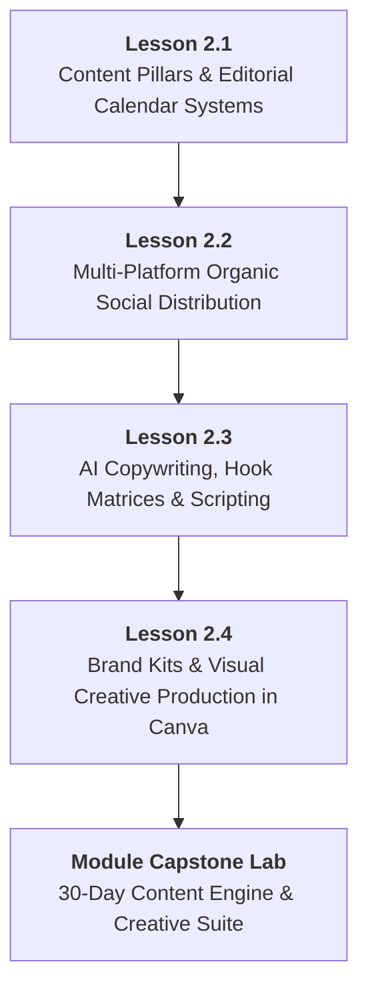

# DMP-MOD-02: Content Marketing, Social Strategy & AI Creative Production
## Detailed Teaching Syllabus & Lesson Specifications

**Course ID:** `dm-professional`  
**Course Name:** AI Digital Marketing Professional  
**Module ID:** `DMP-MOD-02`  
**Module Title:** Content Marketing, Social Strategy & AI Creative Production  
**Curriculum Version:** 1.0 (October 2026)  
**Parent Plan:** [`docs/course-redesign/digital-marketing/dm-professional-redesign-plan.md`](file:///c:/Users/wasee/Desktop/NovaSkillsProject/NovaSkills%20Website/docs/course-redesign/digital-marketing/dm-professional-redesign-plan.md)  
**Target Learner Profile:** Career Seekers, Junior Marketing Associates, Digital Marketing Executives  
**Total Workload:** 20.0 Hours (10.0h Supervised Instruction + 6.0h Guided Practical Labs & Assignments + 4.0h Comprehensive Capstone Project)  

---

## 1. Module Overview & Pedagogical Architecture

### 1.1 Module Objective
The objective of **DMP-MOD-02** is to transform learners from passive content creators into systematic content strategists and creative directors. Rather than teaching random social posting or generic graphic design, this module delivers professional mastery over:
1. Building sustainable, multi-tier editorial systems and content pillars.
2. Formulating platform-specific distribution strategies across LinkedIn, Instagram, and YouTube.
3. Deploying advanced prompt engineering for direct-response copywriting, hook variations, and script generation.
4. Designing production-grade social and ad creative suites in Canva adhering to strict brand kit guidelines.
5. Managing multi-format creative production schedules and performance iteration workflows.

### 1.2 Pedagogical Workload Breakdown (20.0 Total Hours)

```
┌────────────────────────────────────────────────────────────────────────┐
│                   DMP-MOD-02 TOTAL WORKLOAD: 20 HOURS                  │
├────────────────────────────┬────────────────────────────┬──────────────┤
│ Supervised Contact Time    │ Independent Practice Time  │ Capstone Lab │
│ 10.0 Hours Total           │ 6.0 Hours Total            │ 4.0 Hours    │
├────────────────────────────┼────────────────────────────┼──────────────┤
│ • Supervised Lecture: 5.0h │ • Independent Homework:    │ • Module 02  │
│ • Guided Lab: 5.0h         │   4.0h (4 x 1.0h)          │   Creative   │
│   (4 Lessons x 2.5h each)  │ • Formative Quizzes: 2.0h  │   Production │
└────────────────────────────┴────────────────────────────┴──────────────┘
```

- **Lesson 2.1:** Content Strategy, Content Pillars & Editorial Calendar Systems (2.5h Supervised Contact + 1.0h Independent Practice)
- **Lesson 2.2:** Multi-Platform Organic Social Strategy (LinkedIn, Instagram & YouTube) (2.5h Supervised Contact + 1.0h Independent Practice)
- **Lesson 2.3:** AI-Augmented Copywriting, Hook Matrices & Direct-Response Scripts (2.5h Supervised Contact + 1.0h Independent Practice)
- **Lesson 2.4:** High-Converting Visual Creative Production & Brand Kits in Canva (2.5h Supervised Contact + 1.0h Independent Practice)
- **Comprehensive Module Capstone:** 30-Day Multi-Platform Content Engine & Brand Creative Suite (4.0h Supervised Lab & Portfolio Assembly)

---

## 2. Lesson-by-Lesson Syllabus Specifications



---

### Lesson 2.1: Content Strategy, Content Pillars & Editorial Calendar Systems

#### 1. Lesson Identification
- **Lesson Number:** `DMP-2.1`
- **Lesson Title:** Content Strategy, Content Pillars & Editorial Calendar Systems
- **Time Allocation:** Theory: 1.25 Hours | Supervised Lab: 1.25 Hours | Homework: 1.0 Hour

#### 2. Main Topics & Detailed Numbered Subtopics
- **2.1.1 The Role of Content in the Modern Buying Cycle:**
  - Building authority and trust before the pitch; moving prospects from unconscious indifference to active product desire.
  - The Content Pyramid model: High-effort anchor content (Whitepapers, Podcasts, Masterclasses) cascaded into mid-effort assets (Articles, Newsletters) and micro-content (Carousels, Reels, Tweets/Threads).
- **2.1.2 Defining Strategic Content Pillars (The 4 E's Framework):**
  - **Educate:** How-to guides, teardowns, industry benchmarks, common misconceptions.
  - **Entertain / Engage:** Relatable industry humor, behind-the-scenes culture, controversial takes.
  - **Empathize / Inspire:** Founder transformation stories, client struggle-to-success narratives.
  - **Execute / Promote:** Case studies, product walk-throughs, testimonials, clear commercial offers.
- **2.1.3 Content Repurposing Engine (1-to-10 Workflow):**
  - Turning one customer case study into: 1 LinkedIn thought leadership article, 3 Instagram carousel slides, 2 short-form video scripts, 1 newsletter highlight, and 2 quote graphics.
- **2.1.4 Professional Editorial Calendar Architecture:**
  - Structuring an agency-grade master content calendar in Google Sheets or Notion.
  - Essential tracking fields: Publish Date, Platform, Content Pillar, Funnel Stage (TOFU/MOFU/BOFU), Hook Headline, Creative Asset Link, Copy Draft, Status (Idea, Drafted, Approved, Scheduled, Published), and Performance URL.

#### 3. Teaching Explanations & Real Business Examples
- *Teaching Explanation:* Most businesses fail at content marketing not because their writing is bad, but because their operational cadence breaks down. Without a structured content calendar and predefined pillars, content teams face daily blank-page syndrome, resulting in sporadic, inconsistent posting that fails to build algorithmic or audience momentum.
- *Real Business Example:* **GlowSkin Dermatology Clinic**. Instead of posting random product photos, the clinic establishes 3 strict content pillars: *Mythbusting Tuesdays* (Educate: "Why Coconut Oil Clogs Acne-Prone Skin"), *Before-and-After Thursdays* (Empathize & Promote: Real patient chemical peel results), and *Dermatologist Q&A Saturdays* (Engage: Video responses to common skin concerns). Result: Consistent 4x follower growth and a 30% increase in weekly consultation bookings.

#### 4. Software & Relevant Features
- **Google Sheets / Notion:** Building collaborative editorial content calendars with automated conditional formatting and status pipelines.
- **Trello / Asana (Free Tier):** Managing visual content workflow stages (Backlog ➔ In Progress ➔ Client Review ➔ Scheduled).

#### 5. Trainer Demonstration (45 Minutes)
1. Display a chaotic, disorganized content folder from a struggling brand, highlighting inconsistent posting dates and lack of thematic focus.
2. Open a pre-built agency editorial master template in Google Sheets.
3. Walk through the setup of data validation dropdowns for Content Pillars, Funnel Stages, and Status flags.
4. Demonstrate how to take a single 500-word blog article and map out 5 distinct micro-content assets directly into the editorial calendar schedule.

#### 6. Student Practical Exercise (45 Minutes)
- **Title:** *Editorial Calendar & Content Repurposing Setup*
- **Task:** Build a structured 14-day master editorial calendar in Google Sheets for *UrbanZen Co-working Spaces*.
- **Requirements:**
  1. Define 4 specific content pillars customized for remote professionals and startup founders.
  2. Populate 14 consecutive days of scheduled content entries across LinkedIn and Instagram.
  3. Ensure a balanced funnel distribution: 50% TOFU (Educational/Entertaining), 30% MOFU (Community/Behind-the-scenes), and 20% BOFU (Tour bookings/Desk discounts).
  4. Fill out all tracking metadata: Pillar, Hook, Format, Copy snippet, and Status.
- **Trainer Guidance:** Check that students do not schedule promotional offers on every single day; enforce the 80/20 value-to-promotion ratio.

#### 7. Assignment (1.0 Hour)
- Expand the 14-day calendar into a complete **30-Day Master Editorial Strategy Calendar** for their course capstone business scenario, fully documented in Google Sheets.

#### 8. Expected Learning Outcomes
- Establish structured content pillars for any B2B or B2C business model.
- Execute a 1-to-10 content repurposing workflow.
- Build collaborative, scalable editorial calendar systems in Google Sheets.

#### 9. Assessment Criteria
- Rigorous adherence to balanced content pillar ratios.
- Completeness and operational clarity of editorial tracking metadata.

---

### Lesson 2.2: Multi-Platform Organic Social Strategy (LinkedIn, Instagram & YouTube)

#### 1. Lesson Identification
- **Lesson Number:** `DMP-2.2`
- **Lesson Title:** Multi-Platform Organic Social Strategy (LinkedIn, Instagram & YouTube)
- **Time Allocation:** Theory: 1.25 Hours | Supervised Lab: 1.25 Hours | Homework: 1.0 Hour

#### 2. Main Topics & Detailed Numbered Subtopics
- **2.2.1 Algorithmic Distribution Mechanics Across Modern Platforms:**
  - How social algorithms prioritize watch time, scroll-stopping duration, saves, shares, and comment velocity over mere likes.
  - The "Golden Hour" of social engagement: Why early comment engagement dictates broad feed distribution.
- **2.2.2 Platform-Specific Native Playbooks:**
  - **LinkedIn for B2B & Career Authority:** Text-only hooks, document carousels (PDF slides), personal vulnerability blended with professional insight, executive ghostwriting rules.
  - **Instagram for Visual Brands & Local Discovery:** High-retention Reels (3-second hook rule), multi-slide educational carousels, Stories for daily engagement, broadcast channels.
  - **YouTube & Short-Form Video (Shorts):** Keyword-rich titles, click-worthy thumbnail design, high retention pacing, search-based discovery vs. feed-based discovery.
- **2.2.3 Carousel Architecture & Slide Psychology:**
  - Slide 1: The Curated Hook (Stating a high-stakes problem or counterintuitive truth).
  - Slide 2: Agitation and contextualization (Why most advice fails).
  - Slides 3–7: Actionable, step-by-step value delivery (Bite-sized, readable chunks).
  - Slide 8: The Summary Recap (Easy to screenshot and save).
  - Slide 9: Clear Call to Action (Save for later, follow, comment a specific keyword).
- **2.2.4 Community Management, Comment Velocity & Direct Message (DM) Funnels:**
  - Transforming comments into conversations: Responding with open-ended questions within 30 minutes of publication.
  - Moving conversations from public comments to private DMs to qualify leads without appearing aggressive.

#### 3. Teaching Explanations & Real Business Examples
- *Teaching Explanation:* Each social platform has its own native language and user mindset. Cross-posting the exact same square image and caption to LinkedIn, Instagram, and Twitter will fail across all three. Professional marketers tailor the format, hook, and tone to match user expectations on each platform.
- *Real Business Example:* **CodeMentor Coding Bootcamp**. When promoting a new Web Development cohort:
  - *On LinkedIn:* A 7-slide PDF carousel written from the founder's perspective: *"How I hired 45 junior developers and why 90% of resumes failed the initial technical screening."* (Generates 450 shares among recruiters and aspiring developers).
  - *On Instagram:* A 15-second Reel showing a split screen of a chaotic desktop vs. clean VS Code terminal with trending audio and caption: *"Day in the life of a junior frontend dev after our 16-week bootcamp."* (Generates 25,000 views and direct inquiries).

#### 4. Software & Relevant Features
- **LinkedIn / Instagram Native Interfaces:** Analyzing profile optimization, bio links, creator analytics, and formatting.
- **Google Sheets:** Designing carousel slide wireframe scripts.

#### 5. Trainer Demonstration (45 Minutes)
1. Screen-share an audit of an optimized vs. un-optimized LinkedIn company page and personal creator profile (Banner, Headline, Featured section, Call to action).
2. Walk through the slide-by-slide structure of an actual high-performing educational carousel that achieved 1,000+ saves on Instagram.
3. Demonstrate live how to write a 3-second short-form video hook using the *Curiosity Gap* and *Pattern Interrupt* techniques.

#### 6. Student Practical Exercise (45 Minutes)
- **Title:** *Multi-Platform Content Adaptation & Carousel Wireframing*
- **Task:** Students take one core insight: *"Why traditional website contact forms lose 70% of potential leads to WhatsApp."*
- **Requirements:**
  1. Write a 150-word native text post for LinkedIn featuring a strong 2-line hook and professional formatting (white space, bullet points).
  2. Create a detailed 8-slide wireframe script for an Instagram carousel (defining the text, visual direction, and CTA for every slide).
  3. Write a 30-second short-form video script (Hook, Body, CTA) suitable for Instagram Reels or YouTube Shorts.
- **Trainer Guidance:** Review student hooks; reject passive openings such as *"In today's digital world..."* and enforce sharp, active hooks such as *"Your website contact form is quietly costing you thousands."*

#### 7. Assignment (1.0 Hour)
- Produce a **Multi-Platform Native Content Suite** containing 2 complete LinkedIn text posts with formatting, 1 complete 8-slide carousel script, and 2 short-form video scripts for their capstone business.

#### 8. Expected Learning Outcomes
- Adapt a single core message into platform-native formats for LinkedIn, Instagram, and YouTube.
- Architect high-retention carousel slide decks that drive saves and shares.
- Write compelling short-form video scripts utilizing pattern interrupts and curiosity hooks.

#### 9. Assessment Criteria
- Native platform fidelity (tone, formatting, line breaks, visual directions).
- Strength of opening hooks and retention mechanics across scripts.

---

### Lesson 2.3: AI-Augmented Copywriting, Hook Matrices & Direct-Response Scripts

#### 1. Lesson Identification
- **Lesson Number:** `DMP-2.3`
- **Lesson Title:** AI-Augmented Copywriting, Hook Matrices & Direct-Response Scripts
- **Time Allocation:** Theory: 1.25 Hours | Supervised Lab: 1.25 Hours | Homework: 1.0 Hour

#### 2. Main Topics & Detailed Numbered Subtopics
- **3.1.1 The Mechanics of Direct-Response Digital Copywriting:**
  - Difference between creative brand copywriting (slogans, brand manifestos) and direct-response copywriting (driving an immediate, measurable action).
  - The anatomy of high-converting copy: The Hook (Stops the scroll), The Lead (Builds curiosity and empathy), The Body (Proves the claim with features/benefits), The Offer (Irresistible value exchange), and The Call to Action (Frictionless instruction).
- **3.2.2 Systematic Hook Angle Matrices:**
  - Developing multi-angle ad hooks for the same product:
    - *Angle 1: Negative Emotion / Fear of Missing Out (FOMO)*
    - *Angle 2: Direct Self-Interest / Transformation*
    - *Angle 3: Social Proof / Case Study Validation*
    - *Angle 4: Counter-Intuitive / Contrarian Stance*
    - *Angle 5: Curiosity / Story Open-Loop*
- **3.3.3 Advanced Prompt Engineering for Copywriters:**
  - Defining brand voice parameters: Formality, tone, enthusiasm, reading grade level (aiming for 6th–8th grade readability).
  - Few-Shot Prompting: Providing the LLM with 2–3 winning copy examples before requesting new variations.
  - Prompt chaining: Step 1 (Brainstorm 20 raw hook ideas) ➔ Step 2 (Select top 3 and expand into PAS ad drafts) ➔ Step 3 (Critique and rewrite for brevity and punchiness).
- **3.4.4 Ad Policy Compliance & Misleading Claims Avoidance:**
  - Meta & Google Advertising Policies: Prohibited content, unrealistic promises ("Get rich in 30 days", "Cure acne overnight"), personal attributes callouts ("Are you struggling with debt?").
  - Editing AI copy to ensure strict policy compliance and brand safety.

#### 3. Teaching Explanations & Real Business Examples
- *Teaching Explanation:* Relying on basic AI prompts like *"Write an ad for my bakery"* produces generic, bland copy that everyone ignores. A professional marketer uses AI as a high-speed brainstorming partner, feeding it specific audience pain points, proven copywriting structures (AIDA/PAS), and negative constraints to generate dozens of targeted angles in minutes.
- *Real Business Example:* **SaaS Productivity App (TaskFlow)**.
  - *Weak Generic Copy:* "Boost your productivity today with TaskFlow. It has amazing task tracking and calendar features."
  - *Direct-Response Hook Matrix Copy:*
    - *Contrarian:* "To-do lists are the #1 reason you feel overwhelmed at work. Here's why."
    - *Direct Transformation:* "How to leave your office at 5:00 PM every day without leaving a single task unfinished."
    - *Social Proof:* "Why 1,400+ remote engineering teams deleted Asana and switched to TaskFlow this year."

#### 4. Software & Relevant Features
- **ChatGPT / Claude (Free Tier):** Executing few-shot and chained copywriting prompts.
- **Hemingway Editor (Web Tool):** Testing copy readability, sentence length, and eliminating passive voice.

#### 5. Trainer Demonstration (45 Minutes)
1. Open ChatGPT and demonstrate a 3-stage prompt chain:
   - *Prompt 1:* Define the target persona, product offer, and tone of voice.
   - *Prompt 2:* Generate a 5-angle hook matrix (Contrarian, Story, Transformation, Social Proof, Urgency).
   - *Prompt 3:* Expand the top 2 hooks into full Facebook feed ad copy using the PAS framework.
2. Copy the resulting text into Hemingway Editor live and demonstrate how to edit down long, convoluted AI sentences to achieve a clean Grade 7 readability score.
3. Review the text against Meta's ad policies to ensure no prohibited trigger words exist.

#### 6. Student Practical Exercise (45 Minutes)
- **Title:** *Direct-Response Ad Copy & Hook Matrix Generation*
- **Task:** Create a multi-angle ad copywriting suite for *KettleCraft: Handcrafted Cast Iron Cookware*.
- **Requirements:**
  1. Build a 5-angle hook matrix using an AI prompt chain (1 Contrarian, 1 Social Proof, 1 Transformation, 1 Pain-Agitation, 1 Curiosity).
  2. Write 2 complete, long-form ad copy drafts using the PAS framework for Facebook/Instagram feeds.
  3. Write 3 short-form ad copy variations (under 50 words) for Instagram Stories.
  4. Test both drafts in Hemingway Editor and refine until readability is Grade 8 or lower.
- **Trainer Guidance:** Watch out for students accepting the first AI output without human editing; enforce active verbs and emotional resonance.

#### 7. Assignment (1.0 Hour)
- Develop a comprehensive **Ad Copywriting Matrix & Script Portfolio** containing 10 diverse hook variations, 3 full feed ad drafts, and 2 video ad voiceover scripts for their capstone business.

#### 8. Expected Learning Outcomes
- Construct 5-angle hook matrices for any product or service.
- Deploy prompt chaining to produce high-converting direct-response copy.
- Edit AI outputs for readability, brand voice, and advertising policy compliance.

#### 9. Assessment Criteria
- Punchiness and scroll-stopping power of hook angles.
- Readability scores (Grade 6–8) and zero ad policy violations.

---

### Lesson 2.4: High-Converting Visual Creative Production & Brand Kits in Canva

#### 1. Lesson Identification
- **Lesson Number:** `DMP-2.4`
- **Lesson Title:** High-Converting Visual Creative Production & Brand Kits in Canva
- **Time Allocation:** Theory: 1.25 Hours | Supervised Lab: 1.25 Hours | Homework: 1.0 Hour

#### 2. Main Topics & Detailed Numbered Subtopics
- **4.1.1 Principles of High-Converting Digital Visual Hierarchy:**
  - The F-Pattern and Z-Pattern eye-scanning behaviors in mobile feeds.
  - Visual contrast: Rule of thirds, focal point isolation, typography hierarchy (Headline > Subhead > Supporting text > CTA button).
  - Mobile-first design constraints: Text legibility on 390px mobile viewports, safe zones for Stories and Reels (avoiding top handle and bottom captions overlay).
- **4.2.2 Building a Production Brand Kit in Canva:**
  - Establishing a consistent brand identity: Primary and secondary color palettes (60-30-10 rule), font pairing (Header font vs. Body font), logo variations (Dark, Light, Icon only).
  - Creating standardized brand templates in Canva to accelerate daily agency workflows.
- **4.3.3 Production Creative Formats & Specifications:**
  - **Feed Square / Portrait (1:1 & 4:5):** Instagram/Facebook main feed standard.
  - **Vertical Full-Screen (9:16):** Instagram Stories, Reels, TikTok, YouTube Shorts.
  - **Horizontal Banner (16:9):** YouTube thumbnails, LinkedIn post banners, Google Display ads.
- **4.4.4 Ad Creative Variations & The 3x3 Creative Matrix:**
  - The 3x3 creative testing model: 3 distinct visual formats (e.g., Product Hero Shot, User-Generated Content / Customer Selfie, Infographic / Benefit Comparison) paired with 3 distinct copy hooks to produce 9 testable ad assets.
  - Designing visual social carousels with seamless slide-to-slide continuity.

#### 3. Teaching Explanations & Real Business Examples
- *Teaching Explanation:* In paid social advertising, the visual creative accounts for over 70% of campaign performance variation. You can have the best audience targeting in the world, but if your creative looks like clip art or is impossible to read on a phone screen, users will scroll right past it. Marketers must know how to produce polished, high-contrast creative assets rapidly without waiting on a design agency.
- *Real Business Example:* **BeanCraft Artisanal Coffee Roasters**. Running ads with a plain photo of a coffee bag generated a 0.8% CTR. When redesigned in Canva into a high-contrast 3-part comparison graphic (*"Supermarket Coffee: Roasted 6 months ago, stale beans" vs. "BeanCraft: Roasted 48 hours ago, freshly sealed valve pack"* with clean arrows and an orange CTA badge), the CTR jumped to 3.4% and CPA dropped by 55%.

#### 4. Software & Relevant Features
- **Canva (Free / Education / Pro Trial):** Brand Kit setup, custom canvas dimensions (1080x1080, 1080x1350, 1080x1920), typography hierarchy, layer management, framing elements, Magic Studio tools.
- **Coolors.co (Web Tool):** Generating accessible, high-contrast hex color palettes.

#### 5. Trainer Demonstration (45 Minutes)
1. Open Canva and build a Brand Kit from scratch: select a 3-color palette (Primary Navy, Accent Gold, Neutral White) and assign typography (Montserrat Bold for Headers, Inter Regular for Body).
2. Set up a 1080x1350 (4:5 Portrait) canvas.
3. Design a professional direct-response ad creative: insert an eye-catching product image, apply drop shadow, overlay a high-contrast headline box, add 3 bulleted benefit badges with checkmarks, and anchor a clear "Order Today" visual button.
4. Demonstrate how to resize and reposition elements into a 9:16 vertical format (Stories/Reels) while respecting UI safe zones.

#### 6. Student Practical Exercise (45 Minutes)
- **Title:** *Multi-Format Brand Asset & Ad Creative Suite Build*
- **Task:** Create a branded social and ad creative package in Canva for *AuraClean: Eco-Friendly Home Cleaning Products*.
- **Requirements:**
  1. Define a brand palette (3 hex colors) and 2 paired fonts in Canva.
  2. Design 1 Feed Graphic (1080x1080) showcasing a benefit comparison or customer review.
  3. Design 1 Vertical Story Graphic (1080x1920) featuring a limited-time offer with clear mobile safe-zone spacing.
  4. Design 1 Educational 5-Slide Carousel demonstrating "3 Toxic Chemicals Hiding in Your Cleaning Cabinet" with seamless slide design.
  5. Export all assets as high-resolution PNGs.
- **Trainer Guidance:** Check text contrast against backgrounds; penalize unreadable script fonts or text placed outside mobile safe zones.

#### 7. Assignment (1.0 Hour)
- Produce a **Production-Ready 6-Piece Creative Asset Pack** in Canva for their course capstone business scenario, exported in both 1:1 and 9:16 formats.

#### 8. Expected Learning Outcomes
- Configure standardized brand kits with colors, typography, and logo assets.
- Design high-converting social and ad creatives utilizing proven visual hierarchy principles.
- Format visual assets for 1:1, 4:5, and 9:16 mobile viewports respecting UI safe zones.

#### 9. Assessment Criteria
- Visual contrast, readability, and typography hierarchy on mobile screens.
- Strict adherence to brand consistency across all multi-format assets.

---

## 3. Comprehensive Module 02 Capstone Project

### Project Title
**The 30-Day Multi-Platform Content Engine & Brand Creative Suite**

### Project Scenario
Building directly on the strategy formulated in Module 01, students develop the complete content and creative engine for their chosen enterprise (*PureBotanics Skincare*, *TalentForge Recruitment*, or *Starlight Dental Care*).

### Required Project Deliverables (Creative Suite Package)
1. **Master 30-Day Editorial Strategy Spreadsheet:**
   - 30 fully planned content entries across LinkedIn, Instagram, and short-form video channels.
   - Categorized by Content Pillar, Funnel Stage, Target Persona, Hook, Copy Draft, and Creative Asset Link.
2. **AI Copywriting & Hook Portfolio:**
   - Documented 10-hook matrix covering 5 distinct emotional and psychological angles.
   - 3 full-length direct-response feed ad copy drafts (PAS framework) with Hemingway readability scores verified.
   - 2 short-form video scripts (30–60 seconds) with visual cues and voiceover text.
3. **Canva Brand Identity & Asset Package (6 Core Assets):**
   - Brand Kit Style Guide (Hex color codes, typography pairings, logo usage).
   - 2 Feed Ad Creatives (1080x1080 / 1080x1350) testing contrasting visual hooks.
   - 2 Vertical Story/Reels Creatives (1080x1920) formatted for mobile safe zones.
   - 1 Complete 7-Slide Educational Social Carousel exported as a multi-page PDF/PNG sequence.

### Lab Time Allocation
- **4.0 Hours Supervised Capstone Session:** 2.5 hours guided asset production and Canva design polish + 1.5 hours creative critique and presentation defense.

---

## 4. Module 02 Assessment & Grading Rubric (100 Points)

| Assessment Dimension | Maximum Points | Excellent (90–100%) | Proficient (70–89%) | Needs Improvement (<70%) |
| :--- | :---: | :--- | :--- | :--- |
| **1. Editorial Strategy & Planning** | 25 | 30-day calendar is fully populated with balanced pillars, realistic cadence, and complete metadata. | Calendar is complete and organized; minor imbalances in funnel stage distribution. | Incomplete calendar (<20 days), sporadic dates, or missing tracking metadata. |
| **2. Multi-Platform Adaptation** | 20 | Copy is natively formatted for LinkedIn and Instagram; video scripts follow strict hook-retention pacing. | Copy is tailored to platforms with minor formatting oversights; scripts are solid. | Exact same copy cross-posted across all platforms without native formatting. |
| **3. AI Copywriting & Hook Power** | 25 | Hooks are scroll-stopping, emotional, and diverse; body copy is punchy, high-converting, and Grade 6–8 readability. | Well-written copy with solid hooks; minor reliance on standard AI phrasing. | Bland, generic AI copy; weak hooks; excessive passive voice or policy risks. |
| **4. Visual Design & Brand Kit** | 20 | High-contrast, polished Canva assets adhering strictly to brand kit; perfect mobile safe-zone spacing. | Clean visual design with good brand consistency; minor alignment or contrast flaws. | Cluttered layout, unreadable text on mobile screens, or violation of safe zones. |
| **5. Deliverable Packaging** | 10 | Executive-ready submission package with clean folder structure, accessible links, and zero asset errors. | Well-organized submission with all required links accessible. | Missing assets, broken links, or disorganized file exports. |

---

## 5. Trainer & Student Completion Checklist

### Student Verification Checklist
- [ ] Constructed a 30-day multi-channel editorial calendar in Google Sheets with complete tracking metadata.
- [ ] Engineered an AI prompt chain generating a 5-angle ad hook matrix.
- [ ] Wrote 2 complete direct-response feed ad copy drafts using the PAS framework.
- [ ] Scripted a 30-second short-form video following the 3-second hook rule.
- [ ] Configured a complete Brand Kit (colors, fonts, logos) in Canva.
- [ ] Designed and exported 6 professional visual creative assets (Feed, Story, and Carousel formats).
- [ ] Submitted the full 30-Day Multi-Platform Content Engine & Brand Creative Suite.

### Trainer Delivery Checklist
- [ ] Demonstrated live agency editorial calendar management in Google Sheets.
- [ ] Walked through the step-by-step deconstruction of high-performing carousel slide psychology.
- [ ] Demonstrated multi-turn prompt chaining and Hemingway Editor readability auditing.
- [ ] Reviewed Canva visual assets on mobile display viewports to confirm text legibility and safe-zone adherence.
- [ ] Graded the Module 02 Capstone Creative Suite against the 100-point rubric and provided actionable critique.
