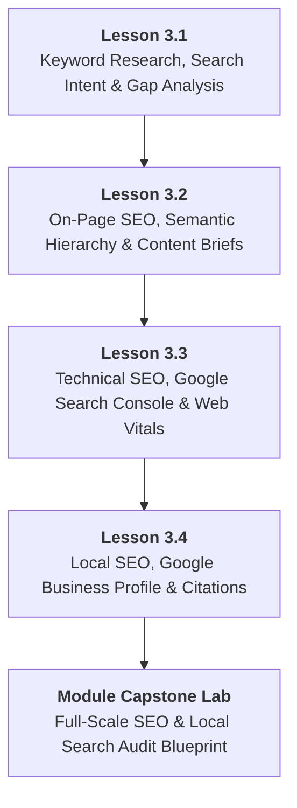

# DMP-MOD-03: Professional Search Engine Optimization (SEO) & Local Search
## Detailed Teaching Syllabus & Lesson Specifications

**Course ID:** `dm-professional`  
**Course Name:** AI Digital Marketing Professional  
**Module ID:** `DMP-MOD-03`  
**Module Title:** Professional Search Engine Optimization (SEO) & Local Search  
**Curriculum Version:** 1.0 (October 2026)  
**Parent Plan:** [`docs/course-redesign/digital-marketing/dm-professional-redesign-plan.md`](file:///c:/Users/wasee/Desktop/NovaSkillsProject/NovaSkills%20Website/docs/course-redesign/digital-marketing/dm-professional-redesign-plan.md)  
**Target Learner Profile:** Career Seekers, Junior Marketing Associates, Digital Marketing Executives  
**Total Workload:** 20.0 Hours (10.0h Supervised Instruction + 6.0h Guided Practical Labs & Assignments + 4.0h Comprehensive Capstone Project)  

---

## 1. Module Overview & Pedagogical Architecture

### 1.1 Module Objective
The objective of **DMP-MOD-03** is to provide rigorous, industry-grade training in organic search visibility, modern keyword intelligence, technical site health diagnostics, and local search dominance. Moving past obsolete keyword-stuffing tactics, this module equips learners to conduct intent-driven keyword research using accessible native tools, optimize on-page content structures, diagnose technical indexation and Core Web Vitals issues in Google Search Console, execute authoritative local Google Business Profile (GBP) optimizations, and generate actionable SEO audit deliverables for corporate and freelance clients.

### 1.2 Pedagogical Workload Breakdown (20.0 Total Hours)

```
┌────────────────────────────────────────────────────────────────────────┐
│                   DMP-MOD-03 TOTAL WORKLOAD: 20 HOURS                  │
├────────────────────────────┬────────────────────────────┬──────────────┤
│ Supervised Contact Time    │ Independent Practice Time  │ Capstone Lab │
│ 10.0 Hours Total           │ 6.0 Hours Total            │ 4.0 Hours    │
├────────────────────────────┼────────────────────────────┼──────────────┤
│ • Supervised Lecture: 5.0h │ • Independent Homework:    │ • Module 03  │
│ • Guided Lab: 5.0h         │   4.0h (4 x 1.0h)          │   SEO & Local│
│   (4 Lessons x 2.5h each)  │ • Formative Quizzes: 2.0h  │   Search     │
│                            │                            │   Audit Lab  │
└────────────────────────────┴────────────────────────────┴──────────────┘
```

- **Lesson 3.1:** Modern Keyword Research, Search Intent Mapping & Competitive Gap Analysis (2.5h Supervised Contact + 1.0h Independent Practice)
- **Lesson 3.2:** On-Page SEO Architecture, Semantic Hierarchy & AI-Assisted Content Briefs (2.5h Supervised Contact + 1.0h Independent Practice)
- **Lesson 3.3:** Technical SEO Fundamentals, Google Search Console Diagnostics & Site Health (2.5h Supervised Contact + 1.0h Independent Practice)
- **Lesson 3.4:** Local SEO Mastery, Google Business Profile (GBP) & Local 3-Pack Dominance (2.5h Supervised Contact + 1.0h Independent Practice)
- **Comprehensive Module Capstone:** Professional Multi-Page SEO & Local Search Audit Blueprint (4.0h Supervised Lab & Client Presentation Defense)

---

## 2. Lesson-by-Lesson Syllabus Specifications



---

### Lesson 3.1: Modern Keyword Research, Search Intent Mapping & Competitive Gap Analysis

#### 1. Lesson Identification
- **Lesson Number:** `DMP-3.1`
- **Lesson Title:** Modern Keyword Research, Search Intent Mapping & Competitive Gap Analysis
- **Time Allocation:** Theory: 1.25 Hours | Supervised Lab: 1.25 Hours | Homework: 1.0 Hour

#### 2. Main Topics & Detailed Numbered Subtopics
- **3.1.1 How Search Engines Process Query Semantics:**
  - Evolution from exact-match keyword indexing to natural language understanding (Google Hummingbird, BERT, MUM).
  - Understanding Entity SEO: Topics and semantic clusters over isolated single keywords.
- **3.1.2 Deconstructing the 4 Types of Search Intent:**
  - **Informational Intent:** How-to queries, educational definitions, guides (`how to clean cast iron pan`).
  - **Navigational Intent:** Specific brand or portal searches (`shopify login`, `kettlecraft cookware`).
  - **Commercial Investigation:** Comparison queries, best-of lists, reviews (`best cast iron skillet 2026`, `staub vs lodge`).
  - **Transactional Intent:** High purchase urgency (`buy 12 inch cast iron skillet online`, `cast iron pan discount code`).
- **3.1.3 Intent-Driven Keyword Mining with Free & Native Tools:**
  - **Google Keyword Planner:** Extracting search volumes, competitive bid estimates (high/low range as commercial intent proxies).
  - **Google Autocomplete, People Also Ask (PAA) & Related Searches:** Scraping real-time long-tail search questions.
  - **Google Trends:** Identifying search seasonality, rising breakout queries, and geographic distribution.
- **3.1.4 Competitive Keyword Gap Analysis:**
  - Mapping competitor ranking pages against target commercial terms.
  - Identifying keyword difficulty vs. business value: Prioritizing low-competition, high-intent long-tail keywords for fast organic traction.

#### 3. Teaching Explanations & Real Business Examples
- *Teaching Explanation:* Chasing high-volume, generic keywords like `"shoes"` or `"marketing"` is a rookie mistake that burns months of effort with zero sales. A professional SEO identifies high-intent, long-tail commercial queries like `"best running shoes for flat feet marathon training"`. Even with 300 monthly searches, this query converts at 8–12% because the buyer's intent is razor-sharp.
- *Real Business Example:* **Apex Legal Consultants (Corporate Law Firm)**. Instead of trying to rank for `"lawyer"` (impossible competition and broad intent), they targeted long-tail transactional queries: `"statutory employment contract drafting for IT startups in Pune"` and `"ESOP plan advisory legal fees"`. With under 500 total monthly visits across these targeted pages, they secured 14 high-value corporate retainers in 6 months.

#### 4. Software & Relevant Features
- **Google Keyword Planner (Expert Mode - Free):** Historical search volume, forecast trends, keyword clustering, competition levels.
- **Google Trends:** Geographic breakout filtering, category breakdowns, 5-year query trajectory.
- **AnswerThePublic / AlsoAsked (Free Daily Searches):** Visualizing PAA interrogative clusters (Who, What, Where, Why).
- **Google Sheets:** Building master keyword research and intent-mapping matrices.

#### 5. Trainer Demonstration (45 Minutes)
1. Open Google Keyword Planner and input 3 seed terms for an organic meal-delivery brand.
2. Filter out irrelevant queries using negative keyword filters (e.g., exclude "recipe", "free", "jobs").
3. Export the raw keyword dataset into Google Sheets and apply a formula to categorize keywords into Informational, Commercial, and Transactional intent buckets.
4. Open Google Search in an incognito window, trigger the SERP for a target commercial keyword, and evaluate the ranking competitors' URL structures and title tags.

#### 6. Student Practical Exercise (45 Minutes)
- **Title:** *Intent-Driven Keyword Research & Mapping Matrix*
- **Task:** Build a master keyword strategy workbook for *DentaCare Aligners: Clear Teeth Aligners Provider*.
- **Requirements:**
  1. Identify 5 Informational, 5 Commercial, and 5 Transactional target keywords using Google Keyword Planner and Google Suggest.
  2. Document estimated monthly search volume, competition level, and Google CPC benchmark range (as an indicator of commercial value).
  3. Map each keyword to a proposed website page type (Blog Post, Comparison Guide, or Service Landing Page).
- **Trainer Guidance:** Verify that students do not select broad single-word terms; ensure all transactional keywords contain clear intent modifiers ("cost", "near me", "price", "booking").

#### 7. Assignment (1.0 Hour)
- Expand the keyword matrix into a **Comprehensive 30-Keyword Intent Map** for their course capstone business scenario, fully organized in Google Sheets.

#### 8. Expected Learning Outcomes
- Extract and filter keyword data using Google Keyword Planner.
- Classify search queries accurately into the 4 primary intent categories.
- Build structured keyword-to-page mapping matrices.

#### 9. Assessment Criteria
- Accuracy of intent classification for each mined keyword.
- Commercial viability and long-tail specificity of selected queries.

---

### Lesson 3.2: On-Page SEO Architecture, Semantic Hierarchy & AI-Assisted Content Briefs

#### 1. Lesson Identification
- **Lesson Number:** `DMP-3.2`
- **Lesson Title:** On-Page SEO Architecture, Semantic Hierarchy & AI-Assisted Content Briefs
- **Time Allocation:** Theory: 1.25 Hours | Supervised Lab: 1.25 Hours | Homework: 1.0 Hour

#### 2. Main Topics & Detailed Numbered Subtopics
- **3.2.1 Critical On-Page Ranking Elements & Optimization Standards:**
  - **Title Tag Formulation:** The primary ranking factor. Length constraints (50–60 characters / 580 pixels), primary keyword placement at the front, branding suffix, click-through rate (CTR) modifiers.
  - **Meta Description Best Practices:** Length constraints (150–160 characters / 960 pixels), secondary keyword inclusion, emotional benefit, clear call-to-action.
  - **Clean URL Slug Design:** Short, lowercase, hyphenated, primary keyword only, zero dates or category stop-words (`domain.com/clear-aligners-cost` vs. `domain.com/?p=123&cat=teeth`).
- **3.2.2 Semantic Heading Hierarchy (H1, H2, H3, H4) & Scannability:**
  - Strict H1 rule: Exactly one H1 per page containing primary keyword and user benefit.
  - H2 subheadings for core topical facets and secondary keywords.
  - H3 and H4 tags for granular subpoints, FAQ questions, and technical specifications.
- **3.2.3 Image Optimization & Accessibility:**
  - Descriptive, hyphenated file names (`invisible-teeth-aligners-tray.webp` vs. `IMG_4021.jpg`).
  - WebP/AVIF format compression (keeping images under 150KB).
  - Writing functional descriptive Alt Text for search crawlers and screen readers.
- **3.2.4 Internal Linking Architecture & Topical Authority:**
  - Inbound vs. Outbound internal links: Distributing PageRank from high-authority pages to deep service pages.
  - Descriptive, contextual anchor text (avoiding "click here" or "read more").
- **3.2.5 Engineering AI-Assisted SEO Content Briefs:**
  - Prompting AI to structure comprehensive content briefs based on competitor SERP analysis: Recommended word count, required semantic subheadings, PAA questions to answer, and internal link targets.

#### 3. Teaching Explanations & Real Business Examples
- *Teaching Explanation:* On-page SEO is not about repeating a keyword 20 times in the body text (which triggers algorithmic spam penalties). Modern on-page SEO is about **topical completeness and search satisfaction**. Search engines reward pages that answer the user's primary query immediately, anticipate their follow-up questions, and provide clear navigation through clean semantic heading structures.
- *Real Business Example:* **Urban Woodcraft Furniture**. Their product page for `"solid teak dining table"` was stuck on Google Page 4. An on-page audit revealed: Title tag was just *"Products | Urban Woodcraft"*, URL was `urbanwoodcraft.in/shop/?item=9842`, images were 4MB JPEGs named `photo1.jpg` without alt text, and the page lacked an H1. After rewriting the Title to *"Solid Teak Wood Dining Tables (6-Seater) | Urban Woodcraft"*, fixing the URL, compressing images to 90KB WebP, and adding an H2 FAQ covering maintenance and warranty, the page jumped to #3 on Google within 6 weeks.

#### 4. Software & Relevant Features
- **ToTheWeb / Mangools SERP Simulator (Free Web Tools):** Previewing title tags and meta descriptions in real-time Google desktop and mobile SERPs.
- **ChatGPT / Claude (Free Tier):** Prompt chaining for comprehensive SEO content briefs and FAQ schema drafting.
- **Screaming Frog SEO Spider (Free Version - up to 500 URLs):** Crawling and auditing title tags, missing H1s, and alt text across pages.

#### 5. Trainer Demonstration (45 Minutes)
1. Navigate to a live, non-optimized web page and inspect its HTML source code (`Ctrl+U`), locating `<title>`, `<meta name="description">`, `<h1>`, and `` tags.
2. Open the SERP Simulator and rewrite the title and meta description live, demonstrating how length truncation occurs on mobile viewports.
3. Prompt ChatGPT to analyze a target keyword and generate a detailed SEO Content Brief including semantic H2/H3 subtopics and People Also Ask questions.
4. Demonstrate how to write descriptive image alt text for 3 contrasting e-commerce product photos.

#### 6. Student Practical Exercise (45 Minutes)
- **Title:** *On-Page SEO Optimization & AI Content Brief Lab*
- **Task:** Optimize an existing un-optimized web page for a B2B SaaS platform (*CloudInvoice: Small Business Invoicing Software*).
- **Requirements:**
  1. Draft an optimized Title Tag (under 60 characters) and Meta Description (under 155 characters) incorporating primary and secondary keywords.
  2. Structure a complete semantic heading tree (1 H1, 4 H2s, 4 H3s) covering the complete feature set, pricing tiers, and common buyer objections.
  3. Write 3 descriptive image alt text strings for product dashboard screenshots.
  4. Formulate an AI prompt that outputs a 1,200-word SEO article outline with recommended internal linking targets.
- **Trainer Guidance:** Check student title tags in the SERP simulator; fail any title that gets truncated or lacks the primary keyword at the beginning.

#### 7. Assignment (1.0 Hour)
- Produce a full **On-Page SEO Specification & Content Brief Document** for 2 priority pages of their course capstone business scenario.

#### 8. Expected Learning Outcomes
- Author high-CTR, algorithmically compliant title tags and meta descriptions.
- Construct semantic heading hierarchies (H1–H4) that maximize topical completeness.
- Optimize images for web performance and accessibility.
- Produce comprehensive SEO content briefs utilizing AI prompting.

#### 9. Assessment Criteria
- Character count and visual pixel compliance in title and meta tags.
- Logical, hierarchical structure of semantic headings without skipping levels.

---

### Lesson 3.3: Technical SEO Fundamentals, Google Search Console Diagnostics & Site Health

#### 1. Lesson Identification
- **Lesson Number:** `DMP-3.3`
- **Lesson Title:** Technical SEO Fundamentals, Google Search Console Diagnostics & Site Health
- **Time Allocation:** Theory: 1.25 Hours | Supervised Lab: 1.25 Hours | Homework: 1.0 Hour

#### 2. Main Topics & Detailed Numbered Subtopics
- **3.3.1 Search Engine Crawling & Indexation Architecture:**
  - How Googlebot discovers, renders, and indexes web documents.
  - The role of `robots.txt`: Directing crawler budget, user-agent directives, `Disallow` rules, sitemap declaration.
  - XML Sitemaps: Structure, priority, update frequency, submission protocols.
  - Canonical tags (`rel="canonical"`): Preventing duplicate content penalties on e-commerce filtering and parameter URLs.
- **3.3.2 Google Search Console (GSC) Navigation & Core Reports:**
  - **Performance Report:** Analyzing Total Clicks, Total Impressions, Average CTR, and Average Position across Queries and Pages.
  - **Page Indexing Report:** Diagnosing why pages are not indexed (Crawled - currently not indexed, Discovered - currently not indexed, 404 Not Found, Excluded by `noindex` tag).
  - **URL Inspection Tool:** Requesting real-time indexing, viewing live rendered HTML, checking mobile usability.
  - **Sitemaps Report:** Submitting and verifying XML sitemap status.
- **3.3.3 Core Web Vitals & Page Experience Signals:**
  - **Largest Contentful Paint (LCP):** Main content loading speed (Target: < 2.5 seconds).
  - **Interaction to Next Paint (INP):** Page responsiveness to user clicks (Target: < 200 ms).
  - **Cumulative Layout Shift (CLS):** Visual stability during page load (Target: < 0.1).
  - HTTPS security certificates, mobile-friendly rendering, and avoidance of intrusive interstitials.
- **3.3.4 Diagnosing HTTP Status Codes:**
  - 200 (Success), 301 (Permanent Redirect vs. 302 Temporary), 404 (Client Error / Not Found), 410 (Gone), 500 (Server Error).
  - Managing 301 redirect maps during website migrations and page deletions to preserve link equity.

#### 3. Teaching Explanations & Real Business Examples
- *Teaching Explanation:* You can write the greatest content in the world, but if technical barriers prevent Googlebot from crawling or rendering your pages, your website will simply not exist in search results. Google Search Console is the only direct communication channel between a website owner and Google. Understanding GSC indexation reports is an essential skill for any hireable digital marketer.
- *Real Business Example:* **StyleHub Fashion E-Commerce**. After launching a new website theme, organic traffic dropped by 65% in two weeks. The agency claimed "SEO takes time." A junior SEO associate inspected Google Search Console and discovered that the web developer had left `<meta name="robots" content="noindex, nofollow">` in the global header template after staging testing. Once the `noindex` tag was removed and a sitemap re-submitted via GSC, organic traffic returned to normal within 10 days.

#### 4. Software & Relevant Features
- **Google Search Console (GSC - Live Property & Training Sandbox):** Performance queries, Page Indexing diagnostic reports, URL Inspection Tool, Sitemap verification.
- **Google PageSpeed Insights / Chrome DevTools Lighthouse:** Evaluating Core Web Vitals (LCP, INP, CLS) and mobile performance scores.
- **TechnicalSEO.com Schema & Robots.txt Tools:** Generating valid `robots.txt` directives and testing syntax.

#### 5. Trainer Demonstration (45 Minutes)
1. Open a verified Google Search Console property and navigate to the Performance report.
2. Demonstrate how to filter by Queries containing "low CTR but high impressions" (Position 4–10) to identify immediate "quick-win" title tag optimization opportunities.
3. Open the Page Indexing report, click into "Excluded by 'noindex' tag" and "Not found (404)", and explain the diagnostic workflow.
4. Run Google PageSpeed Insights on a live URL, deconstruct the Core Web Vitals diagnostic waterfall, and identify uncompressed JavaScript and oversized hero images causing slow LCP.

#### 6. Student Practical Exercise (45 Minutes)
- **Title:** *Google Search Console Performance Analysis & Technical Site Audit*
- **Task:** Analyze an exported GSC dataset and run technical diagnostic checks on a sample website.
- **Requirements:**
  1. Review a 3-month GSC performance export: Identify the top 5 high-impression queries ranking in positions 5–15 with low CTR (< 2%).
  2. Formulate specific title and meta tag improvements to boost CTR for those 5 queries.
  3. Draft a valid `robots.txt` file for an e-commerce site that allows full crawling of product and category pages while disallowing `/cart/`, `/checkout/`, and `/admin/`.
  4. Run PageSpeed Insights on a test URL, record LCP, INP, and CLS metrics, and list 3 concrete technical recommendations to improve page speed.
- **Trainer Guidance:** Ensure students understand the difference between a 301 redirect (which passes authority) and a 404 error (which breaks the journey); verify `robots.txt` syntax.

#### 7. Assignment (1.0 Hour)
- Produce a **Technical SEO Health & GSC Diagnostic Memo** summarizing performance findings, indexation errors, and a recommended 301 redirect mapping table for their capstone business scenario.

#### 8. Expected Learning Outcomes
- Navigate and interpret Google Search Console Performance and Indexing reports.
- Draft error-free `robots.txt` files and XML sitemap submission protocols.
- Audit Core Web Vitals (LCP, INP, CLS) using PageSpeed Insights and prescribe non-code optimization fixes.

#### 9. Assessment Criteria
- Accuracy in diagnosing GSC indexation status codes and performance anomalies.
- Correct syntax and structural logic in the generated `robots.txt` directives.

---

### Lesson 3.4: Local SEO Mastery, Google Business Profile (GBP) & Local 3-Pack Dominance

#### 1. Lesson Identification
- **Lesson Number:** `DMP-3.4`
- **Lesson Title:** Local SEO Mastery, Google Business Profile (GBP) & Local 3-Pack Dominance
- **Time Allocation:** Theory: 1.25 Hours | Supervised Lab: 1.25 Hours | Homework: 1.0 Hour

#### 2. Main Topics & Detailed Numbered Subtopics
- **4.1.1 The Local Search Algorithm & The Google Local 3-Pack:**
  - How Google ranks local businesses: **Relevance** (Category match), **Distance / Proximity** (User location relative to business), and **Prominence** (Reviews, backlinks, citations, engagement).
  - Difference between standard localized organic blue links and the Google Maps Local 3-Pack.
- **4.2.2 Complete Google Business Profile (GBP) Setup & Optimization:**
  - Selecting the Primary Category (the single highest ranking factor) and relevant Secondary Categories.
  - Business Name guidelines: Adhering to Google GBP policies and avoiding spammy keyword-stuffing penalties.
  - Complete profile attributes: Exact physical address, service areas, verified phone number, operating hours, holiday schedules, accessibility attributes.
  - Writing an engaging, keyword-rich 750-character business description.
- **4.3.3 Products, Services & Weekly Google Updates (Posts):**
  - Building detailed service and product catalogs inside GBP with pricing and direct booking links.
  - Publishing weekly GBP Updates (Offers, Events, What's New) with photos and direct CTA buttons.
  - High-resolution geo-relevant photo uploads: Exterior, interior, team, and work-in-progress images.
- **4.4.4 NAP Consistency & Local Citation Building:**
  - NAP Integrity: Exact matching of **Name, Address, and Phone Number** across the website, Google Maps, Justdial, Sulekha, IndiaMART, Yelp, and Facebook.
  - How inconsistent phone formats or suite numbers degrade algorithmic local trust.
- **4.5.5 Review Generation Systems & Review Response Psychology:**
  - Creating a direct Google Review shortlink (`g.page/r/.../review`).
  - Designing a frictionless WhatsApp/SMS review request script for post-service follow-up.
  - Responding professionally to both 5-star praise and negative 1-star reviews (incorporating localized service keywords organically in responses).

#### 3. Teaching Explanations & Real Business Examples
- *Teaching Explanation:* For local service businesses (clinics, salons, restaurants, repair services, law firms), local search is responsible for over 80% of inbound customer calls. Ranking in the top 3 of Google Maps produces immediate, high-intent phone calls and direction requests without paying for ads. A digital marketer who knows how to optimize a GBP profile can deliver immediate, tangible ROI to local business clients within weeks.
- *Real Business Example:* **Apex Auto Garage (Neighborhood Car Service Center)**. They had an unverified GBP listing named "Apex" with no category, wrong phone number, and 4 reviews. A local SEO optimization was implemented: Primary category set to *"Auto Repair Shop"*, secondary categories added (*"Brake Shop", "Oil Change Service"*), detailed pricing added for 15 services, 20 high-quality photos uploaded, and a WhatsApp automation set up sending customers a direct review link upon car pickup. Within 90 days, reviews grew from 4 to 68 (4.9 rating), Google Maps phone calls increased by 240%, and the garage booked 35 new service jobs every month from the Local 3-Pack.

#### 4. Software & Relevant Features
- **Google Business Profile Manager:** Profile editing, category selection, service catalog build, review management, insights/performance reporting.
- **Google Maps Web Interface:** Proximity auditing, local competitor listing analysis.
- **Whitespark Local Citation Finder / Free Local Listing Checkers:** Checking NAP consistency across top local directories.

#### 5. Trainer Demonstration (45 Minutes)
1. Log into a live Google Business Profile dashboard.
2. Demonstrate how changing a Primary Category fundamentally alters search discovery; show how to research top competitor categories using Google Maps inspection.
3. Build a detailed Service Item with pricing, turnaround time, and a 200-word benefit description.
4. Generate a direct Google Review shortlink and demonstrate how to draft a professional, de-escalating response to a critical 1-star review while maintaining brand reputation.

#### 6. Student Practical Exercise (45 Minutes)
- **Title:** *Google Business Profile Optimization Blueprint & Review Playbook*
- **Task:** Build a comprehensive GBP launch blueprint for *UrbanSmile Orthodontic Clinic*.
- **Requirements:**
  1. Define the Primary Category and 3 relevant Secondary Categories.
  2. Write an optimized 700-character business description incorporating local neighborhood keywords naturally.
  3. Detail 4 distinct service items (e.g., Ceramic Braces, Clear Aligners, Teeth Whitening, Emergency Dental) with pricing and descriptions.
  4. Draft a 3-message WhatsApp/SMS automated review request sequence.
  5. Write professional response templates for: (a) a glowing 5-star review, and (b) a hostile 1-star review complaining about clinic wait times.
- **Trainer Guidance:** Check business names strictly; disqualify any student who attempts to spam the business name with extra keywords (e.g., "UrbanSmile - Best Cheap Aligners Clinic Pune"), explaining Google's suspension policies.

#### 7. Assignment (1.0 Hour)
- Complete a **Local Business Citation & GBP Audit Worksheet** evaluating an actual brick-and-mortar business in their local city, identifying 5 profile optimization opportunities.

#### 8. Expected Learning Outcomes
- Optimize Google Business Profiles for maximum prominence in the Local 3-Pack.
- Maintain strict NAP (Name, Address, Phone) consistency across local web citations.
- Architect automated post-purchase review acquisition funnels and reputation management workflows.

#### 9. Assessment Criteria
- Policy compliance in business name and category selection.
- Professionalism, empathy, and strategic keyword integration in review responses.

---

## 3. Comprehensive Module 03 Capstone Project

### Project Title
**The Full-Scale SEO & Local Search Audit Blueprint**

### Project Scenario
Students are contracted as an SEO Specialist to conduct an exhaustive organic search and local visibility audit for one of the three established program enterprises (*PureBotanics Skincare*, *TalentForge Recruitment*, or *Starlight Dental Care*).

### Required Project Deliverables (Audit Package)
1. **Keyword Intent & Content Mapping Dossier:**
   - 30 target keywords categorized across Informational, Commercial, and Transactional intent.
   - Assigned target URLs, estimated search volumes, commercial difficulty, and mapping recommendations.
2. **On-Page Optimization Specification Sheet:**
   - Title tag and meta description rewrites for 3 core pages with SERP simulator preview screenshots.
   - Complete H1–H4 semantic heading tree for the primary service landing page.
   - Image optimization schedule (file names, WebP format standards, and descriptive alt text).
3. **Technical SEO Health & Diagnostics Report:**
   - Custom `robots.txt` file and XML sitemap architecture specification.
   - Core Web Vitals audit (LCP, INP, CLS) from PageSpeed Insights with 3 prioritized non-code performance fixes.
   - 301 redirect map for 5 hypothetical deprecated URLs.
4. **Google Business Profile (GBP) & Local Optimization Blueprint:**
   - Full profile configuration plan (Primary category, secondary categories, 750-char description).
   - 4-item product/service catalog build.
   - Local citation audit checklist and 3-step review acquisition sequence.

### Lab Time Allocation
- **4.0 Hours Supervised Capstone Session:** 2.5 hours guided audit assembly and data synthesis + 1.5 hours client audit presentation and technical defense.

---

## 4. Module 03 Assessment & Grading Rubric (100 Points)

| Assessment Dimension | Maximum Points | Excellent (90–100%) | Proficient (70–89%) | Needs Improvement (<70%) |
| :--- | :---: | :--- | :--- | :--- |
| **1. Keyword Intelligence & Mapping** | 25 | 30 long-tail keywords correctly categorized by intent; page mapping is strategically sound and commercially valuable. | Keywords are relevant with solid intent categorization; minor overlap between pages. | Broad, unrealistic single-word keywords; confused or inaccurate intent classifications. |
| **2. On-Page Semantic Execution** | 25 | Title/meta tags are perfectly formatted without truncation; semantic heading hierarchy (H1–H4) is flawless; alt text is descriptive. | Solid on-page tags with minor pixel width truncation; heading hierarchy is logical. | Truncated titles; missing H1; generic alt text or keyword stuffing. |
| **3. Technical SEO Diagnostics** | 25 | `robots.txt` syntax is error-free; sitemap logic is sound; Core Web Vitals recommendations are actionable and non-code focused. | `robots.txt` is functional; valid speed recommendations; minor technical terminology errors. | Broken `robots.txt` syntax; unrealistic or generic technical advice. |
| **4. Local SEO & GBP Blueprint** | 15 | Policy-compliant GBP setup; categories perfectly selected; review request scripts and responses are professional and empathetic. | Solid GBP plan; minor oversights in secondary categories or review response framing. | Keyword-stuffed business name (policy violation); generic review responses. |
| **5. Client Audit Presentation** | 10 | Executive-ready presentation deck; professional tables, clean visual layout, and confident verbal technical defense. | Well-organized audit document; clear explanations during defense. | Disorganized, incomplete submission; unable to justify recommendations during defense. |

---

## 5. Trainer & Student Completion Checklist

### Student Verification Checklist
- [ ] Mined and intent-classified 30 target keywords using Google Keyword Planner and Google Suggest.
- [ ] Drafted pixel-compliant title tags and meta descriptions verified in a SERP simulator.
- [ ] Structured a semantic H1–H4 heading hierarchy and written descriptive image alt text.
- [ ] Formulated a valid `robots.txt` file and diagnosed Core Web Vitals using PageSpeed Insights.
- [ ] Built a complete Google Business Profile optimization blueprint with category selection and service catalog.
- [ ] Scripted an automated WhatsApp review request sequence and drafted review response templates.
- [ ] Submitted the completed 4-part Full-Scale SEO & Local Search Audit Blueprint.

### Trainer Delivery Checklist
- [ ] Demonstrated live query filtering and intent classification in Google Keyword Planner.
- [ ] Walked through live HTML source code inspection of on-page title, meta, and heading tags.
- [ ] Demonstrated real-time GSC performance filtering and PageSpeed Insights diagnostics.
- [ ] Verified student Google Business Profile plans for strict policy compliance (zero name spam).
- [ ] Evaluated the Module 03 Capstone Audit against the 100-point rubric and provided actionable critique.
