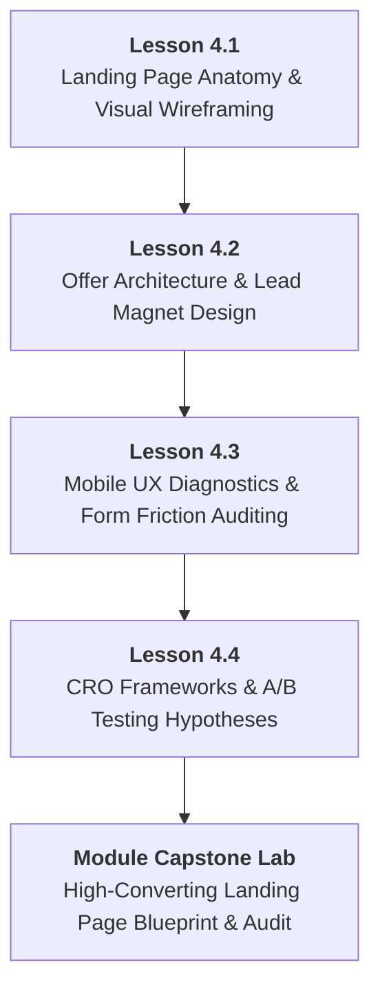

# DMP-MOD-04: High-Converting Landing Pages, UX & Offer Architecture
## Detailed Teaching Syllabus & Lesson Specifications

**Course ID:** `dm-professional`  
**Course Name:** AI Digital Marketing Professional  
**Module ID:** `DMP-MOD-04`  
**Module Title:** High-Converting Landing Pages, UX & Offer Architecture  
**Curriculum Version:** 1.0 (October 2026)  
**Parent Plan:** [`docs/course-redesign/digital-marketing/dm-professional-redesign-plan.md`](file:///c:/Users/wasee/Desktop/NovaSkillsProject/NovaSkills%20Website/docs/course-redesign/digital-marketing/dm-professional-redesign-plan.md)  
**Target Learner Profile:** Career Seekers, Junior Marketing Associates, Digital Marketing Executives  
**Total Workload:** 20.0 Hours (10.0h Supervised Instruction + 6.0h Guided Practical Labs & Assignments + 4.0h Comprehensive Capstone Project)  

---

## 1. Module Overview & Pedagogical Architecture

### 1.1 Module Objective
The objective of **DMP-MOD-04** is to bridge the gap between traffic generation and revenue generation. Driving thousands of clicks via SEO or paid ads is entirely wasted if the destination page fails to convert visitors. This module delivers comprehensive, practical training in:
1. Deconstructing the cognitive psychology of high-converting landing pages.
2. Formulating irresistible lead magnets, value exchanges, and low-friction offers.
3. Conducting rigorous mobile user experience (UX) and conversion friction audits.
4. Designing production-grade landing page wireframes and visual prototypes without coding.
5. Establishing structured Conversion Rate Optimization (CRO) frameworks and A/B testing protocols.

### 1.2 Pedagogical Workload Breakdown (20.0 Total Hours)

```
┌────────────────────────────────────────────────────────────────────────┐
│                   DMP-MOD-04 TOTAL WORKLOAD: 20 HOURS                  │
├────────────────────────────┬────────────────────────────┬──────────────┤
│ Supervised Contact Time    │ Independent Practice Time  │ Capstone Lab │
│ 10.0 Hours Total           │ 6.0 Hours Total            │ 4.0 Hours    │
├────────────────────────────┼────────────────────────────┼──────────────┤
│ • Supervised Lecture: 5.0h │ • Independent Homework:    │ • Module 04  │
│ • Guided Lab: 5.0h         │   4.0h (4 x 1.0h)          │   High-      │
│   (4 Lessons x 2.5h each)  │ • Formative Quizzes: 2.0h  │   Converting │
│                            │                            │   Landing    │
│                            │                            │   Page Lab   │
└────────────────────────────┴────────────────────────────┴──────────────┘
```

- **Lesson 4.1:** Landing Page Anatomy, Visual Hierarchy & Cognitive Wireframing (2.5h Supervised Contact + 1.0h Independent Practice)
- **Lesson 4.2:** Irresistible Offer Architecture, Lead Magnets & Call-to-Action (CTA) Psychology (2.5h Supervised Contact + 1.0h Independent Practice)
- **Lesson 4.3:** Mobile UX Diagnostics, Form Friction Auditing & Trust Engineering (2.5h Supervised Contact + 1.0h Independent Practice)
- **Lesson 4.4:** Conversion Rate Optimization (CRO) Methodology, Micro-Conversions & A/B Testing Hypotheses (2.5h Supervised Contact + 1.0h Independent Practice)
- **Comprehensive Module Capstone:** High-Converting Multi-Section Landing Page Blueprint & Friction Audit (4.0h Supervised Lab & Design Defense)

---

## 2. Lesson-by-Lesson Syllabus Specifications



---

### Lesson 4.1: Landing Page Anatomy, Visual Hierarchy & Cognitive Wireframing

#### 1. Lesson Identification
- **Lesson Number:** `DMP-4.1`
- **Lesson Title:** Landing Page Anatomy, Visual Hierarchy & Cognitive Wireframing
- **Time Allocation:** Theory: 1.25 Hours | Supervised Lab: 1.25 Hours | Homework: 1.0 Hour

#### 2. Main Topics & Detailed Numbered Subtopics
- **4.1.1 Landing Pages vs. Traditional Websites:**
  - The critical distinction: A website is a multi-purpose brochure with multiple navigation links; a landing page is a single-purpose conversion funnel with a 1:1 attention ratio (Zero external header/footer navigation links).
  - Understanding the 5-Second Rule: Can a visitor identify *What you offer*, *Who it is for*, and *What to do next* within 5 seconds of arrival?
- **4.1.2 The Anatomy of a High-Converting Above-the-Fold Section:**
  - Clear, benefit-driven primary headline (answering: "What's in it for me?").
  - Supporting sub-headline elaborating on the mechanism or unique advantage.
  - High-contrast Call to Action (CTA) button with action-oriented verbiage.
  - Visual hero asset (Product-in-use photograph, short explainer video, or interface mockup).
  - Immediate trust anchors (Client logos, 5-star rating badge, or verified user counter).
- **4.1.3 Progressive Narrative Flow (The 7-Block Landing Page Architecture):**
  - Block 1: Above-the-Fold Hero Section (Hook & Primary CTA).
  - Block 2: The Problem & Agitation (Validating visitor pain points and frustrations).
  - Block 3: The Solution & Feature-to-Benefit Transformation (How the product solves the pain).
  - Block 4: Social Proof & Testimonials (Case studies, video reviews, verbatim quotes).
  - Block 5: The Offer Breakdown (What's included, pricing, bonuses, guarantees).
  - Block 6: Frequently Asked Questions (FAQ) (Overcoming final lingering objections).
  - Block 7: Final Urgency Call to Action (Risk-reversal footer).
- **4.1.4 Visual Hierarchy & Cognitive Scanning Patterns:**
  - Designing for the F-Pattern and Z-Pattern reading flow.
  - Visual directional cues (Arrows, human gaze direction pointing toward the CTA button).
  - White space utilization: Preventing cognitive fatigue and isolating high-priority elements.

#### 3. Teaching Explanations & Real Business Examples
- *Teaching Explanation:* When you send paid traffic from Google Ads or Meta Ads to a standard website homepage, 90% of visitors bounce because they get lost in navigation menus ("About Us", "Careers", "Blog"). A dedicated landing page strips away all distractions, presenting one clear problem, one clear solution, and one single action to take.
- *Real Business Example:* **Apex Fitness Online Coaching**. Originally sent Facebook ad clicks to their homepage (`apexfitness.in`), converting at 1.1% (Cost Per Lead: ₹980). They replaced the homepage with a dedicated 1-page landing page featuring a prominent headline (*"Lose 5–8 kg in 12 Weeks with Custom Nutrition & Daily WhatsApp Accountability"*), removed the top navigation bar, added 6 real before/after client transformation cards, and placed a simple 3-field form. Conversion rate jumped to 6.8% (Cost Per Lead dropped to ₹160).

#### 4. Software & Relevant Features
- **Canva / Figma (Free Tier) / Whimsical:** Building visual low-fidelity and high-fidelity landing page wireframes.
- **Chrome DevTools (Device Mode):** Testing visual hierarchy and above-the-fold cutoff across diverse mobile screen dimensions (390px, 412px, 768px).

#### 5. Trainer Demonstration (45 Minutes)
1. Display a live, cluttered corporate homepage and count how many clickable navigation links compete for visitor attention (often 40+ links).
2. Contrast this with an industry-leading landing page (e.g., *Stripe*, *Dropbox*, or *Monday.com* campaign landing pages).
3. Open Figma / Whimsical and demonstrate live how to structure the 7-Block Landing Page wireframe, setting up proper visual hierarchy, font scaling, and directional cues leading toward the form button.

#### 6. Student Practical Exercise (45 Minutes)
- **Title:** *Low-Fidelity Landing Page Wireframe Lab*
- **Task:** Build a structured landing page wireframe for *CloudDesk Virtual Assistant Agency*.
- **Requirements:**
  1. Sketch or build a 6-section low-fidelity wireframe in Canva or Whimsical.
  2. Structure an above-the-fold hero section containing: Headline, Subheadline, Primary CTA, Hero Image placeholder, and 3 Trust Badges.
  3. Include a 3-part Problem/Solution comparison block.
  4. Include a 4-question FAQ accordion section addressing common client anxieties (pricing, security, contract lock-ins).
  5. Enforce a strict 1:1 attention ratio (no external navigation links).
- **Trainer Guidance:** Intervene if students include a navigation bar with external links; verify that the primary CTA button stands out visually against the background.

#### 7. Assignment (1.0 Hour)
- Produce a **High-Fidelity Visual Landing Page Wireframe** for their course capstone business scenario, including all 7 core narrative blocks.

#### 8. Expected Learning Outcomes
- Distinguish between exploratory websites and conversion-focused landing pages.
- Architect high-converting landing page layouts using the 7-Block narrative framework.
- Design directional visual hierarchies that guide user gaze directly toward conversion actions.

#### 9. Assessment Criteria
- Strict maintenance of a 1:1 attention ratio (zero distractive external links).
- Clarity and visual prominence of the above-the-fold value proposition and primary CTA.

---

### Lesson 4.2: Irresistible Offer Architecture, Lead Magnets & Call-to-Action (CTA) Psychology

#### 1. Lesson Identification
- **Lesson Number:** `DMP-4.2`
- **Lesson Title:** Irresistible Offer Architecture, Lead Magnets & Call-to-Action (CTA) Psychology
- **Time Allocation:** Theory: 1.25 Hours | Supervised Lab: 1.25 Hours | Homework: 1.0 Hour

#### 2. Main Topics & Detailed Numbered Subtopics
- **4.2.1 The Psychology of the Value Exchange:**
  - Why asking a cold visitor to "Buy Now" or "Book a Call" immediately fails: High perceived friction vs. unproven value.
  - The Grand Slam Offer Equation (Alex Hormozi framework adapted for digital marketing): $\text{Value} = \frac{\text{Dream Outcome} \times \text{Perceived Likelihood of Achievement}}{\text{Time Delay} \times \text{Effort \& Sacrifice}}$.
- **4.2.2 Formulating High-Converting Lead Magnets (The Bait):**
  - Characteristics of winning lead magnets: Specific, immediately consumable (< 10 minutes), solves one burning micro-problem, bridges directly to the paid offering.
  - Winning formats: Interactive Calculators/Spreadsheets, Cheatsheets/Checklists, Free Audit/Teardown, Templates, Mini-Video Training.
  - Formats to avoid: Generic 80-page eBooks (nobody reads them), vague monthly newsletters ("Subscribe for updates").
- **4.2.3 Risk Reversal & Guarantee Engineering:**
  - The role of guarantees in eliminating buyer friction: 30-Day Money-Back Guarantees, Conditional Guarantees ("If you don't get X in 60 days, we work for free until you do"), Zero-Risk Free Trials.
  - Overcoming the fear of buyer's remorse and reputational risk.
- **4.2.4 Call-to-Action (CTA) Copywriting & Button Psychology:**
  - Replacing generic, passive button labels (*"Submit"*, *"Click Here"*, *"Download"*) with active, value-centric copy (*"Get My Free 2026 Marketing Audit"*, *"Claim My ₹500 Discount Coupon"*, *"Unlock Instant Access"*).
  - Button visual styling: High-contrast accent colors, adequate touch target sizing (minimum 48x48 pixels for mobile thumbs), click triggers (supporting reassurance text: "No credit card required • Instant download").

#### 3. Teaching Explanations & Real Business Examples
- *Teaching Explanation:* Visitors do not fill out forms out of goodwill; they perform a calculated economic trade: *"Is the information or asset I am receiving worth more than the friction of giving away my personal name, email, and phone number?"* If you offer a generic "Free Consultation", the perceived value is low and the perceived sales pressure is high. If you offer a *"15-Minute Live Website Speed & SEO Video Teardown"*, the perceived value is immense.
- *Real Business Example:* **PropertyEase Commercial Real Estate Brokerage**. Their ad campaign offered *"Contact an Agent Today"* (Conversion Rate: 0.9%). They restructured their lead offer into an interactive tool: *"Download the 2026 Commercial Office Rental Rate Benchmarking Sheet for Bangalore CBD (Excel)"*. Conversion rate skyrocketed to 8.4%, collecting 450 verified business email addresses in 30 days.

#### 4. Software & Relevant Features
- **Canva (Free Tier):** Designing professional lead magnet covers, PDF worksheets, and cheatsheet assets.
- **ChatGPT / Claude (Free Tier):** Brainstorming high-converting lead magnet concepts and drafting high-converting CTA button copy variations.

#### 5. Trainer Demonstration (45 Minutes)
1. Display 3 contrasting lead magnet offers on screen and conduct a live classroom poll on which asset students would actually give their personal phone number for.
2. Deconstruct why generic offers fail using the Value Equation.
3. Prompt ChatGPT with a specific business profile and generate 5 distinct lead magnet concepts ranging from calculators to templates.
4. Walk through the design of a professional 2-page PDF Cheatsheet cover in Canva.

#### 6. Student Practical Exercise (45 Minutes)
- **Title:** *Irresistible Lead Magnet & Offer Architecture Workshop*
- **Task:** Develop an irresistible lead capture offer for *EcoSolar Home Solar Rooftop Installations*.
- **Requirements:**
  1. Formulate 2 contrasting lead magnet concepts (1 Template/Cheatsheet, 1 Interactive Tool/Calculator).
  2. Select the winning concept and draft: (a) Title, (b) 3-bullet teaser benefit description, and (c) Immediate delivery mechanism.
  3. Write 3 high-converting CTA button copy variations with matching click-trigger reassurance text.
  4. Formulate a compelling risk-reversal guarantee statement for their eventual paid installation service.
- **Trainer Guidance:** Reject any student proposal of "Free Consultation" or "Subscribe to Newsletter"; enforce specific, tangible assets.

#### 7. Assignment (1.0 Hour)
- Fully outline and write the content for a **1-Page Actionable Lead Magnet Asset** for their course capstone business scenario, including cover design in Canva.

#### 8. Expected Learning Outcomes
- Apply the Value Equation to construct high-converting commercial offers.
- Formulate specific, high-intent lead magnets that attract qualified buyers.
- Author high-converting, value-driven CTA copy and risk-reversal guarantees.

#### 9. Assessment Criteria
- Tangibility and perceived value of the proposed lead magnet.
- Direct alignment between the free lead magnet and the paid commercial product.

---

### Lesson 4.3: Mobile UX Diagnostics, Form Friction Auditing & Trust Engineering

#### 1. Lesson Identification
- **Lesson Number:** `DMP-4.3`
- **Lesson Title:** Mobile UX Diagnostics, Form Friction Auditing & Trust Engineering
- **Time Allocation:** Theory: 1.25 Hours | Supervised Lab: 1.25 Hours | Homework: 1.0 Hour

#### 2. Main Topics & Detailed Numbered Subtopics
- **4.3.1 Mobile-First Conversion Reality:**
  - Over 75% of paid social traffic and 60% of search traffic originates on smartphones.
  - The "Thumb Zone" physical ergonomics: Designing touch targets for natural thumb reach without hand strain.
  - Minimum touch target standards: 48x48 pixel buttons, adequate padding between interactive elements to prevent accidental miss-clicks.
- **4.3.2 Form Friction Engineering & Field Optimization:**
  - The inverse relationship: Every additional form field decreases conversion rate by approximately 5–10%.
  - Evaluating field necessity: Do you really need their physical address, company website, and job title on initial contact?
  - Single-Step vs. Multi-Step Forms: When to use single-step (Low-friction lead magnets) vs. Multi-step breadcrumb forms (High-ticket consultations, mortgages, insurance).
  - Mobile input ergonomics: Auto-complete attributes, telephone keypad triggering (`type="tel"`), email validation, inline error handling.
- **4.3.3 Trust Architecture & Social Proof Engineering:**
  - The 5 Pillars of Digital Trust:
    - *Peer Proof:* Customer testimonials, Google/Trustpilot star widgets, user-generated photos.
    - *Authority Proof:* Media mentions ("As seen in..."), industry certifications, founder credentials.
    - *Statistical Proof:* "Trusted by 14,000+ businesses", "Over ₹50 Crore in ad spend managed".
    - *Security Proof:* SSL lock badge, GDPR/DPDP privacy compliance statement, secure payment gateway icons.
    - *Risk Reversal:* Money-back guarantee seals, "No credit card required".
- **4.3.4 Identifying & Eliminating Cognitive Leaks:**
  - Auto-playing audio/video that frustrates mobile users.
  - Aggressive immediate pop-ups that block mobile viewports and trigger Google interstitial penalties.
  - Text contrast failures: Pale gray text on white backgrounds that become unreadable outdoors in daylight.

#### 3. Teaching Explanations & Real Business Examples
- *Teaching Explanation:* Marketers design landing pages on 27-inch desktop monitors with high-speed fiber internet and a mouse. But their customers experience those landing pages on a 6.1-inch smartphone screen on a crowded bus with 4G mobile data and one thumb. If your form requires pinch-to-zoom or asks for 9 fields of text on a mobile keyboard, your campaign is doomed before it starts.
- *Real Business Example:* **FastLoan Personal Financing**. Their mobile application form had 12 fields on a single page, resulting in an 82% abandonment rate. They implemented two UX changes: (1) Converted the form into a 3-step progressive quiz (Step 1: "How much do you need?", Step 2: "Employment type", Step 3: "Phone number"), and (2) Added a verified bank partner security badge under the button. Form completion rate jumped from 1.8% to 5.6%.

#### 4. Software & Relevant Features
- **Chrome DevTools (Device Mode & Network Throttling):** Simulating mid-tier mobile devices (iPhone 13, Pixel 7) and slow 4G network conditions.
- **Hotjar / Microsoft Clarity (Free Heatmap & Session Recording Tools):** Analyzing user scroll maps, tap/click heatmaps, and identifying form drop-off friction points.

#### 5. Trainer Demonstration (45 Minutes)
1. Open Chrome DevTools on a live e-commerce landing page, switch to Mobile Device Mode (390px viewport), and throttle the network to "Fast 3G".
2. Demonstrate how to audit touch targets, sticky navigation bars that consume too much screen real estate, and horizontal scrolling defects.
3. Walk through a live Microsoft Clarity / Hotjar recording session, showing real user mouse/finger hesitation, rage clicks, and form abandonment behavior.
4. Demonstrate the visual difference between a high-friction form and an optimized progressive lead capture form.

#### 6. Student Practical Exercise (45 Minutes)
- **Title:** *Mobile UX & Conversion Friction Audit Lab*
- **Task:** Conduct an exhaustive UX audit on a provided live mobile landing page URL.
- **Requirements:**
  1. Inspect the mobile page across 390px and 412px viewports using Chrome DevTools.
  2. Document 3 specific mobile UX friction flaws (e.g., small touch targets, unreadable contrast, excessive form fields).
  3. Redesign the existing lead form: Cut unnecessary fields from 8 down to 3, and add proper HTML input attributes (`type="tel"`, `type="email"`).
  4. Recommend 2 specific trust badges and placements to alleviate visitor skepticism.
- **Trainer Guidance:** Emphasize that students must physically check touch target sizes using DevTools element inspection; verify that contrast meets WCAG AA standards.

#### 7. Assignment (1.0 Hour)
- Produce a **Mobile UX & Form Friction Diagnostic Report** evaluating an actual client landing page in their city, identifying 5 concrete conversion leaks with annotated screenshot evidence.

#### 8. Expected Learning Outcomes
- Execute mobile-first UX audits using Chrome DevTools device simulation.
- Optimize lead capture forms for minimal cognitive friction and maximum mobile completion.
- Deploy trust anchors, security seals, and social proof elements effectively.

#### 9. Assessment Criteria
- Rigor in identifying mobile UX friction points and touch target violations.
- Practicality and friction reduction in the redesigned lead form layout.

---

### Lesson 4.4: Conversion Rate Optimization (CRO) Methodology, Micro-Conversions & A/B Testing Hypotheses

#### 1. Lesson Identification
- **Lesson Number:** `DMP-4.4`
- **Lesson Title:** Conversion Rate Optimization (CRO) Methodology, Micro-Conversions & A/B Testing Hypotheses
- **Time Allocation:** Theory: 1.25 Hours | Supervised Lab: 1.25 Hours | Homework: 1.0 Hour

#### 2. Main Topics & Detailed Numbered Subtopics
- **4.4.1 The Mathematics & Business Impact of Conversion Rate Optimization (CRO):**
  - Why CRO is the highest-leverage skill in digital marketing: How doubling conversion rate from 1% to 2% cuts Cost Per Acquisition (CPA) in half and doubles revenue without spending an extra rupee on ad traffic.
  - The quantitative CRO formula: $\text{Conversion Rate (CR)} = \left(\frac{\text{Total Goal Completions}}{\text{Total Unique Visitors}}\right) \times 100$.
- **4.4.2 Macro-Conversions vs. Micro-Conversions:**
  - **Macro-Conversions:** Primary commercial transactions (Completed purchases, submitted lead forms, scheduled appointments).
  - **Micro-Conversions:** Diagnostic behavioral stepping stones (Video 50% watch time, pricing page visits, downloading a PDF, clicking WhatsApp chat icon).
  - How tracking micro-conversions pinpoints the exact stage where prospects drop off in the conversion funnel.
- **4.4.3 Formulating Statistically Sound A/B Testing Hypotheses:**
  - The structured hypothesis framework: *Based on [Observed User Friction / Data Insight], we believe that changing [Specific Variable] for [Target Segment] will result in [Measurable Impact on Metric], because [Psychological Rationale].*
  - Variables to test: Headline messaging, Offer structure, Form layout (Single vs. Multi-step), CTA button copy and color, Social proof placement.
  - Isolating single variables: Why changing 5 things simultaneously invalidates A/B test learnings.
- **4.4.4 Test Prioritization Frameworks (PIE & ICE):**
  - **PIE Framework:** Potential (How much improvement is possible?), Importance (How valuable is the traffic to this page?), Ease (How technically difficult is the test to implement?).
  - **ICE Framework:** Impact, Confidence, Ease (Scoring tests 1–10 to prioritize testing roadmaps).
  - Statistical significance principles: Sample size requirements, minimum test duration (avoiding premature test termination).

#### 3. Teaching Explanations & Real Business Examples
- *Teaching Explanation:* A/B testing is not about guessing random button colors ("Let's test red vs. green"). That is a waste of time. Professional CRO is an evidence-based scientific methodology: You observe real user friction using analytics and session recordings, formulate a testable psychological hypothesis, and run a controlled experiment to validate whether your solution measurably increases conversions.
- *Real Business Example:* **LearnPro Online Certifications**. Their enrollment page had a 2.4% conversion rate. Heatmap data showed that 60% of visitors spent over 40 seconds reading the pricing table, but abandoned without clicking.
  - *Hypothesis:* Visitors want to enroll but fear hidden exam fees and lack of installment options.
  - *Test:* Added a simple reassurance bullet under the price: *"₹3,999 All-Inclusive • Zero Hidden Fees • 3 Easy Monthly Installments Available"*.
  - *Result:* Variant B achieved a 3.8% conversion rate (+58% relative lift), generating ₹4.2 Lakhs in additional monthly revenue with zero additional ad spend.

#### 4. Software & Relevant Features
- **Google Sheets:** Building CRO testing roadmaps, ICE prioritization matrices, and A/B test logging sheets.
- **ABTestguide.com / Optimizely Sample Size Calculator (Free Web Tools):** Calculating statistical significance, required sample sizes, and confidence intervals.

#### 5. Trainer Demonstration (45 Minutes)
1. Open a completed Google Analytics 4 landing page report, highlighting a page with high traffic (5,000 visits/month) but a poor 1.2% conversion rate.
2. Formulate a structured CRO hypothesis using the standardized framework live in Google Docs.
3. Open an online A/B testing sample size calculator and demonstrate how to determine required traffic and test duration based on baseline conversion rate and desired minimum detectable effect.
4. Score 4 competing test ideas using the ICE prioritization matrix in Google Sheets.

#### 6. Student Practical Exercise (45 Minutes)
- **Title:** *CRO A/B Testing Hypothesis & Prioritization Workshop*
- **Task:** Develop an evidence-based A/B testing roadmap for an underperforming landing page.
- **Requirements:**
  1. Review a provided case study scenario with quantitative bounce rates and qualitative heatmap insights.
  2. Formulate 3 distinct A/B testing hypotheses covering: (a) Headline value proposition, (b) Form friction reduction, and (c) Trust/Guarantee reassurance.
  3. Score all 3 test ideas using the ICE prioritization framework (1–10 scale) in Google Sheets.
  4. Select the #1 priority test and calculate the required sample size and estimated run duration using an online statistical calculator.
- **Trainer Guidance:** Check hypothesis structures; disqualify vague statements like "change the button" and require full hypothesis phrasing including psychological rationale.

#### 7. Assignment (1.0 Hour)
- Produce a **3-Month CRO Testing Roadmap & Hypothesis Log** outlining 4 prioritized A/B tests for their course capstone landing page.

#### 8. Expected Learning Outcomes
- Calculate conversion rates and quantify the revenue leverage of CRO improvements.
- Distinguish between macro-conversions and micro-conversions in funnel diagnostics.
- Author scientific A/B testing hypotheses using the ICE prioritization framework.

#### 9. Assessment Criteria
- Rigor and scientific validity of formulated A/B testing hypotheses.
- Mathematical accuracy in ICE scoring and sample size duration estimations.

---

## 3. Comprehensive Module 04 Capstone Project

### Project Title
**The High-Converting Landing Page Blueprint & Conversion Friction Audit**

### Project Scenario
Acting as a Senior Conversion Strategist, students design and document a complete, high-converting landing page architecture for their designated program business (*PureBotanics Skincare*, *TalentForge Recruitment*, or *Starlight Dental Care*).

### Required Project Deliverables (Landing Page Package)
1. **7-Block High-Converting Landing Page Wireframe:**
   - Low-fidelity or high-fidelity visual layout designed in Canva, Figma, or Whimsical.
   - Complete above-the-fold hero section (Headline, Subhead, Primary CTA, Trust Badges, Hero Visual).
   - Problem/Agitation section, Solution transformation, Social proof gallery, Offer breakdown, 5-question FAQ accordion, and Final risk-reversal CTA.
   - Enforced 1:1 attention ratio (Zero external navigation links).
2. **Irresistible Lead Magnet & Offer Specification Sheet:**
   - Complete lead capture offer definition (Title, format, delivery mechanism).
   - Designed 1-page lead magnet cover/preview asset in Canva.
   - 3 value-driven CTA button copy variations with micro-copy reassurance triggers.
3. **Mobile UX & Form Friction Diagnostic Report:**
   - Mobile viewport audit screenshot across 390px viewport.
   - Redesigned 3-field mobile-first lead capture form with HTML input specifications (`type="tel"`, `type="email"`).
   - Identified trust seals, security badges, and social proof anchors.
4. **Structured CRO Testing Roadmap:**
   - 3 prioritized A/B testing hypotheses scored via the ICE framework.
   - Documented sample size and statistical confidence timeline calculations.

### Lab Time Allocation
- **4.0 Hours Supervised Capstone Session:** 2.5 hours guided wireframe refinement and offer packaging + 1.5 hours student design defense and peer conversion critique.

---

## 4. Module 04 Assessment & Grading Rubric (100 Points)

| Assessment Dimension | Maximum Points | Excellent (90–100%) | Proficient (70–89%) | Needs Improvement (<70%) |
| :--- | :---: | :--- | :--- | :--- |
| **1. Landing Page Architecture & Hierarchy** | 25 | All 7 blocks present; flawless visual hierarchy; strict 1:1 attention ratio; above-the-fold clearly passes 5-second test. | Complete wireframe with solid visual hierarchy; minor distractive elements. | Cluttered layout; missing core blocks; contains external navigation links breaking 1:1 ratio. |
| **2. Offer Psychology & Lead Magnet** | 25 | Compelling, specific lead magnet with immense perceived value; excellent CTA copy and risk-reversal guarantee. | Strong offer and lead magnet; CTA copy is good but conventional. | Generic offer ("Subscribe to newsletter"); weak CTA buttons ("Submit"); no risk reversal. |
| **3. Mobile UX & Friction Reduction** | 25 | Perfect mobile thumb ergonomics; form reduced to essential fields; high-contrast buttons and strategic trust badges. | Good mobile layout; form is optimized; minor spacing or contrast flaws. | Cluttered mobile view; excessive form fields (6+); unreadable text or broken touch targets. |
| **4. CRO Hypothesis & Testing Rigor** | 15 | Scientifically sound hypotheses with clear psychological rationale; accurate ICE scoring and sample size calculations. | Clear hypotheses with reasonable ICE scores; minor statistical calculation gaps. | Vague test ideas ("change color"); missing psychological rationale; arbitrary scoring. |
| **5. Design Defense & Presentation** | 10 | Executive-ready presentation; articulate defense of UX decisions; professional formatting and visual polish. | Well-presented wireframe; able to answer questions during defense. | Disorganized presentation; unable to justify design decisions against conversion criteria. |

---

## 5. Trainer & Student Completion Checklist

### Student Verification Checklist
- [ ] Designed a 7-block landing page wireframe adhering to a strict 1:1 attention ratio.
- [ ] Formulated a high-value lead magnet and written value-driven CTA copy variations.
- [ ] Audited mobile touch targets and designed an optimized, low-friction mobile lead form.
- [ ] Incorporated the 5 pillars of digital trust (Peer, Authority, Statistical, Security, Risk Reversal).
- [ ] Formulated 3 scientific A/B testing hypotheses and scored them using the ICE framework.
- [ ] Calculated required sample size and statistical run duration for an A/B test.
- [ ] Submitted the complete 4-part High-Converting Landing Page Blueprint & Friction Audit.

### Trainer Delivery Checklist
- [ ] Demonstrated the visual and psychological contrast between general websites and conversion landing pages.
- [ ] Walked through live Chrome DevTools mobile device emulation and network throttling.
- [ ] Demonstrated real-time session recording and heatmap friction analysis.
- [ ] Verified student landing page wireframes for strict 1:1 attention ratio compliance.
- [ ] Evaluated the Module 04 Capstone Blueprint against the 100-point rubric and provided actionable critique.
