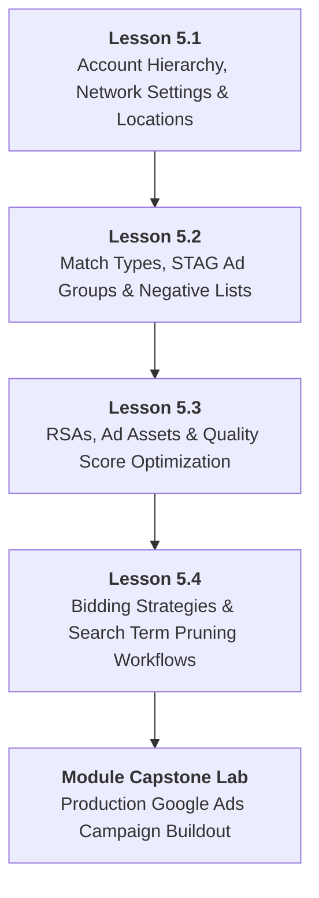

# DMP-MOD-05: Google Ads Search Campaign Architecture & Bidding
## Detailed Teaching Syllabus & Lesson Specifications

**Course ID:** `dm-professional`  
**Course Name:** AI Digital Marketing Professional  
**Module ID:** `DMP-MOD-05`  
**Module Title:** Google Ads Search Campaign Architecture & Bidding  
**Curriculum Version:** 1.0 (October 2026)  
**Parent Plan:** [`docs/course-redesign/digital-marketing/dm-professional-redesign-plan.md`](file:///c:/Users/wasee/Desktop/NovaSkillsProject/NovaSkills%20Website/docs/course-redesign/digital-marketing/dm-professional-redesign-plan.md)  
**Target Learner Profile:** Career Seekers, Junior Marketing Associates, Digital Marketing Executives  
**Total Workload:** 20.0 Hours (10.0h Supervised Instruction + 6.0h Guided Practical Labs & Assignments + 4.0h Comprehensive Capstone Project)  

---

## 1. Module Overview & Pedagogical Architecture

### 1.1 Module Objective
The objective of **DMP-MOD-05** is to deliver rigorous, employable competence in paid search advertising on Google Ads. Moving past superficial "Smart Campaigns" and express modes that waste advertising capital, this module trains learners to structure professional search campaigns using Single-Theme Ad Groups (STAGs), configure tight keyword match types and negative lists, write high-Ad-Strength Responsive Search Ads (RSAs) with comprehensive ad assets, select mathematically appropriate bidding strategies, and execute ongoing search term pruning to maximize Return on Ad Spend (ROAS).

### 1.2 Pedagogical Workload Breakdown (20.0 Total Hours)

```
┌────────────────────────────────────────────────────────────────────────┐
│                   DMP-MOD-05 TOTAL WORKLOAD: 20 HOURS                  │
├────────────────────────────┬────────────────────────────┬──────────────┤
│ Supervised Contact Time    │ Independent Practice Time  │ Capstone Lab │
│ 10.0 Hours Total           │ 6.0 Hours Total            │ 4.0 Hours    │
├────────────────────────────┼────────────────────────────┼──────────────┤
│ • Supervised Lecture: 5.0h │ • Independent Homework:    │ • Module 05  │
│ • Guided Lab: 5.0h         │   4.0h (4 x 1.0h)          │   Google Ads │
│   (4 Lessons x 2.5h each)  │ • Formative Quizzes: 2.0h  │   Search     │
│                            │                            │   Campaign   │
└────────────────────────────┴────────────────────────────┴──────────────┘
```

- **Lesson 5.1:** Google Ads Account Hierarchy, Network Targeting & Campaign Settings (2.5h Supervised Contact + 1.0h Independent Practice)
- **Lesson 5.2:** Keyword Match Types, Single-Theme Ad Groups (STAGs) & Negative Keyword Lists (2.5h Supervised Contact + 1.0h Independent Practice)
- **Lesson 5.3:** Responsive Search Ads (RSAs), Ad Assets (Extensions) & Quality Score Optimization (2.5h Supervised Contact + 1.0h Independent Practice)
- **Lesson 5.4:** Bidding Strategies, Search Term Reports & Negative Pruning Workflows (2.5h Supervised Contact + 1.0h Independent Practice)
- **Comprehensive Module Capstone:** Production-Ready Google Ads Search Campaign Build & Optimization Protocol (4.0h Supervised Lab & Technical Audit Defense)

---

## 2. Lesson-by-Lesson Syllabus Specifications



---

### Lesson 5.1: Google Ads Account Hierarchy, Network Targeting & Campaign Settings

#### 1. Lesson Identification
- **Lesson Number:** `DMP-5.1`
- **Lesson Title:** Google Ads Account Hierarchy, Network Targeting & Campaign Settings
- **Time Allocation:** Theory: 1.25 Hours | Supervised Lab: 1.25 Hours | Homework: 1.0 Hour

#### 2. Main Topics & Detailed Numbered Subtopics
- **5.1.1 Google Ads Enterprise Account Hierarchy:**
  - Manager Accounts (MCC - My Client Center): Purpose, agency-client linking, user permissions (Admin, Standard, Read-only), central billing.
  - Individual Ad Accounts: Currency and timezone permanence (critical rules before setup).
  - Campaign level settings vs. Ad Group level settings vs. Keyword/Ad level controls.
- **5.1.2 Avoiding the "Google Express / Smart Mode" Beginner Trap:**
  - Switching an account from Smart Mode to **Expert Mode**.
  - Why automated "Smart Campaigns" conceal essential search term data, prevent negative keyword lists, and waste marketing budget.
- **5.1.3 Network Settings & The Display Network Pitfall:**
  - Search Network vs. Search Partners vs. Google Display Network (GDN).
  - The Golden Rule of Paid Search: **Never combine Search and Display in the same campaign**. Unchecking "Include Google Display Network" to prevent ad spend dilution.
- **5.1.4 Geographic Targeting, Languages & Device Bid Controls:**
  - Location targeting options: **Presence** (People in or regularly in your targeted locations) vs. **Interest** (People searching for your targeted locations).
  - Setting up localized radius targeting vs. city/state boundaries.
  - Language targeting best practices and desktop vs. mobile budget pacing.

#### 3. Teaching Explanations & Real Business Examples
- *Teaching Explanation:* When beginners set up a Google Ads account, Google defaults to "Smart Mode" with "Include Display Network" checked and location targeting set to "Presence or Interest". This default setting causes up to 40% of the budget to be wasted on accidental clicks from mobile gaming apps or people located 5,000 miles away who merely searched the city's name. A professional marketer immediately switches to Expert Mode, isolates Search only, and restricts location to "Presence only".
- *Real Business Example:* **Apex Commercial HVAC Repair (Mumbai)**. Their initial campaign spent ₹45,000 in one month with zero booked jobs. An audit revealed: Location was set to "India" with "Presence or Interest", and "Display Network" was checked. Ads were appearing on mobile flashlight apps in Kolkata and Punjab. Once re-configured to a 25km radius around Mumbai with "Presence only" and Display disabled, their cost per qualified phone call dropped from ₹15,000 to ₹650.

#### 4. Software & Relevant Features
- **Google Ads Platform (Expert Mode - Free Account Setup):** Account navigation, Manager Account (MCC) overview, Campaign Settings interface, Location Radius tool, Network toggles.
- **Google Ads Editor (Offline Desktop Tool):** Bulk campaign navigation and structural auditing.

#### 5. Trainer Demonstration (45 Minutes)
1. Navigate to Google Ads in an incognito window and demonstrate how to create an account **without creating a campaign first** to bypass mandatory billing entry.
2. Switch an account into **Expert Mode**.
3. Create a new Search Campaign draft: Name taxonomy conventions, deselect the Display Network, configure location radius with exclusion zones, and set language parameters.
4. Show the location settings dropdown and emphasize selecting "Presence: People in or regularly in your targeted locations".

#### 6. Student Practical Exercise (45 Minutes)
- **Title:** *Google Ads Expert Mode Account & Campaign Architecture Setup*
- **Task:** Configure the core settings for a search campaign for *ProTax Advisors: Corporate Tax Filing Services*.
- **Requirements:**
  1. Set up an Expert Mode Google Ads account shell (no ad spend required; draft mode).
  2. Create a Search Campaign shell adhering to strict agency naming taxonomy: `[Search] - [B2B] - [Corporate Tax] - [Tier 1 Cities]`.
  3. Deselect Display Network and select Search Network only.
  4. Configure location targeting to 3 specific major metro cities with "Presence only" enabled.
  5. Set daily budget pacing and language targeting.
- **Trainer Guidance:** Check each student's screen to verify that Display Network is completely disabled and location targeting is set to Presence; reject any setup with default Google Express settings.

#### 7. Assignment (1.0 Hour)
- Complete the full **Campaign Settings Blueprint Specification Sheet** for their course capstone business scenario, documenting account hierarchy, location exclusions, and budget schedules.

#### 8. Expected Learning Outcomes
- Navigate Google Ads Expert Mode and MCC structures.
- Configure campaign settings that prevent budget waste across the Display Network.
- Apply strict geographic presence targeting and language parameters.

#### 9. Assessment Criteria
- Strict de-selection of the Google Display Network in search campaigns.
- Correct selection of the "Presence" location targeting radio button.

---

### Lesson 5.2: Keyword Match Types, Single-Theme Ad Groups (STAGs) & Negative Keyword Lists

#### 1. Lesson Identification
- **Lesson Number:** `DMP-5.2`
- **Lesson Title:** Keyword Match Types, Single-Theme Ad Groups (STAGs) & Negative Keyword Lists
- **Time Allocation:** Theory: 1.25 Hours | Supervised Lab: 1.25 Hours | Homework: 1.0 Hour

#### 2. Main Topics & Detailed Numbered Subtopics
- **5.2.1 The Modern Keyword Match Type Taxonomy:**
  - **Exact Match `[keyword]`:** Matches search queries with identical meaning or close variants; highest commercial intent, lowest wasted spend.
  - **Phrase Match `"keyword"`:** Matches search queries containing the meaning of your keyword; moderate volume, balanced intent.
  - **Broad Match `keyword`:** Matches any related search query determined by Google AI; highest reach, immense risk of irrelevant click waste if used without negative lists.
- **5.2.2 Single-Theme Ad Groups (STAGs) Architecture:**
  - Why outdated SKAGs (Single Keyword Ad Groups) are dead due to close-variant matching.
  - Structuring modern STAGs: Grouping 3 to 7 tightly related keywords sharing identical user intent per ad group (e.g., Ad Group 1: `Tax Filing Consultant`, Ad Group 2: `GST Registration Agent`, Ad Group 3: `Payroll Compliance Service`).
  - Ensuring 100% ad copy relevance to the specific theme of the ad group.
- **5.2.3 Negative Keyword Engineering & Account Protection:**
  - The vital role of negative keywords: Preventing ads from triggering on irrelevant, wasteful, or harmful queries.
  - Universal Negative Keyword Lists:
    - *Employment / Career:* `jobs, vacancy, salary, resume, interview, hiring, glassdoor`
    - *Free / Low-Value:* `free, crack, torrent, download, open source, pdf, cheap`
    - *Educational / Research:* `what is, definition, history, courses, wiki, youtube`
    - *DIY / Competitor:* Specific low-intent phrases.
  - Negative Match Types: Negative Broad, Negative Phrase `-"free"`, Negative Exact `-[competitor name]`.
- **5.2.4 Campaign-Level vs. Account-Level Negative Lists:**
  - Creating centralized Negative Keyword Lists in the Shared Library and applying them dynamically across all search campaigns.

#### 3. Teaching Explanations & Real Business Examples
- *Teaching Explanation:* If you bid on the broad match keyword `tax consultant`, Google might show your ad for `"how to become a tax consultant"` (a student looking for a job), `"free tax calculator online"` (someone with zero money), or `"tax consultant salary in Pune"` (someone researching wages). By building a STAG around phrase and exact match `"[corporate tax consultant]"` and applying a universal negative list blocking `"job, salary, free, course"`, every single rupee spent goes to genuine buyers.
- *Real Business Example:* **Apex Dental Implant Center**. Spent ₹30,000 on broad match `dental implants`. Inspection of their search terms showed 65% of clicks were for: `"dental implant degree courses"`, `"are dental implants painful"`, and `"free government dental clinics"`. Once restructured into 3 STAGs (`[Titanium Implants]`, `[Full Mouth Implants]`, `[Same Day Implants]`) with 85 negative keywords applied, cost per patient consultation dropped from ₹4,200 to ₹950.

#### 4. Software & Relevant Features
- **Google Ads Keyword Planner:** Extracting thematic keyword clusters.
- **Google Ads Shared Library:** Building, managing, and applying master Negative Keyword Lists.
- **Google Sheets:** Building Single-Theme Ad Group (STAG) architecture workbooks.

#### 5. Trainer Demonstration (45 Minutes)
1. Open Google Ads and navigate to Tools & Settings ➔ Shared Library ➔ Negative Keyword Lists.
2. Build a live "Universal B2B Negative List" containing 50 standard negative terms (jobs, free, definition, pdf, etc.) and associate it with a campaign.
3. Construct 2 distinct Single-Theme Ad Groups in Google Sheets, demonstrating exact syntax formatting: `[exact match]` and `"phrase match"`.
4. Walk through an ad group keyword preview, showing how match types trigger different query variations.

#### 6. Student Practical Exercise (45 Minutes)
- **Title:** *STAG Architecture & Negative Keyword List Build*
- **Task:** Build the keyword architecture for *Elite Movers: Premium Commercial Office Relocation*.
- **Requirements:**
  1. Construct 3 distinct Single-Theme Ad Groups (e.g., STAG 1: Office Relocation, STAG 2: Corporate IT Moving, STAG 3: Commercial Storage).
  2. Add 4 tightly themed keywords per ad group in both Phrase `" "` and Exact `[ ]` match types (24 keywords total).
  3. Compile a master Negative Keyword List containing at least 25 universal negative terms categorized by Career, Free/Cheap, and DIY intent.
  4. Document the structure in a standardized Google Sheets campaign workbook.
- **Trainer Guidance:** Check student keywords for proper syntax (quotes and brackets); disqualify any broad match keywords entered without specific negative guardrails.

#### 7. Assignment (1.0 Hour)
- Produce a **Complete Keyword & STAG Architecture Workbook** containing 4 themed ad groups (16–24 keywords) and a 35-term master negative list for their course capstone business scenario.

#### 8. Expected Learning Outcomes
- Apply Exact and Phrase match types strategically to balance volume and intent.
- Architect Single-Theme Ad Groups (STAGs) that achieve high message relevance.
- Compile and implement account-level and campaign-level Negative Keyword Lists.

#### 9. Assessment Criteria
- Strict thematic tightness within each ad group (no cross-contamination of themes).
- Error-free bracket and quote syntax in match type definitions.

---

### Lesson 5.3: Responsive Search Ads (RSAs), Ad Assets (Extensions) & Quality Score Optimization

#### 1. Lesson Identification
- **Lesson Number:** `DMP-5.3`
- **Lesson Title:** Responsive Search Ads (RSAs), Ad Assets (Extensions) & Quality Score Optimization
- **Time Allocation:** Theory: 1.25 Hours | Supervised Lab: 1.25 Hours | Homework: 1.0 Hour

#### 2. Main Topics & Detailed Numbered Subtopics
- **5.3.1 Mechanics of Modern Responsive Search Ads (RSAs):**
  - Up to 15 Headlines (30 characters max each) and 4 Descriptions (90 characters max each).
  - How Google's machine learning rotates and tests headline/description combinations to maximize CTR and conversions.
  - Ad Strength Indicator (Poor, Average, Good, Excellent): What factors genuinely drive "Excellent" ad strength (keyword inclusion, unique benefit hooks, call-to-action variety).
- **5.3.2 Headline Pinning Strategy (Control vs. Machine Learning):**
  - When and how to pin headlines:
    - *Pin Position 1:* Core ad group keyword match (relevance guarantee).
    - *Pin Position 2:* Primary value proposition or unique transformation.
    - *Pin Position 3:* Urgency, risk reversal, or call-to-action.
  - The trade-off: Pinning reduces Google's testing flexibility but guarantees compliance and narrative coherence.
- **5.3.3 Comprehensive Ad Assets (Extensions) Ecosystem:**
  - Why ad assets are critical: Expanding SERP visual footprint, pushing competitors down, and boosting CTR by 15–20%.
  - **Sitelink Assets:** Adding 4 clickable sub-page links with 2-line descriptions (e.g., Pricing, Client Reviews, Case Studies, Contact Us).
  - **Callout Assets:** 4–6 non-clickable benefit snippets (e.g., "24/7 Live Support", "No Setup Fees", "ISO 9001 Certified").
  - **Structured Snippets:** Categorized lists (e.g., Types: Sedan, SUV, Luxury; Services: Audit, Setup, Management).
  - **Call Assets & Lead Form Assets:** Direct phone calling buttons and native mobile lead forms.
- **5.3.4 Deconstructing Google's Quality Score (1–10 Scale):**
  - The 3 Pillars of Quality Score:
    1. **Expected Click-Through Rate (eCTR):** How likely your ad is to be clicked based on historical performance.
    2. **Ad Relevance:** How closely your ad copy matches the user's search query intent.
    3. **Landing Page Experience:** Relevance, transparency, mobile speed, and navigation of the destination page.
  - The Economic Impact of Quality Score: High Quality Score (8–10) gives up to a **50% discount on CPC**; Low Quality Score (1–4) imposes a **up to 400% penalty tax on CPC**.

#### 3. Teaching Explanations & Real Business Examples
- *Teaching Explanation:* Many advertisers think the highest bidder always wins the #1 spot on Google. This is mathematically false. Google ranks ads using **Ad Rank = Max CPC Bid $\times$ Quality Score**. An advertiser bidding ₹50 with a Quality Score of 10 achieves an Ad Rank of 500 and wins the top spot, paying less than a sloppy competitor who bids ₹100 with a Quality Score of 3 (Ad Rank 300). Mastering Quality Score through tight keyword-to-ad relevance is how smart marketers outcompete bigger budgets.
- *Real Business Example:* **QuickLegal Online Trademark Filing**. Competitors were bidding ₹220 per click with generic ads pointing to homepages (Quality Score: 4). QuickLegal created a dedicated STAG for `[trademark registration online]`, wrote an RSA with "Trademark Registration Online" pinned to Headline 1, added 4 sitelinks pointing to pricing and FAQ, and directed traffic to a dedicated 1-page landing page. Their Quality Score hit 9/10, dropping their actual CPC to ₹95 while holding the #1 position on the page.

#### 4. Software & Relevant Features
- **Google Ads RSA Builder:** Real-time character counter, ad preview visualizer (mobile vs. desktop), Ad Strength rating engine.
- **Google Ads Assets Interface:** Sitelinks, Callouts, Structured Snippets, and Call extension setup.
- **Google Sheets:** Building RSA copywriting templates with character length validation formulas (`=LEN()`).

#### 5. Trainer Demonstration (45 Minutes)
1. Open Google Ads RSA creator interface for a sample ad group.
2. Draft 10 diverse headlines live, demonstrating the use of `=LEN()` in Google Sheets to enforce the strict 30-character limit.
3. Show how adding diverse headlines (Questions, Numbers, Offers, CTAs) shifts Ad Strength from "Poor" to "Good" and "Excellent".
4. Build 4 complete Sitelinks with two 35-character description lines and demonstrate how the mobile SERP preview expands.
5. Show where Quality Score columns (eCTR, Ad Relevance, Landing Page Experience) are added in the Google Ads keyword report.

#### 6. Student Practical Exercise (45 Minutes)
- **Title:** *Responsive Search Ad (RSA) & Ad Asset Suite Build*
- **Task:** Create a complete RSA and asset package for *DataVault: Enterprise Cloud Backup Solutions*.
- **Requirements:**
  1. Write 10 headlines (maximum 30 characters each) adhering to character limits, covering: 3 Keyword matches, 3 Value propositions, 2 Social proof/numbers, and 2 Direct CTAs.
  2. Write 3 descriptions (maximum 90 characters each).
  3. Formulate 4 Sitelinks with Title and 2 description lines each.
  4. Formulate 4 Callout Assets and 1 Structured Snippet (Type: Services).
  5. Verify that all copy respects character limits using character-counting tools.
- **Trainer Guidance:** Reject any headline with 31 characters; teach students how to edit down words ruthlessly while preserving punchiness and keyword relevance.

#### 7. Assignment (1.0 Hour)
- Build the complete **Responsive Search Ad (RSA) Copywriting & Ad Asset Master Deck** (2 RSAs and 4 full asset types) for their course capstone business scenario.

#### 8. Expected Learning Outcomes
- Author high-Ad-Strength Responsive Search Ads that combine algorithmic variation with narrative control.
- Configure Sitelink, Callout, and Structured Snippet assets to maximize SERP visual footprint.
- Explain the 3 components of Quality Score and formulate tactics to achieve 8+/10 scores.

#### 9. Assessment Criteria
- 100% compliance with strict character limits (30 chars for headlines, 90 chars for descriptions).
- Visual completeness and relevance of configured Sitelinks, Callouts, and Snippets.

---

### Lesson 5.4: Bidding Strategies, Search Term Reports & Negative Pruning Workflows

#### 1. Lesson Identification
- **Lesson Number:** `DMP-5.4`
- **Lesson Title:** Bidding Strategies, Search Term Reports & Negative Pruning Workflows
- **Time Allocation:** Theory: 1.25 Hours | Supervised Lab: 1.25 Hours | Homework: 1.0 Hour

#### 2. Main Topics & Detailed Numbered Subtopics
- **5.4.1 Bidding Strategies Spectrum (Manual vs. Smart Bidding):**
  - **Manual CPC / Enhanced CPC:** Best for new accounts with zero conversion data; full control over maximum bid caps; prevents algorithmic overspending.
  - **Maximize Clicks:** Goal is driving traffic volume within a daily budget; dangerous without setting a **Maximum CPC Bid Limit**.
  - **Maximize Conversions:** Algorithmic bidding using machine learning to secure the highest conversion volume; requires accurate conversion tracking.
  - **Target CPA (Cost Per Acquisition):** Setting a target cost per lead; requires historical conversion volume (recommended 30+ conversions in past 30 days).
  - **Target ROAS (Return On Ad Spend):** Best for e-commerce with dynamic cart values; requires revenue tracking data.
- **5.4.2 The Recommended Bidding Progression for New Accounts:**
  - Stage 1 (Days 1–14): Maximize Clicks with a conservative Max CPC Bid Limit to gather initial click data and build Quality Score.
  - Stage 2 (Days 15–45): Switch to Maximize Conversions once conversion tracking is verified and 20+ conversions are logged.
  - Stage 3 (Scaling): Apply Target CPA or Target ROAS once predictable conversion baseline rates are established.
- **5.4.3 Search Term Reports vs. Keyword Reports:**
  - Critical distinction: The **Keyword** is what you bid on; the **Search Term** is the exact string the user typed into Google.
  - How close variants and broad/phrase match cause search terms to deviate from your intended keywords.
- **5.4.4 The 7-Day Negative Keyword Pruning Routine:**
  - Step 1: Filter Search Terms report by Clicks > 0 and Conversions = 0.
  - Step 2: Sort by Spend descending to identify budget bleeds.
  - Step 3: Identify irrelevant search intents, brand names, or low-value queries.
  - Step 4: Add wasteful terms directly to Negative Keyword Lists (as Phrase or Exact negatives).
  - Step 5: Identify high-performing unexpected search terms and promote them to dedicated STAGs.

#### 3. Teaching Explanations & Real Business Examples
- *Teaching Explanation:* Launching a Google Ads campaign is only 20% of the job; 80% of success comes from the weekly optimization routine. If you set up a campaign and leave it alone for a month, Google will spend your budget on increasingly broad query variations. Professional search marketers review the Search Terms Report every 7 days, ruthlessly pruning wasteful terms and feeding the negative keyword list.
- *Real Business Example:* **Apex Residential Roofing Contractors**. Launched a campaign bidding on `"roof replacement cost"`. In the second week, the Search Terms report revealed ₹18,000 spent on `"car roof replacement"`, `"asbestos roof legal liability"`, and `"diy roof patch tutorial"`. None of these people wanted a new house roof. The marketer immediately added `-"car"`, `-"asbestos"`, and `-"diy"` to the negative keyword list, stopping the bleed and instantly restoring campaign profitability.

#### 4. Software & Relevant Features
- **Google Ads Search Terms Report:** Filtering by impressions, clicks, cost, and conversion metrics; one-click negative keyword addition.
- **Google Ads Bid Strategy Interface:** Configuring Maximize Clicks with Max CPC caps, Target CPA, and Target ROAS.
- **Google Sheets:** Building 7-day search term pruning audit logs and performance tracking sheets.

#### 5. Trainer Demonstration (45 Minutes)
1. Open a live Google Ads account with active search campaign history.
2. Navigate to Keywords ➔ Search Terms Report.
3. Demonstrate how to apply a filter: `Conversions = 0` and `Cost > ₹500`.
4. Walk through 10 real search terms on screen, categorizing each into: (a) Add to Negative List, (b) Promote to New Ad Group, or (c) Keep Monitoring.
5. Demonstrate how to select 3 negative terms and add them directly to the Master Negative Keyword List with correct match type syntax.

#### 6. Student Practical Exercise (45 Minutes)
- **Title:** *Search Term Report Diagnostic & Negative Pruning Workshop*
- **Task:** Analyze an exported 30-day Google Search Terms dataset (50 queries provided in Google Sheets) for an enterprise software client.
- **Requirements:**
  1. Audit the 50 queries: Calculate total spend wasted on irrelevant queries with 0 conversions.
  2. Identify 10 queries that must be immediately added as Negative Keywords, specifying whether they should be Negative Phrase or Negative Exact.
  3. Identify 2 breakout high-converting search terms that should be extracted from general ad groups and promoted into dedicated STAGs.
  4. Write a 1-page weekly optimization log explaining the rationale for the budget reallocation.
- **Trainer Guidance:** Check student negative keyword match types; ensure students do not add an entire 5-word sentence as an exact negative when adding a single phrase negative (e.g., `-"free"`) would block 15 other wasted queries simultaneously.

#### 7. Assignment (1.0 Hour)
- Produce a **7-Day Search Campaign Optimization Protocol & Bidding Roadmap** detailing the bid strategy transition phases and weekly negative pruning schedule for their capstone business.

#### 8. Expected Learning Outcomes
- Evaluate and select appropriate Google Ads bidding strategies based on account conversion maturity.
- Perform systematic search term pruning to eliminate wasted ad spend.
- Identify and promote high-converting search queries into dedicated ad groups.

#### 9. Assessment Criteria
- Accuracy in diagnosing wasted search terms from raw query logs.
- Strategic logic in selecting negative keyword match types (Phrase vs. Exact).

---

## 3. Comprehensive Module 05 Capstone Project

### Project Title
**Production-Ready Google Ads Search Campaign Buildout & Optimization Protocol**

### Project Scenario
Acting as a Paid Search Specialist at a digital marketing agency, students build a complete, production-ready Google Ads Search Campaign architecture for their assigned enterprise (*PureBotanics Skincare*, *TalentForge Recruitment*, or *Starlight Dental Care*).

### Required Project Deliverables (Campaign Architecture Package)
1. **Campaign Settings & Location Specification:**
   - Agency-standard campaign naming taxonomy.
   - Network settings (Search Network only; zero Display Network).
   - Geographic presence targeting with defined inclusion radiuses and explicit exclusions.
   - Daily budget allocation and recommended bidding strategy for Day 1 launch.
2. **STAG Keyword Architecture & Master Negative List:**
   - 3 distinct Single-Theme Ad Groups (STAGs) with 4–6 tightly themed keywords each in Phrase `" "` and Exact `[ ]` match types (zero loose broad match).
   - Universal Negative Keyword List containing at least 30 categorized negative search terms.
3. **Responsive Search Ad (RSA) & Asset Suite:**
   - 1 production-ready RSA per ad group (10–12 unique headlines, 3 descriptions, character limits verified via `=LEN()`).
   - 4 fully populated Sitelink Assets with descriptions.
   - 4 Callout Assets and 1 Structured Snippet Asset.
4. **Weekly Search Terms Audit & Bidding Transition Protocol:**
   - Standard Operating Procedure (SOP) for the 7-day search term pruning workflow.
   - 90-day bidding transition roadmap (Maximize Clicks $\rightarrow$ Maximize Conversions $\rightarrow$ Target CPA).

### Lab Time Allocation
- **4.0 Hours Supervised Capstone Session:** 2.5 hours guided account buildout and character validation + 1.5 hours technical peer review and trainer campaign audit defense.

---

## 4. Module 05 Assessment & Grading Rubric (100 Points)

| Assessment Dimension | Maximum Points | Excellent (90–100%) | Proficient (70–89%) | Needs Improvement (<70%) |
| :--- | :---: | :--- | :--- | :--- |
| **1. Campaign Settings & Safety** | 20 | Zero Display Network; location set to "Presence only"; strict naming taxonomy; appropriate starting bid strategy. | Display disabled; location correct; minor formatting oversights in naming taxonomy. | Display Network left enabled; location left on default "Interest"; inappropriate bidding setup. |
| **2. STAG Architecture & Match Types** | 25 | All 3 ad groups are tightly themed around single intents; flawless Phrase and Exact syntax; zero loose broad match. | Tightly themed ad groups; correct syntax; minor keyword overlap between groups. | Disorganized ad groups mixing disparate intents; missing match type brackets/quotes. |
| **3. Negative Keyword Engineering** | 20 | 30+ comprehensive, categorized negative terms; intelligent use of Negative Phrase to block broad query families. | 25+ solid negative terms; covers core career and free queries. | Fewer than 15 negative terms; missing obvious negative categories (jobs, free, DIY). |
| **4. RSA Copywriting & Asset Suite** | 25 | 100% character limit compliance; strong keyword insertion; diverse benefit/CTA angles; full sitelinks and callouts. | Character limits respected; solid copy; ad assets are complete but conventional. | Character limit violations (>30 or >90 chars); missing ad assets; generic ad strength. |
| **5. Optimization Protocol & Defense** | 10 | Clear, actionable 7-day pruning SOP; sound mathematical bid transition logic; confident technical defense. | Solid pruning protocol; able to explain bidding stages during defense. | Incomplete SOP; unable to explain difference between keywords and search terms. |

---

## 5. Trainer & Student Completion Checklist

### Student Verification Checklist
- [ ] Created an Expert Mode Google Ads account shell with Display Network completely disabled.
- [ ] Configured geographic targeting to "Presence only" with defined location exclusions.
- [ ] Structured 3 Single-Theme Ad Groups with Phrase and Exact match keywords.
- [ ] Compiled a 30-term Master Negative Keyword List in the Shared Library.
- [ ] Authored 10+ headlines and 3 descriptions per RSA with verified character limits.
- [ ] Configured 4 Sitelink assets with descriptions, 4 Callouts, and 1 Structured Snippet.
- [ ] Documented a 7-day search terms pruning workflow and bidding strategy roadmap.
- [ ] Submitted the full Production-Ready Google Ads Campaign Buildout.

### Trainer Delivery Checklist
- [ ] Verified that all student campaign drafts have Google Display Network completely disabled.
- [ ] Confirmed student location settings are set to "Presence" rather than default "Presence or Interest".
- [ ] Audited student RSA headlines for strict 30-character length compliance.
- [ ] Inspected student Negative Keyword Lists to confirm proper negative match types.
- [ ] Evaluated the Module 05 Capstone Campaign Build against the 100-point rubric and provided actionable critique.
