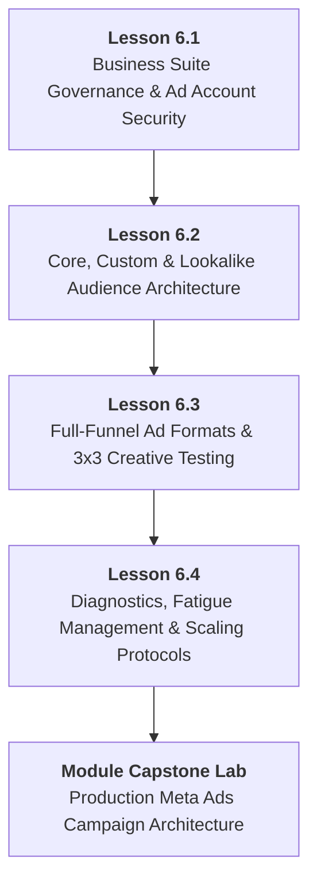

# DMP-MOD-06: Meta Ads Manager, Audience Funnels & Paid Social Scaling
## Detailed Teaching Syllabus & Lesson Specifications

**Course ID:** `dm-professional`  
**Course Name:** AI Digital Marketing Professional  
**Module ID:** `DMP-MOD-06`  
**Module Title:** Meta Ads Manager, Audience Funnels & Paid Social Scaling  
**Curriculum Version:** 1.0 (October 2026)  
**Parent Plan:** [`docs/course-redesign/digital-marketing/dm-professional-redesign-plan.md`](file:///c:/Users/wasee/Desktop/NovaSkillsProject/NovaSkills%20Website/docs/course-redesign/digital-marketing/dm-professional-redesign-plan.md)  
**Target Learner Profile:** Career Seekers, Junior Marketing Associates, Digital Marketing Executives  
**Total Workload:** 20.0 Hours (10.0h Supervised Instruction + 6.0h Guided Practical Labs & Assignments + 4.0h Comprehensive Capstone Project)  

---

## 1. Module Overview & Pedagogical Architecture

### 1.1 Module Objective
The objective of **DMP-MOD-06** is to deliver industry-standard, professional mastery over paid social advertising across Meta platforms (Facebook, Instagram, Messenger). Moving decisively beyond the amateur "Boost Post" button on mobile, this module trains learners to architect enterprise-grade business structures in Meta Business Suite, configure custom and lookalike audiences, deploy structured full-funnel paid social campaigns (Prospecting, Retargeting, Retention), execute systematic 3x3 creative testing matrices, analyze core unit economics (CPL, CPA, CTR, ROAS, Frequency), and implement safe horizontal and vertical budget scaling protocols.

### 1.2 Pedagogical Workload Breakdown (20.0 Total Hours)

```
┌────────────────────────────────────────────────────────────────────────┐
│                   DMP-MOD-06 TOTAL WORKLOAD: 20 HOURS                  │
├────────────────────────────┬────────────────────────────┬──────────────┤
│ Supervised Contact Time    │ Independent Practice Time  │ Capstone Lab │
│ 10.0 Hours Total           │ 6.0 Hours Total            │ 4.0 Hours    │
├────────────────────────────┼────────────────────────────┼──────────────┤
│ • Supervised Lecture: 5.0h │ • Independent Homework:    │ • Module 06  │
│ • Guided Lab: 5.0h         │   4.0h (4 x 1.0h)          │   Meta Ads   │
│   (4 Lessons x 2.5h each)  │ • Formative Quizzes: 2.0h  │   Funnel &   │
│                            │                            │   Scaling Lab│
└────────────────────────────┴────────────────────────────┴──────────────┘
```

- **Lesson 6.1:** Meta Business Suite Architecture, Ad Account Governance & Pixel Asset Pairing (2.5h Supervised Contact + 1.0h Independent Practice)
- **Lesson 6.2:** Audience Architecture: Core Demographics, Custom Audiences & Lookalike Modeling (2.5h Supervised Contact + 1.0h Independent Practice)
- **Lesson 6.3:** Full-Funnel Paid Social Ad Formats, Creative Strategy & 3x3 Testing Matrices (2.5h Supervised Contact + 1.0h Independent Practice)
- **Lesson 6.4:** Campaign Diagnostics, Ad Fatigue Management, Budget Scaling & Policy Compliance (2.5h Supervised Contact + 1.0h Independent Practice)
- **Comprehensive Module Capstone:** Full-Funnel Meta Ads Acquisition Architecture & Creative Testing Suite (4.0h Supervised Lab & Campaign Review Defense)

---

## 2. Lesson-by-Lesson Syllabus Specifications



---

### Lesson 6.1: Meta Business Suite Architecture, Ad Account Governance & Pixel Asset Pairing

#### 1. Lesson Identification
- **Lesson Number:** `DMP-6.1`
- **Lesson Title:** Meta Business Suite Architecture, Ad Account Governance & Pixel Asset Pairing
- **Time Allocation:** Theory: 1.25 Hours | Supervised Lab: 1.25 Hours | Homework: 1.0 Hour

#### 2. Main Topics & Detailed Numbered Subtopics
- **6.1.1 Enterprise Business Governance vs. Personal Profiles:**
  - Why professional marketers never run ads from personal profiles or click the mobile "Boost Post" button.
  - Architecture of **Meta Business Suite / Business Manager**: Business Accounts, Assets (Pages, Ad Accounts, Pixels/Datasets, Instagram Accounts), and People.
  - Role-based permissions: Admin vs. Employee vs. Financial Analyst vs. Partner access.
- **6.1.2 Partner Access & Agency Client Onboarding:**
  - How an agency requests access to client assets without asking for personal Facebook passwords.
  - Using Partner Business IDs: Requesting access to client Pages, Ad Accounts, and Pixels with appropriate permission tiers.
- **6.1.3 Meta Pixel & Dataset Asset Pairing:**
  - Understanding the Meta Pixel / Dataset: The bridge connecting website visitor behavior back to Meta's machine learning algorithm.
  - Creating a Dataset inside Business Settings and assigning it to the designated Ad Account.
  - Connecting the verified Instagram Business Profile and Facebook Page to the Ad Account.
- **6.1.4 Ad Account Security, Payment Thresholds & 2FA Enforcement:**
  - Mandatory Two-Factor Authentication (2FA) enforcement across all business users.
  - Managing billing thresholds, primary and secondary payment methods, and preventing ad account payment freezes.

#### 3. Teaching Explanations & Real Business Examples
- *Teaching Explanation:* The biggest mistake junior marketers make is running client ads from their own personal Facebook account or asking clients for their personal Facebook login password. This is an immediate violation of Meta's terms and creates massive liability. Professional agencies operate through Meta Business Manager, using Partner Access requests to manage client assets securely while maintaining centralized governance.
- *Real Business Example:* **Apex Media Agency Onboarding**. A new client (*PureOrganic Supplements*) hired an agency to run Instagram ads. A previous freelancer had created the ad account under his personal profile, and when he left, the client lost access to ₹12 Lakhs of historical pixel data. The new agency properly onboarded the client: Created an official Meta Business Account for the client, paired their corporate billing card, added the agency via Partner ID, and created an agency-owned Dataset that the client retains forever.

#### 4. Software & Relevant Features
- **Meta Business Suite / Business Settings (Free Platform):** User access management, Partner ID linking, Ad Account creation, Dataset/Pixel pairing, Brand Safety domain verification.
- **Meta Pixel Helper (Chrome Extension):** Verifying live pixel firing on destination websites.

#### 5. Trainer Demonstration (45 Minutes)
1. Open Meta Business Settings (`business.facebook.com/settings`).
2. Walk through the navigation: People, Partners, Pages, Ad Accounts, and Data Sets.
3. Demonstrate live how to generate an agency Partner Request link for a client asset.
4. Create a new test Dataset, assign connected assets (assigning the Ad Account to the Dataset), and show where the Dataset ID is located for tracking configuration.
5. Inspect a live e-commerce site using the Meta Pixel Helper Chrome extension, showing how the extension detects PageView events.

#### 6. Student Practical Exercise (45 Minutes)
- **Title:** *Meta Business Manager Asset Mapping & Governance Simulation*
- **Task:** Map out and configure the governance structure for an agency managing a retail client (*AuraLiving Home Décor*).
- **Requirements:**
  1. Access Meta Business Suite / Settings (sandbox account; zero ad spend required).
  2. Map out a complete business asset hierarchy: 1 Business Account, 1 Facebook Page, 1 Instagram Professional Account, 1 Ad Account, and 1 Data Set (Pixel).
  3. Draft an official agency client onboarding email detailing the step-by-step instructions for the client to accept an agency Partner Access request.
  4. Verify 2FA security enforcement checklist for the organization.
- **Trainer Guidance:** Ensure students understand that Ad Accounts cannot be deleted once created; emphasize that currency and timezone cannot be changed after initial setup.

#### 7. Assignment (1.0 Hour)
- Produce an **Agency-Client Meta Governance & Asset Onboarding Protocol** documenting asset connection procedures, permission roles, and security protocols for their course capstone business scenario.

#### 8. Expected Learning Outcomes
- Configure enterprise-grade asset hierarchies inside Meta Business Suite.
- Manage client onboarding using professional Partner Access requests.
- Pair Datasets (Pixels) with Ad Accounts and verify installation using Meta Pixel Helper.

#### 9. Assessment Criteria
- Correct mapping of business assets, permissions, and partner roles.
- Professional clarity and security compliance in the client onboarding instructions.

---

### Lesson 6.2: Audience Architecture: Core Demographics, Custom Audiences & Lookalike Modeling

#### 1. Lesson Identification
- **Lesson Number:** `DMP-6.2`
- **Lesson Title:** Audience Architecture: Core Demographics, Custom Audiences & Lookalike Modeling
- **Time Allocation:** Theory: 1.25 Hours | Supervised Lab: 1.25 Hours | Homework: 1.0 Hour

#### 2. Main Topics & Detailed Numbered Subtopics
- **6.2.1 The 3-Tier Meta Audience Spectrum:**
  - **Core Audiences (Cold / Prospecting):** Targeting based on location, age, gender, language, detailed interests, and behavioral signals.
  - **Custom Audiences (Warm / Retargeting):** Targeting people who have already interacted with your business (Website visitors, customer list upload, video viewers, Instagram engagers).
  - **Lookalike Audiences (Cold Expansion):** Algorithmic matching: Finding people who statistically mirror your highest-value existing customers.
- **6.2.2 Core Audience Targeting & Advantage+ Detailed Targeting:**
  - How Meta's machine learning interprets interests: Interest targeting vs. Broad targeting with creative filtering.
  - Advantage+ Audience: When to let Meta expand audience parameters beyond designated interests.
  - The critical rule of **Audience Exclusions**: Always excluding existing buyers and recent converters from cold prospecting ad sets to prevent wasted spend.
- **6.2.3 Constructing High-Value Custom Audiences:**
  - **Website Custom Audiences:** All website visitors (past 30, 60, 90 days), specific landing page visitors, checkout abandoners.
  - **Customer List (First-Party Data) Upload:** Preparing a CSV with hashed identifiers (Email, Phone, First Name, City); complying with data privacy regulations.
  - **Meta Native Engagement Audiences:** Video viewers (People who watched 50% or 75% of your video), Instagram profile engagers (past 365 days), Lead Form openers who didn't submit.
- **6.2.4 Lookalike (LAL) Modeling & Percentage Scaling:**
  - How Meta builds Lookalike Audiences: Analyzing common attributes, purchase history, and browsing behaviors of a seed source.
  - Seed Source Quality: Why a 500-person high-value purchaser list produces a vastly superior Lookalike compared to a 10,000-person cold page-like list.
  - Percentage tiers: 1% Lookalike (Closest match; highest intent) vs. 2–3% (Moderate scale) vs. 5–10% (Broad reach).

#### 3. Teaching Explanations & Real Business Examples
- *Teaching Explanation:* In paid social, targeting the wrong audience guarantees failure, but targeting the right audience with the wrong message also fails. The most powerful audience you will ever have is your own first-party data (past customers and high-intent website visitors). By uploading a customer list and creating a 1% Lookalike, you instruct Meta's multi-billion-dollar algorithm to find the 2 million people in India who behave exactly like your existing paying customers.
- *Real Business Example:* **Artisan Leather Goods (CraftHide)**. Originally ran ads targeting broad interest: "Leather bags, Luxury lifestyle" (Cost Per Purchase: ₹1,800). They restructured their audience architecture: Exported a list of their top 600 repeat buyers, built a 1% Lookalike Audience in India, and excluded past 90-day purchasers. Concurrently, they created a warm retargeting custom audience of people who visited the cart page in the last 14 days. Result: Lookalike prospecting drove fresh customers at ₹720 CPA, while the cart retargeting ad achieved an 8.4x ROAS.

#### 4. Software & Relevant Features
- **Meta Ads Manager - Audiences Interface:** Creating Saved Audiences, Custom Audiences (Website, Customer List, Video, Lead Form), and Lookalike Audiences (1% to 10% sliders).
- **Google Sheets:** Formatting customer list CSV files adhering to Meta's data formatting standards (country codes, lowercase emails).

#### 5. Trainer Demonstration (45 Minutes)
1. Open Meta Ads Manager ➔ Audiences menu.
2. Build a Core Saved Audience live: Set geographic radius, age/gender, layer 2 complementary interests, and demonstrate the "Exclude" button to filter out unqualified audiences.
3. Demonstrate creating a Website Custom Audience: Select Event ("PageView" or URL contains "thank-you"), set retention window to 30 days, and explain the trade-off between window length and audience freshness.
4. Build a 1% Lookalike Audience from a seed custom audience, showing how Meta calculates audience size.

#### 6. Student Practical Exercise (45 Minutes)
- **Title:** *3-Tier Meta Audience Architecture Build*
- **Task:** Build the complete audience targeting suite for *Apex Orthopedic Footwear*.
- **Requirements:**
  1. Build 1 Cold Core Prospecting Audience: Define age, gender, 3 focused health/footwear interests, and exclude existing buyers.
  2. Define 2 distinct Warm Custom Audiences: (a) 30-Day Website Product Page Visitors, and (b) 60-Day Instagram Profile Engagers.
  3. Create a 1% Lookalike Audience based on a hypothetical high-value customer seed source.
  4. Document audience sizes, targeting parameters, and exclusion rules in an Audience Mapping Sheet.
- **Trainer Guidance:** Check exclusion rules; fail any student who forgets to exclude recent buyers from cold prospecting ad sets.

#### 7. Assignment (1.0 Hour)
- Produce a **Comprehensive 3-Tier Audience Blueprint** (Cold Prospecting, Lookalike Expansion, and Warm Retargeting) for their course capstone business scenario.

#### 8. Expected Learning Outcomes
- Configure Core, Custom, and Lookalike audiences in Meta Ads Manager.
- Apply audience exclusions to prevent ad spend waste and audience overlap.
- Prepare first-party customer data for Lookalike modeling in compliance with privacy guidelines.

#### 9. Assessment Criteria
- Strategic logic in interest layering and audience definition.
- Correct implementation of audience exclusion parameters.

---

### Lesson 6.3: Full-Funnel Paid Social Ad Formats, Creative Strategy & 3x3 Testing Matrices

#### 1. Lesson Identification
- **Lesson Number:** `DMP-6.3`
- **Lesson Title:** Full-Funnel Paid Social Ad Formats, Creative Strategy & 3x3 Testing Matrices
- **Time Allocation:** Theory: 1.25 Hours | Supervised Lab: 1.25 Hours | Homework: 1.0 Hour

#### 2. Main Topics & Detailed Numbered Subtopics
- **2.1.1 The Meta Campaign Hierarchy:**
  - **Campaign Level:** Objective selection (Awareness, Traffic, Engagement, Leads, App Promotion, Sales) and Budget Architecture (Advantage Campaign Budget / CBO vs. Ad Set Budget / ABO).
  - **Ad Set Level:** Audience targeting, placements (Advantage+ Placements vs. Manual Placements), optimization for ad delivery, schedule.
  - **Ad Level:** Creative format, primary text, headline, description, visual asset, call-to-action button, destination URL.
- **2.2.2 Full-Funnel Creative Matching (TOFU ➔ MOFU ➔ BOFU):**
  - **TOFU (Top-of-Funnel / Cold):** High-retention video (15–30 sec), UGC (User-Generated Content) problem-demonstration, disruptive infographics. Goal: Stop the scroll and educate.
  - **MOFU (Middle-of-Funnel / Warm):** Multi-card Carousels, feature comparisons, customer transformation case studies. Goal: Overcome skepticism and build desire.
  - **BOFU (Bottom-of-Funnel / Hot):** Testimonial screenshots, limited-time discount codes, risk-reversal guarantees, FAQ objection handling. Goal: Force the decision.
- **2.3.3 The 3x3 Creative Testing Methodology:**
  - Why creative testing is the single greatest lever in paid social: Ad fatigue and creative burnout happen fast.
  - The 3x3 Testing Matrix: Testing **3 Distinct Visual Angles** (e.g., UGC Video vs. Clean Graphic Infographic vs. Founder Teardown) $\times$ **3 Distinct Copy Hooks** (e.g., Pain-Agitation vs. Direct Transformation vs. Social Proof).
  - Structuring an ABO (Ad Set Budget Optimization) creative sandbox to identify winning creatives before scaling in CBO.
- **2.4.4 Ad Placements & Native Aspect Ratio Rules:**
  - Advantage+ Placements (Automatic) vs. Manual Placements: When to let Meta distribute everywhere vs. restricting to Instagram Feeds & Reels.
  - Mandatory asset tailoring: 1:1 / 4:5 for Feeds, 9:16 for Stories and Reels. Customizing text and media crops per placement inside Ads Manager.

#### 3. Teaching Explanations & Real Business Examples
- *Teaching Explanation:* Amateur advertisers create 1 image, write 1 headline, spend ₹5,000, and conclude "Facebook ads don't work for my business." Professional media buyers treat creative production like a laboratory: They build structured 3x3 creative testing matrices inside isolated testing ad sets. When the data identifies the 1 ad that delivers an 80% lower cost per lead, they graduate that specific winning ad into a scaling campaign.
- *Real Business Example:* **SaaS CRM Platform (LeadPulse)**. Tested 3 creatives for a cold B2B audience: (1) Professional screenshot of dashboard, (2) Cartoon graphic about lost leads, (3) 20-second selfie video of a sales rep showing how LeadPulse alerts her on WhatsApp. Creative #1 had a ₹1,200 CPL; Creative #2 had an ₹850 CPL; Creative #3 delivered a ₹210 CPL with an 8.2% CTR. By isolating the winner through structured testing, they reallocated 90% of budget to Creative #3, scaling lead volume 5x without increasing daily budget.

#### 4. Software & Relevant Features
- **Meta Ads Manager (Campaign Creation Interface):** Campaign objectives, CBO/ABO toggles, Ad Set placement customizations, Ad creative uploader with placement asset tailoring.
- **Canva:** Producing 1:1 and 9:16 creative variations for ad testing.
- **Google Sheets:** Building 3x3 Creative Testing Matrix frameworks and naming taxonomy logs.

#### 5. Trainer Demonstration (45 Minutes)
1. Open Meta Ads Manager and click "Create Campaign".
2. Select the "Leads" objective and explain the difference between Advantage Campaign Budget (CBO) and Ad Set Budget (ABO).
3. Set up an ad set with Manual Placements, demonstrating how to customize media cropping for Feeds (1:1/4:5) vs. Stories/Reels (9:16).
4. Build a live ad inside Ads Manager: Upload contrasting media, enter primary text variations, select the CTA button ("Learn More" vs. "Get Quote"), and configure UTM parameters in the URL tracking field.

#### 6. Student Practical Exercise (45 Minutes)
- **Title:** *Meta Full-Funnel Campaign & Creative Matrix Build*
- **Task:** Build a draft full-funnel lead generation campaign inside Meta Ads Manager (draft mode; zero ad spend required) for *GreenLeaf Cold-Pressed Juices*.
- **Requirements:**
  1. Create a campaign shell with the "Leads" objective.
  2. Structure 2 Ad Sets: Ad Set 1 = Cold Prospecting (Broad/Interest), Ad Set 2 = Warm Retargeting (Website Visitors past 30 days).
  3. Inside Ad Set 1, build 3 contrasting ad creatives adhering to a 3x3 testing matrix (1 UGC-style visual, 1 Product benefit graphic, 1 Customer review carousel).
  4. Ensure all ad copy utilizes distinct hooks (Pain-agitation vs. Transformation vs. Discount).
  5. Tailor creative aspect ratios for Feeds (1:1) and Stories (9:16).
- **Trainer Guidance:** Inspect student placement customizations; ensure no 1:1 square graphics appear stretched or cut off in 9:16 vertical story previews.

#### 7. Assignment (1.0 Hour)
- Complete the full **3x3 Creative Testing Matrix Specification Sheet** for their course capstone business scenario, including all 9 visual/copy combinations and naming taxonomy.

#### 8. Expected Learning Outcomes
- Navigate the 3-tier Meta Ads Manager campaign hierarchy.
- Deploy full-funnel creative strategies tailored for TOFU, MOFU, and BOFU stages.
- Build and execute structured 3x3 creative testing matrices.

#### 9. Assessment Criteria
- Proper alignment between campaign objectives and ad set delivery settings.
- Diversity and quality of visual and copywriting angles in the creative testing matrix.

---

### Lesson 6.4: Campaign Diagnostics, Ad Fatigue Management, Budget Scaling & Policy Compliance

#### 1. Lesson Identification
- **Lesson Number:** `DMP-6.4`
- **Lesson Title:** Campaign Diagnostics, Ad Fatigue Management, Budget Scaling & Policy Compliance
- **Time Allocation:** Theory: 1.25 Hours | Supervised Lab: 1.25 Hours | Homework: 1.0 Hour

#### 2. Main Topics & Detailed Numbered Subtopics
- **4.1.1 Essential Media Buying Metrics & Performance Diagnostics:**
  - Key Performance Indicators: **Impressions, Reach, Frequency, CPM (Cost Per 1,000 Impressions), CTR (Click-Through Rate - Link), CPC (Cost Per Click), CPL (Cost Per Lead), CPA (Cost Per Acquisition), and ROAS (Return On Ad Spend)**.
  - The Diagnostic Decision Tree:
    - *High CPM?* Audience too narrow or ad creative triggering low quality/relevance penalties.
    - *Low CTR (< 1%)?* Creative hook is weak, unreadable, or failing to stop the scroll.
    - *High CTR but Low Conversion Rate?* Landing page disconnect, broken link, slow mobile speed, or high form friction.
    - *High Cost Per Acquisition?* Offer is uncompelling or audience is saturated.
- **4.2.2 Diagnosing & Combating Ad Fatigue:**
  - Understanding **Frequency**: How many times the average user in your audience has seen your ad.
  - Warning signs of fatigue: Frequency climbs above 2.5–3.0 in cold audiences while CTR drops and CPA increases.
  - Solutions: Introducing fresh creative angles, rotating background colors, testing new hooks, or broadening audience size.
- **4.3.3 Budget Scaling Protocols (Vertical vs. Horizontal Scaling):**
  - **Vertical Scaling (Increasing Budget):** The 20% Rule—increasing ad set budget by no more than 15–20% every 48–72 hours to prevent resetting the algorithmic "Learning Phase".
  - **Horizontal Scaling (Expanding Reach):** Duplicating winning ad sets to new Lookalike tiers (2%, 3%, 5%), testing adjacent interest buckets, or launching in new geographic territories.
  - Automated Rules: Setting safety rules in Ads Manager (e.g., "Turn off ad if spend > ₹1,000 and conversions = 0 today").
- **4.4.4 Meta Advertising Policies & Account Health Protection:**
  - Common reasons for ad rejection and account disablement: Misleading claims, before/after images for weight loss/skincare, calling out personal attributes ("Are you suffering from..."), cryptocurrency, MLM, or aggressive financial promises.
  - Ad account recovery procedures: Requesting a human review, submitting business verification documents, maintaining clean backup admin profiles.

#### 3. Teaching Explanations & Real Business Examples
- *Teaching Explanation:* Scaling a Meta ad campaign is not like turning up a water tap. If you have an ad set spending ₹1,000/day generating leads at ₹200, and you suddenly change the budget to ₹10,000/day, the algorithm enters a shock state. It panics, bids aggressively against broader low-intent audiences, and your cost per lead will explode to ₹800. Professional media buyers scale methodically: 20% vertical budget pacing combined with horizontal expansion into fresh Lookalike and broad audiences.
- *Real Business Example:* **FreshGlow Ayurvedic Cosmetics**. Had a winning ad set running at ₹2,000/day with a 4.2x ROAS. The business owner doubled the budget overnight to ₹4,000, and ROAS collapsed to 1.4x within 48 hours. The media buyer stepped in: Reset the budget, waited for performance to stabilize, and implemented a scaling protocol: (1) Scaled the original ad set by 20% every 3 days, and (2) Horizontally scaled by duplicating the winning creative into a 2% Lookalike and a Broad Advantage+ ad set. Within 4 weeks, total daily spend scaled safely to ₹9,000/day while holding a profitable 3.8x ROAS.

#### 4. Software & Relevant Features
- **Meta Ads Manager Reporting & Breakdown Columns:** Customizing columns (Performance, Engagement, Conversion metrics), Breakdown by Age, Gender, Placement, and Time.
- **Meta Automated Rules Interface:** Setting conditional triggers (Auto-pause unprofitable ads, notification alerts on high CPA).
- **Google Sheets:** Building Meta ad campaign diagnostic calculators and performance tracking sheets.

#### 5. Trainer Demonstration (45 Minutes)
1. Open a live Meta Ads Manager account with historical data.
2. Customize the reporting columns to create a "Media Buyer Master View" (Spend, Impressions, Frequency, CPM, Link Clicks, CTR Link, Cost Per Result, Purchases, ROAS).
3. Apply the Breakdown menu to inspect performance across Placements (Instagram Feeds vs. Stories vs. Audience Network), demonstrating how to identify placements that waste money with zero conversions.
4. Demonstrate how to configure an Automated Rule: Auto-pause any ad whose Cost Per Lead exceeds ₹400 after spending ₹800.
5. Review Meta's official Advertising Standards policy page, highlighting the Top 5 trigger words that lead to automated account bans.

#### 6. Student Practical Exercise (45 Minutes)
- **Title:** *Meta Campaign Diagnostic Audit & Scaling Protocol Workshop*
- **Task:** Analyze an exported 14-day Meta Ads performance report (containing 6 ad sets with diverse CPM, Frequency, CTR, and CPA metrics).
- **Requirements:**
  1. Calculate the blended Cost Per Lead and ROAS across all 6 ad sets.
  2. Identify 2 ad sets suffering from severe ad fatigue (Frequency > 3.0, declining CTR).
  3. Identify 1 "winner" ad set ready for scaling and document a step-by-step 14-day vertical scaling schedule (applying the 20% rule).
  4. Formulate 2 horizontal scaling recommendations (new audiences or geographic expansions).
  5. Write an emergency response memo diagnosing why a hypothetical ad set was rejected for "Personal Attributes" and rewrite the copy to pass policy review.
- **Trainer Guidance:** Check student vertical scaling math; verify that students do not increase budgets by more than 20% in a single step.

#### 7. Assignment (1.0 Hour)
- Produce a **Meta Ads Campaign Diagnostic & Scaling Standard Operating Procedure (SOP)** detailing daily/weekly monitoring routines and policy safety checklists for their capstone business.

#### 8. Expected Learning Outcomes
- Diagnose campaign bottlenecks using the CPM $\rightarrow$ CTR $\rightarrow$ CPA performance decision tree.
- Identify and mitigate ad fatigue using creative rotation and audience management.
- Execute vertical (20% rule) and horizontal budget scaling protocols.
- Adhere strictly to Meta Advertising Standards to prevent ad rejections and account bans.

#### 9. Assessment Criteria
- Accuracy in diagnosing campaign performance issues from raw metric datasets.
- Mathematical rigor in vertical budget scaling calculations and policy compliance awareness.

---

## 3. Comprehensive Module 06 Capstone Project

### Project Title
**Production Meta Ads Acquisition Architecture & Creative Testing Suite**

### Project Scenario
Acting as a Senior Paid Social Media Buyer, students build and document a complete, scalable acquisition funnel in Meta Ads Manager for their assigned program enterprise (*PureBotanics Skincare*, *TalentForge Recruitment*, or *Starlight Dental Care*).

### Required Project Deliverables (Paid Social Package)
1. **Business Governance & Setup Protocol:**
   - Meta Business Manager asset map (Pages, Ad Accounts, Datasets, Partner permissions).
   - Pixel / Dataset tracking plan and verified domain integration specifications.
2. **3-Tier Audience Architecture Specification:**
   - 1 Cold Core Prospecting Audience (Demographics, layered interests, explicit exclusions).
   - 2 Warm Custom Audiences (30-day website visitors, 60-day social engagers).
   - 1 Lookalike Audience (1% seed source definition and exclusion parameters).
3. **Full-Funnel Campaign Architecture & 3x3 Creative Suite:**
   - Campaign shell structure inside Ads Manager (Objective, CBO/ABO logic).
   - Documented 3x3 Creative Matrix: 3 visual assets (UGC, Infographic/Benefit, Carousel/Review) $\times$ 3 copywriting hooks (PAS, Transformation, Social Proof).
   - Placement asset tailoring plan for 1:1 Feed and 9:16 Stories/Reels viewports.
4. **Diagnostic, Scaling & Optimization Playbook:**
   - Standard Operating Procedure (SOP) for weekly frequency and fatigue monitoring.
   - 14-day vertical scaling schedule adhering to the 20% rule.
   - 2 configured Automated Rules for account protection and budget capping.

### Lab Time Allocation
- **4.0 Hours Supervised Capstone Session:** 2.5 hours guided Ads Manager buildout and creative verification + 1.5 hours student campaign presentation and media buyer audit defense.

---

## 4. Module 06 Assessment & Grading Rubric (100 Points)

| Assessment Dimension | Maximum Points | Excellent (90–100%) | Proficient (70–89%) | Needs Improvement (<70%) |
| :--- | :---: | :--- | :--- | :--- |
| **1. Business Governance & Security** | 15 | Flawless asset hierarchy; professional Partner Access procedures; 2FA and billing security fully documented. | Complete asset structure; solid onboarding workflow; minor terminology gaps. | Incomplete asset mapping; attempts to manage client ads from personal profile. |
| **2. Audience Architecture & Exclusions** | 25 | Comprehensive 3-tier structure; tight interest layering; flawless exclusion of past buyers from cold ad sets. | Solid 3-tier audience setup; correct Lookalike definition; minor exclusion gaps. | Missing audience exclusions; overlapping ad sets; broad unfocused targeting. |
| **3. 3x3 Creative Matrix Execution** | 25 | All 9 visual/copy combinations fully documented; strong creative angles; proper 1:1 and 9:16 mobile formatting. | Complete creative matrix with solid angles; minor placement formatting flaws. | Incomplete matrix (<6 combinations); weak, identical hooks; format stretching. |
| **4. Diagnostics & Scaling Protocols** | 25 | Flawless metric diagnosis; mathematically accurate 20% vertical scaling schedule; effective automated rules. | Good diagnostic analysis; valid scaling schedule; minor timing or calculation errors. | Dangerous scaling jumps (>50% at once); inability to explain CPM/CTR relationships. |
| **5. Technical Defense & Policy Review** | 10 | Executive-ready presentation; deep understanding of Meta advertising policies; confident verbal defense. | Well-organized presentation; clear explanations during defense. | Disorganized submission; ignorance of common Meta ad policy rejection triggers. |

---

## 5. Trainer & Student Completion Checklist

### Student Verification Checklist
- [ ] Mapped an enterprise Meta Business Manager hierarchy with Partner Access protocols.
- [ ] Built a 3-tier audience architecture (Cold Core, Warm Custom, 1% Lookalike) with buyer exclusions.
- [ ] Configured a full-funnel lead generation campaign shell inside Meta Ads Manager.
- [ ] Formulated a 3x3 Creative Testing Matrix with 1:1 and 9:16 placement customizations.
- [ ] Designed a diagnostic decision tree for CPM, CTR, Frequency, and CPA metrics.
- [ ] Calculated a 14-day vertical budget scaling schedule applying the 20% rule.
- [ ] Documented 2 automated safety rules and reviewed Meta's Advertising Standards.
- [ ] Submitted the full Production Meta Ads Acquisition Architecture & Creative Testing Suite.

### Trainer Delivery Checklist
- [ ] Demonstrated live Meta Business Settings navigation and Partner ID onboarding.
- [ ] Verified that student audience targeting includes strict exclusions of recent converters.
- [ ] Inspected student placement customizations to confirm correct 1:1 and 9:16 aspect ratios.
- [ ] Audited student vertical scaling calculations to ensure adherence to the 20% pacing limit.
- [ ] Evaluated the Module 06 Capstone Campaign against the 100-point rubric and provided actionable critique.
