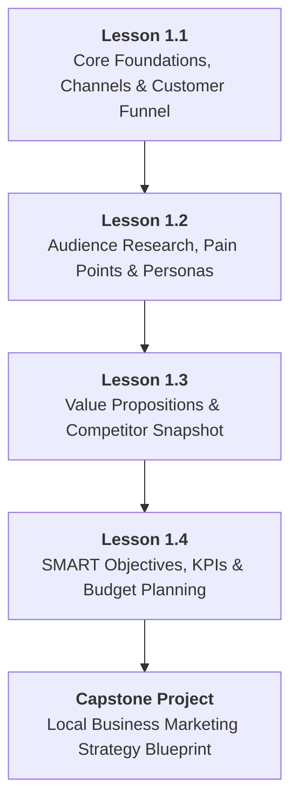

# DMS-MOD-01: Digital Marketing Foundations, Personas & Strategy
## Detailed Teaching Syllabus & Lesson Specifications

**Course ID:** `digital-marketing-pro`  
**Course Working Title:** Digital Marketing Standard / Foundation  
**Module ID:** `DMS-MOD-01`  
**Module Title:** Digital Marketing Foundations, Personas & Strategy  
**Curriculum Version:** 1.0 (October 2026)  
**Parent Specification:** [`docs/course-redesign/digital-marketing/digital-marketing-standard-spec.md`](file:///c:/Users/wasee/Desktop/NovaSkillsProject/NovaSkills%20Website/docs/course-redesign/digital-marketing/digital-marketing-standard-spec.md)  
**Document Status:** Complete Teaching Syllabus — Ready for Classroom Delivery  

---

## 1. Module Overview & Pedagogical Architecture

### 1.1 Module Objective
The objective of **DMS-MOD-01** is to establish an unshakeable, practical mental model of digital marketing for absolute beginners, career switchers, and small business owners. Before touching complex advertising dashboards or design software, students must understand:
1. How consumers discover, evaluate, and purchase products in the digital age.
2. How to profile real buyers and identify their emotional triggers and practical pain points.
3. How to articulate clear value propositions that stand out against competitors.
4. How to translate vague business hopes into measurable SMART marketing objectives.
5. How to choose the right marketing channels and allocate a small business budget without wasting money.

### 1.2 Pedagogical Workload & Time Allocation
This module represents exactly **12 Total Learner Workload Hours**, structured to guarantee high student engagement and zero conceptual overwhelm:

```
┌────────────────────────────────────────────────────────────────────────┐
│                   DMS-MOD-01 TOTAL WORKLOAD: 12 HOURS                  │
├────────────────────────────┬────────────────────────────┬──────────────┤
│ Supervised Contact Time    │ Independent Practice Time  │ Capstone Lab │
│ 7.0 Hours Total            │ 3.0 Hours Total            │ 2.0 Hours    │
├────────────────────────────┼────────────────────────────┼──────────────┤
│ • Supervised Theory: 4.0h  │ • Independent Homework:    │ • Strategy   │
│ • Guided Labs: 3.0h        │   3.0h (4 x 45 min)        │   Blueprint  │
│   (4 Lessons x 1h 45m)     │                            │   Project    │
└────────────────────────────┴────────────────────────────┴──────────────┘
```

- **Lesson 1.1:** Digital Marketing Core Foundations, Channels & the Customer Journey Funnel (2.5h total)
- **Lesson 1.2:** Target Audience Research, Customer Pain Points & Buyer Persona Development (2.5h total)
- **Lesson 1.3:** Customer Problems, Value Proposition Design & Competitor Snapshot (2.5h total)
- **Lesson 1.4:** Marketing Objectives (SMART), KPIs, Channel Selection & Budget Allocation (2.5h total)
- **Final Class Project:** Local Business Marketing Strategy Blueprint & Evaluation (2.0h total)

---

## 2. Lesson-by-Lesson Syllabus Specifications



---

### Lesson 1.1: Digital Marketing Core Foundations, Channels & the Customer Journey Funnel

#### 1. Lesson Number & Title
- **Lesson Number:** `DMS-1.1`
- **Lesson Title:** Digital Marketing Core Foundations, Channels & the Customer Journey Funnel
- **Instructional Focus:** Conceptual mental models, channel taxonomy, and consumer decision journey.

#### 2. Main Topics & Numbered Subtopics
- **1.1.1 The Shift from Traditional to Digital Marketing:**
  - One-way broadcasting (billboards, print, TV) vs. two-way conversational marketing (social, search, chat).
  - Measurability, targeting precision, feedback loops, and cost barriers.
- **1.1.2 Push vs. Pull Marketing Dynamics:**
  - Pull (Inbound / High Intent): Search engines, directory listings, reviews where customers seek solutions.
  - Push (Outbound / Interruption): Social feeds, display ads, video ads where solutions are introduced to customers.
- **1.1.3 The Core Channel Taxonomy (Organic vs. Paid):**
  - Organic channels (SEO, social posting, GBP profile, word-of-mouth): High time investment, compounding long-term equity, zero direct media cost.
  - Paid channels (Google Search ads, Meta feed ads, local sponsored posts): Fast validation, guaranteed impressions, direct media spend required.
  - Owned assets (Website, email list, customer phone database): Assets the business fully controls vs. rented platforms (social algorithms).
- **1.1.4 The Full-Funnel Customer Journey (TOFU ➔ MOFU ➔ BOFU):**
  - **Top of Funnel (TOFU / Awareness):** The customer realizes a symptom or desire, but doesn't know solutions.
  - **Middle of Funnel (MOFU / Consideration):** The customer compares available solutions, categories, and vendors.
  - **Bottom of Funnel (BOFU / Decision & Conversion):** The customer is ready to buy and decides *who* to trust.
  - **Retention & Advocacy (Post-Purchase):** Repeat purchase, referrals, reviews, and word-of-mouth.
- **1.1.5 Customer Touchpoints & Conversion Friction:**
  - Identifying digital touchpoints: Instagram reel ➔ Website bio link ➔ WhatsApp chat ➔ Clinic booking.
  - Friction points that cause drop-off: Slow load times, confusing pricing, lack of trust badges, unresponsive messaging.

#### 3. What Students Will Learn
Students will learn to view digital marketing not as random posting on Instagram, but as a deliberate, interconnected system designed to guide a stranger into becoming a loyal customer. They will understand the distinct difference between high-intent channels (Google Search) and discovery channels (Meta/Instagram), enabling them to choose the right approach for different types of consumer needs.

#### 4. Real Business Examples
- **Example A (Pull / High Intent):** *Apex Emergency Plumbing*. When a homeowner's kitchen pipe bursts at 11:00 PM, they do not scroll Instagram looking for plumbing memes. They open Google Search, type `"emergency plumber near me"`, look at Google Maps ratings, and immediately click the `"Call"` button. This is 100% Pull / High-Intent marketing.
- **Example B (Push / Discovery):** *The Crust & Crumb Artisan Sourdough Bakery*. People rarely wake up searching `"artisan gluten-free sourdough loaf with wild cranberries"`. However, seeing a high-definition Instagram video of hot, crusty sourdough bread being sliced open at 8:00 AM triggers craving and drives foot traffic or online orders. This is Push / Discovery marketing.

#### 5. Trainer Demonstration (40 Minutes)
- **Step 1:** The trainer opens a digital whiteboard (or Google Docs) and sketches the AIDA / Funnel model (Awareness ➔ Consideration ➔ Decision ➔ Retention).
- **Step 2:** The trainer selects a real local business: *SmileCraft Dental Clinic*.
- **Step 3:** The trainer maps out the complete multi-touchpoint customer journey:
  - *Awareness:* Patient sees an informative educational Instagram Reel: *"Why do your gums bleed when you brush?"*
  - *Consideration:* Patient searches Google for *"SmileCraft Dental Clinic reviews"* and reads 45 five-star reviews on Google Maps.
  - *Decision:* Patient visits the clinic's landing page, sees a clear new-patient offer (₹499 Consultation + Cleaning), and clicks a green *"Book via WhatsApp"* button.
  - *Retention:* 3 months later, clinic sends an automated WhatsApp check-in reminder.
- **Step 4:** The trainer highlights where businesses lose money (e.g., spending ₹5,000 on Instagram ads pointing to an broken website without WhatsApp contact).

#### 6. Student Hands-On Practical (45 Minutes)
- **Exercise Name:** *Customer Journey Touchpoint Mapping Lab*
- **Tool:** Google Docs or fillable PDF worksheet template.
- **Task:** Students are provided with a case study of *Urban Pet Care Grooming Salon*.
- **Instructions:**
  1. Define 2 Awareness touchpoints (1 organic, 1 paid).
  2. Define 2 Consideration touchpoints (where does the pet parent check credibility?).
  3. Define the exact Decision touchpoint (the booking mechanism and call-to-action).
  4. Identify 2 potential friction points that would cause the pet parent to leave without booking.
  5. Propose 1 simple fix for each friction point.
- **Trainer Role:** Circulate through the classroom / virtual lab, reviewing student touchpoints, correcting confusion between Awareness and Conversion stages, and ensuring touchpoints are realistic.

#### 7. Assignment (Independent Practice — 45 Minutes)
- **Task:** Select a real small business in your neighborhood (or your own workplace/business).
- **Deliverable:** Complete a 1-page **Customer Journey Audit Worksheet** containing:
  - Business name, location, and primary service/product.
  - Current digital discovery channels (how do people find them today?).
  - Complete funnel map across Awareness, Consideration, and Decision.
  - Identify 1 major friction point currently harming their conversion.

#### 8. Expected Learning Outcome
By completing Lesson 1.1, students will be able to dissect any small business's marketing presence into structured funnel stages, identify whether the business relies on Push or Pull mechanics, and diagnose where prospective customers are dropping off.

#### 9. Assessment Criteria
- Correct classification of Push vs. Pull channels (100% accuracy required).
- Funnel stages clearly distinguished without mixing awareness content with checkout offers.
- Realistic touchpoints identified with measurable friction points.

#### 10. Estimated Teaching & Practice Time
- Supervised Lecture & Discussion: 35 Minutes
- Live Trainer Demonstration: 25 Minutes
- Guided Hands-On Lab Work: 45 Minutes
- Independent Homework Practice: 45 Minutes
- **Total Lesson Time:** **150 Minutes (2.5 Hours)**

---

### Lesson 1.2: Target Audience Research, Customer Pain Points & Buyer Persona Development

#### 1. Lesson Number & Title
- **Lesson Number:** `DMS-1.2`
- **Lesson Title:** Target Audience Research, Customer Pain Points & Buyer Persona Development
- **Instructional Focus:** Audience segmentation, psychographic empathy, customer objection analysis, and responsible AI prompting.

#### 2. Main Topics & Numbered Subtopics
- **1.2.1 Target Market vs. Target Audience vs. Buyer Persona:**
  - Broad Market: Everyone who could theoretically buy (e.g., "All dog owners in Pune").
  - Target Audience: Specific demographic segment prioritized for a campaign (e.g., "Working professionals aged 25–40 owning high-maintenance dog breeds").
  - Buyer Persona: A fictional, detailed representation of your ideal customer based on real behavioral patterns (e.g., "Tech Professional Rohit, 32, owns a Golden Retriever, works 10-hour days").
- **1.2.2 The 4 Pillars of Customer Profiling:**
  - Demographics: Age, gender, income tier, education, occupation, family status.
  - Geographics: City, neighborhood radius, climate, transit access.
  - Psychographics: Values, lifestyle, priorities, anxieties, social status aspirations.
  - Behavioral: Purchasing habits, platform usage, decision triggers, price sensitivity.
- **1.2.3 Uncovering Genuine Pain Points & Emotional Drivers:**
  - Surface problem vs. Root emotional pain:
    - *Surface:* "My dog has tangled fur."
    - *Root Emotional Pain:* "I feel guilty that I work long hours and neglect my dog's grooming, and I dread the stress of forcing him into a crowded salon where he cries."
- **1.2.4 Mapping Customer Objections & Trust Barriers:**
  - Price objections ("Is this too expensive?"), Trust objections ("Will they mistreat my pet / botch my haircut?"), Inertia objections ("I'll just do it next month").
  - Proactive objection mitigation in messaging.
- **1.2.5 Responsible AI-Assisted Persona Ideation with ChatGPT:**
  - Framing contextual prompts to brainstorm customer motivations.
  - **Mandatory Privacy Safeguards & Data Controls:** Never input real customer names, private phone numbers, client emails, or proprietary business financial data.
  - **Mandatory Human Verification:** Reviewing AI suggestions critically to discard generic clichés and replace them with local, culturally relevant realities.

#### 3. What Students Will Learn
Students will learn how to move beyond superficial customer descriptions (e.g., "Men and women aged 18–65") and construct vivid, authentic Buyer Personas that drive effective ad copy, social media topics, and product offers. They will master using ChatGPT as an ideation assistant while enforcing strict data hygiene and critical human fact-checking.

#### 4. Real Business Examples
- **Example A (Poor Targeting):** A boutique fitness studio advertises: *"Get fit today! Classes for everyone!"* Result: Weak response because nobody feels specifically spoken to.
- **Example B (Persona-Driven Targeting):** The same studio targets *"Post-Partum Mother Neha (31)"*. Pain points: Lack of sleep, core weakness, anxiety about leaving the baby, intimidated by heavy bodybuilders. The studio launches: *"Gentle Post-Natal Recovery & Core Strengthening — 45-Minute Morning Batches with Certified Female Physios & Private Infant Creche"*. Result: High conversions because the offer addresses her exact emotional and logistical barriers.

#### 5. Trainer Demonstration (40 Minutes)
- **Step 1:** The trainer opens Google Docs and shares the **Nova Skills Buyer Persona Dossier Template**.
- **Step 2:** The trainer demonstrates safe, structured prompting in ChatGPT:
  ```text
  Prompt: "Act as an experienced small-business marketing strategist. I am developing a marketing plan for an independent specialty pediatric dental clinic in a suburban family neighborhood. The clinic focuses on gentle, anxiety-free dentistry for children aged 2 to 10. Help me brainstorm:
  1. The primary decision-maker's demographics and daily routine.
  2. 3 core emotional anxieties the parent feels before visiting a dentist.
  3. 3 major objections preventing them from booking an appointment.
  4. What specific reassurance would make them choose this clinic over a general hospital dentist?
  Do not include generic fluff. Be specific to suburban working parents."
  ```
- **Step 3:** The trainer reviews the output live, highlighting which parts are accurate and which require manual human adjustment (e.g., adjusting school pickup schedules and local WhatsApp group habits).
- **Step 4:** The trainer fills out the Persona Dossier live for *"Anxious Mother Priya, 34"*.

#### 6. Student Hands-On Practical (45 Minutes)
- **Exercise Name:** *Complete Buyer Persona Dossier Formulation*
- **Tool:** Google Docs / Sheets + ChatGPT (Free Tier).
- **Task:** Students pick one assigned business scenario:
  - Scenario 1: *The Green Table (Healthy Organic Tiffin Service for Working Professionals)*.
  - Scenario 2: *QuickFix Home Appliance Repair Service*.
  - Scenario 3: *Little Learners Pre-School & Daycare*.
- **Instructions:**
  1. Name the persona and give them an authentic demographic and lifestyle profile.
  2. Document 3 specific daily pain points related to this service.
  3. Identify 2 primary objections that stop them from buying immediately.
  4. Write down the 2 digital channels they use most often during their daily routine.
  5. Include an annotated prompt log documenting the prompt used and the human edits made.
- **Trainer Role:** Ensure students apply human review and do not copy-paste raw AI text without tailoring it.

#### 7. Assignment (Independent Practice — 45 Minutes)
- **Task:** Conduct an informal mini-interview (or review analysis) for your chosen local business.
- **Deliverable:**
  - Read 5 customer reviews on Google Maps for your chosen business (or a direct competitor).
  - Extract 3 exact phrases customers use to describe what they loved or hated.
  - Update your Buyer Persona Dossier with these authentic customer voice phrases.

#### 8. Expected Learning Outcome
Students will be able to construct a comprehensive, realistic Buyer Persona Dossier that reveals the true underlying motivations, emotional hesitations, and objections of their target customer, forming the foundation for all upcoming creative and copywriting work.

#### 9. Assessment Criteria
- Persona includes distinct demographic, psychographic, and behavioral attributes.
- Pain points reflect emotional depth rather than just surface-level product features.
- Evidence of human editing and customization of AI ideation.
- Zero customer PII in prompts or submitted files.

#### 10. Estimated Teaching & Practice Time
- Supervised Lecture & Discussion: 35 Minutes
- Live Trainer Demonstration: 25 Minutes
- Guided Hands-On Lab Work: 45 Minutes
- Independent Homework Practice: 45 Minutes
- **Total Lesson Time:** **150 Minutes (2.5 Hours)**

---

### Lesson 1.3: Customer Problems, Value Proposition Design & Competitor Snapshot

#### 1. Lesson Number & Title
- **Lesson Number:** `DMS-1.3`
- **Lesson Title:** Customer Problems, Value Proposition Design & Competitor Snapshot
- **Instructional Focus:** Jobs-to-be-Done, Value Proposition Canvas, competitor differentiation, and core positioning statements.

#### 2. Main Topics & Numbered Subtopics
- **1.3.1 The "Jobs-to-Be-Done" (JTBD) Framework:**
  - People don't buy a 6mm drill bit; they buy a 6mm hole in the wall to hang a picture of their family.
  - Functional jobs (fix the leak), Emotional jobs (feel secure), Social jobs (look competent to peers).
- **1.3.2 The Value Proposition Canvas (VPC):**
  - **Customer Profile Side:** Customer Jobs, Pains, and Desired Gains.
  - **Company Value Map Side:** Products & Services, Pain Relievers, and Gain Creators.
  - Achieving "Fit": Ensuring your specific pain relievers directly eliminate the customer's top pains.
- **1.3.3 Authoring Clear, Jargon-Free Value Proposition Statements:**
  - The Geoff Moore positioning formula:
    *For [Target Customer] who [Statement of Need/Pain], our [Product/Service] is a [Category] that [Primary Benefit / Differentiator], unlike [Competitor Alternative], our offering [Unique Proof Point].*
  - Eliminating generic corporate jargon ("We provide synergistic world-class solutions").
- **1.3.4 Competitor Snapshot Basics for Small Businesses:**
  - Identifying Direct Competitors (businesses selling the exact same solution locally) vs. Indirect Competitors (different solutions solving the same problem, e.g., gym vs. home workout app).
  - Conducting a public footprint audit: Website quality, Google review score, pricing transparency, social media activity, and response speed.
- **1.3.5 Differentiating on Value vs. The Price-War Trap:**
  - Why small businesses must never compete purely on being the cheapest.
  - Competing on speed, convenience, specialized niche expertise, superior communication, or risk-free guarantees.

#### 3. What Students Will Learn
Students will learn how to uncover the real "job" customers hire a business to perform and articulate a clear, compelling Value Proposition that convinces buyers to choose that business without engaging in a self-destructive price war. They will also learn how to evaluate competitors objectively using publicly available online data.

#### 4. Real Business Examples
- **Example A (The Price-War Trap):** *CleanCo Dry Cleaners* advertises: *"Shirts washed for ₹40 — cheapest in town!"* A competitor opens next door offering shirts for ₹35. Both businesses operate at paper-thin margins, cut corners on detergent, ruin customer garments, and burn out.
- **Example B (Value Differentiation):** *Executive Express Garment Care* charges ₹99 per shirt. Their positioning: *"Crisp, hand-inspected business shirts delivered to your doorstep in 24 hours with zero missing buttons guaranteed — or your order is 100% free."* Working executives happily pay double for certainty, speed, and saved time.

#### 5. Trainer Demonstration (40 Minutes)
- **Step 1:** The trainer displays the **Value Proposition Canvas** on screen.
- **Step 2:** The trainer selects *SmileCraft Dental Clinic* and fills out the Canvas:
  - *Customer Job:* Fix painful toothache before an important client presentation.
  - *Customer Pain:* Dread of needles, terrifying drilling sounds, fear of hidden charges.
  - *Clinic Pain Relievers:* Needle-free computerized numbing, noise-canceling headphones with Netflix, 100% transparent itemized price quote before treatment starts.
- **Step 3:** The trainer conducts a live **Competitor Snapshot** of 2 competing local dental clinics using Google Maps and web inspection:
  - Competitor A: Has 4.8 stars but reviews mention rude receptionists and 45-minute wait times.
  - Competitor B: General hospital dental wing; clinical and intimidating.
- **Step 4:** The trainer synthesizes this into an airtight Positioning Statement:
  *"For busy professionals who dread dental pain and unexpected clinic delays, SmileCraft provides gentle, on-time dental care with needle-free numbing and upfront pricing, so you leave smiling in under 45 minutes."*

#### 6. Student Hands-On Practical (45 Minutes)
- **Exercise Name:** *Value Proposition Canvas & Competitor Snapshot Lab*
- **Tool:** Google Sheets / Docs.
- **Task:** For the business assigned in Lesson 1.2, conduct a competitor audit and build a Value Proposition Canvas.
- **Instructions:**
  1. Identify 2 real local competitors (using Google Search / Google Maps).
  2. Document for each competitor: Star rating, review count, primary strength, visible customer complaint/weakness.
  3. Complete the Value Proposition Canvas (Customer Pains/Gains vs. Your Pain Relievers/Gain Creators).
  4. Draft a 1-sentence Value Proposition using the standard formula.
- **Trainer Role:** Review student statements to ensure they are specific, testable, and completely free of meaningless buzzwords like "high quality" and "best service".

#### 7. Assignment (Independent Practice — 45 Minutes)
- **Task:** Test your Value Proposition Statement on 2 real people (family, peer, or colleague).
- **Deliverable:**
  - Show them the 1-sentence statement.
  - Ask them: *"In your own words, what does this business do, and who is it for?"*
  - If they hesitate or misunderstand, rewrite the statement to remove ambiguity.
  - Submit the original statement, feedback received, and the final refined statement.

#### 8. Expected Learning Outcome
Students will be able to audit local competitors using public signals, identify clear market white-space, and author a compelling Value Proposition that clearly communicates why an ideal customer should buy from their business over alternatives.

#### 9. Assessment Criteria
- Value Proposition directly matches identified customer pain points.
- Competitor audit includes concrete evidence (review themes, service limits) rather than assumptions.
- Statement adheres to the structured formula without corporate jargon.

#### 10. Estimated Teaching & Practice Time
- Supervised Lecture & Discussion: 35 Minutes
- Live Trainer Demonstration: 25 Minutes
- Guided Hands-On Lab Work: 45 Minutes
- Independent Homework Practice: 45 Minutes
- **Total Lesson Time:** **150 Minutes (2.5 Hours)**

---

### Lesson 1.4: Marketing Objectives (SMART), KPIs, Channel Selection & Budget Allocation

#### 1. Lesson Number & Title
- **Lesson Number:** `DMS-1.4`
- **Lesson Title:** Marketing Objectives (SMART), KPIs, Channel Selection & Budget Allocation
- **Instructional Focus:** Goal setting, metric selection, channel matching framework, and realistic small-business budget modeling.

#### 2. Main Topics & Numbered Subtopics
- **1.4.1 Connecting Business Goals to Marketing Objectives:**
  - The business goal is revenue and profit; the marketing objective is the specific behavior required to achieve it.
  - Common mismatch: "We need more sales" vs. "We need 25 qualified consultation inquiries per month."
- **1.4.2 The SMART Marketing Framework:**
  - **Specific:** Exact outcome defined (e.g., "Generate new patient leads" vs. "Get more popular").
  - **Measurable:** Numerical target attached (e.g., "30 inquiries").
  - **Achievable:** Realistic within budget and team capacity (not "10,000 customers in 30 days on ₹2,000").
  - **Relevant:** Directly impacts bottom-line business health.
  - **Time-Bound:** Defined timeframe (e.g., "In the next 60 days").
- **1.4.3 Key Performance Indicators (KPIs) by Funnel Stage:**
  - Top of Funnel (Awareness): Impressions, Reach, Video 3-second Views, Profile Visits.
  - Middle of Funnel (Engagement/Consideration): Website Clicks, Link CTR, Average Engagement Time, Direct Inquiries.
  - Bottom of Funnel (Conversion): Form Fills, WhatsApp Inquiries, Phone Calls, Appointments Booked, Cost Per Lead (CPL).
  - Vanity Metrics vs. Business Metrics: Why 10,000 Instagram likes mean nothing if the phone never rings.
- **1.4.4 Strategic Channel Selection Matrix:**
  - Matching business category to primary and secondary channels:
    - *Local Emergency/High Intent Services (Plumbers, Locksmiths, Clinics):* Google Search + Google Business Profile = 70%; Meta Retargeting/Awareness = 30%.
    - *Visual / Lifestyle / Impulsive Products (Boutiques, Bakeries, Salons):* Instagram/Meta Ads + Visual Content = 70%; Local Search = 30%.
    - *B2B Services & Professional Consultancies:* LinkedIn / Direct Outreach + Website Case Studies = 60%; Google Search = 40%.
- **1.4.5 Introductory Monthly Budget Modeling:**
  - Allocating a realistic introductory budget (e.g., ₹15,000 to ₹30,000 / month):
    - Paid Advertising (Meta / Google): 60%
    - Content Creation & Visual Production (Canva, photography): 25%
    - Software Tools & Infrastructure (Domain, basic tools): 15%
  - Setting expectations: Calculating estimated Cost Per Lead (CPL) benchmarks.

#### 3. What Students Will Learn
Students will learn how to establish disciplined, realistic marketing goals that business owners respect. They will understand how to choose the right channels based on evidence rather than personal platform preference, and how to build a transparent, monthly budget breakdown that allocates funds strategically.

#### 4. Real Business Examples
- **Example A (Unrealistic Goal & Wrong Channel):** A neighborhood boutique clothing shop sets a goal to *"Get 100,000 YouTube subscribers in 1 month with ₹3,000 budget"*. Result: 100% budget waste with zero local shoppers in store.
- **Example B (SMART Goal & Aligned Channel):** The same boutique sets a SMART objective: *"Generate 40 walk-in visits and 25 direct WhatsApp catalog inquiries during Diwali month (October 15 – November 15) by allocating a ₹15,000 budget across localized Meta feed ads and daily Instagram styling stories within a 5 km radius"*. Result: Clear target, trackable WhatsApp clicks, and measurable footfall.

#### 5. Trainer Demonstration (40 Minutes)
- **Step 1:** The trainer opens Google Sheets and displays the **Nova Skills 3-Month Marketing Budget & Channel Allocation Model**.
- **Step 2:** The trainer sets up a realistic scenario: *Local Physiotherapy & Sports Injury Clinic* with a monthly marketing budget of **₹20,000**.
- **Step 3:** The trainer defines 2 primary SMART objectives:
  - *Objective 1:* Generate 30 qualified patient booking inquiries via WhatsApp per month at a target Cost Per Lead of ₹400 or less.
  - *Objective 2:* Attain 15 verified Google Maps 5-star reviews within 60 days.
- **Step 4:** The trainer builds the budget allocation live:
  - Google Search Ads (High intent keywords: "physio near me"): ₹9,000 (45%)
  - Meta Ads (Local radius video ad: "Neck pain relief exercises"): ₹5,000 (25%)
  - Local Print / Clinic Referral Cards & QR Code Stands: ₹3,000 (15%)
  - Creative Asset Production & Software: ₹3,000 (15%)
  - **Total:** ₹20,000 / month.
- **Step 5:** The trainer demonstrates how to calculate expected outcomes (₹14,000 total ad spend / ₹400 CPL = ~35 expected leads).

#### 6. Student Hands-On Practical (45 Minutes)
- **Exercise Name:** *SMART Goal & Budget Allocation Modeling Lab*
- **Tool:** Google Sheets.
- **Task:** Formulate 2 SMART marketing objectives and build a 1-month budget plan for a specified small business budget of ₹25,000.
- **Instructions:**
  1. Write 1 primary Conversion objective (SMART format).
  2. Write 1 secondary Awareness / Local Visibility objective (SMART format).
  3. List the 3 primary KPIs you will track weekly.
  4. Build a Channel Allocation Table allocating 100% of the ₹25,000 budget across 2–3 selected channels with written justification for why each channel was chosen.
- **Trainer Role:** Check student spreadsheets to ensure formulas sum exactly to ₹25,000 and verify that channel allocations match the business type.

#### 7. Assignment (Independent Practice — 45 Minutes)
- **Task:** Complete the Channel Justification Brief for your chosen business.
- **Deliverable:**
  - Write a 1-page document explaining why you selected your primary channels and why you explicitly *rejected* 2 other channels (e.g., *"Why we chose Google Search and Meta Ads, and why we rejected LinkedIn and Twitter for this local bakery"*).

#### 8. Expected Learning Outcome
Students will be able to construct SMART marketing goals with aligned KPIs, defend their channel selection choices with business logic, and assemble a mathematically balanced monthly marketing budget in Google Sheets.

#### 9. Assessment Criteria
- Objectives satisfy all 5 SMART criteria.
- KPIs directly measure the stated objective without reliance on vanity metrics.
- Channel selection aligns with Push vs. Pull consumer intent.
- Budget table mathematically balances to the assigned budget limit.

#### 10. Estimated Teaching & Practice Time
- Supervised Lecture & Discussion: 35 Minutes
- Live Trainer Demonstration: 25 Minutes
- Guided Hands-On Lab Work: 45 Minutes
- Independent Homework Practice: 45 Minutes
- **Total Lesson Time:** **150 Minutes (2.5 Hours)**

---

## 3. Final Class Project Specification

### 3.1 Project Title
**Local Business Marketing Strategy Blueprint**

### 3.2 Project Purpose & Context
The Final Class Project for Module 01 integrates all foundational competencies mastered across Lessons 1.1 through 1.4 into a cohesive, professional strategy dossier. Students synthesize customer empathy, market research, value proposition design, and financial discipline into an actionable blueprint that could be handed directly to a real business owner.

### 3.3 Project Scenario Options
Students must select **one** of the following scenarios:
- **Scenario Option A (Health / Service):** *Aura Wellness Dental & Implant Clinic* — A modern 3-chair dental practice seeking to attract working professionals and families in a growing suburban neighborhood.
- **Scenario Option B (Food / Retail):** *BakeCraft Artisan Bakery & Cafe* — A neighborhood specialty bakery specializing in sourdough breads, fresh morning pastries, and custom occasion cakes.
- **Scenario Option C (Home Services):** *SwiftShield Pest Control & Sanitization* — A family-owned service business looking to secure recurring quarterly residential pest control contracts.
- **Scenario Option D (Student's Own Business):** A genuine small business owned by the student, their family, or an approved local business client.

### 3.4 Required Deliverable Components (Blueprint Structure)
The submitted blueprint must be a clean, structured Google Docs or PDF document (4–6 pages) containing these six mandatory sections:

```
┌────────────────────────────────────────────────────────────────────────┐
│         LOCAL BUSINESS MARKETING STRATEGY BLUEPRINT STRUCTURE          │
├────────────────────────────────────────────────────────────────────────┤
│ 1. Executive Summary & Business Profile                                │
│    • Business name, location, core offering, target market territory   │
│ 2. Ideal Customer Persona Dossier                                      │
│    • Demographics, psychographics, daily routine, 3 core pain points,  │
│      2 primary buying objections, and trusted information channels     │
│ 3. Competitor Snapshot & Market White-Space                            │
│    • 2 direct competitors audited (ratings, strengths, weaknesses)     │
│    • Identified gap/opportunity in the local market                    │
│ 4. Value Proposition Canvas & Core Positioning Statement               │
│    • Customer jobs/pains/gains mapped to products/pain relievers       │
│    • 1-sentence standardized positioning statement (jargon-free)       │
│ 5. SMART Marketing Objectives & Primary KPIs                           │
│    • 1 primary conversion objective + 1 visibility objective           │
│    • Weekly and monthly tracking metrics (avoiding vanity metrics)     │
│ 6. Strategic Channel Selection & 3-Month Introductory Budget           │
│    • Channel selection justification & excluded channels rationale     │
│    • Monthly budget allocation table (₹20,000 to ₹30,000 baseline)     │
└────────────────────────────────────────────────────────────────────────┘
```

---

## 4. Measurable Grading Rubric (100 Points Total)

Each student's Local Business Marketing Strategy Blueprint is evaluated against this standard institutional rubric:

| Assessment Dimension | Exemplary (90–100%) | Proficient (75–89%) | Developing (60–74%) | Incomplete (< 60%) | Score Weight |
|---|---|---|---|---|---|
| **1. Customer Persona & Pain Point Depth** | Persona is vivid, authentic, and culturally grounded. Articulates 3 deep emotional pain points and actionable objections with zero fluff. | Persona is clear with standard demographic and lifestyle details. Pain points are realistic but somewhat surface-level. | Persona is generic (e.g., "Men/Women 20–50"); pain points are vague; relies on unedited AI output. | Missing persona, unrealistic attributes, or contains unauthorized client PII. | **20 Points** |
| **2. Competitor Snapshot & Differentiation** | Thorough audit of 2 real competitors with verified review themes and operational gaps. Identifies clear, defensible market white-space. | Audits 2 competitors with basic strengths and weaknesses. Differentiation is logical but conventional. | Competitor info is superficial or assumed without real review data. Weak distinction from competitors. | No competitor analysis provided or duplicates existing offerings with zero differentiator. | **20 Points** |
| **3. Value Proposition Statement Quality** | Flawless execution of standard positioning formula. 100% jargon-free, customer-centric, and communicates clear tangible value. | Follows the positioning formula with minor awkward phrasing. Clear benefit, minimal buzzwords. | Rambling or buzzword-heavy ("best quality", "leading"). Fails to clearly explain what makes the offer unique. | Missing positioning statement or incoherent description of business service. | **20 Points** |
| **4. SMART Objectives & KPI Alignment** | Objectives perfectly satisfy all 5 SMART criteria. KPIs directly track bottom-line conversion and cost metrics. Zero vanity metrics. | Objectives are mostly SMART with minor ambiguity in timeline or measurement. KPIs are sensible. | Objectives are vague hopes ("grow our brand"); KPIs rely primarily on vanity metrics (likes, impressions). | No measurable goals or completely unrealistic figures (e.g., 100k leads on ₹5,000). | **20 Points** |
| **5. Channel Selection & Budget Logic** | Channel mix perfectly matches Push vs. Pull customer intent. Budget allocation mathematically sound with clear ROI expectations. | Logical channel choices with standard budget split. Math is correct and realistic for small business. | Mismatched channels (e.g., B2B on TikTok only). Budget table has calculation errors or unexplained splits. | Unjustified channel choices; budget missing or wildly unbalanced. | **15 Points** |
| **6. Professional Presentation & Ethics** | Clean layout, professional formatting, zero grammatical errors. Strict adherence to prompt privacy and data hygiene. | Well-organized document with minor formatting flaws. Respects ethical data standards. | Cluttered layout, inconsistent fonts, or raw unprocessed AI bullet points. | Disorganized, incomplete submission, or ethical violations (fake testimonials). | **5 Points** |
| **TOTAL** | **Outstanding Foundation Mastery** | **Competent & Ready for Module 02** | **Requires Guided Revision** | **Resubmission Required** | **100 Points** |

---

## 5. Lesson-Completion & Deliverable Tracking Checklist

This checklist is utilized by both students and instructors to monitor progression across the module:

### Student Self-Checklist:
- [ ] **Lesson 1.1:** Completed the Customer Journey Touchpoint Mapping Lab for the case study.
- [ ] **Lesson 1.1:** Submitted the Independent Customer Journey Audit Worksheet.
- [ ] **Lesson 1.2:** Mastered prompt hygiene in ChatGPT (zero private customer data shared).
- [ ] **Lesson 1.2:** Completed the Buyer Persona Dossier with human verification and authentic voice.
- [ ] **Lesson 1.3:** Conducted a public audit of 2 local competitors on Google Maps / Search.
- [ ] **Lesson 1.3:** Completed the Value Proposition Canvas and drafted a 1-sentence positioning statement.
- [ ] **Lesson 1.4:** Formulated 2 SMART marketing objectives with aligned business KPIs.
- [ ] **Lesson 1.4:** Built a balanced monthly marketing budget allocation table in Google Sheets.
- [ ] **Capstone Project:** Assembled all components into the **Local Business Marketing Strategy Blueprint**.
- [ ] **Capstone Project:** Reviewed final blueprint against the 100-point Grading Rubric prior to submission.

### Trainer Verification Checklist:
- [ ] Verified student understood the operational distinction between Push (Social) and Pull (Search) marketing.
- [ ] Confirmed student's persona dossier demonstrates genuine human empathy and local market relevance.
- [ ] Validated that the student's value proposition avoids generic clichés ("high quality service").
- [ ] Inspected Google Sheets budget calculations for mathematical accuracy and realistic channel splits.
- [ ] Graded the Local Business Marketing Strategy Blueprint using the standardized 100-point rubric.
- [ ] Certified student readiness to proceed to **DMS-MOD-02: Content Strategy, Canva Design & Organic Social Media**.

---

## 6. Upward Progression Alignment (Transition to Module 02)

Upon successful completion and evaluation of **DMS-MOD-01**, the student possesses an actionable strategy document. This document directly feeds into the subsequent module:

```
┌─────────────────────────────────────────────────────────────┐
│          DMS-MOD-01 STRATEGIC OUTPUT (The Blueprint)        │
│  • Target Persona Profile & Emotional Triggers              │
│  • Core Value Proposition & Key Messaging Points            │
│  • Prioritized Social & Search Channels                     │
└──────────────────────────────┬──────────────────────────────┘
                               │
                               ▼ Feeds directly into
┌─────────────────────────────────────────────────────────────┐
│          DMS-MOD-02 OPERATIONAL WORKFLOW (The Creative)     │
│  • Developing 30-Day Content Pillars based on Persona Pains │
│  • Designing Visual Assets in Canva using the Brand Style   │
│  • Scheduling Branded Content in Meta Business Suite        │
└─────────────────────────────────────────────────────────────┘
```

This seamless transition ensures that students never create content in a vacuum; every graphic, caption, and video produced in Module 02 serves the strategic purpose defined in Module 01.

---
*End of Detailed Teaching Syllabus for `DMS-MOD-01`.*
