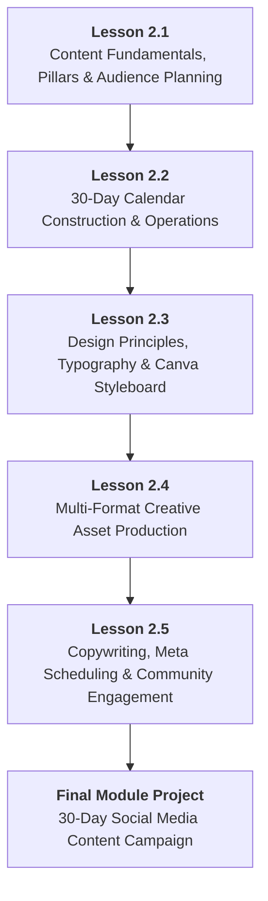

# DMS-MOD-02: Content Strategy, Canva Design & Organic Social Media
## Detailed Teaching Syllabus & Lesson Specifications

**Course ID:** `digital-marketing-pro`  
**Course Working Title:** Digital Marketing Standard / Foundation  
**Module ID:** `DMS-MOD-02`  
**Module Title:** Content Strategy, Canva Design & Organic Social Media  
**Curriculum Version:** 1.0 (October 2026)  
**Parent Specification:** [`docs/course-redesign/digital-marketing/digital-marketing-standard-spec.md`](file:///c:/Users/wasee/Desktop/NovaSkillsProject/NovaSkills%20Website/docs/course-redesign/digital-marketing/digital-marketing-standard-spec.md)  
**Prerequisite Module:** [`DMS-MOD-01: Digital Marketing Foundations, Personas & Strategy`](file:///c:/Users/wasee/Desktop/NovaSkillsProject/NovaSkills%20Website/docs/course-redesign/digital-marketing/modules/dms-mod-01.md)  
**Document Status:** Complete Teaching Syllabus — Ready for Classroom Delivery  

---

## 1. Module Overview & Pedagogical Architecture

### 1.1 Module Objective
The objective of **DMS-MOD-02** is to equip learners with the practical creative and operational skills required to build, design, and manage a high-performing organic social media presence for small businesses. Building directly upon the strategic outputs of Module 01 (Buyer Persona, Value Proposition, and Channel Strategy), students transition from strategic intent to daily visual execution:
1. Translating customer pain points into high-value organic content pillars.
2. Engineering a comprehensive 30-day editorial content calendar in Google Sheets.
3. Applying foundational graphic design principles (visual hierarchy, typography, contrast, and whitespace) using the 100% free tier of Canva.
4. Designing multi-format marketing creatives (square feed posts, vertical stories, reel covers, and promotional banners) without reliance on paid assets.
5. Writing compelling hooks, body copy, hashtags, and single calls-to-action (CTAs).
6. Executing scheduled publishing workflows via Meta Business Suite (with guaranteed offline scheduling alternatives).
7. Managing customer community interactions and applying data privacy and accessibility ethics.

### 1.2 Pedagogical Workload & Time Allocation
This module allocates exactly **18 Total Learner Workload Hours**, maintaining a balanced distribution of conceptual demonstrations, extensive supervised lab practice, and portfolio project assembly:

```
┌────────────────────────────────────────────────────────────────────────┐
│                   DMS-MOD-02 TOTAL WORKLOAD: 18 HOURS                  │
├────────────────────────────┬────────────────────────────┬──────────────┤
│ Supervised Contact Time    │ Independent Practice Time  │ Capstone Lab │
│ 11.0 Hours Total           │ 4.0 Hours Total            │ 3.0 Hours    │
├────────────────────────────┼────────────────────────────┼──────────────┤
│ • Supervised Theory: 5.0h  │ • Independent Homework:    │ • 30-Day     │
│ • Guided Labs: 6.0h        │   4.0h (5 x 48 min)        │   Social     │
│   (5 Lessons x 2h 12m)     │                            │   Campaign   │
└────────────────────────────┴────────────────────────────┴──────────────┘
```

- **Lesson 2.1:** Content Marketing Fundamentals, Content Pillars & Audience-Centric Planning (3.0h total)
- **Lesson 2.2:** 30-Day Content Calendar Construction & Workflow Operations (3.0h total)
- **Lesson 2.3:** Visual Design Principles, Typography & Manual Brand Styleboards in Canva Free (3.0h total)
- **Lesson 2.4:** Multi-Format Asset Production: Feed Posts, Stories, Reel Covers & Banners (3.0h total)
- **Lesson 2.5:** Copywriting, Meta Business Suite Scheduling & Community Engagement (3.0h total)
- **Final Module Project:** 30-Day Social Media Content Campaign Assembly & Evaluation (3.0h total)

---

## 2. Lesson-by-Lesson Syllabus Specifications



---

### Lesson 2.1: Content Marketing Fundamentals, Content Pillars & Audience-Centric Planning

#### 1. Lesson Number & Title
- **Lesson Number:** `DMS-2.1`
- **Lesson Title:** Content Marketing Fundamentals, Content Pillars & Audience-Centric Planning
- **Instructional Focus:** Value-first content mechanics, the 4 core content pillars, audience pain mapping, and AI-assisted topic brainstorming.

#### 2. Main Topics & Numbered Subtopics
- **2.1.1 The Philosophy of Value-First Content Marketing:**
  - Why traditional sales pitching fails on organic social: the difference between "Buy my product" vs. "Here is how to solve your problem."
  - Building the "Know, Like, and Trust" factor over time; earned attention vs. bought attention.
  - Organic reach realities in modern social algorithms: engagement velocity, watch time, shares, and saves.
- **2.1.2 The 4 Core Content Pillars for Small Businesses:**
  - **Pillar 1: Educational / Helpful Content (40%):** How-to tips, tutorials, demystifying misconceptions, step-by-step guides that solve micro-problems.
  - **Pillar 2: Engaging / Relatable Content (20%):** Industry memes, behind-the-scenes realities, polls, questions, celebrating customer milestones.
  - **Pillar 3: Authority / Trust & Connection Content (20%):** Founder origin stories, customer testimonials, before-and-after transformations, credentials, process quality standards.
  - **Pillar 4: Promotional / Direct-Response Content (20%):** Product spotlights, seasonal discounts, consultation offers, clear service packages with explicit CTAs.
- **2.1.3 Mapping Buyer Personas to Concrete Content Ideas:**
  - Extracting pain points from the Module 01 Buyer Persona Dossier.
  - Converting 1 customer anxiety into 3 distinct content topics (e.g., Pain: "Dental visits hurt" ➔ Topic 1: "3 myths about needle injections", Topic 2: "How our computerized numbing wand works", Topic 3: "Patient video: First cavity fill without tears").
- **2.1.4 Platform Demographics & Cultural Contexts (Instagram vs. Facebook):**
  - Instagram: Visual-first, younger/working demographic (18–35), carousel saves, aesthetic consistency, short video reels, story daily updates.
  - Facebook: Community groups, local family demographic (30–55), discussion threads, longer text reflections, local event sharing, neighborhood word-of-mouth.
- **2.1.5 Responsible AI-Assisted Content Ideation with ChatGPT:**
  - Prompting ChatGPT for 30 topic ideas structured strictly across the 4 pillars.
  - **Data Privacy & IP Protection:** Never input unpublished product secrets, proprietary pricing formulas, or customer private data.
  - **Critical Human Review:** Filtering out generic, clichéd ideas; refining for local cultural nuance and brand authenticity.

#### 3. What Students Will Learn & Real Business Example
Students will learn how to structure an organic content strategy that delivers consistent value without burning out or alienating followers with nonstop aggressive sales pitches.

- **Real Business Example:**
  - *The Ineffective Approach:* *FitPro Boutique Gym* posts 7 days a week: *"Join today! Only ₹2,000/month! Call now!"* Result: Zero engagement, unfollows, and algorithm suppression.
  - *The Pillar-Based Approach:* *FitPro Boutique Gym* implements the 4 pillars:
    - *Monday (Educational):* "3 common squat mistakes that cause lower back pain (and how to fix your stance in 30 seconds)."
    - *Wednesday (Trust/Story):* "Client Spotlight: How 42-year-old accountant Rajesh lost 8kg while working 60-hour weeks."
    - *Friday (Relatable):* "That feeling when Monday's leg day hits you on Friday morning (Humorous behind-the-scenes video)."
    - *Sunday (Promotional):* "Only 4 spots remaining for our 6-Week Beginners Strength Cohort starting this Tuesday. DM 'START' for syllabus."
    - *Result:* High shares on Monday, social proof on Wednesday, high comments on Friday, and paying signups on Sunday.

#### 4. Trainer Demonstration (25 Minutes)
- **Step 1:** The trainer opens Google Docs and brings up the *SmileCraft Dental Clinic* persona from Module 01 ("Anxious Mother Priya, 34").
- **Step 2:** The trainer demonstrates constructing a **Content Topic Matrix** live across the 4 pillars.
- **Step 3:** The trainer executes a live ChatGPT ideation prompt demonstrating safe boundaries:
  ```text
  Prompt: "Act as a content strategist for an independent neighborhood pediatric dental clinic. Our target audience is anxious suburban mothers of children aged 2 to 9. Based on the 4 content pillars (Educational, Trust/Story, Relatable, Promotional), generate 3 specific, non-generic post concepts for each pillar. For each concept, give:
  1. A compelling 1-line hook.
  2. The core message.
  3. The recommended format (Carousel, Static graphic, or Story).
  Do not write full captions yet. Keep the tone empathetic, reassuring, and jargon-free."
  ```
- **Step 4:** The trainer reviews the AI output live, discarding generic suggestions (e.g., "Brush twice a day") and tailoring chosen concepts to local parenting realities (e.g., "What to pack in school tiffins that won't cause tooth decay").

#### 5. Student Hands-On Practical (72 Minutes)
- **Exercise Name:** *Audience Content Pillar Formulation Lab*
- **Tool:** Google Docs + ChatGPT (Free tier).
- **Task:** Students use the small business scenario approved in Module 01 (Dental Clinic, Artisan Bakery, Pest Control, or Approved SMB).
- **Instructions:**
  1. Define 4 specific sub-themes under each of the 4 Content Pillars (total 16 topic seeds).
  2. Ensure every educational topic directly resolves an anxiety or pain point identified in the Module 01 Buyer Persona.
  3. Formulate 1 high-intent promotional offer that solves a core problem without sound desperate.
  4. Include an annotated prompt log showing the raw AI suggestions and the human edits made.
- **Trainer Role:** Circulate through the classroom / virtual lab, ensuring students do not rely on 100% promotional topics and checking that educational topics offer genuine, actionable value.

#### 6. Assignment (Independent Practice — 48 Minutes)
- **Task:** Audit 2 local competing social media pages on Instagram or Facebook.
- **Deliverable:**
  - Categorize their last 10 posts into the 4 Content Pillars.
  - Calculate their Pillar Percentage Split (e.g., 80% Promotional, 10% Educational, 10% Trust).
  - Identify what type of content received the highest comment and share count.
  - Write a 1-paragraph reflection on what content gap exists that your business can exploit.

#### 7. Expected Learning Outcome
Students will be able to organize any brand's organic social presence into a balanced, 4-pillar content architecture that systematically attracts, nurtures, and converts ideal prospects.

#### 8. Assessment Criteria
- Content pillars properly balanced (approx. 40% Educational, 20% Trust, 20% Relatable, 20% Promotional).
- Topics directly address validated buyer persona anxieties and pain points.
- Evidence of critical human refinement of AI-generated content ideas.

#### 9. Time Allocation
- Supervised Lecture & Discussion: 35 Minutes
- Live Trainer Demonstration: 25 Minutes
- Guided Hands-On Lab Work: 72 Minutes
- Independent Homework Practice: 48 Minutes
- **Total Lesson Time:** **180 Minutes (3.0 Hours)**

---

### Lesson 2.2: 30-Day Content Calendar Construction & Workflow Operations

#### 1. Lesson Number & Title
- **Lesson Number:** `DMS-2.2`
- **Lesson Title:** 30-Day Content Calendar Construction & Workflow Operations
- **Instructional Focus:** Spreadsheet calendar architecture, publishing frequency, the 80/20 rule, and sustainable weekly batching workflows.

#### 2. Main Topics & Numbered Subtopics
- **2.2.1 The Strategic Importance of Batching vs. Daily Scrambling:**
  - Why "What should I post today?" leads to marketing inconsistency, visual disorder, and burnout.
  - The weekly batching cycle: Planning (Monday) ➔ Writing & Design (Tuesday) ➔ Review & Staging (Wednesday).
- **2.2.2 The Anatomy of a Professional Content Calendar Spreadsheet:**
  - Mandatory tracking columns:
    1. *Date & Day of Week*
    2. *Publishing Time & Channel (Instagram / Facebook)*
    3. *Content Pillar Category (P1–P4)*
    4. *Content Format (Single Graphic, Carousel, Reel/Video, Story)*
    5. *Working Title & Visual Hook*
    6. *Visual Creative Description / Text on Image*
    7. *Caption Copy Draft (Hook ➔ Value ➔ CTA)*
    8. *Hashtag Cluster*
    9. *Production Status (Idea ➔ Designed ➔ Approved ➔ Scheduled ➔ Published)*
    10. *Asset Link (Google Drive / Canva Link)*
- **2.2.3 Determining Sustainable Publishing Frequencies:**
  - The myth of "Posting 3 times a day": Quality and consistency beat algorithm spamming.
  - Recommended beginner small-business cadence:
    - 3–4 High-value feed posts per week (Carousels & single educational graphics).
    - 4–5 Casual stories per week (Behind the scenes, polls, daily updates).
    - 1 Educational reel or video per week.
- **2.2.4 The 80/20 Rule of Organic Content Distribution:**
  - 80% of content must deliver standalone value, entertainment, or community inspiration without asking for a purchase.
  - 20% of content directly asks for the inquiry, booking, or purchase.
  - Maintaining audience goodwill and high algorithmic engagement before making commercial asks.
- **2.2.5 Operational Review & Pre-Publishing Checklists:**
  - Checking for brand voice consistency, spelling, accurate operating hours, active links in bio, and verified phone numbers before scheduling.

#### 3. What Students Will Learn & Real Business Example
Students will learn how to build and maintain a complete 30-day editorial calendar in Google Sheets, organizing an entire month of marketing communications into an efficient, predictable operational system.

- **Real Business Example:**
  - *The Sourdough Bakery:* Without a calendar, the baker remembers to post on Instagram only when sales drop on rainy afternoons. Posts are rushed, photos are poorly lit, and captions say: *"Bread available today."*
  - *With the 30-Day Calendar:* On the last Sunday of the month, the baker plans 16 feed posts and 20 stories for the month. Monday posts highlight wholesale ingredients; Wednesday posts show bread-shaping techniques; Friday posts remind followers to reserve weekend loaves by 6:00 PM Thursday. Weekend pre-orders increase by 45% because customers know exactly when and how to buy.

#### 4. Trainer Demonstration (25 Minutes)
- **Step 1:** The trainer opens Google Sheets and shares the **Nova Skills Master 30-Day Content Calendar Template**.
- **Step 2:** The trainer demonstrates setting up conditional formatting for the *Status* column (Red = "Idea", Yellow = "Drafted", Green = "Scheduled").
- **Step 3:** The trainer populates 1 full week of content for *SmileCraft Dental Clinic*, alternating content pillars across Monday, Wednesday, Friday, and Saturday.
- **Step 4:** The trainer shows how to write a "Visual Creative Description" so that a graphic designer (or the business owner) knows exactly what visual to create in Canva without confusion.

#### 5. Student Hands-On Practical (72 Minutes)
- **Exercise Name:** *30-Day Content Calendar Architecture Lab*
- **Tool:** Google Sheets (or offline spreadsheet application).
- **Task:** Students build a structured 30-day content calendar containing a minimum of **12 to 16 feed posts** and **8 story prompts** for their selected business.
- **Instructions:**
  1. Set up all 10 standard tracking columns.
  2. Map out a 4-week publishing schedule (e.g., 3 feed posts/week + 2 stories/week).
  3. Ensure the 80/20 balance is mathematically maintained across the calendar.
  4. Write the working title, pillar tag, format, and creative visual concept for every scheduled slot.
- **Trainer Role:** Inspect student spreadsheets, check for proper column structure, and ensure student schedules avoid repetitive formats (e.g., varying single graphics with carousels).

#### 6. Assignment (Independent Practice — 48 Minutes)
- **Task:** Complete the full caption concepts and visual briefs for Weeks 1 and 2 (first 6–8 posts) in your Google Sheets calendar.
- **Deliverable:**
  - Fully populated spreadsheet rows for Days 1 to 15.
  - Each entry must include a clear visual brief describing what the graphic will look like.
  - Shareable Google Sheets link with viewing/commenting access.

#### 7. Expected Learning Outcome
Students will be able to construct and manage an enterprise-grade 30-day editorial content calendar in Google Sheets that balances content pillars, specifies creative requirements, and establishes a disciplined batch-production workflow.

#### 8. Assessment Criteria
- Calendar contains at least 12 fully planned feed post entries spanning a 30-day period.
- 80/20 value-to-promotion ratio strictly observed.
- Visual briefs provide clear, actionable instructions for graphic production.

#### 9. Time Allocation
- Supervised Lecture & Discussion: 35 Minutes
- Live Trainer Demonstration: 25 Minutes
- Guided Hands-On Lab Work: 72 Minutes
- Independent Homework Practice: 48 Minutes
- **Total Lesson Time:** **180 Minutes (3.0 Hours)**

---

### Lesson 2.3: Visual Design Principles, Typography & Manual Brand Styleboards in Canva Free

#### 1. Lesson Number & Title
- **Lesson Number:** `DMS-2.3`
- **Lesson Title:** Visual Design Principles, Typography & Manual Brand Styleboards in Canva Free
- **Instructional Focus:** Graphic design fundamentals, color palettes, font pairings, visual hierarchy, and setting up a brand styleboard in Canva's Free plan.

#### 2. Main Topics & Numbered Subtopics
- **2.3.1 Foundational Graphic Design Principles for Non-Designers:**
  - **Visual Hierarchy:** Guiding the viewer's eye: Headline (Primary) ➔ Subtitle/Hook (Secondary) ➔ Supporting detail (Tertiary).
  - **Contrast:** Light text on dark backgrounds vs. dark text on light backgrounds; why low contrast destroys mobile readability.
  - **Alignment & Grid Grids:** Sticking to left-aligned or center-aligned layouts; avoiding chaotic mixed alignments.
  - **Whitespace / Positive Space:** Giving visual elements room to breathe; why clutter makes amateur graphics look untrustworthy.
- **2.3.2 Color Theory & Accessible Palette Selection:**
  - Color psychology in business (Blue for healthcare/trust, Warm Orange/Red for food/energy, Green for wellness/outdoors, Deep Slate for luxury/corporate).
  - The 60-30-10 Color Rule: 60% Dominant neutral/background, 30% Secondary brand color, 10% High-contrast accent color (used for buttons and core hooks).
  - Accessibility standards: Ensuring text meets WCAG AA contrast standards so text is readable in direct sunlight.
- **2.3.3 Typography Rules & Hierarchy for Social Graphics:**
  - Choosing font pairs: Combining a distinctive Header font (Serif or Bold Sans-Serif) with a clean, highly legible Body font (Clean Sans-Serif like Open Sans, Montserrat, or Inter).
  - Font size hierarchy: Headline (60–80pt), Body/Tip (28–36pt), Handle/Footer (18–22pt).
  - Letter spacing and line height: Avoiding squished text blocks.
- **2.3.4 Navigating Canva Free Environment & Tooling:**
  - Understanding Canva's free interface: Canvas dimensions, Template search, Elements (shapes, lines, frames), Text tool, Uploads, and Layers.
  - **Canva Free Boundary Compliance:** The India Free plan includes **one Brand Kit limited to three colours**. Students learn how to manually save and input custom HEX codes (`#FFFFFF`, `#1A365D`, `#E53E3E`) into standard shapes and text elements.
  - How to select 100% free graphics and photos (avoiding the Crown/Pro watermark).
- **2.3.5 Constructing a Manual Brand Styleboard:**
  - What a styleboard contains: Brand Name, Logo placement rule, 3 Primary Color HEX codes, 2 Font families, Imagery style guidelines, and 1 standard footer banner format.

#### 3. What Students Will Learn & Real Business Example
Students will learn how to design clean, professional visual marketing assets without having formal graphic design training. They will understand why amateur social media graphics look messy and learn how to enforce visual consistency across every post using Canva's free tools.

- **Real Business Example:**
  - *The Amateur Graphic:* *Aura Dental Clinic* posts an Instagram graphic using 5 different neon fonts, a stretched clipart image of a smiling tooth, a yellow background with light green text that nobody can read, and text jammed against the extreme edges of the image. It looks like spam, so patients assume the dental care is equally sloppy.
  - *The Professional Graphic:* The clinic uses a manual styleboard: Navy Blue background (`#0A192F`), Crisp White headline (`#FFFFFF`), Cyan accent button (`#00B4D8`), and clean *Montserrat* font. Clean spacing, plenty of breathing room, and a professional photo of a doctor. Followers perceive the clinic as modern, sterile, and premium.

#### 4. Trainer Demonstration (25 Minutes)
- **Step 1:** The trainer opens Canva (`canva.com`) using a standard free personal account.
- **Step 2:** The trainer demonstrates how to set up a custom canvas (1080 $\times$ 1080 pixels for square Instagram feed).
- **Step 3:** The trainer demonstrates the **Visual Hierarchy Disaster vs. Remedy**:
  - Starts with an unaligned, messy graphic with 4 fonts.
  - Applies design rules live: Stripping down to 2 fonts, establishing a clear 3-level text hierarchy, adding 80px margins around edges, and applying the 60-30-10 color rule.
- **Step 4:** The trainer builds a **Brand Styleboard** template live on Canva, adding color swatches with exact HEX codes, font sample headers, and logo placement guides.

#### 5. Student Hands-On Practical (72 Minutes)
- **Exercise Name:** *Brand Styleboard & Color Hierarchy Lab*
- **Tool:** Canva (Free Tier).
- **Task:** Build a 1-page **Brand Styleboard** for your selected small business.
- **Instructions:**
  1. Create a 1080 $\times$ 1080 px canvas in Canva Free.
  2. Define and display 3 distinct brand colors: Primary (60%), Secondary (30%), Accent (10%). Annotate each with its exact 6-character HEX code (e.g., `#2B6CB0`).
  3. Select 2 complementary free Google/Canva fonts: 1 Header font and 1 Body font. Show samples of H1 Headline, H2 Subhead, and Body text.
  4. Include a visual note on brand tone (e.g., "Warm, artisan, earthy" or "Clinical, clean, trustworthy").
  5. Export the completed styleboard as a standard PNG file.
- **Trainer Role:** Inspect student styleboards, test color contrast using a free contrast checker, and ensure font pairings are readable on mobile screens.

#### 6. Assignment (Independent Practice — 48 Minutes)
- **Task:** Audit your personal or a competitor's Instagram feed against the 4 design principles (Hierarchy, Contrast, Alignment, Whitespace).
- **Deliverable:**
  - Take screenshots of 2 bad posts and 2 good posts from any local business account.
  - Annotate the screenshots highlighting contrast issues, margin violations, or excellent visual hierarchy.
  - Save as a 2-page PDF reflection.

#### 7. Expected Learning Outcome
Students will be able to apply essential graphic design rules to social media marketing, select accessible brand color palettes, pair legible typography, and assemble a reusable Brand Styleboard in Canva Free.

#### 8. Assessment Criteria
- Styleboard contains 3 distinct colors with valid HEX codes and WCAG AA contrast.
- Exactly 2 legible, complementary free fonts selected.
- Clean visual layout adhering to margins and whitespace rules.
- 100% free Canva tools used with zero watermarked premium assets.

#### 9. Time Allocation
- Supervised Lecture & Discussion: 35 Minutes
- Live Trainer Demonstration: 25 Minutes
- Guided Hands-On Lab Work: 72 Minutes
- Independent Homework Practice: 48 Minutes
- **Total Lesson Time:** **180 Minutes (3.0 Hours)**

---

### Lesson 2.4: Multi-Format Asset Production: Feed Posts, Stories, Reel Covers & Promotional Banners

#### 1. Lesson Number & Title
- **Lesson Number:** `DMS-2.4`
- **Lesson Title:** Multi-Format Asset Production: Feed Posts, Stories, Reel Covers & Promotional Banners
- **Instructional Focus:** Canvas sizing, safe zones, template adaptation, and multi-format asset creation in Canva Free.

#### 2. Main Topics & Numbered Subtopics
- **2.4.1 Social Media Aspect Ratios & Technical Dimensions:**
  - **Square Feed Post (1:1 — 1080 $\times$ 1080 px):** The universal standard for Instagram and Facebook feeds.
  - **Portrait Feed Post (4:5 — 1080 $\times$ 1350 px):** Maximizing screen real estate on mobile feeds.
  - **Vertical Story / Reel Cover (9:16 — 1080 $\times$ 1920 px):** Full-screen mobile immersive format.
  - **Promotional Web / Facebook Banner (1.91:1 — 1200 $\times$ 628 px):** Landscape format for Facebook page headers, event covers, and ad placements.
- **2.4.2 Safe Zones & UI Overlay Rules:**
  - Understanding Instagram Reels/Stories safe zones: Keeping text and critical visuals away from top header icons (profile/close) and bottom caption/audio overlays (150px top and bottom margin).
  - The 1:1 Grid Center Crop for Reel covers: Ensuring the center 1080 $\times$ 1080 px of a 1080 $\times$ 1920 px reel cover looks balanced on the main profile grid.
- **2.4.3 Designing Educational & Carousel Slide Graphics:**
  - Structure of a 3-slide educational carousel: Slide 1 = High-curiosity hook; Slide 2 = The actionable breakdown; Slide 3 = The summary & "Save this post" CTA.
  - Consistent background and footer elements to unify multi-slide posts.
- **2.4.4 Designing Promotional & Discount Banners:**
  - The 3-second rule for promotional graphics: The offer must be understood in under 3 seconds.
  - Clear visual prominence: Big bold discount/offer headline, supporting date/eligibility limit, and simulated button visual (e.g., "Book on WhatsApp ➔").
- **2.4.5 Sourcing Royalty-Free Imagery & Legal Compliance:**
  - Safe commercial image sourcing: Using Canva's free photo library, Pexels, and Unsplash.
  - Prohibitions: Why grabbing images directly from Google Image search violates copyright and risks legal takedowns.
  - Image optimization: Downloading web-ready standard PNG and JPG files without bloat.

#### 3. What Students Will Learn & Real Business Example
Students will learn how to design production-ready visual assets across all essential social media formats, adhering to exact pixel dimensions, safe-zone guidelines, and legal copyright standards using Canva Free.

- **Real Business Example:**
  - *The Safe-Zone Blunder:* *BakeCraft Bakery* designs a vertical Story announcing their weekend sourdough menu. They place the order phone number at the very bottom of the graphic. When published on Instagram, Instagram's "Send Message" bar completely covers the phone number. Nobody can read it, and zero orders come in.
  - *The Safe-Zone Master:* The student designs the Story with a 200px bottom safe margin. The phone number and WhatsApp prompt sit right in the center visual zone. Followers easily view the number, tap the link sticker, and order bread.

#### 4. Trainer Demonstration (25 Minutes)
- **Step 1:** The trainer opens Canva and creates a 1080 $\times$ 1920 px canvas (Vertical Story / Reel Cover).
- **Step 2:** The trainer drags horizontal ruler guides at 250px from top and 350px from bottom to demonstrate the **Mobile UI Safe Zone**.
- **Step 3:** The trainer designs a **Reel Cover Graphic** live:
  - Adds a free high-resolution background photo of fresh bread from Canva's free library.
  - Applies a semi-transparent dark rectangle overlay (`#000000` at 40% transparency) to create high contrast.
  - Adds a bold, 2-line hook: *"Why Your Sourdough Crust Isn't Crispy"*.
  - Checks the center 1080 $\times$ 1080 crop to ensure the title remains perfectly centered on the profile grid.
- **Step 4:** The trainer creates a 1200 $\times$ 628 px canvas and adapts the exact same brand style into a **Promotional Facebook Banner**, demonstrating visual consistency across different aspect ratios.

#### 5. Student Hands-On Practical (72 Minutes)
- **Exercise Name:** *Multi-Format Creative Asset Production Lab*
- **Tool:** Canva (Free Tier).
- **Task:** Design a coordinated 3-asset visual package for your approved business scenario based on your Lesson 2.3 Brand Styleboard.
- **Deliverables:**
  1. **Asset 1 (Feed Graphic):** 1080 $\times$ 1080 px educational tip graphic.
  2. **Asset 2 (Story / Reel Cover):** 1080 $\times$ 1920 px vertical visual adhering to safe zones.
  3. **Asset 3 (Promotional Banner):** 1200 $\times$ 628 px landscape promotional graphic featuring a clear offer and CTA.
- **Instructions:**
  - Strictly apply the colors and fonts from your Brand Styleboard.
  - Use only free Canva elements and photos (zero Pro watermarks).
  - Export all 3 graphics as high-quality static PNG files.
- **Trainer Role:** Review student designs on mobile screen previews, verifying that safe zones are respected and text contrast is sharp.

#### 6. Assignment (Independent Practice — 48 Minutes)
- **Task:** Design 2 additional graphics to expand your visual suite:
  - 1 Carousel Slide Graphic (1080 $\times$ 1080 px) featuring a "3 Steps to..." breakdown.
  - 1 Customer Testimonial / Review Graphic (1080 $\times$ 1080 px) featuring a 5-star rating visual and customer quote.
- **Deliverable:** Export both static PNG files and add them to your course project folder.

#### 7. Expected Learning Outcome
Students will be able to produce technically compliant, visually consistent social media graphics across square, vertical, and landscape formats, respecting UI safe zones and copyright rules.

#### 8. Assessment Criteria
- Correct aspect ratios and pixel dimensions (1080 $\times$ 1080, 1080 $\times$ 1920, 1200 $\times$ 628).
- Safe zones strictly respected on vertical graphics.
- High visual contrast and zero Pro watermarks on exported files.

#### 9. Time Allocation
- Supervised Lecture & Discussion: 35 Minutes
- Live Trainer Demonstration: 25 Minutes
- Guided Hands-On Lab Work: 72 Minutes
- Independent Homework Practice: 48 Minutes
- **Total Lesson Time:** **180 Minutes (3.0 Hours)**

---

### Lesson 2.5: High-Converting Copywriting, Meta Business Suite Scheduling & Community Engagement

#### 1. Lesson Number & Title
- **Lesson Number:** `DMS-2.5`
- **Lesson Title:** High-Converting Copywriting, Meta Business Suite Scheduling & Community Engagement
- **Instructional Focus:** Caption anatomy, hook writing, CTAs, hashtag research, scheduling operations in Meta Business Suite, offline scheduling blueprints, and community response protocols.

#### 2. Main Topics & Numbered Subtopics
- **2.5.1 The Anatomy of a High-Converting Social Media Caption:**
  - **The Hook (Line 1):** Stopping the thumb scroll before the "more" button truncate (first 125 characters). Types of hooks: Curiosity hooks, Controversy hooks, Direct pain-point hooks, Numbered list hooks.
  - **The Body (The Value Delivery):** Easy-to-read scannable formatting; using line breaks, bullet emojis, and clear sentences.
  - **The Single Call-to-Action (CTA):** Asking for exactly ONE action (e.g., "Tap the link in our bio to book", "Save this post for your next grocery run", or "Comment 'CAKE' below").
- **2.5.2 Strategic Hashtag Clustering for Local Discovery:**
  - How hashtags function in 2026: Search categorization vs. spam tags.
  - The 3-Tier Hashtag Cluster Formula (8 to 15 total hashtags):
    - *Tier 1: Local / Geo Tags (3–5):* E.g., `#PuneBakery #KoregaonParkFood #PuneEats`
    - *Tier 2: Category / Niche Tags (3–5):* E.g., `#SourdoughBread #ArtisanBaker #GlutenFreeBaking`
    - *Tier 3: Community / Lifestyle Tags (2–4):* E.g., `#WeekendBreakfast #HealthyEatingHabits`
  - Why generic tags (`#love #food #happy`) waste reach and attract spam bots.
- **2.5.3 Meta Business Suite: Publishing, Staging & Scheduling Operations:**
  - Navigating the Meta Business Suite dashboard (`business.facebook.com`).
  - Connecting Facebook Pages and Instagram Professional accounts.
  - Using the **Planner Tool**: Uploading media, pasting caption, selecting preview (FB vs. IG), setting future publishing date/time, and saving drafts.
  - **Guaranteed Offline Scheduling Blueprint:** For students without personal Facebook Pages or facing profile verification checkpoints, completing the **Standard Offline Publishing Blueprint** (spreadsheet with exact scheduling timestamps, tags, and staging specifications) carries 100% full academic credit.
- **2.5.4 Community Management & The First 60-Minute Rule:**
  - The golden hour of organic reach: Responding to comments within 60 minutes signals high engagement to platform algorithms.
  - Formulating professional, brand-aligned inquiry responses: Turning comment questions into WhatsApp/DM conversations.
  - De-escalating negative comments: The public acknowledgment + private resolution framework.
- **2.5.5 Basic Content Performance Metrics for Beginners:**
  - Measuring what matters: Saves (high value content), Shares (high viral/advocacy content), Comments (engagement), Reach (unique viewers).
  - Monthly content review: Identifying the top 2 performing posts and repeating that format next month.

#### 3. What Students Will Learn & Real Business Example
Students will learn how to write compelling social media captions that drive action, organize effective local hashtag sets, navigate the scheduling tools inside Meta Business Suite, and implement community management routines that convert casual commenters into paying clients.

- **Real Business Example:**
  - *The Weak Caption:* A salon posts a haircut photo: *"Nice haircut today. Call us."* Hashtags: `#hair #style #salon #love #cute`. Result: 4 likes from family members, zero bookings.
  - *The High-Converting Caption:*
    - *Hook:* *"Thinking about chopping your hair but terrified you'll hate it? Read this before you book."*
    - *Body:* Explains 3 face shapes and the ideal bob length for each in bullet points.
    - *CTA:* *"Ready for a change that actually suits your routine? Tap the link in our bio to book a complimentary 10-minute consultation with Senior Stylist Maya."*
    - *Hashtags:* `#BangaloreSalons #IndiranagarHair #ShortHairTransformation #BangaloreStylist`.
    - *Result:* 48 saves, 14 comments asking for Maya's availability, and 7 direct bookings in 48 hours.

#### 4. Trainer Demonstration (25 Minutes)
- **Step 1:** The trainer opens Google Docs and demonstrates live caption drafting using the **Hook ➔ Body ➔ CTA Formula**.
- **Step 2:** The trainer demonstrates constructing a balanced 10-tag hashtag cluster for a neighborhood business.
- **Step 3:** The trainer navigates to Meta Business Suite live on screen:
  - Opens the **Planner** calendar view.
  - Clicks "Schedule Post", selects both Facebook Page and Instagram Account.
  - Uploads a static PNG graphic, pastes the formatted caption, and previews the mobile feed rendering.
  - Demonstrates selecting a future publishing slot (e.g., Saturday at 9:30 AM).
- **Step 4:** The trainer displays the **Standard Offline Publishing Blueprint**, demonstrating how students without live page permissions record identical scheduling metadata in Google Sheets.

#### 5. Student Hands-On Practical (72 Minutes)
- **Exercise Name:** *Copywriting, Tagging & Scheduling Execution Lab*
- **Tool:** Google Sheets / Docs + Meta Business Suite (or Offline Scheduling Template).
- **Task:** Write complete captions and stage 3 scheduled posts from your 30-day calendar.
- **Instructions:**
  1. Select 3 distinct posts from your calendar (1 Educational, 1 Trust/Story, 1 Promotional).
  2. Write complete captions for each: Strong hook line, scannable body, and 1 explicit CTA.
  3. Research and attach an authentic 10-tag hashtag cluster to each post.
  4. **Platform Track:** Schedule all 3 posts inside Meta Business Suite Planner in Draft or Scheduled mode, capturing screenshot proof.
  5. **Offline Track (Guaranteed Alternative):** Populate the Offline Scheduling Blueprint with exact scheduled date/time, channel targets, full text, and file links.
- **Trainer Role:** Inspect student hooks and CTAs, ensuring captions are scannable and free of generic hashtag stuffing.

#### 6. Assignment (Independent Practice — 48 Minutes)
- **Task:** Draft a **Community Response Playbook** for your business.
- **Deliverable:**
  - Write standard response templates for 3 common scenarios:
    1. *Pricing Inquiry:* Someone comments: *"Price please?"* under an Instagram post.
    2. *Service Timing:* Someone asks: *"Are you open this Sunday?"*
    3. *Dissatisfied Customer:* Someone comments: *"I called twice yesterday and nobody answered. Very unprofessional."*
  - Ensure all responses are courteous, professional, and move complex queries to WhatsApp or private messaging.

#### 7. Expected Learning Outcome
Students will be able to write engaging, scannable social media captions with clear hooks and CTAs, research local hashtag clusters, schedule multi-platform posts, and manage public community comments professionally.

#### 8. Assessment Criteria
- Captions contain clear 3-part structure (Hook, Body, Single CTA).
- Hashtag clusters follow the 3-tier local/niche formula without generic spam tags.
- Scheduled post proof provided via Meta Business Suite screenshot OR complete Offline Scheduling Blueprint.
- Community response templates demonstrate empathy, brand tone, and de-escalation skill.

#### 9. Time Allocation
- Supervised Lecture & Discussion: 35 Minutes
- Live Trainer Demonstration: 25 Minutes
- Guided Hands-On Lab Work: 72 Minutes
- Independent Homework Practice: 48 Minutes
- **Total Lesson Time:** **180 Minutes (3.0 Hours)**

---

## 3. Final Module Project Specification

### 3.1 Project Title & Overview
- **Project Title:** **30-Day Social Media Content Campaign**
- **Project Code:** `DMS-PROJ-02`
- **Allocated Project Time:** **3.0 Hours (180 Minutes Dedicated In-Class Capstone Lab)**

### 3.2 Project Purpose & Context
The Final Module Project for **DMS-MOD-02** integrates content planning, visual design, copywriting, and publishing operations into a production-ready marketing campaign. Students take the strategy developed in Module 01 and build an authentic, ready-to-deploy 30-day social media campaign that can be published immediately for a real business or presented in an agency job interview.

### 3.3 Required Deliverable Components (The Campaign Portfolio)
The submitted project must be organized into a shared Google Drive folder containing these **7 mandatory deliverables**:

```
┌────────────────────────────────────────────────────────────────────────┐
│           30-DAY SOCIAL MEDIA CONTENT CAMPAIGN DELIVERABLES            │
├────────────────────────────────────────────────────────────────────────┤
│ 1. 30-Day Master Content Calendar (Google Sheets)                      │
│    • 12 to 16 feed posts + 8 stories mapped across 4 content pillars   │
│    • Complete tracking columns (Date, Pillar, Format, Concept, Status) │
│ 2. Manual Brand Styleboard (Canva Free Static PNG)                     │
│    • 3 Brand Colors with exact HEX codes (Primary, Secondary, Accent)  │
│    • 2 Font Pairings (Header & Body) with size hierarchy rules         │
│ 3. Three (3) Instagram Feed Creatives (1080 x 1080 px Static PNGs)     │
│    • 1 Educational tip graphic or carousel cover                       │
│    • 1 Customer trust / testimonial / authority graphic                │
│    • 1 Relatable community / behind-the-scenes graphic                 │
│ 4. Two (2) Vertical Story / Reel-Cover Creatives (1080 x 1920 px PNGs) │
│    • Adheres strictly to mobile safe zones (top/bottom UI margins)     │
│    • Features prominent, high-contrast hook centered for 1:1 grid crop │
│ 5. One (1) Promotional Banner Creative (1200 x 628 px Static PNG)      │
│    • Landscape aspect ratio suitable for Facebook or website promo     │
│    • Clear promotional offer headline, terms, and simulated CTA button │
│ 6. Complete Copywriting Dossier (Google Docs)                          │
│    • Full written captions for all 6 designed creatives                │
│    • 3-part anatomy: Line-1 Hook, Scannable Body, Single CTA           │
│    • Aligned 10-tag hashtag clusters (Local, Niche, Community)         │
│ 7. Publishing & Scheduling Plan                                        │
│    • Screenshot proof of 3 posts staged in Meta Business Suite Planner │
│      OR Completed Offline Scheduling Blueprint with exact time slots   │
└────────────────────────────────────────────────────────────────────────┘
```

---

## 4. Measurable Grading Rubric (100 Points Total)

Each student's 30-Day Social Media Content Campaign is evaluated against this standard institutional rubric:

| Assessment Dimension | Exemplary (90–100%) | Proficient (75–89%) | Developing (60–74%) | Incomplete (< 60%) | Score Weight |
|---|---|---|---|---|---|
| **1. 30-Day Calendar Architecture & Pillar Balance** | Master calendar contains 14–16 feed posts and 8 stories. Perfect 80/20 balance across all 4 pillars. Detailed visual briefs for every entry. | Calendar contains at least 12 feed posts. Follows the 4 pillars with minor balance skews. Clear visual concepts. | Fewer than 12 posts; heavily skewed toward promotion (> 40%); visual briefs are vague or missing. | Incomplete calendar; sporadic entries; zero structure or pillar categorization. | **20 Points** |
| **2. Brand Styleboard & Design Principles** | Flawless Brand Styleboard with valid HEX codes and accessible contrast. Exported graphics display rigorous alignment, hierarchy, and whitespace. | Clear styleboard with sensible colors and fonts. Designs are clean, legible, and mostly consistent. | Inconsistent colors or fonts across graphics; cluttered layout; low text contrast against backgrounds. | Missing styleboard; amateurish, chaotic designs; unreadable text on mobile screens. | **20 Points** |
| **3. Multi-Format Technical Compliance** | All 6 graphics match exact pixel specifications (1080 $\times$ 1080, 1080 $\times$ 1920, 1200 $\times$ 628). Story safe zones strictly observed. Zero Pro watermarks. | All graphics match correct dimensions. Minor safe-zone encroachment on stories. Zero Pro watermarks. | Incorrect aspect ratios on 1–2 graphics; safe zones violated (text cut off by UI); uses watermarked assets. | Missing required graphics; wrong dimensions; widespread watermark violations. | **20 Points** |
| **4. Copywriting, Hooks & Call-to-Action** | Captions feature magnetic Line-1 hooks, scannable body text with bullet formatting, and clear, compelling single CTAs. Highly engaging. | Well-written captions with good hooks and clear CTAs. Minor formatting or length issues. | Weak or generic hooks ("Happy Monday"); buried CTAs; walls of unbroken text that discourage reading. | Missing captions; pure placeholder text ("lorem ipsum"); no actionable call to action. | **15 Points** |
| **5. Hashtag Strategy & Local Discovery** | Hashtags rigorously follow the 3-tier formula (Local, Niche, Community). Zero banned or spammy generic tags (`#love`). | Good selection of niche and local hashtags with 8–12 relevant tags per post. | Overly broad tags (`#viral #fyp #business`); fails to include essential local neighborhood tags. | Missing hashtags or spammy wall of 30 irrelevant generic keywords. | **10 Points** |
| **6. Scheduling Staging & Community Playbook** | Flawless Meta Business Suite Planner scheduling proof OR perfectly detailed Offline Scheduling Blueprint. Community playbook handles criticism with empathy. | Clear scheduling proof or offline blueprint. Good community response templates. | Scheduling details incomplete; community response templates are overly defensive or robotic. | Missing scheduling proof; no community management protocols provided. | **15 Points** |
| **TOTAL** | **Outstanding Creative Mastery** | **Competent & Ready for Module 03** | **Requires Guided Revision** | **Resubmission Required** | **100 Points** |

---

## 5. Lesson-Completion & Deliverable Tracking Checklist

This checklist is utilized by both students and instructors to track progress across Module 02:

### Student Self-Checklist:
- [ ] **Lesson 2.1:** Completed the Audience Content Pillar Formulation Lab for my business.
- [ ] **Lesson 2.1:** Completed the Competitor Social Media Audit Assignment.
- [ ] **Lesson 2.2:** Populated all 10 columns of the 30-Day Master Content Calendar in Google Sheets.
- [ ] **Lesson 2.2:** Verified that my calendar maintains an 80% value to 20% promotion ratio.
- [ ] **Lesson 2.3:** Created a 1-page Brand Styleboard in Canva Free with 3 HEX colors and 2 fonts.
- [ ] **Lesson 2.3:** Verified text contrast meets WCAG AA standards using a contrast checker.
- [ ] **Lesson 2.4:** Designed 3 Square Feed Creatives (1080 $\times$ 1080 px) in Canva Free.
- [ ] **Lesson 2.4:** Designed 2 Vertical Story / Reel-Cover Creatives (1080 $\times$ 1920 px) with safe zones.
- [ ] **Lesson 2.4:** Designed 1 Landscape Promotional Banner (1200 $\times$ 628 px) with clear CTA.
- [ ] **Lesson 2.5:** Authored complete 3-part captions (Hook, Body, CTA) for all 6 graphics.
- [ ] **Lesson 2.5:** Developed localized 3-tier hashtag clusters for every post.
- [ ] **Lesson 2.5:** Staged 3 posts in Meta Business Suite Planner OR completed the Offline Scheduling Blueprint.
- [ ] **Final Project:** Organized all 7 deliverables into a shared Google Drive folder.
- [ ] **Final Project:** Reviewed submission against the 100-point Grading Rubric.

### Trainer Verification Checklist:
- [ ] Verified student content pillars directly resolve customer pain points identified in Module 01.
- [ ] Confirmed the 30-day content calendar is mathematically balanced and operationally viable.
- [ ] Inspected exported Canva PNGs to verify 100% free asset compliance (zero watermarks).
- [ ] Checked mobile safe zones on vertical 1080 $\times$ 1920 creatives.
- [ ] Audited captions for strong opening hooks and unambiguous, single CTAs.
- [ ] Verified scheduling proof (Meta Business Suite screenshots or verified offline blueprint).
- [ ] Graded the complete 30-Day Social Media Content Campaign using the 100-point rubric.
- [ ] Certified student readiness to proceed to **DMS-MOD-03: Local Business Presence, GBP & Website UX**.

---

## 6. Upward Progression Alignment (Transition to Module 03)

Upon completion and evaluation of **DMS-MOD-02**, the student has mastered outbound content creation and visual communication. The curriculum now naturally progresses from social media feeds to high-intent local search discovery:

```
┌─────────────────────────────────────────────────────────────┐
│          DMS-MOD-02 OPERATIONAL OUTPUT (Social Creative)    │
│  • Brand Visual Styleboard & Branded Asset Suite            │
│  • Compelling Value Messaging, Hooks & Call-to-Actions      │
│  • Organic Social Engagement & Community Building           │
└──────────────────────────────┬──────────────────────────────┘
                               │
                               ▼ Feeds directly into
┌─────────────────────────────────────────────────────────────┐
│          DMS-MOD-03 LOCAL PRESENCE & CONVERSION (The Web)   │
│  • Establishing Google Business Profile for Search/Maps     │
│  • Applying Brand Visual Assets to Local Map Listings       │
│  • Auditing Website Landing Pages so Social Traffic Converts│
└─────────────────────────────────────────────────────────────┘
```

This strategic bridge ensures that social media traffic has a credible, high-converting destination on Google Search, Google Maps, and local landing pages.

---
*End of Detailed Teaching Syllabus for `DMS-MOD-02`.*
