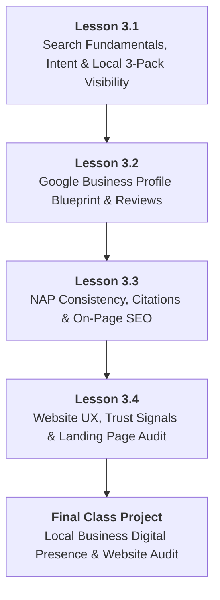

# DMS-MOD-03: Local Business Presence, Google Business Profile & Website UX
## Detailed Teaching Syllabus & Lesson Specifications

**Course ID:** `digital-marketing-pro`  
**Course Working Title:** Digital Marketing Standard / Foundation  
**Module ID:** `DMS-MOD-03`  
**Module Title:** Local Business Presence, Google Business Profile & Website UX  
**Curriculum Version:** 1.0 (October 2026)  
**Parent Specification:** [`docs/course-redesign/digital-marketing/digital-marketing-standard-spec.md`](file:///c:/Users/wasee/Desktop/NovaSkillsProject/NovaSkills%20Website/docs/course-redesign/digital-marketing/digital-marketing-standard-spec.md)  
**Prerequisite Modules:**  
- [`DMS-MOD-01: Digital Marketing Foundations, Personas & Strategy`](file:///c:/Users/wasee/Desktop/NovaSkillsProject/NovaSkills%20Website/docs/course-redesign/digital-marketing/modules/dms-mod-01.md)  
- [`DMS-MOD-02: Content Strategy, Canva Design & Organic Social Media`](file:///c:/Users/wasee/Desktop/NovaSkillsProject/NovaSkills%20Website/docs/course-redesign/digital-marketing/modules/dms-mod-02.md)  
**Document Status:** Complete Teaching Syllabus — Ready for Classroom Delivery  

---

## 1. Module Overview & Pedagogical Architecture

### 1.1 Module Objective
The objective of **DMS-MOD-03** is to provide foundational learners with the knowledge and practical capabilities required to establish, optimize, and audit a local business's high-intent search footprint and web conversion assets. Where Module 02 focused on *Push* discovery via social feeds, Module 03 focuses on *Pull* capture: winning high-intent local searches on Google and ensuring website visitors actually convert into phone calls, WhatsApp inquiries, and walk-in customers:
1. Understanding search engine fundamentals, crawling/indexing, and the mechanics of search intent ("near me" searches).
2. Mastering Google Maps and the Local 3-Pack ranking factors (Relevance, Distance, Prominence).
3. Blueprinting complete Google Business Profile (GBP) configurations (categories, service menus, operating hours, photography, and review management) without risking account suspensions or violating anti-spam policies.
4. Auditing Name, Address, Phone (NAP) consistency across local business directories and citations.
5. Implementing essential on-page SEO foundations (keyword discovery, title tags, meta descriptions, heading structure, and image alt text) without technical code-level overload.
6. Evaluating small business websites and landing pages for user experience (UX), mobile responsiveness, trust signals, and conversion friction.

### 1.2 Pedagogical Workload & Time Allocation
This module allocates exactly **12 Total Learner Workload Hours**, designed to balance foundational search theory, live public audits, and concrete blueprinting:

```
┌────────────────────────────────────────────────────────────────────────┐
│                   DMS-MOD-03 TOTAL WORKLOAD: 12 HOURS                  │
├────────────────────────────┬────────────────────────────┬──────────────┤
│ Supervised Contact Time    │ Independent Practice Time  │ Capstone Lab │
│ 7.0 Hours Total            │ 3.0 Hours Total            │ 2.0 Hours    │
├────────────────────────────┼────────────────────────────┼──────────────┤
│ • Supervised Theory: 3.0h  │ • Independent Homework:    │ • Digital    │
│ • Guided Labs: 4.0h        │   3.0h (4 x 45 min)        │   Presence   │
│   (4 Lessons x 1h 45m)     │                            │   Audit      │
└────────────────────────────┴────────────────────────────┴──────────────┘
```

- **Lesson 3.1:** Search Fundamentals, Search Intent & Local Maps Visibility (2.5h total)
- **Lesson 3.2:** Google Business Profile Architecture, Optimization & Review Management (2.5h total)
- **Lesson 3.3:** NAP Consistency, Local Citations & Basic On-Page SEO Foundations (2.5h total)
- **Lesson 3.4:** Website & Landing Page Fundamentals, UX & Conversion Optimization (2.5h total)
- **Final Class Project:** Local Business Digital Presence & Website Audit (2.0h total)

---

## 2. Lesson-by-Lesson Syllabus Specifications



---

### Lesson 3.1: Search Fundamentals, Search Intent & Local Maps Visibility

#### 1. Lesson Number & Title
- **Lesson Number:** `DMS-3.1`
- **Lesson Title:** Search Fundamentals, Search Intent & Local Maps Visibility
- **Instructional Focus:** Search engine mechanics, the 4 types of search intent, local search dynamics, and the Google Local 3-Pack.

#### 2. Main Topics & Numbered Subtopics
- **3.1.1 How Search Engines Work (The Simplified Beginner Model):**
  - Crawling: How search engine bots discover web pages, business profiles, and directories via links.
  - Indexing: How search engines catalog, categorize, and store information in a massive global database.
  - Ranking: How algorithms decide which result best answers the searcher's query in milliseconds.
- **3.1.2 The Taxonomy of Search Intent:**
  - **Informational Intent:** Seeking knowledge (e.g., *"How often should you get teeth cleaned"*).
  - **Navigational Intent:** Seeking a specific website or brand (e.g., *"SmileCraft clinic login"*).
  - **Commercial Investigation:** Comparing options before buying (e.g., *"Best dental clinics in Pune reviews"*).
  - **Transactional / Local Intent:** Ready to take action immediately (e.g., *"Emergency dentist near me open now"*).
  - Why local businesses must prioritize Commercial and Local intent over broad generic searches.
- **3.1.3 The Google Search Engine Results Page (SERP) Anatomy:**
  - Sponsored Ads (Top Google Search Ads).
  - The **Google Local 3-Pack (Map Pack)**: The three featured local businesses displayed alongside a map.
  - Organic Website Links (Standard SEO results).
  - "People Also Ask" and localized Knowledge Panels.
  - Why over 40% of all local business clicks go directly to the Local 3-Pack.
- **3.1.4 The 3 Core Ranking Factors of Local SEO:**
  - **Relevance:** How closely a business profile matches what the user is searching for (proper category selection, keywords in services).
  - **Distance:** How close the business physical address is to the searcher's current GPS location or stated city area.
  - **Prominence:** How well-known and reputable the business is offline and online (review count, average star rating, directory citations, local news mentions).
- **3.1.5 Ethical Guidelines & Anti-Spam Basics:**
  - Why keyword stuffing into a business name (e.g., *"Dr. Rahul Sharma Best Cheapest Root Canal Dentist Pune"*) violates Google guidelines and triggers account suspensions.
  - Maintaining clean, honest business representations that build permanent local equity.

#### 3. What Students Will Learn & Real Business Example
Students will learn how Google interprets search queries, why local intent searches trigger the coveted Map Pack, and how the triad of Relevance, Distance, and Prominence dictates who gets seen.

- **Real Business Example:**
  - *The Zero-Visibility Business:* *City Smiles Dental* does not specify pediatric dentistry on their profile. When a local mother searches `"kids dentist near me"`, Google bypasses City Smiles entirely because their Relevance score for "pediatric/kids" is zero, even though their clinic is only 200 meters away.
  - *The Optimized Local Presence:* *SmileCraft Pediatric Dental Clinic* has set its primary category to *"Pediatric Dentist"*, lists *"painless milk teeth fillings"* under services, and has 48 reviews mentioning "kids" and "gentle". Google features them at position #1 in the Local 3-Pack for parents across a 5 km radius, generating 35 phone calls a week without ad spend.

#### 4. Trainer Demonstration (25 Minutes)
- **Step 1:** The trainer opens Google Search in an Incognito/Private browser window.
- **Step 2:** The trainer performs two contrasting live searches:
  - Search 1: `"Sourdough bread recipe"` (Triggers 100% Informational results: blogs, YouTube videos; zero map pack).
  - Search 2: `"Artisan sourdough bakery near me"` (Triggers the Google Local 3-Pack, map pins, star ratings, and direct "Directions" / "Call" buttons).
- **Step 3:** The trainer dissects the top 3 businesses in the Local 3-Pack live:
  - Highlights their primary category label (e.g., "Bakery").
  - Inspects their review velocity (how recent their reviews are).
  - Demonstrates how distance impacts results by changing the search location filter to another neighborhood.

#### 5. Student Hands-On Practical (60 Minutes)
- **Exercise Name:** *Local SERP Anatomy & Local 3-Pack Audit Lab*
- **Tool:** Web browser (Chrome / Edge / Firefox) in Private/Incognito mode + Google Docs.
- **Task:** Perform a comparative local search audit for 2 different business categories in your city (e.g., Category 1: Emergency Plumber; Category 2: Boutique Fitness Studio).
- **Instructions:**
  1. Execute 2 high-intent queries for each category (e.g., `"[service] in [city/area]"` and `"[service] near me"`).
  2. Take a screenshot of the resulting SERP and annotate the 4 major components (Ads, Local 3-Pack, Organic Links, People Also Ask).
  3. For the top 3 businesses in the Local 3-Pack, record: Business Name, Stated Category, Review Count, Star Rating, and Estimated Distance.
  4. Write a 1-paragraph analysis explaining why Business #1 outranks Business #3 based on Relevance, Distance, or Prominence signals.
- **Trainer Role:** Circulate and ensure students use Incognito mode to avoid personalized search history bias; help students identify the difference between organic website rankings and Google Map Pack rankings.

#### 6. Assignment (Independent Practice — 45 Minutes)
- **Task:** Perform a Local 3-Pack Gap Analysis for your assigned business (or chosen local SMB).
- **Deliverable:**
  - Search for your business's top 3 service keywords.
  - Does your business appear in the Local 3-Pack? If yes, what position? If no, which 3 competitors dominate?
  - Identify the exact Prominence gap: How many reviews does the #1 competitor have compared to your business?
  - Submit a 1-page **Local Search Footprint Audit Summary**.

#### 7. Expected Learning Outcome
Students will be able to distinguish between different search intents, dissect a Google SERP, analyze the Local 3-Pack, and diagnose why specific local competitors rank higher based on Relevance, Distance, and Prominence.

#### 8. Assessment Criteria
- Correct identification of search intent across test queries.
- Accurate documentation of Local 3-Pack ranking signals (category, reviews, distance).
- Clear, evidence-based reasoning for local ranking differences without technical jargon.

#### 9. Time Allocation
- Supervised Lecture & Discussion: 20 Minutes
- Live Trainer Demonstration: 25 Minutes
- Guided Hands-On Lab Work: 60 Minutes
- Independent Homework Practice: 45 Minutes
- **Total Lesson Time:** **150 Minutes (2.5 Hours)**

---

### Lesson 3.2: Google Business Profile Architecture, Optimization & Review Management

#### 1. Lesson Number & Title
- **Lesson Number:** `DMS-3.2`
- **Lesson Title:** Google Business Profile Architecture, Optimization & Review Management
- **Instructional Focus:** GBP profile fields, category selection, service menus, visual asset standards, ethical review generation, and strict anti-spam compliance.

#### 2. Main Topics & Numbered Subtopics
- **3.2.1 Google Business Profile (GBP) Core Architecture:**
  - The central command center for local search presence; how GBP powers Google Search knowledge panels and Google Maps pins.
  - Essential profile fields: Business Name, Primary Category, Secondary Categories, Physical Address / Service Area, Operating Hours, Phone Number, Website URL, Appointment Link.
- **3.2.2 Strategic Category Selection (The #1 Relevance Factor):**
  - Primary Category: The single most impactful SEO choice on GBP (e.g., *"Pediatric Dentist"* vs. general *"Dentist"*).
  - Secondary Categories: Capturing adjacent services without diluting authority (e.g., *"Dental Clinic"*, *"Teeth Whitening Service"*, *"Emergency Dental Service"*).
  - Why choosing incorrect or irrelevant categories harms visibility.
- **3.2.3 Service Menus, Descriptions & Visual Asset Standards:**
  - Writing a compelling 750-character Business Description using customer-focused language and natural local keywords.
  - Structuring individual service items with transparent starting prices and brief descriptions.
  - Photography guidelines: Cover photo (exterior storefront with visible signage), interior environment, team at work, high-resolution product photos.
  - The strict prohibition of generic stock photos: Why Google's computer vision flags and de-ranks stock images.
- **3.2.4 The Review Management & Reputation Engine:**
  - Why review count, velocity (new reviews per month), and review keywords directly boost Prominence.
  - Creating a frictionless Direct Review Shortlink (`g.page/r/.../review`).
  - The 5-Star Review Generation Playbook: Timing the request, WhatsApp review request scripts, QR code desk stands.
  - Responding to all reviews within 24–48 hours: Incorporating keywords into positive replies and using the de-escalation protocol for 1-star complaints.
- **3.2.5 Strict Compliance, Verification & Anti-Spam Directives:**
  - **Zero Tolerance Policy:** Creating fictional businesses, test profiles, or using virtual co-working addresses violates Google anti-spam guidelines and causes permanent Google Account blacklisting.
  - Verification realities in 2026: Live video verification, physical storefront signage checks, utility bills, and official business registration certificates.
  - **Classroom Rule:** All student work is conducted through **Offline Blueprinting** on real operating businesses or supervised read-only inspection; students never create dummy listings.

#### 3. What Students Will Learn & Real Business Example
Students will learn how to architect a fully optimized Google Business Profile blueprint that maximizes local search visibility, and how to build an ethical customer review generation system that builds trust and boosts map rankings.

- **Real Business Example:**
  - *The Neglected Profile:* *Apex Plumbing* claimed their GBP profile in 2021, set their category to "Plumber", left operating hours blank, uploaded 1 blurry photo of a pipe, and has 3 reviews with zero owner replies. When homeowners search for a plumber, they assume Apex is out of business and call someone else.
  - *The Optimized Profile:* *SwiftShield Pest Control* has a verified profile with primary category *"Pest Control Service"*, secondary category *"Bird Control Service"*, 24 high-res photos of marked company vans and uniformed technicians, custom service cards with upfront pricing, and a custom review link. They generate 8 new 5-star reviews every month and reply to every review within 12 hours. They receive over 60 direct phone calls monthly from Google Maps.

#### 4. Trainer Demonstration (25 Minutes)
- **Step 1:** The trainer opens Google Search and inspects a live, public Google Business Profile of a local business (*SmileCraft Dental Clinic*).
- **Step 2:** The trainer demonstrates the **GBP Optimization Audit**:
  - Checks whether the business has selected the most specific primary category.
  - Evaluates photo recency, storefront clarity, and team representation.
  - Reviews customer review sentiment, frequency, and owner response quality.
- **Step 3:** The trainer opens the **Nova Skills GBP Configuration Blueprint Template** in Google Docs.
- **Step 4:** The trainer fills out a complete optimization blueprint:
  - Formulates a 750-character keyword-rich business description.
  - Defines 1 primary and 3 secondary categories.
  - Drafts 3 standardized customer review response templates (1 for 5-star praise, 1 for specific service praise, 1 for a negative complaint).

#### 5. Student Hands-On Practical (60 Minutes)
- **Exercise Name:** *Google Business Profile Optimization Blueprint Lab*
- **Tool:** Google Docs / Sheets (Offline Blueprint Template).
- **Task:** Author a comprehensive **GBP Optimization Blueprint** for your approved course business scenario.
- **Instructions:**
  1. Determine the single most effective Primary Category and 3 Secondary Categories from Google's official category taxonomy.
  2. Write an engaging, customer-centric 750-character Business Description incorporating your core value proposition and 2 local geographic identifiers.
  3. Define 4 core service items with clear titles, 2-line descriptions, and pricing guidelines.
  4. Author a 5-step Photo Production Checklist specifying what real photos the business must capture (Storefront, Reception, Equipment, Team, Products).
  5. Draft 2 personalized review response scripts: One acknowledging a 5-star review, and one professionally de-escalating a critical 2-star complaint.
- **Trainer Role:** Ensure students write natural, human descriptions and do NOT stuff keywords into the business name; verify that review response templates sound empathetic and professional.

#### 6. Assignment (Independent Practice — 45 Minutes)
- **Task:** Create an in-store / post-service **Review Generation Protocol** for your business.
- **Deliverable:**
  - Design a 1-page table-tent / counter card concept (or WhatsApp follow-up script) inviting happy customers to leave a Google review.
  - Write the exact 3-sentence message sent to customers 2 hours after service completion.
  - Include an ethical guideline statement explaining why paying for reviews or having staff post fake reviews is strictly illegal and counterproductive.

#### 7. Expected Learning Outcome
Students will be able to author an industry-grade Google Business Profile configuration blueprint, select optimal categories, establish visual standards, and deploy a professional review management and response system.

#### 8. Assessment Criteria
- Optimal primary and secondary categories selected based on business type.
- Business description is persuasive, accurate, and completely free of spammy keyword stuffing.
- Review response templates demonstrate professional brand tone and effective conflict resolution.
- Strict compliance with Google anti-spam rules.

#### 9. Time Allocation
- Supervised Lecture & Discussion: 20 Minutes
- Live Trainer Demonstration: 25 Minutes
- Guided Hands-On Lab Work: 60 Minutes
- Independent Homework Practice: 45 Minutes
- **Total Lesson Time:** **150 Minutes (2.5 Hours)**

---

### Lesson 3.3: NAP Consistency, Local Citations & Basic On-Page SEO Foundations

#### 1. Lesson Number & Title
- **Lesson Number:** `DMS-3.3`
- **Lesson Title:** NAP Consistency, Local Citations & Basic On-Page SEO Foundations
- **Instructional Focus:** Name-Address-Phone integrity, local directory citations, keyword discovery without paid tools, title tags, meta descriptions, headings, and image alt text.

#### 2. Main Topics & Numbered Subtopics
- **3.3.1 The Principle of NAP Consistency (Name, Address, Phone):**
  - What NAP represents: The foundational digital fingerprint of a local business across the entire internet.
  - Why consistency matters: How search engines cross-reference directory listings to verify that a business is legitimate and physically operating.
  - The danger of NAP discrepancies: E.g., *"SmileCraft Dental"* vs. *"Smile Craft Clinic"*, or *"Flat 4B, MG Road"* vs. *"4/B Mahatma Gandhi Marg"*. Why inconsistent phone numbers or old addresses confuse search bots and destroy local rankings.
- **3.3.2 Local Business Citations & Directory Ecosystem:**
  - Core citation platforms in India and globally: Justdial, IndiaMART, Sulekha, TradeIndia, Google Business Profile, Facebook Local Page, Apple Maps, Yellow Pages.
  - Industry-specific directories: Practo/Lybrate for doctors, Zomato/Swiggy for restaurants, Houzz for interior designers.
  - Conducting a manual citation audit using Google Search operators (e.g., `"Business Name" + "Phone Number"`).
- **3.3.3 Beginner-Friendly Keyword Discovery (Zero Paid Tools Required):**
  - Why expensive SEO software (SEMrush, Ahrefs) is unnecessary for foundational local marketing.
  - Sourcing high-intent search terms using free Google native features:
    - Google Search Autocomplete (typing service queries to see what local users search).
    - Google "Searches related to" at the bottom of the SERP.
    - Google "People Also Ask" questions.
    - Google Trends (comparing search term popularity over time).
- **3.3.4 On-Page SEO Core Foundations (Titles, Descriptions, Headings):**
  - **Title Tags (The #1 On-Page Element):** Standard local structure: `[Primary Service Keyword] in [City/Area] | [Brand Name]` (50–60 characters).
  - **Meta Descriptions (The Ad Copy of Organic Search):** Compelling value summary + explicit CTA (140–160 characters). How meta descriptions impact click-through rate (CTR) even though they don't directly impact rankings.
  - **Heading Hierarchy (H1, H2, H3):** Exactly one single `<h1>` per page containing the core service and location; `<h2>` subheads for supporting services and FAQs; `<h3>` for individual features.
- **3.3.5 Image Alt Text & File Name Optimization:**
  - Renaming raw camera files (`IMG_20261016_001.jpg` ➔ `pediatric-dental-clinic-pune-reception.jpg`).
  - Writing descriptive, accessible Image Alt Text for screen readers and search bots (e.g., *"Child smiling during gentle dental checkup at SmileCraft Pune"*).

#### 3. What Students Will Learn & Real Business Example
Students will learn how to maintain flawless NAP consistency across the web to build search engine trust, discover what local customers are actively searching for using free Google tools, and craft perfectly structured title tags, meta descriptions, headings, and alt text for local website pages.

- **Real Business Example:**
  - *The Fragmented Citation Disaster:* *BakeCraft Bakery* moved two streets over in 2024. Their new address is on their Instagram bio, but their old address remains on Justdial, their Facebook page has an old landline number that is disconnected, and their website lists an old email. Google detects conflicting data, loses confidence in their real location, and drops them from position #2 to position #18 on Google Maps.
  - *The Optimized On-Page Presence:* A local yoga studio optimizes their website homepage:
    - *Old Title:* `Home - My Site 1` (Completely invisible to Google).
    - *New Title:* `Gentle Postnatal Yoga Classes in Koramangala | Prana Studio`
    - *New Meta Description:* `Strengthen your core and regain energy with certified female yoga therapists in Koramangala. Small group batches with infant creche. Book your trial class today.`
    - *Result:* Within 4 weeks, the page ranks on Page 1 of Google for local mothers searching for postnatal yoga.

#### 4. Trainer Demonstration (25 Minutes)
- **Step 1:** The trainer opens Google Search and executes a live **Citation Audit** using search operators:
  `"SmileCraft Dental" AND "9876543210"`
- **Step 2:** The trainer demonstrates finding NAP discrepancies across Facebook, Justdial, and the clinic website.
- **Step 3:** The trainer demonstrates **Free Keyword Discovery**:
  - Types `"dental clinic baner"` into Google Search bar and shows the live Autocomplete suggestions (`baner pashan link road`, `root canal baner`, `pediatric dentist baner`).
  - Scrolls down to "People Also Ask" and extracts 3 customer questions.
- **Step 4:** The trainer inspects a live webpage using browser developer tools (Right-Click ➔ Inspect):
  - Shows where the `<title>` tag and `<meta name="description">` live inside the HTML `<head>`.
  - Shows the page's `<h1>` tag and critiques its structure.
  - Writes an optimized Title Tag and Meta Description on screen.

#### 5. Student Hands-On Practical (60 Minutes)
- **Exercise Name:** *NAP Audit & On-Page SEO Optimization Lab*
- **Tool:** Google Search, Browser Inspect Tool, Google Docs / Sheets.
- **Task:** Audit an existing business's web presence and craft an on-page SEO package for its primary service page.
- **Instructions:**
  1. Perform a citation search for an assigned local business using Google search operators; document their Name, Address, and Phone across 3 different public platforms in a NAP Audit Table. Flag any inconsistencies.
  2. Use Google Autocomplete and "Related Searches" to identify 5 real local search keyword phrases for this business.
  3. Author an optimized **Title Tag** (50–60 characters) adhering to the standard local formula.
  4. Author a high-converting **Meta Description** (140–160 characters) featuring an emotional benefit and a clear CTA.
  5. Draft an `<h1>` headline and 3 supporting `<h2>` subheadings for the page.
  6. Write descriptive file names and accessible Alt Text for 3 representative website images.
- **Trainer Role:** Validate character counts for title tags and meta descriptions using a free online SERP snippet simulator; ensure keywords flow naturally and do not read like spam.

#### 6. Assignment (Independent Practice — 45 Minutes)
- **Task:** Complete an On-Page SEO Checklist for 2 internal service pages of your course business.
- **Deliverable:**
  - Primary Service Page (e.g., "Root Canal Treatment" or "Custom Sourdough Loaves").
  - Secondary Service Page (e.g., "Teeth Whitening" or "Catering & Event Pastries").
  - Provide for each: Target Keyword, URL Slug concept, Title Tag (with character count), Meta Description (with character count), H1 headline, and 2 H2 subheads.

#### 7. Expected Learning Outcome
Students will be able to audit local business citations for NAP consistency, extract high-intent keywords using free native search tools, and compose search-optimized, user-friendly on-page meta tags and heading structures.

#### 8. Assessment Criteria
- NAP audit accurately identifies platform sources and flags discrepancies.
- Title tags stay strictly within 50–60 characters and follow the local structure.
- Meta descriptions stay within 140–160 characters with clear call-to-action.
- Logical heading hierarchy (one H1, clear H2s).

#### 9. Time Allocation
- Supervised Lecture & Discussion: 20 Minutes
- Live Trainer Demonstration: 25 Minutes
- Guided Hands-On Lab Work: 60 Minutes
- Independent Homework Practice: 45 Minutes
- **Total Lesson Time:** **150 Minutes (2.5 Hours)**

---

### Lesson 3.4: Website & Landing Page Fundamentals, UX & Conversion Optimization

#### 1. Lesson Number & Title
- **Lesson Number:** `DMS-3.4`
- **Lesson Title:** Website & Landing Page Fundamentals, UX & Conversion Optimization
- **Instructional Focus:** Small-business website architecture, landing page UX principles, mobile responsiveness, trust signals, CTA design, and conversion friction audits.

#### 2. Main Topics & Numbered Subtopics
- **2.4.1 Website vs. Dedicated Landing Page:**
  - Multi-page website (Home, About, Services, Blog, Contact): Educates, builds broad brand authority, serves multiple audiences.
  - Dedicated Landing Page: Single-purpose destination with **one single goal** (e.g., book a consultation, request a quote, register for an event).
  - The "Leaky Bucket" problem: Why sending paid ads or high-intent local searchers to a cluttered multi-page homepage results in 90% bounce rates.
- **3.4.2 Core UX Principles for High-Converting Local Websites:**
  - **Mobile-First Priority:** Over 75% of local service searches occur on smartphones; why desktop-only layouts destroy business revenue.
  - **Visual Hierarchy & The 5-Second Test:** Can a visitor answer three questions in 5 seconds:
    1. *What do you offer?*
    2. *Why should I trust you?*
    3. *What do I do next?*
  - **Scannability & Readability:** Big bold headlines, short 2-line paragraphs, bullet points, and generous whitespace.
- **3.4.3 Trust Signals & Credibility Architecture:**
  - Overcoming the online stranger barrier:
    - Real customer reviews with authentic photos and star ratings.
    - Verified credentials, medical licenses, trade certifications, awards.
    - Physical storefront photos and Google Maps embed (proving the business is real).
    - Transparent pricing or "No hidden costs" guarantees.
- **3.4.4 Call-to-Action (CTA) Architecture & Form Friction:**
  - Primary CTA vs. Secondary CTA: The primary action (e.g., *"Book on WhatsApp"*) vs. low-commitment alternative (e.g., *"Download Pricing Menu"*).
  - Button styling: High-contrast accent color, sticky mobile buttons, action-oriented verbs.
  - Reducing Form Friction: The mathematical rule of form fields (every extra field reduces conversion rate by 10–15%).
  - The local service standard: 3 fields maximum (Name, Phone/WhatsApp, Preferred Time/Service).
  - Direct Click-to-Call and Click-to-WhatsApp button integration for mobile users.
- **3.4.5 Conducting a Structured Usability & Conversion Audit:**
  - Evaluating a live website using the **Nova Skills 12-Point UX Scorecard**.
  - Testing mobile responsiveness using Chrome Developer Tools Device Mode (inspecting iPhone, Samsung, and tablet screen sizes).
  - Diagnosing load speed friction (oversized uncompressed images, broken links, non-clickable phone numbers).

#### 3. What Students Will Learn & Real Business Example
Students will learn how to evaluate any small business website or landing page through the eyes of a mobile consumer. They will master diagnosing conversion friction, auditing trust signals, and restructuring layout hierarchy so that incoming search and social traffic converts into paying customers.

- **Real Business Example:**
  - *The Cluttered Homepage (High Friction):* *QuickFix Plumbing* sends Google Search visitors to their homepage. It features an autoplay video background that takes 8 seconds to load on mobile, a 12-field form requiring street name and zip code, no phone number in the top header, and tiny text that requires zooming. 94 out of 100 visitors tap "Back" within 4 seconds.
  - *The Frictionless Landing Page:* *SwiftShield Pest Control* creates a clean, mobile-first landing page. The top header has a prominent green button: *"Call Now: 98765-XXXXX"*. The headline is bold: *"Termite Inspection & Eradication in Aundh — Same-Day Service"*. Beneath it are 3 bullet points, 4 Google review badges, and a 2-field form: *"Enter Phone Number for Instant Quote"*. Conversions jump from 3% to 18%.

#### 4. Trainer Demonstration (25 Minutes)
- **Step 1:** The trainer opens Google Chrome and navigates to a live small-business website.
- **Step 2:** The trainer presses `F12` (or Right-Click ➔ Inspect) and clicks the **Toggle Device Toolbar** icon (`Ctrl+Shift+M`) to switch to **Mobile View (iPhone 14 / Pixel 7)**.
- **Step 3:** The trainer performs the **5-Second Test** live:
  - Is the phone number immediately clickable?
  - Does the headline make sense without scrolling?
  - Does the image load cleanly without overlapping text?
- **Step 4:** The trainer evaluates the website using the **12-Point UX Scorecard**, scoring each dimension from 1 to 5 (Headline clarity, Mobile responsiveness, Form friction, Trust badges, Page load perception, and CTA prominence).
- **Step 5:** The trainer writes 3 high-priority, actionable recommendations that would double the page's conversion rate in under 48 hours.

#### 5. Student Hands-On Practical (60 Minutes)
- **Exercise Name:** *Mobile UX & Conversion Usability Audit Lab*
- **Tool:** Google Chrome / Edge Developer Tools (Mobile Device Mode) + UX Scorecard Template.
- **Task:** Perform a rigorous Mobile UX and Conversion Audit on an operating local business website (or landing page).
- **Instructions:**
  1. Open the website in Chrome Developer Tools set to a standard mobile viewport (390 $\times$ 844 px).
  2. Conduct the 5-Second Test: Record what is visible above the fold on mobile.
  3. Evaluate and score the page across all 6 core UX categories (Mobile Responsiveness, Headline & Message Clarity, Trust & Credibility Signals, Form Friction, Visual Hierarchy, and Call-to-Action Visibility) on a scale of 1 to 5.
  4. Identify the #1 conversion bottleneck causing prospective leads to abandon the page.
  5. Formulate 3 specific, non-technical improvement recommendations (e.g., *"Add sticky WhatsApp button to mobile footer; reduce form fields from 7 to 3; add verified Google review star widget above the fold"*).
- **Trainer Role:** Guide students in navigating Chrome Developer Tools; ensure students focus on practical user behavior rather than backend programming code.

#### 6. Assignment (Independent Practice — 45 Minutes)
- **Task:** Design a low-fidelity **Mobile Landing Page Wireframe Sketch** for your course business.
- **Deliverable:**
  - Create a clean 1-page visual sketch (hand-drawn on paper and photographed, or built using simple shapes in Google Docs / Canva).
  - Illustrate the exact layout of the mobile screen from top to bottom:
    - Header (Logo + Click-to-Call button).
    - Hero Section (Headline, Subhead, Primary CTA).
    - Trust Bar (Star rating, review count, credentials).
    - 3 Key Benefits / Service Offerings.
    - Simplified 3-Field Lead Capture Form.
    - Mobile sticky footer CTA bar.

#### 7. Expected Learning Outcome
Students will be able to audit small business websites and landing pages for mobile responsiveness, identify conversion friction, evaluate trust signals, and author actionable layout recommendations to boost lead generation.

#### 8. Assessment Criteria
- Comprehensive audit covering mobile layout, trust signals, and CTA prominence.
- Accurate diagnosis of conversion bottlenecks.
- Realistic, high-impact recommendations tailored for small businesses.
- Clean, structured mobile wireframe sketch submitted.

#### 9. Time Allocation
- Supervised Lecture & Discussion: 20 Minutes
- Live Trainer Demonstration: 25 Minutes
- Guided Hands-On Lab Work: 60 Minutes
- Independent Homework Practice: 45 Minutes
- **Total Lesson Time:** **150 Minutes (2.5 Hours)**

---

## 3. Final Class Project Specification

### 3.1 Project Title
**Local Business Digital Presence & Website Audit**

### 3.2 Project Purpose & Context
The Final Class Project for **DMS-MOD-03** synthesizes local search visibility, Google Business Profile optimization, on-page SEO essentials, and website UX into a professional, client-facing audit report. Students take a real operating local business (from the approved scenarios in Module 01/02 or an authorized local SMB) and conduct a comprehensive footprint evaluation that diagnoses why the business is missing out on high-intent local customers and provides a step-by-step roadmap for local dominance.

### 3.3 Required Deliverable Components (The Audit Portfolio)
The submitted project must be a clean, structured Google Docs or PDF document (5–8 pages) containing these **6 mandatory sections**:

```
┌────────────────────────────────────────────────────────────────────────┐
│        LOCAL BUSINESS DIGITAL PRESENCE & WEBSITE AUDIT DOSSIER         │
├────────────────────────────────────────────────────────────────────────┤
│ 1. Executive Summary & Local Footprint Overview                        │
│    • Business name, category, physical location, and audit scope       │
│    • Current Google Maps presence status and primary competitor gap    │
│ 2. Local Search Visibility & 3-Pack Gap Analysis                       │
│    • SERP audit for 3 primary service keywords (Incognito mode)        │
│    • Comparison table of top 3 Local 3-Pack competitors (ratings/NAP) │
│ 3. Google Business Profile Optimization Blueprint                      │
│    • Primary & 3 secondary categories from official taxonomy           │
│    • 750-character keyword-rich business description (no spam)         │
│    • 4 core service items with descriptions and pricing guidelines     │
│    • Visual photo audit & production guidelines (real photos only)     │
│    • 2 personalized review response scripts (positive & negative)      │
│ 4. NAP Consistency & Local Citation Review                             │
│    • Cross-platform audit table (Google Maps, Facebook, Justdial, Web) │
│    • Flagged discrepancies in Name, Address, or Phone formatting       │
│ 5. Basic On-Page SEO Checklist & Metadata Package                      │
│    • 5 verified local search keywords (from Autocomplete / Related)    │
│    • Optimized Title Tag (50–60 chars) and Meta Description (140–160)   │
│    • Heading structure (H1 and 3 H2s) and 2 image alt text specs       │
│ 6. Website Mobile UX Scorecard & Conversion Action Plan                │
│    • 12-point mobile usability evaluation (scores 1–5 per category)    │
│    • Identification of #1 conversion friction bottleneck               │
│    • 3 prioritized, actionable recommendations to double conversions   │
│    • Mobile landing page wireframe sketch (attached graphic/photo)     │
└────────────────────────────────────────────────────────────────────────┘
```

---

## 4. Measurable Grading Rubric (100 Points Total)

Each student's Local Business Digital Presence & Website Audit is evaluated against this standard institutional rubric:

| Assessment Dimension | Exemplary (90–100%) | Proficient (75–89%) | Developing (60–74%) | Incomplete (< 60%) | Score Weight |
|---|---|---|---|---|---|
| **1. Local SERP & 3-Pack Gap Analysis** | Meticulous Incognito audit of 3 local queries. Deep analysis of Relevance, Distance, and Prominence differences. Clear competitor benchmark. | Audits 3 queries with clear screenshots. Identifies competitor ratings and categories with good commentary. | Superficial search review; missing competitor details; fails to distinguish between map pack and organic links. | Incomplete search audit; assumed findings without evidence or search screenshots. | **15 Points** |
| **2. GBP Optimization Blueprint Quality** | Flawless category selection. Compelling, professional 750-char description with zero keyword stuffing. Empathetic, brand-aligned review scripts. | Good category choices. Well-written description and solid review responses. Follows Google guidelines. | Generic description; repetitive keyword stuffing; robotic or defensive review response templates. | Missing GBP blueprint; promotes fake listings; violates Google anti-spam rules. | **20 Points** |
| **3. NAP Consistency & Citation Integrity** | Comprehensive audit across 4 platforms. Precisely flags minute formatting discrepancies. Clear remediation steps provided. | Audits across 3 platforms. Identifies major address or phone mismatches accurately. | Incomplete citation check (only 1–2 platforms); misses obvious phone number or naming discrepancies. | No citation audit provided or claims universal perfection without verification. | **15 Points** |
| **4. On-Page SEO & Metadata Precision** | 5 high-intent keywords sourced from native tools. Title tags (50–60) and Meta descriptions (140–160) strictly adhere to character limits and local formula. | Good local keywords. Meta tags adhere to length limits with minor wording flaws. Clear H1/H2 hierarchy. | Keywords are overly broad; title tag exceeds character limits; meta description lacks call to action. | Missing on-page SEO package; spammy keyword stuffing; zero metadata formatting. | **20 Points** |
| **5. Mobile UX Scorecard & Conversion Plan** | Rigorous 12-point audit using Chrome mobile view. Identifies exact friction bottlenecks. 3 recommendations are highly specific, practical, and non-technical. | Complete mobile scorecard. Identifies solid usability issues and practical recommendations. | Superficial UX review; generic advice ("make website prettier"); fails to test actual mobile view. | Missing UX scorecard; ignores mobile viewport; irrelevant technical recommendations. | **20 Points** |
| **6. Professional Presentation & Ethics** | Immaculate client-ready report. Clear tables, professional formatting, zero grammatical errors. 100% compliant with white-hat ethical SEO standards. | Well-organized report with minor layout imperfections. Respects ethical guidelines. | Cluttered layout; poor screenshot formatting; unedited raw bullet points. | Disorganized, incomplete submission, or promotes black-hat / fake review schemes. | **10 Points** |
| **TOTAL** | **Outstanding Technical & Strategic Mastery** | **Competent & Ready for Module 04** | **Requires Guided Revision** | **Resubmission Required** | **100 Points** |

---

## 5. Lesson-Completion & Deliverable Tracking Checklist

This checklist is utilized by both students and instructors to track progress across Module 03:

### Student Self-Checklist:
- [ ] **Lesson 3.1:** Conducted Incognito local searches and documented the Local 3-Pack anatomy.
- [ ] **Lesson 3.1:** Completed the Local SERP Anatomy & Local 3-Pack Audit Lab.
- [ ] **Lesson 3.2:** Selected official primary and secondary GBP categories for my business.
- [ ] **Lesson 3.2:** Authored the 750-character business description without keyword stuffing.
- [ ] **Lesson 3.2:** Drafted personalized positive and negative review response templates.
- [ ] **Lesson 3.3:** Audited NAP consistency across 3+ public directories and flagged discrepancies.
- [ ] **Lesson 3.3:** Discovered 5 local search keywords using Google Autocomplete and Related Searches.
- [ ] **Lesson 3.3:** Authored an optimized Title Tag (50–60 chars) and Meta Description (140–160 chars).
- [ ] **Lesson 3.4:** Tested the business website in Chrome Developer Tools Mobile Device Mode.
- [ ] **Lesson 3.4:** Completed the 12-Point Mobile UX Scorecard and identified the #1 conversion bottleneck.
- [ ] **Lesson 3.4:** Sketched a low-fidelity mobile landing page wireframe with high-contrast CTAs.
- [ ] **Final Project:** Assembled all 6 sections into the **Local Business Digital Presence & Website Audit**.
- [ ] **Final Project:** Verified submission against the 100-point Grading Rubric prior to hand-in.

### Trainer Verification Checklist:
- [ ] Verified student understood the difference between Organic Web SEO and Google Local 3-Pack mechanics.
- [ ] Confirmed student's GBP blueprint strictly complies with Google anti-spam rules (zero fake listings).
- [ ] Inspected title tag and meta description character counts using a SERP preview simulator.
- [ ] Checked that NAP audit cross-references real public citations and highlights real discrepancies.
- [ ] Verified that student evaluated the website using a genuine mobile screen viewport.
- [ ] Graded the Local Business Digital Presence & Website Audit using the standardized 100-point rubric.
- [ ] Certified student readiness to proceed to **DMS-MOD-04: Introductory Paid Advertising: Google Search & Meta Ads**.

---

## 6. Upward Progression Alignment (Transition to Module 04)

Upon completion and evaluation of **DMS-MOD-03**, the student has mastered high-intent organic search capture and web conversion fundamentals. The curriculum now seamlessly connects organic foundations to paid media acceleration:

```
┌─────────────────────────────────────────────────────────────┐
│          DMS-MOD-03 ORGANIC FOUNDATION (Local Presence)     │
│  • Verified Google Business Profile & Local Search Map Pack │
│  • High-Intent Local Keywords & On-Page Meta Optimization   │
│  • High-Converting, Frictionless Mobile Landing Page UX     │
└──────────────────────────────┬──────────────────────────────┘
                               │
                               ▼ Feeds directly into
┌─────────────────────────────────────────────────────────────┐
│          DMS-MOD-04 PAID ACCELERATION (Google & Meta Ads)   │
│  • Deploying Google Search Ads for the Same Local Keywords  │
│  • Targeting Radius Audiences on Meta using Verified Assets │
│  • Driving Paid Traffic to Optimized, High-Converting UX    │
└─────────────────────────────────────────────────────────────┘
```

By completing Module 03 first, students never waste paid ad budget in Module 04 on broken landing pages, unverified profiles, or untrusted local footprints.

---
*End of Detailed Teaching Syllabus for `DMS-MOD-03`.*
