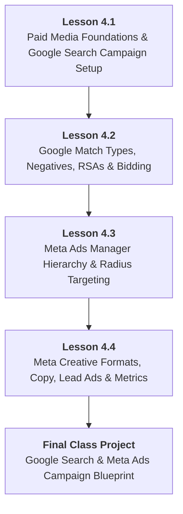

# DMS-MOD-04: Introductory Paid Advertising: Google Search & Meta Ads
## Detailed Teaching Syllabus & Lesson Specifications

**Course ID:** `digital-marketing-pro`  
**Course Working Title:** Digital Marketing Standard / Foundation  
**Module ID:** `DMS-MOD-04`  
**Module Title:** Introductory Paid Advertising: Google Search & Meta Ads  
**Curriculum Version:** 1.0 (October 2026)  
**Parent Specification:** [`docs/course-redesign/digital-marketing/digital-marketing-standard-spec.md`](file:///c:/Users/wasee/Desktop/NovaSkillsProject/NovaSkills%20Website/docs/course-redesign/digital-marketing/digital-marketing-standard-spec.md)  
**Prerequisite Modules:**  
- [`DMS-MOD-01: Digital Marketing Foundations, Personas & Strategy`](file:///c:/Users/wasee/Desktop/NovaSkillsProject/NovaSkills%20Website/docs/course-redesign/digital-marketing/modules/dms-mod-01.md)  
- [`DMS-MOD-02: Content Strategy, Canva Design & Organic Social Media`](file:///c:/Users/wasee/Desktop/NovaSkillsProject/NovaSkills%20Website/docs/course-redesign/digital-marketing/modules/dms-mod-02.md)  
- [`DMS-MOD-03: Local Business Presence, Google Business Profile & Website UX`](file:///c:/Users/wasee/Desktop/NovaSkillsProject/NovaSkills%20Website/docs/course-redesign/digital-marketing/modules/dms-mod-03.md)  
**Document Status:** Complete Teaching Syllabus — Ready for Classroom Delivery  

---

## 1. Module Overview & Pedagogical Architecture

### 1.1 Module Objective
The objective of **DMS-MOD-04** is to demystify paid digital advertising for foundational learners, transitioning them away from blind, wasteful "Boost Post" habits toward structured, controlled advertising campaigns. Students learn how to navigate the two primary paid acquisition channels for small businesses: Google Search Ads (capturing high-intent customer pull) and Meta Ads Manager (driving targeted visual discovery).
1. Understanding the ad auction model, Quality Score, Ad Rank, and cost structures (PPC vs. CPM vs. CPL).
2. Structuring Google Search campaigns using themed ad groups, keyword match types, and negative keywords.
3. Crafting high-converting Responsive Search Ads (RSAs) with compelling headlines, descriptions, and call assets.
4. Mastering Meta Ads Manager's 3-level hierarchy (Campaign ➔ Ad Set ➔ Ad) and moving beyond amateur button clicks.
5. Deploying geographic radius targeting, interest parameters, and mobile placement selections.
6. Writing persuasive ad copy, pairing visual creatives from Module 02, and designing instant lead capture concepts.
7. Managing introductory monthly budgets, pacing spend, interpreting core metrics (CTR, CPC, CPL), and enforcing strict ad policy compliance to prevent account bans.

### 1.2 Pedagogical Workload & Time Allocation
This module allocates exactly **18 Total Learner Workload Hours**, maintaining a balanced 50/50 division between Google Search and Meta Ads:

```
┌────────────────────────────────────────────────────────────────────────┐
│                   DMS-MOD-04 TOTAL WORKLOAD: 18 HOURS                  │
├────────────────────────────┬────────────────────────────┬──────────────┤
│ Supervised Contact Time    │ Independent Practice Time  │ Capstone Lab │
│ 11.0 Hours Total           │ 4.0 Hours Total            │ 3.0 Hours    │
├────────────────────────────┼────────────────────────────┼──────────────┤
│ • Supervised Theory: 5.0h  │ • Independent Homework:    │ • Paid Ads   │
│ • Guided Labs: 6.0h        │   4.0h (4 x 60 min)        │   Campaign   │
│   (4 Lessons x 2h 45m)     │                            │   Blueprint  │
└────────────────────────────┴────────────────────────────┴──────────────┘
```

- **Lesson 4.1:** Paid Advertising Foundations & Google Search Campaign Architecture (3.75h total)
- **Lesson 4.2:** Google Ads Match Types, Negative Keywords, RSAs & Bidding Basics (3.75h total)
- **Lesson 4.3:** Meta Ads Foundations, Account Hierarchy & Audience Targeting (3.75h total)
- **Lesson 4.4:** Meta Creative Formats, Lead Generation, Ad Copy & Campaign Optimization (3.75h total)
- **Final Class Project:** Google Search & Meta Ads Campaign Blueprint Assembly & Evaluation (3.0h total)

### 1.3 Practical Delivery & Tool Access Safeguards
- **100% Guaranteed Offline Standard:** All primary student deliverables and grading assessments are executed via the **Nova Skills Advertising Architecture Blueprint** (structured Google Docs/Sheets templates).
- **Zero Mandatory Spend:** Students are **never required or asked to enter personal payment cards, add billing details, or commit real advertising money**.
- **Platform Navigation Realities:** In-platform walkthroughs use Google Ads ("Expert Mode" without entering billing) and Meta Ads Manager in **Draft Status** (`In Draft`) where account access allows. Platform draft access is account-dependent and treated as an optional observational exercise, not a grading barrier.
- **No False Simulations:** Campaign drafts are never misrepresented as delivering real impressions, leads, or conversions.

---

## 2. Lesson-by-Lesson Syllabus Specifications



---

### Lesson 4.1: Paid Advertising Foundations & Google Search Campaign Architecture

#### 1. Lesson Number & Title
- **Lesson Number:** `DMS-4.1`
- **Lesson Title:** Paid Advertising Foundations & Google Search Campaign Architecture
- **Instructional Focus:** The mechanics of paid advertising, ad auctions, Google Ads account hierarchy, and building high-intent Search campaigns with themed ad groups.

#### 2. Main Topics & Numbered Subtopics
- **4.1.1 Paid Media Foundations & The Ad Auction Concept:**
  - Why businesses pay for media: Guaranteed immediate reach and placement vs. slow compounding organic effort.
  - The pay-per-click (PPC) business model: Advertisers pay only when an interested prospect clicks the ad.
  - How the Google Ad Auction works in real time: Why the highest bidder does not always win.
  - The Ad Rank formula: $\text{Ad Rank} = f(\text{Maximum CPC Bid}, \text{Quality Score}, \text{Ad Assets/Extensions})$.
  - Quality Score demystified: Expected Click-Through Rate (CTR), Ad Relevance, and Landing Page Experience.
- **4.1.2 Google Ads Account Structure & Hierarchy:**
  - The 4-Tier Enterprise Structure:
    1. *Account Level:* Login credentials, administrative rights, billing profile, time zone, currency.
    2. *Campaign Level:* Marketing objective (Leads, Website Traffic), campaign type (Search), geographic location targeting, language, daily budget.
    3. *Ad Group Level:* Thematic keyword clusters, default bids.
    4. *Ad & Keyword Level:* Individual search keywords, responsive ad copy, landing page URL.
- **4.1.3 Google Ads Platform Access & Safe Navigation Realities:**
  - Accessing Google Ads (`ads.google.com`) without a credit card: Choosing **"Switch to Expert Mode" ➔ "Create an account without a campaign"**.
  - Account-dependent variables: Why new accounts in certain regions occasionally encounter mandatory billing verification screens, and how the **Offline Architecture Blueprint** acts as the 100% fail-safe grading standard.
  - Understanding the Keyword Planner: How search volume data is displayed in broad ranges (e.g., 1K–10K) for non-spending accounts.
- **4.1.4 Selecting High-Intent Keywords for Local Search:**
  - Filtering out informational searchers: Why bidding on `"what is root canal"` wastes small business money.
  - Prioritizing commercial and transactional keywords: E.g., `"root canal specialist in baner"`, `"emergency toothache treatment pune"`, `"best pediatric dentist near me"`.
- **4.1.5 The Principle of Tightly Themed Ad Groups (TTAG):**
  - The single biggest mistake beginners make: Dumping 50 unrelated keywords into 1 ad group.
  - Structuring distinct, tightly themed ad groups:
    - *Ad Group 1 (Emergency Dental):* `emergency dentist`, `urgent tooth pain treatment`, `same day tooth extraction`.
    - *Ad Group 2 (Teeth Whitening):* `teeth whitening cost`, `professional dental bleaching`, `laser teeth whitening clinic`.
  - Why grouping keywords tightly ensures ad copy relevance and drives high Quality Scores.

#### 3. What Students Will Learn & Real Business Example
Students will learn how the Google ad auction functions, how Quality Score reduces cost-per-click, and how to structure a professional Google Search campaign into tightly themed ad groups that match high-intent customer searches.

- **Real Business Example:**
  - *The Amateur Campaign (The Dump-All Method):* *City Care Clinic* creates 1 ad group named "Dentistry" and dumps 80 keywords inside, including "dental college", "tooth anatomy", "dentist salary", and "emergency tooth extraction". Their ad headline reads: *"Quality Dental Care For All"*. When someone searches for an emergency toothache, they see a generic ad and scroll past. City Care achieves an Ad Rank of 2/10, pays ₹95 per click, and burns their ₹10,000 monthly budget in 5 days with zero inquiries.
  - *The Tightly Themed Campaign:* *SmileCraft Clinic* creates 2 distinct ad groups. Ad Group 1 targets `"emergency tooth extraction"`. Its ad headline reads: *"Severe Tooth Pain? Seen Today in Baner | Gentle Emergency Care"*. The ad leads directly to a dedicated emergency appointment booking page. Result: Quality Score of 8/10, cost-per-click drops to ₹38, and they generate 28 patient booking calls from the exact same ₹10,000 budget.

#### 4. Trainer Demonstration (35 Minutes)
- **Step 1:** The trainer opens Google Ads (`ads.google.com`) live on screen.
- **Step 2:** The trainer demonstrates the **Expert Mode Bypass**: Clicks "Switch to Expert Mode", clicks "Create an account without a campaign", confirms billing country/currency, and arrives at the main Google Ads dashboard without entering payment details.
- **Step 3:** The trainer walks through the Campaign Creation flow:
  - Selects Objective: *"Leads"*.
  - Selects Campaign Type: *"Search"*.
  - Sets Location Targeting: Pune (Radius: 8 km around Baner).
  - Sets Language: English.
  - Sets Daily Budget: ₹500/day.
- **Step 4:** The trainer displays the **Offline Google Search Campaign Architecture Template** in Google Sheets, demonstrating how every single setting in the interface maps directly to a spreadsheet column for guaranteed grading.

#### 5. Student Hands-On Practical (50 Minutes)
- **Exercise Name:** *Google Search Campaign Structuring Lab*
- **Tool:** Offline Campaign Architecture Template (Google Sheets / Docs) + Optional Google Ads Interface.
- **Task:** Structure a complete Google Search campaign for your course business scenario.
- **Instructions:**
  1. Define the Campaign Name, Marketing Objective (Leads), Geographic Location Radius (e.g., 5–10 km), and Daily Budget limit (e.g., ₹500/day).
  2. Create exactly **2 distinct, tightly themed Ad Groups** (e.g., Ad Group 1: Emergency/Core Service; Ad Group 2: Premium/Specialty Service).
  3. Select 6–8 high-intent commercial keywords for each ad group based on the research conducted in Module 03.
  4. Write a 1-sentence justification for each ad group explaining why these keywords belong together.
  5. *(Optional Platform Step):* If account allows, navigate Google Ads interface to configure the campaign structure in Draft mode and take a verification screenshot.
- **Trainer Role:** Review student ad groups, actively splitting any student's ad group that mixes disparate services (e.g., separating "cleaning" from "implants").

#### 6. Assignment (Independent Practice — 60 Minutes)
- **Task:** Conduct a Search Intent & Quality Score Audit on your selected keywords.
- **Deliverable:**
  - Audit all 12–16 keywords chosen in the practical.
  - For each keyword, label the Search Intent (Commercial Investigation or Transactional).
  - Identify the exact Landing Page URL / Section on your website that corresponds to each keyword group.
  - Explain how you would optimize that landing page to ensure Google awards a high Landing Page Experience score (e.g., matching headlines, fast load speed, visible phone number).

#### 7. Expected Learning Outcome
Students will be able to construct a professional Google Ads search campaign architecture, set appropriate geographic boundaries and budgets, and organize keywords into tightly themed ad groups that maximize relevance and Quality Score.

#### 8. Assessment Criteria
- Campaign settings specify realistic local radius targeting and daily budget controls.
- Exactly 2 tightly themed ad groups created with zero keyword topic bleeding.
- All selected keywords reflect genuine commercial or transactional intent.

#### 9. Time Allocation
- Supervised Lecture & Discussion: 40 Minutes
- Live Trainer Demonstration: 35 Minutes
- Guided Hands-On Lab Work: 50 Minutes
- Independent Homework Practice: 60 Minutes
- **Total Lesson Time:** **185 Minutes (~3.1 Hours)**

---

### Lesson 4.2: Google Ads Match Types, Negative Keywords, RSAs & Bidding Basics

#### 1. Lesson Number & Title
- **Lesson Number:** `DMS-4.2`
- **Lesson Title:** Google Ads Match Types, Negative Keywords, RSAs & Bidding Basics
- **Instructional Focus:** Broad vs. Phrase vs. Exact match types, negative keyword pruning, authoring Responsive Search Ads (RSAs), ad assets, and introductory bidding strategies.

#### 2. Main Topics & Numbered Subtopics
- **4.2.1 The 3 Keyword Match Types Explained:**
  - **Broad Match (`keyword`):** Matches searches related to your keyword, including synonyms, misspellings, and tangential topics. *Why beginners must avoid pure Broad Match on small budgets (wastes budget on loose interpretations).*
  - **Phrase Match (`"keyword"`):** Matches searches that include the meaning of your keyword. Preserves core intent while allowing modifiers before and after (e.g., `"emergency dentist"` matches *"best emergency dentist in baner open now"*).
  - **Exact Match (`[keyword]`):** Matches searches that have the exact same meaning or intent as your keyword (e.g., `[root canal clinic baner]`). Maximizes control, minimizes wasted spend.
  - *The Foundation Rule:* Use Phrase Match and Exact Match exclusively for local small businesses.
- **4.2.2 Negative Keywords (The Ultimate Budget Shield):**
  - What negative keywords do: Prevent your ads from showing for unwanted search terms.
  - The Standard Universal Negative Keyword List for Local Services:
    - Career searchers: `-jobs`, `-vacancy`, `-career`, `-salary`, `-internship`.
    - DIY & Education: `-free`, `-how to`, `-course`, `-training`, `-pdf`, `-book`.
    - Cheap seekers: `-cheap`, `-cheapest`, `-low price`, `-government`.
    - Irrelevant categories: E.g., `-dog`, `-cat` for a human dental clinic.
  - Sourcing negative keywords from the Search Terms Report to continuously eliminate budget leakage.
- **4.2.3 Responsive Search Ads (RSAs) Architecture:**
  - How RSAs work: Advertisers provide up to 15 headlines and 4 descriptions; Google's machine learning dynamically tests combinations to find the highest-performing ad for each query.
  - Headline character limits: Maximum 30 characters per headline.
  - Description character limits: Maximum 90 characters per description.
  - The Winning RSA Headline Formula:
    - *Headlines 1–4 (Keyword-rich):* E.g., *"Emergency Dentist in Baner"*, *"Gentle Toothache Treatment"*.
    - *Headlines 5–8 (Benefits & Social Proof):* E.g., *"Seen Today Guaranteed"*, *"4.9 Stars on Google Maps"*.
    - *Headlines 9–12 (Offers & Urgency):* E.g., *"₹499 Consultation & X-Ray"*, *"Needle-Free Numbing Available"*.
    - *Headlines 13–15 (Clear CTAs):* E.g., *"Call Our Clinic Now"*, *"Book Your Visit Online"*.
  - Pinning headlines: When and why to pin critical headlines to Position 1 (maintaining mandatory brand compliance).
- **4.2.4 Essential Ad Assets (Formerly Extensions):**
  - **Call Assets:** Displaying a clickable phone number directly on the ad on mobile devices.
  - **Sitelink Assets:** Providing 4 deep links to specific pages (e.g., "Our Services", "Meet the Doctors", "Patient Reviews", "Pricing").
  - **Callout Assets:** 25-character bite-sized trust snippets (e.g., "Open Sundays", "Free Parking", "Transparent Pricing").
  - **Structured Snippets:** Highlighting service categories (e.g., *Services: Implants, Braces, Root Canal, Whitening*).
- **4.2.5 Introductory Bidding Strategies & Policy Compliance:**
  - Automated vs. Manual Bidding for beginners:
    - *Maximize Clicks (with Max CPC Cap):* The recommended starting strategy to harvest maximum traffic within a strict budget ceiling (e.g., cap at ₹50/click).
    - *Maximize Conversions:* When to transition (only after logging 30+ verified conversions).
  - Google Ads Policy Directives: Prohibitions against deceptive claims ("100% Guaranteed Cure"), misleading formatting, trademark violations, and sensitive healthcare claims.

#### 3. What Students Will Learn & Real Business Example
Students will learn how to lock down keyword match types to stop wasted clicks, deploy negative keywords as a budget barrier, author high-performing Responsive Search Ads, add high-converting mobile call assets, and select sensible initial bidding rules.

- **Real Business Example:**
  - *The Match Type Disaster:* *SwiftShield Pest Control* enters `pest control` as a Broad Match keyword with zero negative keywords. Over one weekend, Google displays their ad for *"how to control pests in garden for free"*, *"pest control technician salary in india"*, *"termite biology diagram pdf"*, and *"cockroach jokes"*. SwiftShield spends ₹4,200 on clicks from students, job seekers, and gardeners.
  - *The Protected Campaign:* SwiftShield uses Phrase Match: `"termite pest control in aundh"` and adds a 15-word negative keyword list (`-free -salary -jobs -diy -diagram -college`). Every single click comes from a local property owner looking for termite eradication. Their cost-per-lead drops by 65%.

#### 4. Trainer Demonstration (35 Minutes)
- **Step 1:** The trainer opens the Google Ads interface (or the offline template) and displays an RSA ad creation panel.
- **Step 2:** The trainer demonstrates the **Character Count Constraint Challenge**:
  - Types a headline: *"We Are The Best Dental Clinic In Baner"* (39 characters — **Too long!**).
  - Trims to punchy, keyword-rich headlines:
    - Headline 1: *"Emergency Dentist Baner"* (23 chars — PASS).
    - Headline 2: *"Seen Today - No Wait"* (21 chars — PASS).
    - Headline 3: *"4.9 Star Rated Care"* (20 chars — PASS).
- **Step 3:** The trainer authors 2 descriptions under 90 characters:
  - Description 1: *"Suffering from severe tooth pain? Gentle emergency appointments available today. Call now."* (89 chars — PASS).
- **Step 4:** The trainer configures a **Call Asset** with a business phone number, highlighting how mobile users can tap to call directly without visiting the website.
- **Step 5:** The trainer inputs a 10-word **Negative Keyword List** live.

#### 5. Student Hands-On Practical (50 Minutes)
- **Exercise Name:** *RSA Copywriting & Negative Keyword Architecture Lab*
- **Tool:** Google Sheets RSA Template + Character Counter formula (`=LEN()`).
- **Task:** Build a complete Responsive Search Ad and Negative Keyword package for your Ad Group 1.
- **Instructions:**
  1. Set up your 6 core keywords in **Phrase Match** (`"..."`) and **Exact Match** (`[...]`).
  2. Compile a 10-word **Negative Keyword List** tailored to eliminate job seekers, free seekers, and irrelevant queries.
  3. Author an RSA containing:
     - Exactly **10 Headlines** (each strictly between 15 and 30 characters).
     - Exactly **3 Descriptions** (each strictly between 60 and 90 characters).
     - Verify every single line using the spreadsheet `=LEN()` formula.
  4. Write 4 Callout Assets (each under 25 characters) and 1 Call Asset (phone number).
- **Trainer Role:** Audit student character counts; immediately flag any headline that exceeds 30 characters or descriptions that exceed 90 characters.

#### 6. Assignment (Independent Practice — 60 Minutes)
- **Task:** Author the complete RSA and asset package for your **Ad Group 2**.
- **Deliverable:**
  - 6 Phrase/Exact match keywords for Ad Group 2.
  - 10 new headlines (under 30 characters).
  - 3 new descriptions (under 90 characters).
  - 2 Sitelink asset concepts (Title, Description, and target URL).
  - Combine both ad groups into your **Google Search Campaign Master Blueprint** document.

#### 7. Expected Learning Outcome
Students will be able to apply keyword match type syntax accurately, build robust negative keyword defenses, write mathematically compliant Responsive Search Ads that achieve high Ad Strength scores, and configure essential call assets.

#### 8. Assessment Criteria
- Strict match type syntax used (`"..."` for phrase, `[...]` for exact); zero naked broad match.
- Universal and industry-specific negative keywords documented.
- 100% of headlines meet the $\le 30$ character rule; 100% of descriptions meet the $\le 90$ character rule.
- Ad copy is persuasive, local, and compliant with advertising ethics.

#### 9. Time Allocation
- Supervised Lecture & Discussion: 40 Minutes
- Live Trainer Demonstration: 35 Minutes
- Guided Hands-On Lab Work: 50 Minutes
- Independent Homework Practice: 60 Minutes
- **Total Lesson Time:** **185 Minutes (~3.1 Hours)**

---

### Lesson 4.3: Meta Ads Foundations, Account Hierarchy & Audience Targeting

#### 1. Lesson Number & Title
- **Lesson Number:** `DMS-4.3`
- **Lesson Title:** Meta Ads Foundations, Account Hierarchy & Audience Targeting
- **Instructional Focus:** Meta Business Suite vs. Meta Ads Manager, the 3-level account structure, campaign objectives (ODAX), geographic radius targeting, and placement selection.

#### 2. Main Topics & Numbered Subtopics
- **4.3.1 Meta Business Suite vs. Meta Ads Manager (The Professional Divide):**
  - The "Boost Post" trap: Why boosting a post from the Instagram/Facebook app is a blunt instrument that optimizes purely for cheap vanity likes rather than business leads.
  - Meta Ads Manager (`adsmanager.facebook.com`): The full enterprise media-buying engine with precise targeting, bidding controls, creative customization, and conversion tracking.
- **4.3.2 The 3-Level Meta Ads Hierarchy:**
  - **Level 1: Campaign Level:** Setting the single overarching business outcome via the Outcome-Driven Ad Experiences (ODAX) framework:
    - *Awareness:* Maximum reach and brand recall.
    - *Traffic:* Driving clicks to a website or landing page.
    - *Engagement:* Video views, post interactions, messaging conversations.
    - *Leads:* Instant forms, Messenger/WhatsApp leads, phone calls.
    - *Sales:* Direct online catalogue purchases.
    - *Small Business Focus:* Prioritizing **Leads** and **Traffic** over passive engagement.
  - **Level 2: Ad Set Level:** Defining *Who, Where, When, and How Much*:
    - Audience targeting (Geographic location, Age, Gender, Interests).
    - Placements (Where the ad appears).
    - Budget & Schedule (Daily budget vs. Lifetime budget).
  - **Level 3: Ad Level:** The creative experience:
    - Visual format (Single image, Carousel, Video).
    - Primary text, Headline, Description, Call-to-Action button, and Destination link.
- **4.3.3 Geographic Radius Targeting for Local Businesses:**
  - Selecting "People living in this location" vs. "People recently in this location" to eliminate transient travelers.
  - Dropping a pin on a physical storefront and setting a realistic customer radius (e.g., 3 km for a bakery, 7 km for a dental clinic, 15 km for an emergency plumber).
  - Demographic filtering: Aligning age tiers and gender with the Module 01 Buyer Persona.
- **4.3.4 Interest & Behavioral Targeting (The Layering Framework):**
  - Understanding Detailed Targeting: Industry interests, parenting stages, lifestyle behaviors.
  - The danger of over-targeting: Why stacking 25 different interests creates an audience that is too narrow for Meta's delivery algorithm.
  - Recommended beginner approach: Broad geographic targeting with demographic guardrails, allowing creative copy to qualify the prospect.
  - Introductory concept of Custom Audiences (customer lists, website visitors) and Lookalike Audiences without operational setup.
- **4.3.5 Advantage+ Placements vs. Manual Placements:**
  - Advantage+ Placements: Letting Meta's algorithm distribute ads across Facebook, Instagram, Audience Network, and Messenger.
  - Manual Placements: Restricting placements to high-performing surfaces (Instagram Feed, Facebook Feed, Instagram Stories, Reels) while disabling low-quality Audience Network banner placements.

#### 3. What Students Will Learn & Real Business Example
Students will learn how to navigate Meta Ads Manager's professional 3-tier hierarchy, configure campaigns using the Leads objective, and apply tight geographic radius and placement controls to reach local buyers on Instagram and Facebook.

- **Real Business Example:**
  - *The "Boost Post" Waste:* The owner of *BakeCraft Artisan Bakery* clicks "Boost Post" on an Instagram photo of custom wedding cakes, spends ₹2,000, and selects default broad targeting. Instagram shows the post to teenagers 80 km away who like "Cake". The post gets 450 likes, but zero wedding cake orders.
  - *The Professional Ads Manager Setup:* The student builds an ad set in Meta Ads Manager:
    - *Objective:* Leads (WhatsApp Inquiries).
    - *Location:* 8 km radius around the bakery in Kalyani Nagar.
    - *Demographics:* Women aged 24–38.
    - *Detailed Targeting:* "Newly engaged (1 year)" OR "Wedding planning".
    - *Placements:* Instagram Feed & Stories.
    - *Budget:* ₹300/day for 7 days (₹2,100 total).
    - *Result:* 18 direct WhatsApp inquiries from local brides-to-be, resulting in 4 wedding cake bookings worth ₹48,000.

#### 4. Trainer Demonstration (35 Minutes)
- **Step 1:** The trainer opens Meta Ads Manager (`adsmanager.facebook.com`) in a web browser.
- **Step 2:** The trainer walks through the 3-level navigation tree (Campaigns tab ➔ Ad Sets tab ➔ Ads tab).
- **Step 3:** The trainer creates a new campaign in **Draft Mode**:
  - Clicks green "+ Create" button.
  - Selects Campaign Objective: *"Leads"*.
  - Explains Campaign Budget Optimization (Advantage Campaign Budget) vs. Ad Set Budgeting.
- **Step 4:** The trainer configures the Ad Set:
  - Sets conversion location: *"Instant Forms"* or *"Messenger / WhatsApp"*.
  - Navigates to Location: Types "Kalyani Nagar, Pune" and sets radius to **5 km**.
  - Sets Age: 25–45.
  - Demonstrates Manual Placements: Checks Instagram Feed, Facebook Feed, and Instagram Stories; unchecks Audience Network.
- **Step 5:** The trainer opens the **Offline Meta Campaign Blueprint Worksheet** in Google Sheets, demonstrating that every interface dropdown maps to a verifiable spreadsheet cell.

#### 5. Student Hands-On Practical (50 Minutes)
- **Exercise Name:** *Meta Ads Manager Campaign & Audience Architecture Lab*
- **Tool:** Offline Meta Campaign Blueprint Worksheet (Sheets / Docs) + Optional Meta Ads Manager interface.
- **Task:** Build a complete Meta Ads Campaign and Ad Set targeting specification for your course business.
- **Instructions:**
  1. Select the appropriate Campaign Objective (Leads or Traffic) with written justification.
  2. Set a Daily Budget limit between ₹250 and ₹500/day.
  3. Define your Geographic Radius: Specify the exact street address/pin and radius distance (in km) appropriate for your business type.
  4. Define Demographic Filters: Age range, gender, and language.
  5. Select 1–3 specific Detailed Targeting interests that align with your Module 01 Buyer Persona.
  6. Choose your Placements (Manual Placements selecting Feeds and Stories).
  7. *(Optional Platform Track):* Configure these settings in Meta Ads Manager in Draft Mode (`In Draft`) and capture a verification screenshot without publishing or entering billing.
- **Trainer Role:** Validate student audience sizes; ensure geographic radiuses are realistic (e.g., stopping students from setting a 50 km radius for a neighborhood bakery).

#### 6. Assignment (Independent Practice — 60 Minutes)
- **Task:** Conduct an Audience Sizing & Overlap Analysis.
- **Deliverable:**
  - Estimate the potential local audience size for your target geographic radius.
  - Propose 2 distinct targeting approaches for your business:
    - *Approach A (Interest-Targeted):* Specific hobbies/interests (e.g., "Parenting", "Yoga").
    - *Approach B (Broad Local):* Open interests, relying purely on age, gender, geographic radius, and ad copy to filter prospects.
  - Write a 1-page reflection comparing the strengths and risks of both approaches for a small budget.

#### 7. Expected Learning Outcome
Students will be able to navigate Meta Ads Manager's 3-level hierarchy, select appropriate business objectives, configure precise local geographic radiuses, and build structured ad sets that target high-probability local buyers.

#### 8. Assessment Criteria
- Correct campaign objective selected based on conversion goals (Leads/Traffic).
- Geographic radius realistic and tailored to the business category.
- Placements chosen strategically (prioritizing mobile feeds and stories).
- Zero reliance on amateur "Boost Post" methods.

#### 9. Time Allocation
- Supervised Lecture & Discussion: 40 Minutes
- Live Trainer Demonstration: 35 Minutes
- Guided Hands-On Lab Work: 50 Minutes
- Independent Homework Practice: 60 Minutes
- **Total Lesson Time:** **185 Minutes (~3.1 Hours)**

---

### Lesson 4.4: Meta Creative Formats, Lead Generation, Ad Copy & Campaign Optimization

#### 1. Lesson Number & Title
- **Lesson Number:** `DMS-4.4`
- **Lesson Title:** Meta Creative Formats, Lead Generation, Ad Copy & Campaign Optimization
- **Instructional Focus:** Ad creative specifications, mobile aspect ratios, the Hook-Story-Offer copywriting framework, instant lead forms, A/B creative testing, and core advertising performance metrics.

#### 2. Main Topics & Numbered Subtopics
- **4.4.1 Ad Creative Formats & Mobile Dimension Requirements:**
  - Utilizing the visual assets created in Module 02 for paid distribution.
  - Single Image Ad specifications: 1080 $\times$ 1080 px (1:1 Square) for Feeds; 1080 $\times$ 1920 px (9:16 Vertical) for Stories and Reels.
  - Carousel Ad specifications: Up to 10 scrollable cards highlighting sequential steps, service features, or customer testimonials.
  - Video Ad guidelines for small businesses: 15–30 second vertical smartphone videos (authentic, unpolished, problem-focused).
- **4.4.2 Paid Social Copywriting (The Hook-Story-Offer Formula):**
  - **The Hook (Opening 1–2 Lines):** Calling out the audience directly and presenting an uncomfortable problem or provocative question before the "See More" cut-off.
  - **The Story / Body:** Demonstrating empathy, presenting the solution, and providing social proof.
  - **The Offer & Call-to-Action:** Explicitly stating what the customer receives when they click (e.g., *"Tap 'Get Quote' to check availability and claim your ₹500 new-client voucher"*).
  - Headline character guidelines: Punchy headlines under 40 characters; selecting the appropriate CTA button label (*"Contact Us"*, *"Get Quote"*, *"Learn More"*, *"Book Now"*).
- **4.4.3 Introduction to Meta Instant Lead Forms:**
  - What Instant Forms are: Native lead capture forms that load instantly inside Facebook/Instagram without directing users to a slow external website.
  - Form architecture: Background image, short headline, 3–4 qualifying questions (Name, Phone Number, Service required, Preferred time), custom Privacy Policy URL link, and completion thank-you screen.
  - Connecting lead generation to sales: Why following up within 15 minutes is critical to prevent lead decay.
- **4.4.4 Structured Creative A/B Testing for Beginners:**
  - The fundamental rule of advertising testing: **Change only ONE variable at a time.**
  - Testing 2 distinct visual creatives against the exact same copy and audience (e.g., *Graphic A: Doctor smiling in clinic* vs. *Graphic B: Clean infographic of treatment steps*).
  - Determining the winner: Comparing Click-Through Rate (CTR) and Cost Per Lead (CPL) after 1,000 impressions.
- **4.4.5 Introductory Advertising Metrics & Financial Discipline:**
  - Demystifying the core acronyms:
    - **Impressions:** Total times an ad was displayed.
    - **Reach:** Unique individuals who saw the ad.
    - **CTR (Click-Through Rate):** $\frac{\text{Clicks}}{\text{Impressions}} \times 100$ (Benchmark: $> 1.0\%$).
    - **CPC (Cost Per Click):** $\frac{\text{Spend}}{\text{Clicks}}$ (Benchmark for local search/social: ₹15–₹60).
    - **CPL (Cost Per Lead):** $\frac{\text{Spend}}{\text{Total Leads Generated}}$.
  - The Daily Budget Pacing Rule: Never increase a daily budget by more than 20% at a time to prevent resetting the algorithm's learning phase.
- **4.4.6 Meta Advertising Policy Compliance & Account Protection:**
  - Avoiding ad rejections and account disablement:
    - *Personal Attributes Rule:* You cannot imply personal characteristics (e.g., *"Are you suffering from ugly stained teeth?"* is prohibited; *"Professional teeth whitening in Baner"* is compliant).
    - *Sensational / Misleading Claims:* Prohibitions on unrealistic claims ("Cure all pest problems forever").
    - *Before-and-After Images:* Extreme close-up medical before-and-after imagery is prohibited in paid ads.
    - Landing page congruence: The ad offer must match the landing page destination exactly.

#### 3. What Students Will Learn & Real Business Example
Students will learn how to author high-converting paid social ad copy, configure instant lead forms, set up disciplined A/B creative tests, evaluate campaign performance metrics, and avoid common advertising policy traps that trigger ad bans.

- **Real Business Example:**
  - *The Policy Ban Disaster:* *Apex Slimming Center* launches a Facebook ad showing an extreme close-up photo of a woman's stomach with measuring tape, with text reading: *"Are you tired of being overweight? Lose 10kg in 10 days guaranteed!"* Result: Meta's automated policy scanner detects personal attribute violations and misleading medical claims. Within 30 minutes, the ad is rejected, and the personal ad account is permanently restricted.
  - *The Compliant, High-Converting Campaign:* *Aura Wellness Clinic* uses a clean, compliant approach:
    - *Visual:* High-contrast Canva graphic from Module 02 showing a smiling patient consulting with a certified doctor.
    - *Primary Text:* *"Looking for gentle, supportive health guidance tailored to your busy schedule? At Aura Wellness, our certified physicians create personalized wellness plans that fit your lifestyle. 4.9 stars across 120+ verified Google reviews."*
    - *CTA:* *"Book Complimentary Consultation ➔"*
    - *Result:* Ad approved in 15 minutes, achieves 2.4% CTR, generates leads at ₹180 per qualified inquiry, and operates with zero policy flags.

#### 4. Trainer Demonstration (35 Minutes)
- **Step 1:** The trainer opens the Meta Ads Manager ad creation screen (or the offline template).
- **Step 2:** The trainer demonstrates authoring ad copy using the **Hook-Story-Offer Framework**:
  - Writes Line 1 Hook: *"Baner homeowners: Hearing scratching sounds in your attic at night?"*
  - Writes Body: Explains the risk of seasonal roof rats, states SwiftShield's same-day inspection process, and includes 5-star rating proof.
  - Writes Offer & CTA: *"Book your comprehensive ₹299 inspection today and receive ₹500 off any treatment. Tap 'Get Quote' below."*
- **Step 3:** The trainer demonstrates pairing 2 different creatives (Single Image vs. Carousel) under the same ad set to show how an A/B test is structured.
- **Step 4:** The trainer sets up a 4-question **Meta Instant Form Blueprint** on screen, highlighting the mandatory Privacy Policy URL field.
- **Step 5:** The trainer demonstrates calculating CTR, CPC, and CPL using sample campaign numbers on Google Sheets.

#### 5. Student Hands-On Practical (50 Minutes)
- **Exercise Name:** *Paid Social Creative, Copy & Metrics Modeling Lab*
- **Tool:** Google Sheets / Docs Offline Blueprint Template + Canva creatives from Module 02.
- **Task:** Build a complete Meta Ad creative specification, write 2 copy variations, configure an Instant Form blueprint, and calculate performance metrics on a sample dataset.
- **Instructions:**
  1. Select 2 Canva graphics produced in Module 02 (1 Square 1080 $\times$ 1080 and 1 Story 1080 $\times$ 1920).
  2. Write **Copy Variation A (Pain-Point Hook)** and **Copy Variation B (Social Proof / Review Hook)** following the Hook-Story-Offer formula.
  3. Draft an RSA Headline (under 40 chars) and select the CTA button label.
  4. Design a 4-question **Instant Lead Form Blueprint** (Headline, Qualifying Questions, Privacy Policy Link, Thank-You Screen).
  5. Complete the **Metrics Calculation Exercise**: Given a budget of ₹10,000, 50,000 impressions, 1,000 clicks, and 40 leads, calculate:
     - CTR (%)
     - CPC (₹)
     - CPL (₹)
     - Lead Conversion Rate (% of clicks that became leads)
- **Trainer Role:** Check student ad copy for policy compliance (flagging any "Are you..." personal attribute traps); verify mathematical accuracy of student metric calculations.

#### 6. Assignment (Independent Practice — 60 Minutes)
- **Task:** Conduct a Meta Ad Policy Pre-Flight Audit on your proposed campaign.
- **Deliverable:**
  - Audit your 2 copy variations, headline, and creative visuals against Meta's top 5 advertising policies (Personal Attributes, Deceptive Claims, Prohibited Content, Low Quality/Clickbait, Landing Page Congruence).
  - Document a 1-page **Advertising Compliance Checklist** certifying that all assets comply with official platform rules.
  - Finalize all ad copy and creative specs in your project master document.

#### 7. Expected Learning Outcome
Students will be able to author compliant, high-converting paid social ad copy, configure instant lead capture specifications, design structured creative A/B tests, calculate foundational advertising performance metrics (CTR, CPC, CPL), and audit campaigns for advertising policy compliance.

#### 8. Assessment Criteria
- Ad copy follows the Hook-Story-Offer formula with clear character constraints.
- 100% compliant with Meta advertising policies (zero personal attribute violations).
- Instant Form blueprint includes required privacy policy link and qualifying questions.
- Metrics calculation exercise completed with 100% mathematical accuracy.

#### 9. Time Allocation
- Supervised Lecture & Discussion: 40 Minutes
- Live Trainer Demonstration: 35 Minutes
- Guided Hands-On Lab Work: 50 Minutes
- Independent Homework Practice: 60 Minutes
- **Total Lesson Time:** **185 Minutes (~3.1 Hours)**

---

## 3. Final Class Project Specification

### 3.1 Project Title
**Google Search & Meta Ads Campaign Blueprint**

### 3.2 Project Purpose & Context
The Final Class Project for **DMS-MOD-04** synthesizes paid search and paid social media planning into a unified, professional campaign architecture document. Students take the business scenario developed across Modules 01, 02, and 03 and design a complete, multi-channel advertising plan that captures high-intent Google searches while simultaneously harvesting targeted leads on Instagram and Facebook.

### 3.3 Required Deliverable Components (The Blueprint Dossier)
The submitted project must be a clean, structured Google Docs or PDF document (6–10 pages) containing these **7 mandatory sections**:

```
┌────────────────────────────────────────────────────────────────────────┐
│         GOOGLE SEARCH & META ADS CAMPAIGN BLUEPRINT DOSSIER            │
├────────────────────────────────────────────────────────────────────────┤
│ 1. Strategic Campaign Overview & Objectives                             │
│    • Business profile, target geography (radius in km), monthly budget │
│    • Aligned SMART advertising goals (Target CPL, Target Inquiries)    │
│ 2. Google Search Campaign Architecture                                 │
│    • Campaign settings: Search network, location radius, daily budget  │
│    • 2 Tightly Themed Ad Groups (TTAG) with 6–8 keywords each          │
│    • Match type syntax applied (Phrase "..." and Exact [...] only)     │
│    • Universal & Industry Negative Keyword List (15+ terms)            │
│ 3. Google Responsive Search Ad (RSA) & Asset Suite                     │
│    • 10 Verified Headlines (each <= 30 chars)                          │
│    • 3 Verified Descriptions (each <= 90 chars)                        │
│    • 4 Callout Assets (<= 25 chars) and 1 Click-to-Call Asset         │
│ 4. Meta Ads Manager Campaign & Ad Set Architecture                     │
│    • Campaign objective: Leads (Instant Forms or Messaging)            │
│    • Geographic radius, age, gender, and detailed targeting parameters │
│    • Manual Placements selection (Feeds & Stories prioritized)         │
│ 5. Meta Creative & Copywriting Suite                                   │
│    • Creative specs pairing 2 Canva visual assets from Module 02       │
│    • 2 Complete Copy Variations (Hook-Story-Offer formula)             │
│    • 4-Question Instant Lead Form Blueprint (with Privacy Policy link) │
│ 6. Consolidated Budget Allocation & Performance Forecast               │
│    • Monthly budget allocation table (e.g., ₹20,000 to ₹30,000)        │
│    • Channel split (Google Search vs. Meta Ads) with justification     │
│    • Forecasted metrics: Expected CTR, estimated CPC, target CPL       │
│ 7. Advertising Policy Compliance & Optimization Roadmap                │
│    • Meta and Google ad policy compliance checklist                    │
│    • Post-launch optimization routine (Day 3, Day 7, Day 14 checks)    │
└────────────────────────────────────────────────────────────────────────┘
```

---

## 4. Measurable Grading Rubric (100 Points Total)

Each student's Google Search & Meta Ads Campaign Blueprint is evaluated against this standard institutional rubric:

| Assessment Dimension | Exemplary (90–100%) | Proficient (75–89%) | Developing (60–74%) | Incomplete (< 60%) | Score Weight |
|---|---|---|---|---|---|
| **1. Google Search Campaign Architecture** | Exactly 2 tightly themed ad groups with zero topic bleeding. Keywords reflect genuine commercial intent. Strict match type syntax (`"..."`, `[...]`). | 2 ad groups with good keyword choices. Minor match type errors or slight thematic overlap. | Only 1 ad group created; keywords mixed together; relies on naked broad match without control. | Missing search architecture; unorganized keyword dump; zero understanding of campaign hierarchy. | **20 Points** |
| **2. Negative Keywords & Budget Protection** | Comprehensive list of 15+ negative keywords covering career seekers, free seekers, DIYers, and irrelevant services. Bulletproof budget defense. | 10+ negative keywords covering major career and free-seeker categories. Good protection. | Fewer than 8 negative keywords; misses obvious budget leakers (e.g., allows `-free` or `-jobs`). | No negative keywords provided; campaign vulnerable to massive budget leakage. | **10 Points** |
| **3. RSA Copywriting & Asset Precision** | Exactly 10 headlines ($\le 30$ chars) and 3 descriptions ($\le 90$ chars). High keyword relevance and emotional hooks. Callout and call assets properly configured. | 8–10 headlines and 2–3 descriptions meeting character limits with minor phrasing flaws. Assets included. | Headlines exceed 30 chars or descriptions exceed 90 chars; generic copy; missing required ad assets. | Missing RSA spec; severe character limit violations; unreadable or placeholder ad text. | **20 Points** |
| **4. Meta Ad Set Targeting & Audience Logic** | Precise geographic radius tailored to business type. Placements selected logically (Feeds/Stories). Balanced interest targeting without over-constraining. | Good location radius and demographic filters. Sensible placement choices and target interests. | Radius too wide for a small local business (e.g., 50 km); cluttered with 20+ conflicting interests. | Missing targeting specs; relies on amateur "Boost Post" approach; unrealistic global audience. | **15 Points** |
| **5. Meta Creative, Copy & Instant Form** | Creative specs pair Module 02 assets flawlessly. 2 compelling copy variations (Hook-Story-Offer). Instant Form includes qualifying questions and privacy link. | Good copy variations with clear CTAs. Instant Form configured properly with minor question ambiguity. | Copy lacks clear hook; buried CTAs; Instant Form missing privacy policy URL or qualifying questions. | Missing copy or creative specs; policy-violating copy (personal attribute traps); no form spec. | **20 Points** |
| **6. Budget Modeling & Policy Compliance** | Budget mathematically balances. Realistic metric forecasts (CTR, CPC, CPL). 100% compliant with Meta and Google advertising policies. | Balanced budget with reasonable metric estimates. Solid policy checklist with minor omissions. | Budget math contains errors; metric forecasts are wildly unrealistic (e.g., ₹1 CPL); policy risks present. | Missing budget model; severe policy violations that would result in immediate account ban. | **15 Points** |
| **TOTAL** | **Outstanding Campaign Media-Buying Mastery** | **Competent & Ready for Module 05** | **Requires Guided Revision** | **Resubmission Required** | **100 Points** |

---

## 5. Lesson-Completion & Deliverable Tracking Checklist

This checklist is utilized by both students and instructors to track progress across Module 04:

### Student Self-Checklist:
- [ ] **Lesson 4.1:** Mastered the Ad Auction concept, Quality Score components, and Ad Rank formula.
- [ ] **Lesson 4.1:** Structured a Google Search campaign with exactly 2 tightly themed Ad Groups (TTAG).
- [ ] **Lesson 4.2:** Applied Phrase Match (`"..."`) and Exact Match (`[...]`) syntax to all search keywords.
- [ ] **Lesson 4.2:** Compiled a 15-word Negative Keyword List to shield against wasted spend.
- [ ] **Lesson 4.2:** Authored 10 Headlines ($\le 30$ chars) and 3 Descriptions ($\le 90$ chars) verified by `=LEN()`.
- [ ] **Lesson 4.2:** Configured Callout Assets and a mobile Click-to-Call Asset.
- [ ] **Lesson 4.3:** Mapped business goals to the Meta Leads/Traffic campaign objective in Ads Manager.
- [ ] **Lesson 4.3:** Defined a local geographic radius (in km), demographic filters, and placement selections.
- [ ] **Lesson 4.4:** Paired Canva visual assets from Module 02 into paid ad format specifications.
- [ ] **Lesson 4.4:** Authored 2 Meta ad copy variations following the Hook-Story-Offer formula.
- [ ] **Lesson 4.4:** Designed a 4-question Meta Instant Lead Form blueprint with Privacy Policy link.
- [ ] **Lesson 4.4:** Completed the metrics calculation exercise (CTR, CPC, CPL) with 100% accuracy.
- [ ] **Lesson 4.4:** Conducted a pre-flight policy audit to ensure zero personal attribute violations.
- [ ] **Final Project:** Assembled all 7 sections into the **Google Search & Meta Ads Campaign Blueprint**.
- [ ] **Final Project:** Reviewed submission against the 100-point Grading Rubric prior to hand-in.

### Trainer Verification Checklist:
- [ ] Verified that student's Google Search keywords are cleanly segregated into 2 distinct ad groups.
- [ ] Inspected RSA character counts to confirm 100% compliance with $\le 30$ and $\le 90$ character limits.
- [ ] Verified negative keyword list contains career, free-seeker, and industry-specific exclusions.
- [ ] Confirmed student understands that platform draft mode is an observational tool, not a live spend requirement.
- [ ] Audited Meta ad copy to guarantee zero personal attribute violations or misleading guarantees.
- [ ] Verified mathematical accuracy of budget pacing, CPL forecasts, and metrics modeling.
- [ ] Graded the Google Search & Meta Ads Campaign Blueprint using the standardized 100-point rubric.
- [ ] Certified student readiness to proceed to **DMS-MOD-05: Lead Capture, Customer Follow-Up & AI Productivity**.

---

## 6. Upward Progression Alignment (Transition to Module 05)

Upon completion and evaluation of **DMS-MOD-04**, the student has mastered paid traffic generation. The curriculum now naturally progresses from generating ad clicks to capturing and managing customer leads:

```
┌─────────────────────────────────────────────────────────────┐
│          DMS-MOD-04 PAID TRAFFIC GENERATION (The Click)     │
│  • Google Search Ads capturing high-intent local searches   │
│  • Meta Radius Ads generating mobile visual discovery       │
│  • Compelling Ad Copy driving targeted clicks and inquiries │
└──────────────────────────────┬──────────────────────────────┘
                               │
                               ▼ Feeds directly into
┌─────────────────────────────────────────────────────────────┐
│          DMS-MOD-05 LEAD CAPTURE & CONVERSION (The Lead)    │
│  • Capturing customer contact details via Instant Forms     │
│  • Routing lead notifications automatically to Google Sheets│
│  • AI-assisted prompt follow-up messaging (WhatsApp/Email)  │
└─────────────────────────────────────────────────────────────┘
```

This strategic bridge ensures that paid ad clicks generated in Module 04 are never lost or ignored, connecting traffic directly to customer inquiries, follow-up messaging, and business revenue in Module 05.

---
*End of Detailed Teaching Syllabus for `DMS-MOD-04`.*
