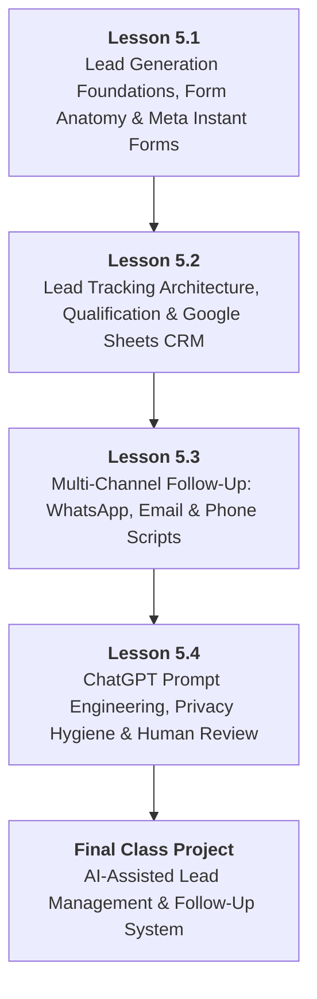
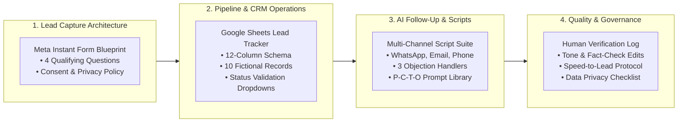

# DMS-MOD-05: Lead Capture, Customer Follow-Up & AI Productivity
## Detailed Teaching Syllabus & Lesson Specifications

**Course ID:** `digital-marketing-pro`  
**Course Working Title:** Digital Marketing Standard / Foundation  
**Module ID:** `DMS-MOD-05`  
**Module Title:** Lead Capture, Customer Follow-Up & AI Productivity  
**Curriculum Version:** 1.0 (October 2026)  
**Parent Specification:** [`docs/course-redesign/digital-marketing/digital-marketing-standard-spec.md`](file:///c:/Users/wasee/Desktop/NovaSkillsProject/NovaSkills%20Website/docs/course-redesign/digital-marketing/digital-marketing-standard-spec.md)  
**Prerequisite Modules:**  
- [`DMS-MOD-01: Digital Marketing Foundations, Personas & Strategy`](file:///c:/Users/wasee/Desktop/NovaSkillsProject/NovaSkills%20Website/docs/course-redesign/digital-marketing/modules/dms-mod-01.md)  
- [`DMS-MOD-02: Content Strategy, Canva Design & Organic Social Media`](file:///c:/Users/wasee/Desktop/NovaSkillsProject/NovaSkills%20Website/docs/course-redesign/digital-marketing/modules/dms-mod-02.md)  
- [`DMS-MOD-03: Local Business Presence, Google Business Profile & Website UX`](file:///c:/Users/wasee/Desktop/NovaSkillsProject/NovaSkills%20Website/docs/course-redesign/digital-marketing/modules/dms-mod-03.md)  
- [`DMS-MOD-04: Introductory Paid Advertising: Google Search & Meta Ads`](file:///c:/Users/wasee/Desktop/NovaSkillsProject/NovaSkills%20Website/docs/course-redesign/digital-marketing/modules/dms-mod-04.md)  
**Document Status:** Complete Teaching Syllabus — Ready for Classroom Delivery  

---

## 1. Module Overview & Pedagogical Architecture

### 1.1 Module Objective
The objective of **DMS-MOD-05** is to bridge the critical gap between marketing traffic generation and real commercial revenue for small businesses. While amateur marketers stop at generating clicks and impressions, professional marketers understand that an uncontacted lead is a wasted investment. Students learn the full operational lifecycle of lead management:
1. Understanding the lead generation journey from anonymous prospect to captured inquiry.
2. Designing low-friction, high-intent lead capture mechanisms, qualifying questions, and privacy-compliant consent structures.
3. Architecting Meta Instant Forms (Lead Ads) while mastering their operational constraints and data handling realities.
4. Setting up a lightweight, robust Lead Tracker in Google Sheets that functions as a small business CRM.
5. Qualifying and prioritizing inbound inquiries using practical frameworks (BANT and Small Business Fit) to distinguish genuine prospects from casual tire-kickers.
6. Executing multi-channel follow-up cadences across WhatsApp Business, email, and phone, emphasizing the commercial value of the "5-minute speed-to-lead" principle.
7. Configuring native WhatsApp Business tools (Quick Replies, Labels, Greeting/Away Messages) and mastering empathetic objection handling.
8. Leveraging Generative AI (ChatGPT Free Tier) as an ethical, time-saving marketing assistant to draft personalized customer communications, FAQs, and response variations.
9. Engineering structured prompts using the P-C-T-O framework (Persona, Context, Task, Output constraints).
10. Applying strict data privacy hygiene (zero PII in AI models) and mandatory human-in-the-loop fact-checking and brand voice verification.

### 1.2 Pedagogical Workload & Time Allocation
This module allocates exactly **12 Total Learner Workload Hours**, structured to provide equal balance across structured instruction, active lab execution, independent practice, and project synthesis:

```
┌────────────────────────────────────────────────────────────────────────┐
│                   DMS-MOD-05 TOTAL WORKLOAD: 12 HOURS                  │
├────────────────────────────┬────────────────────────────┬──────────────┤
│ Supervised Contact Time    │ Independent Practice Time  │ Capstone Lab │
│ 7.0 Hours Total            │ 3.0 Hours Total            │ 2.0 Hours    │
├────────────────────────────┼────────────────────────────┼──────────────┤
│ • Supervised Theory: 3.0h  │ • Independent Homework:    │ • Lead Mgmt  │
│ • Guided Labs: 4.0h        │   3.0h (4 x 45 min)        │   & AI Sys   │
│   (4 Lessons x 1h 45m)     │                            │   Blueprint  │
└────────────────────────────┴────────────────────────────┴──────────────┘
```

- **Lesson 5.1:** Lead Generation Fundamentals, Capture Mechanics & Meta Instant Forms (2.5h total: 45m theory, 60m lab, 45m assignment)
- **Lesson 5.2:** Lead Tracking, Qualification & Google Sheets CRM Workflow (2.5h total: 45m theory, 60m lab, 45m assignment)
- **Lesson 5.3:** Multi-Channel Follow-Up: WhatsApp Business, Email & Phone Nurturing (2.5h total: 45m theory, 60m lab, 45m assignment)
- **Lesson 5.4:** AI Marketing Productivity, Prompt Engineering & Responsible Verification (2.5h total: 45m theory, 60m lab, 45m assignment)
- **Final Class Project:** AI-Assisted Lead Management & Follow-Up System Assembly & Evaluation (2.0h total: 120m dedicated capstone lab)

### 1.3 Practical Delivery & Tool Access Safeguards
- **100% Guaranteed Offline Standard:** All core grading assessments are executed using offline worksheets, standardized Google Sheets templates, and formatted script dossiers.
- **Zero Complex Automation Dependencies:** Foundational workflows focus on operational mastery. Advanced paid automation platforms (e.g., paid Zapier tiers, enterprise CRMs, custom n8n webhooks, API coding) are strictly out of scope.
- **Meta Instant Forms Access Realities:** Building Instant Forms in Meta Ads Manager is demonstrated in **Draft Mode** where account permissions allow. Creating live forms or spending ad budget is never required; the **Lead Capture Form Blueprint Worksheet** is the authoritative assessment deliverable.
- **Strict Data Privacy & AI Hygiene:** Students are explicitly instructed never to paste real customer Personally Identifiable Information (PII) — full names, phone numbers, email addresses, medical details, or home addresses — into ChatGPT or any third-party AI tool. All practical exercises and project submissions utilize realistic, instructor-provided dummy data records.

---

## 2. Lesson-by-Lesson Syllabus Specifications



---

### Lesson 5.1: Lead Generation Fundamentals, Capture Mechanics & Meta Instant Forms

#### 1. Lesson Number & Title
- **Lesson Number:** `DMS-5.1`
- **Lesson Title:** Lead Generation Fundamentals, Capture Mechanics & Meta Instant Forms
- **Instructional Focus:** Inbound lead generation concepts, form friction vs. lead quality, privacy compliance, and configuring Meta Instant Forms in draft mode.

#### 2. Main Topics & Numbered Subtopics
- **5.1.1 Lead Generation in the Modern Customer Journey:**
  - Defining a marketing lead: A person who has expressed explicit, documented interest in a business's product or service by exchanging contact information.
  - The Lead Generation Funnel: Top of Funnel (Discovery/Attention) ➔ Middle of Funnel (Value Exchange/Lead Magnet) ➔ Bottom of Funnel (Direct Inquiry/Consultation Request).
  - The Cost-Per-Lead (CPL) dynamic: Total Ad Spend divided by Total Captured Leads. Why a cheap lead is not always a profitable lead.
- **5.1.2 The Anatomy of a High-Converting Lead Capture Form:**
  - The Form Friction Paradox: Fewer fields increase submission volume but decrease lead intent; more fields decrease submission volume but filter for serious buyers.
  - Core Contact Fields: Name, WhatsApp/Phone Number, Email Address.
  - Strategic Qualifying Questions: Short-answer vs. multiple-choice questions (e.g., timeline, budget bracket, service category).
  - Headline, Value Proposition, and Button Copy: Moving beyond "Submit" to action-oriented CTAs ("Claim Free Consultation", "Request Price Quote", "Book Appointment").
- **5.1.3 Data Privacy, Consent & Regulatory Compliance:**
  - The legal necessity of clear consent: Informing the user exactly why their data is collected and how it will be used.
  - Privacy Policy links: Every lead form must link to a valid public privacy policy webpage.
  - Custom disclaimers and opt-in checkboxes: Avoiding deceptive pre-checked consent boxes.
- **5.1.4 Meta Instant Forms (Lead Ads) Architecture & Settings:**
  - Native in-app experience: Why Meta Instant Forms load instantly on mobile without landing page latency.
  - Form Types: *More Volume* (quick autofill) vs. *Higher Intent* (adds a review step where the prospect confirms their submitted details).
  - Key sections of an Instant Form:
    1. *Greeting / Introduction:* Headline, background image, and brief bullet points explaining the offer.
    2. *Questions:* Prefilled system fields (Full Name, Phone Number, Email) and custom qualifying questions.
    3. *Privacy Notice:* Link text, website privacy policy URL, and custom opt-in disclaimer.
    4. *Completion / Thank You Screen:* Confirmation headline, description of what happens next, and exit CTA button (Call Business, Visit Website, View WhatsApp).
- **5.1.5 Meta Instant Forms Operational Limitations & Realities:**
  - The lead retrieval reality: On free tiers without third-party webhooks, Meta leads must be manually downloaded as CSV files from Meta Business Suite / Ads Manager.
  - Lead expiration window: Meta stores lead data for only 90 days; businesses must download and process leads promptly.
  - The Draft Mode fallback: Practicing form architecture using the offline **Lead Capture Form Blueprint Worksheet** ensures 100% accessibility without ad account restrictions.

#### 3. What Students Will Learn & Real Business Example
Students will learn how to design a high-converting lead capture form that balances conversion volume with qualification intent, write clear privacy disclaimers, and architect a complete Meta Instant Form.

- **Real Business Example:**
  - *The Low-Intent Trap:* *FitLife Gym* runs a Facebook Lead Ad offering a "Free 1-Day Pass". Their Instant Form uses the *More Volume* setting with only 2 prefilled fields: Name and Phone Number. In 7 days, they capture 120 leads at ₹45 per lead. However, when the sales team calls, 65% say "I don't remember clicking that", 20% have invalid numbers, and only 3 people visit the gym. Net revenue: ₹0.
  - *The Qualified Architecture:* *FitLife Gym* switches to a *Higher Intent* form with a custom review step. They add two required multiple-choice qualifying questions: (1) *"What is your primary fitness goal?"* [Fat Loss / Muscle Gain / General Fitness] and (2) *"When do you plan to start?"* [Immediately / This Month / Just Researching]. Submissions drop to 48 leads at ₹110 per lead, but when called, 85% actively discuss their goals, 22 schedule personal training assessments, and 14 purchase memberships generating ₹1,68,000 in revenue.

#### 4. Trainer Demonstration (20 Minutes)
- **Step 1:** The trainer opens the **Lead Capture Form Blueprint Worksheet** on screen and walks through the field friction matrix.
- **Step 2:** The trainer accesses Meta Ads Manager (`ads.facebook.com/adsmanager`) in demonstration mode.
- **Step 3:** The trainer creates a test draft campaign under the **Leads** objective, navigates to the Ad level, and selects **Instant Forms ➔ Create Form**.
- **Step 4:** The trainer configures:
  - Form Name: `SmileCraft_Dental_TeethWhitening_Q4`
  - Form Type: Selects **Higher Intent** (explains the value of the review step).
  - Intro: Adds headline *"Transform Your Smile in 60 Minutes"* and 3 value bullets.
  - Questions: Adds 1 custom multiple-choice question: *"Have you had professional whitening before?"* [Yes / No].
  - Prefill Fields: Arranges Full Name, WhatsApp Number, and City.
  - Privacy Policy: Pastes sample policy URL (`https://smilecraftclinic.in/privacy-policy`) and adds standard consent text.
  - Completion Screen: Configures CTA button *"Call Clinic Now"* with direct telephone link.
- **Step 5:** The trainer clicks "Save Draft" and reviews the preview across mobile viewport screens.

#### 5. Student Hands-On Practical (40 Minutes)
- **Task:** Students build a complete **Lead Capture Form Blueprint** for an assigned local small business (e.g., *Urban Paws Pet Grooming* or *Apex Home Interiors*).
- **Step-by-Step Instructions:**
  1. Open the *Nova Skills Lead Form Blueprint Template* in Google Docs.
  2. Select business type and define the Core Offer / Lead Magnet (e.g., "Free In-Home Design Consultation & 3D Layout Plan").
  3. Formulate the Form Intro: Draft a headline (max 60 characters) and 3 benefit bullets.
  4. Design Form Fields: Specify 3 standard contact fields and author **2 strategic qualifying questions** (1 multiple-choice, 1 short-answer/dropdown) designed to filter tire-kickers without causing excessive bounce.
  5. Author Privacy & Consent Notice: Draft compliant consent wording stating how contact details will be used (e.g., *"By clicking Confirm, you authorize Apex Interiors to contact you via WhatsApp or phone regarding your consultation. We respect your privacy."*).
  6. Design Completion Screen: Specify confirmation headline, expected response timeframe (e.g., *"Our design team will WhatsApp you within 2 business hours"*), and set the final CTA button destination.
  7. *(Optional Tier B):* If authorized Meta Ads Manager access is available, input these fields into an Instant Form in Draft status and capture 2 mobile preview screenshots.

#### 6. Student Assignment & Homework (45 Minutes)
- **Scenario:** *Dr. Mehra's Ayurvedic Wellness Center* wants to generate inquiries for their 14-day detox program. Currently, their website contact form asks for 9 fields: Full Name, Age, Gender, Phone, Email, City, Medical History, Preferred Doctor, and Detailed Symptoms. Conversion rate is under 0.8%.
- **Task Deliverable:**
  1. Audit the 9-field form and identify the 4 primary friction points causing drop-offs.
  2. Redesign the inquiry mechanism into a streamlined 4-step Meta Instant Form blueprint.
  3. Include 1 non-intrusive qualifying question that gauges serious readiness without violating medical privacy.
  4. Write a professional privacy disclaimer assuring prospects that their health goals remain strictly confidential.

#### 7. Expected Measurable Learning Outcome
Every student produces a completed, rubric-aligned **Lead Capture Form Blueprint Document** containing exact copy, qualifying question rationale, privacy policy consent text, and completion screen actions.

#### 8. Assessment Criteria & Evaluation Rubric (100 Points)
- **Offer & Intro Clarity (20 Points):** Compelling value proposition, clear headline, and enticing benefit bullets.
- **Friction vs. Qualification Balance (25 Points):** Thoughtful selection of contact fields paired with 2 relevant qualifying questions that filter low-intent submissions without killing conversion.
- **Privacy & Legal Consent (20 Points):** Valid privacy policy structure, clear opt-in disclosure, and transparent usage notice.
- **Completion Flow & Next Steps (20 Points):** Reassuring confirmation message, explicit response timeline, and functional CTA destination.
- **Professional Formatting & Error-Free Copy (15 Points):** Flawless grammar, proper character counts, and clear organization.

#### 9. Student Self-Checklist
- [ ] Does my lead form headline immediately communicate the exact benefit of submitting?
- [ ] Have I included at least 1 custom qualifying question to filter casual browsers?
- [ ] Is my privacy disclaimer clear, ethical, and free of deceptive pre-checked boxes?
- [ ] Does the completion screen give the prospect a clear timeframe of when they will hear from the business?
- [ ] Have I proofread all copy for spelling, punctuation, and brand voice?

#### 10. Trainer Verification Checklist
- [ ] Verified that qualifying questions directly support business qualification without asking overly sensitive or intrusive data.
- [ ] Confirmed that privacy consent text meets standard transparency principles.
- [ ] Ensured that student understood the difference between *More Volume* and *Higher Intent* forms.
- [ ] Checked that no live ad spend or credit card entry was prompted or required.

#### 11. Estimated Time Allocation
- **Supervised Theory & Demo:** 45 Minutes (25m Lecture + 20m Demonstration)
- **Supervised Lab Practical:** 60 Minutes (Hands-on blueprint authoring & peer review)
- **Independent Homework / Assignment:** 45 Minutes (Ayurvedic Clinic Form Redesign)
- **Total Lesson Time:** **150 Minutes (2.5 Hours)**

---

### Lesson 5.2: Lead Tracking, Qualification & Google Sheets CRM Workflow

#### 1. Lesson Number & Title
- **Lesson Number:** `DMS-5.2`
- **Lesson Title:** Lead Tracking, Qualification & Google Sheets CRM Workflow
- **Instructional Focus:** Lead decay and the speed-to-lead rule, building a functional Google Sheets Lead Tracker, status management, and the BANT qualification framework for small businesses.

#### 2. Main Topics & Numbered Subtopics
- **5.2.1 The Economics of Speed-to-Lead & Lead Decay:**
  - The Lead Decay Curve: Research shows contacting an inbound lead within 5 minutes results in a 21x higher qualification rate compared to contacting them after 30 minutes.
  - The reality of consumer attention: When a prospect submits an ad form, their problem is top-of-mind. After 2 hours, they have returned to work, forgotten the ad, or contacted a competitor.
  - Why small businesses fail at paid ads: Blaming "bad ad traffic" when the true root cause is slow, disorganized follow-up (calling 3 days later).
- **5.2.2 Architecture of a Small Business Lead Tracker in Google Sheets:**
  - Why a simple spreadsheet outperforms complex, expensive enterprise software for small teams.
  - Core Data Fields (The Standard 12-Column Schema):
    1. `Lead ID` (e.g., `LD-101`)
    2. `Date & Time Captured`
    3. `Lead Name`
    4. `WhatsApp / Mobile Number`
    5. `Email Address`
    6. `Lead Source / Campaign` (e.g., `Meta Ads - Whitening`, `Google Search - Emergency`)
    7. `Qualifying Answer 1` (e.g., Service Interest)
    8. `Qualifying Answer 2` (e.g., Budget / Timeline)
    9. `Lead Status` (Standardized Dropdown)
    10. `Priority Level` (High / Medium / Low)
    11. `Last Follow-Up Date`
    12. `Notes & Next Action Step`
- **5.2.3 Status Lifecycle & Pipeline Management:**
  - Standardized Lead Stages:
    - `1. New / Uncontacted` (Fresh inquiry, 0 attempts made)
    - `2. Contact Attempted - 1` (First message or call dispatched)
    - `3. Contact Attempted - 2` (Second follow-up attempt)
    - `4. In Conversation / Qualified` (Prospect engaged, criteria verified)
    - `5. Appointment / Demo Booked` (Scheduled on calendar)
    - `6. Won / Converted Customer` (Transaction completed or deposit paid)
    - `7. Cold / Nurture Later` (Interested but delayed timeline)
    - `8. Unqualified / Invalid` (Wrong number, out of service area, spam)
  - Data Validation: Enforcing strict dropdown menus to prevent messy, inconsistent data entry.
  - Conditional Formatting: Color-coding statuses (Green = Won, Red = Urgent/New, Gray = Closed) for instant visual pipeline clarity.
- **5.2.4 The BANT Qualification Framework for Small Businesses:**
  - **B - Budget:** Does the prospect have the financial ability to afford the service?
  - **A - Authority:** Is this person the decision-maker (e.g., homeowner, business owner, parent) or an influencer?
  - **N - Need:** Does the prospect have a specific, urgent pain point that our service solves?
  - **T - Timeline:** When do they intend to purchase or start? (Immediate / Within 30 Days / 3+ Months).
  - Adapting BANT for Local SMBs: Simplifying questions so sales reps qualify prospects naturally during a casual WhatsApp chat or friendly phone call without sounding like an interrogation.
- **5.2.5 Practical Lead Data Hygiene & Security:**
  - Managing spreadsheet permissions: Viewer vs. Editor roles to prevent accidental record deletion.
  - Ethical handling of contact numbers: Storing customer data securely and never sharing lists with unauthorized third parties.

#### 3. What Students Will Learn & Real Business Example
Students will learn how to design, format, and maintain an operational Lead Tracking CRM in Google Sheets, establish a 7-stage lead status lifecycle, and apply practical qualification criteria to sort inbound inquiries.

- **Real Business Example:**
  - *The Chaotic WhatsApp Inbox:* *Kavita Photography* runs Facebook ads for wedding photography and receives 40 inquiries a month. She manages everything inside her personal WhatsApp chats without a tracker. Inquiries get buried under family messages. She forgets to follow up with 15 brides who asked for pricing, accidentally messages the same bride twice with conflicting prices, and only books 2 weddings.
  - *The Google Sheets CRM Workflow:* Kavita builds a 12-column Lead Tracker in Google Sheets. Every morning at 9:00 AM, new leads are entered. She uses dropdown tags (`New`, `Quote Sent`, `Date Reserved`, `Won`). Her pipeline view instantly highlights 6 brides who received quotes 3 days ago. She sends a polite check-in message. Four respond immediately, and 3 book their wedding dates that afternoon, generating an extra ₹1,80,000 from existing leads that would have been lost.

#### 4. Trainer Demonstration (20 Minutes)
- **Step 1:** The trainer opens a clean Google Sheet and demonstrates creating the 12-column lead tracker architecture.
- **Step 2:** The trainer creates a Data Validation dropdown for the `Lead Status` column containing the 8 standardized stages.
- **Step 3:** The trainer applies Conditional Formatting rules (e.g., cell turns soft red if status is `New / Uncontacted`, soft green if `Won / Converted`).
- **Step 4:** The trainer inputs 3 distinct fictional lead records on screen:
  - Lead 1: Hot commercial inquiry needing service this week (Priority: High).
  - Lead 2: Student asking for free career advice (Priority: Low / Unqualified).
  - Lead 3: Homeowner requesting a quote for next month (Priority: Medium).
- **Step 5:** The trainer demonstrates pipeline filtering: showing how to sort by `Priority` and filter for leads requiring follow-up today.

#### 5. Student Hands-On Practical (40 Minutes)
- **Task:** Students build a fully functional **Small Business Lead Tracker Sheet** in Google Sheets with data validation, conditional formatting, and 5 realistic fictional sample records.
- **Step-by-Step Instructions:**
  1. Create a new Google Sheet named `[YourName]_SmallBiz_Lead_Tracker`.
  2. Build the standard 12-column header row with bold formatting, frozen header row, and distinct header fill color.
  3. Configure Data Validation for Column I (`Status`) using the 8 approved standard lifecycle stages.
  4. Configure Data Validation for Column J (`Priority`) with options: `High - Immediate`, `Medium - Active`, `Low - Nurture`.
  5. Set up at least 2 Conditional Formatting rules: (1) Highlight `New / Uncontacted` in light red/coral; (2) Highlight `Won / Converted Customer` in light green.
  6. Populate the sheet with **5 realistic fictional dummy records** representing diverse inquiry scenarios (e.g., 2 High-priority hot leads, 2 Medium-priority considering quotes, 1 Unqualified/spam entry).
  7. Add a Summary KPI block at the top or in a separate tab showing: `Total Leads Captured`, `Total Contacted`, and `Conversion Rate %` using basic spreadsheet formulas (`COUNTA`, `COUNTIF`).

#### 6. Student Assignment & Homework (45 Minutes)
- **Scenario:** *Pinnacle Fitness Academy* has collected 15 leads from a recent Facebook campaign over the weekend. The leads are disorganized and scattered across sticky notes, email alerts, and phone call logs.
- **Task Deliverable:**
  1. Take the provided 15 raw inquiry profiles (provided in the student case pack).
  2. Input all 15 records into your Google Sheets Lead Tracker.
  3. Apply the BANT framework to assign a Priority score (`High`, `Medium`, `Low`, or `Disqualified`) to each inquiry based on their stated budget, urgency, and goals.
  4. Write a 1-paragraph operational summary identifying the top 3 leads that the sales counselor must contact first at 9:00 AM on Monday morning and justify why.

#### 7. Expected Measurable Learning Outcome
Every student produces a live, formatted, and formula-enabled **Google Sheets Lead Tracker CRM** populated with standardized dropdowns, color-coded statuses, KPI summaries, and qualified fictional records.

#### 8. Assessment Criteria & Evaluation Rubric (100 Points)
- **Sheet Architecture & Schema (25 Points):** Proper 12-column structure, frozen headers, clean alignment, and readable formatting.
- **Data Validation & Formatting Logic (25 Points):** Correctly implemented dropdown menus for Status and Priority; functional conditional formatting rules.
- **BANT Qualification Accuracy (25 Points):** Logical categorization of fictional leads into correct priority tiers based on objective readiness indicators.
- **KPI Summary Formulas (15 Points):** Accurate usage of `COUNTA` and `COUNTIF` formulas to calculate pipeline metrics dynamically.
- **Data Hygiene & Realistic Entry (10 Points):** Error-free dummy data entry with comprehensive notes and designated next action steps.

#### 9. Student Self-Checklist
- [ ] Is my header row frozen so it remains visible when scrolling down?
- [ ] Does every row in the Status column use the dropdown selector rather than free text?
- [ ] Does my conditional formatting automatically change color when I change a lead's status?
- [ ] Have I used only fictional dummy data without any real personal phone numbers or names?
- [ ] Do my summary formulas update automatically when a new record is added?

#### 10. Trainer Verification Checklist
- [ ] Verified that student implemented data validation dropdowns correctly without broken references.
- [ ] Checked that conditional formatting enhances readability rather than creating visual clutter.
- [ ] Ensured student demonstrated clear comprehension of lead decay and response urgency.
- [ ] Confirmed that all entered records use dummy names and synthetic contact info.

#### 11. Estimated Time Allocation
- **Supervised Theory & Demo:** 45 Minutes (25m Lecture + 20m Demonstration)
- **Supervised Lab Practical:** 60 Minutes (Hands-on spreadsheet setup & formula testing)
- **Independent Homework / Assignment:** 45 Minutes (15-Record Lead Processing Case Study)
- **Total Lesson Time:** **150 Minutes (2.5 Hours)**

---

### Lesson 5.3: Multi-Channel Follow-Up: WhatsApp Business, Email & Phone Nurturing

#### 1. Lesson Number & Title
- **Lesson Number:** `DMS-5.3`
- **Lesson Title:** Multi-Channel Follow-Up: WhatsApp Business, Email & Phone Nurturing
- **Instructional Focus:** Designing multi-touch follow-up cadences, configuring WhatsApp Business tools, crafting persuasive scripts across three channels, and handling core sales objections.

#### 2. Main Topics & Numbered Subtopics
- **5.3.1 The Multi-Touch Follow-Up Architecture:**
  - Why single-attempt follow-up fails: 70% of small business leads never receive a second contact attempt, yet 60% of sales happen after the 3rd to 5th touchpoint.
  - Designing a 5-Day Multi-Channel Cadence:
    - *Day 1 (Within 5–15 Minutes):* Immediate WhatsApp acknowledgment message + phone call attempt if high urgency.
    - *Day 2 (24 Hours Later):* Value-focused email with case study or portfolio link.
    - *Day 3 (48 Hours Later):* Friendly WhatsApp check-in with a low-friction question.
    - *Day 5 (Day 5):* The polite "Permission to Close File" message.
  - Channel preference dynamics: When to use WhatsApp (informal, immediate, high open rates in India/Asia) vs. Email (detailed quotes, formal proposals, B2B) vs. Phone Calls (high-ticket services, complex consultations).
- **5.3.2 WhatsApp Business for Local Marketing Operations:**
  - Setting up a professional WhatsApp Business Profile: Business category, address, operating hours, catalog, and verified website link.
  - Automated Messaging Tools:
    - *Greeting Message:* Instant welcome sent to first-time message senders.
    - *Away Message:* Professional automated notice during after-hours managing expectations.
    - *Quick Replies:* Creating keyboard shortcuts (e.g., `/pricing`, `/location`, `/book`) for standard frequently asked questions.
  - Chat Labels: Organizing WhatsApp chats by stage (`New Lead`, `Pending Payment`, `Consultation Booked`, `Follow-Up Needed`).
- **5.3.3 Crafting Follow-Up Scripts Across Three Channels:**
  - **Channel 1 — The WhatsApp Follow-Up Script:**
    - Under 50 words, warm tone, referencing the specific ad offer.
    - Ending with a single low-friction question (e.g., *"Would tomorrow morning or afternoon be better for a 5-minute chat?"*).
  - **Channel 2 — The Email Follow-Up Script:**
    - Clear, curiosity-driven subject line (e.g., *"Quick question regarding your smile consultation, Rahul"*).
    - Context sentence, 2 proof points or client testimonials, and a direct calendar link or WhatsApp reply prompt.
  - **Channel 3 — The Professional Phone Call Script:**
    - The Permission-Based Opener: *"Hi Priya, this is Sameer from SmileCraft Clinic. I saw you requested details on our whitening package a few minutes ago. Did I catch you with 2 minutes, or are you in the middle of something?"*
    - The Discovery Question: Uncovering the prospect's real underlying motivation.
    - The Closed-End Appointment Close: Offering two specific time slots rather than asking "When are you free?".
- **5.3.4 Mastering the Big 3 Small Business Objections:**
  - **Objection 1 — "It's too expensive / Your price is higher than others":**
    - The Empathy + Value Reframe technique: Acknowledging price sensitivity while isolating quality differences, guarantees, and total cost of ownership.
  - **Objection 2 — "Just send me all the details and prices on WhatsApp / Email":**
    - The Information Stall technique: Providing a concise price bracket while explaining why a 5-minute consultation is needed to provide an exact, accurate quote.
  - **Objection 3 — "I need to discuss this with my spouse / partner":**
    - The Alignment + Joint Resource technique: Validating the joint decision and offering a 1-page summary sheet or inviting both partners to the discovery call.
- **5.3.5 Follow-Up Ethics, Etiquette & Consent:**
  - Calling hour etiquette: Never calling before 9:00 AM or after 7:30 PM.
  - Frequency caps: Avoiding spamming; respecting when a prospect explicitly requests to be removed.
  - Maintaining dignity and professionalism in all text communications.

#### 3. What Students Will Learn & Real Business Example
Students will learn how to build a structured multi-channel follow-up cadence, author response scripts for WhatsApp, email, and phone calls, utilize WhatsApp Business quick replies, and resolve common customer sales objections with empathy.

- **Real Business Example:**
  - *The Aggressive Spam Approach:* *Alpha Fitness* captures a Facebook lead named Rohan. The sales rep calls Rohan 6 times in 2 hours. When Rohan doesn't answer, the rep texts: *"Bro why you not picking up call? Offer ending today!"*. Rohan blocks the number, leaves a 1-star Google review citing harassment, and complains publicly on Instagram.
  - *The Structured Multi-Channel Cadence:* *Zenith Wellness* captures a lead from Rohan. Within 8 minutes, Rohan receives a polite WhatsApp: *"Hi Rohan, this is Ananya from Zenith Wellness. Thank you for checking out our personal training program! To make sure I send you the right program guide, are you looking to train for general fitness, fat loss, or strength building?"*. Rohan replies 20 minutes later: *"Fat loss"*. Ananya shares a 2-minute video testimonial of a client with a similar profile and uses a Quick Reply shortcut (`/book`) to offer a complimentary fitness screening. Rohan books for Saturday morning.

#### 4. Trainer Demonstration (20 Minutes)
- **Step 1:** The trainer displays the official WhatsApp Business interface on screen (via screen projection or desktop web interface).
- **Step 2:** The trainer demonstrates creating a **Quick Reply**:
  - Shortcut: `/timing`
  - Message Text: *"Our clinic is open Monday to Saturday from 9:30 AM to 8:00 PM. We are located at Baner Road near Westend Mall. Would you like to reserve a consultation slot this week?"*
- **Step 3:** The trainer demonstrates organizing customer conversations using color-coded **WhatsApp Labels**.
- **Step 4:** The trainer conducts a live roleplay demonstration of handling the "Send details on WhatsApp" objection:
  - Demonstrates how to avoid sending a massive 15-page PDF that never gets read, and instead sends a concise 3-line summary ending with a qualifying question.

#### 5. Student Hands-On Practical (40 Minutes)
- **Task:** Students author a complete **Multi-Channel Follow-Up Script Suite & Objection Guide** for an assigned business scenario.
- **Step-by-Step Instructions:**
  1. Open the *Nova Skills Multi-Channel Follow-Up Template* in Google Docs.
  2. Select target business persona (e.g., local home interior designer, boutique dental clinic, or language coaching institute).
  3. Author **Script 1 (WhatsApp Instant Follow-Up):** Maximum 60 words, referencing the exact ad offer, friendly and conversational, ending with an easy A/B question.
  4. Author **Script 2 (Professional Email Nurture):** Subject line (under 50 characters), personal greeting, value proposition, proof point, and clear CTA link.
  5. Author **Script 3 (Phone Call Script):** 30-second permission-based opening script, 2 qualifying discovery questions, and a 2-choice appointment close.
  6. Author **3 Objection Responses:** Draft verbatim response scripts for:
     - Objection A: *"Your charges are too high compared to local freelancers."*
     - Objection B: *"Just WhatsApp me your complete pricing brochure."*
     - Objection C: *"I have to check with my family/business partner first."*
  7. Form pairs in the classroom (or breakout pairs) and execute a 10-minute live roleplay verifying the natural flow and tone of each script.

#### 6. Student Assignment & Homework (45 Minutes)
- **Scenario:** *BrightSpark Tutoring Institute* generates leads from parents seeking Class 10 Board exam coaching. 70% of parents who fill the form respond to the first WhatsApp message saying: *"Just send the fee structure"*. When the institute sends the fee PDF (₹45,000/year), the parents stop replying ("ghost").
- **Task Deliverable:**
  1. Diagnose why sending the raw fee structure immediately causes parents to ghost.
  2. Write a 3-part WhatsApp response sequence that acknowledges the price inquiry politely, explains why fees depend on the student's current assessment level, and transitions the parent to booking a free 20-minute diagnostic test.
  3. Author 3 Quick Reply shortcuts that BrightSpark's counselors can save in WhatsApp Business to handle common parent queries efficiently.

#### 7. Expected Measurable Learning Outcome
Every student produces a comprehensive, verified **Multi-Channel Follow-Up Script Dossier** containing 3 distinct channel templates, 3 objection-handling scripts, and 3 WhatsApp Business quick replies.

#### 8. Assessment Criteria & Evaluation Rubric (100 Points)
- **Tone & Personalization (20 Points):** Empathetic, professional, and conversational tone matching the target audience without sounding robotic or aggressive.
- **Multi-Channel Adaptability (25 Points):** Clear differentiation in style between concise WhatsApp text, structured email copy, and natural phone dialogue.
- **Low-Friction Closing Mechanics (20 Points):** Effective use of permission-based questions and A/B choice closings rather than open-ended dead ends.
- **Objection Handling Depth (20 Points):** Constructive reframing of price, delay, and stall objections that builds trust rather than creating defensive arguments.
- **Ethical Etiquette & Compliance (15 Points):** Explicit adherence to calling hours, opt-out respect, and privacy principles.

#### 9. Student Self-Checklist
- [ ] Is my WhatsApp message short enough to read on a mobile screen without scrolling?
- [ ] Does my phone script start by asking permission rather than immediately pitching?
- [ ] Do my objection scripts validate the prospect's concern before offering a solution?
- [ ] Did I avoid sending unrequested, overwhelming PDF brochures that kill conversation?
- [ ] Have I tested reading my phone script out loud to ensure it sounds like natural speech?

#### 10. Trainer Verification Checklist
- [ ] Checked that phone scripts utilize permission-based openers.
- [ ] Verified that WhatsApp scripts avoid spammy formatting (excessive emojis, all-caps, fake urgency).
- [ ] Ensured objection handling scripts focus on empathy and value rather than aggressive sales tactics.
- [ ] Observed student roleplays to confirm conversational pacing and active listening.

#### 11. Estimated Time Allocation
- **Supervised Theory & Demo:** 45 Minutes (25m Lecture + 20m Demonstration)
- **Supervised Lab Practical:** 60 Minutes (Scriptwriting lab & peer roleplay testing)
- **Independent Homework / Assignment:** 45 Minutes (Tutoring Institute Follow-Up Case Study)
- **Total Lesson Time:** **150 Minutes (2.5 Hours)**

---

### Lesson 5.4: AI Marketing Productivity, Prompt Engineering & Responsible Verification

#### 1. Lesson Number & Title
- **Lesson Number:** `DMS-5.4`
- **Lesson Title:** AI Marketing Productivity, Prompt Engineering & Responsible Verification
- **Instructional Focus:** Using ChatGPT as an ethical small business marketing assistant, mastering the P-C-T-O prompt framework, strict privacy hygiene, and mandatory human verification.

#### 2. Main Topics & Numbered Subtopics
- **5.4.1 Generative AI in the Modern Marketer's Workflow:**
  - What Generative AI actually is: Advanced statistical pattern prediction, not conscious reasoning or omniscient truth.
  - The Marketer + AI Co-Pilot Model: Moving from "AI will do my job" to "Marketers using AI will outperform marketers who don't".
  - High-impact foundational marketing use cases:
    - Brainstorming campaign themes and angle variations.
    - Drafting customer communication and email sequences.
    - Generating multi-persona objection response templates.
    - Rewriting technical jargon into accessible customer benefits.
    - Creating FAQ documentation and community review replies.
- **5.4.2 The P-C-T-O Prompt Engineering Framework:**
  - Why lazy prompts produce bland, generic junk: The failure of prompts like *"Write an email for a dentist"*.
  - The 4-Pillar P-C-T-O Architecture:
    1. **P — Persona / Role:** Who is the AI acting as? (e.g., *"You are an experienced customer service manager for a boutique interior design studio in Pune..."*).
    2. **C — Context / Background:** Who is the customer, what is the offer, what is the situation? (e.g., *"A prospective client submitted an ad inquiry for a 2BHK renovation. Their budget is ₹8-10 Lakhs, and they are worried about delayed project handovers..."*).
    3. **T — Task / Specific Objective:** Exactly what must be generated? (e.g., *"Write a warm, professional WhatsApp follow-up message under 50 words that addresses handover reliability and offers a 10-minute discovery call..."*).
    4. **O — Output Format & Constraints:** What style, length, structure, and tone boundaries must be enforced? (e.g., *"Use an empathetic tone. Do not use buzzwords like 'synergy' or 'game-changer'. Include 1 question at the end. Provide 2 distinct tone variations."*).
- **5.4.3 Prompting for Customer Communication & Sales Support:**
  - Engineering prompts for WhatsApp Quick Replies and FAQ generation.
  - Generating empathetic responses to negative customer reviews.
  - Creating personalized follow-up sequences for leads at different readiness stages.
- **5.4.4 The Critical Dangers & Limitations of Generative AI:**
  - AI Hallucinations: Generating false facts, invented legal claims, or fabricated statistics with complete grammatical confidence.
  - The Bland Homogeneity Problem: AI defaults to generic, clichéd marketing language (*"In today's fast-paced world...", "Look no further!"*).
  - Lack of Local Cultural Nuance: Missing regional context, local slang, or city-specific landmarks without explicit prompting.
- **5.4.5 Strict Data Privacy, Security & Responsible AI Hygiene:**
  - **The Golden Privacy Rule:** **NEVER input customer Personally Identifiable Information (PII) into public AI models.**
  - Prohibited AI inputs: Real full names, phone numbers, home addresses, Aadhaar/ID numbers, credit card details, medical records, or proprietary financial spreadsheets.
  - Account Data Controls: Understanding how to turn off chat history and model training in ChatGPT settings (`Settings ➔ Data Controls ➔ Chat history & training`).
  - Intellectual Property & Attribution: Avoiding copyright infringement and representing AI outputs transparently.
- **5.4.6 The Mandatory 4-Step Human-in-the-Loop Verification Protocol:**
  - **Step 1 — Fact & Accuracy Check:** Did the AI invent business policies, discounts, or guarantees that do not exist?
  - **Step 2 — Brand Voice & Tone Polish:** Does this sound like a real, authentic human representing our specific local brand?
  - **Step 3 — Privacy & Compliance Audit:** Are there any privacy violations, deceptive promises, or policy traps?
  - **Step 4 — Format & Actionability Check:** Is the text ready to paste directly into WhatsApp or email with clear next steps?

#### 3. What Students Will Learn & Real Business Example
Students will learn how to write structured, high-performing marketing prompts using the P-C-T-O framework, maintain strict data privacy by stripping all PII, and execute a mandatory 4-step human verification review before using any AI-generated marketing copy.

- **Real Business Example:**
  - *The Careless AI Catastrophe:* *Apex Legal Services* wants to reply quickly to client inquiries. An intern pastes an entire client inquiry into ChatGPT, including the client's real name, phone number, and confidential dispute details. The intern then prompts: *"Write an apology and advice"*. Without reading the output, the intern copies and sends it. The AI response contained an invented legal precedent that does not exist in Indian law and admitted corporate liability. The client sued, and the firm suffered severe reputational and legal penalties.
  - *The Verified Professional Workflow:* *SmileCraft Clinic* uses ChatGPT to draft review responses. The clinic manager uses a structured P-C-T-O prompt with dummy details: *"Act as clinic director. A patient left a 3-star review praising Dr. Mehra's gentle treatment but complaining about a 20-minute waiting room delay. Draft a gracious, professional reply under 60 words acknowledging the wait, explaining our sterilization standards, and inviting them to reach out directly."* The manager reviews the 3 drafts, selects Draft 2, edits 4 words to match clinic tone, verifies zero medical advice is given, and posts an empathetic response that other prospective patients praise.

#### 4. Trainer Demonstration (20 Minutes)
- **Step 1:** The trainer opens ChatGPT (`chatgpt.com` free tier) live on screen.
- **Step 2:** The trainer demonstrates the **Bad Prompt vs. Good Prompt Experiment**:
  - *Bad Prompt:* *"Write a WhatsApp follow up for my gym."* (Examines the generic, clichéd output full of fire emojis and hype words).
  - *Engineered P-C-T-O Prompt:* Enters a full P-C-T-O prompt for a local functional fitness gym targeting working mothers with limited time. Evaluates the vastly superior, targeted output.
- **Step 3:** The trainer demonstrates **Privacy Settings Hygiene**: Shows where to access `Settings ➔ Data Controls` and explains why customer names must always be replaced with synthetic placeholders (e.g., `[Customer Name]`, `[Phone]`).
- **Step 4:** The trainer conducts a live **Human Verification Walkthrough**: Takes an AI-generated draft, highlights 2 hallucinated claims or awkward phrases, edits them live on screen, and explains why the human editor is irreplaceable.

#### 5. Student Hands-On Practical (40 Minutes)
- **Task:** Students build an **AI Marketing Prompt Library & Verification Log** for an assigned local business using ChatGPT (Free Tier).
- **Step-by-Step Instructions:**
  1. Open the *Nova Skills AI Marketing Prompt Worksheet* in Google Docs.
  2. Select an assigned business scenario (e.g., *GreenLeaf Organic Grocery* or *SwiftCure Physiotherapy*).
  3. Author **Prompt 1 (Inquiry Follow-Up):** Engineer a complete P-C-T-O prompt to generate 3 WhatsApp follow-up variations for a newly captured ad lead.
  4. Author **Prompt 2 (Objection Handling):** Engineer a P-C-T-O prompt to generate responses to a customer saying *"Your prices are too expensive"*.
  5. Author **Prompt 3 (Google Review Response):** Engineer a P-C-T-O prompt to draft replies to both a 5-star glowing review and a 2-star service complaint.
  6. Execute the prompts in ChatGPT (Free Tier).
  7. Copy the raw AI output into the Verification Log and apply the **4-Step Human Verification Protocol**:
     - Highlight edited text in yellow.
     - Document in the notes column what factual errors, robotic phrases, or privacy risks were corrected before final approval.

#### 6. Student Assignment & Homework (45 Minutes)
- **Scenario:** *Artisan Woodcraft*, a custom furniture workshop, receives 30 Instagram DMs and Facebook messages every week asking: *"How much for dining table?"*, *"Do you deliver to Mumbai?"*, and *"Can you make this Pinterest design?"*. The owner spends 3 hours every evening typing repetitive responses on his phone.
- **Task Deliverable:**
  1. Author a comprehensive P-C-T-O prompt designed to generate a complete **Customer FAQ & Quick Reply Library** for Artisan Woodcraft.
  2. Generate 5 standardized Quick Reply templates covering: (1) Custom quote process, (2) Delivery zones & timelines, (3) Material & wood quality guarantee, (4) Showroom consultation booking, and (5) Handling Pinterest custom designs.
  3. Perform a complete human verification audit on all 5 templates, showing the before-and-after edits to ensure a warm, artisanal brand voice.
  4. Write a 1-page privacy policy guidelines memo explaining 3 strict rules the workshop owner and staff must follow when using AI tools for customer communications.

#### 7. Expected Measurable Learning Outcome
Every student produces a completed **AI Marketing Prompt Library & Human Verification Log** containing at least 3 engineered P-C-T-O prompts, raw AI outputs, annotated human edits, and a documented privacy compliance checklist.

#### 8. Assessment Criteria & Evaluation Rubric (100 Points)
- **P-C-T-O Prompt Architecture (30 Points):** Clear and distinct definition of Persona, Context, Task, and Constraints in every submitted prompt.
- **Quality & Usability of AI Outputs (20 Points):** Practical, commercially viable customer communication assets generated from structured prompts.
- **Human Verification & Editing Rigor (25 Points):** Explicit evidence of human editing to remove AI clichés, adjust tone, correct inaccuracies, and polish brand voice.
- **Data Privacy & AI Hygiene Compliance (15 Points):** Strict omission of all real personal customer information; complete use of synthetic placeholders.
- **Operational Formatting (10 Points):** Clean layout, well-organized prompt log, and clear documentation.

#### 9. Student Self-Checklist
- [ ] Does every prompt include all 4 components of P-C-T-O?
- [ ] Did I enforce strict word counts and formatting constraints in my prompts?
- [ ] Have I ensured that ZERO real customer personal data was entered into ChatGPT?
- [ ] Did I actively edit and polish the AI text rather than accepting the raw output blindly?
- [ ] Are my verified scripts ready to be used by a real customer service representative?

#### 10. Trainer Verification Checklist
- [ ] Verified that prompts follow the P-C-T-O framework and avoid generic, unconstrained commands.
- [ ] Confirmed that student submissions show clear yellow-highlighted human edits distinguishing raw AI from final output.
- [ ] Inspected prompt inputs to guarantee that no real student or client PII was submitted to external servers.
- [ ] Evaluated the edited scripts to ensure they sound authentic, professional, and natural.

#### 11. Estimated Time Allocation
- **Supervised Theory & Demo:** 45 Minutes (25m Lecture + 20m Demonstration)
- **Supervised Lab Practical:** 60 Minutes (Prompt engineering, ChatGPT testing & verification editing)
- **Independent Homework / Assignment:** 45 Minutes (Artisan Woodcraft FAQ & Privacy Memo)
- **Total Lesson Time:** **150 Minutes (2.5 Hours)**

---

## 3. Module 05 Final Class Project

### 3.1 Project Title & Overview
- **Project Title:** **AI-Assisted Lead Management & Follow-Up System**
- **Project Code:** `DMS-PROJ-05`
- **Allocated Project Time:** **2.0 Hours (120 Minutes Dedicated In-Class Capstone Lab)**
- **Curriculum Purpose:** Synthesizes the core competencies of Module 05 into an operational, commercial-grade lead management architecture for an assigned small business. Students transition from theoretical knowledge to building an end-to-end customer acquisition and follow-up infrastructure.



### 3.2 Required Project Deliverables & Artifacts
Every student must assemble and submit a comprehensive **Lead Management & Follow-Up System Dossier** containing the following seven integrated components:

1. **Lead Capture Form Blueprint (Docs):**
   - Target business profile and core offer / lead magnet description.
   - Complete Meta Instant Form architecture (Form Type selection: *Higher Intent* vs. *More Volume* with rationale).
   - Headline, greeting copy, and 3 value-oriented bullet points.
   - **4 Qualifying Questions:** 2 standard contact fields + 2 strategic qualifying questions (1 multiple-choice, 1 dropdown/short answer) designed to filter tire-kickers.
   - Compliant privacy notice copy, website privacy policy URL placeholder, and transparent opt-in disclaimer text.
   - Completion screen copy, response timeframe promise, and final action CTA destination.

2. **Google Sheets Lead Tracker CRM (Sheets Link or Formatted Workbook):**
   - Complete 12-column standard schema with frozen headers and clear formatting.
   - Configured Data Validation dropdowns for `Lead Status` (8 standardized stages) and `Priority` (High, Medium, Low).
   - Working Conditional Formatting rules visually highlighting uncontacted and converted leads.
   - **10 Realistic Fictional Sample Records:** Populated with diverse inquiry scenarios (3 Hot/Immediate leads, 4 Warm/Evaluation leads, 2 Cold/Long-term leads, 1 Disqualified lead).
   - Automated KPI Summary Block displaying: `Total Leads`, `Total Contacted`, `Contact Rate %`, `Won Customers`, and `Conversion Rate %`.

3. **Lead Qualification & Prioritization Matrix:**
   - Formal BANT criteria definitions customized for the assigned small business.
   - A clear operational decision tree guiding a sales assistant on how to categorize an incoming inquiry into High, Medium, or Low priority within 5 minutes of capture.

4. **Multi-Channel Follow-Up Script Suite (WhatsApp, Email & Phone):**
   - **WhatsApp Follow-Up Script:** Max 60 words, referencing the exact ad offer, friendly and professional, ending with an easy A/B scheduling question.
   - **Professional Email Follow-Up:** Compelling subject line, personalized greeting, value proposition, client proof point, and clear booking link.
   - **Phone Call Script:** 30-second permission-based opener, 2 discovery questions, and a closed-end appointment close offering two specific time slots.

5. **AI Prompt Library & Verification Log:**
   - Minimum **4 reusable marketing prompts** authored using the strict P-C-T-O framework (Role, Context, Task, Constraints).
   - Prompts covering: (1) Ad lead initial follow-up, (2) Price objection response, (3) Customer review reply, (4) Re-engagement message for cold leads.
   - Raw ChatGPT outputs paired with side-by-side **Human-in-the-Loop Verification Notes** showing yellow-highlighted text edits, tone adjustments, and factual corrections.

6. **Three Real-World Objection-Handling Response Scripts:**
   - Verbatim response scripts addressing the Big 3 objections:
     - Objection 1 (Price): *"Your prices are too high compared to competitors."*
     - Objection 2 (Stall): *"Just send me your brochure and prices on WhatsApp."*
     - Objection 3 (Authority/Delay): *"I have to discuss this with my spouse/partner."*
   - Each response must apply the Empathy + Value Reframe technique.

7. **Follow-Up Operational Cadence & Privacy Governance Checklist:**
   - Documented 5-day speed-to-lead follow-up cadence (Day 1, Day 2, Day 3, Day 5 touchpoints).
   - Calling hour rules and message frequency caps.
   - Formal Data Privacy Checklist guaranteeing zero customer PII in third-party AI tools and secure spreadsheet permission management.

---

### 3.3 100-Point Project Assessment Rubric

| Assessment Dimension | Weight | Novice (0–59%) | Competent (60–79%) | Proficient (80–89%) | Exemplary (90–100%) | Score |
|---|:---:|---|---|---|---|:---:|
| **1. Lead Capture Form Architecture & Consent** | 20% | Form lacks qualifying questions; generic headline; missing privacy consent or broken links. | Basic form layout; questions are purely contact fields; generic privacy disclaimer. | Well-structured form; 2 relevant qualifying questions; compliant privacy notice and clear CTA. | Masterful form design; perfectly balances friction and qualification; pristine privacy compliance and compelling copy. | /20 |
| **2. Google Sheets CRM Setup & Data Validation** | 20% | Missing core columns; no dropdown validation; messy manual text entry; no formulas. | Correct columns but missing conditional formatting; inconsistent dropdown options; broken formulas. | Clean 12-column schema; functional data validation and conditional formatting; 10 fictional records populated. | Enterprise-grade small business sheet; flawless validation, automated KPI summary block, and impeccable data hygiene. | /20 |
| **3. BANT Qualification & Prioritization Logic** | 15% | No qualification criteria defined; leads prioritized randomly without rationale. | Vague BANT definitions; inconsistent priority scoring across fictional records. | Clear BANT definitions tailored to business; logical priority categorization for all 10 sample records. | Highly sophisticated qualification rubric; clear decision tree enabling seamless operational execution by any team member. | /15 |
| **4. Multi-Channel Script Craft & Voice** | 15% | Aggressive, robotic, or spammy scripts; identical text copy-pasted across all 3 channels. | Acceptable scripts but lacks channel-specific formatting; phone script lacks permission opener. | High-quality scripts customized for WhatsApp, Email, and Phone; natural tone with low-friction closes. | World-class conversational copy; highly persuasive, empathetic, respectful of prospect time; flawless roleplay execution. | /15 |
| **5. AI Prompt Engineering (P-C-T-O)** | 15% | Vague 1-line prompts (*"Write a follow up"*); generic, clichéd AI outputs accepted without changes. | P-C-T-O framework partially followed; minimal constraints; minor human editing evident. | Complete P-C-T-O structure across all 4 prompts; high-quality outputs with documented human edits. | Flawless prompt engineering; strict constraints yielding exceptional drafts; thorough yellow-highlighted human edits. | /15 |
| **6. Objection Handling & Privacy Governance** | 15% | Defensive or dismissive objection replies; customer PII exposed; no privacy safeguards. | Basic objection replies; generic privacy notes; unclear follow-up schedule. | Constructive objection responses reframing value; documented 5-day cadence; clear PII hygiene rules. | Masterclass in empathetic objection resolution; comprehensive 5-day multi-channel cadence; robust privacy governance policy. | /15 |
| **TOTAL SCORE** | **100%** | **Fails to meet minimum foundational standards.** | **Meets baseline operational competency.** | **Strong, industry-ready execution.** | **Outstanding, commercial-grade portfolio asset.** | **/100** |

---

### 3.4 Student Pre-Submission Checklist

Before submitting the Module 05 Final Class Project for evaluation, every student must independently verify each of the following requirements:

- [ ] **Lead Capture Blueprint:** Is my form headline compelling, and have I included 2 strategic qualifying questions to filter low-intent inquiries?
- [ ] **Privacy Notice:** Does my form include a transparent privacy notice explaining that details will be used solely for consultation contact?
- [ ] **Spreadsheet Architecture:** Does my Google Sheet include all 12 standard columns with a frozen header row?
- [ ] **Data Validation:** Are `Status` (8 stages) and `Priority` (3 levels) configured with locked dropdown menus?
- [ ] **Conditional Formatting:** Do status changes trigger automatic color-coding in the spreadsheet?
- [ ] **Sample Records:** Have I populated exactly 10 realistic fictional records using synthetic dummy names and numbers (zero real PII)?
- [ ] **Pipeline Formulas:** Does my KPI summary block accurately calculate total leads, contact rate %, and conversion rate %?
- [ ] **Multi-Channel Scripts:** Do I have distinct, tailored scripts for WhatsApp (under 60 words), Email (subject line + body), and Phone (permission opener)?
- [ ] **Objection Responses:** Have I authored empathetic, value-reframing response scripts for Price, Brochure Stall, and Partner Consultation objections?
- [ ] **P-C-T-O Prompts:** Are all 4 AI prompts structured with Persona, Context, Task, and Constraints?
- [ ] **Human Verification Log:** Have I clearly highlighted in yellow all human edits made to raw AI outputs, documenting the rationale for each change?
- [ ] **Privacy Hygiene:** Have I verified that no real personal information was submitted to ChatGPT or any public AI tool?

---

### 3.5 Trainer Project Verification & Grading Protocol

The trainer must rigorously evaluate each student's project submission against this standard operational protocol:

1. **Safety & Privacy Inspection (Immediate Disqualification Check):**
   - Scan all submitted Google Sheets, scripts, and prompt logs.
   - *Strict Rule:* If any real customer personal data (real phone numbers, real citizen ID numbers, real medical records) appears in the submission or prompt logs, return the project immediately for sanitization with a grade penalty. All records must use synthetic dummy data.
2. **Spreadsheet Operational Verification:**
   - Open the student's Google Sheet link (or workbook file).
   - Test the dropdown menus in Column I (`Status`) and Column J (`Priority`). Confirm that arbitrary text entry is rejected.
   - Change a status from `New` to `Won` and verify that the conditional formatting updates color instantly.
   - Inspect formulas in the KPI summary block (`COUNTA`, `COUNTIF`) to confirm dynamic calculation.
3. **Lead Form Blueprint Inspection:**
   - Confirm that the form utilizes the *Higher Intent* model (or includes a justified rationale if *More Volume* is chosen).
   - Ensure qualifying questions are relevant to the assigned business and filter tire-kickers effectively without demanding sensitive personal data.
   - Check the privacy consent statement for transparency and compliance.
4. **Script & Objection Roleplay Audit:**
   - Verify that the WhatsApp message is under 60 words and ends with an easy A/B question.
   - Check that the phone script includes a permission-based opening line (*"Did I catch you with 2 minutes, or are you in the middle of something?"*).
   - Ensure objection-handling responses avoid defensive arguments and instead reframe value with empathy.
5. **AI Prompt & Human Verification Review:**
   - Check that all 4 prompts explicitly contain Persona, Context, Task, and Constraints.
   - Review the student's yellow-highlighted edits. Confirm that the student actively eliminated AI clichés, adjusted tone, and corrected inaccuracies rather than blindly accepting raw output.
6. **Final Scoring & Feedback Entry:**
   - Grade each dimension using the 100-point rubric.
   - Provide concrete, actionable feedback focusing on professional client readiness and operational efficiency.

---

## 4. Module 05 Completion & Progression Standards

### 4.1 Passing Criteria
To successfully pass **DMS-MOD-05**, a student must achieve:
- A minimum score of **70%** on the Final Class Project rubric.
- 100% completion of all 4 lesson assignments.
- Demonstration of strict data privacy hygiene (zero PII in AI tools).
- Verified competency in configuring Google Sheets data validation and authoring multi-channel follow-up scripts.

### 4.2 Upward Alignment & Next Module Transition
Upon completing Module 05, students have mastered the complete operational bridge from initial ad discovery to captured, qualified, and nurtured business leads:

```
[DMS-MOD-01: Foundations & Strategy] ➔ [DMS-MOD-02: Content & Canva] ➔ [DMS-MOD-03: Local & Web UX] ➔ [DMS-MOD-04: Paid Ads] ➔ [DMS-MOD-05: Lead Capture, CRM & AI] ➔ [DMS-MOD-06: Measurement, GA4 & Reporting]
```

- **In DMS-MOD-05:** Students captured leads, organized pipelines in Google Sheets, and nurtured prospects using WhatsApp, email, phone, and ethical AI productivity.
- **In DMS-MOD-06 (The Final Capstone Module):** Students will close the loop by learning **Campaign Measurement, GA4 Analytics & Executive Reporting**, mastering UTM parameter tracking, navigating Google Analytics 4 standard reports, calculating true Return on Ad Spend (ROAS), and assembling a 5-slide Executive Marketing Performance Presentation.

---
*End of Teaching Syllabus for `DMS-MOD-05: Lead Capture, Customer Follow-Up & AI Productivity`.*
