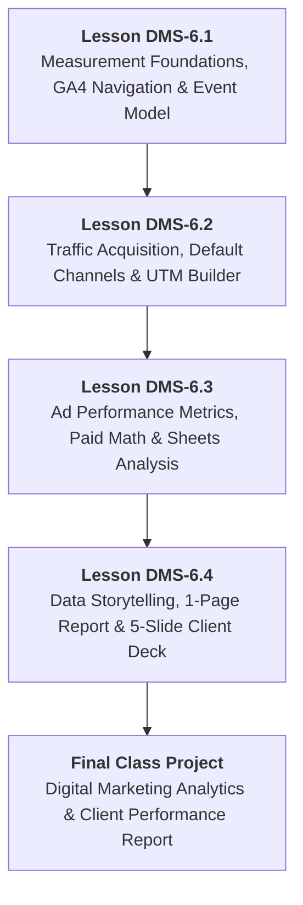
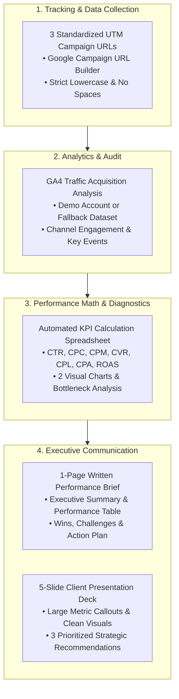
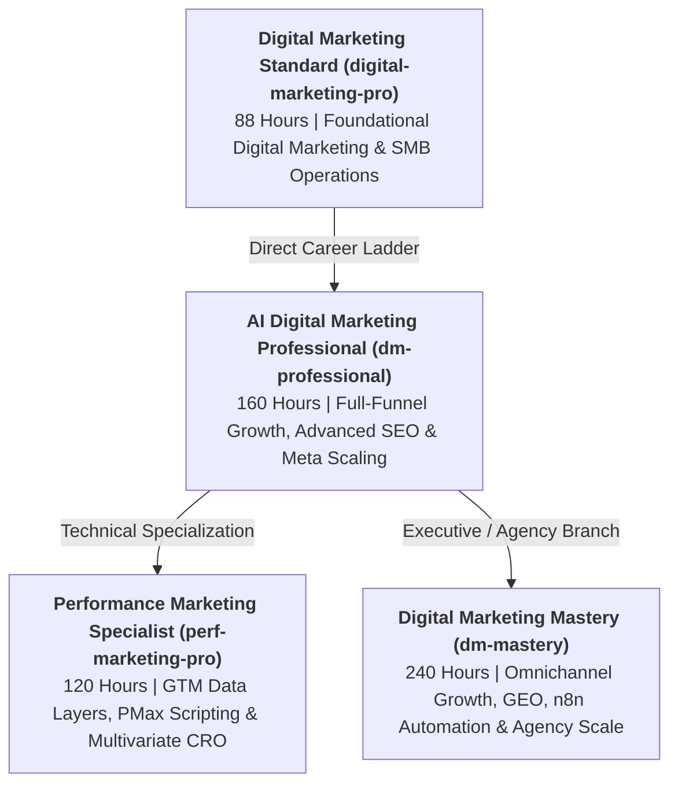

# DMS-MOD-06: Campaign Measurement, GA4 Analytics & Performance Reporting
## Detailed Teaching Syllabus & Lesson Specifications

**Course ID:** `digital-marketing-pro`  
**Course Working Title:** Digital Marketing Standard / Foundation  
**Module ID:** `DMS-MOD-06`  
**Module Title:** Campaign Measurement, GA4 Analytics & Performance Reporting  
**Curriculum Version:** 1.0 (October 2026)  
**Parent Specification:** [`docs/course-redesign/digital-marketing/digital-marketing-standard-spec.md`](file:///c:/Users/wasee/Desktop/NovaSkillsProject/NovaSkills%20Website/docs/course-redesign/digital-marketing/digital-marketing-standard-spec.md)  
**Prerequisite Modules:**  
- [`DMS-MOD-01: Digital Marketing Foundations, Personas & Strategy`](file:///c:/Users/wasee/Desktop/NovaSkillsProject/NovaSkills%20Website/docs/course-redesign/digital-marketing/modules/dms-mod-01.md)  
- [`DMS-MOD-02: Content Strategy, Canva Design & Organic Social Media`](file:///c:/Users/wasee/Desktop/NovaSkillsProject/NovaSkills%20Website/docs/course-redesign/digital-marketing/modules/dms-mod-02.md)  
- [`DMS-MOD-03: Local Business Presence, Google Business Profile & Website UX`](file:///c:/Users/wasee/Desktop/NovaSkillsProject/NovaSkills%20Website/docs/course-redesign/digital-marketing/modules/dms-mod-03.md)  
- [`DMS-MOD-04: Introductory Paid Advertising: Google Search & Meta Ads`](file:///c:/Users/wasee/Desktop/NovaSkillsProject/NovaSkills%20Website/docs/course-redesign/digital-marketing/modules/dms-mod-04.md)  
- [`DMS-MOD-05: Lead Capture, Customer Follow-Up & AI Productivity`](file:///c:/Users/wasee/Desktop/NovaSkillsProject/NovaSkills%20Website/docs/course-redesign/digital-marketing/modules/dms-mod-05.md)  
**Document Status:** Complete Teaching Syllabus — Ready for Classroom Delivery  

---

## 1. Module Overview & Pedagogical Architecture

### 1.1 Module Objective
The objective of **DMS-MOD-06** is to complete the foundational digital marketing lifecycle by equipping students with the critical analytical and reporting skills needed to evaluate marketing effectiveness, communicate business value to stakeholders, and optimize return on investment. Foundational marketers must never operate in the dark or rely on subjective vanity metrics; they must be capable of tracking customer journeys across channels, interpreting real analytics data, performing essential marketing math, and delivering compelling client presentations:
1. Grounding learners in marketing measurement fundamentals, contrasting vanity metrics (likes, impressions) with commercial business KPIs (qualified leads, customer acquisition cost, conversion rate).
2. Navigating Google Analytics 4 (GA4) with ease and understanding its modern event-based data model (Active Users, Sessions, Engagement Rate, Average Engagement Time, and Key Events).
3. Analyzing standard GA4 reports: *Traffic Acquisition* (evaluating marketing channels) and *Pages and Screens* (evaluating landing page engagement).
4. Demystifying attribution concepts: understanding how digital touchpoints are credited across first-click, last-click, and data-driven models without getting lost in technical data engineering.
5. Constructing standardized, error-free UTM tracking links using the official Google Campaign URL Builder to track campaigns across social media, email, and ad networks.
6. Acknowledging campaign tracking limitations and modern privacy realities (iOS App Tracking Transparency, cookie consent, browser tracking prevention, dark social).
7. Calculating core paid advertising performance metrics: Click-Through Rate (CTR), Cost Per Click (CPC), Cost Per Mille (CPM), Cost Per Lead (CPL), Cost Per Acquisition (CPA), and Return on Ad Spend (ROAS) using simulated performance datasets.
8. Building an automated KPI calculation spreadsheet in Google Sheets with formatted formulas and clear data visualizations (bar charts, trendlines).
9. Identifying strategic optimization opportunities by diagnosing performance bottlenecks (e.g., distinguishing ad copy failures from landing page UX friction).
10. Synthesizing complex data into a concise 1-Page Written Marketing Performance Report and delivering a professional 5-Slide Executive Client Presentation in Google Slides.
11. Practicing ethical data reporting: upholding data integrity, transparently distinguishing simulated demo data from real outcomes, and avoiding deceptive statistical manipulation.

### 1.2 Pedagogical Workload & Time Allocation
This module allocates exactly **16 Total Learner Workload Hours**, maintaining an equal four-way division between supervised theory, hands-on guided labs, independent practice, and a dedicated capstone reporting lab:

```
┌────────────────────────────────────────────────────────────────────────┐
│                   DMS-MOD-06 TOTAL WORKLOAD: 16 HOURS                  │
├────────────────────────────┬────────────────────────────┬──────────────┤
│ Supervised Contact Time    │ Independent Practice Time  │ Capstone Lab │
│ 8.0 Hours Total            │ 4.0 Hours Total            │ 4.0 Hours    │
├────────────────────────────┼────────────────────────────┼──────────────┤
│ • Supervised Theory: 4.0h  │ • Independent Homework:    │ • Client     │
│ • Guided Labs: 4.0h        │   4.0h (4 x 60 min)        │   Performance│
│   (4 Lessons x 2h 00m)     │                            │   Report Lab │
└────────────────────────────┴────────────────────────────┴──────────────┘
```

- **Lesson DMS-6.1:** Marketing Measurement Foundations, GA4 Architecture & Navigation (3.0h total: 60m theory, 60m lab, 60m assignment)
- **Lesson DMS-6.2:** Traffic Acquisition, Channels & Campaign Tracking with UTMs (3.0h total: 60m theory, 60m lab, 60m assignment)
- **Lesson DMS-6.3:** Advertising Performance Metrics, Paid Channel Math & Spreadsheet Analysis (3.0h total: 60m theory, 60m lab, 60m assignment)
- **Lesson DMS-6.4:** Client Performance Reporting, Data Storytelling & Presentation Decks (3.0h total: 60m theory, 60m lab, 60m assignment)
- **Final Class Project:** Digital Marketing Analytics & Client Performance Report Assembly & Presentation (4.0h total: 240m dedicated capstone lab)

### 1.3 Practical Delivery & Tool Access Safeguards
- **Official GA4 Demo Account Accessibility:** Practical GA4 navigation exercises utilize the official **Google Merchandise Store (Web)** demo account (`https://support.google.com/analytics/answer/6367342`), granting free, read-only `Viewer` access to live enterprise data.
- **Demo Account Permission Boundaries:** Students and trainers are explicitly instructed that demo account users possess read-only permissions. **Do NOT promise report or Exploration export functionality from the demo account**, as Google frequently restricts or rate-limits export capabilities for public demo users.
- **Guaranteed Offline Fallback Dataset:** For students who face connectivity issues or localized Google account access restrictions, instructors provide the **Nova Skills GA4 Offline Observation Dataset & Screenshot Pack**. This ensures 100% of enrolled students can complete all analytical assignments and project deliverables without technical barriers.
- **Zero Technical Engineering Prerequisites:** This foundational course explicitly avoids complex technical tag management (no Google Tag Manager data layers, no server-side tagging, no custom JavaScript triggers, and no BigQuery SQL queries). All analysis is conducted within standard GA4 user interfaces and spreadsheets.
- **Ethical Handling of Simulated Advertising Data:** Where students analyze paid ad campaigns (Google Search and Meta Ads), standardized, realistic simulated performance data sheets are provided. Students are taught to clearly label simulated figures in their reports, strictly preventing deceptive claims about active client ad spend.

---

## 2. Lesson-by-Lesson Syllabus Specifications



---

### Lesson DMS-6.1: Marketing Measurement Foundations, GA4 Architecture & Navigation

#### 1. Lesson Number & Title
- **Lesson Number:** `DMS-6.1`
- **Lesson Title:** Marketing Measurement Foundations, GA4 Architecture & Navigation
- **Instructional Focus:** Marketing KPIs, vanity vs. business metrics, the GA4 event-based data model, and navigating standard reports via the official GA4 Demo Account.

#### 2. Main Topics & Numbered Subtopics
- **6.1.1 Marketing Measurement Foundations & Business KPIs:**
  - The purpose of digital marketing measurement: Moving from guesswork to data-backed decisions.
  - The Metric Hierarchy:
    - *Vanity Metrics:* Pageviews, raw impressions, social media likes, followers. Feel good, but do not pay rent or payroll.
    - *Operational Metrics:* Click-Through Rate (CTR), Cost Per Click (CPC), Average Engagement Time, Session Duration. Measure channel efficiency.
    - *Business Impact Metrics:* Cost Per Lead (CPL), Qualified Inquiries, Customer Acquisition Cost (CAC), Return on Ad Spend (ROAS), Revenue. Directly drive business survival and growth.
  - Formulating actionable business questions: E.g., *"Which channel generates leads at the lowest cost?"* rather than *"How many people saw our logo?"*.
- **6.1.2 The Evolution of Web Analytics & GA4 Architecture:**
  - The transition from Universal Analytics (UA) to Google Analytics 4 (GA4):
    - UA relied on session-based tracking and pageview hit types.
    - GA4 is built entirely on an **event-based data model**, treating every user interaction (page view, scroll, click, file download, video play) as a distinct event with custom parameters.
  - Privacy-centric measurement: Why GA4 does not store IP addresses and relies on machine-learning modeling to fill data gaps caused by browser privacy restrictions.
- **6.1.3 Understanding Core GA4 Terminology & Metrics:**
  - **Users:**
    - *Total Users:* Total number of unique individuals who logged an event.
    - *Active Users (Primary Metric in GA4):* Any user who had an engaged session or logged `first_open`/`first_visit`.
    - *New Users:* Visitors who interacted with the site for the first time.
  - **Sessions & Session Dynamics:**
    - How a session begins: Triggered when a user opens the site (`session_start` event).
    - Session timeout: Sessions expire after 30 minutes of user inactivity by default.
  - **Engagement Rate vs. Bounce Rate in GA4:**
    - An **Engaged Session** is defined as a session that lasts 10+ seconds, triggers 1+ conversion/key event, or views 2+ pages/screens.
    - *Engagement Rate:* $\text{Engagement Rate} = \frac{\text{Engaged Sessions}}{\text{Total Sessions}} \times 100$.
    - *Bounce Rate (GA4 Definition):* The exact inverse of Engagement Rate ($\text{Bounce Rate} = 100\% - \text{Engagement Rate}$). No longer represents a single-page exit without timer context.
  - **Average Engagement Time:** The actual time the website was in the foreground of the user's screen.
  - **Key Events (Formerly "Conversions"):** Designated important events (e.g., `generate_lead`, `purchase`, `contact_submit`) marked as commercially vital in GA4.
- **6.1.4 Navigating the GA4 Interface:**
  - The Main Navigation Menu:
    - *Home:* AI-driven performance snapshots and recent anomalies.
    - *Reports Snapshot:* Executive overview cards across traffic, user demographics, and engagement.
    - *Realtime Report:* Inspecting user behavior occurring in the last 30 minutes (verifying campaign launches, test visits, device types).
    - *Life Cycle Reports:* Acquisition (How users arrive), Engagement (What they do), Monetization (What they purchase), Retention (How often they return).
    - *User Reports:* Demographics (Country, City, Gender, Age) and Tech (Device Category, Browser, Operating System).
  - Date Range Comparison Controls: Comparing current performance against the previous period or previous year.
- **6.1.5 Accessing & Navigating the Official GA4 Demo Account:**
  - Connecting via Google Support documentation (`https://support.google.com/analytics/answer/6367342`).
  - Selecting the **Google Merchandise Store (Web)** property.
  - Understanding Read-Only `Viewer` limitations: recognizing that settings, conversion definitions, and admin panels cannot be edited.
  - Utilizing the **Nova Skills GA4 Offline Observation Dataset** as a guaranteed backup.

#### 3. What Students Will Learn & Real Business Example
Students will learn how to distinguish vanity metrics from business metrics, navigate the Google Analytics 4 user interface, interpret core engagement metrics, and explore live data inside the official GA4 demo account.

- **Real Business Example:**
  - *The Vanity Trap:* *Vibrant Living Cafe* hires a digital freelancer who reports: *"Great news! Our Instagram post got 14,000 views and 850 likes!"*. The cafe owner checks their cash register: sales dropped 12% that week. The freelancer tracked vanity impressions, but zero viewers visited the cafe website or claimed the lunch coupon.
  - *The GA4 Metric Approach:* *Green Roots Kitchen* reviews their GA4 Reports. They observe that while Organic Social brought 450 users with an Engagement Rate of only 18% (average engagement time: 9 seconds), their Google Business Profile local search traffic generated 210 users with an Engagement Rate of 68% (average engagement time: 1 minute 42 seconds) and generated 34 table reservation clicks (`key_event`). They reallocate their weekend marketing budget to Google Local Search and increase table bookings by 40%.

#### 4. Trainer Demonstration (30 Minutes)
- **Step 1:** The trainer navigates to the official Google Analytics Demo Account support page and clicks the link for **Google Analytics 4 property: Google Merchandise Store (web data)**.
- **Step 2:** The trainer walks through the **Home** dashboard and shows the 30-minute **Realtime** report, pointing out active visitors, their geographical cities, and triggering events.
- **Step 3:** The trainer opens **Reports ➔ Acquisition ➔ Overview** and explains the difference between *Users* and *Sessions*.
- **Step 4:** The trainer navigates to **Reports ➔ Engagement ➔ Pages and Screens**:
  - Shows `Page path and screen class`.
  - Explains how to read `Views`, `Active Users`, `Views per active user`, and `Average engagement time`.
  - Points out high-traffic pages with poor engagement time versus lower-traffic pages with high engagement time.
- **Step 5:** The trainer demonstrates the Date Range Selector: sets the date filter to "Last 28 days" and applies a comparison to the "Preceding period (matched days)".

#### 5. Student Hands-On Practical (45 Minutes)
- **Task:** Students access the GA4 Demo Account (or the provided offline dataset) and conduct a structured **GA4 Interface Navigation & Metric Discovery Audit**.
- **Step-by-Step Instructions:**
  1. Open the GA4 Google Merchandise Store demo account (or open the *Nova Skills GA4 Observation Worksheet*).
  2. Set the reporting date range to the **Last 30 Days**.
  3. Navigate to **Reports ➔ Reports Snapshot** and record:
     - Total Active Users
     - Total New Users
     - Average Engagement Time
  4. Navigate to the **Realtime** report:
     - Document how many users are active right now.
     - Identify the top 2 countries and top 2 devices currently active.
  5. Navigate to **Reports ➔ Engagement ➔ Pages and Screens**:
     - Identify the top 3 most-viewed pages on the website.
     - Record the Average Engagement Time for the Homepage (`/`) versus a specific product category page (e.g., `/apparel`).
     - Calculate the bounce rate for each page using the formula: $100\% - \text{Engagement Rate}$.
  6. Answer 2 analytical questions in your worksheet:
     - Question A: *Which page holds visitors' attention the longest, and why might that be?*
     - Question B: *If a page has 5,000 views but an average engagement time of only 4 seconds, what user experience problem might exist?*

#### 6. Student Assignment & Homework (60 Minutes)
- **Scenario:** *Artisan Craft Emporium* has launched an online store. The owner is confused by their analytics report and cannot understand why they have 3,000 "sessions" but only 1,800 "active users", and their "bounce rate" looks completely different from their old website analytics.
- **Task Deliverable:**
  1. Write a 1-page educational client brief (approx. 400 words) written in simple, non-technical language explaining:
     - Why *Sessions* and *Active Users* are not the same number.
     - What an *Engaged Session* means in GA4 and how Engagement Rate is calculated.
     - Why the old concept of Bounce Rate changed in GA4 and why a 35% bounce rate in GA4 is actually good news (meaning a 65% engagement rate).
     - The difference between a raw pageview and a Key Event (Conversion).
  2. Complete the Metric Classification Table: categorize 10 common metrics into Vanity, Operational, or Business Impact.

#### 7. Expected Measurable Learning Outcome
Every student produces a completed **GA4 Metric Discovery Audit Worksheet** with recorded demo account metrics, calculated engagement ratios, and a well-reasoned 1-page client educational memo on GA4 terminology.

#### 8. Assessment Criteria & Evaluation Rubric (100 Points)
- **Data Retrieval Accuracy (25 Points):** Correctly located and recorded Active Users, Engagement Time, and page metrics from the demo account or offline dataset.
- **Metric Concept Comprehension (25 Points):** Flawless explanation of Active Users vs. Sessions, and Engagement Rate vs. Bounce Rate.
- **Analytical Interpretation (25 Points):** Thoughtful, practical analysis of page engagement times and identification of potential UX friction points.
- **Client Communication Clarity (15 Points):** Educational memo is written in polite, jargon-free, client-friendly business English.
- **Worksheet Neatness & Organization (10 Points):** Professional formatting, proper labeling, and error-free math.

#### 9. Student Self-Checklist
- [ ] Have I accessed either the live GA4 demo account or the official offline screenshot dataset?
- [ ] Did I set the date range to Last 30 Days before recording my numbers?
- [ ] Did I correctly calculate Bounce Rate as $100\% - \text{Engagement Rate}$?
- [ ] Does my client memo explain GA4 metrics without using confusing technical jargon?
- [ ] Have I categorized all 10 metrics in the assignment table correctly?

#### 10. Trainer Verification Checklist
- [ ] Confirmed student accessed the Google Merchandise Store property (or approved offline pack).
- [ ] Checked that student recorded Active Users rather than Total Users.
- [ ] Verified that engagement rate calculations are mathematically sound.
- [ ] Ensured student avoided technical administrative tasks (no property creation, no GTM setup).

#### 11. Estimated Time Allocation
- **Supervised Theory & Demo:** 60 Minutes (30m Lecture + 30m Demonstration)
- **Supervised Lab Practical:** 60 Minutes (Hands-on demo account exploration & audit sheet)
- **Independent Homework / Assignment:** 60 Minutes (Client Educational Memo & Metric Classification)
- **Total Lesson Time:** **180 Minutes (3.0 Hours)**

---

### Lesson DMS-6.2: Traffic Acquisition, Channels & Campaign Tracking with UTMs

#### 1. Lesson Number & Title
- **Lesson Number:** `DMS-6.2`
- **Lesson Title:** Traffic Acquisition, Channels & Campaign Tracking with UTMs
- **Instructional Focus:** Traffic Acquisition reports, default channel groupings, source/medium breakdown, attribution fundamentals, and crafting error-free tracking links with Google Campaign URL Builder.

#### 2. Main Topics & Numbered Subtopics
- **6.2.1 Understanding Traffic Sources, Mediums & Channels in GA4:**
  - The fundamental questions: *Where did our visitors come from? Which marketing channel brought them?*
  - The Three Core Dimensions:
    1. **Source:** The specific platform or origin of the traffic (e.g., `google`, `facebook`, `newsletter`, `instagram`).
    2. **Medium:** The high-level delivery mechanism or category (e.g., `organic`, `cpc`, `email`, `referral`, `social`).
    3. **Source / Medium:** The combined dimension providing immediate context (e.g., `google / organic`, `google / cpc`, `facebook / cpc`, `direct / (none)`).
  - GA4 Default Channel Groups:
    - *Direct:* Visitors typing the URL directly, clicking a bookmark, or arriving from untracked links.
    - *Organic Search:* Unpaid search clicks from Google, Bing, Yahoo.
    - *Paid Search:* Paid search engine ads (Google Search Ads, Bing Ads).
    - *Organic Social:* Unpaid clicks from social media profiles and organic posts.
    - *Paid Social:* Clicks from paid ad campaigns on Meta, LinkedIn, Pinterest.
    - *Referral:* Clicks from other websites linking to your content.
    - *Email:* Clicks from email marketing campaigns with proper tagging.
- **6.2.2 Analyzing the GA4 Traffic Acquisition Report:**
  - Navigating to **Reports ➔ Acquisition ➔ Traffic Acquisition**:
    - Primary dimension selector: Toggling between *Session default channel group*, *Session source / medium*, and *Session campaign*.
    - Reading the metrics table: Users, Sessions, Engaged Sessions, Engagement Rate, Average Engagement Time per Session, Event Count, and Key Events.
  - Evaluating channel quality: Why high traffic with low engagement indicates audience mismatch or deceptive clickbait.
- **6.2.3 Attribution Basics for Foundational Marketers:**
  - What is marketing attribution: The rule or algorithmic model that determines how credit for key events is assigned to touchpoints across the customer journey.
  - Common Attribution Models (Conceptual Overview):
    - *First-Click Attribution:* Gives 100% credit to the first touchpoint that introduced the customer (great for top-of-funnel discovery).
    - *Last-Click Attribution:* Gives 100% credit to the final touchpoint immediately before conversion (favors direct search or retargeting).
    - *Data-Driven Attribution (GA4 Default):* Uses machine learning to evaluate how different touchpoints interact to produce conversions.
  - Why foundational marketers must understand attribution: Avoiding the mistake of killing top-of-funnel channels (like organic social) just because they don't show up on last-click conversion reports.
- **6.2.4 Campaign Tracking with UTM Parameters:**
  - What is a UTM Parameter: Urchin Tracking Module tags appended to the end of a URL to tell analytics exactly which campaign, creative, and channel generated the click.
  - The Five Standard UTM Tags:
    1. `utm_source` (Required): Identifies the platform (e.g., `facebook`, `google`, `mailchimp`, `linkedin`).
    2. `utm_medium` (Required): Identifies the marketing medium (e.g., `cpc`, `paid_social`, `email`, `qr_code`).
    3. `utm_campaign` (Required): Identifies the specific campaign name (e.g., `summer_sale_2026`, `teeth_whitening_q4`).
    4. `utm_content` (Optional): Differentiates ads or creative variations (e.g., `blue_banner_v1`, `video_testimonial_v2`, `text_link`).
    5. `utm_term` (Optional): Identifies paid search keywords or audience segments (e.g., `emergency_dentist`, `homeowners_pune`).
  - Anatomy of a Tagged URL:  
    `https://smilecraftclinic.in/whitening?utm_source=facebook&utm_medium=paid_social&utm_campaign=diwali_special_2026&utm_content=carousel_v1`
- **6.2.5 Golden Rules of UTM Tagging:**
  - Rule 1: Always use strict **lowercase** (GA4 treats `Facebook` and `facebook` as two completely separate sources).
  - Rule 2: Never use spaces (use underscores `_` or hyphens `-` e.g., `diwali_promo`, never `diwali promo`).
  - Rule 3: Keep naming conventions consistent across the entire marketing team.
  - Rule 4: **NEVER use UTM parameters on internal site links** (clicking an internal UTM link resets the session and destroys original acquisition attribution).
- **6.2.6 Using Google Campaign URL Builder & Practical Limitations:**
  - Navigating the free utility (`https://ga-dev-tools.google/campaign-url-builder/`).
  - Why manual link building leads to typos and broken links.
  - Real-world measurement gaps:
    - *Dark Social:* Private shares via WhatsApp, direct messages, and SMS often get classified as "Direct" if untagged.
    - *Ad Blockers & Privacy Extensions:* Up to 15–25% of tech-savvy visitors block tracking scripts.
    - *Cookie Consent Banners:* Users who reject analytics cookies are excluded from direct session reporting.

#### 3. What Students Will Learn & Real Business Example
Students will learn how to analyze channel performance inside GA4's Traffic Acquisition report, understand attribution concepts, construct clean UTM campaign tracking URLs using Google Campaign URL Builder, and adhere to strict tagging conventions.

- **Real Business Example:**
  - *The Untracked Disaster:* *Apex Fitness Studio* launches a ₹30,000 marketing campaign across 3 channels: an influencer Instagram post, a customer email newsletter, and a local WhatsApp community broadcast. They use the raw website link `https://apexfitness.in` in all three. In GA4, 75% of their traffic shows up as `Direct / (none)`. The studio owner has no idea which channel generated their 18 new members and wastes ₹15,000 the following month on the influencer who brought zero paying clients.
  - *The UTM-Tagged Strategy:* *Zenith Gym* runs the exact same promotion but creates 3 unique UTM links:
    - Influencer link: `?utm_source=instagram&utm_medium=influencer&utm_campaign=winter_pass&utm_content=rohit_story`
    - Email link: `?utm_source=newsletter&utm_medium=email&utm_campaign=winter_pass&utm_content=button_cta`
    - WhatsApp link: `?utm_source=whatsapp&utm_medium=broadcast&utm_campaign=winter_pass&utm_content=text_invite`
    In GA4, the owner filters by `Session campaign = winter_pass`. They discover: Email generated 8 memberships, WhatsApp generated 11 memberships, while the influencer generated 0 memberships. They stop the influencer contract and double down on WhatsApp nurturing.

#### 4. Trainer Demonstration (30 Minutes)
- **Step 1:** The trainer opens GA4 Demo Account ➔ **Reports ➔ Acquisition ➔ Traffic Acquisition**.
- **Step 2:** The trainer demonstrates changing the primary dimension:
  - Switches from *Session default channel group* to *Session source / medium*.
  - Points out `google / cpc` vs. `google / organic` vs. `(direct) / (none)`.
- **Step 3:** The trainer demonstrates adding a secondary dimension:
  - Clicks the `+` icon next to the primary dimension and adds `Page path and screen class` or `Country`.
- **Step 4:** The trainer opens the **Google Campaign URL Builder** (`ga-dev-tools.google/campaign-url-builder/`) live on screen:
  - Inputs Website URL: `https://smilecraftclinic.in/appointment`
  - Inputs Campaign Source: `facebook`
  - Inputs Campaign Medium: `paid_social`
  - Inputs Campaign Name: `teeth_whitening_q4`
  - Inputs Campaign Content: `video_ad_smile_v1`
  - Shows the generated complete URL, explains how query parameters `?` and `&` work, and demonstrates shortening or copying the clean URL.
- **Step 5:** The trainer demonstrates the "Capitalization Trap": shows what happens when someone writes `Facebook` vs. `facebook` and explains why standardized UTM templates prevent messy reporting.

#### 5. Student Hands-On Practical (45 Minutes)
- **Task:** Students build a **Standardized UTM Campaign Tracking Sheet** and generate 3 production-ready campaign links for an assigned business campaign.
- **Step-by-Step Instructions:**
  1. Open the *Nova Skills Campaign UTM Tagging Sheet* in Google Sheets.
  2. Select an assigned scenario: *Dr. Mehra's Ayurvedic Detox Campaign*. Landing page: `https://mehra-ayurveda.in/detox-program`.
  3. Construct **Link 1 (Meta Feed Ad):**
     - Source: `meta`
     - Medium: `paid_social`
     - Campaign: `detox_monsoon_2026`
     - Content: `single_image_herbal_tea`
  4. Construct **Link 2 (Email Newsletter):**
     - Source: `newsletter`
     - Medium: `email`
     - Campaign: `detox_monsoon_2026`
     - Content: `header_banner_cta`
  5. Construct **Link 3 (WhatsApp Broadcast):**
     - Source: `whatsapp`
     - Medium: `chat_broadcast`
     - Campaign: `detox_monsoon_2026`
     - Content: `exclusive_patient_discount`
  6. Use Google Campaign URL Builder to generate and verify all 3 complete URLs.
  7. Validate naming conventions: Confirm all tags are lowercase, contain zero spaces, and utilize hyphens or underscores consistently.

#### 6. Student Assignment & Homework (60 Minutes)
- **Scenario:** *Urban Bites Bakery* is launching a "Diwali Gift Hamper" promotion across 4 channels: (1) An Instagram Bio link, (2) A Facebook boosted carousel ad, (3) A promotional SMS broadcast to past customers, and (4) A printed QR code on physical in-store flyer menus.
- **Task Deliverable:**
  1. Complete a **UTM Campaign Architecture Matrix** specifying: Landing Page URL, `utm_source`, `utm_medium`, `utm_campaign`, `utm_content`, and the final concatenated URL for all 4 channels.
  2. Write a 1-page operational SOP (Standard Operating Procedure) for the bakery's marketing team outlining the **4 Golden Rules of UTM Tagging** and explaining what happens if someone accidentally tags an internal website button with a UTM link.

#### 7. Expected Measurable Learning Outcome
Every student produces a validated **Campaign UTM Tagging Spreadsheet** containing 4 verified, error-free campaign tracking URLs generated via the Google Campaign URL Builder, accompanied by a professional UTM naming SOP.

#### 8. Assessment Criteria & Evaluation Rubric (100 Points)
- **UTM Parameter Logic & Tag Selection (30 Points):** Flawless selection of source, medium, and campaign parameters that accurately match the channel category.
- **Syntax & Hygiene Compliance (25 Points):** 100% lowercase, zero spaces, proper separator usage (`?`, `&`, `=`), and consistent naming conventions.
- **Channel Differentiation (20 Points):** Clear and distinct `utm_content` values distinguishing creatives across the 4 media types.
- **Attribution & Traffic Comprehension (15 Points):** Thorough understanding of how tagged links appear inside GA4's Traffic Acquisition report.
- **Operational SOP Quality (10 Points):** Clear, well-structured guidelines that non-technical team members can immediately follow.

#### 9. Student Self-Checklist
- [ ] Are all my UTM parameters written in 100% lowercase letters?
- [ ] Did I replace all spaces with underscores or hyphens?
- [ ] Did I use `ga-dev-tools.google/campaign-url-builder/` to assemble my URLs without typos?
- [ ] Are my `utm_medium` tags accurate (`paid_social`, `email`, `qr_code`)?
- [ ] Did I explain why UTM links should NEVER be used on internal website buttons?

#### 10. Trainer Verification Checklist
- [ ] Tested all submitted URLs to confirm proper syntax structure (`?` followed by `&` parameter pairs).
- [ ] Verified that student did not mix camelCase or UPPERCASE letters in UTM parameters.
- [ ] Confirmed that `utm_medium` adheres to standard GA4 channel grouping expectations.
- [ ] Checked that offline alternative worksheet is accepted without penalty.

#### 11. Estimated Time Allocation
- **Supervised Theory & Demo:** 60 Minutes (30m Lecture + 30m Demonstration)
- **Supervised Lab Practical:** 60 Minutes (Hands-on Campaign URL Builder & tracking sheet setup)
- **Independent Homework / Assignment:** 60 Minutes (Diwali Gift Hamper UTM Matrix & Team SOP)
- **Total Lesson Time:** **180 Minutes (3.0 Hours)**

---

### Lesson DMS-6.3: Advertising Performance Metrics, Paid Channel Math & Spreadsheet Analysis

#### 1. Lesson Number & Title
- **Lesson Number:** `DMS-6.3`
- **Lesson Title:** Advertising Performance Metrics, Paid Channel Math & Spreadsheet Analysis
- **Instructional Focus:** Core paid advertising metrics (CTR, CPC, CPM, CPL, CPA, CVR, ROAS), paid marketing formulas, diagnosing campaign bottlenecks, and building an automated KPI dashboard in Google Sheets.

#### 2. Main Topics & Numbered Subtopics
- **6.3.1 The Paid Advertising Metric Ecosystem:**
  - Volume Metrics vs. Efficiency Ratios vs. Commercial Outcomes.
  - Volume Metrics:
    - *Impressions:* Total number of times an ad was displayed on screen.
    - *Reach:* Unique number of individual people who saw the ad.
    - *Clicks:* Total count of user interactions on the ad link.
    - *Ad Spend:* Total monetary currency expended in the ad auction.
- **6.3.2 Essential Advertising Efficiency Formulas & Calculations:**
  - **Click-Through Rate (CTR):**  
    $$\text{CTR} = \left(\frac{\text{Total Clicks}}{\text{Total Impressions}}\right) \times 100$$  
    *Benchmark:* 2–5% for Google Search; 0.9–1.8% for Meta Feed Ads. High CTR indicates strong creative relevance and compelling hook.
  - **Cost Per Click (CPC):**  
    $$\text{CPC} = \frac{\text{Total Ad Spend}}{\text{Total Clicks}}$$  
    Measures the average cost incurred each time a prospective customer visits your page.
  - **Cost Per Mille / Thousand Impressions (CPM):**  
    $$\text{CPM} = \left(\frac{\text{Total Ad Spend}}{\text{Total Impressions}}\right) \times 1000$$  
    Measures auction competition and the baseline cost to reach 1,000 eyeballs.
- **6.3.3 Conversion & Business Return Formulas:**
  - **Conversion Rate (CVR %):**  
    $$\text{Conversion Rate} = \left(\frac{\text{Total Conversions / Leads}}{\text{Total Clicks / Visits}}\right) \times 100$$  
    *Benchmark:* 3–8% for local business landing pages; 8–15% for Meta Instant Forms.
  - **Cost Per Lead (CPL):**  
    $$\text{CPL} = \frac{\text{Total Ad Spend}}{\text{Total Leads Generated}}$$  
    Measures the acquisition cost of an inquiry before qualification.
  - **Cost Per Acquisition / Customer (CPA / CAC):**  
    $$\text{CPA} = \frac{\text{Total Ad Spend}}{\text{Total Paying Customers Acquired}}$$
  - **Return on Ad Spend (ROAS):**  
    $$\text{ROAS} = \frac{\text{Total Revenue Generated from Ads}}{\text{Total Ad Spend}}$$  
    *Interpretation:* $\text{ROAS} = 4.0\times$ (or 400%) means every ₹1 spent on ads generated ₹4 in gross customer revenue.
  - **Return on Investment (ROI %):**  
    $$\text{ROI} = \left(\frac{\text{Gross Profit} - \text{Ad Spend}}{\text{Ad Spend}}\right) \times 100$$
- **6.3.4 Diagnosing Marketing Bottlenecks via Metric Combinations:**
  - **Symptom 1: High Impressions, Low CTR (<0.5%), High CPM:**
    - *Diagnosis:* Boring ad creative, weak hook, audience fatigue, or poor demographic targeting. The market is ignoring the ad.
    - *Fix:* Revise ad headlines, test a new video hook, or refine target audience parameters.
  - **Symptom 2: High CTR (>3.5%), High Clicks, Zero Conversions (0% CVR):**
    - *Diagnosis:* The ad is enticing, but the landing page fails. Potential issues: page loading too slowly (>3s), pricing surprise, broken lead form, or major expectation mismatch between ad promise and page content.
    - *Fix:* Audit landing page UX, speed up mobile loading, simplify form fields, and ensure copy consistency.
  - **Symptom 3: High Conversion Rate, High CPL, Very Low Volume:**
    - *Diagnosis:* Over-narrow audience targeting or overly restrictive bidding.
    - *Fix:* Broaden location radius or slightly increase ad budget.
- **6.3.5 Building a Paid Marketing KPI Calculation Sheet in Google Sheets:**
  - Organizing raw data columns: `Campaign Name`, `Channel`, `Impressions`, `Clicks`, `Spend (₹)`, `Leads`, `Customers`, `Revenue (₹)`.
  - Implementing dynamic formula columns:
    - CTR (`=D2/C2` formatted as `%`)
    - CPC (`=E2/D2` formatted as Currency)
    - CPM (`=(E2/C2)*1000` formatted as Currency)
    - CVR (`=F2/D2` formatted as `%`)
    - CPL (`=E2/F2` formatted as Currency)
    - CPA (`=E2/G2` formatted as Currency)
    - ROAS (`=H2/E2` formatted as Number `0.00x`)
  - Adding total and average summary rows using `=SUM()` and `=AVERAGE()`.
  - Basic data visualization: Creating a horizontal bar chart comparing CPL across campaigns and a trendline chart showing daily spend vs. leads.
- **6.3.6 Ethical Handling of Simulated Marketing Datasets:**
  - Working with standardized instructor-provided performance data sheets.
  - Explicitly labeling simulated figures as "Educational Model Data" in all client reports.
  - Upholding data accuracy: Never rounding numbers deceitfully or omitting unprofitable campaigns to inflate apparent ROAS.

#### 3. What Students Will Learn & Real Business Example
Students will learn how to perform essential paid advertising math, calculate efficiency ratios and commercial returns, diagnose campaign bottlenecks by analyzing metric relationships, and build an automated KPI reporting dashboard in Google Sheets using simulated campaign data.

- **Real Business Example:**
  - *The Misdiagnosed Campaign:* *SmileCraft Clinic* spends ₹20,000 on Google Search ads. They get 500 clicks (CPC = ₹40), but only 2 patient inquiries (CPL = ₹10,000). The clinic manager shouts: *"Google Ads is a scam! Turn it off!"*. A trained marketer analyzes the metrics: CTR is strong (4.2%), proving the ad copy and keyword targeting are excellent. However, Conversion Rate is abysmal (0.4%). The marketer inspects the mobile landing page: the appointment form has 14 required fields, and the page takes 7 seconds to load on 4G. They compress images, reduce the form to 3 fields, and re-launch. Next week, 500 clicks generate 32 inquiries (CVR = 6.4%, CPL = ₹625). Google Ads was fine; the landing page was broken.

#### 4. Trainer Demonstration (30 Minutes)
- **Step 1:** The trainer opens a Google Sheet containing raw performance data from two campaigns: (1) Google Search Emergency Dentist and (2) Meta Lead Ad Teeth Whitening.
- **Step 2:** The trainer demonstrates entering the formulas live on screen:
  - Writes `=D2/C2` for CTR and formats the column as percentage with 2 decimal places.
  - Writes `=E2/D2` for CPC and formats as Indian Rupees (`₹`).
  - Writes `=H2/E2` for ROAS and custom formats as `0.0"x"`.
- **Step 3:** The trainer introduces an intentional bottleneck in the data: Campaign A has 4.5% CTR but 0.2% CVR. The trainer asks the class: *"Where is the leak in this funnel?"* and explains the diagnosis.
- **Step 4:** The trainer builds a clean horizontal bar chart comparing the **Cost Per Lead (CPL)** of Campaign A (Google Search) vs. Campaign B (Meta Ads).
- **Step 5:** The trainer demonstrates conditional color-scaling on the ROAS column: soft green for ROAS > 3.0x, yellow for 1.5x–3.0x, and soft red for < 1.0x (unprofitable).

#### 5. Student Hands-On Practical (45 Minutes)
- **Task:** Students build an automated **Paid Marketing KPI Calculation & Diagnostic Dashboard** in Google Sheets using the provided simulated multi-channel dataset.
- **Step-by-Step Instructions:**
  1. Open the *Nova Skills Paid Marketing KPI Template* in Google Sheets.
  2. Import or copy the 4 simulated campaign records (Google Search - Inquiries, Google Search - Competitor, Meta Ads - Video Lead Gen, Meta Ads - Carousel Retargeting).
  3. Program the 7 formula columns for every row:
     - CTR (`=Clicks / Impressions`)
     - CPC (`=Spend / Clicks`)
     - CPM (`=(Spend / Impressions) * 1000`)
     - CVR (`=Leads / Clicks`)
     - CPL (`=Spend / Leads`)
     - CPA (`=Spend / Customers`)
     - ROAS (`=Revenue / Spend`)
  4. Build a Total/Average summary row at the bottom using `=SUM()` for volume and spend, and calculate the overall blended CTR, CPC, CPL, and ROAS.
  5. Generate **Chart 1:** A Bar Chart comparing **CPL across all 4 campaigns**.
  6. Generate **Chart 2:** A Bar Chart comparing **ROAS across all 4 campaigns**.
  7. Write a 3-bullet diagnostic memo underneath the sheet identifying:
     - The top-performing campaign by ROAS.
     - The campaign with the severe landing page bottleneck (high CTR, low CVR).
     - The campaign that should be paused immediately and the mathematical justification.

#### 6. Student Assignment & Homework (60 Minutes)
- **Scenario:** *PureClean Home Services* ran a ₹50,000 multi-channel marketing campaign last month across 3 services: AC Servicing, Sofa Deep Cleaning, and Full Home Sanitization. The owner gives you the raw spreadsheet containing impressions, clicks, spend, leads, closed jobs, and total revenue.
- **Task Deliverable:**
  1. Calculate all efficiency and return metrics (CTR, CPC, CVR, CPL, CPA, ROAS, and ROI %) for each of the 3 services.
  2. Create a formatted summary table showing the blended overall performance.
  3. Write a 1-page financial performance review (approx. 350 words) answering:
     - Which service is the most profitable engine of the business?
     - Which service is losing money on ad spend (ROAS < 1.0x)?
     - How should the owner reallocate next month's ₹50,000 budget to maximize total net profit?

#### 7. Expected Measurable Learning Outcome
Every student produces a live, formula-driven **Paid Marketing KPI Calculation Dashboard in Google Sheets** containing 7 programmed metric formulas, 2 clear data charts, blended total rows, and an actionable bottleneck diagnosis memo.

#### 8. Assessment Criteria & Evaluation Rubric (100 Points)
- **Mathematical & Formula Accuracy (30 Points):** 100% correct formula programming for CTR, CPC, CPM, CVR, CPL, CPA, and ROAS with zero calculation errors.
- **Spreadsheet Formatting & Number Styling (20 Points):** Proper currency symbols (₹), percentages, decimal places, frozen headers, and professional cell padding.
- **Data Visualization Clarity (20 Points):** 2 clean, well-labeled charts (CPL comparison and ROAS comparison) that immediately communicate performance differences.
- **Diagnostic Problem Solving (20 Points):** Accurate identification of funnel bottlenecks (distinguishing creative failures from landing page UX leaks).
- **Strategic Budget Recommendations (10 Points):** Sound, mathematically grounded recommendations for budget reallocation.

#### 9. Student Self-Checklist
- [ ] Did I use cell references in my formulas (e.g., `=E2/D2`) rather than hardcoding static numbers?
- [ ] Are all currency figures formatted with the Rupee symbol (`₹`) and 2 decimal places?
- [ ] Are CTR and CVR formatted as percentages (`%`)?
- [ ] Do my charts have clear axis titles, legends, and readable labels?
- [ ] Did I clearly explain which campaign is leaking money and why?

#### 10. Trainer Verification Checklist
- [ ] Audited student sheet formulas: checked that ROAS is calculated as $\text{Revenue} / \text{Spend}$ (not $\text{Spend} / \text{Revenue}$).
- [ ] Verified that student calculated blended averages correctly in the summary row rather than averaging percentages of different sample sizes.
- [ ] Confirmed that all numbers reflect educational simulated datasets.
- [ ] Evaluated the diagnostic memo for sharp analytical thinking.

#### 11. Estimated Time Allocation
- **Supervised Theory & Demo:** 60 Minutes (30m Lecture + 30m Demonstration)
- **Supervised Lab Practical:** 60 Minutes (Hands-on formula modeling & chart creation)
- **Independent Homework / Assignment:** 60 Minutes (PureClean Financial Review & Budget Allocation)
- **Total Lesson Time:** **180 Minutes (3.0 Hours)**

---

### Lesson DMS-6.4: Client Performance Reporting, Data Storytelling & Presentation Decks

#### 1. Lesson Number & Title
- **Lesson Number:** `DMS-6.4`
- **Lesson Title:** Client Performance Reporting, Data Storytelling & Presentation Decks
- **Instructional Focus:** Executive data storytelling, translating raw analytics into commercial insights, authoring 1-page performance memos, and designing professional 5-slide client presentation decks in Google Slides.

#### 2. Main Topics & Numbered Subtopics
- **6.4.1 The Art of Marketing Data Storytelling:**
  - Why raw data fails to influence clients: Clients and business owners do not want a 40-page data dump of tables they do not understand.
  - The 3-Tier Storytelling Framework:
    1. **What Happened? (The Data):** Factual reporting of metrics (e.g., *"We generated 48 leads at ₹312 CPL with ₹15,000 spend"*).
    2. **Why Did It Happen? (The Insight):** Connecting cause and effect (e.g., *"The 'Before/After Smile' video creative reduced CPL by 42% compared to static images because it demonstrated social proof within the first 3 seconds"*).
    3. **What Do We Do Next? (The Action):** Concrete strategic recommendations (e.g., *"Reallocate 70% of next month's creative budget to short-form patient testimonial videos and expand the geographic radius from 5 km to 8 km"*).
- **6.4.2 Structure of a High-Impact 1-Page Written Performance Report:**
  - The "One-Page Rule": Busy stakeholders will read a 1-page memo, but will ignore a 20-page document.
  - Core Sections of the Standard 1-Page Marketing Brief:
    1. *Header & Period Summary:* Client Name, Campaign Period, Total Budget Spent, Blended ROAS / CPL.
    2. *Executive Summary (3 Bullets):* The most important commercial takeaways in 30 seconds.
    3. *Channel Performance Snapshot Table:* High-level table comparing Traffic, Spend, Leads, and CPL across active channels.
    4. *Key Wins & Milestones:* Positive outcomes achieved during the period.
    5. *Challenges, Bottlenecks & Learnings:* Honest, transparent reporting of what underperformed and why.
    6. *Prioritized Action Plan:* 3 concrete optimization steps for the upcoming month.
- **6.4.3 Designing a 5-Slide Executive Client Presentation in Google Slides:**
  - Slide Architecture for Maximum Stakeholder Impact:
    - **Slide 1 — Title & Executive Summary:** Clean branding, date range, overall marketing scorecard, and bottom-line commercial impact.
    - **Slide 2 — Website Traffic & Acquisition Overview:** GA4 traffic acquisition breakdown, top channels (Organic vs. Paid vs. Direct), and overall engagement rate trends.
    - **Slide 3 — Paid Advertising Performance & Funnel Efficiency:** Google Ads vs. Meta Ads side-by-side comparison, CTR, CPC, CPL, and lead generation totals.
    - **Slide 4 — Lead Generation & Pipeline Conversion:** Lead capture numbers, lead status breakdown from the Google Sheets CRM, customer acquisition count, and estimated revenue/ROAS.
    - **Slide 5 — Strategic Recommendations & 30-Day Optimization Roadmap:** Three prioritized initiatives (Creative, Audience, Landing Page) with expected commercial outcomes.
  - Visual Design Principles for Presentation Decks:
    - Big metric callouts (e.g., giant bold font for **₹4.2x ROAS** or **48 Leads**).
    - Eliminating cluttered text paragraphs in favor of concise, high-impact bullet points.
    - Consistent color palette, high contrast, and clean layout whitespace.
- **6.4.4 Communicating with Stakeholders & Ethical Reporting Standards:**
  - Delivering bad news professionally: How to present an underperforming campaign without being defensive, focusing immediately on the diagnosis and the remedial action plan.
  - Data Ethics & Integrity:
    - Never manipulating graph axes to make a flat trend look like exponential growth.
    - Never concealing wasted ad spend or cherry-picking only the best days while ignoring the bad ones.
    - Explicitly distinguishing simulated training models from live verified customer data.
  - Privacy safeguards: Ensuring no client customer contact details or sensitive personal financial statements appear in presentation slides.

#### 3. What Students Will Learn & Real Business Example
Students will learn how to transform raw marketing metrics into a compelling executive narrative, author a concise 1-page written performance report, design a professional 5-slide client presentation in Google Slides, and present marketing findings with commercial confidence and ethical transparency.

- **Real Business Example:**
  - *The Confusing Data Dump:* *Agency X* sends their client a 38-page automated PDF export from their analytics dashboard packed with 400 tiny data tables. The client looks at page 1, gets a headache, cannot find their revenue figures, feels deceived, and fires the agency at the end of the month.
  - *The 5-Slide Executive Briefing:* *Nova Marketing Consultancy* sends a polished 1-page written brief followed by a 15-minute 5-slide presentation in Google Slides. Slide 1 clearly highlights: *"₹25,000 Invested | 54 Qualified Patient Inquiries | ₹1,12,000 Estimated Treatment Revenue | 4.48x ROAS"*. Slide 5 outlines a clear plan to cut 2 unprofitable keywords and shift ₹5,000 into high-performing Meta video ads. The client immediately renews their retainer and increases their marketing budget by 30%.

#### 4. Trainer Demonstration (30 Minutes)
- **Step 1:** The trainer opens the **Nova Skills 1-Page Written Performance Report Template** in Google Docs.
- **Step 2:** The trainer demonstrates authoring an Executive Summary: transforms a table of raw metrics into 3 punchy, high-impact executive takeaway bullets.
- **Step 3:** The trainer opens Google Slides and demonstrates building **Slide 1 (Executive Scorecard)**:
  - Uses large 44pt bold font for the 3 primary hero metrics (`Ad Spend`, `Total Leads`, `Blended CPL`).
  - Demonstrates clean layout, whitespace management, and contrasting card containers.
- **Step 4:** The trainer walks through **Slide 5 (Strategic Optimization Roadmap)**:
  - Shows how to format 3 prioritized recommendations categorized by *Quick Win (This Week)*, *Structural Optimization (Next 2 Weeks)*, and *Scale Initiative (Next Month)*.
- **Step 5:** The trainer demonstrates the "Client Roleplay": simulates answering a tough client question: *"Why did our Cost Per Click go up 15% this month?"* with a calm, data-backed explanation.

#### 5. Student Hands-On Practical (45 Minutes)
- **Task:** Students author a complete **1-Page Written Marketing Performance Report** and assemble a **5-Slide Executive Client Presentation** in Google Slides based on an assigned business scenario.
- **Step-by-Step Instructions:**
  1. Open the *Nova Skills 1-Page Performance Report Template* in Google Docs.
  2. Use the verified campaign performance data from Lesson 6.3 (or the assigned case study: *SmileCraft Dental Q4 Performance*).
  3. Author the **1-Page Written Report:**
     - Fill out the Header & Period Summary.
     - Author 3 executive takeaway bullets.
     - Insert the high-level Channel Performance Table.
     - Document 2 key wins and 1 honest challenge/bottleneck.
     - Detail 3 concrete next-step action items.
  4. Open Google Slides and build the **5-Slide Presentation Deck:**
     - Slide 1: Title, client branding, and 3 hero metric callouts.
     - Slide 2: GA4 Traffic Acquisition overview with a clean breakdown chart.
     - Slide 3: Paid Advertising performance comparison (Google Search vs. Meta Ads).
     - Slide 4: Lead Generation funnel and pipeline outcomes (Inquiries $\rightarrow$ Consultations $\rightarrow$ Won Clients).
     - Slide 5: Strategic Action Plan featuring 3 prioritized optimization initiatives.
  5. Apply professional design standards: high contrast, zero clutter, bold numbers, and clean alignment.

#### 6. Student Assignment & Homework (60 Minutes)
- **Scenario:** *Kavita Photography* hired you to manage her wedding photography marketing last quarter with a ₹40,000 ad budget. The campaign generated 28 inquiries, 8 booked weddings, and ₹3,20,000 in booked revenue (8.0x ROAS). However, Instagram ad CPL rose significantly in the third month due to audience ad fatigue.
- **Task Deliverable:**
  1. Author a comprehensive 1-page executive performance brief for Kavita.
  2. Assemble a completed 5-slide Google Slides presentation deck.
  3. Write a 2-paragraph speaking script for Slide 5 explaining the creative ad fatigue issue transparently and proposing the solution (a new photoshoot video reel campaign) with complete confidence.

#### 7. Expected Measurable Learning Outcome
Every student produces a polished **1-Page Written Marketing Performance Report** and a complete **5-Slide Executive Client Presentation Deck** in Google Slides that effectively translates marketing analytics into clear commercial business decisions.

#### 8. Assessment Criteria & Evaluation Rubric (100 Points)
- **Data Storytelling & Insight Depth (25 Points):** Moves beyond repeating raw numbers to explain the underlying business drivers (*What happened $\rightarrow$ Why $\rightarrow$ What next*).
- **1-Page Report Structure & Brevity (20 Points):** Flawless adherence to the 1-page rule, containing an executive summary, performance table, wins/challenges, and action plan.
- **Slide Deck Visual Design & Hierarchy (25 Points):** High-contrast, clean layout, large metric callouts, zero cluttered text dumps, and professional typography.
- **Prioritized Strategic Recommendations (20 Points):** Actionable, mathematically sound recommendations that solve identified bottlenecks.
- **Ethical Reporting & Professional Tone (10 Points):** Honest portrayal of challenges, no deceptive chart formatting, and respectful client communication.

#### 9. Student Self-Checklist
- [ ] Does my written report strictly fit on 1 single printed or PDF page?
- [ ] Are my 3 executive summary bullets focused on business impact (leads, revenue, CPL) rather than just clicks?
- [ ] Does my slide deck feature large, readable metric callouts on Slide 1?
- [ ] Did I honestly report the campaign's challenges alongside the wins?
- [ ] Are my 3 recommendations on Slide 5 specific, actionable, and prioritized?

#### 10. Trainer Verification Checklist
- [ ] Verified that the written report does not exceed 1 page.
- [ ] Checked that all numbers in the slides match the spreadsheet calculations from Lesson 6.3.
- [ ] Evaluated slide design to ensure it is clean, legible, and professional.
- [ ] Confirmed that student demonstrated ethical transparency in discussing underperforming channels.

#### 11. Estimated Time Allocation
- **Supervised Theory & Demo:** 60 Minutes (30m Lecture + 30m Demonstration)
- **Supervised Lab Practical:** 60 Minutes (Authoring 1-page report & designing 5-slide deck)
- **Independent Homework / Assignment:** 60 Minutes (Kavita Photography Client Presentation & Speaking Script)
- **Total Lesson Time:** **180 Minutes (3.0 Hours)**

---

## 3. Module 06 Final Class Project

### 3.1 Project Title & Overview
- **Project Title:** **Digital Marketing Analytics & Client Performance Report**
- **Project Code:** `DMS-PROJ-06`
- **Allocated Project Time:** **4.0 Hours (240 Minutes Dedicated Capstone Lab & Evaluation)**
- **Curriculum Purpose:** Serves as the ultimate capstone synthesis of the entire **Digital Marketing Standard / Foundation** course. Students integrate skills from all six modules: applying strategic business objectives (Mod 01), evaluating creative content performance (Mod 02), assessing local and website UX friction (Mod 03), analyzing paid Google Search and Meta ad campaigns (Mod 04), tracking pipeline leads and follow-up efficiency (Mod 05), and performing complete web analytics and executive reporting (Mod 06).



### 3.2 Required Capstone Deliverables & Artifacts
Every student must compile and submit a complete, professional **Digital Marketing Analytics & Client Performance Portfolio** containing the following six core components:

1. **Three Correctly Structured UTM Campaign URLs:**
   - Generated using the Google Campaign URL Builder for an assigned marketing campaign.
   - Covering 3 distinct channels: (1) Meta Paid Social Ad, (2) Email Marketing Newsletter, and (3) WhatsApp / QR Code broadcast.
   - 100% compliant with UTM hygiene: strictly lowercase, zero spaces, meaningful parameter tags (`utm_source`, `utm_medium`, `utm_campaign`, `utm_content`).

2. **GA4 Traffic Acquisition Analysis Brief:**
   - Conducted using the official GA4 Google Merchandise Store demo account (or the official Nova Skills GA4 Offline Observation Pack).
   - Documenting Active Users, Sessions, Engagement Rate, Average Engagement Time, and Key Event completions across top traffic channels (*Organic Search*, *Paid Search*, *Direct*, *Organic Social*, *Referral*).
   - A written analytical paragraph evaluating which channel delivers the highest-quality engaged traffic.

3. **Automated Paid Marketing KPI Calculation Spreadsheet (Google Sheets):**
   - Populated with the multi-channel campaign dataset.
   - Programmed with dynamic formulas for: CTR, CPC, CPM, CVR, CPL, CPA, and ROAS.
   - Formatted with correct currency symbols (₹), percentages (%), and decimal points.
   - Includes two embedded charts:
     - Chart A: Horizontal Bar Chart comparing **Cost Per Lead (CPL)** across channels.
     - Chart B: Bar Chart comparing **Return on Ad Spend (ROAS)** across campaigns.
   - A diagnostic notes section identifying the top-performing campaign and isolating any funnel bottlenecks (e.g., ad creative failure vs. landing page drop-off).

4. **One-Page Written Marketing Performance Report (Google Docs / PDF):**
   - Strictly formatted to fit on a single page.
   - Header with client name, campaign period, and high-level spend/lead totals.
   - 3-bullet Executive Summary written for busy business owners.
   - Clean Channel Performance Summary Table.
   - Key Wins & Milestones achieved.
   - Transparent discussion of Underperforming Channels or Bottlenecks.
   - Immediate Next Actions summary.

5. **Five-Slide Executive Client Presentation Deck (Google Slides):**
   - **Slide 1 — Title & Executive Scorecard:** Campaign name, date range, client branding, and 3 bold hero metrics (Total Spend, Leads Generated, Blended CPL / ROAS).
   - **Slide 2 — Website Traffic & Channel Acquisition:** GA4 acquisition trends, channel quality comparison, and engagement rate analysis.
   - **Slide 3 — Paid Advertising Performance:** Side-by-side comparison of Google Search Ads vs. Meta Ads, highlighting efficiency metrics (CTR, CPC, CPL).
   - **Slide 4 — Lead Generation & Funnel Conversion:** Pipeline progression from clicks to leads to customers, referencing the Google Sheets CRM outcomes.
   - **Slide 5 — Strategic Recommendations & 30-Day Optimization Roadmap:** Three prioritized, actionable optimization initiatives (Creative, Audience, Landing Page) with projected business impact.

6. **Three Prioritized Campaign Improvement Recommendations:**
   - Clearly documented within both the written brief and Slide 5.
   - Categorized by operational timeline:
     - *Priority 1 (Immediate / Week 1):* Fixing immediate leaks (e.g., pausing unprofitable keywords, fixing a slow-loading landing page form).
     - *Priority 2 (Short-Term / Week 2–3):* Creative and targeting optimization (e.g., deploying new video hooks, testing lookalike/radius adjustments).
     - *Priority 3 (Medium-Term / Month 2):* Budget reallocation and channel scaling (e.g., shifting budget from low-performing display to high-intent search).

---

### 3.3 100-Point Capstone Assessment Rubric

| Assessment Dimension | Weight | Novice (0–59%) | Competent (60–79%) | Proficient (80–89%) | Exemplary (90–100%) | Score |
|---|:---:|---|---|---|---|:---:|
| **1. UTM Campaign Link Architecture & Hygiene** | 15% | Broken URLs; spaces or capital letters present; incorrect medium tags; internal site tagging. | Functional URLs but minor tagging inconsistencies; partial lowercase adherence. | Clean, valid UTM links for all 3 channels; 100% lowercase; zero spaces; accurate tags. | Flawless UTM architecture; pristine naming taxonomy; professional parameter documentation. | /15 |
| **2. GA4 Traffic Acquisition Interpretation** | 15% | Inaccurate data extraction; confuses Active Users with Sessions; misunderstands Engagement Rate. | Basic metrics retrieved; minimal analytical commentary; descriptive rather than diagnostic. | Accurate metric extraction from demo account/dataset; clear analysis of channel engagement quality. | Deep, insightful analysis; connects traffic source behavior to user intent; evaluates conversion value. | /15 |
| **3. Paid Marketing Math & Spreadsheet Modeling** | 20% | Calculation errors; hardcoded numbers instead of formulas; missing formulas for CPL/ROAS; unformatted sheet. | Correct formulas but missing currency/percentage styling; cluttered charts; minor math flaws. | 100% accurate formulas for all 7 metrics; clean number formatting; 2 readable, well-labeled charts. | Masterful spreadsheet model; dynamic cell references; elegant visual hierarchy; sharp diagnostic notes. | /20 |
| **4. One-Page Written Performance Brief** | 15% | Exceeds 1 page; unstructured data dump; lacks executive summary; defensive tone. | Fits 1 page but densely packed; generic bullet points; vague next steps. | Crisp 1-page memo; clear executive summary; balanced reporting of wins and bottlenecks; concrete actions. | World-class executive memo; compelling business narrative; pristine layout; instantly actionable for CEO. | /15 |
| **5. 5-Slide Presentation Deck Visuals & Storytelling** | 20% | Cluttered text paragraphs; tiny unreadable tables; poor contrast; missing slide structure. | Follows 5-slide layout but text-heavy; charts are small or difficult to read; basic design. | Clean, high-contrast visual design; bold hero metric callouts; well-structured funnel narrative. | Agency-grade presentation deck; exceptional visual hierarchy; effortless data storytelling; executive-ready. | /20 |
| **6. Strategic Optimization Roadmap & Ethics** | 15% | Vague suggestions (*"Do more SEO"*); unrealistic claims; deceptive data presentation. | Basic suggestions; lacks prioritization; minimal rationale provided for budget shifts. | 3 distinct, prioritized recommendations addressing identified bottlenecks with sound logic. | Highly strategic, mathematically grounded 30-day optimization roadmap; impeccable data ethics and transparency. | /15 |
| **TOTAL SCORE** | **100%** | **Fails foundational professional standards.** | **Meets baseline operational competency.** | **Strong, industry-ready commercial delivery.** | **Outstanding, agency-grade capstone portfolio.** | **/100** |

---

### 3.4 Student Capstone Completion Checklist

Before submitting the Module 06 Final Class Project, every student must independently verify each item:

- [ ] **UTM Links:** Have I generated exactly 3 distinct campaign URLs using the Google Campaign URL Builder?
- [ ] **UTM Hygiene:** Are all 3 links written in 100% lowercase with zero spaces, using hyphens or underscores?
- [ ] **GA4 Audit:** Did I extract Active Users, Sessions, Engagement Rate, and Key Events from the GA4 Demo Account or official offline dataset?
- [ ] **Spreadsheet Formulas:** Did I program dynamic formulas for CTR, CPC, CPM, CVR, CPL, CPA, and ROAS using cell references?
- [ ] **Number Formatting:** Are spend, CPC, CPL, and CPA formatted as Indian Rupees (`₹`), CTR/CVR as `%`, and ROAS as `0.00x`?
- [ ] **Spreadsheet Charts:** Did I embed 2 clean charts (CPL comparison and ROAS comparison) with clear titles and legends?
- [ ] **Funnel Diagnosis:** Did I identify which campaign has a creative problem vs. which has a landing page bottleneck?
- [ ] **1-Page Written Report:** Does my written executive brief strictly fit on a single page?
- [ ] **Executive Summary:** Does my 1-page report open with 3 high-impact commercial takeaway bullets?
- [ ] **5-Slide Presentation:** Does my Google Slides deck follow the exact 5-slide structure with bold metric callouts on Slide 1?
- [ ] **Prioritized Roadmap:** Does Slide 5 present 3 prioritized optimization recommendations categorized by timeline?
- [ ] **Data Ethics & Accuracy:** Have I clearly labeled simulated numbers as educational model data and verified all calculations?

---

### 3.5 Trainer Project Verification & Grading Protocol

The trainer must evaluate every capstone project submission against this strict 6-step protocol:

1. **Spreadsheet Math & Formula Integrity Check:**
   - Open the student's Google Sheet workbook.
   - Click directly into cells for CTR, CPC, CPL, and ROAS.
   - *Verification Rule:* Confirm that students used dynamic formulas (`=E2/D2`, `=H2/E2`) rather than typing static numbers. Confirm ROAS is calculated as $\text{Revenue} / \text{Spend}$ (not inverted).
   - Check summary rows: Ensure blended CTR and CPC are calculated from total sums, not an unweighted average of percentages.
2. **UTM Link Syntax & Hygiene Audit:**
   - Copy each of the 3 submitted URLs and inspect the query string.
   - Confirm that parameters begin with `?` and are separated by `&`.
   - Verify that all parameter values are 100% lowercase and contain zero spaces or unencoded characters.
3. **GA4 Interpretation & Data Accuracy Audit:**
   - Compare the student's recorded GA4 metrics against the official demo account (or offline dataset key).
   - Check that the student evaluated *Active Users* rather than *Total Users*, and verified *Engagement Rate* rather than legacy bounce rate definitions.
4. **1-Page Document Length & Executive Tone Audit:**
   - Open the written report in print preview or PDF view.
   - *Strict Rule:* The document must not overflow onto page 2.
   - Verify that the report includes an Executive Summary, Performance Table, Wins, Challenges, and Action Plan.
5. **Slide Deck Visual Hierarchy & Storytelling Evaluation:**
   - Review the 5-slide Google Slides presentation deck.
   - Verify that Slide 1 highlights the 3 hero metrics in large, bold fonts.
   - Confirm that the deck avoids text-heavy paragraphs and tells a coherent story from traffic discovery to revenue.
   - Check Slide 5: Confirm that recommendations are actionable, prioritized, and mathematically grounded.
6. **Final Scoring & Feedback Delivery:**
   - Calculate the final score using the 100-point rubric.
   - Record qualitative feedback highlighting strengths and specific areas for commercial refinement.

---

## 4. Course Completion & Professional Progression Standards

### 4.1 Digital Marketing Standard / Foundation Completion Criteria
To graduate from the **Digital Marketing Standard / Foundation (`digital-marketing-pro`)** program, a student must satisfy:
- Successful completion of all 6 module syllabi (`DMS-MOD-01` through `DMS-MOD-06`).
- A minimum passing grade of **70%** on each of the six end-of-module capstone projects.
- 100% completion of all classroom practicals, spreadsheets, and strategy worksheets.
- Full compliance with ethical advertising standards, data privacy regulations, and responsible AI hygiene.

### 4.2 Comprehensive 6-Module Portfolio Summary
Upon graduating, every student possesses an authentic, industry-ready **Small Business Digital Marketing Portfolio** consisting of:

```
┌────────────────────────────────────────────────────────────────────────┐
│             DIGITAL MARKETING STANDARD GRADUATE PORTFOLIO              │
├─────────────┬──────────────────────────────────────────────────────────┤
│ Module 01   │ • Local Business Marketing Strategy & Buyer Persona Plan │
├─────────────┼──────────────────────────────────────────────────────────┤
│ Module 02   │ • 30-Day Social Media Content Calendar & Canva Assets    │
├─────────────┼──────────────────────────────────────────────────────────┤
│ Module 03   │ • Local SEO, Google Business Profile & UX Audit Report   │
├─────────────┼──────────────────────────────────────────────────────────┤
│ Module 04   │ • Google Search & Meta Paid Ads Campaign Blueprint       │
├─────────────┼──────────────────────────────────────────────────────────┤
│ Module 05   │ • Lead Tracking CRM Sheet & Multi-Channel Script Dossier │
├─────────────┼──────────────────────────────────────────────────────────┤
│ Module 06   │ • GA4 Analytics Brief, KPI Dashboard & 5-Slide Deck      │
└─────────────┴──────────────────────────────────────────────────────────┘
```

### 4.3 Career Progression & Advanced Course Pathways
Graduates of `digital-marketing-pro` possess foundational digital marketing competence. When ready to advance their skills, they progress along Nova Skills' structured career pathways:



- **Pathway to `dm-professional` (AI Digital Marketing Professional):** For graduates seeking full-time agency or in-house roles, advancing into in-depth SEO keyword clustering, advanced Meta custom/lookalike audiences, Google Performance Max campaigns, and custom GA4 event tracking.
- **Pathway to `perf-marketing-pro` (Performance Marketing Specialist):** For analytically inclined graduates focusing on high-spend digital advertising, server-side tracking, GTM data layers, algorithmic bidding scripts, and multivariate landing page experimentation.
- **Pathway to `dm-mastery` (Digital Marketing Mastery):** For aspiring marketing directors and agency founders mastering 360° omnichannel strategy, generative engine optimization (GEO), webhook marketing automation with n8n, and agency client retainer governance.

---
*End of Teaching Syllabus for `DMS-MOD-06: Campaign Measurement, GA4 Analytics & Performance Reporting`.*
*End of Detailed Syllabus Authoring for Course `digital-marketing-pro`.*
