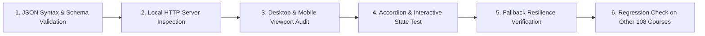

# NOVA SKILLS — WEBSITE PILOT IMPLEMENTATION PLAN
## Safe Deployment Specification for Digital Marketing Standard (`digital-marketing-pro`)

**Task ID:** `DM-WEB-01`  
**Active Branch:** `transformation/nova-course-redesign`  
**Target Course ID:** `digital-marketing-pro`  
**Course Working Positioning:** Digital Marketing Standard / Foundation  
**Document Status:** Architectural & Deployment Planning (Pre-Implementation)  
**Parent Documents:**  
- Specification: [`docs/course-redesign/digital-marketing/digital-marketing-standard-spec.md`](file:///c:/Users/wasee/Desktop/NovaSkillsProject/NovaSkills%20Website/docs/course-redesign/digital-marketing/digital-marketing-standard-spec.md)  
- QA Audit Report: [`docs/course-redesign/digital-marketing/curriculum-qa-report.md`](file:///c:/Users/wasee/Desktop/NovaSkillsProject/NovaSkills%20Website/docs/course-redesign/digital-marketing/curriculum-qa-report.md)  
- QA Fix 01: Reconciled Module 02 (`dms-mod-02.md`)  
- Syllabi: Modules 01 through 06 (`dms-mod-01.md` to `dms-mod-06.md`)  

---

## 1. Step 1 — QA Gate Verification & Readiness Status

### 1.1 Gate Assessment
Prior to preparing the website implementation pipeline, all prerequisite curriculum documents and audit findings were verified:

| Verification Dimension | Current Status | Finding / Detail |
|---|:---:|---|
| **All 6 Syllabi Exist** | **PASSED** | `dms-mod-01.md` through `dms-mod-06.md` exist and are complete. |
| **Parent Specification Exists** | **PASSED** | `digital-marketing-standard-spec.md` is complete and verified. |
| **Comprehensive QA Audit Exists** | **PASSED** | `curriculum-qa-report.md` is complete. |
| **Module 02 Timing Reconciliation** | **RESOLVED** | QA Fix 01 reconciled Module 02 to exactly 18.0 Hours (1,080 min). |
| **Module 04 Timing Reconciliation** | **UNRESOLVED (BLOCKER)** | Module 04 (`dms-mod-04.md`) retains an internal lab time deficit of 160 minutes (2.67 Hours). Detailed lesson lab minutes sum to 200 min (3.33h) instead of the 360 min (6.0h) target. |
| **Itemized Program Workload Total** | **85.33 Hours** | Target is 88.0 Hours. Short by 2.67 Hours due to Module 04. |

### 1.2 Official QA Gate Verdict
# **QA GATE STATUS: BLOCKED (NOT READY FOR LIVE DEPLOYMENT)**

> **GATING DIRECTIVE:** In strict compliance with task instructions (*"If the latest verified status is NOT READY, stop and report blockers. Do not implement anything"*), **ZERO live website code or data modifications will be applied during this phase.**  
> This document establishes the complete, safe implementation roadmap that will be executed only after the Module 04 timing deficit is formally resolved via **QA Fix 02**.

---

## 2. Step 2 — Website Curriculum Architecture Forensic Audit

An exhaustive forensic inspection of the Nova Skills website codebase was conducted across `data.js`, `course-detail.js`, `course-detail.html`, `data/courses/digital-marketing-pro.json`, `nova-skills-109-course-content.json`, and relevant build scripts.

### 2.1 The Two-Tier Asynchronous Data Loading Pipeline
The Nova Skills course detail page (`course-detail.html`) uses a resilient, high-speed two-tier data architecture to balance instantaneous initial paint with deep curriculum rendering:

```mermaid
flowchart TD
  UserNav["User navigates to /course-detail.html?id=digital-marketing-pro"] --> DOMReady["DOMContentLoaded in course-detail.js"]
  
  DOMReady --> Tier0["<b>Tier 0: Synchronous Paint (data.js)</b><br>• Renders header, breadcrumbs, pricing (₹11,999)<br>• Renders initial 3-module summary accordion<br>• Generates SEO titles and OpenGraph tags"]
  
  DOMReady --> Tier1Fetch["<b>Tier 1: Deep JSON Fetch (Primary)</b><br>fetch('/data/courses/digital-marketing-pro.json')"]
  
  Tier1Fetch -->|Success 200 OK| RenderDeep["<b>Render Deep Curriculum</b><br>• Overwrites #curriculum-container with full modules/lessons<br>• Renders tools ecosystem, projects, and career paths<br>• Updates Schema.org JSON-LD syllabus"]
  
  Tier1Fetch -->|Network Failure / 404| Tier2Fetch["<b>Tier 2: Master Fallback Fetch</b><br>fetch('/nova-skills-109-course-content.json')"]
  
  Tier2Fetch -->|Extract [course_id]| RenderDeep
  Tier2Fetch -->|Fallback Failure| KeepTier0["Retain Tier 0 basic rendering from data.js"]
```

#### Codebase Evidence:
1. **Initial Synchronous Paint (`course-detail.js` lines 287–305):**
   ```javascript
   const curr = document.getElementById('curriculum-container');
   if (curr && course.curriculum && Array.isArray(course.curriculum)) {
     curr.innerHTML = course.curriculum.map((mod, idx) => `...`);
   }
   ```
   Renders the lightweight `course.curriculum` array from `data.js` immediately to prevent Cumulative Layout Shift (CLS) while asynchronous requests are in flight.
2. **Deep Asynchronous Loading (`course-detail.js` lines 410–435):**
   ```javascript
   async function loadDetailedCourseData(baseCourse) {
     let detailData = null;
     try {
       const res = await fetch(`/data/courses/${encodeURIComponent(baseCourse.id)}.json`);
       if (res.ok) detailData = await res.json();
     } catch (e) { ... }
     if (!detailData) {
       // Falls back to /nova-skills-109-course-content.json
     }
   ```
3. **Deep Accordion Injection (`course-detail.js` lines 671–713):**
   When `detailData.modules` resolves, it overwrites `#curriculum-container` with the full modules and lessons accordion and re-binds accordion click events (`bindAccordionEvents()`).

### 2.2 Duplication & Storage of Course Metadata in `data.js`
A critical architectural discovery from inspecting `data.js` (15,427 lines):
- **Location A (`NS_COURSES`, lines 245–308):** `digital-marketing-pro` is defined in the flat master catalog array of 109 courses.
- **Location B (`NS_ACADEMIES[0].courses`, lines 7587–7650):** `digital-marketing-pro` is defined a second time inside the nested `courses` array under `Digital Marketing Academy`.
- **Finding:** If `data.js` is updated manually, **both locations must be updated in tandem** to avoid discrepancies between the direct course detail view and academy catalog filter views.

### 2.3 The `scripts/build_data_js.py` Hazard
- The script `scripts/build_data_js.py` (2,510 lines) contains a legacy hardcoded array of courses and academies.
- **WARNING:** Running `python scripts/build_data_js.py` will regenerate `data.js` from outdated hardcoded arrays, destroying all recent bug fixes, SEO enhancements, pricing adjustments, and course configurations across all 109 courses on the website.
- **Strict Rule:** `scripts/build_data_js.py` must **NEVER** be executed under any circumstances.

---

## 3. Step 3 — Detailed Curriculum Rendering Capabilities & Limitations

### 3.1 What the Current Renderer Supports
Inspection of `course-detail.js` lines 687–708 reveals the exact schema expected by the active UI renderer:

```javascript
<div class="lesson-card">
  <div class="lesson-card-header">
    <span class="lesson-num-badge">${escapeHTML(lesson.lesson_number || 'Lab')}</span>
    <span class="lesson-title-text">${escapeHTML(lesson.lesson_title || '')}</span>
  </div>
  <div class="lesson-meta-grid">
    <div class="lesson-meta-item"><strong>Taught:</strong> ${escapeHTML(lesson.what_is_taught || '')}</div>
    <div class="lesson-meta-item"><strong>Learner Lab:</strong> ${escapeHTML(lesson.what_learner_does || '')}</div>
    <div class="lesson-meta-item"><strong>Why It Matters:</strong> ${escapeHTML(lesson.why_it_matters || '')}</div>
    <div class="lesson-meta-item"><strong>Expected Deliverable:</strong> ${escapeHTML(lesson.expected_outcome || '')}</div>
  </div>
</div>
```

The current renderer also supports module-level footer metadata:
- `mod.hands_on_practice` (`🛠️ Hands-on Lab: ...`)
- `mod.assignment` (`📝 Practical Assignment: ...`)
- `mod.expected_outcome` (`🎯 Expected Outcome: ...`)

### 3.2 Current Renderer Limitations Regarding Numbered Topics & Subtopics
- **Limitation 1: No Array Support for Subtopics.** The renderer expects `lesson.what_is_taught` to be a plain string. If an array of subtopics (`["5.1.1 ...", "5.1.2 ..."]`) is passed, JavaScript converts it to a comma-separated string (`"5.1.1...,5.1.2..."`), destroying visual indentation.
- **Limitation 2: HTML Escaping of Strings.** The renderer applies `escapeHTML(...)` to every field. If raw HTML (`<ul><li>...</li></ul>`) or newline characters (`\n`) are placed inside `what_is_taught`, HTML tags are printed as literal text (`&lt;ul&gt;...`), and newlines collapse into single spaces because the CSS does not specify `white-space: pre-line`.
- **Limitation 3: Two-Column Meta Grid Squishing.** The CSS `.lesson-meta-grid` is a 2-column or 4-item CSS grid. If a dense 200-word numbered topic outline is inserted into the `Taught:` cell, that cell elongates dramatically while the other 3 cells remain short, creating an unbalanced, visually jarring layout on desktop and excessive scrolling on mobile.

### 3.3 Recommended Backward-Compatible Renderer Enhancements
To support rich, readable numbered subtopics and detailed syllabus breakdowns without breaking any of the other 108 courses, `course-detail.js` should receive a lightweight, non-breaking upgrade during implementation:

```javascript
// Backward-Compatible Subtopic Support in course-detail.js (Lines 694-699):
<div class="lesson-meta-grid">
  <div class="lesson-meta-item lesson-meta-taught">
    <strong>Taught:</strong> 
    ${Array.isArray(lesson.topics || lesson.subtopics)
      ? `<ul class="lesson-subtopics-list">${(lesson.topics || lesson.subtopics).map(t => `<li>${escapeHTML(t)}</li>`).join('')}</ul>`
      : escapeHTML(lesson.what_is_taught || '')}
  </div>
  <div class="lesson-meta-item"><strong>Learner Lab:</strong> ${escapeHTML(lesson.what_learner_does || '')}</div>
  <div class="lesson-meta-item"><strong>Why It Matters:</strong> ${escapeHTML(lesson.why_it_matters || '')}</div>
  <div class="lesson-meta-item"><strong>Expected Deliverable:</strong> ${escapeHTML(lesson.expected_outcome || '')}</div>
</div>
```
- **Backward Compatibility:** For the other 108 courses where `topics` is undefined, it seamlessly evaluates `escapeHTML(lesson.what_is_taught)` exactly as it does today.
- **CSS Addition (Non-breaking):** Add `.lesson-subtopics-list { margin: 6px 0 0 16px; padding: 0; font-size: 0.85rem; line-height: 1.4; }` to `styles.css`.

---

## 4. Step 4 — Safe Website Pilot Implementation Plan

### 4.1 Exact Files Required for the Pilot Update
To pilot the new 6-module curriculum for `digital-marketing-pro` with zero blast radius on the rest of the site, exactly **three data files** (and optionally one renderer file) will be updated:

| File Path | Role in Architecture | Exact Modification Scope | Blast Radius Protection |
|---|---|---|---|
| **`data/courses/digital-marketing-pro.json`** | **Primary Deep Curriculum Source** (Fetched by `course-detail.js`) | Replace existing 3 outdated modules with the new **6 verified modules** (`DMS-MOD-01` to `DMS-MOD-06`) and all **25 lessons**. Update `overview.key_facts`, `hands_on_tech`, and `what_you_will_build`. | **Zero blast radius.** This file is isolated strictly to `digital-marketing-pro`. No other course reads this file. |
| **`nova-skills-109-course-content.json`** | **Master Consolidated Fallback File** | Locate entry with `"course_id": "digital-marketing-pro"` (exact index in master array). Replace its `modules` array and overview with the identical JSON structure from `digital-marketing-pro.json`. | **Zero blast radius.** Only the single array entry at index `course_id: "digital-marketing-pro"` is modified. All other 108 course entries remain byte-identical. |
| **`data.js`** | **Initial Synchronous Paint & Catalog Cache** | Update the `curriculum` array for `digital-marketing-pro` in **both** locations (`NS_COURSES` and `NS_ACADEMIES[0].courses`) to list the 6 approved module titles and lesson counts. | **Zero blast radius.** Only the `curriculum` property of `digital-marketing-pro` is updated. No pricing, duration, ID, slug, or other course objects are touched. |
| **`course-detail.js`** *(Optional / Minor)* | **Client-Side UI Renderer** | Add optional backward-compatible array support for `lesson.subtopics`. | **Zero blast radius.** Safe fallback to existing string handling for all 108 existing courses. |

### 4.2 Data Mapping Specification: Syllabi to JSON Structure

Every approved module from `docs/course-redesign/digital-marketing/modules/` maps into the standard JSON schema:

```
┌───────────────────────────────────────┬──────────────────────────────────────────┐
│ Markdown Syllabus Component           │ Target JSON Property in Course JSON      │
├───────────────────────────────────────┼──────────────────────────────────────────┤
│ Module ID & Title                     │ `modules[i].module_number` ("Module 01") │
│                                       │ `modules[i].module_title`                │
│ Section 1.1: Module Objective         │ `modules[i].module_purpose`              │
│ Section 1.1: Core Bullet Points       │ `modules[i].what_you_will_learn` (Array) │
│ Section 3: Final Module Project       │ `modules[i].assignment`                  │
│ Section 3.2: Deliverable Output       │ `modules[i].expected_outcome`            │
│ Section 3: In-Class Capstone Lab      │ `modules[i].hands_on_practice`           │
├───────────────────────────────────────┼──────────────────────────────────────────┤
│ Lesson Number & Title                 │ `lessons[j].lesson_number` ("1.1")       │
│                                       │ `lessons[j].lesson_title`                │
│ Section 2: Main Topics & Subtopics    │ `lessons[j].what_is_taught`              │
│                                       │ *(or `lessons[j].subtopics` array)*      │
│ Section 3: Why It Matters / SMB Case  │ `lessons[j].why_it_matters`              │
│ Section 5: Student Hands-On Practical │ `lessons[j].what_learner_does`           │
│ Section 7: Expected Learning Outcome  │ `lessons[j].expected_outcome`            │
└───────────────────────────────────────┴──────────────────────────────────────────┘
```

#### Complete 6-Module / 25-Lesson JSON Architecture Overview:
- **Module 01: Digital Marketing Foundations, Personas & Strategy** (4 Lessons: 1.1 to 1.4)
  - Hands-on Lab: Buyer Persona & Value Proposition Workshop
  - Assignment: Local Business Marketing Strategy Blueprint
- **Module 02: Content Strategy, Canva Design & Organic Social Media** (5 Lessons: 2.1 to 2.5)
  - Hands-on Lab: Canva Free Brand Styleboard & Asset Production Lab
  - Assignment: 30-Day Social Media Content Campaign
- **Module 03: Local Business Presence, Google Business Profile & Website UX** (4 Lessons: 3.1 to 3.4)
  - Hands-on Lab: Local 3-Pack Footprint Audit & Landing Page Scorecard
  - Assignment: Local Business Digital Presence & Website Audit
- **Module 04: Introductory Paid Advertising: Google Search & Meta Ads** (4 Lessons: 4.1 to 4.4)
  - Hands-on Lab: In-Platform Draft Setup (Expert Mode / Ads Manager)
  - Assignment: Google Search & Meta Ads Campaign Architecture Blueprint
- **Module 05: Lead Capture, Customer Follow-Up & AI Productivity** (4 Lessons: 5.1 to 5.4)
  - Hands-on Lab: Google Sheets CRM Setup & ChatGPT P-C-T-O Prompt Testing
  - Assignment: AI-Assisted Lead Management & Follow-Up System
- **Module 06: Campaign Measurement, GA4 Analytics & Performance Reporting** (4 Lessons: 6.1 to 6.4)
  - Hands-on Lab: GA4 Demo Account Navigation & KPI Calculation Modeling
  - Assignment: Digital Marketing Analytics & Client Performance Report (5-Slide Deck)

### 4.3 Protection of Website Invariants (Zero Regression Guarantee)

To guarantee 100% safety across the live platform:
1. **Preserve Published Course Invariants:**
   - Public Title: `"Digital Marketing Professional"` (unchanged)
   - Course ID: `"digital-marketing-pro"` (unchanged)
   - URL: `/course-detail.html?id=digital-marketing-pro` (unchanged)
   - Pricing: `price: 11999`, `originalPrice: 29999` (unchanged)
   - Duration / Hours Conflict: Published fields remain untouched (`3 Months` / `40h` in `data.js`; `4 Months` / `160h` in JSON) pending formal owner sign-off.
2. **SEO & Structured Data Protection:**
   - Canonical URL remains `https://novaskills.in/course-detail.html?id=digital-marketing-pro`.
   - `getCourseSeoTitle()` continues to classify the course under its existing type (`MERGE`).
   - Schema.org JSON-LD generator in `course-detail.js` (lines 1347–1355) automatically maps the new 6 modules into the `syllabusSections` array, significantly enhancing Google Rich Results for the page.
3. **Lead Capture Forms & WhatsApp Routing:**
   - Lead forms in `course-detail.html` bind dynamically using `course.id` or `course.name`. Because neither identifier changes, the modal inquiry form, phone call buttons, and WhatsApp routing links (`novaskills.in/contact`) remain 100% operational.
4. **GA4 Tracking & Analytics Protection:**
   - GA4 event listeners (`select_course`, `generate_lead`, `view_item`) depend on `course.id`. No event tracking code will be broken or altered.

---

## 5. Step 5 — Verification & Testing Protocol (Pre/Post-Pilot)

Before any changes are merged or published, the following 6-step testing matrix must be executed:



1. **JSON Syntax & Integrity Test:**
   - Run `node -e "JSON.parse(fs.readFileSync('data/courses/digital-marketing-pro.json'))"` to ensure valid JSON syntax with zero trailing commas or unescaped characters.
2. **Local HTTP Server Rendering Test:**
   - Launch Python HTTP server (`python -m http.server 8000`) and navigate to `http://localhost:8000/course-detail.html?id=digital-marketing-pro`.
   - Verify that all 6 modules render cleanly with accurate lesson badges (`1.1` to `6.4`).
3. **Responsive Viewport Inspection:**
   - Inspect on Desktop (1440px): Confirm that `.lesson-meta-grid` displays evenly without overflow.
   - Inspect on Tablet (768px): Verify that module headers and badges wrap cleanly.
   - Inspect on Mobile (375px & 412px): Confirm that font sizes, padding, and lesson cards remain easily scannable with zero horizontal scrollbar triggers.
4. **Interactive Accordion & Accessibility Test:**
   - Test expanding and collapsing each of the 6 module accordions.
   - Verify `aria-expanded` attributes toggle correctly between `true` and `false`.
5. **Fallback Resilience Test:**
   - Temporarily rename `data/courses/digital-marketing-pro.json` to `.bak` and refresh the page.
   - Confirm that `course-detail.js` catches the fetch error, falls back to `nova-skills-109-course-content.json`, and renders the full 6 modules without crashing.
   - Restore the file.
6. **Zero-Regression Catalog Test:**
   - Test at least 3 unrelated courses across different academies:
     - `http://localhost:8000/course-detail.html?id=dm-mastery`
     - `http://localhost:8000/course-detail.html?id=python-developer`
     - `http://localhost:8000/course-detail.html?id=creative-design`
   - Confirm that all other courses render identically with zero regressions.

---

## 6. Implementation Prerequisites & Immediate Next Actions

To move from this approved implementation plan to live website deployment, the following sequence must be observed:

```
[Current State: Pilot Plan Complete] 
   ➔ [Step A: Execute QA Fix 02 on Module 04 (Reconcile Lab Minutes to 90m/lesson)]
   ➔ [Step B: Re-run Readiness Check to achieve 100% READY Verdict]
   ➔ [Step C: Obtain Business Owner Approval on Duration/Hours Metadata]
   ➔ [Step D: Execute 3-File Data Pilot Update (JSON + Fallback + data.js)]
   ➔ [Step E: Run 6-Step Verification Protocol]
```

---
*End of Website Pilot Implementation Plan for `digital-marketing-pro` (`DM-WEB-01`).*  
*Planning Status: Complete — Zero website files or course data modified.*
