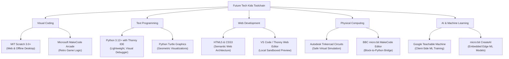
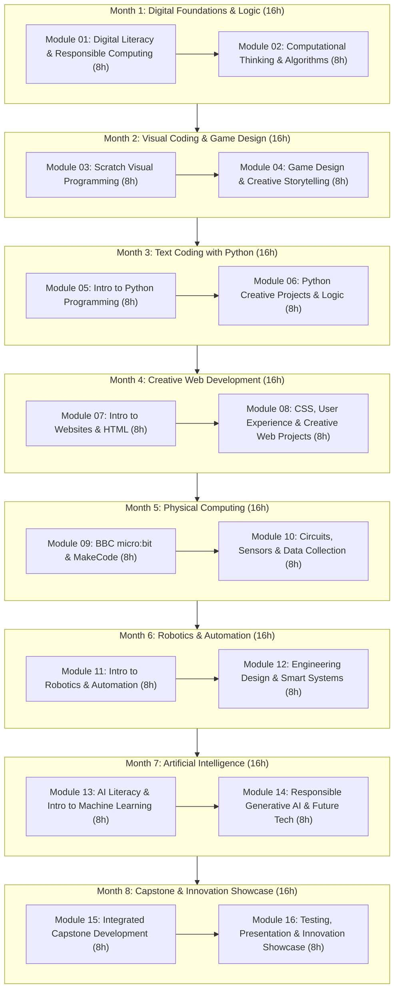
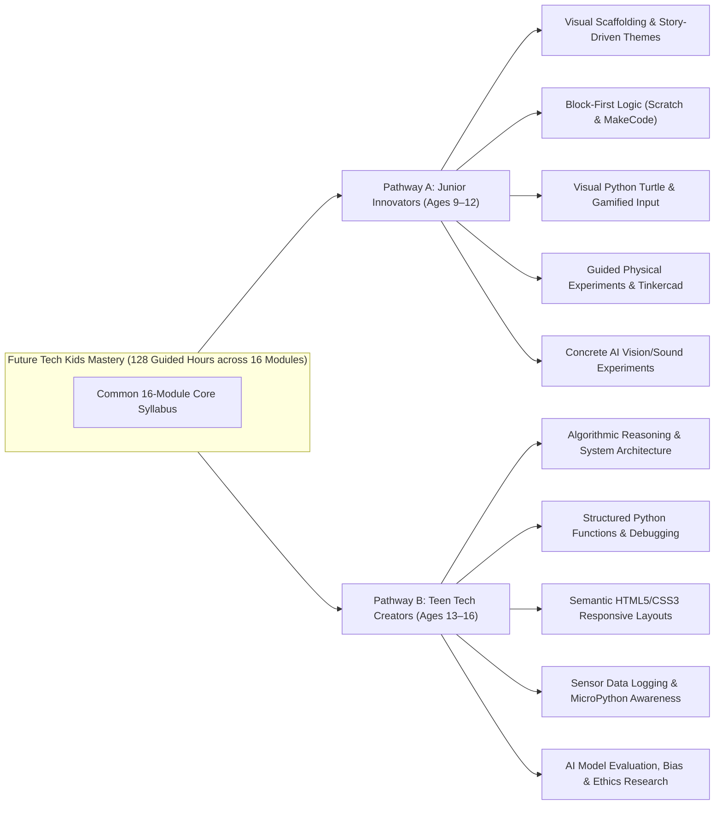
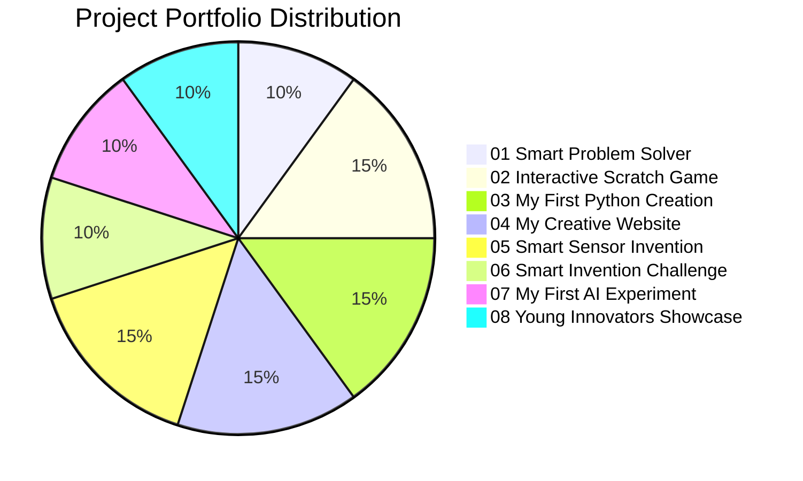
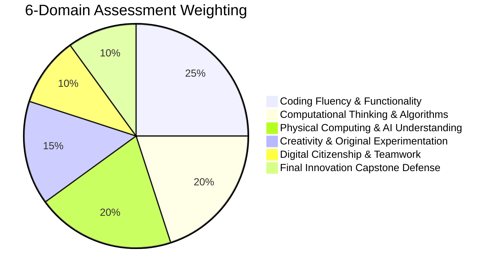
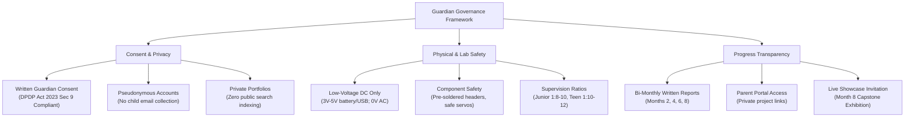

# Academic Blueprint & Curriculum Specification: Future Tech Kids Mastery (2027 Edition)
**Document Identifier:** `NOVA-FTKM-SPEC-2027-V1`  
**Academic Sequence:** Course 25 (Catalog Sequence Number 25; NOT the course slug)  
**Existing Canonical Identifier:** `kids-mastery`  
**Course Slug:** `future-tech-kids-mastery` (Canonical Route: `/course-detail.html?id=kids-mastery`)  
**Program Title:** Future Tech Kids Mastery  
**Curriculum Edition:** 2027 Next-Gen STEAM Edition  
**Governing Academy:** Kids Technology & Innovation (`Kids Tech Academy`, ID: `kids`)  
**Academic Classification:** Flagship STEAM Mastery & Creative Computing Program  
**Target Age Demographic:** 9 to 16 Years (Strictly age-bracketed into 2 developmental pathways)  
**Program Duration:** 8 Academic Months (32 Instructional Weeks)  
**Guided Instructional Hours:** **128 Guided Hours** (4 Hours/Week; two 2-hour practical sessions per week)  
**Weekly Instructional Breakdown:** 1.0h Concept Demonstration + 2.0h Hands-on Guided Labs + 0.5h Peer Code Review & Debugging + 0.5h Project Documentation & Reflection  
**Independent Creative Practice:** 1.0–1.5 Hours Weekly (~32–48 Hours total, strictly demarcated from guided hours)  
**Commercial Standard Fee:** **INR 29,900** + applicable statutory GST (0% Artificial Discounts, Honest Institutional Pricing)  
**Program Tagline:** *Code. Create. Invent. Explore AI.*  
**Document Status:** Complete Forensic Repository Audit & Approved Academic Specification (Task NOVA-FTKM-01)  

---

## 1. Executive Summary & Educational Mandate

The **Future Tech Kids Mastery** program (Course 25) is Nova Skills' flagship 8-month comprehensive STEAM and creative computing curriculum designed specifically for young minds aged 9 to 16. In an era increasingly shaped by automation, pervasive software, and artificial intelligence, this curriculum moves students from passive consumers of digital media to active, ethical creators, inventors, and problem solvers.

The 2027 curriculum represents a fundamental modernization from the legacy 6-month, 5-module generalist coding outline into an industry-referenced, pedagogically sound, 16-module, 128-hour developmental progression. The program integrates six complementary pillars of modern technological literacy:
1. **Computational Thinking & Logic:** Deconstructing real-world problems into algorithms, patterns, and modular steps.
2. **Visual Programming (MIT Scratch 3.0+):** Mastering event-driven logic, variables, conditional branching, coordinates, and interactive game physics without syntax friction.
3. **Text-Based Programming (Python 3.12+):** Transitioning to professional syntax, data structures, functional decomposition, and algorithmic reasoning using the lightweight Thonny IDE.
4. **Creative Web Development (HTML5 & CSS3):** Demystifying the internet by constructing semantic, styled, responsive digital spaces.
5. **Physical Computing & Electronics (BBC micro:bit V2 & Tinkercad Circuits):** Bridging software and the physical world through microcontrollers, sensors, actuators, and low-voltage circuits.
6. **AI Literacy & Machine Learning (Google Teachable Machine & micro:bit CreateAI):** Cultivating deep foundational understanding of how machine learning models are trained, evaluated, and deployed, while embedding digital safety and ethics.

### Critical Institutional Positioning:
- **No Adult Career Claims:** This program is strictly educational and creative. All legacy adult-centric marketing phrases, "career paths", "freelance earnings", "commercial deliverables", and "job placements" are completely eliminated.
- **Child Data Protection & Safety First:** Complies with the Indian Digital Personal Data Protection (DPDP) Act 2023 Section 9 and global child safety standards. All software environments are account-minimized, sandboxed, or run offline. Zero public indexing of children's identities, work, or images occurs without explicit guardian authorization.
- **Physical Safety Standards:** Physical computing labs operate strictly under low-voltage direct current (3V–5V DC battery/USB power). Mains AC electrical circuits are strictly prohibited.

---

## 2. Forensic Audit of Legacy Baseline vs. 2027 Modernization

| Dimension | Legacy Baseline (`data.js` / JSON) | 2027 Approved Specification | Academic Justification for Modernization |
| :--- | :--- | :--- | :--- |
| **Academic Sequence** | Unnumbered / Course 25 | **Course 25** (Academic Sequence) | Formal catalog sequence under Nova Skills Quality Framework. |
| **Canonical ID** | `kids-mastery` | `kids-mastery` | Preserved for 100% URL routing, SEO, and legacy backward compatibility. |
| **Course Title** | Future Tech Kids Mastery | **Future Tech Kids Mastery** | Preserved brand equity with updated 2027 syllabus. |
| **Academy Name** | Kids Tech Academy (`kids`) | **Kids Tech Academy** (Academic: *Kids Technology & Innovation*) | Preserves technical schema ID `kids` while elevating academic pedigree. |
| **Program Level** | `Career Program` (Inappropriate) | **Flagship STEAM Mastery** | Corrects misclassification; minors must not be enrolled in "Career Programs". |
| **Course Role** | `Career/Monetization` (Inappropriate) | **Foundational STEAM & Creative Innovation** | Eliminates commercial monetization claims for young learners. |
| **Target Age Range** | Generic 8–14 Years | **9 to 16 Years** (Divided into Junior 9–12 & Teen 13–16) | Accommodates distinct cognitive development stages through dedicated pathways. |
| **Program Duration** | 6 Months (Vague 180h / 240h claim) | **8 Academic Months (32 Weeks, 128 Guided Hours)** | Provides rigorous 8 hours/module pacing across 16 coherent modules. |
| **Weekly Schedule** | Unspecified | **4 Guided Instructional Hours / Week** | Structured as two 2-hour interactive classroom/lab sessions per week. |
| **Curriculum Scope** | 5 High-Level Modules (4 lessons each) | **16 In-Depth Modules (64 Structured Lessons)** | Granular progression from computational logic to robotics and AI capstone. |
| **Selling Price** | ₹19,999 (Fake ₹49,999 reference price) | **INR 29,900** (+ applicable GST) | Truth-in-Education standard; 0% deceptive discount manipulation. |
| **Software Toolchain** | Generic list (IDLE, Roblox, Blockly) | **MIT Scratch 3, Thonny Python, MakeCode, Tinkercad, Teachable Machine** | Educational, safe, COPPA-compliant, low-friction toolchain with offline support. |
| **Hardware Lab** | Unspecified / Vague robotics claims | **BBC micro:bit V2 + Sensor Kit + Tinkercad Circuits** | Standardized, low-voltage (3V), safe physical computing hardware stack. |
| **Project Output** | Vague "3 Live Projects" | **8 Multi-Category Project Portfolios (Junior & Teen tiers)** | Concrete, progressive evidence of mastery across every single month. |
| **Evaluation Model** | Generic "Project-based evaluation" | **6-Domain Weighted Rubric (100%) + 6 Milestones** | Objective competency assessment with formal Guardian Progress Reports. |

---

## 3. Tool, Software & Hardware Evaluation (2027 EdTech Standards)

### A. Core Software Toolchain (Zero Cost, High Privacy, Age-Appropriate)

1. **MIT Scratch 3.0+ (MIT Media Lab):**
   - *Access & Licensing:* 100% Free, open-source. Accessible via browser (`scratch.mit.edu`) and official offline desktop app (`Scratch Desktop`).
   - *Child Privacy & COPPA Compliance:* Desktop version requires zero user account, zero internet connection, and collects zero personal data. Web version utilizes institutional Scratch Teacher Accounts where student usernames are pseudonymous (e.g., `novaskills_j01`), with email registration managed entirely by the institute without collecting child email addresses.
   - *Pedagogical Role:* Modules 03 and 04. Teaches event-driven execution, cartesian coordinate systems ($x, y$), multi-threaded sprite execution, conditional branching, variable tracking, broadcast messaging, and audio-visual synchronization.
2. **Python 3.12+ & Thonny IDE (University of Tartu):**
   - *Access & Licensing:* 100% Free, open-source (MIT License). Runs locally on Windows, macOS, and Linux.
   - *Child Privacy & Safety:* Fully offline desktop environment. Zero cloud telemetry, zero account creation, zero tracking.
   - *Pedagogical Role:* Modules 05 and 06. Thonny is engineered specifically for learning programming. Unlike complex adult IDEs, Thonny provides a transparent visual debugger where students visually watch variables change in memory, evaluate expression trees step-by-step, and understand function call stacks without terminal confusion.
3. **Microsoft MakeCode & MakeCode Arcade:**
   - *Access & Licensing:* 100% Free by Microsoft Education. Runs in modern browsers and offline Progressive Web Apps (PWA).
   - *Child Privacy & Safety:* Zero account required to write, test, and download hex files. Student projects save locally or export as PNG/hex files.
   - *Pedagogical Role:* Modules 09 and 10. Provides seamless transition between visual block programming and real JavaScript/Python syntax for microcontroller hardware and retro 2D games.
4. **Autodesk Tinkercad Circuits:**
   - *Access & Licensing:* 100% Free cloud CAD and circuit simulation tool.
   - *Child Privacy & Safety:* Instructors use "Tinkercad Classrooms" to generate single-use join codes and student nicknames. Students never register personal email addresses.
   - *Pedagogical Role:* Modules 10, 11, and 12. Allows students to experiment with breadboards, LEDs, resistors, push buttons, buzzers, ultrasonic distance sensors, and microcontrollers in a 100% safe, virtual simulation environment before touching physical hardware. Eliminates burned components, short-circuits, and component wear.
5. **BBC micro:bit Python Editor & micro:bit CreateAI:**
   - *Access & Licensing:* Free official educational tools by the Micro:bit Educational Foundation.
   - *Child Privacy & Safety:* Browser-based WebUSB direct flashing without cloud storage of student code. CreateAI trains edge ML models directly in the client browser without sending raw data to remote servers.
   - *Pedagogical Role:* Modules 09, 10, 13, and 14. Enables on-device machine learning inference where micro:bits recognize physical gestures, movement patterns, and audio cues.
6. **Google Teachable Machine (Google Research):**
   - *Access & Licensing:* 100% Free, web-based AI training environment.
   - *Child Privacy & Safety:* All computer vision and audio model training executes entirely client-side inside the student's local browser using TensorFlow.js. Web camera feeds and microphone audio streams are processed in local memory and are never uploaded, stored, or transmitted to external servers.
   - *Pedagogical Role:* Modules 13 and 14. Provides experiential understanding of training data, classification labels, epoch cycles, confidence thresholds, false positives, and algorithmic bias.

---

### B. Standardized Hardware Inventory (Low-Voltage DC Safety Certified)

All physical computing components are standardized on a strictly regulated low-voltage direct current (3.0V – 5.0V DC) specification powered solely via USB cables or regulated 2x AAA battery packs. Mains electrical power ($230\text{V AC}$) is strictly forbidden in the classroom.

| Component Category | Standard Hardware Unit | Technical Specifications | Purpose in Curriculum | Safety & Handling Protocol |
| :--- | :--- | :--- | :--- | :--- |
| **Core Microcontroller** | **BBC micro:bit V2.2** | Nordic nRF52833 (64 MHz), 512KB Flash, 128KB RAM, 5x5 LED Display, 2 Push Buttons, Touch Logo, MEMS Mic, Speaker, Accelerometer, Compass. | Modules 09, 10, 11, 13, 14, 15, 16. Primary physical computing engine. | Operates at 3.3V DC. Protected by silicon bumper sleeve. Direct WebUSB flashing. |
| **Power Supply** | Regulated 2x AAA Battery Pack | 3.0V DC with integrated JST-PH connector and physical sliding power switch. | Portable power for robotics and wearable sensor inventions. | Alkaline batteries only. Sealed battery compartment with screw lock. No lithium-ion pouches. |
| **Prototyping Board** | micro:bit Edge Connector Breakout | Standard 20-pin pitch breakout board with labeled 3V, GND, and GPIO pins. | Module 10 and 11. Connecting external breadboards and components. | Keyed slot prevents reversed insertion. Low-voltage bus only. |
| **Input Sensors** | Sensor Starter Kit | Passive Infrared (PIR) Motion Sensor, Analog Light Sensor (LDR), Soil Moisture Probe, Ultrasonic Sensor (HC-SR04P 3V compatible), Push Switches. | Modules 10, 11, 12. Environmental monitoring, smart home and security prototypes. | Pre-soldered pin headers; zero loose wires or bare solder points. |
| **Output Actuators** | Actuator Starter Kit | Micro Servo Motor (SG90 180-degree), 3V Active Buzzer, RGB Neopixel Strip (5-pixel addressable, 3.3V), 10mm Diffused LEDs with built-in resistors. | Modules 11, 12, 15, 16. Robotic arms, automated barrier gates, visual alarm systems. | Low-torque servos to eliminate pinch risks; current-limited LED assemblies. |
| **Connection Cables** | Premium Alligator-to-Pin & DuPont Wires | Multicolored insulated 20cm jumper wires with shrouded alligator clips and female-to-female DuPont connectors. | Rapid, solder-free circuit construction on breadboards and micro:bit pins. | 100% solderless; color-coded standards (Red=3V, Black=GND, Blue/Yellow=Data). |
| **Virtual Alternative** | Autodesk Tinkercad Circuits | Virtual simulation platform matching exact physical micro:bit and sensor pinouts. | Primary pre-lab simulation, remote student option, and offline homework. | 100% digital simulation with zero hardware damage risks. |

---

## 4. The 16-Module Curriculum Matrix (128 Guided Hours)

---

### MONTH 1: DIGITAL FOUNDATIONS & COMPUTATIONAL THINKING (16 Guided Hours)

#### Module 01: Digital Literacy, Technology & Responsible Computing (8 Hours)
- **Guided Hours:** 8 Hours (Two 4-hour instructional weeks; 4 lessons)
- **Module Purpose:** Establish an empowering, safe, and disciplined foundation in computer architecture, operating systems, cloud vs local storage, keyboard proficiency, cyber hygiene, ergonomics, and digital citizenship.
- **Pedagogical Focus:** Demystifying what computers actually do; moving from passive touch screens to active keyboard-and-mouse operating system mastery; establishing healthy screen time habits and privacy awareness.
- **Main Teachable Topics:**
  1. *Hardware Demystification:* CPU (the brain), RAM (the workbench), Hard Drive/SSD (the library), Input Devices vs Output Devices.
  2. *Operating System Literacy:* File hierarchies, folder organization, file naming conventions, saving work locally vs in educational cloud drives.
  3. *Digital Citizenship & Cyber Safety:* Personal Identifiable Information (PII) definition, the permanence of digital footprints, creating strong passphrases, recognizing phishing and malicious download buttons.
  4. *Ergonomics & Healthy Technology Habits:* 20-20-20 eye rest rule, posture ergonomics, intentional creative screen time vs mindless scrolling.
- **Classroom Exercises:**
  - *Exercise 1.1:* "Unpack the Computer Box" — interactive physical/virtual matching of hardware components to their real-world functions.
  - *Exercise 1.2:* File System Scavenger Hunt — organizing 20 disordered project assets into cleanly structured parent/child directories.
  - *Exercise 1.3:* Passphrase Matrix Challenge — constructing and testing secure, memorable 4-word passphrases without personal data.
- **Student Assignment:** Create a digital "Tech Passport & Workspace Charter" detailing their personal computer setup, file backup routine, and family-approved digital safety commitments.
- **Monthly Project Contribution:** Contributes initial algorithmic profile and digital safety badge to Project 01.

#### Module 02: Computational Thinking, Logic & Algorithms (8 Hours)
- **Guided Hours:** 8 Hours (Two 4-hour instructional weeks; 4 lessons)
- **Module Purpose:** Develop the four fundamental pillars of computational thinking—Decomposition, Pattern Recognition, Abstraction, and Algorithm Design—through unplugged logic games and visual flowcharts before writing syntax.
- **Pedagogical Focus:** Separating logical problem solving from computer code. Teaching students how to structure instructions so precisely that an unambiguous machine can execute them without human guessing.
- **Main Teachable Topics:**
  1. *Decomposition:* Breaking complex tasks (e.g., preparing for school, playing tic-tac-toe) into atomic, manageable sub-problems.
  2. *Pattern Recognition:* Identifying recurring sequences, symmetries, and commonalities across different challenges.
  3. *Abstraction:* Filtering out irrelevant visual and narrative noise to focus exclusively on essential mathematical and logical rules.
  4. *Algorithm Design & Pseudocode:* Writing precise, ordered, step-by-step instructions using standard sequence, selection (if/else), and iteration (loops) notation.
  5. *Debugging Unplugged:* Tracing algorithms line by line using dry-run tracking tables to locate and correct logical faults.
- **Classroom Exercises:**
  - *Exercise 2.1:* "Program the Instructor Robot" — students write strict peanut-butter sandwich or maze-walking instructions; the instructor acts as a literal computer that fails at any ambiguous step.
  - *Exercise 2.2:* Flowchart Mapping — using standard flowchart symbols (Start/End oval, Process rectangle, Decision diamond) to map game rules.
  - *Exercise 2.3:* Spot the Loop Challenge — identifying repetitive task sequences and refactoring them with loop counts.
- **Student Assignment:** Design a complete, illustrated logical flowchart and pseudocode algorithm solving a real-world sorting, scheduling, or maze navigation challenge.
- **Monthly Project Output:** **Project 01: Smart Problem Solver Portfolio Item** (Structured flowchart, pseudocode, dry-run test table, and reflection).

---

### MONTH 2: VISUAL PROGRAMMING & GAME DESIGN (16 Guided Hours)

#### Module 03: Scratch Visual Programming (8 Hours)
- **Guided Hours:** 8 Hours (Two 4-hour instructional weeks; 4 lessons)
- **Module Purpose:** Transition computational thinking into functional computer programs using MIT Scratch 3.0+, mastering Cartesian coordinates, costume animation, event listeners, variables, conditional statements, and loops.
- **Pedagogical Focus:** Eradicating syntax errors so students focus entirely on algorithmic logic, spatial relationships, and cause-and-effect coding.
- **Main Teachable Topics:**
  1. *Scratch Architecture & Cartesian Plane:* Stage coordinates ($-240 \le x \le 240$, $-180 \le y \le 180$), sprite direction, rotation styles, and vector costume editing.
  2. *Event-Driven Execution:* Green flag triggers, key press listeners, sprite click detection, and message broadcasting between multiple independent sprites.
  3. *Control Flow in Blocks:* Sequential stacks, `repeat (n)`, `forever` loops, and conditional branching (`if <then>`, `if <then> else`).
  4. *State & Variables:* Creating, displaying, incrementing, and resetting numeric score counters, health bars, and timer variables.
  5. *Sensing & Boundary Physics:* Detecting edge collisions, color touching, mouse tracking, and distance-to calculations.
- **Classroom Exercises:**
  - *Exercise 3.1:* Sprite Animation Studio — animating a character walk cycle with costume switches, directional gliding, and speech bubbles.
  - *Exercise 3.2:* Cartesian Target Game — spawning targets at random $(x, y)$ coordinates and accumulating points on click before a timer expires.
  - *Exercise 3.3:* Broadcast Ping-Pong — coordinating ball movement and paddle bounces using broadcast messages across multiple sprites.
- **Student Assignment:** Build an interactive "Catch the Falling Objects" simulation with increasing falling velocity, score tracking, audio feedback, and a game-over condition.
- **Monthly Project Contribution:** Contributes sprite assets, logic scripts, and scoring mechanics to Project 02.

#### Module 04: Game Design & Creative Storytelling (8 Hours)
- **Guided Hours:** 8 Hours (Two 4-hour instructional weeks; 4 lessons)
- **Module Purpose:** Synthesize visual programming into a complete, polished, playable 2D game, integrating game design theory, player feedback loops, multi-level progression, win/lose states, and original sound design.
- **Pedagogical Focus:** Teaching user empathy and game design balance—understanding what makes a game fair, engaging, clear, and bug-free for other players.
- **Main Teachable Topics:**
  1. *Game Design Principles:* Core mechanics, player goals, difficulty curves, visual feedback, and user interface (UI) design.
  2. *Multi-Level Architecture:* Managing background changes, resetting sprite coordinates, and scaling obstacle speed across Level 1, 2, and 3.
  3. *Cloning Sprites:* Efficiently spawning dynamic obstacle waves, projectiles, and collectible coins using `create clone of [myself]` and `when I start as a clone`.
  4. *Audio & Polish:* Recording custom sound effects, trimming audio in the Scratch sound editor, royalty-free background music loops, and start/game-over screens.
  5. *Playtesting & Peer Feedback:* Conducting structured playtests, observing user confusion, documenting bugs, and iterating based on constructive critique.
- **Classroom Exercises:**
  - *Exercise 4.1:* Platformer Gravity Engine — implementing realistic jumping, downward gravity acceleration, and ground platform collision.
  - *Exercise 4.2:* Clone Asteroid Field — spawning random obstacles moving from right to left that delete themselves upon touching the edge.
  - *Exercise 4.3:* Classroom Peer Playtest Lab — students swap seats, playtest a partner's game for 5 minutes, and fill out a 3-point bug/praise rubric.
- **Student Assignment:** Complete, debug, and document a fully playable 2D game in Scratch featuring a start menu, 2+ levels of escalating challenge, audio, and victory/defeat screens.
- **Monthly Project Output:** **Project 02: Interactive Scratch Game Showcase** (Project file `.sb3`, game design design doc, video screen recording, and guardian playtest report).

---

### MONTH 3: TEXT-BASED PROGRAMMING WITH PYTHON (16 Guided Hours)

#### Module 05: Introduction to Python Programming (8 Hours)
- **Guided Hours:** 8 Hours (Two 4-hour instructional weeks; 4 lessons)
- **Module Purpose:** Transition learners from visual block assembly to real-world typed Python code using Thonny IDE, mastering syntax conventions, data types, console I/O, mathematical operations, and basic conditional branching.
- **Pedagogical Focus:** Overcoming the fear of syntax errors; teaching precise typing, indentation semantics, reading error tracebacks constructively, and building confidence in text coding.
- **Main Teachable Topics:**
  1. *From Blocks to Text:* Comparing Scratch blocks side-by-side with equivalent Python statements.
  2. *Thonny IDE Orientation:* The editor, run button, interactive shell (REPL), and viewing variables in the memory assistant.
  3. *Variables & Primitive Data Types:* Strings (`str`), Integers (`int`), Floats (`float`), Booleans (`bool`), and dynamic type assignment.
  4. *Console Interaction:* `print()` formatting, capturing keyboard input via `input()`, and explicit type casting (`int(input())`).
  5. *Arithmetic & Comparison Operators:* Addition, subtraction, multiplication, division, modulo (`%`), and boolean comparisons (`==`, `!=`, `<`, `>`).
  6. *Indentation & If/Elif/Else:* Python's mandatory 4-space indentation rules for conditional decision trees.
- **Classroom Exercises:**
  - *Exercise 5.1:* "Block Translator" — converting a 5-step Scratch math program into clean Python script in Thonny.
  - *Exercise 5.2:* Interactive Mad Libs Generator — collecting user names, adjectives, and nouns to print a dynamic humorous story.
  - *Exercise 5.3:* The Smart Ticket Booth — calculating amusement park ticket prices based on user age and membership status using nested conditionals.
- **Student Assignment:** Write a fully functional console-based "Secret Number Guessing Game" with warm/cold hints, validation against invalid input, and attempt counters.
- **Monthly Project Contribution:** Core syntax scripts, input validation routines, and algorithmic logic for Project 03.

#### Module 06: Python Creative Projects & Logic (8 Hours)
- **Guided Hours:** 8 Hours (Two 4-hour instructional weeks; 4 lessons)
- **Module Purpose:** Deepen Python mastery through iteration (`for` and `while` loops), modular functions (`def`), list collections, and visual geometry via the standard `turtle` graphics library.
- **Pedagogical Focus:** Cultivating modular code architecture and visual mathematical satisfaction. Making abstract programming concepts visible through geometric rendering and interactive text simulations.
- **Main Teachable Topics:**
  1. *Repetition with Loops:* `for i in range(n)` for deterministic counts, iterating over collections, and `while` loops with exit flag conditions.
  2. *Collections with Lists:* Creating lists, indexing elements ($0$-indexed), appending items (`.append()`), and calculating list length (`len()`).
  3. *Modular Functions:* Defining reusable code blocks using `def function_name(parameters):`, returning values with `return`, and scope basics.
  4. *Python Turtle Graphics:* The canvas plane, forward/backward movement, turning angles ($360^\circ / n$), pen color/width control, and filling shapes.
  5. *Algorithmic Art & Patterns:* Combining loops and turtle functions to draw regular polygons, fractals, spiraling rosettes, and generative visual patterns.
  6. *Debugging Python Errors:* Deconstructing `SyntaxError`, `IndentationError`, `NameError`, and `ValueError` through Thonny's step-through execution.
- **Classroom Exercises:**
  - *Exercise 6.1:* Polygon Master Function — writing a single function `draw_polygon(sides, length, color)` that draws any regular shape on command.
  - *Exercise 6.2:* Randomized Spirograph — using Python's `random` module to draw overlapping multicolored geometric mandalas.
  - *Exercise 6.3:* Text Adventure Inventory Engine — managing player health and inventory items inside a Python list as the user navigates choices.
- **Student Assignment:** Build either (Pathway A) a Generative Turtle Art Portfolio displaying 3 distinct mathematical designs, or (Pathway B) a Modular Text Adventure / Utility Simulator featuring functions and inventory lists.
- **Monthly Project Output:** **Project 03: My First Python Creation** (Documented `.py` script, execution screenshots/turtle renders, code walkthrough commentary).

---

### MONTH 4: CREATIVE WEB DEVELOPMENT (16 Guided Hours)

#### Module 07: Introduction to Websites & HTML (8 Hours)
- **Guided Hours:** 8 Hours (Two 4-hour instructional weeks; 4 lessons)
- **Module Purpose:** Demystify the World Wide Web by inspecting how web browsers parse documents, mastering semantic HTML5 structure, text hierarchies, multimedia embedding, hyperlinks, and web accessibility fundamentals.
- **Pedagogical Focus:** Teaching students that websites are not magic, but structured text files. Understanding client-server basics and constructing clean, semantic document skeletons.
- **Main Teachable Topics:**
  1. *How the Internet Works:* Web browsers, web servers, IP addresses, URLs, and the distinct roles of HTML (content), CSS (style), and JS (behavior).
  2. *HTML Document Anatomy:* `<!DOCTYPE html>`, `<html>`, `<head>`, `<meta charset="utf-8">`, `<title>`, and `<body>`.
  3. *Text Structure & Semantics:* Heading hierarchies (`<h1>` through `<h6>`), paragraphs (`
`), blockquotes, line breaks (` `), and horizontal dividers (`
`).
  4. *Lists & Tabular Data:* Unordered lists (`<ul>`/`<li>`), ordered lists (`<ol>`), and simple data tables.
  5. *Hyperlinks & Media:* Anchor tags (`<a href="...">`) for internal page anchors and external links; images (``) with mandatory accessibility `alt` text.
  6. *Safe Web Practices:* Avoiding personal data on webpages, using copyright-free imagery (Unsplash/Wikimedia Commons), and validating HTML tags.
- **Classroom Exercises:**
  - *Exercise 7.1:* Browser Inspector Detective — using Chrome/Firefox DevTools to inspect and temporarily modify headlines on sample web pages.
  - *Exercise 7.2:* Build a Fan Page Skeleton — coding a raw HTML document celebrating an animal, scientist, or hobby with headings, lists, and images.
  - *Exercise 7.3:* Broken Tag Scavenger Hunt — identifying and repairing unclosed tags, misspelled attributes, and broken image paths.
- **Student Assignment:** Code a 2-page interconnected raw HTML website (Home & About) covering an educational or personal interest topic with valid markup and zero broken links.
- **Monthly Project Contribution:** Structural HTML content, asset folders, and accessibility annotations for Project 04.

#### Module 08: CSS, User Experience & Creative Web Projects (8 Hours)
- **Guided Hours:** 8 Hours (Two 4-hour instructional weeks; 4 lessons)
- **Module Purpose:** Transform plain HTML documents into visually striking, modern, responsive web experiences using CSS syntax, selectors, color palettes, typography, the CSS Box Model, and flexbox layout basics.
- **Pedagogical Focus:** Fostering design aesthetics and spatial layout thinking; understanding how digital styling enhances readability and user engagement.
- **Main Teachable Topics:**
  1. *CSS Integration & Syntax:* Internal `<style>` tags vs external `.css` stylesheets; selector, property, and value anatomy.
  2. *Colors & Typography:* Color models (Hex, RGB, color names), contrast accessibility ratios, web-safe fonts, and Google Fonts integration.
  3. *The CSS Box Model:* Demystifying Content, Padding, Border, and Margin through interactive visual dev tools.
  4. *Page Layouts with Flexbox:* Container display (`display: flex`), alignment (`justify-content`, `align-items`), and flex direction.
  5. *Interactive Elements & Hover States:* Pseudo-classes (`:hover`, `:active`), button styling, card shadows, and smooth CSS transitions.
  6. *Responsive Awareness:* Fluid percentages vs fixed pixels; inspecting mobile vs desktop preview in browser developer mode.
- **Classroom Exercises:**
  - *Exercise 8.1:* The CSS Makeover Challenge — taking an unstyled HTML recipe or biography and applying CSS rules to dramatically transform its presentation.
  - *Exercise 8.2:* Box Model Playground — adjusting margin and padding live on a button to visualize spatial layout boundaries.
  - *Exercise 8.3:* Three-Card Showcase Grid — constructing a responsive flexbox row of project preview cards that re-stack gracefully.
- **Student Assignment:** Complete and style a 3-page personal showcase website (Home, My Projects, Contact Me / About) with consistent navigation, custom CSS, card layouts, and hover animations.
- **Monthly Project Output:** **Project 04: My Creative Website** (Multi-page HTML/CSS codebase, mobile/desktop screenshots, accessibility audit checklist, parent review note).

---

### MONTH 5: PHYSICAL COMPUTING & INTERACTIVE HARDWARE (16 Guided Hours)

#### Module 09: BBC micro:bit & Microsoft MakeCode (8 Hours)
- **Guided Hours:** 8 Hours (Two 4-hour instructional weeks; 4 lessons)
- **Module Purpose:** Bridge the gap between software and hardware using the BBC micro:bit V2 microcontroller and Microsoft MakeCode, learning embedded computing, LED matrix animation, push-button inputs, and device-to-device radio communication.
- **Pedagogical Focus:** Experiencing the thrill of holding code in one's hands; understanding that everyday electronic devices (microwaves, cars, fitness trackers) run on small, dedicated microcontrollers.
- **Main Teachable Topics:**
  1. *Embedded Computing Concepts:* What is a microcontroller? Comparing microprocessors (PC) with microcontrollers (micro:bit); flashing firmware via USB (.hex files).
  2. *The micro:bit V2 Architecture:* 5x5 LED display array, buttons A and B, touch-sensitive logo, onboard microphone, speaker, and 3.3V power rails.
  3. *MakeCode Block-to-Code Environment:* Event handlers (`on start`, `forever`, `on button [A] pressed`), plotting coordinates on the 25-LED grid, and custom icon design.
  4. *Audio & Music Synthesis:* Playing tones, frequencies, melody sequences, and sound effect triggers through the onboard V2 speaker.
  5. *Sensory Input Basics:* Reading temperature from the processor die, measuring light intensity through the LED matrix, and polling the touch logo.
  6. *Radio Communication:* Sending and receiving wireless numeric packets and text strings between multiple classroom micro:bits.
- **Classroom Exercises:**
  - *Exercise 9.1:* Digital Pet (Tamagotchi) — coding an interactive virtual pet on the 5x5 LED grid that displays different emotions when buttons A, B, or touch logo are pressed.
  - *Exercise 9.2:* Wireless Classroom Morse Code Messenger — sending encrypted numeric letters across room micro:bits over low-power radio channels.
  - *Exercise 9.3:* Electronic Die & Step Counter — utilizing accelerometer shaking events (`on shake`) to roll random numbers (1–6) with dice sound effects.
- **Student Assignment:** Build a functional "Personal Mood Badge & Activity Tracker" that monitors room temperature, counts steps, and plays personalized alert tones.
- **Monthly Project Contribution:** Microcontroller code, input handling logic, and physical mounting design for Project 05.

#### Module 10: Circuits, Sensors & Data Collection (8 Hours)
- **Guided Hours:** 8 Hours (Two 4-hour instructional weeks; 4 lessons)
- **Module Purpose:** Explore electrical engineering fundamentals and environmental data logging using Tinkercad Circuits simulation and real micro:bit sensor breakout pins, learning circuit polarity, Ohm's law intuition, analog vs digital inputs, and automated threshold alerts.
- **Pedagogical Focus:** Electrical safety first; understanding closed circuits, voltage, and ground; learning how software reads physical phenomena from the real world.
- **Main Teachable Topics:**
  1. *Electrical Circuit Fundamentals:* Closed vs open circuits, voltage ($V$), ground (GND), resistance, and why LEDs require current-limiting resistors.
  2. *Safe Low-Voltage Prototyping:* Strict classroom rules: 3V–5V DC only; zero mains electricity; breadboard power rails; handling alligator clips safely.
  3. *Tinkercad Circuits Simulation:* Designing, wiring, and simulating virtual breadboard circuits before connecting any physical hardware.
  4. *Digital vs Analog Sensors:* Digital on/off switches vs analog continuous sensors (potentiometers, light-dependent resistors, soil moisture probes).
  5. *Threshold Logic & Actuation:* Translating raw sensor readings (0–1023) into meaningful real-world units and triggering output responses (e.g., *if moisture < 30%, sound buzzer*).
  6. *Data Logging & Graphing:* Recording sensor values over time, plotting live data streams in MakeCode console, and interpreting environmental graphs.
- **Classroom Exercises:**
  - *Exercise 10.1:* Virtual Circuit Builder — wiring an LED, push button, and resistor on a virtual breadboard in Tinkercad and testing current flow.
  - *Exercise 10.2:* Smart Nightlight Circuit — connecting an analog light sensor to a micro:bit pin to automatically illuminate LEDs when classroom lights are dimmed.
  - *Exercise 10.3:* Live Plant Moisture Audit — calibrating a soil moisture sensor probe in wet vs dry soil and displaying hydration status on the LED grid.
- **Student Assignment:** Design and build a working "Smart Plant Monitor & Soil Hydration Station" with visual moisture indicators and audible low-water warnings.
- **Monthly Project Output:** **Project 05: Smart Sensor Invention** (Circuit schematic diagram, MakeCode hex file, live testing video demonstration, data calibration log).

---

### MONTH 6: ROBOTICS & AUTOMATION (16 Guided Hours)

#### Module 11: Introduction to Robotics & Automation (8 Hours)
- **Guided Hours:** 8 Hours (Two 4-hour instructional weeks; 4 lessons)
- **Module Purpose:** Introduce mechanical movement and actuator control, exploring servo motors, continuous rotation motors, ultrasonic distance sensing, and the fundamentals of autonomous machine decision-making.
- **Pedagogical Focus:** Understanding that a robot is a machine that senses, plans, and acts. Learning mechanical linkage, gear motion, and physical reaction times.
- **Main Teachable Topics:**
  1. *What Defines a Robot?* Sense $\rightarrow$ Plan $\rightarrow$ Act cycle. Differentiating automated machines from true robotic systems.
  2. *Actuators & Motor Control:* Standard 180-degree positional servo motors (micro SG90) vs continuous rotation DC motors; pulse-width modulation (PWM) basics.
  3. *Ultrasonic Distance Measurement:* How bats and robots "see" using high-frequency sound waves; calculating distance based on echo travel time ($t$).
  4. *Obstacle Avoidance Algorithms:* Reading distance in centimeters; implementing safe stopping zones, reverse maneuvers, and steering turns.
  5. *Mechanical Design & Prototyping:* Building cardboard/chassis linkages, servo horns, pivot arms, and securing wires with cable ties.
  6. *Safety in Motion:* Keeping fingers clear of moving gears/servos; current draw limitations when powering motors through microcontrollers.
- **Classroom Exercises:**
  - *Exercise 11.1:* Automated Barrier Gate — programming a 180-degree servo to lift a crossing gate when a push button or light beam is triggered.
  - *Exercise 11.2:* Ultrasonic Radar Sweep — mounting an ultrasonic sensor on a servo motor to scan $180^\circ$ and plot obstacle distances on the LED grid.
  - *Exercise 11.3:* Autonomous Stop-at-Wall Test — calculating stopping distances to halt motor actuation exactly 10 cm before a barrier.
- **Student Assignment:** Construct an automated mechanical prototype (e.g., smart pet feeder, contactless trash can lid, or security barrier) actuated by a servo motor upon sensor trigger.
- **Monthly Project Contribution:** Actuator scripts, mechanical chassis schematics, and sensor calibration curves for Project 06.

#### Module 12: Engineering Design & Smart Systems (8 Hours)
- **Guided Hours:** 8 Hours (Two 4-hour instructional weeks; 4 lessons)
- **Module Purpose:** Apply the complete Engineering Design Process (Ask $\rightarrow$ Imagine $\rightarrow$ Plan $\rightarrow$ Create $\rightarrow$ Test $\rightarrow$ Improve) to design multi-component smart systems integrating sensors, microcontrollers, and actuators.
- **Pedagogical Focus:** Fostering resilience through iteration. Overcoming real-world physical failure (chassis imbalance, loose wires, sensor noise) through systematic engineering trouble-shooting.
- **Main Teachable Topics:**
  1. *The Engineering Design Process:* Defining constraints, user needs, prototyping with low-cost craft materials (cardboard, popsicle sticks, 3D printed brackets).
  2. *System Integration:* Coordinating multiple concurrent sensor inputs (e.g., sound + light + distance) to trigger staged robotic actions.
  3. *State Machine Architecture:* Managing operational states (Idle, Detecting, Actuating, Alarm) using variables and clean conditional branching.
  4. *Failsafe & Redundancy Design:* Writing defensive code that handles disconnected sensors, unexpected readings, or low battery levels gracefully.
  5. *Design Optimization & Rapid Iteration:* Identifying weak points during testing and re-engineering physical linkages and code loops for reliability.
  6. *Technical Documentation for Young Engineers:* Creating clean wiring pinout diagrams, Bill of Materials (BOM), and operation user manuals.
- **Classroom Exercises:**
  - *Exercise 12.1:* Smart Recycling Sorter Prototype — designing a multi-angle tilt mechanism that directs items into bins based on sensor input.
  - *Exercise 12.2:* Automated Security Safe — constructing a lock box that opens its servo latch only when the correct 3-step button combination and light sequence is entered.
  - *Exercise 12.3:* Failure Analysis Circle — students document why a physical prototype failed on test run 1 and present their structural engineering fix.
- **Student Assignment:** Build, iterate, and document a multi-stage "Smart Home Automation or Assistive Technology System" that solves a real domestic challenge.
- **Monthly Project Output:** **Project 06: Smart Invention Challenge** (Complete working system prototype, engineering notebook with 3 iterative design cycles, wiring schematic, video demo).

---

### MONTH 7: ARTIFICIAL INTELLIGENCE & FUTURE TECHNOLOGY (16 Guided Hours)

#### Module 13: AI Literacy & Introductory Machine Learning (8 Hours)
- **Guided Hours:** 8 Hours (Two 4-hour instructional weeks; 4 lessons)
- **Module Purpose:** Demystify Artificial Intelligence through hands-on experiential machine learning, training computer vision and audio classification models with Google Teachable Machine, and integrating them into interactive Scratch/micro:bit projects.
- **Pedagogical Focus:** Moving students from AI hype and superstition to clear scientific understanding. Learning that AI models are mathematical pattern matchers that depend entirely on the quality and diversity of training data.
- **Main Teachable Topics:**
  1. *What is AI & Machine Learning?* Rule-based programming (rules + data $\rightarrow$ answers) vs machine learning (data + answers $\rightarrow$ rules).
  2. *The Machine Learning Pipeline:* Data Collection $\rightarrow$ Data Labeling $\rightarrow$ Training Epochs $\rightarrow$ Model Evaluation $\rightarrow$ Inference.
  3. *Computer Vision Fundamentals:* How computers interpret digital images as numeric pixel arrays; training image classification models in Google Teachable Machine.
  4. *Audio Recognition:* Spectrograms, frequency sound patterns, and training keyword or sound effect classification models.
  5. *Confidence Scores & Thresholds:* Understanding output probabilities (e.g., 94% Rock, 6% Paper); tuning classification threshold sliders to reduce false positives.
  6. *Edge AI with micro:bit CreateAI:* Training movement models using micro:bit accelerometer gesture data for real-time edge inference.
- **Classroom Exercises:**
  - *Exercise 13.1:* Rock-Paper-Scissors AI Classifier — training an image recognition model with diverse hand shapes and testing live accuracy against webcam feeds.
  - *Exercise 13.2:* Classroom Sound Sorter — training an audio classification model to distinguish between clapping, whistling, and spoken voice commands.
  - *Exercise 13.3:* AI-Controlled Scratch Game — exporting a trained Teachable Machine model into Scratch to control game characters via physical body poses or facial gestures.
- **Student Assignment:** Train, test, and document an original machine learning classification model (vision, pose, or sound) with balanced training data and minimum 85% validation accuracy.
- **Monthly Project Contribution:** Trained model weights, training dataset documentation, and inference scripts for Project 07.

#### Module 14: Responsible Generative AI & Future Technology (8 Hours)
- **Guided Hours:** 8 Hours (Two 4-hour instructional weeks; 4 lessons)
- **Module Purpose:** Cultivate critical thinking and ethical digital citizenship regarding generative AI (Large Language Models, image synthesis), algorithmic bias, intellectual property, deepfakes, privacy rights, and the future of human-AI collaboration.
- **Pedagogical Focus:** Equipping young minds with the ethical compass and critical skepticism needed to navigate generative media. Learning to verify information, protect personal privacy, and use AI responsibly as a collaborative creative tool.
- **Main Teachable Topics:**
  1. *How Generative AI Works:* Token prediction in language models; diffusion processes in image generators; why AI hallucinates and produces confident errors.
  2. *Algorithmic Bias & Fairness:* Exploring real historical examples of biased datasets leading to unfair or exclusionary AI predictions.
  3. *Digital Truth & Deepfakes:* Identifying synthetic media, reverse image verification techniques, evaluating online sources, and spotting AI misinformation.
  4. *Intellectual Property & Creativity:* Copyright ethics, original creative ownership vs AI assistance, and acknowledging AI tools in student work.
  5. *Privacy in the AI Era:* Strict rules: never input personal names, family photos, passwords, school names, or confidential information into public AI prompts.
  6. *Future Emerging Technologies:* Exploration of quantum computing concepts, brain-computer interfaces, renewable energy tech, and human-centric engineering.
- **Classroom Exercises:**
  - *Exercise 14.1:* The Bias Detective — deliberately training a model with skewed data (e.g., only green apples) and documenting how it fails when encountering red apples.
  - *Exercise 14.2:* Real vs AI-Generated Challenge — analyzing 10 digital images to identify visual AI artifacts (hands, lighting inconsistencies, background logic).
  - *Exercise 14.3:* Ethical AI Classroom Debate — structured roleplay debate exploring autonomous vehicle dilemmas, AI art contests, and school AI policies.
- **Student Assignment:** Create an interactive "AI Ethics & Fact-Checker Guide" or build an AI-powered educational application incorporating clear fairness disclaimers and privacy safeguards.
- **Monthly Project Output:** **Project 07: My First AI Experiment** (Trained model artifact, balanced dataset manifest, interactive integration demo, and written AI Ethics & Bias Reflection).

---

### MONTH 8: CAPSTONE ENGINEERING & INNOVATION SHOWCASE (16 Guided Hours)

#### Module 15: Integrated Technology Capstone Development (8 Hours)
- **Guided Hours:** 8 Hours (Two 4-hour instructional weeks; 4 lessons)
- **Module Purpose:** Guide students through the comprehensive synthesis of visual/text coding, physical hardware, web design, and AI literacy into an ambitious, integrated technology capstone project solving a meaningful challenge.
- **Pedagogical Focus:** Independent project management, architectural planning, multi-technology integration, and disciplined troubleshooting under instructor mentorship.
- **Main Teachable Topics:**
  1. *Capstone Ideation & Problem Definition:* Selecting a challenge aligned with the UN Sustainable Development Goals (e.g., Clean Water, Quality Education, Climate Action, Health).
  2. *Multi-Tier Architecture Planning:* Designing systems that combine at least two course domains (e.g., micro:bit sensors + Python dashboard; Scratch game + AI gesture control; Web portfolio + hardware monitor).
  3. *Component Integration & Wiring:* Translating circuit schematics into stable physical assemblies or robust virtual simulations.
  4. *Software Refactoring & Modularity:* Cleaning up code, adding detailed explanatory comments, removing dead blocks, and organizing file hierarchies.
  5. *Defensive Testing & Stress Testing:* Testing project durability under edge cases (low light, noisy rooms, rapid button clicks, invalid keyboard entries).
  6. *Version Control Habits for Students:* Making dated project backups (`project_v1`, `project_v2_working`) before attempting major changes.
- **Classroom Exercises:**
  - *Exercise 15.1:* Capstone Proposal Pitch — 2-minute student presentations outlining their problem statement, target user, required tools, and feasibility plan.
  - *Exercise 15.2:* Integration Milestone 1 — achieving end-to-end communication between the input sensor/model and the software output.
  - *Exercise 15.3:* The Red Pen Code Review — peer review where students inspect a classmate's code for missing comments and logical clarity.
- **Student Assignment:** Complete full functional construction, hardware wiring, and software implementation of the integrated technology capstone invention.
- **Monthly Project Contribution:** Functional capstone prototype, commented source code repository, and engineering troubleshooting log.

#### Module 16: Testing, Presentation & Innovation Showcase (8 Hours)
- **Guided Hours:** 8 Hours (Two 4-hour instructional weeks; 4 lessons)
- **Module Purpose:** Finalize capstone projects through rigorous user testing, construct professional demonstration slide decks, curate the complete 8-project digital portfolio, and present live in the Young Innovators Showcase.
- **Pedagogical Focus:** Communication, technical storytelling, presentation poise, answering technical questions, celebrating 8 months of growth, and inspiring lifelong technological curiosity.
- **Main Teachable Topics:**
  1. *User Acceptance Testing:* Conducting formal testing sessions with peers and instructors using standardized evaluation scorecards.
  2. *Technical Storytelling & Slide Deck Construction:* Crafting a 5-slide presentation: Problem Statement $\rightarrow$ Solution $\rightarrow$ How It Works (Tech Architecture) $\rightarrow$ Challenges Overcome $\rightarrow$ Future Improvements.
  3. *Demonstration Protocol:* Preparing live demos, managing backup screen recordings in case of live hardware failure, and speaking clearly to an audience.
  4. *Digital Portfolio Curation:* Compiling all 8 monthly projects into a cohesive, private digital portfolio with photos, code links, and reflection summaries.
  5. *Live Q&A Defense:* Confidently explaining code architecture, justifying design tradeoffs, and receiving constructive feedback from instructors and guardians.
  6. *Next Steps in Technology:* Mapping future learning pathways (advanced Python, competitive robotics, full-stack web development, AI engineering).
- **Classroom Exercises:**
  - *Exercise 16.1:* Dress Rehearsal Pitch — students practice their 4-minute presentation with a timer and slide clicker, receiving instructor delivery coaching.
  - *Exercise 16.2:* Portfolio Polish Sprint — finalizing markdown descriptions, uploading code files, and checking that all links work.
  - *Exercise 16.3:* The Young Innovators Showcase Event — live classroom or virtual exhibition where students demonstrate their capstones to peers, instructors, and invited guardians.
- **Student Assignment:** Deliver live capstone presentation, defend project architecture in oral viva voce, and submit the completed 8-category Young Innovators Digital Portfolio.
- **Monthly Project Output:** **Project 08: Young Innovators Technology Showcase** (Live Capstone Demonstration, 5-Slide Presentation Deck, Final Viva Defense, and Complete 8-Month Curated Digital Portfolio).

---

## 5. Age-Adaptive Pathways (Junior Innovators vs. Teen Tech Creators)

To ensure maximum cognitive engagement and age-appropriate pedagogy, the 128-hour program provides two distinct instructional pathways within the exact same 16-module curriculum structure.

### Detailed Competency & Scaffolding Comparison Matrix

| Learning Area | Pathway A: Junior Innovators (Ages 9–12) | Pathway B: Teen Tech Creators (Ages 13–16) |
| :--- | :--- | :--- |
| **Cognitive Scaffolding** | Concrete-operational thinking; story-driven analogies; step-by-step visual scaffolding; gamified mechanics. | Formal-operational thinking; abstract problem decomposition; architectural modeling; self-directed debugging. |
| **Computational Logic (M01–M02)** | Visual flowcharting with illustrated icon cards; unplugged physical maze games; basic sequence and loop counts. | Formal pseudocode; decision logic truth tables; dry-run variable tracing tables; time complexity awareness. |
| **Scratch Visual Coding (M03–M04)** | Focus on animation, character dialogue, simple collision detection, sound effects, single-level arcade games. | Complex coordinate math, nested logic, cloning physics, modular broadcast state machines, multi-level platformers. |
| **Python Programming (M05–M06)** | Visual Python Turtle geometry, drawing shapes, interactive text guessing games, guided Thonny step-debugger. | Pure Python algorithms, function parameters & returns, list manipulation, dictionary lookups, input validation loops. |
| **Web Development (M07–M08)** | Single/two-page hobby sites, guided tag insertion, playful CSS styling, font changes, custom image galleries. | Semantic multi-page websites, external CSS stylesheets, CSS Box Model calculation, Flexbox responsive card grids. |
| **Physical Computing (M09–M10)** | Microsoft MakeCode visual blocks, LED matrix pixel art, button triggers, pre-wired smart plant/nightlight kits. | MakeCode block-to-Python view, MicroPython introduction, analog sensor calibration formulas, multi-pin breadboard wiring. |
| **Robotics & Systems (M11–M12)** | Cardboard mechanical assemblies, guided servo angle positioning, ultrasonic stopping thresholds, craft integration. | Multi-sensor state machines, mechanical gear ratio considerations, failsafe redundancy logic, structured engineering logs. |
| **AI & Machine Learning (M13–M14)** | Training webcam gesture classifiers in Teachable Machine; integrating AI into Scratch games; discussing online safety. | Analyzing training dataset balance, confidence thresholds, false positive audits, researching deepfakes and algorithmic bias. |
| **Capstone Scope (M15–M16)** | Whimsical, story-rich interactive smart toy, animated game, or pet monitor; guided 5-slide visual presentation. | Rigorous smart home, assistive device, or educational simulation combining hardware + code + AI; technical viva defense. |
| **Instructor Batch Ratio** | Recommended **1 : 8–10 Students** per Instructor | Recommended **1 : 10–12 Students** per Instructor |

---

## 6. The Eight Mandatory Project Categories

Every student must complete and archive one significant project for each month of study, culminating in an 8-project digital innovation portfolio.

### Detailed Project Category Specifications

#### Project 01: Smart Problem Solver (Month 1)
- **Primary Learning Objective:** Demonstrate computational thinking by decomposing a non-trivial real-world task into clear flowcharts, pseudocode, and test cases.
- **Junior Tier (Ages 9–12):** Illustrated flowchart and step-by-step logic map for an "Autonomous Room Cleaning Robot" or "Morning School Routine Algorithm".
- **Teen Tier (Ages 13–16):** Formal algorithm flowchart, pseudocode specification, and dry-run decision table solving an "ATM Cash Dispenser", "Automated Traffic Light Controller", or "Library Book Sorter".
- **Required Deliverables:** Flowchart diagram file (`.png`/`.pdf`), pseudocode text sheet, dry-run test table with 3 input test cases, and a 100-word written reflection.
- **Safety & Ethics:** Zero personal information included in scenarios. Focus on algorithmic clarity and user empathy.

#### Project 02: Interactive Scratch Game Showcase (Month 2)
- **Primary Learning Objective:** Engineer a complete, playable 2D game in Scratch demonstrating event handling, coordinate navigation, variables, broadcast communication, and audio feedback.
- **Junior Tier (Ages 9–12):** Multi-character "Catch the Healthy Snacks" or "Maze Runner Adventure" featuring score tracking, lives counter, timer, sound effects, and victory screen.
- **Teen Tier (Ages 13–16):** Multi-level scrolling arcade game or platformer featuring sprite cloning, obstacle gravity mechanics, dynamic difficulty scaling, and high-score memory.
- **Required Deliverables:** Scratch project file (`.sb3`), offline playable link or video screen recording, Game Design Document (GDD), and guardian playtest scorecard.
- **Safety & Ethics:** All artwork and audio must be family-friendly and non-violent. No real child voices or personal images used as sprite assets.

#### Project 03: My First Python Creation (Month 3)
- **Primary Learning Objective:** Apply text-based Python syntax, loops, and functions to construct either a generative geometric art gallery or an interactive logical application.
- **Junior Tier (Ages 9–12):** "Geometric Mandala & Spirograph Studio" — a modular Python Turtle script utilizing `for` loops, functions, and randomized color palettes to render complex mathematical art.
- **Teen Tier (Ages 13–16):** "Interactive Text Quest & Inventory Engine" or "Smart Personal Budget / Study Planner" written in pure Python using functions, `while` loops, lists, and input validation.
- **Required Deliverables:** Commented Python source code (`.py`), execution screenshots / rendered canvas outputs, and written explanation of function architecture.
- **Safety & Ethics:** Safe local execution within Thonny IDE; zero external web requests or sensitive file access.

#### Project 04: My Creative Website (Month 4)
- **Primary Learning Objective:** Construct a semantic, responsive 3-page website using clean HTML5 and custom CSS styling that adheres to modern web standards.
- **Junior Tier (Ages 9–12):** "My Tech & Hobbies Universe" — 2 to 3-page website with a navigation bar, topic sections, styled image cards, styled text, and hover button effects.
- **Teen Tier (Ages 13–16):** "Young Developer Portfolio & Tech Journal" — semantic 3-page site featuring external CSS stylesheet, CSS Box Model precision, Flexbox card grid, and mobile-responsive viewport styling.
- **Required Deliverables:** Complete website directory (`index.html`, `about.html`, `projects.html`, `style.css`, `/assets`), browser preview screenshots, and an accessibility checklist.
- **Safety & Ethics:** Strict privacy protocol: students must use pen names or first names with initial only (e.g., "Aarav K."); zero phone numbers, addresses, school names, or personal photos allowed on pages.

#### Project 05: Smart Sensor Invention (Month 5)
- **Primary Learning Objective:** Program a BBC micro:bit V2 microcontroller to read continuous environmental data from a sensor and execute automated visual and auditory actions.
- **Junior Tier (Ages 9–12):** "Smart Classroom Plant Moisture Detector" or "Personal Step & Activity Counter" with LED emotion displays and audio alert tones.
- **Teen Tier (Ages 13–16):** "Automated Environmental Climate Station" monitoring ambient temperature, light levels, and tilt security, featuring calibration math and live MakeCode data logging.
- **Required Deliverables:** MakeCode project file (`.hex`), circuit connection diagram, live 60-second video demonstrating sensor actuation, and sensor calibration table.
- **Safety & Ethics:** Low-voltage DC (3.3V) battery or USB operation only. Solderless, insulated connections.

#### Project 06: Smart Invention Challenge (Month 6)
- **Primary Learning Objective:** Combine input sensors, microcontroller decision logic, and motorized output actuators (servo motors) to build an automated mechanical prototype.
- **Junior Tier (Ages 9–12):** "Automated Pet Feeder" or "Smart Hands-Free Trash Can" that swings open a cardboard lid via a servo motor when an ultrasonic or light sensor detects an object.
- **Teen Tier (Ages 13–16):** "Smart Railway Crossing Barrier" or "Two-Factor Automated Security Safe" integrating ultrasonic distance measurement, multi-state servo actuation, buzzer alarms, and emergency override switches.
- **Required Deliverables:** Physical or Tinkercad Circuits prototype assembly, MakeCode/Python code file, engineering design notebook documenting 3 iterative test runs, and circuit schematic.
- **Safety & Ethics:** Component current limits strictly respected; pinch hazard safety instructions for servo motor arms.

#### Project 07: My First AI Experiment (Month 7)
- **Primary Learning Objective:** Train, validate, and integrate an original machine learning classification model using Google Teachable Machine or micro:bit CreateAI, demonstrating understanding of data balance and AI ethics.
- **Junior Tier (Ages 9–12):** "AI Gesture-Controlled Game Controller" — training an image or body pose model to control a Scratch game via webcam hand gestures (e.g., Jump, Duck, Move).
- **Teen Tier (Ages 13–16):** "Sign Language / ASL Letter Classifier" or "Audio Command Smart Hub" trained with diverse datasets, evaluated with confidence matrices, and accompanied by an algorithmic bias audit report.
- **Required Deliverables:** Trained model link / exported model weights (`model.json`), training data class manifest, interactive implementation project, and 250-word written reflection on algorithmic bias and privacy.
- **Safety & Ethics:** 100% client-side training via local browser memory. Zero training media uploaded to external servers. No faces or PII of minors published.

#### Project 08: Young Innovators Technology Showcase (Month 8)
- **Primary Learning Objective:** Synthesize multiple curriculum technologies into an integrated capstone invention, defend the engineering architecture in a live presentation, and publish a comprehensive digital portfolio.
- **Junior Tier (Ages 9–12):** Integrated smart invention (e.g., "Smart Bedroom Assistant" combining micro:bit sensors, Scratch visual dashboard, and servo movement) presented with a 5-slide visual deck to parents and peers.
- **Teen Tier (Ages 13–16):** Advanced multidisciplinary capstone (e.g., "AI-Powered Environmental Sentry" combining ultrasonic sensors, Python telemetry logging, and Teachable Machine classification) defended through live technical demonstration and code walkthrough.
- **Required Deliverables:** Live working prototype, 5-slide presentation deck (`.pdf`/`.pptx`), 3-minute video pitch recording, oral viva voce defense, and complete curated 8-project digital portfolio archive.
- **Safety & Ethics:** Public exhibition occurs strictly within authorized school/guardian sessions; private portfolio links shared only with registered guardians.

---

## 7. Assessment Framework & Evaluation Rubrics

The program employs an objective, transparent, multi-dimensional assessment system designed to encourage creative experimentation while maintaining rigorous standards of computational thinking.

### Assessment Domains & Weight Allocations

1. **Coding Fluency, Syntax & Functionality (25% Weight):**
   - Clean, readable code structure; correct syntax usage in Scratch, Python, and HTML/CSS; robust error handling; avoidance of redundant logic; bug-free program execution.
2. **Computational Thinking & Algorithmic Problem Solving (20% Weight):**
   - Precise problem decomposition; accurate flowcharting and pseudocode; pattern identification; effective abstraction of complex challenges; logical debugging methodology.
3. **Physical Computing & AI Literacy Understanding (20% Weight):**
   - Safe circuit assembly; accurate sensor data reading and calibration; actuator control; understanding machine learning pipelines, dataset balance, and edge computing.
4. **Creativity, User Experience & Original Experimentation (15% Weight):**
   - Originality of project ideas; visual design aesthetics; thoughtful user interface (UI) and user experience (UX); exploration beyond minimum assignment requirements.
5. **Digital Citizenship, Safety & Collaboration (10% Weight):**
   - Exemplary online safety and privacy habits; respectful peer code reviews and playtesting feedback; ethical awareness regarding AI bias and copyright.
6. **Final Innovation Capstone & Project Defense (10% Weight):**
   - Depth of multi-technology integration in Month 8 capstone; presentation clarity and storytelling; ability to answer technical questions and explain code architecture during viva voce.

### Six Institutional Assessment Milestones
- **Milestone 1 (End of Month 1):** *Diagnostic & Digital Readiness Assessment* — Evaluates computer literacy, file organization, algorithm flowcharts, and safety awareness.
- **Milestone 2 (End of Month 2):** *Visual Coding & Game Logic Audit* — Practical review of Scratch project architecture, variable state management, and collision mechanics.
- **Milestone 3 (End of Month 4):** *Midpoint Text Coding & Web Architecture Review* — Evaluation of Python syntax, functions, loops, and semantic HTML5/CSS3 page structures (Benchmark: $\ge 65\%$).
- **Milestone 4 (End of Month 6):** *Physical Computing & Systems Practical Exam* — Circuit wiring safety, sensor calibration accuracy, and servo motor integration check.
- **Milestone 5 (End of Month 7):** *AI Literacy & Ethical Machine Learning Review* — Model training verification, dataset balance inspection, and algorithmic bias assessment.
- **Milestone 6 (End of Month 8):** *Comprehensive Exit Viva Voce & Portfolio Defense* — Oral examination of the integrated capstone and final evaluation of all 8 portfolio categories (Passing threshold: $\ge 70\%$).

---

## 8. Guardian Reporting & Child Safety Governance

### A. Statutory Privacy Compliance (DPDP Act 2023 & International Standards)
1. **Verifiable Parental Consent (VPC):** Prior to student induction, a formal written/digital consent agreement is executed with the verified parent or legal guardian detailing the educational tools used, offline storage practices, and educational goals.
2. **Data Minimization:** No minor's personal email, phone number, home address, or school identity is collected or entered into educational software platforms.
3. **Pseudonymous Identifiers:** Student accounts on educational platforms (Scratch, Tinkercad, MakeCode) utilize randomized pseudonymous identifiers generated by the institute (e.g., `NSK-2027-J104`).
4. **Zero Public Indexing:** Student project repositories and code galleries are hosted on private, unlisted institutional portals accessible solely to registered guardians via authenticated links. Search engines (`Googlebot`, `Bingbot`) are strictly blocked via `noindex, nofollow` headers.
5. **Separate Media Release Authorization:** Written, opt-in consent is required separately if a guardian permits their child's photograph or video recording from the graduation showcase to appear in institutional educational archives. Default status is non-public.

### B. Classroom Electrical & Hardware Safety Rules
1. **Low Voltage Standard:** Classrooms operate strictly on regulated direct current ($3.0\text{V} - 5.0\text{V}$). Mains AC power ($230\text{V}$) is physically isolated from student work tables.
2. **Battery Security:** Alkaline battery packs feature secured, screw-locked compartments. Lithium-polymer (LiPo) bare pouch cells are prohibited to eliminate puncture and thermal runaway risks.
3. **Pinch & Motion Safety:** High-torque industrial motors are excluded; low-torque micro servos (SG90) are utilized with clear finger-clearance protocols during testing.
4. **Clean Workspaces:** Work benches feature anti-static silicone mats, organized component storage trays, and strict no-food/no-drink policies near hardware prototyping stations.

### C. Bi-Monthly Guardian Reporting Schedule
Guardians receive formal, structured Progress Reports at four key developmental milestones:
- **Report 1 (End of Month 2):** *Foundations & Visual Coding Diagnostic* — Reports on computational thinking scores, Scratch game design mastery, and digital hygiene habits.
- **Report 2 (End of Month 4):** *Text-Based Python & Web Development Review* — Details the student's transition from blocks to typed code, problem-solving persistence, and web design creativity.
- **Report 3 (End of Month 6):** *Physical Computing & Engineering Systems Audit* — Evaluates hardware prototyping safety, circuit understanding, and sensor automation skills.
- **Report 4 (End of Month 8):** *Final Graduation & Innovation Capstone Assessment* — Comprehensive cumulative report detailing all 8 project evaluations, final viva voce scores, and official Nova Skills Certificate of STEAM Mastery.

---

## 9. 32-Week Instructional Timetable (4 Hours/Week = 128 Guided Hours)

| Month | Week | Module | Weekly Session Breakdown (4.0 Guided Hours / Week) | Practical Milestone / Hands-on Activity |
| :---: | :---: | :---: | :--- | :--- |
| **Month 1** | **W01** | M01 | Session 1 (2h): Hardware Demystification & Operating System Session 2 (2h): Safe File Management & Digital Passport | Physical hardware matching; setting up clean directory tree. |
| | **W02** | M01 | Session 1 (2h): Digital Citizenship & Cyber Hygiene Session 2 (2h): Ergonomics, Screen Balance & Workspace Charter | Passphrase security matrix; workspace charter document. |
| | **W03** | M02 | Session 1 (2h): Decomposition & Pattern Recognition Unplugged Session 2 (2h): Flowchart Symbols & Decision Logic | Peanut butter sandwich algorithm challenge; drawing flowcharts. |
| | **W04** | M02 | Session 1 (2h): Pseudocode Conventions & Dry-Run Tracing Session 2 (2h): Algorithmic Debugging & Milestone 1 Review | **Project 01 Submission:** Smart Problem Solver Portfolio item. |
| **Month 2** | **W05** | M03 | Session 1 (2h): Scratch Plane, Coordinates & Vector Costumes Session 2 (2h): Event Triggers, Movement & Direction Controls | Sprite animation studio; Cartesian coordinate target game. |
| | **W06** | M03 | Session 1 (2h): Loops, Conditional Logic & Sound Triggers Session 2 (2h): Variables, Scoreboards & Timers | Catch the falling objects game with speed increments. |
| | **W07** | M04 | Session 1 (2h): Game Mechanics, Lives & Win/Lose States Session 2 (2h): Sprite Cloning & Dynamic Obstacle Waves | Platformer gravity engine; clone asteroid field exercise. |
| | **W08** | M04 | Session 1 (2h): UI Polish, Audio Mixing & Multi-Level Layout Session 2 (2h): Peer Playtesting Lab & Milestone 2 Review | **Project 02 Submission:** Interactive Scratch Game Showcase. |
| **Month 3** | **W09** | M05 | Session 1 (2h): Block-to-Text Comparison & Thonny IDE Intro Session 2 (2h): Variables, Strings, Integers & Console Print | Writing first Python scripts; variable memory inspector in Thonny. |
| | **W10** | M05 | Session 1 (2h): Capturing User Input & Type Casting Session 2 (2h): Arithmetic Operators & If/Elif/Else Branching | Mad Libs story generator; ticket booth pricing algorithm. |
| | **W11** | M06 | Session 1 (2h): For Loops, Ranges & While Loop Flag Exits Session 2 (2h): Python Lists, Append & Collection Indexing | Text guessing game with input validation; list inventory engine. |
| | **W12** | M06 | Session 1 (2h): Modular Functions (`def`) & Return Values Session 2 (2h): Python Turtle Graphics & Algorithmic Mandalas | **Project 03 Submission:** My First Python Creation Portfolio. |
| **Month 4** | **W13** | M07 | Session 1 (2h): How the Internet Works & Client-Server Basics Session 2 (2h): HTML Document Skeleton, Headings & Paragraphs | Browser DevTools inspection; building raw HTML fan page. |
| | **W14** | M07 | Session 1 (2h): Lists, Tables & Structural Content Layout Session 2 (2h): Hyperlinks, Relative Paths & Image Accessibility | Multi-page interlinking; zero broken links audit. |
| | **W15** | M08 | Session 1 (2h): CSS Syntax, Color Palettes & Google Fonts Session 2 (2h): The CSS Box Model (Padding, Border, Margin) | CSS Makeover Challenge; visual box model adjustment. |
| | **W16** | M08 | Session 1 (2h): Flexbox Container Layout & Card Grids Session 2 (2h): Hover States, Transitions & Midpoint Review | **Project 04 Submission:** My Creative Website Portfolio. |
| **Month 5** | **W17** | M09 | Session 1 (2h): Embedded Computing & BBC micro:bit V2 Intro Session 2 (2h): MakeCode Interface & 5x5 LED Grid Animations | Flashing first hex file via WebUSB; digital pet badge. |
| | **W18** | M09 | Session 1 (2h): Push Buttons, Touch Logo & Speaker Melodies Session 2 (2h): Accelerometer Events & Radio Wireless Messaging | Dice roll shaker; multi-device wireless radio chat. |
| | **W19** | M10 | Session 1 (2h): Closed Circuits, Voltage, Ground & Resistors Session 2 (2h): Tinkercad Circuits Breadboard Simulation | Virtual circuit simulation; Ohm's law intuitive understanding. |
| | **W20** | M10 | Session 1 (2h): Analog Light Sensors & Temperature Monitoring Session 2 (2h): Soil Moisture Probe Calibration & Data Graphs | **Project 05 Submission:** Smart Sensor Invention Showcase. |
| **Month 6** | **W21** | M11 | Session 1 (2h): What is a Robot? Sense-Plan-Act Paradigm Session 2 (2h): Positional Servo Motors & Angle PWM Control | Automated crossing barrier gate; servo calibration. |
| | **W22** | M11 | Session 1 (2h): Ultrasonic Distance Sensors & Echo Timing Session 2 (2h): Obstacle Avoidance Logic & Cardboard Linkages | Ultrasonic radar scanner; obstacle detection algorithm. |
| | **W23** | M12 | Session 1 (2h): The Engineering Design Process & Multi-Sensors Session 2 (2h): State Machine Architecture (Idle/Detect/Alarm) | Smart safe with combination buttons and light lock. |
| | **W24** | M12 | Session 1 (2h): Prototyping Chassis, Wiring Tidy & Stress Tests Session 2 (2h): Failure Analysis Circle & Milestone 4 Review | **Project 06 Submission:** Smart Invention Challenge Prototype. |
| **Month 7** | **W25** | M13 | Session 1 (2h): Introduction to AI & Machine Learning Concepts Session 2 (2h): Data Collection & Google Teachable Machine Vision | Rock-Paper-Scissors gesture classifier; webcam training. |
| | **W26** | M13 | Session 1 (2h): Audio Classification & Spectrogram Patterns Session 2 (2h): Confidence Thresholds & Exporting Models | Audio command sorter; connecting Teachable Machine to Scratch. |
| | **W27** | M14 | Session 1 (2h): Edge AI Inference with micro:bit CreateAI Session 2 (2h): How Generative AI Works (Tokens & Prompts) | Movement gesture recognition on micro:bit; generative text demo. |
| | **W28** | M14 | Session 1 (2h): Algorithmic Bias, Deepfakes & Digital Truth Session 2 (2h): AI Privacy Rules & Milestone 5 Review | **Project 07 Submission:** My First AI Experiment & Ethics Paper. |
| **Month 8** | **W29** | M15 | Session 1 (2h): Capstone Problem Selection & Architecture Pitch Session 2 (2h): Multi-Tier System Design & Schematic Draft | Project ideation aligned with UN SDGs; peer proposal review. |
| | **W30** | M15 | Session 1 (2h): Hardware Assembly & Core Software Integration Session 2 (2h): Edge Case Debugging, Code Comments & Backups | Milestone 1 integration; defensive coding and refactoring. |
| | **W31** | M16 | Session 1 (2h): User Acceptance Testing & Peer Feedback Cycles Session 2 (2h): 5-Slide Presentation Deck & Storytelling Workshop | Scorecard testing; technical storytelling and demo prep. |
| | **W32** | M16 | Session 1 (2h): Dress Rehearsal & Digital Portfolio Final Polish Session 2 (2h): Young Innovators Showcase & Exit Viva Voce | **Project 08 Submission:** Capstone Exhibition & Graduation. |

---

## 10. Commercial & Marketing Audit (Truth-in-Pricing)

### Pricing Policy & Institutional Integrity:
- **Approved Active Selling Tuition:** **INR 29,900** (Full 8-Month Comprehensive Program).
- **Statutory Taxes:** Applicable GST (18%: INR 5,382) added transparently where legally applicable. Total payable: INR 35,282.
- **Zero Fake Discounts:** The obsolete reference price of INR 49,999 and deceptive "60% OFF" marketing badges are permanently revoked and eliminated.
- **No False Academic Guarantees:** Marketing materials must never claim guaranteed academic admission, external ISO child certifications, or job/commercial earnings.
- **Enrollment Flow:** Managed via guardian enquiry, parent consultation call, and diagnostic readiness evaluation.

---

## 11. Website Data Migration Plan (For Task NOVA-FTKM-02)

| Target Repository File | Scope of Authorized Future Modification | Safety Constraints |
| :--- | :--- | :--- |
| `data.js` (`NS_COURSES`) | Update `kids-mastery` metadata: duration ("8 Months", 8), hours (128), price (29900), originalPrice (29900), programLevel ("Flagship STEAM Program"), courseRole ("STEAM Mastery"), 16 curriculum modules, modern tool stack. | Preserve course ID `kids-mastery`, slug, category, and color gradient. |
| `data.js` (`NS_ACADEMIES`) | Mirror exact updated `kids-mastery` course record inside `kids` academy listing. | Preserve academy ID `kids` and the other 6 standalone certification courses. |
| `data/courses/kids-mastery.json` | Replace legacy 5-module record with the authoritative 16-module, 128-hour, 8-project, 2-pathway specification. | Preserve file path; adhere strictly to 31-field detailed JSON schema. |
| `nova-skills-109-course-content.json` | Synchronize course object at catalog index for `kids-mastery` with updated JSON data. | Maintain exactly 109 catalog items; preserve all other 108 course records. |
| `js/data.min.js` | Rebuild minified bundle via `node scripts/build_min_js.js`. | Execute only via official build script; do not edit manually. |

---

## 12. Implementation Prerequisites & Risk Management

### Key Operational Risks & Mitigation Strategies:
1. **Risk: Cognitive Overload in Text Coding (Month 3 Python):**
   - *Mitigation:* Visual bridging through side-by-side Scratch/Python comparisons, Thonny visual memory debugger, and optional Turtle graphics scaffolding for junior learners.
2. **Risk: Hardware Component Damage or Loose Wiring (Month 5–6):**
   - *Mitigation:* Mandatory Tinkercad Circuits virtual simulation before touching physical hardware; pre-soldered sensor pin headers; keyed breakout connectors.
3. **Risk: Child Privacy Exposure on the Web (Month 4 Web & Month 7 AI):**
   - *Mitigation:* Strict pseudonymous student identifiers; private unlisted portfolio links; 100% client-side local browser machine learning via TensorFlow.js; zero public web hosting of minor PII.
4. **Risk: Uneven Starting Competencies:**
   - *Mitigation:* Pre-course diagnostic readiness assessment directing students to appropriate Junior (9–12) vs Teen (13–16) scaffolding tracks while maintaining unified 128-hour curriculum progression.

---

> **Academic Specification Status:** **COMPLETE & LOCKED FOR IMPLEMENTATION**  
> **Verification Authority:** Nova Skills Quality & Curriculum Governance Council  
> **Course Sequence:** Course 25 | **Target ID:** `kids-mastery` | **Duration:** 8 Months / 128 Guided Hours  
> **Action Gate:** STOP at Academic Approval Gate. Do NOT modify website data records until explicit owner approval of this specification.
