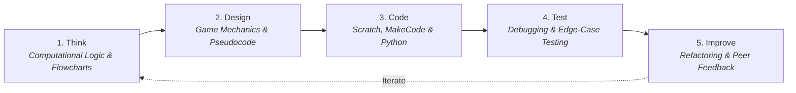
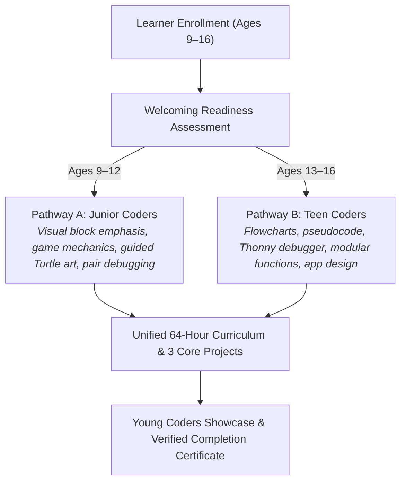
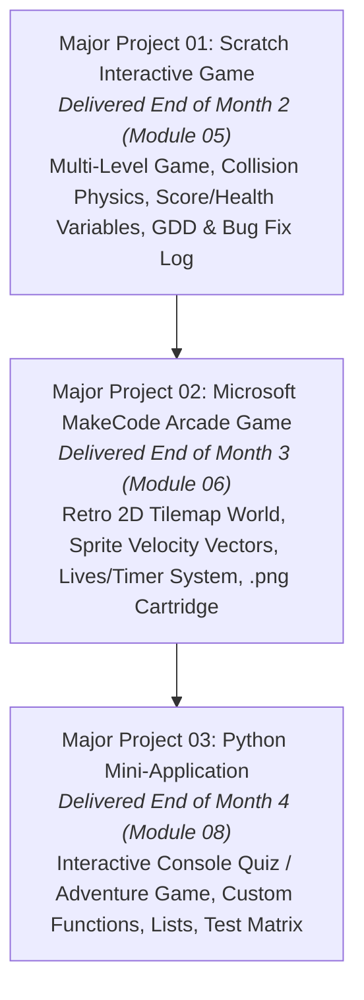
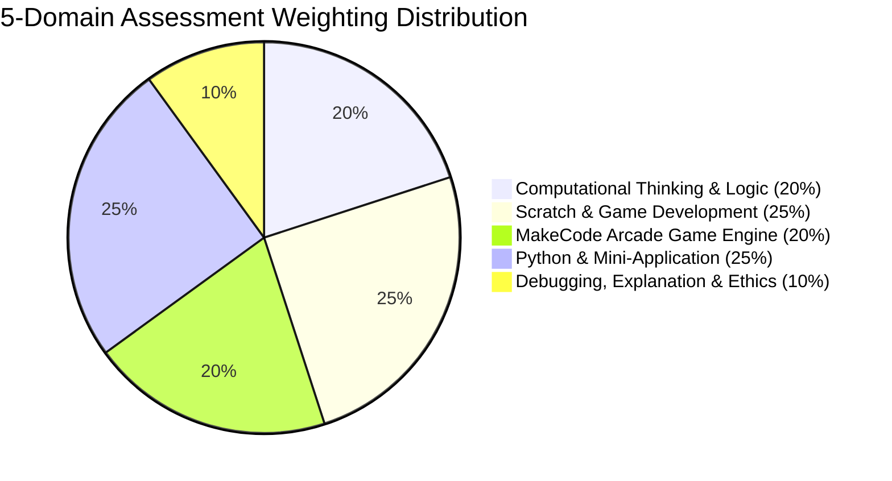
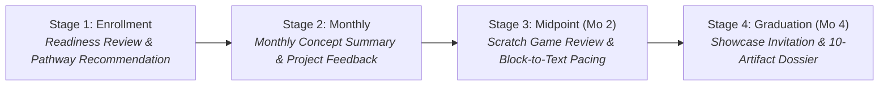
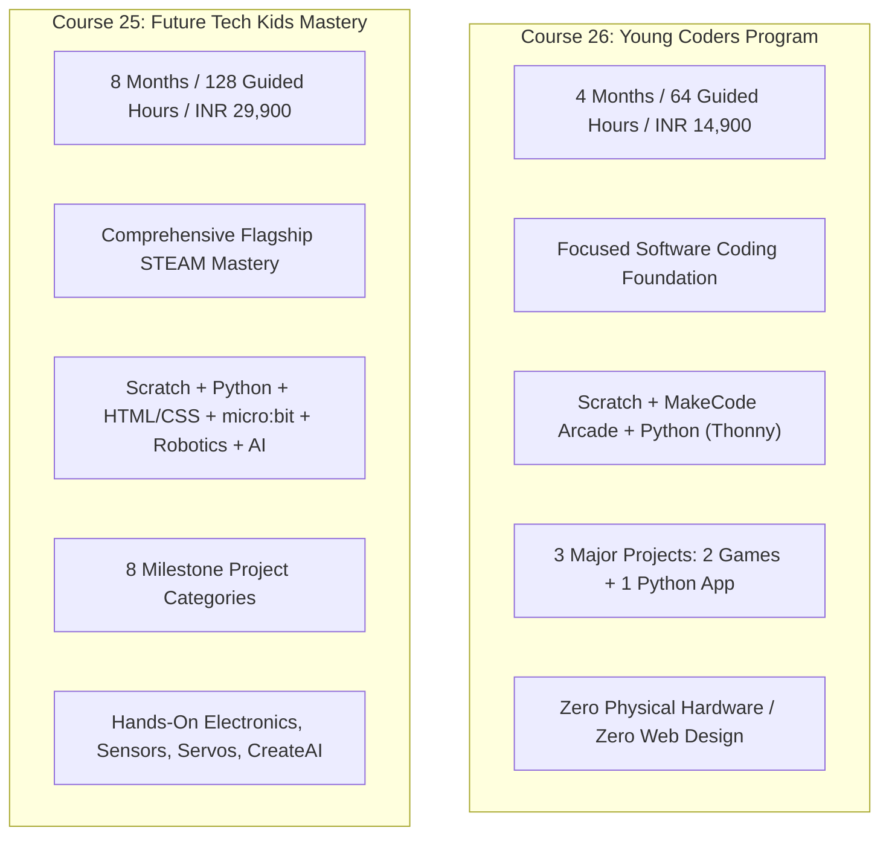
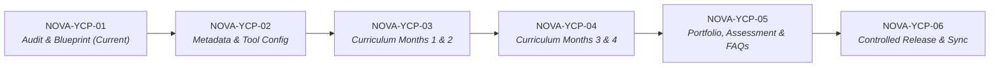

# Academic Blueprint & Curriculum Specification: Young Coders Program (2027 Edition)
**Document Identifier:** `NOVA-YCP-SPEC-2027-V1`
**Academic Sequence:** Course 26 (Catalog Sequence Number 26; NOT the course slug)
**Existing Canonical Identifier:** `young-coders`
**Course Slug:** `young-coders-program` (Canonical Route: `/course-detail.html?id=young-coders`)
**Program Title:** Young Coders Program
**Curriculum Edition:** 2027 Next-Gen Coding Foundation
**Governing Academy:** Kids Technology & Innovation (`Kids Tech Academy`, ID: `kids`)
**Academic Classification:** Coding Foundation & Creative Problem-Solving Program
**Target Age Demographic:** 9 to 16 Years (Strictly age-bracketed into 2 developmental pathways)
**Program Duration:** 4 Academic Months (16 Instructional Weeks)
**Guided Instructional Hours:** **64 Guided Hours** (4 Hours/Week; two 2-hour guided practical sessions per week)
**Weekly Instructional Breakdown:** 1.0h Concept Demonstration + 2.0h Hands-on Guided Labs + 0.5h Peer Code Review & Debugging + 0.5h Project Documentation & Reflection
**Independent Creative Practice:** 1.0–1.5 Hours Weekly (~16–24 Hours total, strictly demarcated from guided hours)
**Commercial Standard Fee:** **INR 14,900** + applicable statutory GST (0% Artificial Discounts, Honest Institutional Pricing)
**Program Tagline:** *Code. Play. Create. Solve.*
**Marketing Headline:** *Turn Curiosity into Code.*
**Document Status:** Complete Forensic Repository Audit & Approved Academic Specification (Task NOVA-YCP-01)

---

## 1. Executive Summary & Educational Mandate

The **Young Coders Program** (Course 26) is Nova Skills' foundational 4-month coding and computational problem-solving curriculum designed for young learners aged 9 to 16. While its sister program, **Future Tech Kids Mastery** (Course 25, 8 Months / 128 Hours), offers a broad multi-disciplinary exploration across robotics, electronics, web development, and edge AI, the **Young Coders Program** is a deeply focused, accessible software-programming journey centered squarely on algorithmic thinking, creative game creation, and text-based coding.

The 2027 edition modernizes the outdated legacy outline (which confusingly advertised 3 months, 120 hours, 60% markups, HTML/CSS, and professional VS Code) into a coherent, pedagogically rigorous **64-hour, 10-module, 4-month learning progression**. The program is built on three core programming pillars:
1. **Visual Creative Coding (MIT Scratch 3.0+):** Developing core logic, Cartesian coordinate geometry, event-driven broadcasts, variables, conditional loops, and multi-level arcade game mechanics without typing friction.
2. **Retro 2D Game Development (Microsoft MakeCode Arcade):** Bridging block coding to game engines with structured sprite lifespans, tilemaps, physics, sound synthesis, and game state machines.
3. **Real-World Text Programming (Python 3.12+ via Thonny IDE):** Transitioning young coders from visual blocks into authentic typed code, mastering variables, data types, console I/O, mathematical expressions, loops, modular functions, lists, and algorithmic geometry via Python Turtle.

### Core Institutional Principles
- **Strictly Educational & Age-Appropriate:** Nova Skills rejects vocational and career-monetization claims for minors. All legacy marketing claiming "freelance earnings", "commercial clients", "junior web developer placement", or "professional employment" is completely eradicated.
- **Child Privacy by Design (DPDP Act 2023 & COPPA):** Strictly adheres to Section 9 of the Indian Digital Personal Data Protection Act 2023 and COPPA standards. Student projects are developed in private offline environments or educator-managed sandboxes. No personal child data, photographs, voice recordings, or real full names are published online.
- **Standardized Beginner Toolchain:** Employs beginner-friendly, accessible software (Scratch, MakeCode Arcade, Thonny IDE). Standard CPython through Thonny is required; MakeCode Arcade's Python mode does not replace standard Python instruction. Complex tools like professional VS Code and web stacks (HTML/CSS) are removed to preserve focus on foundational coding logic.

---

## 2. Forensic Audit of Legacy Baseline vs. 2027 Modernization

| Dimension | Legacy Baseline (`data.js` / JSON) | 2027 Approved Specification | Academic Justification for Modernization |
| :--- | :--- | :--- | :--- |
| **Academic Sequence** | Unnumbered / Course 26 | **Course 26** (Academic Sequence) | Formal catalog sequence under Nova Skills Quality Governance. |
| **Canonical ID** | `young-coders` | `young-coders` | Preserved for 100% URL routing, SEO, and backward compatibility. |
| **Course Slug** | `young-coders-program` | `young-coders-program` | Preserved canonical route `/course-detail.html?id=young-coders`. |
| **Course Title** | Young Coders Program | **Young Coders Program** | Preserved brand identity with upgraded 2027 curriculum. |
| **Governing Academy** | Kids Tech Academy (`kids`) | **Kids Tech Academy** (Academic: *Kids Technology & Innovation*) | Preserves technical schema ID `kids` while elevating academic pedigree. |
| **Program Level** | `Professional Program` (Inappropriate) | **Coding Foundation** | Minors must never be labeled as "Professional Program" trainees. |
| **Course Role** | `Professional Skill` (Inappropriate) | **Youth Foundation & Computational Literacy** | Replaces commercial monetization with authentic cognitive skill building. |
| **Target Age Range** | Generic 10–15 Years | **9 to 16 Years** (Dual Pathways: Junior 9–12 & Teen 13–16) | Structured developmental pathways match cognitive readiness. |
| **Duration & Hours** | Contradictory: 3 Months vs 4 Months; 120 Hours | **4 Academic Months (16 Weeks, 64 Guided Hours)** | Harmonizes duration: exactly 4 months $\times$ 16h/mo = 64 guided hours. |
| **Weekly Schedule** | Unspecified | **4 Guided Hours / Week** (Two 2-hour guided sessions) | Realistic, sustainable scheduling for school-going children. |
| **Curriculum Scope** | 4 Outdated Modules (HTML/CSS & VS Code) | **10 Structured Modules (40 Guided Lessons)** | Replaces premature web/VS Code training with Scratch, MakeCode, and Python. |
| **Selling Price** | ₹11,999 (Fake ₹29,999 reference price; 60% OFF) | **INR 14,900** (+ applicable statutory GST) | Truth-in-Education: honest pricing with 0% deceptive discount games. |
| **Software Toolchain** | Bloated list (Roblox, Replit, Blockly, Canva) | **MIT Scratch 3.0, MakeCode Arcade, Python 3, Thonny IDE, Turtle** | Focuses on pedagogically verified, distraction-free educational tools. |
| **Core Projects** | Contradictory: Badge says 2; Text says 4 or 12 | **3 Major Projects + 10 Portfolio Evidence Categories** | Concrete, manageable project outcomes verified with developmental rubrics. |
| **Evaluation Model** | Generic project check | **5-Domain Weighted Rubric (100%) + 5 Milestone Gates** | Transparent, objective assessment with formal monthly parent reports. |
| **Career Claims** | "Junior Web Assistant", "Freelance script writer" | **Completely Removed** | Ethical compliance: zero commercial gig or employment claims for minors. |

### Classification of Audit Findings:
- **KEEP:** Canonical course ID `young-coders`, brand title *Young Coders Program*, academy mapping `Kids Tech Academy` (`kids`), core focus on visual and text coding.
- **EXPAND:** Curriculum depth expanded from 4 legacy modules to 10 structured modules; computational thinking, game physics, and step-by-step Python debugging.
- **ADD:** Microsoft MakeCode Arcade (retro 2D pixel games, sprite tilemaps, collision physics); 10 portfolio evidence categories; 5 milestone gates; 4-stage transparent parent reporting framework; DPDP Act 2023 child safety protocols.
- **REPOSITION:** Repositioned from confused "3-month / 120-hour / web design / VS Code" into a focused "4-Month / 64 Guided Hours / Coding Foundation" track.
- **REMOVE:**
  - Obsolete 120 learning hours and 3-month duration contradictions.
  - Obsolete INR 11,999 selling fee and fake INR 29,999 crossed-out reference price (60% OFF).
  - Outdated 10–15 age eligibility (repositioned to 9–16 with dual pathways).
  - Web development specialization (HTML5/CSS3) and professional VS Code (these distract from core coding logic).
  - Roblox Studio (Luau), Replit, Tinkercad, and Canva for Kids from mandatory toolchain.
  - Inappropriate vocational freelance/career monetization claims.
- **VERIFY:** Tool licensing and accessibility (Scratch MIT, MakeCode Microsoft, Python/Thonny open-source); offline capabilities; child privacy terms.

---

## 3. Educational Philosophy & Pedagogical Framework

The curriculum follows the developmental **"Think $\rightarrow$ Design $\rightarrow$ Code $\rightarrow$ Test $\rightarrow$ Improve"** engineering framework, structured specifically for youth cognitive development:



### Cognitive Scaffolding: From Visual Blocks to Typed Code
1. **Unplugged & Algorithmic Logic (Month 1):** Children learn that computers are deterministic machines requiring precise instructions. Sequencing games, maze navigation, and condition logic build algorithmic confidence before syntax is introduced.
2. **Visual Block Synthesis (Months 1 & 2):** Scratch eliminates syntax errors (misplaced commas, missing brackets) so learners can master Cartesian coordinates ($X, Y$), event-driven broadcasts, variables, and nested loops.
3. **Structured Arcade Game Architecture (Month 3):** Microsoft MakeCode Arcade introduces tilemaps, sprite velocity vectors ($vx, vy$), collision boundaries, and countdown timers, reinforcing object-oriented concepts visually.
4. **Authentic Typed Python (Months 3 & 4):** Using Thonny IDE, students make the leap to text coding. Because Thonny features a built-in visual variable inspector and step-by-step expression evaluation, students "see" how Python evaluates variables and loops, preventing syntax anxiety.
5. **Responsible AI Literacy (Month 4):** Students explore how AI coding assistants work, understanding hallucinations, why human understanding must precede code generation, and the importance of academic honesty.

---

## 4. Program Structure & Module Pacing (10 Modules, 64 Guided Hours)

The curriculum is structured across **4 Academic Months (16 Weeks)**, with exactly **16 Guided Instructional Hours per Month**:

```mermaid
gantt
    title Young Coders Program Pacing (4 Months / 64 Guided Hours)
    dateFormat  YYYY-MM-DD
    section Month 1: Logic & Scratch Basics
    M01: Intro, Safety & Readiness (4h)       :m01, 2027-01-01, 7d
    M02: Computational Thinking & Logic (6h)   :m02, after m01, 10d
    M03: Scratch Programming Essentials (6h)   :m03, after m02, 11d
    section Month 2: Scratch Game Studio
    M04: Intermediate Scratch & Game Logic (8h):m04, after m03, 14d
    M05: Scratch Game Studio & Testing (8h)    :m05, after m04, 14d
    section Month 3: MakeCode & Python Transition
    M06: MakeCode Arcade Game Dev (8h)         :m06, after m05, 14d
    M07: Python Programming with Thonny (8h)   :m07, after m06, 14d
    section Month 4: Python Apps & Capstone
    M08: Python Logic, Functions & Apps (8h)   :m08, after m07, 14d
    M09: AI Literacy & Digital Citizenship (4h):m09, after m08, 7d
    M10: Final Coding Capstone & Showcase (4h) :m10, after m09, 7d
```

### Monthly Hour Breakdown
- **Month 1 — Computational Thinking & Visual Coding Foundations (16 Hours)**
  - Module 01: Introduction to Coding, Digital Safety & Readiness — **4 Hours**
  - Module 02: Computational Thinking, Algorithms & Logic — **6 Hours**
  - Module 03: Scratch Programming Essentials — **6 Hours**
- **Month 2 — Game Mechanics, Logic & Polish in Scratch (16 Hours)**
  - Module 04: Intermediate Scratch Programming & Game Logic — **8 Hours**
  - Module 05: Scratch Game Design Studio & Quality Testing — **8 Hours**
- **Month 3 — Arcade Game Engines & Transition to Python (16 Hours)**
  - Module 06: Microsoft MakeCode Arcade Game Development — **8 Hours**
  - Module 07: Python Programming with Thonny — **8 Hours**
- **Month 4 — Text Coding Mastery, AI Literacy & Capstone (16 Hours)**
  - Module 08: Python Logic, Functions & Mini-Application Development — **8 Hours**
  - Module 09: AI Literacy, Digital Citizenship & Responsible Coding Assistance — **4 Hours**
  - Module 10: Final Coding Capstone & Student Showcase — **4 Hours**

**Total Guided Hours:** $4 + 6 + 6 + 8 + 8 + 8 + 8 + 8 + 4 + 4 = \mathbf{64\text{ Hours}}$ ($16 \times 4\text{h/week} = 64\text{h}$).

---

## 5. Comprehensive 10-Module Syllabus Specification

### Module 01: Introduction to Coding, Digital Safety & Readiness (4 Hours)
- **Module Purpose:** Establish keyboard familiarity, workspace safety, cyber hygiene, digital citizenship, and foundational concepts of how computers execute instructions.
- **Main Topics:**
  1. *What is Coding?* Programs as sequences of instructions; hardware vs software; compilers/interpreters in simple terms.
  2. *Digital Safety & Cyber Hygiene:* Safe screen habits; posture; creating strong passwords; avoiding unverified downloads; understanding the Golden Rule of privacy (never share full name, school, address, or phone number).
  3. *Development Workspace Setup:* Navigating files and folders; opening browser-based tools; keyboard shortcut fundamentals.
- **Junior Coders (Ages 9–12):** Interactive typing game; unplugged "Robot Teacher" activity where students command the instructor to make a sandwich with exact verbal steps; digital safety poster design.
- **Teen Coders (Ages 13–16):** File management hierarchy; keyboard navigation benchmarks (30+ WPM); digital footprint analysis; setting up local workspace folders.
- **Assessable Deliverable:** Learner Readiness Diagnostic & Digital Safety Charter signed by student.
- **Safety Note:** Strict privacy rules: no real student names used as online usernames; pseudonymous accounts only.

### Module 02: Computational Thinking, Algorithms & Logic (6 Hours)
- **Module Purpose:** Deconstruct real-world challenges into structured algorithms using the four pillars of computational thinking: Decomposition, Pattern Recognition, Abstraction, and Algorithm Design.
- **Main Topics:**
  1. *Four Pillars of Computational Thinking:* Breaking big tasks into atomic actions; finding repeating patterns in nature and games; ignoring irrelevant details (abstraction); step-by-step algorithms.
  2. *Algorithmic Flowcharts:* ANSI flowchart symbols (Start/End, Process, Decision Diamond, Arrows); tracing sequential paths.
  3. *Conditional Logic:* `IF / THEN / ELSE` branching; true/false Boolean conditions; everyday decision trees.
  4. *Tracing & Dry Runs:* Manual execution table; predicting variable states before running code; spotting logical sequencing bugs.
- **Junior Coders (Ages 9–12):** Maze navigation puzzle cards; conditional card games ("If red card drawn, jump; Else, clap"); drawing a 5-step visual flowchart of their morning routine.
- **Teen Coders (Ages 13–16):** Structured pseudocode; multi-branch system flowchart (e.g., ATM pin verification logic); 5-column dry-run verification table.
- **Assessable Deliverable:** Algorithm & Flowchart Design Sheet with dry-run trace table (Milestone 1 Deliverable).
- **Safety Note:** Unplugged and offline exercises; respectful peer critique norms enforced.

### Module 03: Scratch Programming Essentials (6 Hours)
- **Module Purpose:** Introduce MIT Scratch 3.0, mastering sprite coordinates, motion blocks, event triggers, costumes, and basic loops.
- **Main Topics:**
  1. *Scratch Environment Navigation:* Stage, Sprites, Costumes, Sounds, Blocks Palette, Scripts Area.
  2. *Cartesian Coordinate System:* The $X$ (horizontal $-240$ to $+240$) and $Y$ (vertical $-180$ to $+180$) grid; positioning, gliding, and directional angles ($0^\circ$ to $360^\circ$).
  3. *Events & Sequences:* `when green flag clicked`, keypress triggers, mouse-click events; sequential block execution.
  4. *Repetition & Animation:* `repeat (n)`, `forever` loops; switching costumes to create smooth walking and jumping sprite animations.
- **Junior Coders (Ages 9–12):** "Animated Ocean Adventure" with moving fish, bubble sound effects, and keyboard arrow controls.
- **Teen Coders (Ages 13–16):** "Interactive Vector Animator" with custom sprite drawing, coordinate teleports, acceleration curves, and speech bubble dialog sequences.
- **Assessable Deliverable:** Interactive Animated Story Project File (`.sb3`).
- **Safety Note:** Scratch projects saved locally to computer or within educator-managed classroom accounts with public cloud sharing disabled.

### Module 04: Intermediate Scratch Programming & Game Logic (8 Hours)
- **Module Purpose:** Master game design logic in Scratch: collision detection, score and health variables, countdown timers, broadcasting messages between sprites, and win/loss states.
- **Main Topics:**
  1. *Variables & Game States:* Creating variables for Score, Lives, and Timer; global vs sprite-only variables; initializing variables at game start.
  2. *Sensing & Collision Physics:* `touching [sprite]?`, `touching color?`, distance to mouse pointer; bouncing mechanics.
  3. *Broadcasting Messages:* `broadcast [message]` and `when I receive [message]`; coordinating game states (`Start Menu`, `Level 1`, `Game Over`, `Victory`).
  4. *Cloning Sprites:* Generating multiple falling obstacles or collectible stars using lightweight clones.
- **Junior Coders (Ages 9–12):** "Fruit Catcher Game": catching falling apples into a basket with a 30-second timer and live scoreboard.
- **Teen Coders (Ages 13–16):** "Multi-Wave Space Defender": spaceship shooting lasers at randomized enemy clones with shield health bars and difficulty scaling.
- **Assessable Deliverable:** Multi-Sprite Game Prototype File (`.sb3`) with documented collision logic.
- **Safety Note:** Non-violent themes strictly enforced. Educator-approved game assets only.

### Module 05: Scratch Game Design Studio & Quality Testing (8 Hours)
- **Module Purpose:** Complete, debug, and polish **Major Project 01 (Scratch Interactive Game)**, applying game balance, sound effects, instructional menus, and structured peer playtesting.
- **Main Topics:**
  1. *Game Design Document (GDD):* Player objective, core loop, rules, controls, and win/loss conditions.
  2. *User Experience (UX) & Polish:* Title screen, instructions screen, game-over screen with restart button; audio effects and celebratory fanfare.
  3. *Systematic Playtesting & Bug Hunting:* Documenting bugs (e.g., score incrementing twice, sprite getting stuck in walls); isolation and bug fixing.
  4. *Project Documentation:* Writing clear player instructions and a personal coding reflection.
- **Junior Coders (Ages 9–12):** Multi-level maze escape game with keys, locked doors, moving obstacles, and sound effects.
- **Teen Coders (Ages 13–16):** 2D platformer engine with gravity physics, platform jumping, scrolling backgrounds, and high-score saving.
- **Assessable Deliverable:** **Major Project 01: Scratch Interactive Game** (`.sb3` + GDD + Bug Fix Log).
- **Safety Note:** Offline project archiving; student game credits display first names or pseudonyms only.

### Module 06: Microsoft MakeCode Arcade Game Development (8 Hours)
- **Module Purpose:** Introduce retro 2D arcade game development with Microsoft MakeCode Arcade, constructing tilemap worlds, controlling sprite velocity ($vx, vy$), managing game physics, and completing **Major Project 02**.
- **Main Topics:**
  1. *MakeCode Arcade Engine:* Retro $160 \times 120$ pixel display; sprite kinds (`Player`, `Food`, `Enemy`, `Projectile`).
  2. *Tilemaps & Camera Scrolling:* Designing retro tile maps, solid wall collisions, camera follow-player mechanisms.
  3. *Physics & Movement Vectors:* Velocity $X$, Velocity $Y$, acceleration, gravity simulation, and friction.
  4. *Game Life Cycle & Completion:* Built-in countdown timers, hearts/lives system, celebratory splash screens, and retro 8-bit sound chiptunes.
- **Junior Coders (Ages 9–12):** "Dungeon Treasure Hunter": navigating a tilemap maze to collect 5 hidden gems while avoiding wandering skeletons.
- **Teen Coders (Ages 13–16):** "Side-Scrolling Platformer": custom tilemap with moving platforms, enemy patrols, double-jump physics, and collectible coin multipliers.
- **Assessable Deliverable:** **Major Project 02: MakeCode Arcade Game** (`.png` / `.uf2` cartridge + Design Sheet).
- **Safety Note:** Projects saved locally as `.png` image cartridges; no commercial third-party account registration needed.

### Module 07: Python Programming with Thonny (8 Hours)
- **Module Purpose:** Bridge from visual blocks to authentic text programming using Python 3.12+ and the Thonny IDE, understanding Python syntax, variables, data types, console I/O, and algorithmic geometry via Python Turtle.
- **Main Topics:**
  1. *Welcome to Python:* Why Python is the world's most popular first text language; comparing Scratch blocks to Python text.
  2. *Thonny IDE Environment:* Editor window, interactive shell/REPL, run button, and the built-in visual variable inspector.
  3. *Variables & Primitive Data Types:* Strings (`str`), Integers (`int`), Floats (`float`), Booleans (`bool`); dynamic typing rules.
  4. *Input & Output:* The `print()` statement, string concatenation, formatted f-strings, and receiving user text via `input()`.
  5. *Algorithmic Art with Turtle:* Importing `turtle`, coordinate navigation (`forward`, `backward`, `left`, `right`), pensize, colors, and drawing geometric polygons.
- **Junior Coders (Ages 9–12):** "Turtle Geometric Spirograph": using loops to draw colorful multi-sided starburst mandalas and interactive greeting scripts.
- **Teen Coders (Ages 13–16):** "Interactive Math & Geometry Workbench": calculating polygon angles dynamically, drawing complex fractal patterns, and building a console currency converter.
- **Assessable Deliverable:** Python Starter Scripts (`.py`) & Turtle Visual Artwork Renders.
- **Safety Note:** Runs 100% locally on computer; no internet connection required during coding or script execution.

### Module 08: Python Logic, Functions & Mini-Application Development (8 Hours)
- **Module Purpose:** Master conditional control flow, loops, custom functions, and collections (lists) in Python, constructing **Major Project 03 (Python Mini-Application)**.
- **Main Topics:**
  1. *Conditionals in Python:* `if`, `elif`, `else` syntax; relational operators (`==`, `!=`, `<`, `>`, `<=`, `>=`); logical operators (`and`, `or`, `not`).
  2. *Repetition Loops:* `for i in range()` definite loops and `while` condition-controlled loops; avoiding accidental infinite loops.
  3. *Modular Functions:* Defining custom functions with `def`, parameters/arguments, and `return` values; writing reusable, clean code.
  4. *Collections & Lists:* Creating Python lists (`[item1, item2]`), indexing, `len()`, appending items, and iterating through lists with `for` loops.
  5. *Thonny Step-By-Step Debugger:* Stepping into code execution (`F7`), observing how variables change, and fixing syntax errors (`IndentationError`, `NameError`, `TypeError`).
- **Junior Coders (Ages 9–12):** "Animal Adventure Trivia Game": 5-question interactive quiz with score tracking, customized feedback messages, and randomized encouragement.
- **Teen Coders (Ages 13–16):** "Text-Based RPG Dungeon Adventure" or "Interactive Study Flashcard Assistant": modular multi-room console application with inventory list management, random events, and health calculations.
- **Assessable Deliverable:** **Major Project 03: Python Mini-Application** (`.py` + Code Documentation + Test Table).
- **Safety Note:** Strict adherence to clean PEP 8 indentation standards; student code runs in sandboxed local console.

### Module 09: AI Literacy, Digital Citizenship & Responsible Coding Assistance (4 Hours)
- **Module Purpose:** Cultivate critical, age-appropriate artificial intelligence literacy, exploring how computers recognize patterns, understanding the limits of generative AI, identifying deepfakes/hallucinations, and upholding academic honesty.
- **Main Topics:**
  1. *Demystifying Artificial Intelligence:* How AI differs from traditional programming (writing rules vs training on patterns); everyday AI examples (search suggestions, autocorrect, chess bots).
  2. *How Large Language Models Work:* Statistical word prediction based on training libraries; why AI has no actual understanding or consciousness.
  3. *AI Hallucinations & Critical Thinking:* Why AI assistants generate believable falsehoods; fact-checking strategies; why human developers must verify all code.
  4. *Responsible AI Use & Academic Honesty:* Distinguishing between using AI to explain a tricky concept vs copying AI-generated code without understanding; the strict rule: "If you cannot explain it, you cannot submit it."
  5. *Digital Privacy & Under-13 Protections:* Indian DPDP Act 2023 Section 9 child privacy standards; why under-13 students do not have independent commercial chatbot accounts; protecting personal data.
- **Junior Coders (Ages 9–12):** Educator-operated demonstration: asking an AI tool to write a silly story, finding 3 incorrect facts, and discussing why human brains are superior.
- **Teen Coders (Ages 13–16):** Critical code audit: reviewing an AI-generated Python snippet with an intentional logic bug, isolating the flaw using Thonny, and writing a reflection on intellectual property and coding integrity.
- **Assessable Deliverable:** Responsible Coding & AI Literacy Reflection Sheet.
- **Safety Note:** No student accounts created on commercial AI platforms. All demonstrations are strictly educator-operated and sandboxed.

### Module 10: Final Coding Capstone & Student Showcase (4 Hours)
- **Module Purpose:** Synthesize all course competencies, polish project source code, curate the verified **10-Category Student Portfolio**, prepare a 3-minute oral presentation, and demonstrate achievements in the celebratory Young Coders Showcase.
- **Main Topics:**
  1. *Code Polish & Formatting:* Cleaning comments, ensuring proper variable names, removing test print statements, and checking game balance.
  2. *Curating the 10-Category Portfolio:* Organizing Scratch files, MakeCode cartridges, Python scripts, flowcharts, and testing reflection documents into a personal archive.
  3. *Technical Presentation Skills:* Explaining the problem statement, showing how code works, describing a tricky bug that was overcome, and answering questions.
  4. *The Young Coders Showcase:* Live classroom or private recorded demonstration celebrating 4 months of growth in computational thinking.
  5. *Next Learning Pathways:* Guidance on moving forward into **Future Tech Kids Mastery** (Course 25), school coding clubs, or competitive game jams.
- **Junior Coders (Ages 9–12):** 2-slide presentation (Slide 1: My Favorite Project; Slide 2: What I Learned); demonstrating their Scratch game and answering 1 instructor question.
- **Teen Coders (Ages 13–16):** 4-slide technical walkthrough (Problem, Logic Flowchart, Live Demo, Challenges & Bug Fixes); demonstrating their Python application and explaining function parameters.
- **Assessable Deliverable:** Completed **10-Category Student Portfolio** + Final Showcase Oral Demonstration.
- **Safety Note:** Showcases are hosted in private, educator-supervised classrooms or password-protected virtual galleries; no public video streaming of minors.

---

## 6. Dual Developmental Pathways

To provide developmental parity while accommodating differing cognitive stages, students follow one of two age-adaptive pathways within the single 64-hour curriculum:



### Pathway A: Junior Coders (Ages 9–12)
- **Cognitive Profile:** Concrete operational stage transitioning to abstract reasoning; developing fine motor typing skills; visual and experiential learners.
- **Instructional Delivery:** Heavy visual metaphor, step-by-step block construction in Scratch, pair programming exercises, interactive visual feedback via Python Turtle art, and teacher-supported live debugging.
- **Deliverable Expectations:** Focus on creative gameplay, story narratives, colorful visual presentation, and demonstrating clear understanding of sequences, loops, and conditions.

### Pathway B: Teen Coders (Ages 13–16)
- **Cognitive Profile:** Formal operational stage; strong abstract reasoning capability; fluent keyboard typing; ready for systematic structural decomposition.
- **Instructional Delivery:** Formal flowcharts, structured pseudocode, independent typing in Thonny IDE, multi-branch condition trees, custom function parameters/returns, list indexing, and systematic debugger inspection.
- **Deliverable Expectations:** Focus on clean code architecture, modular functions, PEP 8 styling, comprehensive testing matrices, and detailed bug-fix documentation.

### Unified Parity Standard
- Both pathways follow the exact same **10 modules**, complete **64 guided hours**, build all **3 major projects**, and compile the **10 portfolio evidence categories**.
- Age alone does not determine placement: an initial welcoming readiness review ensures students are assigned the optimal pathway based on typing comfort, reading ease, and prior digital exposure.

---

## 7. Toolchain & Education Research

| Software Tool | Primary Role | License & Cost | Storage & Privacy Protocol | Educational Rationale |
| :--- | :--- | :--- | :--- | :--- |
| **MIT Scratch 3.0+** | Visual Block Coding & Game Design (Months 1 & 2) | Free, Open Source (MIT Media Lab) | Local `.sb3` file export or educator-managed private classroom accounts. | World's premier visual coding platform; eliminates syntax friction to focus 100% on computational logic. |
| **Microsoft MakeCode Arcade** | Retro 2D Arcade Engine (Month 3) | Free, Open Source (Microsoft) | Local `.png` / `.uf2` cartridge saving; zero student accounts needed. | Bridges block programming to real game engine concepts (sprite velocity, tilemaps, collision physics). |
| **Python 3.12+ (CPython)** | Core Text Programming Language (Months 3 & 4) | Free, Open Source (Python Software Foundation) | 100% local `.py` file execution; zero network transmission required. | The premier real-world programming language for computer science, data science, and software engineering. |
| **Thonny IDE** | Educational Python Development Environment | Free, Open Source (University of Tartu) | Local desktop application; no cloud syncing or third-party tracking. | Purpose-built for beginners; visual variable inspector and step-by-step expression evaluation prevent syntax confusion. |
| **Python Turtle** | Algorithmic Geometry & Visual Art (Month 3) | Free, Standard Python Library | Runs natively inside Python without external packages. | Provides immediate, beautiful visual feedback for loops, coordinates, and angles, easing the transition to text code. |
| **Code.org CS Discoveries** | Supplemental Logic & Algorithmic Exercises | Free Educational Resource | Browser-based, COPPA/FERPA compliant. | High-quality unplugged and puzzle-based reinforcement of algorithm design. |

### Critical Clarifications:
- **MakeCode Arcade Python vs. Standard CPython:** MakeCode Arcade's web-based Python mode is a supportive bridge but does **NOT** substitute for standard CPython taught through Thonny. Standard Python script execution, console I/O, file structure, and PEP 8 formatting are mandatory core competencies.
- **Hardware & Web Development Not Required:** Physical microcontrollers (BBC micro:bit, Arduino), robotics hardware, electronic breadboards, HTML/CSS, and professional VS Code are **NOT** part of Course 26. These belong exclusively to the broader STEAM flagship, Course 25.

---

## 8. Mandatory Student Portfolio (3 Major Projects + 10 Evidence Categories)

### Three Major Core Projects



1. **Major Project 01: Scratch Interactive Game (Month 2, Module 05)**
   - *Junior Coders:* Multi-level maze adventure or arcade fruit catcher with timer, lives, and start/win screens.
   - *Teen Coders:* 2D platformer engine or multi-wave arcade space defender with state machines and physics.
   - *Required Deliverables:* Playable `.sb3` project file, Game Design Document (GDD), testing & bug correction log.
2. **Major Project 02: Microsoft MakeCode Arcade Game (Month 3, Module 06)**
   - *Junior Coders:* Dungeon treasure hunter game with tilemap walls, 5 collectible gems, and wandering enemy sprites.
   - *Teen Coders:* Side-scrolling platformer with double-jump velocity vectors, patrolling enemies, and score multipliers.
   - *Required Deliverables:* MakeCode project file (`.png` image cartridge / `.uf2`), game mechanics design sheet.
3. **Major Project 03: Python Mini-Application (Month 4, Module 08)**
   - *Junior Coders:* Interactive animal trivia game with scoring, user input validation, and customized feedback.
   - *Teen Coders:* Modular text adventure game or study flashcard assistant with custom functions, list collections, and while loops.
   - *Required Deliverables:* Executable Python script (`.py`), test verification table, code explanation comments.

### Ten Portfolio Evidence Categories
Every graduate compiles an individual digital portfolio dossier containing verified artifacts across exactly 10 categories:
1. **Computational-Thinking Exercise:** Documented problem decomposition, pattern analysis, and algorithm design sheet.
2. **Introductory Scratch Project:** Interactive animated story or character greeting demonstrating coordinate movement.
3. **Completed Scratch Game:** Fully playable Major Project 01 (`.sb3`) with complete gameplay loop.
4. **Completed MakeCode Arcade Game:** Fully playable Major Project 02 (`.png` / `.uf2`) with tilemaps and sprite physics.
5. **Python Starter Exercise:** Python Turtle geometric spirograph artwork render and initial script.
6. **Python Mini-Application:** Fully functional Major Project 03 (`.py`) with conditionals, loops, and functions.
7. **Debugging Evidence:** Documented bug-hunting record showing before-and-after code and error analysis.
8. **Project Reflection:** Written personal reflection explaining design choices, obstacles, and lessons learned.
9. **Final Coding Demonstration:** 3-minute oral/video walkthrough demonstrating working code to instructors and peers.
10. **Individual Progress Report:** Comprehensive 4-stage competency report issued by the educator.

---

## 9. Assessment, Evaluation & Milestone Architecture

Assessment is developmental, celebrating problem-solving logic and computational resilience rather than commercial production speed:



### Assessment Weights (100% Total)
1. **Computational Thinking & Problem-Solving (20%):** Decomposing challenges into steps, designing clear flowcharts, recognizing repeating patterns, and writing structured pseudocode.
2. **Scratch & Game Development (25%):** Correct implementation of event handling, coordinate navigation, variables (score/lives), conditional branching, collision sensing, and broadcast states.
3. **MakeCode Arcade Game Engine (20%):** Effective design of tilemaps, sprite kinds, velocity vectors, game lifecycle events, and retro audio integration.
4. **Python & Mini-Application (25%):** Precision in Python syntax, appropriate data types, console I/O, relational/logical expressions, loops, custom function definitions, and list handling.
5. **Debugging, Independent Explanation & Responsible Coding (10%):** Ability to isolate and fix code errors in Thonny/Scratch, explain code logic verbally without AI assistance, and demonstrate digital citizenship.

### Five Milestone Assessment Gates
- **Milestone 1 (Week 1): Baseline Readiness Gate** $\rightarrow$ Keyboard familiarity, workspace navigation, signed digital safety charter.
- **Milestone 2 (Week 4): Computational Thinking Gate** $\rightarrow$ Flowchart design sheet, conditional logic puzzles, dry-run trace table.
- **Milestone 3 (Week 8): Scratch Game Mastery Gate** $\rightarrow$ Completed Major Project 01 (`.sb3`), Game Design Document, bug fix log.
- **Milestone 4 (Week 12): MakeCode & Python Starter Gate** $\rightarrow$ Completed Major Project 02 (`.png`), Python Turtle geometric render, console I/O script.
- **Milestone 5 (Week 16): Final Practical & Showcase Gate** $\rightarrow$ Completed Major Project 03 (`.py`), 10-category portfolio dossier, 3-minute capstone demonstration.

### Certification Standards
- **Passing Threshold:** Minimum **70% cumulative achievement** across all 5 assessment domains.
- **Mandatory Requirements:** Completion of all 3 major projects, minimum 80% attendance in guided lab sessions, ability to explain code logic independently, and completion of the final showcase.
- **Authentic Credential:** *Nova Skills — Young Coders Program Course Completion Certificate* issued with a unique verification ID. No deceptive external university degree or ISO claims.

---

## 10. Parent Engagement & Transparent Reporting

Nova Skills provides transparent, direct educator-to-guardian progress reporting across four key stages:



1. **Stage 1: At Enrollment (Readiness Assessment & Roadmap Alignment):**
   - Welcoming 1-on-1 readiness conversation with guardian and learner.
   - Recommended pathway placement (Junior Coders 9–12 vs Teen Coders 13–16).
   - Detailed 4-month curriculum roadmap and class timetable.
   - Guardian permissions and digital safety consent verification.
2. **Stage 2: Monthly Progress Reports (Ongoing Skill Progression):**
   - Summary of coding concepts mastered during the month.
   - Status of milestone projects and teacher rubric scores.
   - Observations on student persistence, computational logic, and problem-solving.
   - Constructive growth suggestions and optional supervised home exploration activities.
3. **Stage 3: Midpoint Review at End of Month 2 (Visual Coding & Python Pacing):**
   - In-depth demonstration of Major Project 01 (Scratch Interactive Game).
   - Evaluation of student readiness for the transition to typed Python code in Month 3.
   - 1-on-1 parent-teacher check-in (virtual or in-person) to align on student pacing.
4. **Stage 4: Graduation & Completion at Month 4 (Showcase & Dossier):**
   - Guardian invitation to the Young Coders Capstone Showcase.
   - Delivery of the verified 10-Category Student Portfolio.
   - Comprehensive competency dossier evaluating achievement across all 5 learning domains.
   - Guidance on next learning pathways (e.g., advancing to Course 25 or secondary school computer science).

---

## 11. Child Safety, Data Privacy & Compliance (DPDP Act 2023 & COPPA)

Child protection is an absolute release prerequisite. The curriculum incorporates strict governance safeguards:

1. **Indian DPDP Act 2023 Compliance:** Complies with Section 9 of the Digital Personal Data Protection Act 2023 regarding the processing of children's personal data:
   - Verifiable parental/guardian consent is mandatory prior to enrollment.
   - No tracking or behavioral monitoring of minors for commercial or advertising purposes.
   - Absolute prohibition against collecting children's personal contact information (full legal names, phone numbers, home addresses, school names).
2. **COPPA & Third-Party Age Requirements:**
   - Under-13 learners are strictly prohibited from creating independent accounts on commercial AI platforms (e.g., ChatGPT, Claude) or public developer forums.
   - All AI interactions in Month 4 are strictly educator-operated and sandboxed.
   - For eligible teens (13–16), any educational tool exploration requires explicit parental consent and complies with platform terms of service.
3. **Private & Sandboxed Storage:**
   - Scratch, MakeCode Arcade, and Python projects are developed and stored locally on the learner's computer or inside restricted classroom repositories.
   - Public online cloud sharing in Scratch or MakeCode is disabled by default.
4. **No Public Child Portfolios:**
   - Student portfolios and project showcase recordings are hosted in private, password-protected virtual galleries accessible exclusively to enrolled families.
   - Photographs, video recordings, or audio files of minors are never published publicly without separate express written guardian permission.
5. **Zero Identifying Data in Prompts:**
   - Absolute prohibition against entering learner personal details, family data, or school names into educational AI demonstration prompts.

---

## 12. Curricular Distinction: Course 26 vs Course 25

To prevent catalog confusion, the distinction between Nova Skills' two youth offerings is strictly defined:



| Dimension | Course 26: Young Coders Program | Course 25: Future Tech Kids Mastery |
| :--- | :--- | :--- |
| **Academic Positioning** | Coding Foundation & Algorithmic Problem-Solving | Flagship Multi-Disciplinary STEAM Innovation |
| **Duration** | **4 Months** (16 Instructional Weeks) | **8 Months** (32 Instructional Weeks) |
| **Guided Hours** | **64 Guided Hours** (4h/week) | **128 Guided Hours** (4h/week) |
| **Regular Tuition Fee** | **INR 14,900** + applicable GST | **INR 29,900** + applicable GST |
| **Module Count** | **10 Structured Modules** | **16 Structured Modules** |
| **Core Software Focus** | Scratch 3.0, MakeCode Arcade, Python 3 (Thonny) | Scratch, Python, HTML5/CSS3, MakeCode, CreateAI |
| **Physical Hardware** | **None** (100% Software & Algorithmic Logic) | **BBC micro:bit V2, Breadboards, Servos, Sensors** |
| **Web Development** | **None** (Removed to maintain pure coding focus) | **Semantic HTML5 & Responsive CSS3** |
| **AI Integration** | Safe AI Literacy & Responsible Use (Module 09) | Full Edge Machine Learning & CreateAI (Modules 13–14) |
| **Core Projects** | **3 Major Projects** (2 Games + 1 Python App) | **8 Milestone Projects** across 8 STEAM Categories |
| **Target Learner** | Beginners wanting pure coding and game development | Learners wanting an exhaustive 8-month invention journey |

---

## 13. Pricing, Commercial Integrity & Marketing Audit

### Institutional Truth-in-Education Pricing
- **Approved Regular Fee:** **INR 14,900**
- **Applicable Taxes:** Statutory 18% GST (INR 2,682) is extra; **Total Fee:** **INR 17,582**.
- **0% Artificial Discounts:** Complete removal of the legacy fake "₹29,999 reference price" and misleading "60% OFF" badges.
- **No False Financing Claims:** No unverified "No-Cost EMI" or misleading monthly micro-installment figures unless backed by verified banking partnerships.

### Marketing Claims Sanitization
- **No Vocational or Employment Promises:** Eliminate all phrases suggesting children aged 9–16 are being trained for "junior developer careers", "freelance earnings on Fiverr/Upwork", or "commercial client delivery".
- **Authentic Educational Positioning:** Marketed accurately as an enriching extracurricular program developing computational thinking, cognitive persistence, and creative technological agency.
- **Tagline:** *Code. Play. Create. Solve.*
- **Marketing Headline:** *Turn Curiosity into Code.*
- **Short Description:** *An engaging four-month practical coding program for children and teenagers that develops computational thinking, game design, and Python programming through hands-on creative projects.*

---

## 14. Website Implementation Plan

The academic modernization for Course 26 will be executed across the standard Nova Skills controlled release workflow:



### Planned Implementation Phases:
1. **NOVA-YCP-01 (Current Step):** Complete Forensic Audit & Approved Academic Specification (`docs/course-redesign/kids-technology/young-coders-program-spec.md`).
2. **NOVA-YCP-02:** Target-course metadata and tool configuration in `data.js` and `data/courses/young-coders.json` (Price: INR 14,900, Duration: 4 Months, Hours: 64, Tools: Scratch, MakeCode Arcade, Python/Thonny).
3. **NOVA-YCP-03:** Curriculum Months 1 & 2 implementation in `data/courses/young-coders.json` (Modules 01 to 05, 32 guided hours, Scratch game mechanics).
4. **NOVA-YCP-04:** Curriculum Months 3 & 4 implementation in `data/courses/young-coders.json` (Modules 06 to 10, 32 guided hours, MakeCode Arcade, Python, AI literacy, and Capstone).
5. **NOVA-YCP-05:** 3 Major Projects, 10 portfolio evidence categories, 5-domain assessment model, 4-stage parent reporting framework, truth-in-education disclaimers, and comprehensive 31-question FAQ.
6. **NOVA-YCP-06:** Controlled source synchronization across `data.js`, `young-coders.json`, and `nova-skills-109-course-content.json`, build minification, academic/functional QA, regression audit, and development release push.

---

> **Academic Specification Status:** **COMPLETE & LOCKED FOR IMPLEMENTATION**
> **Verification Authority:** Nova Skills Quality & Curriculum Governance Council
> **Course Sequence:** Course 26 | **Target ID:** `young-coders` | **Duration:** 4 Months / 64 Guided Hours
