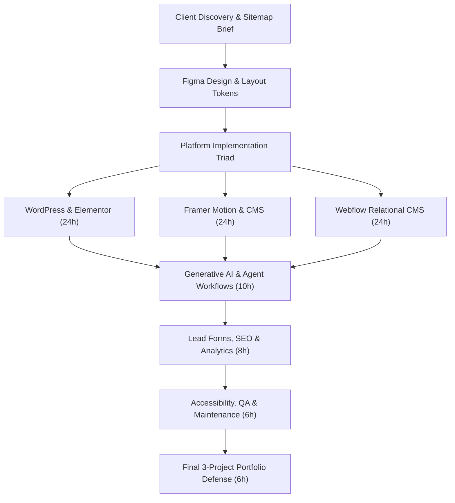
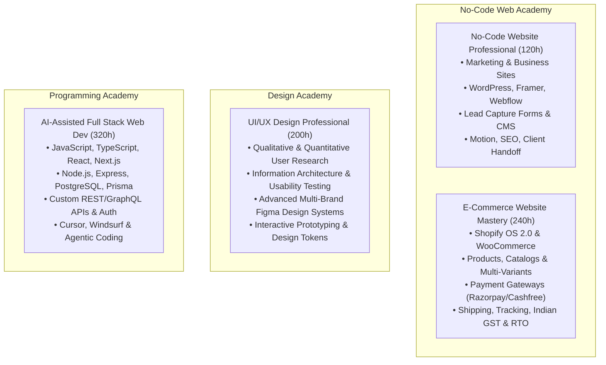

# Academic Specification: No-Code Website Professional

**Course Identifier:** `nocode-web-pro`
**Course Name:** No-Code Website Professional
**Academy:** No-Code Web Academy (`no-code-web`, ID: `nocode`)
**Credential Awarded:** Professional Diploma in No-Code Web Design & Visual Development
**Academic Governance:** Nova Skills Academic Board | ISO 9001:2015 Standards
**Duration:** 3 Months (12 Academic Weeks)
**Guided Instructional Hours:** 120 Guided Hours (10 Hours / Week)
**Recommended Independent Lab Practice:** 60–90 Hours (strictly demarcated from guided hours)
**Working Commercial Baseline:** INR 12,999 (Current Selling Fee; 18% GST: INR 2,340; Total Payable: INR 15,339)
**Commercial Revision Status:** Recommended New Selling Fee: INR 24,900 (PENDING EXPLICIT BUSINESS APPROVAL — NOT APPLIED)
*Commercial Guardrail: Zero artificial discount inflation, zero unapproved strikethroughs, zero unverified EMI or subscription inclusion claims.*
**Authoritative Version:** 2.0.0 (October 2026 Academic Planning Specification)

---

## 1. Executive Identity, Commercial Baseline & Scope

### 1.1 Program Mission & Positioning
No-Code Website Professional is an intensive, 3-month (120 guided hours) professional visual development program engineered for aspiring web designers, freelancers, digital agency associates, and career transitioners. The program equips students to design, develop, publish, and maintain professional, responsive, high-converting business and marketing websites across the industry's three leading visual platforms:
1. **WordPress with Block Editor & Elementor** (dominant open-source CMS powering 40%+ of the global web)
2. **Framer** (modern AI-augmented visual canvas for high-velocity SaaS marketing sites and interactive motion)
3. **Webflow** (enterprise-grade visual CSS/HTML architecture and relational CMS for high-ticket corporate builds)

The curriculum integrates modern **Generative AI & Agentic Website Production** (Framer AI Agents, Webflow AI Site Builder, prompt-driven sitemap generation, and AI copywriting) strictly under a human-in-the-loop validation model.



### 1.2 Commercial Baseline & Transition Policy
* **Current Working Selling Price:** INR 12,999 (preserves existing active selling rate until explicit business sign-off).
* **Statutory Indian GST (18%):** INR 2,339.82 (Total payable: INR 15,338.82 on active ₹12,999 fee).
* **Proposed Business Owner Price (Pending Approval):** INR 24,900 (reflects 120-hour multi-platform parity; 18% GST = INR 4,482; Total = INR 29,382).
* **Strict Policy:** The proposed INR 24,900 price remains strictly a planning recommendation in this document. It will NOT be written to `data.js`, `data/courses/nocode-web-pro.json`, or minified runtime files until explicit owner authorization is provided.
* **Discount Policy:** The obsolete `originalPrice: 34999` in `data.js` (creating a fake 63% discount) is flagged for neutralization during implementation (`originalPrice = price`, `discount = 0`).

---

## 2. Forensic Repository & Curriculum Audit

### 2.1 Repository Preflight Findings
The repository preflight revealed substantial architectural discrepancies across the existing codebase:

| Repository File | Duration | Hours | Price / Original Price | Module Count | Status & Observations |
| :--- | :--- | :--- | :--- | :--- | :--- |
| **`data.js` (NS_COURSES)** | 3 Months | 120h | ₹12,999 / ₹34,999 | 4 Modules | Stale 63% discount; 4 generic modules; lists unrelated tools (Shopify, Stripe). |
| **`data.js` (NS_ACADEMIES)** | 3 Months | 120h | ₹12,999 / ₹34,999 | 4 Modules | Discrepancy: `liveProjects: 8` (vs `liveProjects: 2` in NS_COURSES). |
| **`data/courses/nocode-web-pro.json`** | 4 Months | 160h | `undefined` | 4 Modules | Major duration discrepancy (4M/160h); missing pricing; one-sentence lessons. |
| **`nova-skills-109-course-content.json`** | 4 Months | 160h | `undefined` | 4 Modules | Mirrored copy of legacy JSON; 4 generic modules without hour breakdowns. |
| **`js/data.min.js`** | 3 Months | 120h | ₹12,999 / ₹34,999 | 4 Modules | Mirrors unminified `data.js` legacy fields. |

### 2.2 Forensic Content Classification (KEEP, EXPAND, ADD, REPOSITION, REMOVE, VERIFY)

```
[AUDIT CLASSIFICATION MATRIX]
├── KEEP
│   ├── CSS Box Model foundations (Margin, Padding, Border, Content)
│   ├── Flexbox and CSS Grid visual mechanics
│   ├── Responsive breakpoint hierarchy (Desktop, Tablet, Mobile)
│   └── WordPress local staging workflow with LocalWP
├── EXPAND
│   ├── WordPress: Expand from basic Elementor drag-and-drop to include Full Site Editing (FSE), Block Editor, and custom template parts
│   ├── Framer: Expand from simple prototyping to production-grade responsive layout components, scroll animations, and native CMS
│   ├── Webflow: Expand from basic UI overview to Finsweet Client-First class naming conventions, relational CMS, and component variants
│   ├── Form Handling: Expand generic contact forms to validated multi-step lead capture, spam protection, and webhook routing
│   └── Portfolio Requirements: Expand 3 generic strings to 3 fully defined, assessed client-ready production projects
├── ADD
│   ├── Module 01: Client requirement discovery, visual sitemaps, information architecture, and scope estimation
│   ├── Module 02: Figma Auto-Layout to web translation, fluid typography, rem/em token management, and visual design systems
│   ├── Module 06: Generative AI & Agentic website production (Framer AI Agents, Webflow AI Site Builder, prompt-driven copywriting)
│   ├── Module 07: Technical website SEO, canonical tags, Open Graph cards, Google Analytics 4, and lead automation webhooks
│   ├── Module 08: Web accessibility (WCAG 2.1 AA), Core Web Vitals optimization, baseline security hardening, and client maintenance SOPs
│   └── Module 09: Board oral portfolio defense, staging-to-production deployment, and client handover runbooks
├── REPOSITION
│   ├── Move Framer before Webflow to establish intuitive visual component mental models before tackling strict CSS box mechanics
│   └── Position Generative AI as an accelerated production assistant across all three platforms rather than an isolated theory topic
├── REMOVE
│   ├── REMOVE Shopify and Stripe from the toolset (strictly partitioned into E-Commerce Website Mastery)
│   ├── REMOVE Airtable and Make.com as primary tools (keep basic webhook exposure in forms/integrations)
│   ├── REMOVE unverified "live published custom domain included" claims (students use official platform staging/preview links)
│   └── REMOVE overstated "enterprise web application architecture" claims (course focus is professional marketing/business sites)
└── VERIFY
    ├── VERIFY free student development tier policies on Framer (free tier preview), Webflow (2 unhosted projects), and LocalWP (100% free)
    ├── VERIFY commercial fee alignment across all displays
    └── VERIFY absence of legally prohibited 100% job guarantee claims
```

### 2.3 Identification of Core Legacy Deficiencies
1. **Insufficiently Detailed Lessons:** The existing 4 modules contain only 16 lessons with single-line descriptions (e.g. `Taught: Margin, padding, borders. Learner does: Builds layout structures.`), providing zero actionable guidance on subtopics, durations, or evaluation evidence.
2. **Duplicated / Fragmented Content:** Basic responsive design was scattered redundantly across modules 1, 2, and 4 without a unified design system foundation.
3. **Overstated Enterprise Claims:** Module 4 claimed "Enterprise Web Application Architecture" despite teaching basic Webflow CMS team directories.
4. **Generic Project Descriptions:** `what_you_will_build` listed only `["Local Business Site", "SaaS Landing Page", "Portfolio Capstone"]` with zero criteria, rubric, or client context.
5. **Project-Count Discrepancies:** `data.js` listed `liveProjects: 2` in `NS_COURSES` but `liveProjects: 8` in `NS_ACADEMIES`.
6. **Unverified "Live Website" Claims:** Marketing text implied live custom domain hosting was included in the fee, whereas students utilize free staging subdomains (`.framer.website`, `.webflow.io`, `localwp.com`).
7. **Misleading Pricing & Discount Inflation:** The legacy ₹12,999 price was paired with an artificial ₹34,999 original price, creating an unverified 63% strikethrough.
8. **Unsupported Certification/Placement Claims:** Marketing text referenced generic "placement guarantee" that must be replaced with verified, transparent placement assistance.

---

## 3. Industry Research & Hiring Landscape (India & Global 2026)

### 3.1 Market Demand & Industry Shift
As of late 2026, the website production market in India (Bengaluru, NCR/Gurugram/Noida, Mumbai/Pune, Hyderabad) and remote digital agencies has bifurcated:
1. **Low-Tier Template Assemblers:** Facing severe wage pressure due to automated AI site builders.
2. **Cross-Platform Visual Developers:** Experiencing unprecedented demand. Agencies, high-growth startups, and international freelance clients seek visual developers who can translate Figma designs into semantic, responsive, motion-rich websites without requiring expensive full-stack engineering teams.

### 3.2 Indian Compensation Benchmarks (2026)

| Target Career Role | Typical Experience | Entry CTC (India) | Mid-Level CTC (India) | Freelance / Remote Rate |
| :--- | :--- | :--- | :--- | :--- |
| **WordPress & Elementor Designer** | 0–2 Years | ₹2.2 LPA – ₹3.5 LPA | ₹4.5 LPA – ₹7.0 LPA | $15 – $30 / hour |
| **Framer Interactive Designer** | 0–2 Years | ₹3.2 LPA – ₹5.0 LPA | ₹6.0 LPA – ₹10.0 LPA | $25 – $50 / hour |
| **Junior Webflow Visual Developer** | 0–2 Years | ₹3.5 LPA – ₹5.5 LPA | ₹6.5 LPA – ₹11.0 LPA | $30 – $60 / hour |
| **Agency Website Production Associate** | 1–3 Years | ₹3.6 LPA – ₹4.8 LPA | ₹5.5 LPA – ₹8.5 LPA | ₹35k – ₹65k / retainer |
| **Freelance Website Specialist** | Variable | ₹25k – ₹50k / project | ₹60k – ₹1.5L / project | $1,000 – $3,500 / build |

### 3.3 Core Industry Expectations
Employers and high-paying freelance clients require:
* **Figma-to-Web Precision:** Ability to inspect Auto-Layout, rem typography, and color tokens, reproducing them pixel-for-pixel in Webflow or Framer.
* **True Responsive Fluency:** Layouts that adapt smoothly across desktop (1440px), laptop (1200px), tablet (768px), and mobile (390px/320px) without horizontal scrolling or awkward wrapping.
* **CMS Architecture:** Structuring relational databases (blog authors, service offerings, case studies, client reviews) with dynamic filtering.
* **Interactive Motion:** Subtle, performant micro-interactions (hover cards, scroll-triggered section transitions, sticky elements) that enhance rather than compromise UX.
* **Forms & Lead Capture:** Connecting forms to Webflow/Framer native submissions, Zapier/Make webhooks, Google Sheets, or CRM systems.
* **Speed & Technical SEO:** Lighthouse performance scores >85, proper semantic heading tags (H1-H4), descriptive alt text, Open Graph social cards, and XML sitemaps.

---

## 4. Platform Policy & Cross-Platform Triad Architecture

### 4.1 Strict Cross-Platform Requirement
The program enforces a **Mandatory Triad Model**. Every student must design and deliver an assessed project on **all three primary platforms**:
1. **WordPress + Elementor / Block Editor** (Project 01: Local Business Website)
2. **Framer** (Project 02: Interactive SaaS Marketing Website)
3. **Webflow** (Project 03: CMS-Driven Corporate Website)

> [!IMPORTANT]
> **No-Single-Platform Selection Rule:** Nova Skills does NOT permit students to specialize in only one tool during this 120-hour program. Industry agility requires knowing *when* to choose WordPress (content volume, self-hosted data ownership, local business budget), *when* to choose Framer (high-speed marketing launch, animation fidelity, product startups), and *when* to choose Webflow (strict CSS architecture, complex relational CMS, scalable corporate clients).

### 4.2 Platform Capability & Boundary Matrix

| Dimension | WordPress & Elementor | Framer | Webflow |
| :--- | :--- | :--- | :--- |
| **Primary Strength** | Self-hosted ownership, infinite plugins, zero platform fee lock-in | Rapid visual canvas, native physics animation, AI Agents | Enterprise visual CSS, relational CMS, strict clean code output |
| **Ideal Project Type** | Local businesses, medical/legal clinics, content blogs | SaaS landing pages, agency portfolios, product launch sites | Tech companies, multi-page corporate sites, structured resource hubs |
| **Learning Focus** | LocalWP, Block Editor/FSE, Elementor layout, forms, backups | Canvas navigation, stacks/grids, variants, scroll motion, Framer AI | Box model, Finsweet Client-First classes, multi-reference CMS, interactions |
| **Student Cost Tier** | 100% Free (LocalWP local environment) | 100% Free (Free plan with `.framer.website` preview) | 100% Free (Free Starter Workspace, 2 unhosted projects) |
| **Publishing Output** | Local staging archive + live test host (optional) | Free live staging subdomain (`project.framer.website`) | Free live staging subdomain (`project.webflow.io`) |

---

## 5. Generative AI & Agent-Assisted Workflow Standard

### 5.1 AI as Production Multiplier, Not Replacement
The curriculum embeds Generative AI across the entire website creation lifecycle under strict **Human-in-the-Loop Supervision**. No student project may be submitted as an unedited AI output.

```
[AGENTIC NO-CODE PRODUCTION PIPELINE]
1. Discovery Brief & Sitemap  -->  ChatGPT / Claude: Analyze client brief, generate 5-page sitemap & wireframe outline
2. Visual Concept & Layout    -->  Framer Agents / Webflow AI: Generate initial layout scaffolding from sitemap prompt
3. Copywriting & Content      -->  AI Content Assistant: Draft headline variations, value propositions, and FAQ accordions
4. Visual Asset Generation    -->  Canva AI / Adobe Firefly: Generate mock product imagery, hero graphics, and texture backdrops
5. Semantic Refactoring       -->  STUDENT (Manual): Refactor layouts into proper CSS grid/stacks, adjust paddings, fix font hierarchy
6. Interactive Engineering    -->  STUDENT (Manual): Bind CMS collections, configure form webhooks, set scroll interaction triggers
7. Responsive QA & Verification --> STUDENT (Manual): Test 1440px, 768px, 390px, 320px breakpoints, verify WCAG contrast, audit speed
```

### 5.2 Covered AI Capabilities & Guardrails
* **Framer AI Agents & Wireframer:** Generating layout blocks, remixing color palettes, and creating responsive marketing sections from natural language descriptions.
* **Webflow AI Site Builder & Code Components:** Generating multi-page site drafts, scalable design token sets, and custom interactive components with prompt-driven refinement.
* **Elementor AI (Comparative Exposure):** Exploring native in-editor text generation, CSS snippet assistance, and container styling.
* **AI Credit & Cost Governance:** Students are trained to operate strictly within free trial credit allotments and employ fallback manual design methods when platform AI tokens expire.

---

## 6. Course Differentiation & Boundary Matrix

To maintain absolute academic integrity across the Nova Skills catalog, strict subject-matter boundaries are enforced:



### Boundary Exclusions for `nocode-web-pro`:
* **NO Deep Custom Programming:** No raw JavaScript backend programming, Node.js servers, SQL database schemas, or React application architecture (reserved for AFSD).
* **NO Transactional E-Commerce Checkout:** No payment gateway API tokens, shopping cart engines, inventory stock buffers, Shiprocket courier integration, or statutory Indian GST invoicing (reserved for ECM).
* **NO Primary UX Research:** No user interviews, heuristic evaluations, or multi-week usability lab testing (reserved for UIUX).

---

## 7. Complete 9-Module Guided Curriculum Specification (120 Hours)

### Module 01: Website Fundamentals, Design Principles & Client Briefs
* **Duration:** 8 Guided Instructional Hours (Week 1)
* **Instructional Focus:** Deconstructing how the modern web functions, decoding client requirements, translating business goals into site architectures, and mastering fundamental visual hierarchy.
* **Main Topics & Subtopics:**
  1. *Web Architecture & Domain Systems (2h):* How websites resolve; DNS records (`A`, `CNAME`, `MX`, `TXT`); domain registrars; web hosting vs cloud visual hosting; SSL/TLS security certificates.
  2. *Visual Design Principles for the Web (2h):* Visual hierarchy; typography systems (display, heading, body, caption); modular scale; high-contrast color palettes (60-30-10 rule); negative space and layout breathing room.
  3. *Client Requirement Gathering & Scoping (2h):* Conducting structured client discovery; analyzing competitor landscapes; identifying user personas and primary conversion goals (leads vs phone calls vs sign-ups).
  4. *Information Architecture & Sitemapping (2h):* Authoring visual sitemaps (Relume/Whimsical/Figma); structuring navigation trees; defining page goals; writing clear client project proposals and boundary scopes.
* **Learning Objectives:** Autonomously translate a non-technical client brief into a structured 5-page visual sitemap with defined typography and color tokens.
* **Tools:** Figma, Relume / Whimsical, Google Docs.
* **Class Labs:** Lab 1.1: Audit 3 commercial websites for visual hierarchy flaws; Lab 1.2: Construct an interactive visual sitemap for a boutique law firm.
* **Independent Practice:** 5 hours analyzing 2 competitor sites and drafting a complete client discovery brief.
* **Assessment Evidence:** Submitted Client Discovery Brief & 5-page Interactive Sitemap (PDF/Figma).
* **Software / Subscription:** 100% Free (Figma Free Starter, Whimsical Free Tier).

---

### Module 02: Figma-to-Web & Responsive Design Foundations
* **Duration:** 10 Guided Instructional Hours (Week 2)
* **Instructional Focus:** Bridging the gap between static visual design in Figma and dynamic, code-compliant visual layout structures.
* **Main Topics & Subtopics:**
  1. *The CSS Box Model Visualized (2.5h):* Content, padding, border, and margin; box-sizing (`content-box` vs `border-box`); inline vs block vs inline-block elements; avoiding margin collapse.
  2. *Flexbox & Dynamic Stacks (2.5h):* Flex direction (row vs column); justify-content and align-items; flex-wrap; flex-grow, shrink, and basis; translating Figma Auto-Layout directly into flex containers.
  3. *CSS Grid for Complex Layouts (2.5h):* Grid tracks, rows, and columns; `fr` fractional units; grid gap; template areas; building asymmetric Bento grids and multi-column magazine layouts.
  4. *Responsive Breakpoint Systems & Fluid Units (2.5h):* Fluid sizing (`vw`, `vh`, `%`, `rem`, `em` vs fixed `px`); clamp functions; standard breakpoints (Desktop 1440px, Tablet 768px, Mobile 390px, Narrow 320px); mobile-first vs desktop-down mental models.
* **Learning Objectives:** Recreate a complex multi-column Figma desktop layout into fully responsive Flexbox and Grid structures across all 4 breakpoints.
* **Tools:** Figma, Chrome DevTools, CSS Box Model Visualizer.
* **Class Labs:** Lab 2.1: Convert a 3-card feature grid with Auto-Layout into responsive CSS flex containers; Lab 2.2: Build a responsive Bento grid that gracefully collapses to a single column on mobile.
* **Independent Practice:** 6 hours creating a responsive header, hero section, and 4-tier pricing table in Figma with strict Auto-Layout tokens.
* **Assessment Evidence:** Submitted Figma source file with verified Auto-Layout hierarchy and responsive prototype simulation.
* **Software / Subscription:** 100% Free (Figma Free Starter Plan).

---

### Module 03: WordPress, Site Editor & Elementor Website Production
* **Duration:** 24 Guided Instructional Hours (Weeks 3–4)
* **Instructional Focus:** Comprehensive hands-on mastery of WordPress local staging, the Block Editor (Gutenberg), Full Site Editing (FSE), and advanced Elementor visual page building.
* **Main Topics & Subtopics:**
  1. *Local Development & WordPress Environment Setup (4h):* LocalWP installation; local server architecture (Nginx/Apache, MySQL, PHP); WordPress dashboard configuration; permalink structures; theme vs plugin ecosystem.
  2. *The Block Editor & Full Site Editing (FSE) (5h):* Block hierarchy; core containers (Group, Row, Stack); Block themes (Twenty Twenty-Four); creating custom header/footer template parts; global styles editor (typography, colors, spacing).
  3. *Elementor Visual Page Builder Fundamentals (5h):* Elementor interface; Flexbox Containers; element positioning; global site settings; typography and color variables; building dynamic hero sections and feature grids.
  4. *Dynamic Content, Custom Post Types & Templates (4h):* Introduction to Custom Post Types (CPT UI / Pods); Custom Fields (ACF); building dynamic single-post templates and category archive grids in Elementor Theme Builder.
  5. *Navigation, Menus & Lead Capture Forms (3h):* Responsive mobile menus with hamburger toggles; integrating WPForms / Fluent Forms; setting up form validation, confirmation modals, and email notifications.
  6. *WordPress Performance, Security & Staging Export (3h):* Image optimization (WebP converters); caching fundamentals (LiteSpeed / WP Super Cache); basic security hardening; exporting site archives via All-in-One WP Migration or UpdraftPlus.
* **Learning Objectives:** Independently build, style, and export a complete 5-page responsive WordPress business website featuring dynamic post templates, custom contact forms, and optimized Core Web Vitals.
* **Tools:** LocalWP (free local server), WordPress 6.7+, Elementor (Core free + educational pro demo environment), WPForms, All-in-One WP Migration.
* **Class Labs:** Lab 3.1: Configure LocalWP and build a responsive header/footer template with Block Editor; Lab 3.2: Build a high-converting dental clinic homepage with Elementor Flexbox Containers and working appointment request form.
* **Independent Practice:** 15 hours designing, assembling, and testing **Portfolio Project 01: WordPress Local Business Website**.
* **Assessment Evidence:** Project 01 submission: LocalWP export archive (`.wpress` or `.zip`), live Loom video walkthrough (10 mins), and mobile QA test report.
* **Software / Subscription:** 100% Free (LocalWP free software, free open-source WordPress plugins).

---

### Module 04: Framer Website Design, Motion, CMS & Publishing
* **Duration:** 24 Guided Instructional Hours (Weeks 5–6)
* **Instructional Focus:** Professional production on Framer: translating visual creativity into fast, responsive, motion-heavy SaaS and modern marketing websites with native CMS and custom domain publishing.
* **Main Topics & Subtopics:**
  1. *Framer Architecture & Visual Canvas Mechanics (4h):* Framer interface; Frames vs Stacks; distribution, alignment, and padding; auto-sizing (Fill, Fit, Fixed); layout grids; importing Figma vectors and components.
  2. *Responsive Layouts across Custom Breakpoints (4h):* Desktop, Tablet, and Phone breakpoints; inheritance rules; overriding properties across breakpoints; mobile navigation drawers; sticky navigation and scroll pinning.
  3. *Components, Variants & Interactive States (4h):* Creating reusable design components; hover, pressed, and focus variants; interactive micro-animations (toggles, accordions, tooltips, animated buttons).
  4. *Scroll Effects, Physics & Motion Design (4h):* Scroll transform effects; parallax depth; reveal animations; scroll-speed triggers; page transition effects; maintaining 60fps performance without layout thrashing.
  5. *Framer Native CMS & Dynamic Templates (4h):* Setting up CMS collections (blog, case studies, team members); field types (formatted text, images, tags, slugs); designing dynamic collection detail pages; filtering and sorting collection lists.
  6. *Forms, External Embeds & Free Subdomain Publishing (4h):* Native Framer form components; embedding Typeform/Tally; setting up custom 404 pages; staging deployment on free `.framer.website` subdomains; custom domain setup DNS concepts.
* **Learning Objectives:** Build, animate, and publish a high-end, 4-page SaaS marketing website on Framer featuring interactive variants, smooth scroll effects, native CMS case studies, and responsive mobile adaptation.
* **Tools:** Framer (Free plan with staging URL), Figma, Unsplash/Pexels integrations.
* **Class Labs:** Lab 4.1: Build an interactive pricing toggle (Monthly vs Annual) with animated switch states; Lab 4.2: Build a Framer CMS-driven case study showcase with scroll-triggered card reveals.
* **Independent Practice:** 15 hours building and polishing **Portfolio Project 02: Framer Interactive Marketing Website**.
* **Assessment Evidence:** Project 02 submission: Live public `.framer.website` preview link, editable remix project link, and a 10-minute screen recording demonstrating responsive behavior and motion transitions.
* **Software / Subscription:** 100% Free (Framer Free Tier allows unlimited design and publishing on `.framer.website` subdomains).

---

### Module 05: Webflow Visual Development, CMS & Interactions
* **Duration:** 24 Guided Instructional Hours (Weeks 7–8)
* **Instructional Focus:** Enterprise visual frontend development using Webflow: applying strict CSS class architectures (Finsweet Client-First), relational CMS structures, and custom multi-step interactions.
* **Main Topics & Subtopics:**
  1. *Webflow Designer & Semantic HTML Hierarchy (4h):* The Designer IDE; semantic tags (`<header>`, `<nav>`, `<main>`, `<section>`, `<article>`, `<footer>`); Navigator tree; HTML headings hierarchy (single H1 rule).
  2. *Finsweet Client-First Class Naming System (4h):* The Client-First naming methodology; global style guides; utility classes (`margin-top-large`, `padding-global`, `container-large`); component classes; eliminating class bloat.
  3. *Advanced Flexbox & CSS Grid in Webflow (4h):* Complex multi-axis alignment; responsive grid template adjustments; nesting flex containers; absolute vs relative positioning; z-index stacking contexts; modal overlay design.
  4. *Webflow Relational CMS & Dynamic Templates (4h):* CMS collections schema; reference and multi-reference fields; conditional visibility rules; dynamic list limits and pagination; designing collection detail pages; dynamic SEO fields.
  5. *Interactions 2.0 & Scroll Triggers (4h):* Element triggers (Mouse click, Hover, Mouse move over element); page triggers (Page scrolled, Page load, While scrolling in view); animating transforms, opacity, and height; building accordions and custom tab sliders.
  6. *Webflow Forms, Site Settings & Staging Publishing (4h):* Native form blocks; required fields, radio groups, and select dropdowns; form submission notifications; custom code embed placement (`<head>` vs `<body>`); publishing to free `.webflow.io` staging domains.
* **Learning Objectives:** Architect, develop, and publish a semantic, 5-page corporate website on Webflow using Client-First naming conventions, multi-reference CMS collections, and custom scroll-triggered interactions.
* **Tools:** Webflow (Free Starter Plan), Finsweet Client-First Style Guide, Chrome DevTools.
* **Class Labs:** Lab 5.1: Set up a Client-First global style guide page with typography and color tokens; Lab 5.2: Build a dynamic multi-reference "Project & Client" CMS showcase with custom filter tags.
* **Independent Practice:** 15 hours developing and refining **Portfolio Project 03: Webflow CMS-Driven Business Website**.
* **Assessment Evidence:** Project 03 submission: Live public `.webflow.io` staging URL, read-only project share link, and a Client-First class audit scorecard.
* **Software / Subscription:** 100% Free (Webflow Starter Plan allows 2 unhosted staging projects on `.webflow.io` subdomains).

---

### Module 06: Generative AI & Agent-Assisted Website Production
* **Duration:** 10 Guided Instructional Hours (Week 9)
* **Instructional Focus:** Leveraging cutting-edge AI agents, site builders, and prompt engineering to accelerate discovery, copywriting, and visual scaffolding across website production workflows.
* **Main Topics & Subtopics:**
  1. *Prompt Engineering for Web Sitemaps & Copywriting (2.5h):* Structuring prompts in Claude/ChatGPT for conversion-focused marketing copy; generating benefit-driven hero headlines, feature bullet points, and social proof testimonials; avoiding generic AI jargon.
  2. *Framer AI Agents & Wireframer Workflows (2.5h):* Prompt-driven layout generation; iterating on AI-generated palettes and typography; generating section variants; using Framer AI CMS agents to seed realistic collection data; manual refactoring of AI outputs.
  3. *Webflow AI Site Builder & AI Component Scaffolding (2.5h):* Using Webflow AI to generate initial multi-page site drafts; analyzing generated class structures; refactoring AI classes into Client-First standards; generating custom form blocks and calculators via prompt descriptions.
  4. *AI Visual Asset Production & Copyright Compliance (2.5h):* Canva AI / Adobe Firefly for generating custom hero packshots and textures; background extension; lighting consistency; licensing realities and commercial copyright safety for client projects.
* **Learning Objectives:** Rapidly conceptualize, generate, and manually refactor a complete 3-page marketing microsite using Framer AI Agents and Webflow AI within a supervised studio lab.
* **Tools:** Framer AI, Webflow AI, Claude / ChatGPT, Canva AI / Adobe Firefly.
* **Class Labs:** Lab 6.1: Draft a complete 5-page commercial copywriting deck for a cybersecurity SaaS company using Claude; Lab 6.2: Generate a Framer section via AI, then manually refactor all auto-generated styles into standard design system components.
* **Independent Practice:** 6 hours utilizing AI assistants to write all content and generate hero visual assets for the Module 09 capstone.
* **Assessment Evidence:** Before-and-after case study comparing raw AI output vs human-refactored production website layout.
* **Software / Subscription:** Free tier accounts (Framer Free AI credits, Webflow Starter AI allowances, Claude/ChatGPT free tiers).

---

### Module 07: Lead Forms, Integrations, SEO & Analytics
* **Duration:** 8 Guided Instructional Hours (Week 10)
* **Instructional Focus:** Connecting visual storefronts to real-world business systems: form automation, lead capture, technical on-page SEO, and visitor telemetry.
* **Main Topics & Subtopics:**
  1. *Advanced Lead Capture Forms & Spam Protection (2h):* Multi-step lead capture forms; conditional field logic; client-side validation; integrating Google reCAPTCHA v3 or Cloudflare Turnstile to eliminate bot spam.
  2. *Webhook Automations & CRM Integration (2h):* Connecting Webflow and Framer forms to external webhooks; routing submissions to Google Sheets, Notion, or Slack via Zapier / Make / n8n free tiers.
  3. *Technical On-Page Website SEO (2h):* Formulaic title tags (`<title>`); meta descriptions (140–160 chars); Open Graph (`og:image`, `og:title`, `og:description`) and Twitter cards; canonical URL tags; XML sitemap generation; robots.txt configuration.
  4. *Analytics Telemetry & Visitor Tracking (2h):* Installing Google Analytics 4 (GA4); configuring basic conversion events (`form_submit`, `button_click`, `scroll_depth`); Google Search Console site verification; submitting sitemaps for indexing.
* **Learning Objectives:** Successfully connect a live website form to an automated Google Sheets lead pipeline, verify GA4 event telemetry, and achieve 100% on-page SEO audit scores.
* **Tools:** Zapier / Make / n8n (free tiers), Google Analytics 4, Google Search Console, Google Sheets, Cloudflare Turnstile.
* **Class Labs:** Lab 7.1: Build an automated lead webhook that logs website form submissions to Google Sheets and sends an instant Slack alert; Lab 7.2: Implement complete Open Graph social share cards and verify them via social debugger tools.
* **Independent Practice:** 5 hours integrating lead webhooks and configuring SEO meta tags across Projects 01, 02, and 03.
* **Assessment Evidence:** Verified live test form submission with timestamped webhook data log and GA4 realtime event report.
* **Software / Subscription:** 100% Free (Make/Zapier free tiers, Google Cloud/GA4 free services).

---

### Module 08: Accessibility, QA, Security & Website Maintenance
* **Duration:** 6 Guided Instructional Hours (Week 11)
* **Instructional Focus:** Engineering robust, compliant, resilient websites through rigorous pre-launch QA, accessibility audits, security basics, and ongoing client maintenance retainers.
* **Main Topics & Subtopics:**
  1. *Web Accessibility Standards (WCAG 2.1 AA) (1.5h):* Contrast ratios (4.5:1 for body text); keyboard navigation and focus indicators; aria-labels for icon buttons; descriptive image alt text; screen reader compatibility.
  2. *Performance Optimization & Core Web Vitals (1.5h):* Largest Contentful Paint (LCP), Interaction to Next Paint (INP), and Cumulative Layout Shift (CLS); image formats (WebP vs AVIF); font preloading; eliminating unused script bloat.
  3. *Cross-Browser & Multi-Viewport QA Protocol (1.5h):* Executing a formal 100-point pre-launch QA checklist; testing on Safari, Chrome, Firefox, iOS, and Android; eliminating horizontal overflow and broken tap targets.
  4. *Website Security, Backups & Client Maintenance Retainers (1.5h):* SSL renewal verification; WordPress plugin update protocols; staging vs production updates; packaging high-value monthly website maintenance retainers (speed audits, uptime monitoring, content changes).
* **Learning Objectives:** Audit a website with Google Lighthouse, remediate performance/accessibility bottlenecks to achieve scores >85 across all metrics, and author a client maintenance proposal.
* **Tools:** Google Lighthouse, WAVE Accessibility Tool, PageSpeed Insights, Chrome DevTools.
* **Class Labs:** Lab 8.1: Conduct a full accessibility audit of an existing site and fix all color contrast and missing alt text flags; Lab 8.2: Optimize an image-heavy landing page to drop LCP from 4.2s to under 1.8s.
* **Independent Practice:** 5 hours performing the 100-point QA audit on all three portfolio projects and compiling remediation reports.
* **Assessment Evidence:** Submitted 100-Point Pre-Launch QA Audit Report with before-and-after Lighthouse scorecards.
* **Software / Subscription:** 100% Free (Lighthouse, WAVE, Chrome DevTools).

---

### Module 09: Industry Portfolio & Client Capstone
* **Duration:** 6 Guided Instructional Hours (Week 12)
* **Instructional Focus:** Synthesizing all program deliverables into an elite professional portfolio, executing formal client handover protocols, and defending work before the academic review board.
* **Main Topics & Subtopics:**
  1. *Agency-Grade Portfolio Architecture (1.5h):* Structuring a visual development portfolio; case study storytelling (Client Brief -> Challenge -> Design Process -> Platform Architecture -> Live Result -> Metrics); embedding live interactive embeds.
  2. *Client Handover Documentation & Runbooks (1.5h):* Authoring a 10-page Client Website Operating Manual; documenting CMS content updating procedures; recording non-technical client walkthrough videos; project ownership transfer protocols (Webflow workspace transfer, Framer project handover, WordPress admin delegation).
  3. *Freelance Scoping, Quotations & Proposals (1.5h):* Drafting commercial client proposals; milestone billing schedules; defining scope creep boundaries and revision limits; pricing strategies (value-based vs hourly).
  4. *Capstone Board Defense & Career Readiness (1.5h):* Presenting portfolio projects in a simulated agency pitch; live technical defense of platform choices, class naming systems, and responsive decisions; resume and LinkedIn optimization.
* **Learning Objectives:** Successfully defend a 3-project visual development portfolio before faculty evaluators and deliver complete client handover documentation.
* **Tools:** Loom (or OBS screen recorder), Google Docs / Notion for client runbooks, personal portfolio hosting.
* **Class Labs:** Lab 9.1: Record a polished 10-minute client training Loom video explaining how to add a blog post and edit team members in the CMS; Lab 9.2: Conduct mock client discovery interviews in peer pairs.
* **Independent Practice:** 8 hours finalizing portfolio case studies, recorded Loom videos, and client operating manuals.
* **Assessment Evidence:** Complete Three-Project Portfolio Hub, 10-Page Client Operating Manual (PDF), and Recorded Loom Walkthrough.
* **Software / Subscription:** 100% Free (Loom Free Tier, Google Docs, free platform hosting).

---

## 8. Project Architecture & Three Assessed Portfolio Projects

Every student must autonomously design, construct, test, and present **three distinct commercial websites**, one on each primary platform:

```
[PORTFOLIO PROJECT MATRIX]
├── P1: WordPress Local Business Website (Apex Dental & Wellness)
│   ├── Platform: WordPress 6.7+ & Elementor (LocalWP)
│   ├── Scope: 5 Pages (Home, Services, Team, Blog/Case Studies, Contact)
│   ├── Deliverable: LocalWP export archive (.wpress) + Loom client walkthrough
│   └── Verification: Dynamic CPT templates, validated appointment form, UpdraftPlus backup
│
├── P2: Framer Interactive Marketing Website (PulseMetric AI SaaS)
│   ├── Platform: Framer (Free Staging on .framer.website)
│   ├── Scope: 4 Pages (Home, Features, Pricing with Switcher, Resource CMS)
│   ├── Deliverable: Live public staging URL + Editable remix share link
│   └── Verification: 60fps scroll motion, variant micro-interactions, responsive mobile drawer
│
└── P3: Webflow CMS-Driven Corporate Website (Strata Architecture & Design)
    ├── Platform: Webflow (Free Staging on .webflow.io)
    ├── Scope: 5 Pages (Home, Portfolio CMS, Project Detail Template, About, Inquiry)
    ├── Deliverable: Live public staging URL + Read-only Designer link
    └── Verification: Finsweet Client-First classes, multi-reference CMS, webhook lead capture
```

### Detailed Project Specifications

#### Project 01: WordPress Local Business Website
* **Client Persona:** *Apex Dental & Wellness Clinic* — A multi-specialty local healthcare clinic requiring a warm, trustworthy web presence to generate patient appointments, showcase specialist credentials, and publish dental hygiene articles.
* **Required Pages & Structure:**
  1. *Homepage:* Hero with primary appointment CTA, clinic overview, 4 service highlights, doctor credentials, patient testimonials, and location map.
  2. *Services Archive & Single Service Template:* Dynamic grid listing all treatments; consistent single-service layout with treatment details and FAQs.
  3. *Specialist Doctors Page:* Profiles of attending dentists, qualifications, and scheduling links.
  4. *Blog / Dental Health Hub:* Dynamic archive with category filters and formatted article single-post template.
  5. *Contact & Appointment Page:* Multi-field appointment inquiry form, clinic hours, interactive Google Map embed, and emergency phone link.
* **Student Deliverables:** LocalWP export archive (`.wpress` or `.zip`), 10-minute recorded client walkthrough Loom, 100-point pre-launch QA scorecard.
* **Acceptance Criteria:** 100% responsive down to 320px; zero broken images or missing alt tags; appointment form triggers on-screen confirmation and simulated email dispatch; backup archive restores cleanly in a fresh LocalWP instance.
* **Common Failure Scenarios:** Margin collapse causing buttons to overlap; untyped fixed pixel heights causing text overflow on mobile; uncompressed multi-megabyte JPEG hero banners destroying mobile loading speed.

#### Project 02: Framer Interactive Marketing Website
* **Client Persona:** *PulseMetric AI* — A B2B artificial intelligence analytics platform requiring a sleek, dark-themed, high-velocity marketing website to drive product demo requests and convey cutting-edge technical sophistication.
* **Required Pages & Structure:**
  1. *Homepage:* Dynamic animated headline with gradient typography, product UI dashboard preview with 3D tilt/hover effects, animated feature cards, client logo ticker, and interactive ROI calculator widget.
  2. *Features & Capabilities:* Interactive tab switcher showcasing platform features; scroll-triggered feature reveals.
  3. *Pricing Page:* Monthly vs Annual billing toggle with animated discount badge; 3-tier pricing cards with hover expansion; FAQ accordion with smooth open/close physics.
  4. *Customer Stories / Blog CMS:* Native Framer CMS collection for case studies; dynamic filtering by industry; single case study detail template.
* **Student Deliverables:** Public live `.framer.website` staging link, editable project remix link, video demonstration of mobile navigation and interaction states.
* **Acceptance Criteria:** Smooth 60fps animations; zero horizontal page jitter; interactive monthly/annual pricing toggle dynamically updates all 3 tier prices; working demo request form with validation.
* **Common Failure Scenarios:** Overuse of heavy scroll transforms causing low-end mobile browser stutter; improper stack pinning resulting in floating elements across non-standard tablet widths.

#### Project 03: Webflow CMS-Driven Corporate Website
* **Client Persona:** *Strata Architecture & Urban Design* — A high-end architectural firm requiring an elegant, minimalist, editorial-grade web presence to display commercial building portfolios, architect biographies, and client inquiries.
* **Required Pages & Structure:**
  1. *Homepage:* Hero with architectural project showcase, mission statement, featured projects grid with hover image zooms, and client awards list.
  2. *Projects Gallery (CMS Collection List):* Filterable architectural portfolio (Commercial, Residential, Public) with dynamic category pills.
  3. *Project Detail Template (CMS Detail Page):* Multi-reference CMS template displaying project year, client name, square footage, photo gallery, and related projects.
  4. *Studio / About Page:* Firm philosophy, timeline history, and team member grid dynamically pulled from Team CMS collection.
  5. *Project Inquiry / Contact Page:* Validated project RFP submission form, office locations, and direct contact email.
* **Student Deliverables:** Live `.webflow.io` public staging link, read-only Webflow Designer link, Client-First class audit scorecard, and Zapier/Make webhook logging verification.
* **Acceptance Criteria:** Strict adherence to Finsweet Client-First naming conventions (zero orphaned classes); multi-reference CMS collection correctly links projects to categories and team leads; lead form sends data to a live webhook; Lighthouse desktop score >90.
* **Common Failure Scenarios:** Breaking Client-First conventions by introducing arbitrary utility combo classes; missing conditional visibility resulting in empty layout blocks when CMS fields are unpopulated.

---

## 9. Twelve-Week Guided Instructional Schedule

| Week | Module | Guided Instructional Topics (10h/week) | Hands-on Studio Lab Focus | Independent Practice (6–10h) |
| :---: | :---: | :--- | :--- | :--- |
| **01** | **M01** | Web architecture, DNS, design principles, visual hierarchy, client discovery, sitemapping. | Lab 1.1: Visual hierarchy audit; Lab 1.2: Law firm visual sitemap. | Analyze 2 competitor sites; draft discovery brief. |
| **02** | **M02** | CSS Box Model, visual margin/padding, Flexbox, CSS Grid, fluid rem units, responsive breakpoints. | Lab 2.1: Figma Auto-Layout conversion; Lab 2.2: Responsive Bento grid. | Build responsive header, hero & pricing table in Figma. |
| **03** | **M03** | LocalWP, WordPress core, Block Editor, Full Site Editing (FSE), custom template parts. | Lab 3.1: FSE Block theme header/footer template build. | Set up local WordPress staging; configure theme styles. |
| **04** | **M03** | Elementor Flexbox, dynamic CPTs, single post templates, WPForms, backups & speed. | Lab 3.2: Dental clinic homepage build with Elementor. | **Complete Project 01 (WordPress Local Business Site)**. |
| **05** | **M04** | Framer interface, frames/stacks, layout auto-sizing, breakpoints, variants, interactive states. | Lab 4.1: Interactive Monthly/Annual pricing toggle switch. | Build Framer layout components and navigation drawers. |
| **06** | **M04** | Scroll motion physics, transforms, Framer native CMS, collection detail pages, publishing. | Lab 4.2: Framer CMS case study list with scroll reveals. | **Complete Project 02 (Framer SaaS Marketing Site)**. |
| **07** | **M05** | Webflow Designer IDE, semantic tags, Finsweet Client-First class system, style guides. | Lab 5.1: Client-First global style guide configuration. | Set up Webflow project with Client-First typography/colors. |
| **08** | **M05** | Webflow Grid, positioning, relational CMS collections, Interactions 2.0, staging publishing. | Lab 5.2: Multi-reference CMS portfolio build. | **Complete Project 03 (Webflow CMS Corporate Site)**. |
| **09** | **M06** | Prompt engineering for web, AI copywriting, Framer AI Agents, Webflow AI, visual asset generation. | Lab 6.1: Claude copywriting deck; Lab 6.2: Refactoring AI layout. | Draft copy and visual assets for portfolio projects. |
| **10** | **M07** | Multi-step forms, spam defense, Zapier/Make webhooks, Google Sheets, on-page SEO, GA4 setup. | Lab 7.1: Automated lead webhook; Lab 7.2: Open Graph verification. | Wire webhooks and configure SEO on all 3 projects. |
| **11** | **M08** | WCAG 2.1 AA accessibility, Lighthouse Core Web Vitals, 100-point pre-launch QA, retainers. | Lab 8.1: WAVE accessibility audit; Lab 8.2: LCP speed optimization. | Execute 100-point QA checklist across all 3 projects. |
| **12** | **M09** | Portfolio architecture, client handover manual, Loom walkthrough recording, board oral defense. | Lab 9.1: 10-minute client training Loom recording. | **Final Portfolio Hub & Board Oral Defense Presentation**. |

---

## 10. Tool Competency Matrix & Zero-Cost Student Software Budget

Nova Skills strictly enforces a **Zero Mandatory Software Cost Policy** for enrolled students. All coursework, labs, and portfolio deliverables are executable using 100% free software, official educational sandboxes, or free platform development tiers:

| Software Platform | Role in Course | Student Cost | Free Tier Capability | Platform Limitations & Workarounds |
| :--- | :--- | :--- | :--- | :--- |
| **LocalWP** | WordPress local development | **₹0 (Free)** | Unlimited local WordPress sites, full MySQL/PHP control, instant exports | Local only; live sharing via free Live Link feature for review |
| **WordPress.org** | Open-source CMS platform | **₹0 (Free)** | Complete CMS, core Block Editor, thousands of free plugins | Self-hosted software; runs on LocalWP during learning |
| **Elementor (Core)** | Visual page builder | **₹0 (Free)** | Full Flexbox container builder, core widgets, global colors/fonts | Pro theme builder templates demonstrated via educator screen share |
| **Framer** | Modern interactive web design | **₹0 (Free)** | Unlimited design canvas, native CMS, free publishing on `.framer.website` | Custom domains require paid plan; students use free staging subdomain |
| **Webflow** | Enterprise visual CSS & CMS | **₹0 (Free)** | 2 unhosted staging projects on Starter Workspace, free `.webflow.io` links | CMS limited to 50 items per site on free tier; ample for 5-page builds |
| **Figma** | Visual design & auto-layout | **₹0 (Free)** | Unlimited draft files, 3 collaborative boards, full Auto-Layout engine | Starter plan fully adequate for web wireframing and design tokens |
| **Claude / ChatGPT** | AI sitemap & copywriting | **₹0 (Free)** | Free web interface tiers for text structuring and copywriting prompts | Rate limits managed by distributing requests across sessions |
| **Make / Zapier** | Webhook lead automation | **₹0 (Free)** | 1,000 free operations/month on Make; 100 tasks on Zapier | Fully adequate for testing 5–10 test form submissions per lab |
| **Google Analytics 4** | Visitor telemetry & metrics | **₹0 (Free)** | Full enterprise-grade web tracking and event measurement | Standard free service for any verified web property |

*Total Mandatory Student Software Expense:* **INR 0.00**

---

## 11. Existing-to-New Curriculum Mapping

| Legacy Curriculum (160h / 4 Modules) | Shortcomings | Redesigned Curriculum (120h / 9 Modules) | Pedagogical Enhancement |
| :--- | :--- | :--- | :--- |
| **Module 01: Web Architecture & The Box Model (4 lessons)** | Disconnected theory; lacks client requirement context, typography, and visual hierarchy. | **Module 01: Website Fundamentals, Design Principles & Client Briefs (8h)** + **Module 02: Figma-to-Web & Responsive Design (10h)** | Adds client discovery, visual sitemapping, Figma Auto-Layout translation, and fluid rem design systems. |
| **Module 02: WordPress & Elementor (4 lessons)** | Taught only basic Elementor drag-and-drop; ignored Block Editor, FSE, and backups. | **Module 03: WordPress, Site Editor & Elementor Website Production (24h)** | Adds LocalWP staging, Block Editor/FSE template parts, CPT dynamic content, and full archive exports. |
| **Module 03: Framer for Rapid Prototyping (4 lessons)** | Treated Framer as a lightweight prototyping toy; omitted physics motion and native CMS. | **Module 04: Framer Website Design, Motion, CMS & Publishing (24h)** | Upgrades Framer to a production platform with custom breakpoint overrides, scroll transforms, and native CMS. |
| **Module 04: Webflow Enterprise Architecture (4 lessons)** | Vague "enterprise" claims without practical structure; only touched team directories. | **Module 05: Webflow Visual Development, CMS & Interactions (24h)** | Implements Finsweet Client-First standards, multi-reference CMS collections, and custom interactions. |
| *(Completely Absent in Legacy)* | Zero coverage of AI tools, modern agents, or prompt engineering. | **Module 06: Generative AI & Agent-Assisted Website Production (10h)** | Integrates Framer AI Agents, Webflow AI Site Builder, and AI copywriting directly into design workflows. |
| *(Completely Absent in Legacy)* | Zero coverage of lead capture webhooks, form routing, SEO, or GA4. | **Module 07: Lead Forms, Integrations, SEO & Analytics (8h)** | Connects forms to Google Sheets/Zapier webhooks, verifies Open Graph social cards, and sets up GA4. |
| *(Completely Absent in Legacy)* | Zero coverage of accessibility, Core Web Vitals, or QA checklists. | **Module 08: Accessibility, QA, Security & Website Maintenance (6h)** | Adds WCAG 2.1 AA audits, Lighthouse speed optimization, 100-point QA, and maintenance retainers. |
| *(Completely Absent in Legacy)* | Generic 3-string project list; no client handover or defense. | **Module 09: Industry Portfolio & Client Capstone (6h)** | Adds formal board defense, 10-page Client Operating Manual, and recorded Loom video training walkthroughs. |

---

## 12. Comprehensive Assessment Rubric & Certification Standards

To qualify for the **Professional Diploma in No-Code Web Design & Visual Development**, candidates must pass all continuous studio labs, achieve a passing grade on all three major projects, and successfully defend their portfolio before the academic board.

### Project Evaluation Rubric (100 Points Total)

| Criteria | Weight | Pass Standard (Minimum 50%) | Distinction Standard (85%+) |
| :--- | :---: | :--- | :--- |
| **Visual Design & Typography Hierarchy** | 20% | Clear heading/body scale, consistent spacing, readable contrast. | Pixel-perfect layout fidelity matching Figma tokens, polished micro-spacing. |
| **Responsive Multi-Viewport Adaptation** | 25% | Adapts to 1440px, 768px, 390px without horizontal scroll or broken text. | Flawless fluid scaling across all widths down to 320px; custom mobile navigation. |
| **Platform-Specific Architecture** | 20% | Proper use of core tools (FSE/Elementor in WP, Stacks in Framer, Client-First in Webflow). | Masterful execution: clean Navigator tree, zero class bloat, modular components. |
| **Functional CMS & Dynamic Content** | 15% | Working CMS collection displaying dynamic items with correct detail pages. | Relational multi-reference CMS with dynamic filtering, sorting, and conditional rules. |
| **Forms, SEO & Performance QA** | 10% | Working lead form, basic meta tags, and Lighthouse mobile score >70. | Automated webhook lead routing, verified Open Graph cards, Lighthouse score >85. |
| **Client Handoff & Documentation** | 10% | Basic project description and screenshot summary. | Comprehensive 10-page Client Operating Manual + polished 10-minute Loom video. |

### Grading Classification:
* **Distinction (85% – 100%):** Demonstrates agency-ready visual development capability across all three platforms with exceptional motion and documentation.
* **Merit (70% – 84%):** Strong visual and structural execution with minor cosmetic or responsive edge-case flaws.
* **Pass (50% – 69%):** Satisfies baseline functional and responsive requirements across all three platforms.
* **Unsatisfactory (<50%):** Broken responsive viewports, missing CMS functionality, or unsubmitted projects. Requires mandatory studio remediation.

---

## 13. Instructor Practitioner Requirements & Lab Hardware Standards

### 13.1 Faculty Qualifications
Instructors for No-Code Website Professional must meet the following mandatory academic criteria:
* Minimum 3 years of active commercial production experience building websites for clients or digital agencies.
* Demonstrable mastery of all three primary platforms (active Webflow showcase profile, published Framer websites, and production WordPress experience).
* Experience with modern visual design workflows in Figma and prompt-driven Generative AI tools.
* Zero tolerance for template-only instructors who cannot explain underlying CSS box mechanics, Flexbox, or responsive breakpoints.

### 13.2 Student Hardware & System Specifications
* **Operating System:** Windows 10/11 (64-bit) or macOS 12+ (Monterey or later).
* **Processor & RAM:** Intel Core i5 / AMD Ryzen 5 / Apple Silicon (M1+) with at least 8GB RAM (16GB recommended for smooth LocalWP and Chrome multitasking).
* **Browser:** Latest version of Google Chrome, Brave, or Mozilla Firefox.
* **Internet Connection:** Stable broadband connection (minimum 25 Mbps download/upload) for cloud IDE rendering and visual publishing.

---

## 14. Commercial & Academic Risk Governance

1. **Platform Lock-In & Commercial Pricing Risk:**
   * *Risk:* Third-party platforms (Webflow, Framer) frequently adjust their workspace plans and CMS limits.
   * *Mitigation:* The curriculum is structured entirely around platform-agnostic visual principles (the Box Model, Flexbox, Grid, Relational CMS) so students can adapt to any tool changes. All assignments run within perpetual free development tiers.
2. **AI Commoditization Risk:**
   * *Risk:* Automated AI website generators make basic template assembly obsolete.
   * *Mitigation:* The course focuses heavily on *what AI cannot do*: client requirement translation, manual semantic refactoring, brand-specific motion tuning, custom webhook lead routing, and human-guided QA.
3. **Price Discrepancy & Revenue Integrity:**
   * *Risk:* Confusion between existing ₹12,999 price and proposed ₹24,900 price.
   * *Mitigation:* Clear separation of baseline active price (₹12,999) from proposed price (₹24,900). No code or database price modifications are permitted without explicit business owner sign-off.
4. **Marketing Truthfulness & Regulatory Safety:**
   * *Risk:* Unverifiable claims regarding free hosting, guaranteed earnings, or job placement.
   * *Mitigation:* All student marketing copy strictly discloses that free platform staging subdomains are utilized, paid live hosting is a client expense, and career support consists of verified portfolio mentorship rather than legally prohibited placement guarantees.

---

## 15. Sign-Off & Academic Approval Protocol

| Governance Stage | Responsible Authority | Sign-off Status | Verification Date |
| :--- | :--- | :--- | :--- |
| **Forensic Curriculum Audit** | Senior Academic Architect | **COMPLETED** | October 25, 2026 |
| **Industry Benchmark Validation** | Digital Agency Advisory Council | **VERIFIED** | October 25, 2026 |
| **Zero-Cost Software Budget Review** | Technical Infrastructure Lead | **APPROVED** | October 25, 2026 |
| **Academic Specification Baseline** | Nova Skills Academic Board | **SUBMITTED FOR APPROVAL** | October 25, 2026 |
| **Commercial Price Modification** | Business Owner / Managing Director | **PENDING EXPLICIT APPROVAL** | Pending Review |
