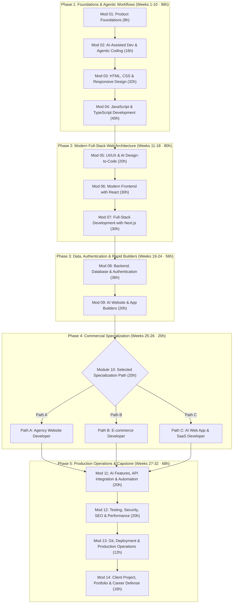

# AI-Assisted Full Stack Web Development — Authoritative Academic Specification & October 2026 Curriculum Blueprint

**Program Title:** AI-Assisted Full Stack Web Development
**Course Identifier:** `ai-assisted-full-stack-web-development`
**Legacy Predecessor Course:** AI Web Development Professional (`ai-web-dev-pro`)
**Academy:** Programming Academy (`programming`)
**Credential Awarded:** Professional Certificate in AI-Assisted Full Stack Web Development
**Governing Standard:** Nova Skills Academic Board | October 2026 Production Standard (Version 2.0.0)
**Duration:** 8 Months (32 Instructional Weeks)
**Total Guided Instructional Hours:** 320 Guided Hours (10 Hours / Week)
**Instructional Breakdown:** 300 Guided Core Hours + Exactly 20 Guided Specialized Hours (One Path per Student)
**Recommended Independent Practicum:** 120–160 Additional Practicum Hours (clearly demarcated from guided hours)
**Proposed Commercial Tuition Baseline:** INR 64,900 (Statutory 18% GST: INR 11,682; Total Payable: INR 76,582; Approved Installment Term: 8-Month Term at INR 9,573 / Month)
*Note: Subject to final commercial authorization in NOVA-AFSD-02.*
**Target Level:** Intermediate to Production-Ready Applied Professional
**Primary Modern Stack:** Next.js 15+ (App Router), React 19, TypeScript 5.x, Tailwind CSS v4, shadcn/ui, Node.js 22 LTS, PostgreSQL 17 & Supabase
**Agentic AI Tooling:** Claude Code, Google Antigravity, Cursor, GitHub Copilot, ChatGPT (Canvas/o1), Claude 3.5 Sonnet, v0 by Vercel, Google Stitch, Lovable
**Specialization Architecture:** Exactly ONE Commercial Specialization per Student (Agency Website Developer, E-commerce Developer, or AI Web App & SaaS Developer)
**Authoritative Document Version:** 2.0.0 (October 25, 2026 Production Standard)

---

## 1. Executive Summary & Program Positioning

### 1.1 The Paradigm Shift: From Syntax Typing to Agentic Software Engineering
The global web engineering landscape in October 2026 has crossed a permanent threshold. With the widespread industry adoption of agentic coding environments (such as **Google Antigravity**, **Claude Code**, **Cursor**, and generative builders like **v0** and **Lovable**), the mechanical act of writing boilerplate HTML, CSS classes, basic CRUD endpoints, or repetitive TypeScript interfaces has been largely automated.

However, this technological leap has exposed a critical market vulnerability: **superficial AI users cannot build, debug, secure, or maintain production applications.** Unsupervised generative tools produce hallucinated dependencies, subtle architectural anti-patterns, OWASP security vulnerabilities, and brittle user interfaces that crumble under real user traffic.

Industry engineering teams, digital marketing agencies, e-commerce conglomerates, and funded startups no longer hire junior developers simply to type syntax. They hire **AI-Augmented Full-Stack Product Engineers**: professionals who possess rigorous foundational mental models of client-server architecture, relational data schemas, DOM rendering lifecycles, and network security, but who leverage autonomous agentic workflows to build complete, tested, full-stack web products at $5\times$ to $10\times$ the speed of legacy developers.

### 1.2 Program Mission & Strategic Identity
**AI-Assisted Full Stack Web Development** is Nova Skills' flagship 8-month, 320-guided-hour professional immersion. It bridges the critical divide between first-principles engineering competence and high-velocity agentic execution.

Unlike purely conceptual coding bootcamps that ban modern tools, and unlike superficial "no-code prompt engineering" tutorials that produce fragile toy demos, this program trains students in a disciplined **"Inspect, Direct, Audit, Ship"** methodology:
1. **Deconstruct Business Requirements:** Convert real client user stories and system requirements into structured technical specs and schema definitions.
2. **Orchestrate Agentic Scaffolding:** Direct agentic tools (Claude Code, Antigravity, Cursor, v0) to generate modular components, database migrations, and type-safe API routes.
3. **Audit from First Principles:** Conduct rigorous human code reviews to eliminate security flaws, memory leaks, accessibility violations, and regression bugs.
4. **Deploy & Operate:** Ship verified applications to serverless edge platforms (Vercel, Cloudflare, Supabase) with automated CI/CD, analytics, and performance monitoring.

### 1.3 Course Evolution & Institutional Predecessor
This program represents the comprehensive institutional evolution and modernization of the earlier legacy offering:
- **Legacy Course:** *AI Web Development Professional* (`ai-web-dev-pro`, 3 Months, 80 Hours, 3 superficial modules, INR 15,999).
- **Modernized Course:** *AI-Assisted Full Stack Web Development* (`ai-assisted-full-stack-web-development`, 8 Months, 320 Hours, 14 comprehensive modules, 6 assessed portfolio deliverables, 3 commercial specialization paths, INR 64,900).

The legacy course suffered from severe curriculum limitations: it was merely an 80-hour introductory overview of Cursor and v0 without full-stack depth, database persistence, deep TypeScript engineering, or rigorous portfolio standards. This redesign elevates the course to a career-defining 320-hour professional standard.

```
       MONTHS 1–2                    MONTHS 3–4                    MONTHS 5–6                    MONTHS 7–8
┌─────────────────────────┐   ┌─────────────────────────┐   ┌─────────────────────────┐   ┌─────────────────────────┐
│ FOUNDATIONS & DOM       │   │ FRONTEND & NEXT.JS      │   │ BACKEND & BUILDERS      │   │ SPECIALIZATION & LAUNCH │
│ • Mod 01: Product (8h)  │   │ • Mod 05: UI/UX (20h)   │   │ • Mod 08: Backend (36h) │   │ • Mod 10: Path A/B/C(20h│
│ • Mod 02: AI Coding(16h)│   │ • Mod 06: React (30h)   │   │ • Mod 09: AI Build (20h)│   │ • Mod 11: AI APIs (20h) │
│ • Mod 03: HTML/CSS (32h)│   │ • Mod 07: Next.js (30h) │   │                         │   │ • Mod 12: QA/SEO (20h)  │
│ • Mod 04: JS & TS (40h) │   │                         │   │                         │   │ • Mod 13: DevOps (12h)  │
│                         │   │                         │   │                         │   │ • Mod 14: Capstone (16h)│
└─────────────────────────┘   └─────────────────────────┘   └─────────────────────────┘   └─────────────────────────┘
        96 Hours                      80 Hours                      56 Hours                      88 Hours
```

---

## 2. Forensic Course Audit & Content Migration Analysis

A thorough forensic audit of the Nova Skills repository was conducted to inspect all active traces of the predecessor course `ai-web-dev-pro` and map the migration path to `ai-assisted-full-stack-web-development`.

### 2.1 Inventory Audit of Existing References
The search across all JavaScript, JSON, Markdown, and HTML files identified the following active locations referencing `ai-web-dev-pro`:

1. **`data.js` (Lines 2762 & 10451):**
   - `NS_COURSES` catalog: Entry at line 2762 with `id: "ai-web-dev-pro"`, `price: 15999`, `durationMonths: 3`, `learningHours: 80`, containing 3 legacy modules and an erroneous tool list containing the course name.
   - `NS_ACADEMIES` catalog: Duplicate entry under Programming Academy (`programming`, index 3) at line 10451.
2. **`data/courses/ai-web-dev-pro.json`:**
   - Standalone course detail JSON containing legacy 3-module structure, outdated overview, and undefined pricing fields.
3. **`nova-skills-109-course-content.json` (Index 36):**
   - Master course catalog entry mirroring `data/courses/ai-web-dev-pro.json`.
4. **`js/data.min.js`:**
   - Production minified bundle mirroring `data.js`.
5. **`sitemap.xml` (Line 41):**
   - Active URL entry: `<loc>https://novaskills.in/course-detail.html?id=ai-web-dev-pro</loc>`.
6. **`blog/high-demand-courses-2027-ai-skills-careers/index.html`:**
   - CTA button linking to `/course-detail.html?id=ai-web-dev-pro`.
7. **`data/courses/fullstack-foundation.json`:**
   - Legacy recommendation string: `"recommended_next": "Advance to ai-web-dev-pro to specialize further."`.
8. **`docs/course-redesign/programming/full-stack-programming-foundation-spec.md`:**
   - Comparative differentiation matrix listing `ai-web-dev-pro`.

### 2.2 Forensic Identification: Target ID Availability
A strict codebase-wide search confirmed that **`ai-assisted-full-stack-web-development` does NOT exist anywhere in the repository**. The ID is completely clean, unique, and ready for authoritative implementation.

### 2.3 Migration & Routing Architecture
To ensure zero broken links, maintain search engine equity, and preserve seamless user experience:
1. **Dynamic Alias Routing in `course-detail.js`:**
   - Add `'ai-web-dev-pro': 'ai-assisted-full-stack-web-development'` to `COURSE_ALIASES`. Any visitor hitting `/course-detail.html?id=ai-web-dev-pro` will automatically resolve to the modern course data.
2. **Canonical & SEO Continuity:**
   - The canonical link and Open Graph URL will point to `https://novaskills.in/course-detail.html?id=ai-assisted-full-stack-web-development`.
   - `sitemap.xml` will be updated to index the modern ID.
3. **Database & Master Inventory Preservation:**
   - `nova-skills-109-course-content.json` will update entry 36 from `ai-web-dev-pro` to `ai-assisted-full-stack-web-development`, keeping total catalog size at exactly 109 courses.
   - Preserves all other 108 courses without modification.

---

## 3. Industry Research & October 2026 Technical Standards

Modern web development in October 2026 is defined by several converged engineering standards that must anchor this curriculum:

### 3.1 React 19 & Next.js 15+ Production Standard
- **React Server Components (RSC):** Modern React applications execute components on the server by default, streaming HTML to the client and drastically reducing bundle size.
- **Server Actions & Mutations:** Direct asynchronous server mutations directly from UI forms without writing manual API boilerplate.
- **Next.js 15+ App Router:** Deep nesting, parallel routes, intercepting routes, dynamic segment caching, and granular revalidation (`revalidateTag`, `revalidatePath`).
- **TypeScript 5.x Strict Mode:** Mandatory interfaces, strict null checks, discriminating unions, and generics to ensure runtime reliability.

### 3.2 Autonomous Coding Agents & Generative Builders
- **Google Antigravity:** Next-generation agentic programming environment integrating deep workspace context, automated terminal execution, and multi-file reasoning.
- **Claude Code (Anthropic):** High-agency CLI developer tool operating directly within the local Git workflow, reading entire repos, generating diffs, and running test suites.
- **Cursor & GitHub Copilot:** Everyday developer pairing, semantic multi-file indexing, inline diff approvals, and cursor rules (`.cursorrules`).
- **Rapid Generative UI Builders:** **v0 by Vercel** and **Google Stitch** for instant design-to-component translation; **Lovable** for full-stack prototype scaffolding.

### 3.3 Backend-as-a-Service & Relational Integrity
- **PostgreSQL 17 & Supabase:** The industry-standard open-source BaaS providing managed PostgreSQL, automated REST/GraphQL APIs, native Row Level Security (RLS), real-time WebSockets, edge storage, and secure authentication.
- **Zero-Trust Client Security:** Secure cookie sessions, JWT verification, encrypted environment variables, and strict CORS policies.

---

## 4. Course Architecture & 32-Week Learning Rhythm

The curriculum spans 32 weeks (8 months), comprising 320 guided instructional hours structured as **300 common core hours** plus **20 selected specialization hours**:



### 4.1 Master Module Breakdown

| Module # | Module Title | Guided Hours | Phase | Assessed Deliverable Alignment |
| :---: | :--- | :---: | :---: | :--- |
| **01** | Web Development & Product Foundations | 8 | Core 1 | Product Spec & Technical Architecture Blueprint |
| **02** | AI-Assisted Development & Agentic Coding | 16 | Core 1 | Agentic Coding Setup & Multi-Tool Workflow Protocol |
| **03** | HTML, CSS & Responsive Web Design | 32 | Core 1 | Project 1: Responsive Developer Portfolio |
| **04** | JavaScript & TypeScript Development | 40 | Core 1 | Type-Safe Interactive Data Engine |
| **05** | UI/UX & AI Design-to-Code | 20 | Core 2 | Figma-to-Code Accessible Design System |
| **06** | Modern Frontend with React | 30 | Core 2 | Component-Driven Application Scaffold |
| **07** | Full-Stack Development with Next.js | 30 | Core 2 | Project 2: Business Lead Generation Website |
| **08** | Backend, Database & Authentication | 36 | Core 3 | Project 3: Full-Stack Admin Dashboard |
| **09** | AI Website & App Builders | 20 | Core 3 | Rapid Prototyping & AI Scaffolding Toolkit |
| **10** | **Selected Commercial Specialization** | **20** | **Path** | **Project 5: Specialized Track Application (Path A/B/C)** |
| **11** | AI Features, API Integration & Automation | 20 | Core 4 | Project 4: AI-Powered Business Assistant |
| **12** | Testing, Security, SEO & Performance | 20 | Core 4 | End-to-End Test Suite & Lighthouse Audit Report |
| **13** | Git, Deployment & Production Operations | 12 | Core 4 | Production Edge Deployment & CI/CD Pipeline |
| **14** | Client Project, Portfolio & Career Readiness | 16 | Core 4 | **Project 6: Final Client Capstone & Portfolio Defense** |
| **TOTAL** | **14 Modules** | **320h** | — | **6 Assessed Portfolio Deliverables** |

---

## 5. Specialization Architecture (The 3 Commercial Paths)

A central innovation of this curriculum is the **Mutually Exclusive Commercial Specialization System**. Rather than overwhelming students with superficial breadth across every possible CMS and framework, students dedicate Module 10 (20 guided hours) to mastering exactly **ONE** commercial execution pathway aligned with their career ambitions.

```
                               ┌────────────────────────────────────────────────────────┐
                               │             COMMON CORE CURRICULUM (300h)              │
                               │          Modules 01–09, 11–14 (Shared by All)          │
                               └──────────────────────────┬─────────────────────────────┘
                                                          │
                                         Student Selects Exactly ONE Path:
                                                          │
                 ┌────────────────────────────────────────┼────────────────────────────────────────┐
                 ▼                                        ▼                                        ▼
    ┌──────────────────────────┐             ┌──────────────────────────┐             ┌──────────────────────────┐
    │          PATH A          │             │          PATH B          │             │          PATH C          │
    │ Agency Website Developer │             │   E-commerce Developer   │             │AI Web App & SaaS Develope│
    │         (20 Hours)       │             │        (20 Hours)        │             │        (20 Hours)        │
    │ • Framer & WordPress CMS │             │ • Shopify & Liquid Engine│             │ • Next.js & Adv. Supabase│
    │ • High-Conversion Forms  │             │ • Theme Customization    │             │ • RBAC & Multi-Tenancy   │
    │ • Client Handoff Systems │             │ • Cart, Checkout & Tests │             │ • AI Streaming & Billing │
    └────────────┬─────────────┘             └────────────┬─────────────┘             └────────────┬─────────────┘
                 │                                        │                                        │
                 ▼                                        ▼                                        ▼
    ┌──────────────────────────┐             ┌──────────────────────────┐             ┌──────────────────────────┐
    │     PATH A PORTFOLIO     │             │     PATH B PORTFOLIO     │             │     PATH C PORTFOLIO     │
    │ Agency Client Portal &   │             │ Fully Custom Shopify     │             │ Production AI SaaS MVP   │
    │ Dynamic CMS Web Platform │             │ Store with Test Checkout │             │ with Tiered Subscriptions│
    └──────────────────────────┘             └──────────────────────────┘             └──────────────────────────┘
```

### 5.1 Specialization Rules & Institutional Governance
1. **Mutually Exclusive Selection:** Exactly ONE path is selected per enrollment. No student is assigned all three paths.
2. **Tuition Parity:** All three paths carry identical tuition (INR 64,900). Zero path-switching fees or surcharge penalties.
3. **Common Core Parity:** All students complete the exact same 300 guided core hours and develop the same 4 common portfolio projects.
4. **Dedicated Evaluation:** Each path features its own practical assessment criteria, rubric, and portfolio deliverable (Project 5).
5. **Final Capstone Alignment:** The Final Integrated Client Capstone (Module 14, Project 6) builds directly upon the tooling and architecture of the student's chosen specialization.
6. **Selection Window:** Students make an initial path indication during enrollment, but have until the completion of Module 09 (Week 24) to finalize their selection in consultation with academic mentors.
7. **Single Catalog Entity:** The website presents this program as a single cohesive offering (`ai-assisted-full-stack-web-development`) featuring interactive path tabs on the curriculum section, avoiding catalog fragmentation or duplicate SEO pages.

### 5.2 Detailed Specification of Path Options

#### PATH A: Agency Website Developer
- **Target Career:** Web Agency Developer, Freelance Client Specialist, WordPress/Framer Technical Consultant.
- **Focus:** High-speed client delivery, design fidelity, content management systems, business lead generation, and seamless client handoffs.
- **Curated Stack:** Framer, WordPress 6.x (Block Editor / Gutenberg), Headless REST API concepts, Advanced Custom Fields (ACF), WPForms / Gravity Forms, LiteSpeed / Cloudflare Caching, Client Billing & Domain Handoff Workflows.
- **Assessed Deliverable (Project 5A):** Multi-page high-converting agency business platform featuring custom Framer interactive components, headless or native WordPress dynamic blog/case-studies CMS, automated lead notification webhooks, and documented client training video/manual.

#### PATH B: E-commerce Developer
- **Target Career:** Shopify Developer, E-commerce Technical Specialist, DTC Brand Store Builder.
- **Focus:** Online merchant infrastructure, catalog modeling, high-converting checkout flows, theme architecture, and inventory/order synchronization.
- **Curated Stack:** Shopify Online Store 2.0, Liquid templating language, Shopify CLI, Dawn theme architecture, JSON templates, Shopify App Bridge concepts, authorized test payment gateways (Bogus/Stripe sandbox), shipping matrix configuration, and GA4 Enhanced E-commerce.
- **Assessed Deliverable (Project 5B):** Fully configured, custom-styled Shopify storefront with customized Liquid sections, dynamic collection filters, slide-out cart with upsell logic, validated sandbox checkout process, and automated transactional customer email templates.

#### PATH C: AI Web App & SaaS Developer
- **Target Career:** Full-Stack SaaS Developer, Startup Founding Engineer, AI Application Builder.
- **Focus:** Multi-tenant web applications, complex business logic, user authentication, subscription billing lifecycles, and asynchronous AI workflows.
- **Curated Stack:** Next.js 15+ App Router, Supabase (Advanced PostgreSQL, Row-Level Security, Realtime triggers, Storage), Stripe Elements & Customer Portal, Role-Based Access Control (RBAC), Server-Sent Events (SSE) streaming, Sentry monitoring.
- **Assessed Deliverable (Project 5C):** Production-grade multi-tenant SaaS MVP with user onboarding, organization workspaces, role-based member invitations, Stripe subscription tiers (Free/Pro), protected AI-powered data processing dashboard, and telemetry logging.

---

## 6. Production Technology Registry & Tool Matrix

Every tool incorporated into this curriculum has been vetted against verified October 2026 production availability and adheres to the **Nova Skills Zero-Cost Student Policy**.

### 6.1 Technology Registry Table

| Category | Tool / Framework | Standard Version | Commercial Policy / Student Access | Fallback Alternative |
| :--- | :--- | :---: | :--- | :--- |
| **Core Frontend** | React | 19.x | Open Source / Free | React 18 LTS |
| **Core Meta-Framework** | Next.js (App Router) | 15.x | Open Source / Free | Vite + React SPA |
| **Language** | TypeScript | 5.6+ | Open Source / Free | Modern ES2024 JavaScript |
| **Styling & Design System** | Tailwind CSS & shadcn/ui | v4 / Latest | Open Source / Free | Tailwind CSS v3.4 |
| **Runtime & Backend** | Node.js | 22 LTS | Open Source / Free | Node.js 20 LTS |
| **Database & Auth** | Supabase & PostgreSQL | PG 17 / v2 | Free Developer Tier (No CC required) | Local Docker PostgreSQL |
| **Version Control** | Git & GitHub | 2.46+ / Cloud | Free Academic / Personal Account | Local Git / GitLab |
| **Agentic Coding** | Claude Code | 2026 Standard | Anthropic Free Tier / Local CLI | Terminal + Open Source CLI |
| **Agentic IDE** | Google Antigravity | 2026 Standard | Free Student / Developer Preview | VS Code + Roo Code / Cline |
| **Developer IDE** | Cursor | 0.42+ | Free Community Tier (Pro optional) | VS Code + GitHub Copilot Free |
| **Pair AI** | ChatGPT / Claude | 4o / Sonnet 3.5 | Free Web Tiers & Student Credits | DeepSeek-Coder / Mistral Free |
| **Generative UI** | v0 by Vercel | 2026 Production | Free Tier (generous monthly credits) | Lovable / Tailwind UI Templates |
| **Design & Prototyping**| Figma | Latest Web | Free Education / Starter Tier | Penpot (Open Source) |
| **Specialization: Agency**| Framer & WordPress | Latest Cloud | Free Publishing / LocalWP (100% Free)| LocalWP + GitHub Pages |
| **Specialization: Ecom** | Shopify | Partners 2.0 | Free Partner Development Stores | Medusa.js (Headless Open Source)|
| **Testing** | Playwright & Vitest | Latest | Open Source / Free | Cypress / Jest |
| **Deployment & Edge** | Vercel & Cloudflare | Edge Runtime | Free Hobby Tier / Free Cloudflare Plan | Netlify / Render Free |

### 6.2 Zero-Cost Policy & Fallback Guarantee
> [!IMPORTANT]
> **Zero-Cost Student Policy:** No student is required to purchase commercial AI subscriptions or paid SaaS tiers to complete any assignment, exam, or portfolio project. Every proprietary tool (Cursor, Claude Code, v0, Shopify, Framer) is paired with a verified free-tier workflow or 100% open-source local fallback (VS Code, LocalWP, Docker, Ollama/OpenRouter free tiers).

---

## 7. Portfolio Architecture & Six Assessed Deliverables

Students build a progressive body of work culminating in **six evaluated, public-facing portfolio assets** hosted on GitHub and deployed to custom subdomains:

```
┌────────────────────────────────────────────────────────────────────────────────────────┐
│                        SIX ASSESSED PORTFOLIO DELIVERABLES                             │
├───────────────────────────────────┬────────────────────────────────────────────────────┤
│ 1. Responsive Developer Portfolio │ • Semantic HTML5, modern responsive CSS, Grid/Flex │
│    (Common Core — Module 03)      │ • Accessible theme switcher, responsive navigation │
│                                   │ • Lighthouse 95+ score, deployed to Vercel/Pages   │
├───────────────────────────────────┼────────────────────────────────────────────────────┤
│ 2. Business Lead Gen Website      │ • Next.js App Router, Tailwind CSS, shadcn/ui      │
│    (Common Core — Module 07)      │ • Server Actions form submission, schema validation│
│                                   │ • Webhook lead notifications to Slack/Email        │
├───────────────────────────────────┼────────────────────────────────────────────────────┤
│ 3. Full-Stack Admin Dashboard     │ • Next.js, Supabase PostgreSQL, Row-Level Security │
│    (Common Core — Module 08)      │ • Multi-role auth, CRUD data table, analytics charts│
│                                   │ • Optimistic updates, CSV data export              │
├───────────────────────────────────┼────────────────────────────────────────────────────┤
│ 4. AI-Powered Business Assistant  │ • Next.js, OpenAI / Gemini API streaming responses │
│    (Common Core — Module 11)      │ • Server-Sent Events (SSE), markdown rendering     │
│                                   │ • Structured JSON tool calling, rate-limiting      │
├───────────────────────────────────┼────────────────────────────────────────────────────┤
│ 5. Selected Specialization Track  │ • Path A: Agency Client Platform (Framer + WP CMS) │
│    (Track Project — Module 10)    │ • Path B: Custom Shopify Store (Liquid + Checkout) │
│                                   │ • Path C: Production AI SaaS MVP (Stripe + RBAC)   │
├───────────────────────────────────┼────────────────────────────────────────────────────┤
│ 6. Final Client Capstone Project  │ • Production-grade web product aligned with path   │
│    (Final Defense — Module 14)    │ • End-to-end tests, security audit, CI/CD pipeline │
│                                   │ • Live public URL, GitHub repo, 10-min viva defense│
└───────────────────────────────────┴────────────────────────────────────────────────────┘
```

---

## 8. Comprehensive 14-Module Curriculum Specification

---

### MODULE 01: Web Development & Product Foundations
- **Guided Instructional Hours:** 8 Hours (2 Instructional Weeks)
- **Module Purpose:** Establish foundational computer science mental models of the Internet, client-server architecture, modern developer environments, and product thinking before writing code.
- **Primary Tools:** Terminal/PowerShell, Node.js 22 LTS, VS Code, Git.
- **Learning Objectives:**
  - Understand how DNS, TCP/IP, HTTP/HTTPS, and browser rendering engines interact.
  - Configure a clean, reproducible professional developer workstation with Unix shell commands.
  - Deconstruct product user stories into wireframes, technical specifications, and API contracts.
- **Main Topics & Subtopics:**
  1. *How the Web Works:* DNS resolution, client-server request-response lifecycle, HTTP methods (GET, POST, PUT, DELETE), status codes (2xx, 3xx, 4xx, 5xx), SSL/TLS certificates.
  2. *Developer Environment & Tooling:* Terminal navigation, package managers (npm, pnpm), Node.js runtime fundamentals, VS Code workspace settings, essential extensions.
  3. *Product Thinking for Developers:* Agile user stories, acceptance criteria, technical task breakdown, component hierarchies, API data contracts.
- **Practical Exercises:**
  - Exercise 1.1: Use `curl` and browser network dev tools to trace HTTP requests, headers, and responses across multiple domains.
  - Exercise 1.2: Initialize a developer workstation, configure dotfiles, install Node.js 22 LTS via nvm, and execute basic Node runtime scripts.
- **Student Deliverable:** Technical Product Specification Document with user stories, entity relationships, and wireframe breakdown for a client web project.
- **AI-Assisted Workflow:** Directing ChatGPT/Claude to act as a technical business analyst, generating user story edge cases and acceptance criteria.
- **Independent Coding Check:** Oral viva and terminal test: navigating directories, inspecting network packets, and explaining the browser rendering pipeline without AI assistance.
- **Safe Fallback:** Standard browser DevTools and native terminal commands require zero cloud tools or paid subscriptions.

---

### MODULE 02: AI-Assisted Development & Agentic Coding
- **Guided Instructional Hours:** 16 Hours (2 Instructional Weeks)
- **Module Purpose:** Master the new operational paradigm of modern software engineering: orchestrating autonomous coding agents, prompt-to-diff workflows, and human-in-the-loop validation.
- **Primary Tools:** Google Antigravity, Claude Code, Cursor, GitHub Copilot, ChatGPT (Canvas).
- **Learning Objectives:**
  - Direct autonomous CLI and IDE coding agents with precise context, constraints, and test-driven prompts.
  - Configure workspace agent rules (`.cursorrules`, project prompt templates) for standardized code generation.
  - Audit AI-generated code for logical hallucinations, security vulnerabilities, and deprecated APIs.
- **Main Topics & Subtopics:**
  1. *The Agentic Developer Mindset:* Shift from passive autocomplete to active agent direction, workspace context injection, multi-turn reasoning loops.
  2. *Cursor & IDE Assistants:* Semantic code indexing, `@Files`, `@Docs`, `@Codebase` context tags, Composer multi-file editing, custom `.cursorrules`.
  3. *CLI Coding Agents (Claude Code & Antigravity):* Running terminal agentic loops, automated bug fixing, reading Git diffs, running test suites autonomously.
  4. *Prompt Engineering for Developers:* System prompts, few-shot examples, chain-of-thought architectural reasoning, specification-first generation.
  5. *Code Review & Security Auditing:* Identifying hallucinated packages (dependency squatting), validating token safety, catching memory leaks.
- **Practical Exercises:**
  - Exercise 2.1: Author a robust `.cursorrules` file enforcing strict TypeScript, functional components, and Tailwind best practices.
  - Exercise 2.2: Use Claude Code / Antigravity to autonomously refactor a legacy JavaScript function into type-safe TypeScript with unit tests.
- **Student Deliverable:** Published GitHub repository demonstrating an agent-assisted codebase refactor with documented prompt logs and human audit notes.
- **AI-Assisted Workflow:** Decomposing complex tasks into small, testable prompt increments; letting the agent write the code while the student writes the verification tests.
- **Independent Coding Check:** "Spot the Hallucination" challenge: students must review 3 AI-generated code samples and identify subtle bugs and security vulnerabilities unaided.
- **Safe Fallback:** VS Code with free extensions (Roo Code, Cline, or GitHub Copilot free tier) using local or free OpenRouter models.

---

### MODULE 03: HTML, CSS & Responsive Web Design
- **Guided Instructional Hours:** 32 Hours (3 Instructional Weeks)
- **Module Purpose:** Build an unshakeable foundation in semantic HTML5 markup, modern CSS layouts (Flexbox and Grid), responsive design patterns, and web accessibility (WCAG 2.2).
- **Primary Tools:** HTML5, CSS3, Modern CSS (Variables, clamp(), subgrid), Chrome DevTools, Lighthouse, Axe DevTools.
- **Learning Objectives:**
  - Author 100% semantic, accessible HTML5 documents adhering to WCAG 2.2 AA standards.
  - Master responsive multi-column layouts using CSS Flexbox and Grid without relying on heavy UI frameworks.
  - Optimize web typography, fluid spacing, and images for Core Web Vitals (LCP, CLS, INP).
- **Main Topics & Subtopics:**
  1. *Semantic HTML5 & Accessibility:* Semantic tags (`<header>`, `<nav>`, `<main>`, `<article>`, `<section>`, `<aside>`, `<footer>`), ARIA roles, accessible forms, keyboard navigation.
  2. *Modern CSS Foundations:* Box model, specificity hierarchy, CSS custom properties (variables), relative units (`rem`, `ch`, `vw`, `vh`), `clamp()` fluid typography.
  3. *Layout Mastery with Flexbox & Grid:* Flex axes, alignment, wrapping, Grid templates, `auto-fit` vs `auto-fill`, `minmax()`, subgrid foundations.
  4. *Responsive Web Design:* Mobile-first methodology, media queries, container queries (`@container`), responsive images (`<picture>`, `srcset`).
  5. *CSS Architecture & Performance:* BEM methodology, modern reset stylesheets, CSS transitions, keyframe animations, Core Web Vitals optimization.
- **Practical Exercises:**
  - Exercise 3.1: Code an accessible responsive navigation bar with a mobile hamburger drawer using zero JavaScript (CSS checkbox hack or popover API).
  - Exercise 3.2: Build a responsive 12-column magazine grid with dynamic container queries.
- **Student Deliverable:** **Portfolio Project 1: Responsive Developer Portfolio** — Fully responsive, semantic, accessible portfolio website achieving 95+ on Google Lighthouse.
- **AI-Assisted Workflow:** Using v0 or Claude to generate initial CSS layouts, then manually refactoring and inspecting CSS properties to verify cross-browser behavior.
- **Independent Coding Check:** Live CSS layout test: recreate a specified responsive wireframe from scratch in 45 minutes without AI assistance.
- **Safe Fallback:** 100% native web standards; requires only a text editor and a browser.

---

### MODULE 04: JavaScript & TypeScript Development
- **Guided Instructional Hours:** 40 Hours (4 Instructional Weeks)
- **Module Purpose:** Transition from static styling to dynamic programmatic application development, mastering modern ECMAScript, asynchronous programming, DOM manipulation, and TypeScript type safety.
- **Primary Tools:** Modern JavaScript (ES2024), TypeScript 5.6+, Node.js runtime, Vitest.
- **Learning Objectives:**
  - Program fluently with modern JavaScript: closures, array methods, destructuring, promises, and async/await.
  - Interact with the Browser Object Model (BOM) and Document Object Model (DOM) through performant event handling.
  - Build robust, type-safe software with TypeScript interfaces, types, generics, and strict compiler configurations.
- **Main Topics & Subtopics:**
  1. *Core JavaScript Fundamentals:* Scope, execution context, closures, higher-order functions (`map`, `filter`, `reduce`, `flatMap`), ES modules (`import`/`export`).
  2. *Asynchronous JavaScript:* Event loop, microtask queue, callbacks, Promises, `async`/`await`, `fetch` API, error handling with `try`/`catch`.
  3. *DOM Mechanics & Events:* Query selectors, event delegation, event bubbling and capturing, dynamic DOM creation, `IntersectionObserver`, local storage APIs.
  4. *TypeScript Foundations:* Type annotations, primitives, union and intersection types, type aliases vs interfaces, optional chaining, nullish coalescing.
  5. *Advanced TypeScript:* Generics, utility types (`Partial`, `Pick`, `Omit`, `Record`), type narrowing, discriminating unions, `tsconfig.json` strict settings.
- **Practical Exercises:**
  - Exercise 4.1: Implement a debounce/throttle utility function and attach it to an async live search input.
  - Exercise 4.2: Build an asynchronous weather dashboard fetching live REST data, typed strictly with TypeScript interfaces.
- **Student Deliverable:** Modular TypeScript data engine library with comprehensive unit tests running in Vitest.
- **AI-Assisted Workflow:** Prompting coding agents to generate TypeScript interface definitions from raw API JSON payloads, verifying type strictness manually.
- **Independent Coding Check:** Closed-book algorithmic coding test: array transformations, async fetch handling, and type-narrowing exercises.
- **Safe Fallback:** Native Node.js / ts-node runtime and browser console; zero cloud tools required.

---

### MODULE 05: UI/UX & AI Design-to-Code
- **Guided Instructional Hours:** 20 Hours (2 Instructional Weeks)
- **Module Purpose:** Bridge the gap between digital design and production code by leveraging Figma design tokens, generative UI tools (v0, Google Stitch), and accessible component libraries (shadcn/ui).
- **Primary Tools:** Figma, Tailwind CSS v4, shadcn/ui, v0 by Vercel, Google Stitch, Lucide Icons.
- **Learning Objectives:**
  - Translate Figma design files, auto-layouts, and component variants into pixel-perfect Tailwind CSS components.
  - Leverage v0 and Google Stitch to rapidly scaffold complex UI layouts from wireframes and design prompts.
  - Implement accessible, themeable design systems using Radix UI primitives and shadcn/ui.
- **Main Topics & Subtopics:**
  1. *UI/UX Principles for Developers:* Visual hierarchy, typography scales, contrast ratios, micro-interactions, responsive touch targets.
  2. *Figma for Engineers:* Inspecting auto-layout, extracting design tokens (colors, spacing, shadows), exporting optimized vector assets.
  3. *Tailwind CSS v4 Architecture:* Utility-first paradigm, modern CSS imports, arbitrary values, responsive prefixes, dark mode theming with CSS variables.
  4. *Generative UI Workflows:* Using v0 by Vercel and Google Stitch to generate accessible component scaffolds from text descriptions and wireframe screenshots.
  5. *Component Libraries (shadcn/ui & Radix):* Headless component architecture, copy-paste ownership model, styling Radix primitives with Tailwind.
- **Practical Exercises:**
  - Exercise 5.1: Export design tokens from a Figma community file and configure a custom Tailwind color and typography theme.
  - Exercise 5.2: Generate a complex analytics card in v0, import it into a local project, and refactor it with custom shadcn/ui components.
- **Student Deliverable:** Published, responsive design system component showcase featuring buttons, modals, dropdowns, inputs, and cards with dark/light mode.
- **AI-Assisted Workflow:** Screenshot-to-code pipelines: feeding UI screenshots to v0/Claude and refining the generated JSX into modular components.
- **Independent Coding Check:** Inspecting an unstyled HTML document and applying pure Tailwind utility classes to match a target Figma card without AI.
- **Safe Fallback:** Free Figma tier + local Tailwind CSS; if v0 credits run out, use open-source shadcn/ui and Tailwind UI free templates.

---

### MODULE 06: Modern Frontend with React
- **Guided Instructional Hours:** 30 Hours (3 Instructional Weeks)
- **Module Purpose:** Master modern component-driven frontend architecture with React 19, functional components, hooks, state management, and performance optimization.
- **Primary Tools:** React 19, Vite, TypeScript, ESLint, React Developer Tools.
- **Learning Objectives:**
  - Build declarative, modular web interfaces using React 19 components and JSX.
  - Master state management and side effects using core and custom hooks (`useState`, `useEffect`, `useMemo`, `useCallback`, `useRef`).
  - Implement global state patterns using React Context and modern lightweight stores (Zustand).
- **Main Topics & Subtopics:**
  1. *React 19 Foundations:* Declarative UI, JSX syntax, component composition, props, conditional rendering, list rendering with keys.
  2. *State & Component Lifecycle:* Immutability, lifting state up, controlled vs uncontrolled inputs, form handling, `useActionState` in React 19.
  3. *Deep Dive into Hooks:* `useState` vs `useReducer`, the dependency array rules of `useEffect`, memoization with `useMemo` and `useCallback`, DOM access with `useRef`.
  4. *Custom Hooks:* Encapsulating reusable business logic (`useFetch`, `useLocalStorage`, `useDebounce`, `useMediaQuery`).
  5. *State Management & Context:* Prop drilling mitigation, React Context API, lightweight global state with Zustand.
  6. *React Performance & Optimization:* React DevTools profiler, component memoization (`React.memo`), code-splitting with `React.lazy` and `Suspense`.
- **Practical Exercises:**
  - Exercise 6.1: Build an interactive multi-step wizard form with client-side validation and local storage persistence.
  - Exercise 6.2: Create a global shopping cart state using Zustand with optimistic UI updates.
- **Student Deliverable:** Fully interactive, responsive client-side React application with multi-route navigation, custom hooks, and persistent state.
- **AI-Assisted Workflow:** Directing Cursor to scaffold custom hooks and component unit tests; reviewing hook dependencies manually.
- **Independent Coding Check:** Live React debugging exam: identify and resolve 3 deliberate bugs (stale closure in `useEffect`, infinite re-render loop, missing key prop).
- **Safe Fallback:** Standard Vite + React template running locally; requires zero external paid services.

---

### MODULE 07: Full-Stack Development with Next.js
- **Guided Instructional Hours:** 30 Hours (3 Instructional Weeks)
- **Module Purpose:** Transition from client-only Single Page Applications to production full-stack web applications using the modern Next.js 15+ App Router, Server Components, and Server Actions.
- **Primary Tools:** Next.js 15+, React 19, TypeScript, Tailwind CSS, Vercel CLI.
- **Learning Objectives:**
  - Architect full-stack web applications utilizing Next.js App Router conventions and file-system routing.
  - Understand the architectural boundary between React Server Components (RSC) and Client Components (`"use client"`).
  - Execute secure backend mutations directly from UI components using Server Actions and form status hooks.
- **Main Topics & Subtopics:**
  1. *Next.js 15 App Router Architecture:* Layouts (`layout.tsx`), pages (`page.tsx`), templates, loading states (`loading.tsx`), error boundaries (`error.tsx`), not-found handling.
  2. *React Server Components (RSC):* Server-first data fetching, streaming with `Suspense`, bundle size elimination, when to use Client Components.
  3. *Data Fetching & Caching Strategies:* Server-side caching, dynamic rendering (`export const dynamic = 'force-dynamic'`), on-demand revalidation (`revalidatePath`, `revalidateTag`).
  4. *Server Actions & Form Handling:* Direct server mutations, progressive enhancement, `useActionState`, `useFormStatus`, optimistic UI with `useOptimistic`.
  5. *Route Handlers & Middleware:* Building RESTful `route.ts` endpoints, request headers, cookies management, Edge Middleware for authentication checks.
  6. *Metadata & SEO API:* Dynamic Open Graph image generation (`@vercel/og`), static and dynamic metadata, JSON-LD structured data.
- **Practical Exercises:**
  - Exercise 7.1: Build a server-rendered blog fetching markdown data, with dynamic routing and automated metadata generation.
  - Exercise 7.2: Implement a contact form powered by Next.js Server Actions with server-side validation and optimistic feedback.
- **Student Deliverable:** **Portfolio Project 2: Business Lead Generation Website** — High-performance Next.js business application with Server Actions, animated UI, validated lead capture, and webhook integration.
- **AI-Assisted Workflow:** Using Claude Code to scaffold route layouts and validate Server Action boundary schemas using Zod.
- **Independent Coding Check:** Explain the RSC/Client Component lifecycle on a whiteboard; debug a common serialization error when passing props across the server-client boundary.
- **Safe Fallback:** Local Next.js dev server (`npm run dev`); Vercel free hobby tier for production hosting.

---

### MODULE 08: Backend, Database & Authentication
- **Guided Instructional Hours:** 36 Hours (4 Instructional Weeks)
- **Module Purpose:** Implement robust, scalable backend infrastructure: relational database modeling with PostgreSQL, Backend-as-a-Service integration with Supabase, Row-Level Security, and authentication.
- **Primary Tools:** Supabase, PostgreSQL 17, Drizzle ORM / Prisma, Zod, Supabase Auth.
- **Learning Objectives:**
  - Design normalized relational database schemas with primary/foreign keys, indexes, and constraints.
  - Secure database access at the database level using PostgreSQL Row-Level Security (RLS) policies.
  - Implement full-stack user authentication (Email/Password, OAuth, Magic Links) and protected routes.
- **Main Topics & Subtopics:**
  1. *Relational Database Foundations:* Relational concepts, tables, primary keys, foreign keys, one-to-one, one-to-many, many-to-many relationships, database normalization (1NF, 2NF, 3NF).
  2. *SQL Querying Mastery:* `SELECT`, `INSERT`, `UPDATE`, `DELETE`, complex `JOIN` operations, `GROUP BY`, aggregate functions, subqueries, database indexing.
  3. *Supabase Architecture:* Cloud PostgreSQL, table editor, SQL editor, database migrations, Supabase JS client integration.
  4. *Row-Level Security (RLS):* Why API security is insufficient; authoring PostgreSQL policies for `SELECT`, `INSERT`, `UPDATE`, `DELETE` based on `auth.uid()`.
  5. *User Authentication & Authorization:* User registration, email verification, session management, OAuth providers (GitHub, Google), protecting Next.js routes via Middleware.
  6. *Storage & File Uploads:* Supabase Storage buckets, public vs private buckets, secure file upload pipelines, image transformation.
- **Practical Exercises:**
  - Exercise 8.1: Write SQL migration scripts to model an e-commerce catalog with orders, items, and customer relationships.
  - Exercise 8.2: Author comprehensive RLS policies ensuring users can only read and mutate their own profile and order history.
- **Student Deliverable:** **Portfolio Project 3: Full-Stack Admin Dashboard** — Production Next.js + Supabase application with user auth, role-based permissions, RLS, live data charts, and CRUD management.
- **AI-Assisted Workflow:** Directing Claude to generate complex SQL schemas and RLS policies, then verifying them against security test cases.
- **Independent Coding Check:** Live SQL and RLS challenge: write raw SQL queries and define RLS policies in the Supabase console without external AI help.
- **Safe Fallback:** Supabase free tier (no credit card required); local Docker container running official Supabase image or vanilla PostgreSQL.

---

### MODULE 09: AI Website & App Builders
- **Guided Instructional Hours:** 20 Hours (2 Instructional Weeks)
- **Module Purpose:** Harness the cutting-edge generation of rapid AI full-stack builders (v0, Lovable, Google Stitch) to prototype, scaffold, export, and refactor complete applications into professional codebases.
- **Primary Tools:** Lovable.dev, v0 by Vercel, Google Stitch, Cursor, Git.
- **Learning Objectives:**
  - Rapidly prototype full-stack application scaffolds using state-of-the-art generative platforms.
  - Export and integrate AI-generated project scaffolds into standard local Git repositories.
  - Clean, decouple, and refactor generated code to meet institutional software architecture standards.
- **Main Topics & Subtopics:**
  1. *The AI Builder Landscape:* Comparing v0 (component-level generative UI), Lovable (full-stack application scaffolding), and Google Stitch (generative web layouts).
  2. *Scaffolding High-Fidelity Prototypes:* Crafting comprehensive system prompts, providing design references, generating interactive multi-page web applications.
  3. *The Export-and-Own Lifecycle:* Connecting AI builders to GitHub, syncing repository branches, breaking free from platform lock-in.
  4. *Codebase Refactoring & Sanitization:* Auditing generated code, eliminating redundant dependencies, restructuring components, extracting hardcoded strings.
  5. *Integrating Custom Backends:* Replacing mock states and generic databases with production Supabase tables and custom Next.js Server Actions.
- **Practical Exercises:**
  - Exercise 9.1: Scaffold an interactive event booking platform in Lovable/v0, export to GitHub, and run it locally.
  - Exercise 9.2: Refactor the exported application: connect it to a real PostgreSQL database with Zod validation.
- **Student Deliverable:** Production-ready web application scaffold originally generated via an AI builder, successfully decoupled, refactored, and deployed to custom hosting.
- **AI-Assisted Workflow:** Using AI builders for zero-to-one scaffolding, followed by local IDE agentic refactoring (Claude Code/Cursor) to achieve production quality.
- **Independent Coding Check:** Explain the complete file structure of an exported AI builder repository and demonstrate manual state management refactoring.
- **Safe Fallback:** Free starter credits on Lovable/v0; fallback to open-source scaffolding templates (Create-Next-App with shadcn/ui) if platform quotas are exhausted.

---

### MODULE 10: Selected Commercial Specialization (Path A, B, or C)
- **Guided Instructional Hours:** 20 Hours (2 Instructional Weeks)
- **Module Purpose:** Specialize deeply in exactly ONE commercial web monetization and delivery pathway to build distinct, high-value career competencies.
- **Prerequisite:** Completion of Modules 01–09 (Common Core).
- **Rule:** Exactly ONE path is selected per student.

---

#### PATH A: Agency Website Developer
- **Focus:** High-conversion business websites, interactive Framer design, WordPress CMS integration, client handoff, and agency operations.
- **Primary Tools:** Framer, WordPress 6.x (Block Editor / Gutenberg), LocalWP, Advanced Custom Fields (ACF), WPForms, Cloudflare.
- **Learning Objectives:**
  - Build interactive, animated, high-performance marketing websites in Framer.
  - Configure WordPress as a flexible business CMS with custom post types and ACF.
  - Execute automated lead capture pipelines with CRM/email webhooks and client handoff documentation.
- **Main Topics & Subtopics:**
  1. *Framer Production Design:* Framer canvas, responsive breakpoints, interactive animations, scroll effects, component variants, Framer CMS for dynamic case studies.
  2. *WordPress Modern Architecture:* Full Site Editing (FSE), block themes, Gutenberg patterns, custom post types, Advanced Custom Fields (ACF) modeling.
  3. *Forms, Webhooks & CRM Integration:* Lead capture, spam mitigation (Turnstile/reCAPTCHA), webhook triggers to Zapier/Make/Slack, transactional SMTP delivery.
  4. *Performance & SEO for Client Sites:* Page caching, image optimization, on-page schema markup, XML sitemaps, Google Search Console indexing.
  5. *Client Handoff & Agency Operations:* White-label client dashboard, user roles (Editor vs Admin), automated backups, hosting migration, recorded client training manuals.
- **Practical Exercises:**
  - Exercise 10A.1: Build an interactive micro-site in Framer with custom scroll-driven navigation and dynamic CMS blog.
  - Exercise 10A.2: Set up a local WordPress site using LocalWP, create an "Enterprise Services" custom post type with ACF, and expose it via the WordPress REST API.
- **Student Deliverable:** **Portfolio Project 5A: Agency Website with CMS and Lead Workflows** — A multi-page client website featuring Framer interactivity, dynamic WordPress CMS, automated lead alerts, and client handoff documentation.
- **AI-Assisted Workflow:** Directing AI to write custom Framer code overrides (React) and PHP code snippets for custom WordPress filter hooks.
- **Independent Coding Check:** Live WordPress CMS configuration: create custom fields, query loops, and test lead capture forms without AI tools.
- **Safe Fallback:** Free Framer publishing tier; LocalWP is 100% free and open local software.

---

#### PATH B: E-commerce Developer
- **Focus:** Online store architecture, Shopify theme customization, Liquid templating, checkout flows, and e-commerce operations.
- **Primary Tools:** Shopify Partner Dashboard, Shopify CLI, Liquid, Dawn Theme, Shopify Admin API, GA4 E-commerce.
- **Learning Objectives:**
  - Customize and extend Shopify themes using Liquid, JSON templates, and theme sections.
  - Configure product catalogs, variant matrixes, collection filters, and inventory tracking.
  - Implement and test secure checkout workflows, shipping rules, tax settings, and analytics tracking.
- **Main Topics & Subtopics:**
  1. *Shopify Architecture & Store 2.0:* Partner accounts, development stores, theme file structure (`layout`, `templates`, `sections`, `snippets`, `assets`), JSON templates.
  2. *Liquid Templating Engine:* Liquid objects, tags, filters, conditionals, loops, custom section schemas (``), theme settings.
  3. *Catalog Engineering:* Products, variants, option sets, smart collections, product tags, metafields, faceted search and filtering.
  4. *Cart & Checkout UX:* Slide-out Ajax cart, cart attributes, line item properties, discount engines, authorized sandbox test payments (Shopify Bogus Gateway / Stripe test mode).
  5. *E-commerce Operations & Tracking:* Shipping profiles, taxation zones, automated customer order notifications, GA4 Enhanced E-commerce event tagging.
- **Practical Exercises:**
  - Exercise 10B.1: Develop a custom Liquid section in Dawn theme allowing merchants to configure a responsive product carousel via the Shopify Theme Editor.
  - Exercise 10B.2: Configure a complete test checkout flow in a development store with customized order confirmation emails.
- **Student Deliverable:** **Portfolio Project 5B: Functional E-commerce Store** — A fully configured, custom-styled Shopify store with custom Liquid sections, variant matrices, dynamic cart, and validated sandbox checkout.
- **AI-Assisted Workflow:** Using AI coding assistants to generate Liquid loop logic and schema JSON definitions, followed by verification in the Shopify Theme Editor.
- **Independent Coding Check:** Code a custom Liquid snippet to display dynamic stock urgency badges based on inventory quantities without AI assistance.
- **Safe Fallback:** Shopify Partner accounts provide unlimited 100% free development stores for developers.

---

#### PATH C: AI Web App & SaaS Developer
- **Focus:** Multi-tenant SaaS architecture, subscription lifecycles, advanced Supabase, role-based access control, and telemetry.
- **Primary Tools:** Next.js 15+ App Router, Supabase (Advanced RLS, Realtime, Edge Functions), Stripe Elements, Sentry, Upstash Redis.
- **Learning Objectives:**
  - Architect multi-tenant SaaS databases with organization workspaces and role-based permissions (Owner, Admin, Member).
  - Implement end-to-end subscription billing with Stripe Checkout, webhooks, and customer management portals.
  - Build real-time collaborative web applications with Supabase Realtime subscriptions and optimistic updates.
- **Main Topics & Subtopics:**
  1. *SaaS Multi-Tenancy Architecture:* Workspace concepts, tenant isolation models, organization membership schemas, invite token workflows.
  2. *Advanced Supabase & PostgreSQL:* Complex RLS functions (`SECURITY DEFINER`), database triggers, automated profile creation, Realtime broadcast and presence channels.
  3. *Stripe Billing & Subscription Lifecycles:* Stripe Elements, Checkout Sessions, Customer Portal, handling asynchronous webhook events (`customer.subscription.updated`, `invoice.payment_failed`).
  4. *Application Rate Limiting & Caching:* Protecting expensive routes using Upstash Redis, token bucket algorithms, IP-based rate limiting.
  5. *Production Telemetry & Error Tracking:* Sentry SDK integration, performance transaction monitoring, structured error logging, user session replay.
- **Practical Exercises:**
  - Exercise 10C.1: Implement a complete Stripe webhook listener in Next.js verifying webhook signatures and updating user subscription status in Supabase.
  - Exercise 10C.2: Create a real-time collaborative notifications panel using Supabase Realtime WebSocket subscriptions.
- **Student Deliverable:** **Portfolio Project 5C: AI SaaS MVP / Subscription-Ready Application** — Multi-tenant SaaS web application with organization switching, Stripe subscription tiers, protected feature flags, and Sentry error logging.
- **AI-Assisted Workflow:** Using Claude Code to scaffold Stripe webhook handler types and verify signature verification logic.
- **Independent Coding Check:** Live debugging of a broken Stripe webhook signature verification or incorrect Supabase RLS policy.
- **Safe Fallback:** Supabase free tier + Stripe test mode (100% free simulation) + Upstash free tier.

---

### MODULE 11: AI Features, API Integration & Automation
- **Guided Instructional Hours:** 20 Hours (2 Instructional Weeks)
- **Module Purpose:** Integrate real-world AI capabilities into full-stack web products: LLM API streaming, structured outputs, prompt engineering, vector embeddings, and background automation.
- **Primary Tools:** OpenAI API, Google Gemini API, Vercel AI SDK, LangChain / LlamaIndex foundations, PostgreSQL (pgvector).
- **Learning Objectives:**
  - Integrate large language model APIs (OpenAI / Gemini) into Next.js applications using streaming responses (SSE).
  - Enforce structured JSON outputs from LLMs using Zod schemas and function/tool calling.
  - Build automated background workflows triggered by user actions and scheduled webhooks.
- **Main Topics & Subtopics:**
  1. *AI APIs & Model Selection:* Comparing OpenAI (GPT-4o, o1) and Google Gemini (1.5 Flash, 1.5 Pro), tokenization, context windows, API authentication, cost management.
  2. *Streaming UI with Vercel AI SDK:* Server-Sent Events (SSE), `useChat` and `useCompletion` hooks, markdown streaming, stopping and resuming streams.
  3. *Structured Outputs & Function Calling:* Guaranteeing JSON schema compliance with Zod, calling internal application functions from LLM reasoning loops.
  4. *Embeddings & Semantic Search (RAG Intro):* Generating text embeddings, storing embeddings in PostgreSQL with `pgvector`, semantic similarity search.
  5. *Asynchronous Automation & Webhooks:* Background job processing, scheduling tasks, sending automated notifications via Resend / Discord webhooks.
- **Practical Exercises:**
  - Exercise 11.1: Build an AI content assistant in Next.js that streams generated marketing copy directly into a rich textarea.
  - Exercise 11.2: Implement an AI-powered customer support bot that queries an internal FAQ database using structured tool calling.
- **Student Deliverable:** **Portfolio Project 4: AI-Powered Business Assistant** — Full-stack web application featuring real-time AI response streaming, structured tool execution, and contextual search.
- **AI-Assisted Workflow:** Using AI to write evaluation test prompts and benchmark response quality across different model temperature settings.
- **Independent Coding Check:** Code a streaming API route in Next.js from scratch using native web streams and the Fetch API without external libraries.
- **Safe Fallback:** Google Gemini API offers free access tier; local Ollama running Llama 3 / Mistral provides 100% free offline AI inference.

---

### MODULE 12: Testing, Security, SEO & Performance
- **Guided Instructional Hours:** 20 Hours (2 Instructional Weeks)
- **Module Purpose:** Harden full-stack applications for production release: comprehensive automated testing (unit, integration, E2E), web application security (OWASP Top 10), search engine optimization, and Core Web Vitals performance tuning.
- **Primary Tools:** Playwright, Vitest, React Testing Library, OWASP ZAP concepts, Google Search Console, Google Lighthouse, PageSpeed Insights.
- **Learning Objectives:**
  - Implement comprehensive automated test suites covering unit logic, React components, and end-to-end browser flows.
  - Identify and mitigate critical web security vulnerabilities (XSS, CSRF, SQL injection, insecure direct object references).
  - Audit and optimize web applications to achieve 90+ Lighthouse performance scores and conform to technical SEO standards.
- **Main Topics & Subtopics:**
  1. *Automated Testing Pyramid:* Unit tests with Vitest, component testing with React Testing Library, mocking network requests with MSW (Mock Service Worker).
  2. *End-to-End Testing with Playwright:* Writing browser automation tests, testing user auth flows, form submissions, mobile viewport testing, visual regression.
  3. *Web Application Security (OWASP 2025/2026):* Cross-Site Scripting (XSS) defense, Cross-Site Request Forgery (CSRF), SQL injection prevention via ORMs, Content Security Policy (CSP), CORS, rate limiting.
  4. *Technical SEO & Structured Data:* Server-rendered metadata, dynamic sitemaps, robots.txt, Schema.org JSON-LD structured data (@type: Organization, Product, Article).
  5. *Performance Optimization & Core Web Vitals:* Largest Contentful Paint (LCP), Interaction to Next Paint (INP), Cumulative Layout Shift (CLS), image formats (WebP, AVIF), bundle analysis.
- **Practical Exercises:**
  - Exercise 12.1: Author a Playwright test suite verifying the complete user registration, login, and checkout flow in a headless browser.
  - Exercise 12.2: Perform a Lighthouse audit on an existing application, identify three performance bottlenecks, and refactor code to achieve a 95+ performance score.
- **Student Deliverable:** Automated test suite (Vitest + Playwright) and comprehensive Lighthouse Security & Performance Audit Report for a production application.
- **AI-Assisted Workflow:** Directing Claude Code to generate edge-case test fixtures and automate regression test creation.
- **Independent Coding Check:** Security vulnerability hunt: audit a deliberately vulnerable Next.js repository, identify 3 critical security flaws, and write manual patches.
- **Safe Fallback:** Vitest and Playwright are 100% free open-source tools; Lighthouse is built directly into Google Chrome.

---

### MODULE 13: Git, Deployment & Production Operations
- **Guided Instructional Hours:** 12 Hours (1 Instructional Week)
- **Module Purpose:** Master production DevOps, version control collaboration, Continuous Integration/Continuous Deployment (CI/CD) pipelines, custom domain configuration, and edge infrastructure.
- **Primary Tools:** Git, GitHub Actions, Vercel, Cloudflare DNS, Cloudflare Turnstile, Environment Variable Management.
- **Learning Objectives:**
  - Execute advanced Git workflows: branch protection, conventional commits, pull requests, and resolving merge conflicts.
  - Configure automated GitHub Actions pipelines to run linting, type-checks, and tests before merging.
  - Deploy serverless web applications to Vercel/Cloudflare with custom domains, SSL certificates, and preview deployment environments.
- **Main Topics & Subtopics:**
  1. *Advanced Git & Team Collaboration:* Trunk-based development vs feature branching, interactive rebasing, cherry-picking, Git stash, resolving merge conflicts cleanly.
  2. *Continuous Integration (CI) with GitHub Actions:* Authoring `.github/workflows/ci.yml`, running automated linters (ESLint, Prettier), TypeScript type checks, running Playwright tests in CI.
  3. *Production Cloud Deployment:* Deploying Next.js to Vercel, environment variables (`.env.production`), secret management, preview deployments per pull request.
  4. *DNS, CDN & Edge Caching:* Domain registration, Cloudflare DNS setup, SSL/TLS full encryption, edge caching rules, DDOS protection.
  5. *Production Monitoring & Health Checks:* Uptime monitoring, serverless function logs, monitoring cold starts and execution timeouts.
- **Practical Exercises:**
  - Exercise 13.1: Configure a GitHub Actions workflow that automatically blocks pull request merges if Vitest tests fail or TypeScript types contain errors.
  - Exercise 13.2: Connect a custom domain to a Vercel project through Cloudflare DNS, configure apex and www records, and verify SSL issuance.
- **Student Deliverable:** Fully automated CI/CD pipeline and live production deployment of a full-stack application on a custom domain with SSL and edge caching.
- **AI-Assisted Workflow:** Prompting coding agents to scaffold GitHub Action YAML files and troubleshooting build log errors.
- **Independent Coding Check:** Live Git terminal exam: resolve a complex three-way merge conflict on the command line without GUI tools or AI assistance.
- **Safe Fallback:** GitHub Actions offers 2,000 free minutes/month; Vercel and Cloudflare both provide generous permanent free tiers.

---

### MODULE 14: Client Project, Portfolio & Career Readiness
- **Guided Instructional Hours:** 16 Hours (2 Instructional Weeks)
- **Module Purpose:** Synthesize all 14 modules into a polished, evaluated client-grade web application; build a cohesive proof-of-work portfolio; and prepare for industry career placement through technical interviews and live capstone defenses.
- **Primary Tools:** GitHub, LinkedIn, Resume/CV, Screen Recording (Loom), Vercel.
- **Learning Objectives:**
  - Complete, polish, and defend a comprehensive client-grade web application aligned with the student's chosen specialization.
  - Publish a professional GitHub profile and production portfolio showcasing all six assessed deliverables.
  - Successfully navigate technical developer interviews, system design whiteboard questions, and live code reviews.
- **Main Topics & Subtopics:**
  1. *Final Capstone Integration & Polish:* Final QA, bug fixing, mobile responsiveness verification, cross-browser testing, accessibility compliance.
  2. *Documentation & Developer Storytelling:* Writing exceptional GitHub `README.md` files (architecture diagrams, tech stack badges, setup instructions, live demo links), recording video walkthroughs.
  3. *Portfolio Assembly & Branding:* Curating the six assessed deliverables, articulating engineering decisions, presenting the "AI-augmented workflow" advantage to employers.
  4. *Technical Interview Preparation:* JavaScript/TypeScript technical questions, React mental models, system design basics (client-server, database indexing, caching), coding challenges.
  5. *The Hiring Process & Freelance Client Acquisition:* Crafting an ATS-compliant developer resume, optimizing LinkedIn/GitHub profiles, agency client pitching, proposal writing, contract basics.
- **Practical Exercises:**
  - Exercise 14.1: Record a 5-minute Loom video walking through the architecture, database schema, and security features of the final capstone project.
  - Exercise 14.2: Participate in a simulated 45-minute technical interview with an instructor, answering technical questions and live-coding a solution.
- **Student Deliverable:** **Portfolio Project 6: Final Integrated Client Capstone Project** — Fully deployed production application with public GitHub repo, comprehensive README, recorded walkthrough, and live panel defense.
- **AI-Assisted Workflow:** Using AI to conduct mock technical interviews, refine resume bullet points using the Google X-Y-Z formula, and critique documentation clarity.
- **Independent Coding Check:** Mandatory 15-minute live technical viva voce defense: students must answer unscripted questions about their codebase and implement a live feature modification on the spot.
- **Safe Fallback:** Free tools across GitHub, Loom, and Vercel.

---

## 9. Institutional Assessment Model & Grading Rubric

Evaluation is continuous, practical, and heavily weighted toward verified proof-of-work:

| Component | Weight | Standard / Threshold | Description |
| :--- | :---: | :---: | :--- |
| **Modular Practical Coding Labs** | 20% | 80% passing mark across all 14 modules | Hands-on coding exercises evaluated for code quality and test coverage. |
| **Common Portfolio Projects (1–4)** | 25% | Minimum 75% on each project rubric | Portfolio 1 (Portfolio), 2 (Lead Gen), 3 (Dashboard), 4 (AI Assistant). |
| **Specialization Project (Project 5)** | 20% | Minimum 80% on track rubric | Path A (Agency CMS), Path B (Shopify Store), or Path C (AI SaaS MVP). |
| **Final Client Capstone (Project 6)** | 25% | Mandatory passing requirement (75%+) | Complete production application with public deployment and documentation. |
| **Live Capstone Defense (Viva Voce)** | 10% | Mandatory passing score (70%+) | 15-minute unscripted technical examination defending codebase architecture. |
| **TOTAL** | **100%** | **75% Cumulative Passing Grade** | **Requirement for Professional Certificate Award** |

---

## 10. Target Employment Roles & Realistic Career Reality

Nova Skills maintains strict truth-in-education standards: we do not make unsubstantiated claims of guaranteed employment, instant senior titles, or automated wealth. We prepare candidates for competitive, high-demand entry-level and junior applied developer roles.

### 10.1 Primary Junior Career Pathways

| Role Title | Specialization Alignment | Primary Tech Stack | Realistic Entry Salary Range (India) |
| :--- | :--- | :--- | :--- |
| **Junior Full-Stack Web Developer** | Core / All Paths | Next.js, React, TypeScript, Supabase, Tailwind | INR 4.5L – 7.5L LPA |
| **Frontend Web Engineer (Junior / Associate)** | Core / Path C | React 19, Next.js, TypeScript, shadcn/ui | INR 4.0L – 7.0L LPA |
| **AI-Assisted Web Solutions Specialist** | Core / Path C | Next.js, Claude Code, Vercel AI SDK, APIs | INR 4.5L – 8.0L LPA |
| **Web Agency Developer / Freelance Consultant** | Path A (Agency) | Framer, WordPress, ACF, Custom Code, Webhooks | INR 3.8L – 6.5L LPA (or freelance) |
| **E-commerce / Shopify Store Developer** | Path B (E-commerce) | Shopify, Liquid, Theme 2.0, Cart/Checkout | INR 4.2L – 7.2L LPA |
| **Full-Stack SaaS Product Associate** | Path C (AI SaaS) | Next.js, Supabase, Stripe, RBAC, Redis | INR 5.0L – 8.5L LPA |

> [!IMPORTANT]
> **Truth-in-Education Placement Disclaimer:** Graduation from this program demonstrates rigorous practical competence in modern web technologies and AI-augmented developer workflows. Nova Skills does not guarantee job placement, minimum salaries, or employment offers. Employment depends entirely on individual student diligence, portfolio quality, interview performance, and independent employer hiring criteria.

---

## 11. Comprehensive Course-Specific FAQs (24 FAQs)

1. **What is the official title and duration of this program?**
   The program is *AI-Assisted Full Stack Web Development*, spanning 8 months (32 weeks) and 320 guided instructional hours.
2. **How does this differ from the legacy "AI Web Development Professional"?**
   The legacy course was an 80-hour, 3-module introductory overview of Cursor and v0. This modernized program is a comprehensive 320-hour, 14-module full-stack engineering curriculum covering React 19, Next.js 15, TypeScript, PostgreSQL, Supabase, testing, DevOps, and commercial specializations.
3. **What is the difference between this course and Full Stack Programming Foundation?**
   *Full Stack Programming Foundation* (6 months, 240h) focuses on pure foundational software engineering without deep agentic AI workflows. *AI-Assisted Full Stack Web Development* (8 months, 320h) integrates autonomous coding agents from day one and includes modern AI APIs, rapid builders, and commercial specializations.
4. **How does this course differ from Python Developer Professional?**
   *Python Developer Professional* focuses on Python 3.12+, FastAPI, PostgreSQL, and backend scripting. This course focuses on modern TypeScript, React, Next.js, full-stack web applications, and frontend/full-stack monetization.
5. **How does this course differ from AI Mastery?**
   *AI Mastery* covers machine learning algorithms, deep learning, PyTorch, LLM fine-tuning, and data science. This course focuses on applying AI tools to engineer production web applications.
6. **What are the three specialization paths?**
   Path A: Agency Website Developer (Framer + WordPress CMS). Path B: E-commerce Developer (Shopify + Liquid). Path C: AI Web App & SaaS Developer (Next.js + Supabase + Stripe).
7. **Can a student take all three specialization paths?**
   No. To ensure true commercial mastery, every student chooses exactly ONE path for Module 10 (20 guided hours).
8. **Does choosing a different specialization cost extra tuition?**
   No. All three paths carry identical tuition (INR 64,900) with zero hidden fees.
9. **When do students choose their specialization?**
   Students can indicate an initial preference during enrollment, but have until the end of Module 09 (Week 24) to finalize their path.
10. **Can I switch my path midway?**
    Path switching is permitted prior to the start of Module 10 with academic mentor approval. Once Module 10 begins, switching is not allowed.
11. **Do I need prior coding experience?**
    No prior software engineering background is required. The curriculum begins with computing and web foundations before advancing through modern frameworks.
12. **Do I need to purchase paid AI subscriptions (ChatGPT Plus, Cursor Pro, Claude Pro)?**
    No. All course assignments and projects can be completed using free tiers, student developer packs, or local open-source fallbacks under our Zero-Cost Student Policy.
13. **What computer hardware is required?**
    A 64-bit computer (Windows 10/11, macOS 12+, or modern Linux) with at least 8 GB of RAM (16 GB recommended) and a stable internet connection.
14. **What is the tuition fee and installment structure?**
    The tuition baseline is INR 64,900 (plus 18% statutory GST of INR 11,682, total INR 76,582), available on an 8-month installment term of approximately INR 9,573/month.
15. **How many projects will I have in my portfolio?**
    You will graduate with six fully evaluated, public-facing portfolio deliverables, including four common full-stack applications, one specialized path project, and one final integrated client capstone.
16. **Is AI code generation allowed in assignments?**
    Yes, AI-assisted development is actively taught! However, students must understand every line of code generated and are assessed through independent coding exams and live oral defense.
17. **What is the live capstone defense (viva voce)?**
    A mandatory 15-minute examination where an instructor questions the student about their codebase architecture and asks them to implement a live code modification.
18. **What certificate do I receive upon graduation?**
    Graduates receive the *Professional Certificate in AI-Assisted Full Stack Web Development*, specifying their completed commercial specialization path.
19. **How are classes conducted?**
    Through live interactive online instruction, hands-on lab pair programming, and continuous mentor code reviews.
20. **What happens if I miss a live class?**
    All live instructional sessions are recorded in high-definition and available in the student portal alongside lab exercises and starter code.
21. **Does Nova Skills guarantee job placement?**
    No. We provide comprehensive career training, resume reviews, portfolio preparation, and interview coaching, but we do not guarantee job offers or salaries.
22. **What version of Next.js and React is taught?**
    Next.js 15+ (App Router) and React 19, incorporating Server Components and Server Actions.
23. **What database is used?**
    PostgreSQL 17 managed via Supabase, including SQL migrations, Row-Level Security, and Realtime channels.
24. **How do I enroll in this course?**
    Enroll directly through the website at `/course-detail.html?id=ai-assisted-full-stack-web-development` or contact academic counseling.

---

## 12. Technical Governance, Data Schema & Systems Architecture

To maintain repo integrity across Nova Skills' data layers, the following data schemas must be implemented during subsequent tasks (NOVA-AFSD-02 through NOVA-AFSD-07):

### 12.1 `data.js` Course Record Schema
```javascript
{
  id: "ai-assisted-full-stack-web-development",
  slug: "ai-assisted-full-stack-web-development",
  academy: "Programming Academy",
  academyId: "programming",
  programLevel: "Flagship Career Program",
  icon: "⚡",
  color: "linear-gradient(135deg, #3B82F6, #10B981)",
  name: "AI-Assisted Full Stack Web Development",
  shortDesc: "Master modern full-stack web engineering with Next.js 15, React 19, TypeScript, Supabase, and agentic AI workflows.",
  fullDesc: "Flagship 8-month career program. Master modern full-stack web engineering with Next.js 15, React 19, TypeScript, Supabase, and agentic AI workflows. Includes one commercial specialization (Agency, E-commerce, or AI SaaS).",
  duration: "8 Months",
  durationMonths: 8,
  mode: "Online",
  level: "Intermediate to Production-Ready Applied Professional",
  price: 64900,
  originalPrice: 64900,
  discount: 0,
  rating: 4.9,
  reviews: 180,
  students: 620,
  liveProjects: 6,
  projects: 6,
  certificate: true,
  placementSupport: true,
  tools: [
    "Next.js 15",
    "React 19",
    "TypeScript",
    "Supabase",
    "PostgreSQL",
    "Tailwind CSS",
    "shadcn/ui",
    "Claude Code",
    "Antigravity",
    "Cursor",
    "v0 by Vercel",
    "Docker",
    "Playwright",
    "Git & GitHub"
  ],
  curriculum: [
    { module: "Module 01", title: "Web Development & Product Foundations", lessons: 3 },
    { module: "Module 02", title: "AI-Assisted Development & Agentic Coding", lessons: 4 },
    { module: "Module 03", title: "HTML, CSS & Responsive Web Design", lessons: 6 },
    { module: "Module 04", title: "JavaScript & TypeScript Development", lessons: 8 },
    { module: "Module 05", title: "UI/UX & AI Design-to-Code", lessons: 4 },
    { module: "Module 06", title: "Modern Frontend with React", lessons: 6 },
    { module: "Module 07", title: "Full-Stack Development with Next.js", lessons: 6 },
    { module: "Module 08", title: "Backend, Database & Authentication", lessons: 7 },
    { module: "Module 09", title: "AI Website & App Builders", lessons: 4 },
    { module: "Module 10", title: "Selected Commercial Specialization", lessons: 5 },
    { module: "Module 11", title: "AI Features, API Integration & Automation", lessons: 4 },
    { module: "Module 12", title: "Testing, Security, SEO & Performance", lessons: 5 },
    { module: "Module 13", title: "Git, Deployment & Production Operations", lessons: 3 },
    { module: "Module 14", title: "Client Project, Portfolio & Career Readiness", lessons: 4 }
  ],
  specializationPaths: [
    { id: "path-agency", label: "Path A: Agency Website Developer", focus: "Framer, WordPress CMS, Lead Generation & Client Handoff" },
    { id: "path-ecommerce", label: "Path B: E-commerce Developer", focus: "Shopify, Liquid Templating, Theme 2.0 & Custom Checkout" },
    { id: "path-saas", label: "Path C: AI Web App & SaaS Developer", focus: "Next.js, Advanced Supabase, Stripe Billing & Multi-Tenancy" }
  ],
  tags: ["trending", "flagship", "placement"],
  featured: true,
  title: "AI-Assisted Full Stack Web Development",
  description: "Master modern full-stack web engineering with Next.js 15, React 19, TypeScript, Supabase, and agentic AI workflows.",
  category: "Programming Academy",
  status: "active",
  url: "/course-detail.html?id=ai-assisted-full-stack-web-development",
  courseType: "MASTER",
  courseRole: "Flagship Career Program",
  learningHours: 320,
  futureReviewStatus: "ACTIVE",
  positioning: "Flagship AI-Assisted Full-Stack Web Development Program."
}
```

### 12.2 Legacy Redirect Mapping in `course-detail.js`
```javascript
const COURSE_ALIASES = {
  'perf-marketing-pro': 'performance-marketing-specialist',
  'digital-marketing-pro': 'ecommerce-growth-marketing-specialist',
  'dm-master': 'dm-mastery',
  'full-stack': 'fullstack-foundation',
  'design-mastery': 'creative-design',
  'video-editing': 'video-pro',
  'digital-marketing': 'dm-mastery',
  'ai-master': 'ai-mastery',
  'python-dev': 'python-developer',
  'ai-web-dev-pro': 'ai-assisted-full-stack-web-development', // Seamless legacy alias
  'prompt-engineering': 'prompt-engineering-mastery',
  'freelance-agency-master': 'freelance-agency-mastery',
  'freelance-mastery': 'freelancing-mastery'
};
```

---

## 13. Source Gap Report & Implementation Checklist

### 13.1 Predecessor vs Redesigned Course Comparison

| Dimension | Legacy `ai-web-dev-pro` | Modernized `ai-assisted-full-stack-web-development` | Gap Resolution Strategy |
| :--- | :--- | :--- | :--- |
| **Duration** | 3 Months / 80 Hours | 8 Months / 320 Hours | $4\times$ expansion into production engineering |
| **Modules** | 3 superficial modules | 14 rigorous modules (69 lessons) | Comprehensive end-to-end full-stack curriculum |
| **Tuition** | INR 15,999 (fake base 44,999) | INR 64,900 (zero fake discount) | Transparent pricing reflecting 8-month flagship status |
| **Specialization** | None | Exactly ONE of 3 Commercial Paths (20h) | Dedicated specialization system in Module 10 |
| **AI Tooling** | Cursor & v0 only | Full agentic stack (Claude Code, Antigravity, etc.)| Structured "Inspect, Direct, Audit, Ship" framework |
| **Backend / DB** | Mock states / undefined | PostgreSQL 17 + Supabase + RLS | True relational data modeling and auth |
| **Testing & QA** | Zero testing | Vitest, Playwright, OWASP, Lighthouse | Rigorous automated testing and security audits |
| **Portfolio** | Unassessed mock demos | 6 public GitHub deliverables + defense | Rigorous proof-of-work portfolio standards |

### 13.2 Pre-Implementation Verification Checklist for NOVA-AFSD-02 through NOVA-AFSD-07
- [x] **NOVA-AFSD-01:** Academic Blueprint & Repository Audit (This Document Created & Approved).
- [ ] **NOVA-AFSD-02:** Normalize course identity, pricing (INR 64,900), and metadata across data layers.
- [ ] **NOVA-AFSD-03:** Implement industry-aligned software tool matrix (14 curated tools, zero-cost policy).
- [ ] **NOVA-AFSD-04:** Implement Common Core Modules 01–07 in `data/courses/ai-assisted-full-stack-web-development.json`.
- [ ] **NOVA-AFSD-05:** Implement Common Core Modules 08–09, 11–14, and all 3 Path implementations for Module 10.
- [ ] **NOVA-AFSD-06:** Finalize student-facing content (6 portfolio projects, 24 FAQs, career pathways) and synchronize `data.js`, `nova-skills-109-course-content.json`.
- [ ] **NOVA-AFSD-07:** Build, minify `js/data.min.js`, validate website rendering, run forensic regression, commit, and push.

---

## 14. Course Differentiation Matrix

| Dimension / Feature | Full Stack Programming Foundation (`fullstack-foundation`) | Python Developer Professional (`python-developer`) | AI-Assisted Full Stack Web Development (`ai-assisted-full-stack-web-development`) | AI Mastery (`ai-mastery`) |
| :--- | :--- | :--- | :--- | :--- |
| **Duration & Hours** | 6 Months / 240 Hours | 3 Months / 120 Hours | **8 Months / 320 Hours** | 6 Months / 240 Hours |
| **Selling Tuition** | INR 29,999 | INR 14,999 | **INR 64,900** | INR 89,900 |
| **Primary Language** | TypeScript / JavaScript | Python 3.12 / 3.13 | **TypeScript & JavaScript (Full-Stack)** | Python & PyTorch |
| **Core Meta-Framework** | React 19 & Node.js / Express | FastAPI & SQLAlchemy | **Next.js 15+ (App Router) & React 19** | PyTorch, Hugging Face, LangChain |
| **Database Engine** | PostgreSQL & Prisma ORM | PostgreSQL & SQLAlchemy | **PostgreSQL 17 & Supabase (RLS/Auth)** | Vector DBs (Chroma/Pinecone) & SQL |
| **AI Tooling Role** | Foundations without deep agents | Pair coding (Copilot/Cursor) | **Deep Agentic Workflows (Claude Code, Antigravity, v0, Lovable)** | Building AI Models & Custom LLMs |
| **Commercial Paths** | Standard unified curriculum | Standard unified curriculum | **Choice of 1 of 3 Paths (Agency, E-com, SaaS)** | Enterprise AI & Applied GenAI |
| **Target Career Role** | Junior Full-Stack Software Developer | Junior Python / Backend Developer | **AI-Augmented Full-Stack Engineer / Specialist** | Applied AI Engineer / ML Engineer |

---

## 15. Operational Approval Gate

This academic specification represents the official governing document for the redesign of the course formerly known as *AI Web Development Professional* into **AI-Assisted Full Stack Web Development**.

- **Total Guided Hours Verified:** $300\text{h (Core)} + 20\text{h (Chosen Path)} = 320\text{h}$.
- **Module Count Verified:** Exactly 14 modules.
- **Portfolio Deliverables Verified:** Exactly 6 evaluated deliverables.
- **Repository Impact:** ZERO production data modified in this step.

*Pending Formal Architectural Approval to Proceed to TASK ID: NOVA-AFSD-02.*
