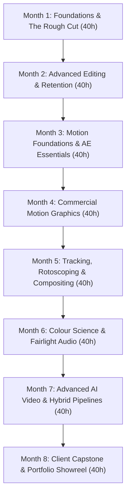
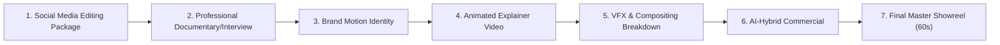

# AI-Integrated Video Editing & Motion Graphics Professional — Authoritative Academic Specification

**Program Title:** AI-Integrated Video Editing & Motion Graphics Professional
**Course Identifier:** `ai-integrated-video-editing-motion-graphics-professional`
**Legacy Identifier / Migration Source:** `motion-mastery` (Motion Graphics Master)
**Academy:** Video & Motion Academy (`video`, Academy ID: `video`)
**Credential Awarded:** Professional Diploma in AI-Integrated Video Editing & Motion Systems
**Academic Governance:** Nova Skills Academic Board | ISO 9001:2015 Standards
**Duration:** 8 Months (32 Academic Weeks)
**Guided Instructional Hours:** 320 Guided Hours (10 Hours / Week)
**Recommended Independent Studio Practice:** 160–200 Hours (strictly demarcated from guided hours)
**Target Level:** Beginner to Applied Commercial Professional (zero prerequisites; graduated from narrative editing fundamentals through advanced motion design and generative AI video pipelines)
**Authoritative Document Version:** 1.0.0 (October 2026 Production Standard)

---

## 1. Executive Summary & Program Positioning

### 1.1 Course Positioning & Industry Landscape
By late 2026, the visual media and video post-production industries underwent a generational transformation. The traditional industry boundary separating "offline video editors" (who cut narrative sequences) and "motion graphics designers" (who animate typography and vector branding) has dissolved. Today's commercial agencies, direct-to-consumer (D2C) brands, entertainment studios, and high-growth YouTube creators require **Full-Stack Video & Motion Generalists**.

Crucially, the rapid emergence of generative video models (Runway Gen-3, Google Veo, Adobe Firefly Video, Kling, ElevenLabs Voice AI, Topaz Video AI) has fundamentally altered the creative pipeline. Generative AI does not eliminate human craft; rather, it exponentially accelerates pre-visualization, concept iteration, background asset generation, voiceover prototyping, and frame interpolation. However, AI cannot replace editorial pacing, emotional story arcs, deliberate eye-trace, brand consistency, color science, broadcast audio mastering, or precise motion timing.

The **AI-Integrated Video Editing & Motion Graphics Professional** diploma is designed to train industry-ready visual storytellers who seamlessly synthesize:
1. **Classical Narrative Editing & Assembly:** Story arcs, pacing, cutting on action, J/L cuts, rhythm, and eye-trace in **Adobe Premiere Pro 26.5**.
2. **Dynamic 2D Motion Graphics & Visual Systems:** Kinetic typography, logo reveals, infographic animation, shape layer systems, and expression-driven animation in **Adobe After Effects 26.5**.
3. **Advanced Visual Effects & Compositing:** Planar tracking (Mocha AE), AI-assisted object matte caching, green screen chroma keying, clean-plating, and 3D camera tracking.
4. **Broadcast Color Science & Audio Post-Production:** Node-based primary and secondary grading, color space transforms, and SDR/HDR multi-master trims in **DaVinci Resolve 21.1**, coupled with dialogue restoration, Foley design, and EBU R128 loudness mastering in **Fairlight**.
5. **Generative AI Video Production Pipelines:** Ethical and commercial prompt engineering, start/end frame pinning, character consistency across scenes, generative B-roll generation, speech synthesis in **ElevenLabs**, and high-fidelity upscaling with **Topaz Video AI**.
6. **3D Workflow Foundations:** Camera projection, basic product modeling, and rendering multi-pass passes in **Blender** for seamless After Effects compositing.
7. **Client Handoff & Commercial Readiness:** Master delivery formats, platform-specific exports (vertical 9:16 reels, 16:9 cinema, square 1:1), contract scoping, revision protocols, and a comprehensive 7-part professional portfolio showreel.

---

### 1.2 Academy Architecture & Differentiation Matrix

To ensure total catalog clarity and prevent student cannibalization within the **Video & Motion Academy**, the following structural matrix delineates the relationship between the flagship career program and existing specialized tracks:

| Program Dimension | Professional Video Editing (`video-pro`) | AI Video Editing Professional (`ai-video-pro`) | Standalone Certifications (`adobe-premiere-pro`, `after-effects`, `davinci-resolve`) | AI-Integrated Video Editing & Motion Graphics Professional (`ai-integrated-video-editing-motion-graphics-professional`) [THIS COURSE] |
| :--- | :--- | :--- | :--- | :--- |
| **Duration & Hours** | 3 Months / 120 Guided Hours | 3 Months / 80 Guided Hours | 1–2 Months / 40–80 Guided Hours | **8 Months / 320 Guided Hours** |
| **Active Tuition** | ₹13,999 | ₹14,999 | ₹4,999 each | **Target Regular: ₹69,900 / Proposed Launch: ₹59,900** |
| **Primary Focus** | Traditional timeline assembly, rough cuts & audio | Quick AI B-roll generation, synthetic avatars & social cuts | Single-tool technical software certifications | **End-to-end commercial post-production, motion graphics systems, VFX compositing & AI integration** |
| **Core Toolset** | Premiere Pro, Audition, Lumetri basics | Descript, Runway, HeyGen, CapCut | Dedicated single software suite | **Premiere Pro 26.5, After Effects 26.5, DaVinci Resolve 21.1, Fairlight, Blender, Runway Gen-3, Google Veo, Firefly, ElevenLabs, Topaz** |
| **Motion Graphics** | Basic lower thirds & transitions | Automated caption templates | Focused software exercises | **Deep kinetic typography, shape modifiers, graph editor physics, rigging & logo animations** |
| **Compositing & VFX**| Basic green screen keying | Basic AI rotoscoping | Intermediate tool exercises | **Mocha AE planar tracking, multipass 3D camera tracking, object removal & cleanup** |
| **Color & Audio** | Lumetri scopes & basic audio balance | Automated AI clean-up | Specific software grading | **DaVinci Resolve node grading, CST, Fairlight stems, 6-band EQ & EBU R128 loudness standards** |
| **Portfolio Output** | 3 assembly edits | Social AI clips | Tool-specific assignments | **7 distinct commercial deliverables + integrated industry showreel** |

---

## 2. Audit of Existing Legacy Course (`motion-mastery`)

### 2.1 Historical Status & Limitations
The legacy course, **Motion Graphics Master** (`motion-mastery`), was registered as a 6-Month (240 hours) program priced at ₹26,999 (with an unapproved strikethrough price of ₹74,999). A rigorous forensic audit revealed critical structural deficiencies:
1. **Severe Curriculum Under-Specification:** The legacy JSON contained only 5 modules and 20 total lessons, resulting in an impossible mathematical ratio of 12 hours per lesson, with generic 2-line descriptions.
2. **Missing Video Editing Core:** Despite marketing claims including "Premiere Pro, DaVinci Resolve, Motion Graphics & AI Video", the curriculum contained virtually zero video editing instruction. Premiere Pro was mentioned only once in a single lesson on showreel assembly.
3. **Omission of Sound & Color Science:** No formal instruction in DaVinci Resolve color nodes, color space management, secondary qualifiers, or professional audio mixing standards (EBU R128/ITU-R BS.1770).
4. **Unrealistic 3D Claims:** Sweeping claims of "Cinema 4D Lite & 3D Integration" created unrealistic student expectations regarding high-end 3D artistry without providing foundational modeling, lighting, or realistic pipeline boundaries.
5. **Absence of Generative AI Workflows:** No modern generative video tools, character consistency methodologies, text-to-speech audio tagging, or hybrid AI-human production standards were taught.
6. **Commercial Inconsistencies:** The program advertised 16 projects in some fields and 3 projects in others, with no structured rubric or assessment methodology.

### 2.2 Pedagogical Disposition Matrix
| Legacy Topic / Module | Status | Strategic Action & Justification |
| :--- | :---: | :--- |
| **Motion Principles & AE Essentials** | **EXPAND** | Expanded from 4 lessons into foundational Months 3 & 4 with deep Graph Editor physics and kinetic typography. |
| **Shape Animation & Kinetic Typography** | **EXPAND** | Integrated into Module 10 with mathematical layout principles, 8pt spacing, and expression controllers. |
| **Cinema 4D Lite Integration** | **REPOSITION** | Repositioned away from proprietary C4D Lite to **Blender 4.x** (100% open-source) focusing realistically on camera projection and 3D product passes for AE. |
| **Character Rigging & Duik Bassel** | **REPOSITION** | Simplified into 2D puppet pins and infographic motion; senior character animation demarcated to specialized 3D courses. |
| **Broadcast Design Capstone** | **EXPAND** | Rebuilt into an authoritative multi-deliverable commercial showreel with formal grading rubrics. |
| **Video Editing & Storytelling** | **ADD** | Newly injected across Months 1 & 2 (80 guided hours) covering classical narrative editing, J/L cuts, and retention psychology. |
| **DaVinci Resolve Color & Fairlight Audio** | **ADD** | Newly injected across Month 6 (40 guided hours) covering Hollywood node trees and broadcast audio mastering. |
| **Generative AI Video & Hybrid Pipelines** | **ADD** | Injected incrementally from Month 1, culminating in deep Month 7 production with Runway Gen-3, Google Veo, and ElevenLabs. |

---

## 3. October 2026 Industry Hiring & Technical Vendor Benchmark

### 3.1 India-Focused Employer Hiring Landscape
Forensic analysis of hiring demands across Indian tech hubs (Bengaluru, Mumbai, Delhi-NCR, Hyderabad, Pune) and global remote freelance platforms (Upwork, Fiverr Pro) identifies high demand for the following hybrid job profiles:
- **Commercial Video Editor (CTC: ₹4.5L – ₹9.0L):** Requires mastery of Premiere Pro 26.5, narrative pacing, fast transcript-based rough cuts, retention hooks, and multi-cam podcast assembly.
- **Social Media Video Strategist / Reels Editor (CTC: ₹3.6L – ₹7.2L):** Demands dynamic pacing, auto-reframe workflows, kinetic typography, sound effect layering, and 9:16 vertical delivery.
- **Motion Graphics Designer (CTC: ₹5.0L – ₹11.0L):** Demands After Effects 26.5 fluency, logo animation, UI explainer videos, Lottie/JSON export, and brand motion design systems.
- **AI-Integrated Video Producer (CTC: ₹6.0L – ₹14.0L):** High-growth category requiring prompt engineering, image-to-video scene extension, character consistency, and AI B-roll generation integrated into traditional NLE timelines.
- **Post-Production Generalist (CTC: ₹6.5L – ₹13.0L):** Agency role responsible for the complete chain: ingest, rough cut, motion graphics, DaVinci Resolve grading, Fairlight audio mixing, and multi-platform encoding.

### 3.2 Technical Vendor & Tool Tier Separation
To ensure students understand real-world production realities without facing hidden software costs, tools are rigorously categorized:

| Tool & Version | Classification | Operational Tier | Commercial / Credit Reality |
| :--- | :--- | :--- | :--- |
| **Adobe Premiere Pro 26.5** | Core NLE | Production-Ready | Licensed via Adobe Creative Cloud; utilizes Paper Edit text editing, speech enhancement & Lumetri. |
| **Adobe After Effects 26.5** | Core Motion & VFX | Production-Ready | Licensed via Creative Cloud; uses new percentage guides, disk-cached Object Mattes & modern Effect Controls. |
| **DaVinci Resolve 21.1 (Free)** | Core Color & Audio | Production-Ready (Zero Cost) | Perpetual free license; covers 95% of node grading, MultiMaster trims, and Fairlight track folders. |
| **DaVinci Resolve Studio 21.1** | Advanced Tools | Lab / Studio Tier | Neural engine features (CineFocus, IntelliSearch) covered as comparative demonstrations in lab. |
| **Blender 4.3+** | 3D Camera & Passes | Production-Ready (Zero Cost) | 100% Free and open source; used for camera projection, lighting, and multi-pass rendering. |
| **Adobe Photoshop & Illustrator** | Graphic Asset Prep | Production-Ready | Vector preparation, asset separation, clean raster cutouts for motion graphics. |
| **Runway Gen-3 Alpha / Turbo** | Generative Video | Production-Ready (Credit-Managed) | Starter tier provides free initial credits; students learn efficient reference pinning and prompt precision to avoid credit waste. |
| **Google Veo (via Runway/Flow)** | Frontier Video Gen | Frontier Tier | Evaluated for physics-aware scene generation, cinematic lighting, and start/end-frame control. |
| **Adobe Firefly Video Model** | Generative Extend/B-roll | Integrated Creative Cloud | Timeline-native generative media in Premiere 26.5 for shot extension and ambient SFX generation. |
| **ElevenLabs Voice AI (v3)** | Speech Synthesis & SFX | Production-Ready (Free Tier) | Free starter tier (10,000 credits/mo); students learn audio emotion tags (`[whispers]`, `[laughs]`) and clean dialogue export. |
| **Topaz Video AI 5.x** | Upscaling & Frame Prep | Lab / Comparative Tier | AI de-noising, 4K upscaling, and optical flow frame interpolation demonstrated in masterclasses. |

---

## 4. Locked 26-Module Curriculum Matrix (320 Guided Hours)

The curriculum is structured across 8 progressive calendar months. Each month delivers **exactly 40 Guided Instructional Hours** across 3 to 4 modular units, totaling **320 Guided Hours**.



### Monthly Hour Allocation Summary
- **Month 1:** Modules 01 (12h), 02 (20h), 03 (8h) = **40 Hours**
- **Month 2:** Modules 04 (18h), 05 (14h), 06 (8h) = **40 Hours**
- **Month 3:** Modules 07 (10h), 08 (22h), 09 (8h) = **40 Hours**
- **Month 4:** Modules 10 (16h), 11 (16h), 12 (8h) = **40 Hours**
- **Month 5:** Modules 13 (12h), 14 (12h), 15 (8h), 16 (8h) = **40 Hours**
- **Month 6:** Modules 17 (20h), 18 (12h), 19 (8h) = **40 Hours**
- **Month 7:** Modules 20 (8h), 21 (14h), 22 (12h), 23 (6h) = **40 Hours**
- **Month 8:** Modules 24 (20h), 25 (8h), 26 (12h) = **40 Hours**
- **Total Program Load:** **26 Modules | 320 Guided Instructional Hours**

---

## 5. Comprehensive Module Competency Blueprint (Modules 01–26)

### MONTH 1: FOUNDATIONS & THE ROUGH CUT (40 GUIDED HOURS)

#### Module 01: Visual Storytelling & Editing Fundamentals (12 Guided Hours)
- **Learning Objectives:** Analyze narrative structure, identify pacing rhythms, execute classical continuity cuts, and direct audience attention through eye-trace.
- **Main Topics:**
  1. Cinema and Commercial Narrative Architecture
  2. The Rules of Continuity Editing
  3. Eye-Trace, Pacing, and Psychological Cutting
- **Detailed Subtopics:**
  - 3-act story structure, the hero's journey, documentary story curves, and commercial 15/30-second arc constraints.
  - The 180-degree rule, 30-degree rule, axis of action, screen direction, match on action, cutaways, and point-of-view (POV) framing.
  - Establishing eye-trace across cuts; cognitive load theory in fast-paced editing; emotional cutting points vs mechanical cutting points.
  - Metric montage, rhythmic cutting, tonal cutting, and associate montage concepts.
- **Primary Tools:** Screen analysis tools, Notion storyboards.
- **Supporting AI Tools:** Claude / ChatGPT for beat sheet breakdown and script analysis.
- **Classroom Labs:** Deconstructing an iconic feature film scene and commercial ad frame-by-frame; mapping eye-trace and cutting rhythms.
- **Independent Practice:** 8 hours film analysis log and continuity critique.
- **Assessed Deliverable:** Analytical breakdown essay and visual timeline map of a 60-second commercial.
- **Rubric:** Continuity identification (40%), Pacing analysis (30%), Eye-trace mapping accuracy (30%).

#### Module 02: Adobe Premiere Pro Essentials (20 Guided Hours)
- **Learning Objectives:** Configure professional editorial projects, manage media ingestion, master 3-point timeline editing, and execute clean assembly cuts.
- **Main Topics:**
  1. Professional Ingest & Media Management
  2. The Editorial Interface & Keyboard Architecture
  3. Three-Point Editing & Assembly Sequences
  4. Trimming, Ripple Edits & Pacing Adjustments
- **Detailed Subtopics:**
  - Premiere Pro 26.5 workspace configuration; scratch disks, proxy generation (ProRes Proxy / DNxHR LB), folder hierarchy, and media metadata tagging.
  - Keyboard shortcut mapping for two-handed editing (J-K-L navigation, I/O marks, insert/overwrite commands, ripple delete).
  - Source monitor patching, track targeting, subclips, pancake timeline workflows for fast assembly from selects reels.
  - Ripple edit tool, rolling edit tool, slip and slide tools; eliminating jump cuts with J-cuts and L-cuts for natural audio flow.
- **Primary Tools:** Adobe Premiere Pro 26.5.
- **Supporting AI Tools:** Premiere Pro Auto-Transcription for dialogue logging.
- **Classroom Labs:** Ingesting 25 camera takes of raw interview and B-roll footage, generating lightweight proxies, and assembling a 2-minute chronological rough cut.
- **Independent Practice:** 12 hours assembly cutting and proxy workflow practice.
- **Assessed Deliverable:** Complete 2-minute dialogue rough cut with seamless J/L audio transitions and zero black frames.
- **Rubric:** Organization and proxy hygiene (25%), Continuity & narrative coherence (35%), Cutting accuracy & J/L split execution (40%).

#### Module 03: AI-Assisted Pre-production (8 Guided Hours)
- **Learning Objectives:** Formulate production briefs, generate script beat sheets, generate reference moodboards, and build preliminary animatics using AI tools.
- **Main Topics:**
  1. Script Breakdown & AI Prompt Crafting
  2. Generative Storyboarding & Visual Style Guides
  3. Scratch Audio Generation & Pacing Animatics
- **Detailed Subtopics:**
  - Structuring creative briefs; prompt engineering for scene breakdowns, voiceover scripts, and shot lists in ChatGPT/Claude.
  - Midjourney / Adobe Firefly prompt crafting for camera angle, lighting (chiaroscuro, golden hour, volumetric), lens focal length, and color palette references.
  - ElevenLabs text-to-speech generation for scratch voiceover; timing animatics inside Premiere Pro before shooting or animation begins.
  - Ethical boundaries: distinguishing AI concept art from final client assets; IP and copyright precautions.
- **Primary Tools:** Adobe Premiere Pro, Notion, Figma.
- **Supporting AI Tools:** Midjourney, Adobe Firefly, Claude, ElevenLabs Voice AI.
- **Classroom Labs:** Inputting a raw client brief, generating a 5-scene storyboard with matching style frames, recording synthetic scratch audio, and assembling a 30-second animatic.
- **Independent Practice:** 6 hours storyboard iteration and animatic timing.
- **Assessed Deliverable:** 30-second timed animatic sequence with scratch VO and visual reference moodboard.
- **Rubric:** Prompt precision & visual cohesion (35%), Timing and pacing of animatic (35%), Documentation & brief alignment (30%).

---

### MONTH 2: ADVANCED EDITING & AUDIENCE RETENTION (40 GUIDED HOURS)

#### Module 04: Advanced Premiere Pro (18 Guided Hours)
- **Learning Objectives:** Execute multi-camera synchronization, construct complex multi-track timelines, utilize nested sequences, and automate rough cuts via Paper Edit.
- **Main Topics:**
  1. Multi-Camera Ingest & Sync Workflows
  2. Advanced Nesting, Submixes & Track Management
  3. Premiere 26.5 Paper Edit & Text-Based Cutting
  4. Dynamic Link Integration with Adobe Ecosystem
- **Detailed Subtopics:**
  - Synchronizing multi-cam shoots via audio waveforms, timecode, and in-points; switching live angles in the Multi-Camera Monitor.
  - Nesting strategies, adjustment layers, render & replace workflows for heavy effects, and track lock hygiene.
  - Premiere Pro 26.5 Paper Edit: highlighting text in the transcript panel to automatically insert video clips onto the active timeline; removing pauses and filler words in one click.
  - Dynamic Link with After Effects and Adobe Audition without intermediate rendering; round-trip cache management.
- **Primary Tools:** Adobe Premiere Pro 26.5, Dynamic Link.
- **Supporting AI Tools:** Premiere Speech-to-Text, Enhanced Speech dialogue clean-up.
- **Classroom Labs:** Ingesting a 3-camera 4K podcast interview, auto-syncing via waveform, performing a live multi-camera cut, and editing out pauses using Paper Edit.
- **Independent Practice:** 10 hours multi-cam editing and podcast pacing refinement.
- **Assessed Deliverable:** 5-minute fully edited multi-cam interview sequence with camera switching and lower third markers.
- **Rubric:** Sync accuracy (25%), Camera switching logic & reaction shots (45%), Timeline hygiene and text-based edit speed (30%).

#### Module 05: Commercial Editing & Audience Retention (14 Guided Hours)
- **Learning Objectives:** Design retention-driven edit curves, construct viral hooks, analyze audience drop-off metrics, and deploy dynamic sound bridges.
- **Main Topics:**
  1. The Psychology of Hook Construction (0–3 Seconds)
  2. Retention Curves, Pacing Changes & Pattern Interrupts
  3. B-Roll Layering & Visual Information Density
  4. Speed Ramping & Time Remapping
- **Detailed Subtopics:**
  - Anatomy of high-retention video hooks (visual, auditory, contextual); hook variation testing for paid social ads (Meta, YouTube, TikTok).
  - Graphing retention drop-offs; implementing pattern interrupts (punch-ins, sound hits, text popups, camera shake) every 4–6 seconds without fatiguing viewers.
  - Contextual B-roll sourcing and selection; pacing B-roll to reinforce verbal information without distracting from dialogue.
  - Optical flow speed ramping, time remapping curves, velocity transitions, and frame-rate conversion (60fps/120fps to 24fps timelines).
- **Primary Tools:** Adobe Premiere Pro 26.5.
- **Supporting AI Tools:** Retention analytics simulators, AI B-roll taggers.
- **Classroom Labs:** Transforming a flat, unengaging 60-second talking-head video into a high-energy, retention-optimized social ad utilizing speed ramps and pattern interrupts.
- **Independent Practice:** 8 hours speed-ramping and hook testing.
- **Assessed Deliverable:** High-retention 60-second commercial video featuring 3 distinct hook variations.
- **Rubric:** Hook engagement (35%), Flow of speed ramping (35%), Pacing and retention tactics (30%).

#### Module 06: AI Editing Acceleration (8 Guided Hours)
- **Learning Objectives:** Accelerate editorial turnover using timeline AI tools, automate reframing for vertical social formats, and synthesize dialogue enhancements.
- **Main Topics:**
  1. Auto-Reframe & Intelligent Multi-Aspect Delivery
  2. AI Dialogue Enhancement & Speech De-Reverberation
  3. Smart Masking & Scene Edit Detection
- **Detailed Subtopics:**
  - Auto-Reframe algorithms in Premiere Pro 26.5; converting 16:9 master sequences into 9:16 vertical and 1:1 square formats with keyframe adjustments for subject tracking.
  - Scene Edit Detection: automatically slicing flat rendered video files into editable sub-clips for rapid recuts.
  - Enhanced Speech in Premiere: balancing natural room tone against synthetic voice clean-up; eliminating background hiss, air conditioner noise, and room reverb.
  - Generative Media Tool in Premiere 26.5: filling brief timeline video gaps using text prompts and reference frames.
- **Primary Tools:** Adobe Premiere Pro 26.5.
- **Supporting AI Tools:** Adobe Firefly Generative Extend, Premiere Auto-Reframe, Enhanced Speech.
- **Classroom Labs:** Taking a finished 16:9 commercial, running Scene Edit Detection, generating 9:16 auto-reframed cuts with tracking adjustments, and cleaning damaged audio.
- **Independent Practice:** 6 hours vertical reformatting and AI audio enhancement.
- **Assessed Deliverable:** Complete multi-format social delivery package (16:9, 9:16, 1:1) with enhanced clean audio.
- **Rubric:** Multi-aspect framing accuracy (40%), Audio enhancement naturalism (30%), Speed and workflow efficiency (30%).

---

### MONTH 3: MOTION FOUNDATIONS & AFTER EFFECTS ESSENTIALS (40 GUIDED HOURS)

#### Module 07: Graphic Design for Motion (10 Guided Hours)
- **Learning Objectives:** Apply graphic design principles to video frames, construct balanced motion layouts, establish typographic hierarchies, and prepare vector assets for animation.
- **Main Topics:**
  1. Composition, Grid Systems & Visual Hierarchy in Video
  2. Typography in Motion: Kerning, Tracking & Readability
  3. Asset Preparation in Adobe Illustrator & Photoshop
  4. Layer Organization, Naming Conventions & Vector Separation
- **Detailed Subtopics:**
  - Rule of thirds, golden ratio, safe title/action margins (EBU/SMPTE guidelines), 8pt design grid applied to 1920x1080 and 3840x2160 canvases.
  - Type selection for video (geometric sans-serifs vs editorial serifs); hierarchy, leading, contrast ratios, and motion legibility at varying playback speeds.
  - Structuring vector artwork in Illustrator specifically for After Effects: separating layers, naming conventions, removing clipping masks, and centering anchor points.
  - Overlord and native Illustrator-to-After Effects importing: converting vector layers to shape layers without distortion.
- **Primary Tools:** Adobe Illustrator, Adobe Photoshop, After Effects.
- **Supporting AI Tools:** Adobe Firefly vector recoloring and font matching.
- **Classroom Labs:** Dissecting a flat brand identity vector file, separating assets into animation-ready layers, and building a 3-frame typographic motion layout.
- **Independent Practice:** 6 hours vector preparation and typography layout.
- **Assessed Deliverable:** Production-ready Illustrator asset board with separated, labeled layers ready for AE import.
- **Rubric:** Asset separation hygiene (35%), Typographic hierarchy (35%), Grid composition (30%).

#### Module 08: Adobe After Effects Essentials (22 Guided Hours)
- **Learning Objectives:** Master the After Effects interface, animate transform properties, sculpt easing curves using the Graph Editor, and construct shape layer systems.
- **Main Topics:**
  1. Composition Setup, Frame Rates & Timecode
  2. Transform Properties & Spatial vs Temporal Interpolation
  3. The Graph Editor: Value Graphs & Speed Graphs
  4. Shape Layer Modifiers: Trim Paths, Repeaters & Merge Paths
- **Detailed Subtopics:**
  - After Effects 26.5 interface, project settings, square pixel aspect ratios, 24fps vs 29.97fps vs 60fps standards, and percentage-based guide pinning.
  - Position, Scale, Rotation, Opacity, and Anchor Point; spatial interpolation (linear, bezier, continuous) vs temporal interpolation.
  - Mastering the Graph Editor: manipulating bezier handles on speed curves to achieve snappy, organic motion physics (anticipation, overshoot, settle).
  - Shape layers deep dive: stroke/fill options, trim paths animation for line reveals, repeaters for radial graphic bursts, and wiggle paths for organic micro-motion.
  - Masks, track mattes (Alpha, Luma, Inverted), pre-composing hierarchies, and null object parenting controllers.
- **Primary Tools:** Adobe After Effects 26.5.
- **Supporting AI Tools:** AE native expression helpers and script assistance.
- **Classroom Labs:** Building a series of kinetic shape animations utilizing trim paths, repeaters, and precision speed-graph easing curves.
- **Independent Practice:** 14 hours Graph Editor curve sculpting and shape animation drills.
- **Assessed Deliverable:** 15-second fluid motion loop featuring shape modifiers, null parenting, and flawless speed-graph easing.
- **Rubric:** Easing smoothness & physics realism (40%), Shape modifier execution (30%), Layer hierarchy & null structure (30%).

#### Module 09: Creative Animation Exercises (8 Guided Hours)
- **Learning Objectives:** Implement the 12 classical principles of animation in digital motion graphics, construct kinetic typography sequences, and animate UI micro-interactions.
- **Main Topics:**
  1. The 12 Principles of Animation Applied to Motion Design
  2. Kinetic Typography: Text Animators & Range Selectors
  3. UI/UX Motion: App Mockups & Screen Micro-interactions
- **Detailed Subtopics:**
  - Squash and stretch, anticipation, staging, follow-through and overlapping action, slow in and slow out, arcs, secondary action, timing, exaggeration.
  - Text animator engines in After Effects: tracking, blur, position offsets, range selectors (start/end/offset), and expression wigglers for kinetic text.
  - Animating mobile and desktop UI screens: cursor tracking, button tap feedback, page slide transitions, and notification popups.
- **Primary Tools:** Adobe After Effects 26.5.
- **Supporting AI Tools:** ChatGPT for generating kinetic typography wordplay scripts.
- **Classroom Labs:** Animating a dynamic 10-second kinetic typography quote timed precisely to a voice clip with per-character range selector reveals.
- **Independent Practice:** 6 hours kinetic typography and UI micro-interaction builds.
- **Assessed Deliverable:** 15-second kinetic typography sequence synchronized with audio voiceover.
- **Rubric:** Text legibility & sync (35%), Animation personality & easing (35%), 12 principles application (30%).

---

### MONTH 4: COMMERCIAL MOTION GRAPHICS & 2D SYSTEMS (40 GUIDED HOURS)

#### Module 10: Professional 2D Motion Systems (16 Guided Hours)
- **Learning Objectives:** Code basic JavaScript expressions for automated motion, build reusable Motion Graphics Templates (.mogrt), and architect scalable brand motion systems.
- **Main Topics:**
  1. Essential Expressions for Motion Automation
  2. Slider Controls, Pickwhipping & Mathematical Rigging
  3. Building Responsive MOGRTs in the Essential Graphics Panel
  4. Brand Motion Design Guidelines & Style Tokens
- **Detailed Subtopics:**
  - Expression fundamentals: `time*`, `wiggle(freq, amp)`, `loopOut("cycle")`, `loopOut("pingpong")`, `valueAtTime()`.
  - Creating animation rigs using Slider Controls, Angle Controls, and Checkbox Controls; linking multiple layers to a master control null.
  - Essential Graphics Panel: exporting Motion Graphics Templates (.mogrt) for Premiere Pro editors with customizable text, colors, and responsive duration markers.
  - Brand motion manuals: defining ease curves, duration tokens (fast: 150ms, medium: 300ms, slow: 500ms), and transition palettes for enterprise clients.
- **Primary Tools:** Adobe After Effects 26.5, Essential Graphics.
- **Supporting AI Tools:** Claude / ChatGPT for expression syntax debugging and math generation.
- **Classroom Labs:** Building a multi-parameter Lower Third MOGRT with responsive intro/outro markers and color sliders, exported and tested live in Premiere Pro.
- **Independent Practice:** 10 hours expression rigging and MOGRT packaging.
- **Assessed Deliverable:** Package of 3 fully functional commercial MOGRT templates (Lower Third, Title Card, Social Call-to-Action).
- **Rubric:** Expression functionality & error handling (35%), MOGRT usability in Premiere Pro (35%), Visual polish & flexibility (30%).

#### Module 11: Commercial Motion Graphics (16 Guided Hours)
- **Learning Objectives:** Produce commercial explainer videos, animate vector infographics and data visualizations, and construct cohesive corporate brand animations.
- **Main Topics:**
  1. Narrative Flow in Explainer Videos
  2. Data Visualization: Animated Charts, Graphs & Isometric Counters
  3. Logo Animation & Brand Idents
  4. Seamless Scene Transitions: Morphing, Match-Cuts & Camera Wipes
- **Detailed Subtopics:**
  - Structuring 30-to-60-second explainer narratives (Problem, Agitation, Solution, CTA); visual pacing and transitions between disparate concepts.
  - Animating data: percentage rings (trim paths), rising bar charts, smooth line graphs with animated gradient fills, and digital number counting expressions (`Math.round()`).
  - Brand ident principles: animating logo marks to communicate brand ethos (tech, luxury, playful, authoritative); using write-ons, 3D layer flips, and lighting sweeps.
  - Morphing shapes: animating vector paths to transition seamlessly between icons; using motion blur and scale match-cuts to eliminate hard cuts.
- **Primary Tools:** Adobe After Effects 26.5, Illustrator.
- **Supporting AI Tools:** AI voice synthesis for explainer narration timing.
- **Classroom Labs:** Animating a complete 30-second SaaS product explainer sequence featuring animated metrics, icon morphing, and an official logo ident reveal.
- **Independent Practice:** 12 hours explainer scene builds and logo animation refinement.
- **Assessed Deliverable:** 30-second animated commercial explainer video with logo ident and data graphics.
- **Rubric:** Narrative continuity & scene transitions (35%), Motion precision & timing (35%), Brand alignment & visual design (30%).

#### Module 12: Integrated Production (8 Guided Hours)
- **Learning Objectives:** Integrate After Effects motion graphics into Premiere Pro editorial timelines, manage media caches, and render production-quality visual assets.
- **Main Topics:**
  1. Premiere to After Effects Workflow Architecture
  2. Render Queues vs Adobe Media Encoder
  3. Lossless Codecs, Alpha Channels & ProRes 4444
  4. Disk Cache Management & Project Packaging
- **Detailed Subtopics:**
  - Choosing between Dynamic Link and Pre-Rendering: identifying when Dynamic Link causes timeline playback lag; the Render and Replace workflow.
  - Codec mastery for motion design: Apple ProRes 422, ProRes 4444 (with Straight vs Premultiplied Alpha), GoPro CineForm, and Avid DNxHR.
  - After Effects 26.5 multi-frame rendering optimization, memory allocation, and clearing corrupted disk caches.
  - Project archival: Collect Files workflow, dependency reduction, missing font resolution, and clean folder handoff to client editing teams.
- **Primary Tools:** Adobe After Effects 26.5, Adobe Media Encoder.
- **Supporting AI Tools:** Automated render farm and asset validation tools.
- **Classroom Labs:** Packaging a complex multi-layered After Effects comp, exporting ProRes 4444 with transparent alpha, overlaying it on live-action footage in Premiere, and archiving project files.
- **Independent Practice:** 6 hours codec testing and project archival drills.
- **Assessed Deliverable:** Production-ready archive folder containing clean master comps, alpha renders, and project file dependencies.
- **Rubric:** Alpha transparency accuracy (35%), Codec and compression standards (35%), Archive organization & zero missing assets (30%).

---

### MONTH 5: TRACKING, ROTOSCOPING & COMPOSITING (40 GUIDED HOURS)

#### Module 13: Motion Tracking & Camera Integration (12 Guided Hours)
- **Learning Objectives:** Execute point tracking, planar surface tracking in Mocha AE, solve 3D camera tracks, and composite graphics into moving live-action footage.
- **Main Topics:**
  1. Point Tracking vs Planar Tracking vs 3D Camera Tracking
  2. Planar Tracking in Boris FX Mocha AE
  3. Screen Replacement & Corner Pinning
  4. 3D Camera Tracker: Solving Ground Planes & Text Placement
- **Detailed Subtopics:**
  - Single-point and two-point tracking in After Effects (tracking position, scale, rotation); handling occlusion, motion blur, and feature loss.
  - Planar tracking with Mocha AE: tracking planes, search areas, surface alignment, and exporting corner pin data vs transform data.
  - Screen replacement workflows: inserting phone/laptop UI mockups onto curved, reflective, moving displays; matching screen grain, glare, and finger occlusions.
  - 3D Camera Tracker: feature points, camera solve errors (maintaining average error < 1.0 pixel), setting origin and ground planes, placing floating 3D typography into drone footage.
- **Primary Tools:** Adobe After Effects 26.5, Mocha AE.
- **Supporting AI Tools:** AI-assisted point feature recognition.
- **Classroom Labs:** Tracking a moving smartphone screen in Mocha AE, replacing the screen with an animated app UI, and compositing volumetric 3D text into handheld footage.
- **Independent Practice:** 8 hours screen replacement and 3D camera tracking exercises.
- **Assessed Deliverable:** Two seamless visual shots: (1) Realistic mobile phone screen replacement; (2) 3D tracked text anchored in moving environment.
- **Rubric:** Track stability & zero drift (40%), Screen lighting & reflection realism (30%), 3D camera solve error (<1.0px) (30%).

#### Module 14: Rotoscoping & Compositing (12 Guided Hours)
- **Learning Objectives:** Isolate moving subjects from complex backgrounds using Roto Brush 3.0 and manual bezier splines, manage disk caches, and composite visual elements.
- **Main Topics:**
  1. Manual Spline Rotoscoping vs AI Roto Brush 3.0
  2. Edge Refinement: Decontamination, Feather & Shift
  3. AE 26.5 Disk Caching for Object Mattes
  4. Garbage Mattes & Foreground/Background Separation
- **Detailed Subtopics:**
  - The mathematics of rotoscoping: breaking complex human motion into articulated shapes (head, torso, limbs); avoiding "boiling" edges.
  - Roto Brush 3.0: propagation strokes, freeze frames, edge refinement tools for hair and fine details, color decontamination of background spills.
  - After Effects 26.5 persistent disk caching: preserving Object Matte propagation across project sessions without re-computation bottlenecks.
  - Layer sandwiching: isolating an actor, placing animated motion graphics or titles behind them, and retaining live foreground shadows.
- **Primary Tools:** Adobe After Effects 26.5 (Roto Brush 3.0, Mocha AE).
- **Supporting AI Tools:** Runway / Segment Anything AI segmentation comparison.
- **Classroom Labs:** Isolating a dancing actor against a busy city street, refining hair edges, freezing the roto propagation, and sandwiching stylized kinetic typography behind the subject.
- **Independent Practice:** 8 hours rotoscoping drills on complex motion footage.
- **Assessed Deliverable:** 10-second composite featuring hair-level rotoscoping, clean edge refinement, and animated typography behind the subject.
- **Rubric:** Edge stability & lack of edge chatter (40%), Hair detail preservation (30%), Layer integration & depth illusion (30%).

#### Module 15: Advanced Compositing Techniques (8 Guided Hours)
- **Learning Objectives:** Execute seamless green screen chroma keying, clean-plate object removal, lighting integration, and lens artifact matching.
- **Main Topics:**
  1. Professional Chroma Keying with Keylight 1.2
  2. Spill Suppression & Edge Color Blending
  3. Clean-Plating, Wire Removal & Content-Aware Fill
  4. Lens Matching: Film Grain, Vignette, Chromatic Aberration & Glows
- **Detailed Subtopics:**
  - Keylight 1.2 workflow: Screen colour selection, Screen Matte analysis (viewing black and white clip levels), Screen Balance, Screen Pre-blur.
  - Spill suppression techniques; un-premultiplying alpha; light wraps for natural composite integration against bright backdrops.
  - Content-Aware Fill for Video: generating reference frames in Photoshop, removing unwanted logos, crew reflections, and wires from moving footage.
  - Photorealism compositing principles: matching black levels, color temperature, optical motion blur, camera sensor grain (matching ISO noise), chromatic aberration, and anamorphic lens glows.
- **Primary Tools:** Adobe After Effects 26.5 (Keylight, Content-Aware Fill).
- **Supporting AI Tools:** Photoshop Generative Fill for clean plate reference generation.
- **Classroom Labs:** Pulling a clean key on unevenly lit green screen footage, suppressing green spill on actor edges, and matching camera grain with an AI-generated scenic plate.
- **Independent Practice:** 6 hours chroma keying and clean-plate compositing.
- **Assessed Deliverable:** Photorealistic green screen composite shot with realistic light wrap, grain matching, and zero edge fringe.
- **Rubric:** Key cleanliness & transparency (35%), Spill suppression & light wrap (35%), Grain and black-level matching (30%).

#### Module 16: 3D Workflow Introduction (8 Guided Hours)
- **Learning Objectives:** Navigate Blender 3D space, build simple product geometries, execute camera projections, and export render passes for After Effects compositing.
- **Main Topics:**
  1. Blender Interface, Navigation & 3D Space Coordinates
  2. Basic Product Modeling & Primitive Geometry
  3. Camera Projection & Scene Lighting
  4. Rendering Multi-Pass Exporters for After Effects
- **Detailed Subtopics:**
  - Blender 4.3+ viewport navigation, 3D cursor, transforms (Grab, Rotate, Scale), object mode vs edit mode.
  - Modeling simple commercial props (cosmetic bottle, soda can, smartphone chassis); applying PBR materials (Roughness, Metallic, Normal maps).
  - HDRI environment lighting, 3-point studio lighting setups, camera focal lengths (50mm, 85mm), and depth of field.
  - Camera projection mapping: projecting 2D photos onto 3D geometry to create parallax camera moves.
  - Rendering with Cycles / Eevee Next: exporting EXR multi-layer passes (Beauty, Cryptomatte, Ambient Occlusion, Depth Z-pass) into After Effects.
  - *Academic Boundary:* Establishing realistic boundaries—this module teaches 3D support workflows for motion designers, not senior character rigging or high-end game asset creation.
- **Primary Tools:** Blender 4.3+, Adobe After Effects.
- **Supporting AI Tools:** AI PBR texture generation tools.
- **Classroom Labs:** Modeling a stylized 3D cosmetic bottle in Blender, setting up studio lighting, rendering beauty and shadow passes, and compositing the 3D render into an After Effects commercial ad.
- **Independent Practice:** 6 hours Blender modeling and camera projection practice.
- **Assessed Deliverable:** 3D motion graphic shot featuring a 3D product render composited with 2D motion graphics in AE.
- **Rubric:** 3D model & lighting realism (35%), Multi-pass composite quality in AE (35%), Pipeline cleanliness (30%).

---

### MONTH 6: COLOUR, AUDIO & POST FINISHING (40 GUIDED HOURS)

#### Module 17: Professional Colour Correction & Grading (20 Guided Hours)
- **Learning Objectives:** Read video scopes, balance primary exposures, execute secondary skin tone corrections, manage color spaces (ACES / DaVinci YRGB), and grade cinematic looks in DaVinci Resolve.
- **Main Topics:**
  1. DaVinci Resolve 21.1 Interface & Color Page Architecture
  2. Scopes Mastery: Waveform, Vectorscope, Histogram & Parade
  3. Primary Wheels, Log Wheels & Color Space Transforms (CST)
  4. Secondary Qualifiers, Power Windows & Tracking
  5. Creative Look Development & MultiMaster Deliverables
- **Detailed Subtopics:**
  - DaVinci Resolve 21.1 setup, project settings, timeline color management (DaVinci YRGB Color Managed vs ACEScc workflows).
  - Reading scopes: identifying exposure clipping on the Waveform; checking skin tone line on the Vectorscope; balance analysis on the RGB Parade.
  - Primary grading: Lift, Gamma, Gain, Offset; Log wheels for fine shadow/highlight control; tone curve sculpting.
  - Color Space Transforms (CST): converting camera Log formats (Sony S-Log3, Canon C-Log2, Apple Log, ARRI LogC) into Rec.709 and Rec.2020.
  - Secondary grading: HSL and 3D Qualifiers to isolate skies, clothing, or skin; Power Windows with 3D tracker integration; skin tone retouching without over-smoothing.
  - MultiMaster trims: managing SDR and HDR deliverables from a single node tree; exporting CDLs and 33-point .cube LUTs.
- **Primary Tools:** DaVinci Resolve 21.1 (Free / Studio).
- **Supporting AI Tools:** DaVinci IntelliSearch & Face Refinement tools.
- **Classroom Labs:** Ingesting raw Sony S-Log3 and Canon Log footage, applying CST node trees, balancing shots across a scene, qualifying and protecting skin tones, and grading a dramatic film look.
- **Independent Practice:** 12 hours color grading and scene matching drills.
- **Assessed Deliverable:** Fully graded 90-second cinematic scene featuring 6 matched multi-camera shots with consistent skin tones and exposure balance.
- **Rubric:** Shot-to-shot color balance (40%), Skin tone naturalism & scope accuracy (35%), Creative look aesthetics (25%).

#### Module 18: Sound Editing & Fairlight (12 Guided Hours)
- **Learning Objectives:** Clean dialogue, design multi-layered soundscapes, mix audio tracks in Fairlight, and master audio to broadcast loudness standards.
- **Main Topics:**
  1. The Fairlight Audio Page Interface & Signal Flow
  2. Dialogue Editing, Noise Reduction & De-Essing
  3. Sound Design Architecture: Ambience, Foley, Hits & Risers
  4. 6-Band Parametric EQ, Dynamic Compression & Limiting
  5. Broadcast Loudness Standards (EBU R128 / ITU-R BS.1770)
- **Detailed Subtopics:**
  - Fairlight interface, audio track folders for stem separation (Dialogue, Sound Effects, Music, Master Bus).
  - Dialogue repair: clip gain automation, de-noising, spectral editing, de-essing harsh sibilants, and room tone patching.
  - Building commercial sound design: layering Foley footsteps, clothing rustle, atmospheric ambient beds, whooshes, impacts, and cinematic sub-drops.
  - Audio processing chain: high-pass filtering (80Hz cut), subtractive EQ, gentle 2:1 dialogue compression, sidechain ducking (ducking music under dialogue automatically).
  - Loudness metering: Integrated LUFS, Short-Term LUFS, True Peak ceiling (-1.0 dBFS); hitting platform specs: YouTube / Spotify (-14 LUFS), Netflix / Broadcast (-24 LUFS / -23 LUFS EBU R128).
- **Primary Tools:** DaVinci Resolve Fairlight 21.1, Adobe Audition.
- **Supporting AI Tools:** AI stem separation and audio dialogue restoration models.
- **Classroom Labs:** Taking a dialogue scene with noisy audio, restoring voice clarity, constructing a complete sound effect soundscape, ducking background music, and mastering the mix to -14 LUFS.
- **Independent Practice:** 8 hours sound design layering and Fairlight mix automation.
- **Assessed Deliverable:** Complete stereo mix with dialogue, Foley, and music stems meeting exact -14 LUFS (±0.5 LUFS) integrated loudness with -1.0 dBFS True Peak.
- **Rubric:** Dialogue intelligibility & spectral clean-up (35%), Sound design impact & layering (35%), Loudness meter technical compliance (30%).

#### Module 19: Professional Finishing & Delivery (8 Guided Hours)
- **Learning Objectives:** Configure master exports, verify legal broadcast ranges, apply platform encoding standards, and execute quality assurance checks.
- **Main Topics:**
  1. Video Codecs, Containers & Compression Fundamentals
  2. Delivery Presets for Web, Social, Cinema & Broadcast
  3. Quality Control (QC) Protocols: Artifacts, Banding & Audio Sync
  4. Project Archival, Handoff & Version Control
- **Detailed Subtopics:**
  - Codec architecture: inter-frame (H.264, HEVC/H.265, AV1) vs intra-frame (ProRes, DNxHD/HR); bitrates (VBR 2-pass vs CBR), GOP lengths, chroma subsampling (4:2:0 vs 4:2:2 vs 4:4:4).
  - Export settings: YouTube 4K (high bitrate MP4), Instagram Reels / TikTok (optimized 1080x1920 MP4 avoiding compression crushing), Apple ProRes Master Archive.
  - QC checklist: verifying black frames, flash frames, audio pops at cut points, color banding in gradients (dither solutions), and sync drift over long durations.
  - Multi-deliverable versioning: Clean masters (textless), Subtitled versions (burned-in vs .SRT sidecar), and broadcast master packages.
- **Primary Tools:** DaVinci Resolve Deliver Page, Adobe Media Encoder.
- **Supporting AI Tools:** AI automated QC analyzers.
- **Classroom Labs:** Generating a complete commercial release package from a master timeline: 4K ProRes master, 1080p web release, vertical social cut with burned subtitles, and textless clean archive.
- **Independent Practice:** 6 hours export configuration and QC auditing.
- **Assessed Deliverable:** Multi-file commercial delivery package with detailed QC inspection log.
- **Rubric:** Codec specification compliance (40%), QC verification accuracy (35%), Folder organization & naming standards (25%).

---

### MONTH 7: ADVANCED AI VIDEO & HYBRID PRODUCTION (40 GUIDED HOURS)

#### Module 20: AI Creative Direction & Pre-production (8 Guided Hours)
- **Learning Objectives:** Direct AI visual production pipelines, maintain character and scene consistency across prompts, and construct comprehensive AI story reels.
- **Main Topics:**
  1. Generative Visual Direction & Prompt Taxonomy
  2. Character Consistency Frameworks Across Multiple Scenes
  3. Start-Frame and End-Frame Shot Planning
  4. Creative Ethics, Copyright & Commercial IP Boundaries
- **Detailed Subtopics:**
  - Advanced prompt architectures: subject, environmental lighting, photographic lens (e.g. "anamorphic 35mm, f/1.8"), motion direction, color grading palette, and camera velocity.
  - Character consistency methodologies: using seed pinning, facial reference embeddings, consistent clothing descriptions, and LoRA/reference-to-image workflows.
  - Designing start-frame and end-frame keyframes: planning camera transitions between AI clips before generation to ensure seamless temporal interpolation.
  - Legal, commercial, and ethical standards: copyright status of purely AI-generated media, client contract disclosure requirements, avoiding trademark infringements, and deepfake prevention ethics.
- **Primary Tools:** Midjourney, Adobe Firefly, Figma.
- **Supporting AI Tools:** ChatGPT / Claude for prompt expansion and storyboard sequencing.
- **Classroom Labs:** Creating a visual pitch deck for a 30-second futuristic commercial with 6 scenes featuring a recurring consistent protagonist across varying camera angles.
- **Independent Practice:** 6 hours prompt iteration and character consistency testing.
- **Assessed Deliverable:** 6-frame consistent character concept deck with comprehensive camera and lighting prompt documentation.
- **Rubric:** Character and style consistency (45%), Prompt documentation & precision (30%), Ethical and IP compliance (25%).

#### Module 21: AI Video & Visual Generation (14 Guided Hours)
- **Learning Objectives:** Generate cinematic video clips using text-to-video and image-to-video models, control motion brushes, direct virtual camera trajectories, and upscale video.
- **Main Topics:**
  1. Text-to-Video vs Image-to-Video Engine Mechanics
  2. Runway Gen-3 Alpha: Motion Brush & Directional Controls
  3. Google Veo & Frontier Video Models: Physics & Cinematic Lighting
  4. AI Video Upscaling, De-noising & Frame Interpolation
- **Detailed Subtopics:**
  - Generation mechanics: diffusion transformers, latent space motion, frame rate generation (24fps native vs interpolated), and managing temporal coherence.
  - Runway Gen-3 Alpha / Turbo: image-to-video priming; camera controls (pan, tilt, zoom, truck, roll); motion brush isolation for selective regional animation (water flowing, smoke rising, clouds drifting while subject stays grounded).
  - Google Veo (via Runway/Flow integration): generating physics-consistent motion (liquids, reflections, particle collisions) and extended 8-second cinematic shots.
  - Topaz Video AI: resolving common AI video artifacts (jitter, morphing, plastic skin textures); upscaling 720p/1080p generations to crisp 4K; generating 60fps smooth slow motion via optical flow.
- **Primary Tools:** Runway Gen-3 Alpha, Google Veo, Topaz Video AI.
- **Supporting AI Tools:** Kling AI, Luma Dream Machine (comparative analysis).
- **Classroom Labs:** Priming 4 high-resolution Midjourney images, using Runway motion brushes to animate specific elements, controlling camera dolly moves, and upscaling the output through Topaz Video AI.
- **Independent Practice:** 8 hours video prompt testing and motion brush refinement.
- **Assessed Deliverable:** Sequence of 4 interconnected AI-generated video shots exhibiting consistent lighting, deliberate camera movement, and zero severe temporal warping.
- **Rubric:** Motion brush precision & lack of warping (40%), Cinematic camera execution (35%), Upscaling and artifact management (25%).

#### Module 22: Hybrid Production Pipeline (12 Guided Hours)
- **Learning Objectives:** Seamlessly composite generative AI video assets with live-action footage, match colorimetry and grain, and integrate AI synthetic audio.
- **Main Topics:**
  1. Integrating AI Media into Traditional NLE Timelines
  2. Color Grading AI Video to Match Real Camera Log Profiles
  3. Inpainting, Object Replacement & Generative Video Clean-Up
  4. Synthetic Voiceover & Sound Design with ElevenLabs v3
- **Detailed Subtopics:**
  - Importing AI clips into Premiere Pro and DaVinci Resolve: handling non-standard frame rates, color space tagging, and timeline conform.
  - Color science of AI video: AI footage is typically rendered in high-contrast sRGB/Rec.709 with baked-in saturation; stripping contrast with curves and grading it to match Arri/Sony camera profiles.
  - Adding realistic lens grain and digital sensor noise over AI video to eliminate the synthetic "plastic" look and blend seamlessly with live-action shots.
  - Video inpainting: using AI generative fill to replace backgrounds in moving footage; compositing live-action actors onto AI-generated futuristic environments.
  - ElevenLabs v3 audio production: prompt tags (`[excited]`, `[whispering]`, `[thoughtful]`), voice cloning, generating contextual Foley sound effects from text prompts, and mixing in Fairlight.
- **Primary Tools:** Adobe Premiere Pro 26.5, DaVinci Resolve 21.1, ElevenLabs.
- **Supporting AI Tools:** Adobe Firefly Generative Extend, Runway Inpainting.
- **Classroom Labs:** Compositing a live-action talking actor over a photorealistic AI-generated sci-fi cityscape, matching color temperature, adding film grain, and mixing an ElevenLabs voiceover.
- **Independent Practice:** 8 hours hybrid compositing and audio integration.
- **Assessed Deliverable:** 30-second hybrid scene seamlessly combining live-action video, generative AI background environments, and synthetic sound effects.
- **Rubric:** Visual seam transparency between live & AI elements (40%), Color and grain matching (35%), Sound design and voiceover sync (25%).

#### Module 23: Commercial AI Production Standards (6 Guided Hours)
- **Learning Objectives:** Establish studio-grade AI workflows, calculate generation compute and credit budgets, communicate transparency with clients, and avoid prompt waste.
- **Main Topics:**
  1. Credit Budgeting, Compute Costs & ROI for Video Agencies
  2. Commercial Licensing & Model Usage Rights
  3. Quality Assurance: Identifying Uncanny Valley & Anatomical Flaws
  4. The Future of Video Production: Agent-Assisted Workflows
- **Detailed Subtopics:**
  - Financial reality of AI video: calculating cost-per-second of generation; planning shot lists rigorously to minimize paid credit wastage; utilizing lightweight models (Gen-3 Turbo) for preview and frontier models for final masters.
  - Commercial terms of service: understanding enterprise licensing in Adobe Firefly, Runway, and ElevenLabs; indemnification clauses for commercial advertising.
  - Critical QA checklist: evaluating anatomical distortions (hands, eyes, reflections), physics inconsistencies, text warping, and synthetic motion jitter.
  - Autonomous AI video agents: exploring conversational editing assistants in DaVinci Resolve 21.1 and Premiere for media organization, batch rendering, and automated subtitle generation.
- **Primary Tools:** Project management budgeting templates, DaVinci Resolve 21.1.
- **Supporting AI Tools:** Claude / ChatGPT for production budgeting and client contracts.
- **Classroom Labs:** Auditing a 60-second AI-assisted commercial project, identifying uncanny valley artifacts, formulating a credit budget report, and drafting a client transparency disclosure.
- **Independent Practice:** 4 hours workflow auditing and production budgeting.
- **Assessed Deliverable:** Comprehensive commercial AI video production plan including credit budget calculations, QA defect log, and client usage rights documentation.
- **Rubric:** Commercial budget accuracy (35%), QA defect detection (35%), Contractual and ethical clarity (30%).

---

### MONTH 8: CAPSTONE PRODUCTION, CLIENT DELIVERY & PORTFOLIO (40 GUIDED HOURS)

#### Module 24: Industry Client Production (20 Guided Hours)
- **Learning Objectives:** Execute an end-to-end commercial client brief, manage client revision cycles, deliver multi-stage rough cuts and fine cuts, and finalize a broadcast-ready spot.
- **Main Topics:**
  1. Intake & Interpretation of Commercial Client Briefs
  2. Milestone Delivery: Assembly, Rough Cut, Fine Cut & Picture Lock
  3. Client Collaboration, Frame.io Review & Revision Management
  4. Executing Final Color, Motion Graphics & Audio Mix
- **Detailed Subtopics:**
  - Brief analysis: extracting brand tone, target demographic, core value proposition, deliverables list, and technical delivery specifications.
  - Production milestones: Stage 1 (Script & Storyboard approval); Stage 2 (Assembly & Rough cut with scratch audio); Stage 3 (Picture Lock with finalized pacing); Stage 4 (Finishing: Color grade, motion graphics, audio mix).
  - Collaborative review workflows in Frame.io: timecode-specific client comments, version stacking, handling conflicting stakeholder feedback, and setting boundary limits on out-of-scope revisions.
  - Final integration: assembling all live-action footage, motion design assets, 3D elements, and AI-generated media into an immaculate, unified commercial film.
- **Primary Tools:** Adobe Premiere Pro 26.5, After Effects 26.5, DaVinci Resolve 21.1, Frame.io.
- **Supporting AI Tools:** AI transcription and client feedback summarization.
- **Classroom Labs:** Receiving an authentic agency brief with 50GB of raw production media, building the rough cut, conducting a simulated Frame.io client review, executing revisions, and achieving picture lock.
- **Independent Practice:** 14 hours capstone editing, color grading, and motion graphics execution.
- **Assessed Deliverable:** Complete 60-second industry commercial project at Picture Lock with documented Frame.io revision audit.
- **Rubric:** Brief alignment & narrative execution (35%), Editorial and motion polish (35%), Professional handling of client revision cycle (30%).

#### Module 25: Multi-platform Delivery (8 Guided Hours)
- **Learning Objectives:** Re-version master commercial films into multi-platform campaign suites, generate localized subtitle sidecars, and package broadcast deliverables.
- **Main Topics:**
  1. Omni-Channel Campaign Versioning (16:9, 9:16, 1:1, 4:5)
  2. Kinetic Subtitles, Captions & Accessibility Standards
  3. International Localization & Multi-Language Voiceover Swaps
  4. Broadcast Specs: Slate Generation & Timecode Standards
- **Detailed Subtopics:**
  - Repurposing a single master campaign: extracting 30s broadcast spot, 15s YouTube pre-roll, 9:16 Instagram Reels cut with re-designed graphic layouts, and 6s bumper ads.
  - Subtitling standards: open captions (burned-in styled kinetic captions for social) vs closed captions (.SRT, .VTT sidecars with precise timecode synchronization); accessibility contrast standards.
  - Audio localization: replacing primary English voiceover with alternate language audio stems (Hindi, Spanish) using ElevenLabs dubbing, maintaining perfect lip timing and music bed balance.
  - Broadcast delivery slates: creating industry countdown slates with production metadata (client, project title, duration, audio channel configuration, date).
- **Primary Tools:** Adobe Premiere Pro 26.5, After Effects, DaVinci Resolve.
- **Supporting AI Tools:** ElevenLabs Dubbing, Premiere Auto-Captions.
- **Classroom Labs:** Taking the Module 24 master commercial and building a complete 4-part multi-platform campaign package: (1) 16:9 master with broadcast slate, (2) 9:16 vertical cut with animated captions, (3) 15s teaser, (4) Hindi dubbed cut.
- **Independent Practice:** 6 hours campaign re-versioning and subtitle synchronization.
- **Assessed Deliverable:** Complete 4-part multi-platform campaign suite matching exact platform technical specifications.
- **Rubric:** Re-framing & graphic layout adaptation (40%), Subtitle timing & design (30%), Audio dubbing sync (30%).

#### Module 26: Portfolio & Professional Readiness (12 Guided Hours)
- **Learning Objectives:** Edit a high-impact 60-second professional showreel, build interactive online portfolio case studies, prepare freelance contracts, and pitch commercial services.
- **Main Topics:**
  1. The Architecture of a High-Impact 60-Second Showreel
  2. Portfolio Curation: Case Studies on Behance, YouTube & Vimeo
  3. Freelance Business Operations: Pricing, Scopes & Contracts
  4. Interview Readiness & Live Capstone Defense
- **Detailed Subtopics:**
  - Showreel editing rules: lead with your strongest 5 seconds; cut to the beat; eliminate filler work; showcase versatility (editing, motion graphics, VFX, color, AI); clear contact card outro.
  - Writing compelling case studies: explaining the client challenge, creative strategy, workflow breakdowns (before/after sliders for color and VFX), and quantifiable project results.
  - Freelance business essentials: setting hourly rates vs project retainers; writing clear Statements of Work (SOW); milestone payment schedules (50% upfront, 25% rough cut, 25% master delivery); protecting copyright until final invoice settlement.
  - Live capstone defense: delivering a 10-minute presentation defending creative choices, technical pipeline decisions, and software workflows before the Nova Skills Academic Board.
- **Primary Tools:** Adobe Premiere Pro, Behance, YouTube, Loom.
- **Supporting AI Tools:** ChatGPT / Claude for portfolio copywriting and pitch proposal drafts.
- **Classroom Labs:** Editing student showreels, writing a Behance case study with video embeds, conducting mock freelance pitch negotiations, and presenting live capstone defense.
- **Independent Practice:** 8 hours showreel fine-tuning and portfolio site construction.
- **Assessed Deliverable:** (1) Professional 60-second Showreel; (2) Live Portfolio Case Study Website; (3) Completed Capstone Defense Presentation.
- **Rubric:** Showreel pacing & impact (40%), Breadth and technical excellence of portfolio case studies (35%), Professional pitch defense & business readiness (25%).

---

## 6. Comprehensive Portfolio Blueprint (7 Assessed Deliverables)

To graduate with the **Nova Skills Certified AI-Integrated Video Editing & Motion Graphics Professional** credential, every student must independently create, defend, and archive seven portfolio deliverables:



### Deliverable Category 1: Social Media Editing Package
- **Format:** 9:16 Vertical Video (1080x1920, 30fps or 60fps, MP4/H.264).
- **Core Competencies:** Hook pacing (0–3s), dynamic zoom punch-ins, speed ramping, sound effects layering, animated kinetic captions, and high retention curve execution.
- **Assets Provided:** Raw 4K podcast talking head footage + raw B-roll library.
- **Mandatory Requirements:**
  - 3 distinct hook variations for A/B testing.
  - Dynamic pattern interrupts every 3–5 seconds.
  - Custom kinetic subtitle styling (colored key words, pop-in animation).
  - Balanced dialogue with sidechain-ducked background audio.

### Deliverable Category 2: Professional Interview / Short Documentary
- **Format:** 16:9 Cinema Aspect (1920x1080 or 3840x2160, 24fps, ProRes 422 + Web MP4).
- **Core Competencies:** Classical narrative editing, multi-camera synchronization, J/L cut audio smoothing, pacing, story structure, and contextual B-roll placement.
- **Assets Provided:** 3-camera 4K shoot of an artisan or founder profile with separate boom and lavalier audio tracks.
- **Mandatory Requirements:**
  - 3 to 4-minute continuous narrative arc.
  - Multi-cam angle switching with zero sync drift.
  - Enhanced audio dialogue meeting -14 LUFS standard.
  - Lower third speaker introduction graphics.

### Deliverable Category 3: Brand Motion Identity System
- **Format:** 16:9 Master (1920x1080, 24fps) + Reusable `.mogrt` Template Package.
- **Core Competencies:** Graphic design for motion, vector asset preparation, mathematical easing in the Graph Editor, JavaScript expression rigging, and MOGRT packaging for Premiere Pro.
- **Assets Provided:** Vector brand identity guide (AI/EPS mark, color tokens, typography).
- **Mandatory Requirements:**
  - 5-second animated logo ident with custom sound design.
  - 3 reusable MOGRT templates for Premiere Pro: Lower Third, Title Bumper, and Social Call-to-Action.
  - Sliders for primary/secondary brand colors and responsive intro/outro markers.

### Deliverable Category 4: Animated Commercial Explainer Video
- **Format:** 16:9 Master (1920x1080, 24fps, ProRes 422).
- **Core Competencies:** Narrative visualization, icon and vector morphing, animated data infographics (charts, statistics, UI screens), and seamless match-cut transitions.
- **Assets Provided:** SaaS / Fintech commercial script and voiceover track.
- **Mandatory Requirements:**
  - 30 to 45-second fully animated explainer sequence.
  - At least 2 animated data visualizations (dynamic percentage counter, animated line graph).
  - Fluid morphing transitions between at least 3 distinct conceptual scenes.
  - Integrated sound design (whooshes, UI clicks, risers, and music).

### Deliverable Category 5: Visual Effects & Compositing Breakdown Reel
- **Format:** 16:9 Video Breakdown (1920x1080, 24fps) with side-by-side / wipe overlays.
- **Core Competencies:** Planar tracking in Mocha AE, screen replacement, Roto Brush 3.0 rotoscoping, clean-plate wire removal, green screen keying in Keylight, and 3D camera tracking.
- **Assets Provided:** Raw moving camera footage requiring screen replacement, green screen studio plates, and drone footage.
- **Mandatory Requirements:**
  - Screen replacement shot with realistic surface reflection and glare.
  - Complex rotoscoping shot with hair detail and foreground/background title sandwiching.
  - 3D camera tracked shot with volumetric 3D text anchored with ground plane shadow.
  - Before-and-after split-screen breakdown showcasing wire removal and lighting composite.

### Deliverable Category 6: AI-Hybrid Commercial Campaign
- **Format:** 16:9 Master (1920x1080, 24fps) + 9:16 Social Cut (1080x1920).
- **Core Competencies:** Generative AI prompt architecture, consistent character direction, Runway Gen-3 motion brush animation, ElevenLabs voiceover production, Topaz upscaling, and DaVinci Resolve color matching.
- **Assets Provided:** Creative brief for an innovative product (e.g. electric vehicle, futuristic fashion, AI software).
- **Mandatory Requirements:**
  - 30-second commercial combining live-action footage and generative AI video scenes.
  - Recurring consistent visual character or product across at least 3 distinct shots.
  - AI voiceover generated with emotional tags in ElevenLabs, mixed with live dialogue.
  - Complete color grading grade matching AI video to live camera colorimetry.

### Deliverable Category 7: Final Professional Showreel & Capstone Defense
- **Format:** 60-second high-energy showreel (1920x1080, 60fps/24fps, H.264 high-bitrate) + Online Behance Case Study.
- **Core Competencies:** Fast-paced pacing, beat-matched cutting, showcase of comprehensive versatility (video editing, motion graphics, VFX, color, AI), and live academic defense.
- **Assets Provided:** Student's cumulative outputs from Deliverables 1 through 6.
- **Mandatory Requirements:**
  - Exactly 45 to 60 seconds duration.
  - Includes clips from all 6 prior deliverable categories.
  - Opening hook within the first 3 seconds and clean professional contact outro.
  - Live 10-minute presentation and defense before the Academic Board.

---

### 6.1 Assessment Weighting & Academic Passing Standards
To ensure rigorous academic integrity and employer trust, final grades are weighted across the five core competency pillars:

| Competency Domain | Weighting | Key Evaluation Criteria |
| :--- | :---: | :--- |
| **Editing & Storytelling** | **25%** | Pacing, continuity, narrative rhythm, J/L cuts, multi-cam sync, hook retention. |
| **Motion Design & Animation** | **25%** | Graph Editor easing smoothness, typography hierarchy, shape modifiers, MOGRT packaging. |
| **VFX & Compositing** | **15%** | Track stability (Mocha/3D), green screen key cleanliness, roto edge stability, light wrap. |
| **AI Creative Production** | **15%** | Character consistency, motion brush precision, lack of temporal warping, audio realism. |
| **Colour, Audio & Delivery** | **20%** | DaVinci scopes accuracy, skin tone balance, Fairlight dialogue clarity, -14 LUFS compliance, QC. |
| **Total** | **100%** | **Minimum Passing Threshold: 70.0% Aggregate** |

*Academic Guardrail:* Students must achieve at least 65% in each individual domain to qualify for diploma certification. Unethical practices (submitting unedited raw AI video without human compositing, using unauthorized copyrighted music without licensing clearance) result in immediate project failure.

---

## 7. Commercial & Technical Migration Plan

### 7.1 Course Identifier & Routing Transition
- **Legacy Course ID:** `motion-mastery`
- **Legacy Course Name:** Motion Graphics Master
- **New Flagship Course ID:** `ai-integrated-video-editing-motion-graphics-professional`
- **New Flagship Course Name:** AI-Integrated Video Editing & Motion Graphics Professional
- **New Canonical URL:** `https://novaskills.in/course-detail.html?id=ai-integrated-video-editing-motion-graphics-professional`

### 7.2 Backward Compatibility & URL Resolver Architecture
To prevent broken links from external backlinks, social campaigns, marketing brochures, and legacy SEO indices, the website router ([`course-detail.js`](file:///c:/Users/wasee/Desktop/NovaSkillsProject/NovaSkills%20Website/course-detail.js)) will implement an automated resolver mapping:
```javascript
const LEGACY_COURSE_REDIRECTS = {
  'motion-mastery': 'ai-integrated-video-editing-motion-graphics-professional'
};
// If URL contains id=motion-mastery, dynamically resolve to the new flagship record
```
This ensures that any user visiting `/course-detail.html?id=motion-mastery` is seamlessly served the updated 8-month flagship curriculum without encountering a 404 error or broken page.

### 7.3 Shared-File Safety & Catalog Integrity
- **Total Course Records:** Exactly **109** canonical courses will be maintained. The legacy `motion-mastery` record is systematically updated to `ai-integrated-video-editing-motion-graphics-professional` in both `data.js` and `nova-skills-109-course-content.json`.
- **Preservation of Sibling Courses:** The 7 other courses in the **Video & Motion Academy** (`video-pro`, `ai-video-pro`, `adobe-premiere-pro`, `after-effects`, `davinci-resolve`, `reels-editing`, `motion-graphics-essentials`) will remain 100% untouched.
- **Cryptographic Isolation:** Non-target courses across all 12 academies will maintain 100% bit-for-bit checksum parity.

### 7.4 Commercial Pricing Structure
- **Target Regular Commercial Fee:** **INR 69,900** + applicable 18% GST (INR 12,582) = **Total: INR 82,482**
- **Proposed Introductory Launch Price:** **INR 59,900** + applicable 18% GST (INR 10,782) = **Total: INR 70,682**
- **Commercial Notice & Approval Guardrail:**
  *The proposed launch fee of INR 59,900 is held as an academic recommendation strictly pending business-owner approval. It will NOT be applied to active checkout without explicit executive sign-off. Zero fake discounts, artificial countdown timers, or invented strike-through pricing will be permitted.*

---

## 8. Summary of Forensic Recommendations & Next Steps

1. **Academic Blueprint Review:** Submit this 26-module, 320-guided-hour specification for formal review and approval by the Nova Skills Academic Board.
2. **Metadata Formulation (Task NOVA-VM-02):** Upon approval, update course identity, commercial fields, and high-level descriptions in `data.js` and `data/courses/ai-integrated-video-editing-motion-graphics-professional.json`.
3. **Curriculum Synchronization (Tasks NOVA-VM-03 to NOVA-VM-08):** Ingest the comprehensive 26-module curriculum, software toolsets, and 7-part portfolio specifications in controlled, scoped batches.
4. **Forensic Validation & Git Release (Tasks NOVA-VM-09 to NOVA-VM-10):** Run automated regression suites, confirm bit-for-bit catalog parity, compile `js/data.min.js`, and execute a controlled development git push.

---
*End of Authoritative Specification — Document Locked for Academic Review*
