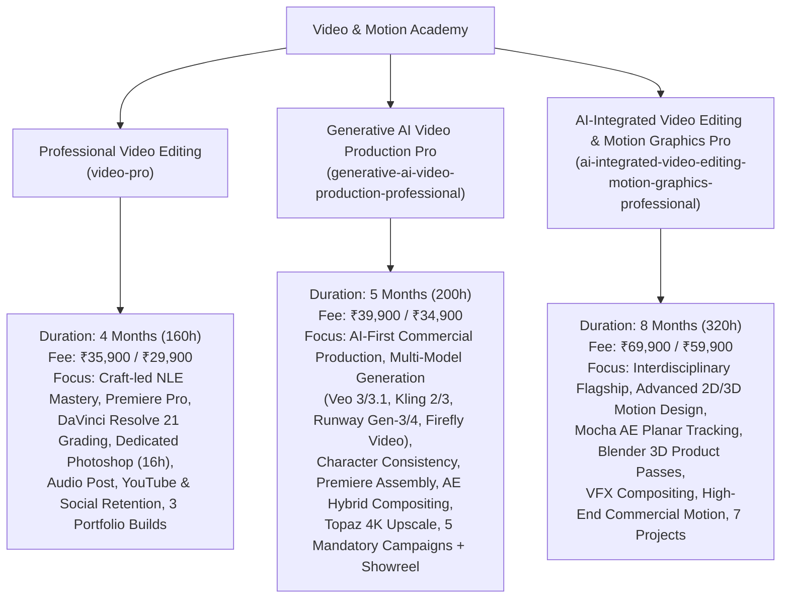
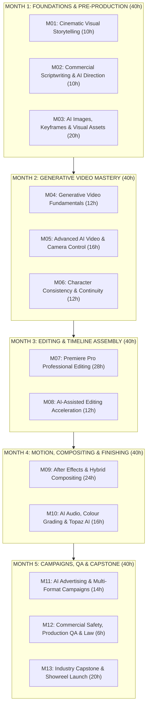
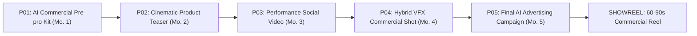
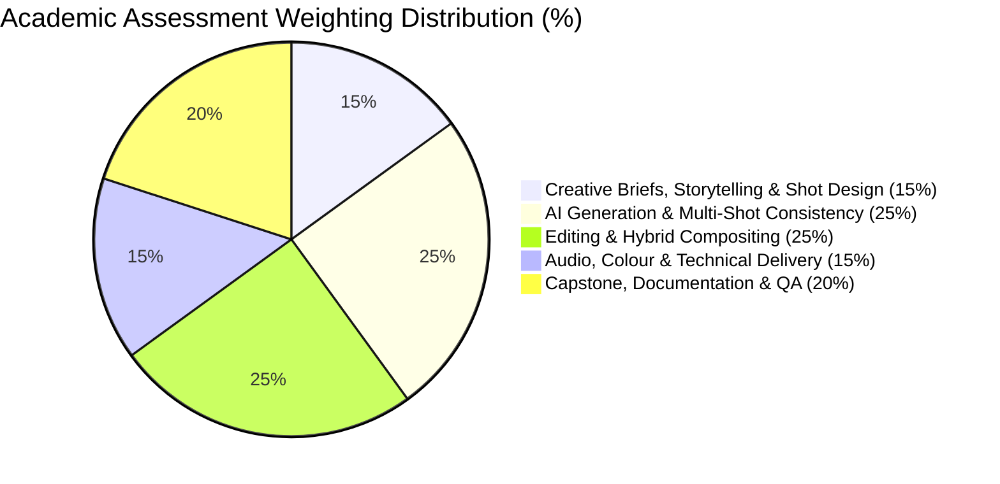
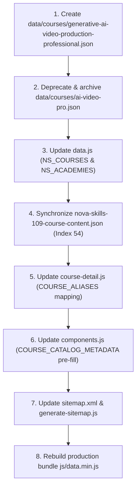

# Generative AI Video Production Professional — Authoritative Academic Specification

**Program Title:** Generative AI Video Production Professional
**Previous Course Title:** AI Video Editing Professional
**New Canonical Identifier:** `generative-ai-video-production-professional`
**Legacy Identifier (Alias):** `ai-video-pro`
**Academy:** Video & Motion Academy (`video`, Academy ID: `video`)
**Credential Awarded:** Professional Certificate in Generative AI Video Production & Commercial Direction
**Academic Governance:** Nova Skills Academic Board | ISO 9001:2015 Educational Standard
**Program Duration:** 5 Months (20 Academic Weeks)
**Guided Instructional Hours:** 200 Guided Hours (10 Hours / Week average: 6h Instructor-Led Sessions + 4h Supervised Practical Studio Labs)
**Recommended Independent Studio Practice:** 100–140 Hours (Strictly demarcated from guided hours)
**Target Level:** Beginner to Applied Commercial Specialist (No prior video editing or AI background required; progressive scaffolding from cinematic grammar to end-to-end commercial campaign production)
**Proposed Regular Tuition Fee:** **INR 39,900** + applicable statutory GST (18%)
**Active Launch-Batch Selling Fee:** **INR 34,900** + applicable statutory GST (18%)
**Authoritative Version:** 1.0.0 (October 2026 Production Standard)

---

## 1. Executive Summary & Program Positioning

### 1.1 Program Mission & Industry Need
In late 2026, generative AI video generation has transitioned from experimental curiosity into an essential production discipline. Top-tier creative advertising agencies, high-velocity D2C consumer brands, corporate marketing divisions, game studios, and digital content creators no longer evaluate video creators solely on traditional timeline trimming or basic AI text-to-video gimmickry. Instead, the market demands **Generative AI Video Producers**: hybrid creative technologists who can take an advertising campaign from concept, script, and visual storyboard to consistent, multi-model generative video generation, professional non-linear timeline editing in **Adobe Premiere Pro**, hybrid live-action compositing in **Adobe After Effects**, broadcast audio design in **ElevenLabs & Fairlight**, and cinematic color grading and upscaling in **DaVinci Resolve & Topaz Video AI**.

The **Generative AI Video Production Professional** program (`generative-ai-video-production-professional`) replaces the legacy, shallow 3-month `ai-video-pro` course. It establishes a rigorous 5-month, 200-guided-hour professional standard designed to train commercial-ready AI directors and producers who operate with absolute creative control, character/product fidelity, multi-model generation pipelines, and enterprise-grade legal and commercial safety.

---

### 1.2 Tri-Course Architecture: Video & Motion Academy Differentiation

The Nova Skills Video & Motion Academy maintains three distinct, complementary, and non-cannibalizing programs. Each addresses a specific career aspiration, toolchain mastery, and market tier:



| Comparative Dimension | Professional Video Editing (`video-pro`) | Generative AI Video Production Pro (`generative-ai-video-production-professional`) | AI-Integrated Video & Motion Graphics Pro (`ai-integrated-...`) |
| :--- | :--- | :--- | :--- |
| **Duration & Schedule** | 4 Months (16 Weeks, 160 Guided Hours) | **5 Months (20 Weeks, 200 Guided Hours)** | 8 Months (32 Weeks, 320 Guided Hours) |
| **Core Philosophical Focus** | Craft-led timeline editorial, pacing, human-cut storytelling, and grading. | **AI-first synthetic visual creation, prompt-driven cinematography, multi-model generation, and commercial ad pipelines.** | Complete post-production & motion design craft across 2D/3D animation, VFX, and hybrid live-action. |
| **Generative Video Scope** | Editorial acceleration (Firefly Extend, text-based edit, auto-reframe). | **Comprehensive multi-model generation (Google Veo, Kling AI, Runway Gen-3/4, Firefly Video, Midjourney v6/v7).** | Hybrid integration (generative b-roll and concept styleframing embedded in motion design). |
| **Photoshop Depth** | Dedicated 16h module: Thumbnails, overlays, alpha masking, graphic layouts. | **Keyframe engineering, reference turnaround sheets, lighting match, and clean-plate inpainting (20h).** | Asset preparation for multi-layer After Effects motion rigging and styleframes. |
| **Motion & Compositing** | Essential titling, lower thirds, MOGRTs, and basic 2D track in AE (10h). | **Hybrid live-action compositing, green-screen plate blending, Mocha planar screen replacement, and light wraps (24h).** | Deep motion graphics: Graph editor, complex expressions, character rigging, kinetic typography, Blender 3D (80h+). |
| **Color & Finishing** | Dedicated DaVinci Resolve 21 node-based grading & scopes (24h). | **DaVinci Resolve matching of AI clips to live plates + Topaz Video AI 4K upscaling/de-aliasing (16h).** | Full color mastering, ACES/color-managed workflows, broadcast delivery standards (20h). |
| **Portfolio Deliverables** | 3 Assessed Projects: Mini-Doc, Social Retention Suite, Commercial Ad. | **5 Mandatory Campaigns: Pre-pro Kit, Product Teaser, Social Ad, Hybrid VFX Shot, Multi-Format Campaign + 60–90s Showreel.** | 7 Assessed Deliverables + Professional Showreel Defense. |
| **Target Career Exit** | Commercial Video Editor, YouTube Editor, Social Content Editor. | **Generative AI Video Producer, AI Commercial Director, Creative Technologist, AI Advertising Creative.** | Senior Motion Graphics Artist, Post-Production Lead, VFX Compositor. |
| **Tuition (Selling / Regular)**| **₹29,900 / ₹35,900** | **₹34,900 / ₹39,900** | **₹59,900 / ₹69,900** |

---

## 2. Forensic Audit of Legacy Course (`ai-video-pro`)

### 2.1 Repository & Architectural Baseline
The existing legacy record for `ai-video-pro` contains serious structural, pedagogical, and commercial deficiencies:
1. **Catalog & Hours Contradictions:** `data.js` lists `ai-video-pro` with `duration: "3 Months"`, `learningHours: 80` in one property and `120 hrs` in the course JSON, with no structured hours breakdown per module.
2. **Superficial Curriculum (4 Modules):** The syllabus comprises only 4 generic modules with 13 total lessons, lacking detailed subtopics, practical lab instructions, assessment rubrics, and guided hour allocations.
3. **Outdated 2023/2024 Generative Tools:** The legacy course relies on Runway Gen-2, basic Pika Labs, and generic avatar tools (HeyGen, Descript), omitting the revolutionary 2025/2026 multi-model video generation ecosystem (Google Veo, Kling AI, Runway Gen-3 Alpha / Gen-4, Adobe Firefly Video).
4. **Neglect of Timeline Craft:** Generative clips are meaningless without timeline editorial discipline. The legacy course omitted professional timeline editing in Adobe Premiere Pro, failing to teach pacing, rhythm, audio ducking, and multi-track assembly.
5. **No Visual Consistency Framework:** Character and product consistency—the single greatest commercial barrier in generative video—was completely unaddressed.
6. **No Hybrid Compositing or Quality Enhancement:** Real client work requires blending synthetic video with live footage and upscaling lower-resolution AI renders. The legacy course omitted After Effects compositing and Topaz Video AI upscaling.
7. **Inflated Commercial Claims:** `data.js` advertised a regular price of ₹42,999 discounted to ₹14,999 (a misleading 65% discount) without GST disclosure or clear commercial licensing boundaries.

### 2.2 Pedagogical Disposition Matrix

| Legacy Topic / Module | Disposition | Detailed Technical Action & Academic Justification |
| :--- | :---: | :--- |
| **Text-Based Editing (Descript)** | **REPOSITION & EXPAND** | Replaced standalone Descript reliance with **Premiere Pro Native Text-Based Editing & Transcript Workflows (Module 08)**, reflecting enterprise broadcast and agency toolchains. |
| **Runway Gen-2 & Early Pika** | **EXPAND & UPGRADE** | Upgraded to **Runway Gen-3 Alpha / Gen-4 and Kling AI (Modules 04 & 05)**, introducing advanced camera trajectories, motion brush multi-vector control, and start/end frame keyframing. |
| **AI Avatars & Digital Twins (HeyGen)** | **REPOSITION & DEMARCATE** | Relegated from core focus to specialized use-case in **Module 11 (Performance Advertising & Multi-Format Campaigns)**; avatars do not represent cinema-grade commercial video production. |
| **Voice Cloning & TTS (ElevenLabs)** | **EXPAND & DEEPEN** | Expanded into **Module 10 (AI Audio Post-Production & Sound Design)**, integrating custom voice design, automated foley, sound effects generation, and -14 LUFS loudness mastering. |
| **Cinematic Storytelling & Shot Grammar** | **ADD (M01)** | Added **Module 01 (10h)**: 180° rule, focal lengths, camera movement psychology, eye-trace, and editorial pacing to ensure students direct shots intentionally rather than generating random visuals. |
| **Commercial Concept & AI Direction** | **ADD (M02)** | Added **Module 02 (10h)**: Commercial scriptwriting, three-act and hook-problem-solution frameworks, visual metaphor ideation, and structured prompt architecture. |
| **Reference Frame Engineering (Photoshop)** | **ADD (M03)** | Added **Module 03 (20h)**: Reference keyframe development in Photoshop, Midjourney v6/v7 multi-prompting, character turnaround sheets, and clean-plate generative inpainting. |
| **Character & Product Consistency** | **ADD (M06)** | Added **Module 06 (12h)**: Multi-shot continuity, seed retention, image-to-video reference injection, face-swapping / LoRA workflows, and product packaging preservation. |
| **Adobe Premiere Pro NLE Mastery** | **ADD (M07)** | Added **Module 07 (28h)**: Comprehensive timeline editorial, multi-track pacing, cutaways, J/L cuts, speed ramping, and professional assemble-to-fine-cut workflows. |
| **After Effects Hybrid Compositing** | **ADD (M09)** | Added **Module 09 (24h)**: Blending live-action plates with AI b-roll, green-screen extraction, Mocha planar tracking, screen replacement, light wraps, and particle atmosphere. |
| **DaVinci Resolve Grading & Topaz AI** | **ADD (M10)** | Added **Module 10 (16h)**: Shot-to-shot color balance in DaVinci Resolve 21 + 4K upscaling, de-noising, and frame rate stabilization (24fps/60fps) in Topaz Video AI. |
| **Commercial Safety, Ethics & QA** | **ADD (M12)** | Added **Module 12 (6h)**: Copyright risks, commercial licensing, watermark policies, artifact detection checklists, and client review handoff protocols. |
| **Industry Capstone & Showreel** | **ADD (M13)** | Added **Module 13 (20h)**: 60–90-second industry showreel assembly, case study portfolio documentation, and client pricing/pitch deck creation. |

---

## 3. Industry Research & Role Competency Framework (October 2026 Standards)

### 3.1 Target Commercial Roles & Market Requirements

Field research across global creative agencies, D2C consumer brands, and video production houses highlights 8 high-demand career pathways:

1. **Junior Generative AI Video Producer:** Manages end-to-end synthetic video workflows, builds shot lists from creative briefs, executes multi-model generation, and manages credit budgets.
2. **AI Video Creative / Creative Technologist:** Works in advertising agencies developing prompt-driven visual campaigns, moodboards, and rapid commercial spec prototypes.
3. **AI Commercial Content Creator:** Generates high-volume performance creative for social platforms (TikTok, Instagram Reels, YouTube Shorts) combining synthetic visuals with live-action UGC hooks.
4. **AI-Assisted Video Editor:** Operates inside traditional post-production houses, using AI tools for rotoscoping, transcription, rough assembly, b-roll generation, and audio repair.
5. **Junior AI Filmmaker / Director:** Creates narrative shorts, music videos, and cinematic brand stories using camera-controlled text-to-video and image-to-video engines.
6. **AI Advertising Creative:** Specializes in multi-variant product advertising, brand story generation, and dynamic localized ad packaging.
7. **Social Media Video Producer:** Delivers high-engagement vertical video content optimized for algorithmic retention, dynamic captions, and instant visual hooks.
8. **Freelance Generative Video Specialist:** Provides turnkey commercial production retainers for startups, e-commerce brands, and marketing agencies seeking high-end visuals without multi-million-dollar physical shoots.

---

### 3.2 Authoritative Toolchain & Commercial Feasibility Matrix

The program selects only industry-standard tools with verified commercial-use licensing, robust APIs/interfaces, and active enterprise adoption:

| Tool & Platform | Category & Role | Primary Operating Modes | Commercial Rights & License Model | Credit / Hardware Assumptions |
| :--- | :--- | :--- | :--- | :--- |
| **Google Flow & Veo Models (Veo 2 / 3)** | Primary Cinematic Video Engine | Text-to-Video, Image-to-Video, Camera Directing, Native Audio Sync | Commercial use permitted under paid Google Cloud / Vertex AI / Flow enterprise tiers. | Fast cloud generation; credit-based allocation via institutional or individual developer tiers. |
| **Kling AI (v1.5 / v1.6 / v2 / v3)** | High-Motion Physical Video Engine | Text-to-Video, Image-to-Video, Start/End Frame, Motion Brush, Element Consistency | Commercial use granted on paid Standard/Pro subscription tiers. | Excellent motion physics; tiered subscription credits (~660 to 3000 credits/mo). |
| **Runway (Gen-3 Alpha / Turbo / Gen-4)** | Precision Camera Control & AI VFX | Director Mode, Multi-Aspect Ratio (16:9, 9:16), Motion Brush, Camera Control | Full commercial ownership of generated outputs on Standard and Pro tiers. | Industry benchmark; credit usage optimized via Turbo drafting before high-fidelity rendering. |
| **Adobe Firefly Video Model** | Commercially Safe Brand Generator | Text-to-Video, Generative Extend in Premiere Pro, Image-to-Video | **100% Commercially Safe**; trained exclusively on licensed Adobe Stock; enterprise indemnification. | Generative credits bundled with Adobe Creative Cloud All Apps subscription. |
| **Midjourney (v6 / v7)** | Keyframe & Concept Engine | Text-to-Image, Character Reference (`--cref`), Style Reference (`--sref`), Inpainting | Commercial rights granted on all paid tiers ($10/mo to $30/mo Standard plan). | Fast GPU hours; primary tool for visual storyboarding and reference image generation. |
| **Adobe Photoshop 2026** | Reference Prep & Keyframing | Generative Fill, Generative Expand, Subject Select, Pen Tool, Clean Plates | Part of Creative Cloud subscription; full commercial commercial rights. | Runs locally on student workstation (16GB RAM, modern GPU recommended). |
| **Adobe Premiere Pro 2026** | Primary Timeline NLE | Multi-track assembly, Text-Based Editing, Generative Extend, Audio Ducking | Industry-standard commercial NLE; Creative Cloud subscription. | Local workstation playback; supports ProRes, DNxHR, H.264/H.265 proxy workflows. |
| **Adobe After Effects 2026** | Hybrid Compositing & Motion | Mocha AE Planar Tracking, Green-Screen Keylight, Light Wrap, MOGRTs | Creative Cloud subscription; full commercial commercial rights. | Requires 32GB RAM recommended for complex multi-layer compositing. |
| **ElevenLabs** | Voice Synthesis & Sound Design | Voice Cloning, Text-to-Speech, Sound Effects (SFX), Voice Isolator | Full commercial rights on Creator plan ($11/mo promo, $22/mo standard). | Character credit pool; highly cost-effective for studio voiceover and foley design. |
| **DaVinci Resolve 21** | Color Grading & Fairlight Mix | Color Page (Node Trees, Scopes, Qualifiers), Fairlight Page (-14 LUFS Mix) | **Free tier includes 95% of needed grading tools**; Studio tier ($295 perpetual) optional. | Runs locally; highly optimized GPU acceleration on Mac (Metal) and Windows (CUDA). |
| **Topaz Video AI** | Video Upscaling & Restoration | Proteus / Iris models, 4K Upscaling, Motion Deblur, Frame Rate Interpolation | Commercial license via perpetual purchase or lab-workstation installation. | Heavy GPU compute; utilized for batch finalization of selected hero project renders. |
| **HeyGen** | Synthetic Avatars & Localization | Talking Head Avatars, Video Translation with Lip-Sync, Dynamic Scripts | Commercial rights on Creator/Team plans. | Credit-based per minute; focused strictly on multi-variant localization module. |

---

## 4. Full 13-Module Curriculum Architecture (200 Guided Hours)

The curriculum is structured across **5 distinct academic months**, delivering exactly **40 guided instructional hours per month** (200 guided hours total):



---

### Month 1: Cinematic Foundations, Concept Ideation & Keyframe Engineering (40 Hours)

#### Module 01: Cinematic Visual Storytelling, Film Grammar & Shot Design
- **Guided Hours:** 10 Hours (6h Theory/Demonstration + 4h Guided Studio Lab)
- **Primary Toolchain:** Figma, Miro, Notion, ShotDeck, FrameForge
- **Learning Objectives:**
  - Understand film grammar, focal lengths, depth of field, and camera movement psychology.
  - Apply the 180-degree rule, 30-degree rule, match-cutting, and eye-trace continuity.
  - Translate commercial client briefs into director's shot lists and visual treatment decks.
- **Main Topics & Detailed Subtopics:**
  1. *Cinematography Fundamentals for AI Directors:* Aspect ratios (16:9, 9:16, 2.39:1 anamorphic), focal length lens language (18mm wide distortion vs 85mm portrait compression), depth of field, three-point lighting, motivated lighting, color temperature (Kelvin), and visual atmosphere.
  2. *Camera Movement & Motivated Staging:* Static, pan, tilt, tracking/dolly, crane, orbit, handheld kinetic movement, and Steadicam aesthetics. Psychological intent behind camera choreography.
  3. *Visual Editorial Grammar:* Eye-trace management, vector continuity, screen direction rules, cross-cutting concepts, and pacing curves for commercial advertising vs cinematic drama.
- **Hands-On Studio Lab:** Analyze three award-winning commercial ads. Deconstruct every shot into focal length, lighting scheme, camera move, and narrative function. Build a 12-shot director's storyboard breakdown in Notion/Figma.
- **Practical Assignment:** Create a comprehensive Visual Director's Treatment for a luxury electric vehicle or boutique fragrance brand, including shot list, lighting moodboard, and framing guidelines.
- **Project Contribution:** Establishes the foundational aesthetic standards for Project 01 (Pre-production Kit).

---

#### Module 02: Commercial Scriptwriting, Concept Ideation & AI Creative Direction
- **Guided Hours:** 10 Hours (6h Theory/Demonstration + 4h Guided Studio Lab)
- **Primary Toolchain:** Claude 3.5 Sonnet / ChatGPT-4o, Notion, Milanote
- **Learning Objectives:**
  - Master commercial script structures: Hook-Problem-Solution-CTA, Three-Act Narrative, and Brand Manifestos.
  - Develop AI prompt frameworks that translate brand guidelines into cinematic visual metaphors.
  - Engineer structured prompt chains to generate coherent scene-by-scene script breakdowns.
- **Main Topics & Detailed Subtopics:**
  1. *Commercial Advertising Script Architecture:* High-retention hook design (0–3 seconds), problem dramatization, product introduction/reveal, emotional proof, and call-to-action (CTA). Script timing math (word count to duration ratios: 130–150 words/minute).
  2. *AI-Powered Creative Brainstorming:* Advanced system prompting for creative directors, role-based persona prompting, tone calibration, and concept iteration. Mitigating cliché and repetitive AI tropes.
  3. *Two-Column Audio/Visual (AV) Scripts:* Formatting professional industry AV scripts matching exact video descriptions with spoken voiceover, on-screen text, and sound effects (SFX) cues.
- **Hands-On Studio Lab:** Prompt-chaining workshop: Take a raw client product brief, generate 5 distinct conceptual directions (cinematic, emotional, high-energy tech, surreal, minimalist), select one, and write a full 30-second AV script.
- **Practical Assignment:** Deliver a polished 30-second commercial script with full AV breakdown and voiceover copy ready for executive client review.
- **Project Contribution:** Directly produces the narrative spine for Project 01 and Project 02.

---

#### Module 03: AI Images, Keyframes & Visual Asset Development
- **Guided Hours:** 20 Hours (12h Theory/Demonstration + 8h Guided Studio Lab)
- **Primary Toolchain:** Midjourney (v6 / v7), Adobe Photoshop 2026, Adobe Firefly
- **Learning Objectives:**
  - Master text-to-image prompt engineering for cinematic realism, hyper-detailed textures, and studio lighting.
  - Implement style referencing (`--sref`) and character referencing (`--cref`) to generate unified visual assets.
  - Use Photoshop Generative Fill and layer masking to composite, re-light, and clean reference frames for video generators.
- **Main Topics & Detailed Subtopics:**
  1. *Advanced Midjourney Prompt Engineering:* Syntax mastery, style weights, aspect ratio controls (`--ar 16:9`, `--ar 9:16`), raw style flags, lighting tokens (rembrandt, volumetric, rim light), and camera/lens tokens (Arri Alexa LF, anamorphic flare, Kodak Vision3 500T).
  2. *Visual Consistency & Style Referencing:* Creating consistent look-books using style references (`--sref`), image prompt blending, and seed control. Generating multi-angle turnaround reference sheets for characters and products.
  3. *Photoshop Prep for Video Inpainting:* Inpainting clean plates, expanding boundaries (Generative Expand), isolating foreground subjects via Pen Tool and Object Selection, removing background artifacts, and prepping 16:9/9:16 master keyframes.
- **Hands-On Studio Lab:** Build a 10-keyframe commercial visual sequence. Generate keyframes in Midjourney, import into Photoshop, correct anatomical flaws and product branding, and output color-matched reference plates.
- **Practical Assignment:** Assemble a complete 10-frame visual storyboard deck ready to feed into image-to-video generation engines.
- **Project Contribution:** Completes **Mandatory Project 01: AI Commercial Pre-production Kit**.

---

### Month 2: Multi-Model Generative Video Mastery & Continuity (40 Hours)

#### Module 04: Generative Video Fundamentals & Multi-Model Generation
- **Guided Hours:** 12 Hours (8h Theory/Demonstration + 4h Guided Studio Lab)
- **Primary Toolchain:** Runway (Gen-3 Alpha / Turbo), Kling AI (v1.5 / v2), Google Veo, Adobe Firefly Video
- **Learning Objectives:**
  - Understand the underlying mechanics of diffusion video models, temporal coherence, and motion vectors.
  - Master Text-to-Video (T2V) vs Image-to-Video (I2V) workflows, understanding why I2V is the commercial standard.
  - Compare model strengths across Runway, Kling, Veo, and Firefly to choose the right engine for every scene.
- **Main Topics & Detailed Subtopics:**
  1. *Diffusion Video Foundations:* How video diffusion models process spatial latents and temporal cross-attention. Understanding common artifacts (morphing, limb blending, flicker, jitter) and their technical root causes.
  2. *Text-to-Video vs Image-to-Video Paradigms:* Why T2V introduces chaotic randomness, and how I2V grounds generation with locked lighting, composition, and product fidelity.
  3. *Comparative Model Deep-Dive:*
     - *Runway Gen-3 Alpha:* Strengths in cinematography, speed ramps, and camera precision.
     - *Kling AI:* Strengths in human motion physics, complex physical interactions, and high temporal stability.
     - *Google Veo:* Photorealism, 1080p native sharpness, and synchronized native sound generation.
     - *Adobe Firefly Video:* Commercially safe generation, clean b-roll, and seamless Creative Cloud integration.
- **Hands-On Studio Lab:** The Benchmark Shootout: Take 3 identical keyframe images. Generate 5-second video clips across Runway, Kling, Veo, and Firefly using identical motion prompts. Document motion smoothness, artifact rate, and model prompt adherence.
- **Practical Assignment:** Create a comparative evaluation matrix of 12 generated clips detailing render time, credit burn, motion fidelity, and commercial suitability.
- **Project Contribution:** Develops the foundational clip asset bank for Project 02 (Cinematic AI Product Teaser).

---

#### Module 05: Advanced AI Video Production & Camera Motion Control
- **Guided Hours:** 16 Hours (10h Theory/Demonstration + 6h Guided Studio Lab)
- **Primary Toolchain:** Runway Gen-3 Director Mode, Kling Motion Brush & Camera Controls, Luma Dream Machine
- **Learning Objectives:**
  - Execute precise camera choreography using 3D camera controls (pan, tilt, zoom, dolly, truck, orbit).
  - Master Motion Brush tools to isolate moving elements from static backgrounds.
  - Utilize Start-Frame and End-Frame interpolation to generate seamless, controlled transitions.
- **Main Topics & Detailed Subtopics:**
  1. *Director Mode & Explicit Camera Trajectories:* Setting exact coordinate values for X, Y, Z translation and pitch, yaw, roll rotation. Controlling camera acceleration, velocity curves, and handheld shake intensity.
  2. *Multi-Vector Motion Brushing:* Painting up to 5 distinct motion vectors on a single image. Separating water flow, background foliage movement, character walking vectors, and camera drift.
  3. *Keyframe-to-Keyframe Morphing (Start & End Frames):* Generating controlled interstitial footage between two designed keyframes. Directing morph cuts, match dissolves, and spatial transitions across scenes without temporal melting.
- **Hands-On Studio Lab:** Complex Camera Lab: Create a 6-second continuous camera push-in that sweeps past foreground environmental elements to reveal a hero product, with isolated steam/particle motion painted via Motion Brush.
- **Practical Assignment:** Direct and render a suite of 8 high-control camera-choreographed shots showcasing dynamic motion and zero unintended background morphing.
- **Project Contribution:** Supplies high-difficulty hero shots for Project 02 and Project 03.

---

#### Module 06: Character Consistency, Product Fidelity & Multi-Shot Storytelling
- **Guided Hours:** 12 Hours (8h Theory/Demonstration + 4h Guided Studio Lab)
- **Primary Toolchain:** Midjourney `--cref`, Kling Element/Face Consistency, Photoshop Layer Blending, ReActor / FaceFusion
- **Learning Objectives:**
  - Maintain facial, wardrobe, and anatomical consistency for human characters across 5+ consecutive scenes.
  - Preserve exact commercial product packaging, logos, labels, and geometry without AI hallucinations.
  - Direct multi-shot cinematic sequences with matching lighting, weather, and environmental continuity.
- **Main Topics & Detailed Subtopics:**
  1. *Character Identity Preservation Workflows:* Generating canonical turnaround reference sheets (front, 3/4, profile). Leveraging image-to-image seeds, face reference weights, and LoRA/ControlNet concepts. Post-generation face refinement.
  2. *Product Packaging & Brand Asset Protection:* Techniques for avoiding brand logo distortion: masking clean product plates in Photoshop, rendering background environments with generative AI, and compositing the locked physical product back into the scene.
  3. *Environmental Continuity Across Cuts:* Matching sun angle, shadows, ambient color tint, rain/fog density, and room acoustics across multiple camera angles (wide shot, medium dialogue shot, extreme close-up).
- **Hands-On Studio Lab:** Multi-Shot Continuity Challenge: Create a 3-shot narrative sequence featuring the same human protagonist in a wide establishing shot, medium action shot, and close-up emotional shot, maintaining identical wardrobe, hairstyle, and lighting.
- **Practical Assignment:** Deliver a 4-shot mini-scene featuring a consistent brand ambassador interacting with a recognizable commercial product.
- **Project Contribution:** Directly fulfills the consistency requirements for **Mandatory Project 02: Cinematic AI Product Teaser**.

---

### Month 3: Professional Timeline Editorial & Workflow Acceleration (40 Hours)

#### Module 07: Adobe Premiere Pro Professional Editing & Timeline Assembly
- **Guided Hours:** 28 Hours (16h Theory/Demonstration + 12h Guided Studio Lab)
- **Primary Toolchain:** Adobe Premiere Pro 2026, Adobe Media Encoder
- **Learning Objectives:**
  - Master professional non-linear editing (NLE) timeline architecture, media management, and proxy workflows.
  - Execute narrative pacing, rhythm, trim tools (Ripple, Roll, Slip, Slide), J/L audio cuts, and match cutting.
  - Assemble rough cuts, director's cuts, and final fine cuts adhering to exact commercial broadcast durations (15s, 30s, 60s).
- **Main Topics & Detailed Subtopics:**
  1. *Media Ingest, Bins & Project Organization:* Project setup for commercial post-production. Organizing generative clips by model, take, focal length, and grade. Proxy workflows for smooth 4K timeline playback.
  2. *Timeline Architecture & Trimming Precision:* Three-point and four-point editing, track targeting, keyboard-driven trimming, dynamic trimming with J-K-L shuttle controls, and ripple/roll edits.
  3. *Pacing, Rhythm & Cutting on Action:* Cutting on subject movement to mask AI motion imperfections. Implementing J-cuts and L-cuts to lead narrative audio before visual transitions. Establishing rhythm aligned with soundtrack tempo.
  4. *Speed Ramping & Time Remapping:* Smoothing generative video stutter with optical flow. Creating commercial speed ramps (fast-slow-fast) to accentuate product reveals and dynamic action.
- **Hands-On Studio Lab:** Timeline Speed Drill: Take 40 raw, unorganized generative AI video clips and a commercial voiceover track. Ingest, organize bins, assemble a timed 30.00-second rough cut, and execute fine trimming within 90 minutes.
- **Practical Assignment:** Assemble and deliver a frame-accurate 30-second commercial fine cut with structured audio tracks, motivated J/L cuts, and seamless pacing.
- **Project Contribution:** Provides the structural timeline foundation for Project 03 (Performance-Ready Social Video) and Project 04.

---

#### Module 08: AI-Assisted Editing & Creative Workflow Acceleration
- **Guided Hours:** 12 Hours (8h Theory/Demonstration + 4h Guided Studio Lab)
- **Primary Toolchain:** Adobe Premiere Pro AI Tools (Text-Based Editing, Generative Extend, Auto Reframe, Enhance Speech)
- **Learning Objectives:**
  - Accelerate documentary and interview editorial using native Text-Based Editing and paper cuts.
  - Extend awkward video clip tails and fix pacing gaps using Premiere Pro Generative Extend.
  - Automatically reframe 16:9 master sequences into vertical 9:16 and square 1:1 layouts with intelligent subject tracking.
- **Main Topics & Detailed Subtopics:**
  1. *Text-Based Editing & Transcript Assembly:* Automated sequence transcription, filler-word removal, paper editing directly in transcript windows, and searching dialogues for key soundbites.
  2. *Premiere Generative Extend (Firefly-Powered):* Extending short generative clips by 1–2 seconds to complete musical bars, generate handles for cross-dissolves, and eliminate abrupt freeze-frames.
  3. *Automated Multi-Format Reframing:* Auto Reframe sequence automation, adjusting keyframe motion tracking for fast-moving subjects, and optimizing title/graphic safe zones for vertical mobile layouts.
  4. *AI Dialogue Cleanup:* One-click speech isolation, background noise reduction, and reverb removal using Enhance Speech.
- **Hands-On Studio Lab:** Multi-Platform Adaptation Lab: Take a 30-second 16:9 commercial master. Use Auto Reframe and manual tracking adjustments to create pixel-perfect 9:16 Reels and 1:1 Instagram feed adaptations with safety margin verification.
- **Practical Assignment:** Deliver a complete 3-format commercial export pack (16:9 master, 9:16 vertical, 1:1 square) reframed and polished with Generative Extend handles.
- **Project Contribution:** Completes **Mandatory Project 03: Performance-Ready Social Media Video**.

---

### Month 4: Motion Graphics, Hybrid Compositing & Video Enhancement (40 Hours)

#### Module 09: After Effects, Motion Graphics & Hybrid Compositing
- **Guided Hours:** 24 Hours (14h Theory/Demonstration + 10h Guided Studio Lab)
- **Primary Toolchain:** Adobe After Effects 2026, Mocha AE, Boris FX Optics
- **Learning Objectives:**
  - Composite synthetic AI video elements seamlessly into real live-action camera footage.
  - Perform planar tracking and screen replacement using Mocha AE on real-world mobile devices and monitors.
  - Match grain, motion blur, lens distortion, and light wraps to eliminate the "AI look."
- **Main Topics & Detailed Subtopics:**
  1. *Hybrid Compositing Philosophy:* The commercial imperative of blending live-action credibility (real actors, authentic hand gestures) with generative AI scope (epic environments, fantasy background VFX).
  2. *Green-Screen & Clean-Plate Extraction:* Keylight 1.2, screen matte tuning, spill suppression, and edge refining. Extracting live talent to place into generative AI 3D environments.
  3. *Planar Tracking in Mocha AE:* Corner pinning, perspective tracking, planar surface definition, and replacing phone screens, billboards, and monitors with generative video content.
  4. *Visual Integration & Light Wraps:* Matching optical characteristics: blending background illumination onto foreground edges (Light Wrap), matching camera grain/sensor noise, chromatic aberration, and lens vignetting.
  5. *Commercial Titles & Kinetic Lower Thirds:* Animating modern sans-serif typography, lower thirds, callout trackers, and MOGRT export for Premiere Pro.
- **Hands-On Studio Lab:** The Hybrid Plate Lab: Take a live-action shot of an actor holding an empty green-screen phone in an office. Key the green screen, track the screen in Mocha AE, insert a custom generative AI animation, match perspective, apply reflection and finger occlusions, and composite a cohesive final frame.
- **Practical Assignment:** Deliver a seamless 5-second hybrid commercial shot blending live footage with generative background and tracked graphic overlays.
- **Project Contribution:** Directly fulfills **Mandatory Project 04: Hybrid AI + Live-Action Commercial Shot**.

---

#### Module 10: AI Audio Post-Production, Colour Grading & Video Enhancement
- **Guided Hours:** 16 Hours (10h Theory/Demonstration + 6h Guided Studio Lab)
- **Primary Toolchain:** ElevenLabs, DaVinci Resolve 21 (Color & Fairlight), Topaz Video AI
- **Learning Objectives:**
  - Produce broadcast-quality voiceovers and sound effects (SFX) using ElevenLabs and Fairlight.
  - Match disparate color spaces and lighting profiles of clips generated across different AI models in DaVinci Resolve.
  - Upscale, de-noise, and stabilize generative video clips to pristine 4K resolution using Topaz Video AI.
- **Main Topics & Detailed Subtopics:**
  1. *AI Voice Design & Foley Generation:* Custom voice cloning, pacing, emotion prompts, and breathing cadence in ElevenLabs. Generating bespoke foley, swooshes, ambient room tone, and cinematic impacts via text-to-audio prompts.
  2. *Fairlight Audio Mixing & Loudness Standards:* Multi-track audio sweetening, parametric EQ, multiband compression, sidechain ducking (music lowering under dialogue), and mastering to broadcast standards (-14 LUFS for YouTube/Web, -24 LUFS for broadcast television).
  3. *DaVinci Resolve Shot Matching & Grading:* Node tree architecture for AI clips: primary exposure balance, white balance correction, skin tone protection via vectorscope, hue vs hue adjustments, and applying unified film emulation LUTs.
  4. *Topaz Video AI 4K Restoration:* Proteus fine-tune model for sharpening blurry textures, Iris model for facial detail recovery, Chronos frame interpolation (converting 16fps/24fps AI video to smooth 60fps), and artifact suppression.
- **Hands-On Studio Lab:** The Finishing Suite: Ingest 6 raw generative AI clips with mismatched color temperatures, muddy 720p resolution, and zero sound. Upscale to 4K in Topaz, color match in DaVinci Resolve, build a rich 6-track audio landscape in Fairlight, and master to -14 LUFS.
- **Practical Assignment:** Deliver a fully mastered, color-graded, and audio-mixed 30-second sequence demonstrating complete acoustic and chromatic cohesion.
- **Project Contribution:** Ensures all project assets meet broadcast-grade quality standards.

---

### Month 5: Commercial Campaigns, Production QA & Capstone Launch (40 Hours)

#### Module 11: AI Advertising & Multi-Format Campaign Production
- **Guided Hours:** 14 Hours (8h Theory/Demonstration + 6h Guided Studio Lab)
- **Primary Toolchain:** Adobe Premiere Pro, HeyGen / ElevenLabs, Meta Ads Manager principles
- **Learning Objectives:**
  - Structure full commercial advertising campaigns with targeted top-of-funnel (TOF), middle-of-funnel (MOF), and bottom-of-funnel (BOF) creative variations.
  - Rapidly produce A/B test variations with differentiated 3-second hooks, pacing, and calls-to-action.
  - Localize commercial campaigns into multiple languages using AI lip-sync and voice translation.
- **Main Topics & Detailed Subtopics:**
  1. *Performance Advertising Creative Strategy:* Why creative is the primary targeting lever in modern digital ads. Hook variations (curiosity, controversy, visual shock, demonstration). Structuring modular ad creative for rapid iteration.
  2. *Modular Ad Assembly:* Creating dynamic video templates in Premiere Pro where intro hooks, body demonstrations, and end-card CTAs can be swapped modularly to create 9 unique ad combinations from a single shoot.
  3. *AI Localization & Translation Workflows:* Using HeyGen and ElevenLabs to translate English video ads into Hindi, Spanish, or German with authentic lip-sync, cultural nuance adjustments, and translated on-screen typography.
- **Hands-On Studio Lab:** The 9-Variant Matrix: Produce 3 distinct hooks, 1 core product body, and 3 distinct CTA end cards. Assemble and export 9 functional performance ad variants for an e-commerce product launch.
- **Practical Assignment:** Deliver a comprehensive multi-variant social ad campaign suite (3 complete ad variants + localized translation demo).
- **Project Contribution:** Provides the strategic commercial deliverables for **Mandatory Project 05: Final AI Commercial Advertising Campaign**.

---

#### Module 12: Commercial Safety, Production Management, Ethics & QA
- **Guided Hours:** 6 Hours (4h Theory/Demonstration + 2h Guided Studio Lab)
- **Primary Toolchain:** Frame.io, Notion Production Tracker, Copyright & Licensing Documentation
- **Learning Objectives:**
  - Navigate copyright, commercial licensing, trademark risks, and legal indemnification in generative AI.
  - Implement forensic Quality Assurance (QA) checklists to detect and eliminate AI artifacts before client delivery.
  - Manage professional client review cycles and revisions using Frame.io.
- **Main Topics & Detailed Subtopics:**
  1. *Copyright, Trademark & Commercial Rights:* Understanding training data provenance, public domain vs proprietary IP, trademark infringement pitfalls (accidental generation of copyrighted logos/characters), and commercial indemnification policies (Adobe Firefly vs open models).
  2. *Forensic AI Quality Assurance Checklist:* The 10-Point Artifact Audit:
     - Anatomical distortions (hands, eyes, extra limbs, teeth).
     - Temporal shimmering and background geometry morphing.
     - Text and logo illegibility.
     - Frame glitching and compression banding.
     - Edge haloing on composites.
     - Lip-sync drift and unnatural phoneme movement.
     - Audio clipping and LUFS compliance.
     - Title and mobile safety margins.
  3. *Client Handoff & Versioning:* Managing client feedback via Frame.io, timestamped notes, version numbering standards (v01, v02, vFinal_Master), archive packaging, and delivering organized master assets.
- **Hands-On Studio Lab:** Client Review Simulation: Review a peer's project file containing deliberate AI artifacts and licensing traps. Conduct a forensic QA audit, flag all issues with timestamped feedback, and recommend specific corrective tools.
- **Practical Assignment:** Create a signed Commercial Release & Quality Assurance Compliance Certificate for the final capstone campaign.
- **Project Contribution:** Establishes the quality-control gate for Capstone submission.

---

#### Module 13: Industry Capstone & Career Portfolio Production
- **Guided Hours:** 20 Hours (6h Theory/Demonstration + 14h Supervised Practical Studio Production)
- **Primary Toolchain:** Full Creative Suite, Behance, Vimeo Pro, LinkedIn, Notion
- **Learning Objectives:**
  - Execute an end-to-end commercial AI advertising campaign from client brief to broadcast delivery.
  - Assemble a high-impact 60–90-second industry showreel highlighting multi-model mastery, consistency, and hybrid editing.
  - Author professional case study documentation demonstrating problem-solving, prompt logs, and business ROI.
- **Main Topics & Detailed Subtopics:**
  1. *Capstone Production Execution:* Developing an end-to-end commercial campaign for an approved client brief (luxury tech, automotive, beauty, beverage, or fashion brand). Producing master 30s commercial, 15s social cutdown, and 9:16 vertical variant.
  2. *The 60–90-Second Commercial Showreel:* Showreel editorial structure: leading with the strongest visual hook (first 5 seconds), pacing to driving music, showcasing technical variety (T2V, I2V, hybrid compositing, consistency, 4K upscaling), and ending with professional contact credentials.
  3. *Case Study Documentation & Online Presence:* Structuring Behance and portfolio case studies: client challenge, creative concept, AI toolchain pipeline diagram, before/after compositing sliders, prompt architecture insights, and business results.
  4. *Client Pitching & Commercial Pricing:* Freelance pricing models (day rate vs project retainer vs value pricing), pitching commercial AI video production to agency clients, and navigating client objections regarding AI video quality.
- **Hands-On Studio Lab:** Supervised Studio Intensive: Dedicated editing, compositing, color grading, audio mastering, and portfolio assembly under one-on-one mentor supervision.
- **Practical Assignment:** Deliver the completed Capstone Campaign Pack, 60–90s Showreel, and a published professional portfolio case study.
- **Project Contribution:** Finalizes **Mandatory Project 05** and the **Professional Career Showreel**.

---

## 5. Mandatory Portfolio Projects & Capstone Specifications

To qualify for graduation and credentialing, every student must complete **5 Mandatory Client-Brief Projects** plus an **Additional 60–90-Second Professional Showreel**:



---

### Project 01: AI Commercial Pre-production Kit
- **Client Brief:** A high-end sustainable electric bicycle brand (*AeroVolt*) requires a complete pre-production visual treatment deck to secure board approval for a national commercial launch.
- **Creative Objective:** Develop a cinematic, visually cohesive 10-keyframe commercial treatment deck and two-column AV script.
- **Primary Toolchain:** Claude 3.5 Sonnet / ChatGPT-4o, Midjourney v6/v7, Adobe Photoshop 2026, Notion.
- **Practical Workflow:**
  1. Draft a 30-second commercial script using Hook-Problem-Solution-CTA structure.
  2. Develop a comprehensive style reference (`--sref`) to lock color palette (deep forest greens, brushed titanium, warm morning sunlight).
  3. Generate 10 keyframe concept images in Midjourney reflecting diverse camera angles (wide aerial landscape, medium riding shot, extreme close-up of carbon frame).
  4. Retouch images in Photoshop: clean up anatomical anomalies, remove AI watermarks, and insert accurate brand typography on the vehicle frame.
  5. Assemble a client-ready PDF treatment deck.
- **Source Files & AI Generation Log:** Complete prompt log documenting seed numbers, style reference URLs, aspect ratios, and raw generation outputs.
- **Quality & Commercial-Rights Checks:** Zero copyrighted brand trademarks generated; all images vetted for commercial use eligibility.
- **Technical Deliverables:**
  - 1x Two-Column AV Script (PDF).
  - 1x 10-Frame High-Resolution Visual Treatment Presentation (PDF / 16:9 1920x1080).
  - 1x Documented AI Prompt Architecture Log.
- **Assessment Rubric Weight:** 15% of total course evaluation.

---

### Project 02: Cinematic AI Product Teaser
- **Client Brief:** A luxury chronograph watchmaker (*Chronos Atelier*) launches a limited-edition celestial timepiece. They need a 15-second teaser video conveying cosmic precision, luxury materials, and craftsmanship.
- **Creative Objective:** Direct and render a continuous, multi-shot teaser featuring absolute product consistency and cinematic camera motion control.
- **Primary Toolchain:** Midjourney, Adobe Photoshop, Kling AI (v1.5/v2), Runway Gen-3 Alpha, DaVinci Resolve 21.
- **Practical Workflow:**
  1. Generate master watch keyframes from front, 45-degree, and macro-gear perspectives.
  2. Lock product geometry and dial markings in Photoshop using clean-plate masking.
  3. Animate shots in Runway Gen-3 and Kling AI using precise camera trajectories (slow orbit, macro rack focus, dramatic light sweeps).
  4. Ensure dial details and celestial star maps remain identical across cuts.
  5. Assemble in Premiere Pro, color grade in DaVinci Resolve, and add orchestral ambient sound design.
- **Technical Deliverables:**
  - 1x 15-Second Cinematic Teaser Video (16:9 4K 3840x2160, ProRes 422 HQ & H.264).
  - 1x Product Consistency Sheet proving fidelity across 4 distinct angles.
- **Assessment Rubric Weight:** 20% of total course evaluation.

---

### Project 03: Performance-Ready Social Media Video
- **Client Brief:** A direct-to-consumer functional hydration brand (*HydraBoost*) requires a high-converting 9:16 vertical video ad for Instagram Reels and TikTok.
- **Creative Objective:** Build a 20–30-second performance ad featuring an irresistible 3-second hook, fast-paced kinetic editing, auto-captioning, and dynamic sound effects.
- **Primary Toolchain:** Runway Gen-3, Adobe Premiere Pro (Text-Based Editing, Auto Reframe, Generative Extend), ElevenLabs.
- **Practical Workflow:**
  1. Write a script addressing common dehydration fatigue with an energetic solution hook.
  2. Generate dynamic visual b-roll in Runway (ice splashing, water droplets in macro slow-motion, athletes revitalized).
  3. Cut the sequence to an upbeat, driving music track in Premiere Pro with rapid 1.2–2.0-second cut pacing.
  4. Generate a punchy, conversational voiceover in ElevenLabs.
  5. Add animated subtitle callouts and sound design accents (whooshes, risers, impacts).
  6. Verify mobile-safe zones (ensuring text does not overlap TikTok/Reels UI buttons).
- **Technical Deliverables:**
  - 1x 9:16 Vertical Video Master (1080x1920, 60fps / 30fps H.264).
  - 1x 16:9 Landscape Cutdown (1920x1080).
  - 1x Frame-by-frame UI Safety Margin Overlay Verification.
- **Assessment Rubric Weight:** 20% of total course evaluation.

---

### Project 04: Hybrid AI + Live-Action Commercial Shot
- **Client Brief:** A next-gen travel app (*TerraNova*) needs a flagship commercial hero shot featuring a real human traveler stepping from a plain subway platform into an otherworldly, hyper-futuristic generative landscape.
- **Creative Objective:** Composite real live-action footage with synthetic generative environments, demonstrating seamless edge integration, camera tracking, and light wrap.
- **Primary Toolchain:** Adobe After Effects 2026, Mocha AE, Keylight 1.2, Google Veo / Runway Gen-3, Boris FX Optics.
- **Practical Workflow:**
  1. Ingest provided green-screen footage of a live actor walking through an entrance doorway.
  2. Generate a sweeping, photorealistic futuristic city/nature hybrid environment in Google Veo / Runway.
  3. Key the green-screen talent in After Effects using Keylight 1.2 with refined edge despill.
  4. Track the camera movement in Mocha AE to match the live camera pan to the generative background.
  5. Apply atmospheric light wrap, matching background sunlight onto the actor's clothing and hair.
  6. Match grain and sensor noise between the live camera plate and generative background.
- **Technical Deliverables:**
  - 1x 6-Second Finished Composite Shot (16:9 4K 3840x2160, ProRes 4444 / H.264).
  - 1x Multi-Layer Breakdown Video (Before/After Wipe showing Green Screen -> Matte -> Generative Background -> Light Wrap -> Final Composite).
- **Assessment Rubric Weight:** 20% of total course evaluation.

---

### Project 05: Final AI Commercial Advertising Campaign (Capstone)
- **Client Brief:** End-to-end commercial campaign for an approved enterprise client brief (select from: *Aura Wireless Audio*, *Verve Electric Mobility*, or *Lumina Skincare*).
- **Creative Objective:** Complete an end-to-end multi-format commercial campaign containing a 30-second hero commercial, 15-second social teaser, 9:16 vertical cut, complete audio mix, and forensic QA certificate.
- **Primary Toolchain:** Full program software stack (Claude/GPT, Midjourney, Photoshop, Runway/Kling/Veo, Premiere Pro, After Effects, DaVinci Resolve, Topaz Video AI, ElevenLabs).
- **Practical Workflow:**
  1. Deliver full AV script and storyboard deck.
  2. Execute multi-model generation with verified character and product consistency.
  3. Edit master timeline in Premiere Pro; composite hero shots in After Effects.
  4. Upscale hero clips in Topaz Video AI to 4K; color match and grade in DaVinci Resolve.
  5. Design full 6-track audio landscape in Fairlight with ElevenLabs voiceover, foley, and licensed music (-14 LUFS).
  6. Conduct forensic QA inspection; compile Frame.io review log and commercial rights release.
- **Technical Deliverables:**
  - 1x 30-Second Hero Commercial Master (16:9 4K 3840x2160, ProRes 422 HQ).
  - 1x 15-Second Cutdown (16:9 1080p).
  - 1x 9:16 Mobile Social Master (1080x1920).
  - 1x Signed QA Audit & Commercial Rights Release Form.
  - 1x Behance / Web Case Study Link.
- **Assessment Rubric Weight:** 25% of total course evaluation.

---

### Additional Portfolio Deliverable: 60–90-Second Commercial Showreel
- **Format:** 60 to 90 seconds (16:9 4K master + optional 9:16 vertical version).
- **Structure:**
  - *0:00–0:05:* High-impact visual hook featuring the single most stunning generative/hybrid shot.
  - *0:05–0:35:* Fast-paced, dynamic montage showcasing diverse capabilities (cinematic camera moves, character consistency, product lighting, speed ramps).
  - *0:35–0:60:* Hybrid live-action compositing breakdowns and commercial performance ad highlights.
  - *0:60–0:75:* Peak visual climax with synced musical impact.
  - *0:75–0:90:* Professional title card with candidate name, title (*Generative AI Video Producer*), verified skills, website URL, and direct contact details.
- **Audio Standards:** Mixed to -14 LUFS, featuring licensed commercial soundtrack and subtle integrated foley sound design.

---

## 6. Academic Assessment Architecture & Rubric Weighting

### 6.1 Evaluation Framework
Assessment is conducted continuously through portfolio milestones, technical lab submissions, and the final capstone defense. In strict adherence to the approved academic blueprint, grading follows a 5-pillar weighting model:



| Assessment Dimension | Blueprint Weight | Specific Competencies Evaluated |
| :--- | :---: | :--- |
| **Pillar 1: Creative Briefs, Storytelling & Shot Design** | **15%** | Scriptwriting quality, hook effectiveness, AV script formatting, visual treatment deck aesthetics, lens/lighting intentionality. |
| **Pillar 2: AI Generation & Multi-Shot Consistency** | **25%** | Prompt architecture sophistication, camera control execution, character/product consistency across cuts, artifact elimination, model selection strategy. |
| **Pillar 3: Editing & Hybrid Compositing** | **25%** | Timeline pacing, rhythm, cutting on action, J/L cuts, speed ramping, Mocha AE planar tracking, green-screen extraction, light wrap realism, grain matching. |
| **Pillar 4: Audio, Colour & Technical Delivery** | **15%** | ElevenLabs voice design, foley/sound design layering, -14 LUFS loudness mastering, DaVinci Resolve color consistency, Topaz Video AI 4K upscaling. |
| **Pillar 5: Capstone, Documentation & QA** | **20%** | End-to-end commercial campaign completion, 60–90s showreel impact, prompt logs, case study documentation, forensic QA compliance certificate. |
| **TOTAL** | **100%** | **Comprehensive Academic Standard** |

### 6.2 Passing Criteria & Certification Standards
- **Minimum Passing Grade:** 70% cumulative score across all 5 evaluation pillars.
- **Mandatory Prerequisite:** Successful, non-negotiable submission of **all 5 Mandatory Portfolio Projects** and the **60–90-second Commercial Showreel**.
- **Plagiarism & Integrity Gate:** Direct replication of untransformed tutorial projects or submitting raw, unedited AI generations without timeline assembly results in immediate failure of that project module.

---

## 7. Production Credit-Budget Model & Student Resource Assumptions

A major commercial barrier in generative AI video education is unpredictable credit consumption. The Nova Skills curriculum integrates a strict **Production Resource Budgeting Model** ensuring students complete all 5 projects and the showreel within predictable, realistic budget boundaries:

### 7.1 Credit Optimization & Anti-Burn Protocol
1. **The Three-Tier Draft-to-Hero Workflow:**
   - *Tier 1 (Zero-Cost / Ultra-Low-Cost Ideation):* Scripting and prompt testing in Claude/ChatGPT; low-cost Midjourney Relaxed mode or fast tiers for storyboard drafts.
   - *Tier 2 (Low-Cost Motion Blocking):* Testing motion vectors and camera moves using fast/turbo modes (e.g., Runway Gen-3 Turbo, Kling Standard mode) at 720p. Never render full-credit hero shots until motion trajectory is locked.
   - *Tier 3 (Hero Finalization):* Rendering locked 5-second hero clips in full-fidelity engines (Runway Gen-3 Alpha, Kling Pro, Google Veo).
2. **Local Machine Processing Where Feasible:**
   - Editing, compositing, color grading, and audio mixing are performed on local student hardware in Adobe Premiere Pro, After Effects, and DaVinci Resolve (free edition), incurring zero recurring cloud costs.
   - 4K upscaling is handled via Topaz Video AI on local hardware or scheduled studio workstation batches.

### 7.2 Estimated Monthly Tooling & Credit Cost Matrix

| Tool / Platform | Recommended Tier | Monthly Cost (Est.) | Student Access Strategy & Allocation |
| :--- | :--- | :--- | :--- |
| **Adobe Creative Cloud** | Student All Apps Plan | ₹1,599 / month | Includes Premiere Pro, After Effects, Photoshop, Audition, and bundled monthly Firefly Generative Credits. |
| **Midjourney** | Standard Plan | ~$30 / month (~₹2,500) | Provides 15 hours of Fast GPU time + unlimited Relaxed generation for keyframing. (Students may share or cycle). |
| **Runway ML** | Standard Plan | ~$15 / month (~₹1,250) | 625 credits/month; sufficient for 125 seconds of Gen-3 Turbo or 62 seconds of Gen-3 Alpha when using Tier 2 drafting. |
| **Kling AI** | Standard Plan | ~$10 / month (~₹850) | 660 credits/month; high motion physics and start/end frame generation. |
| **ElevenLabs** | Starter / Creator Plan | ~$5 to $11 / month (~₹450 to ₹900) | 30,000 to 100,000 characters; ample for all project voiceovers and sound effect prompts. |
| **DaVinci Resolve 21** | Free Public Version | **₹0 (Free)** | Industry-standard node color grading and Fairlight audio post at zero software expense. |
| **Google Flow / Veo** | Pay-as-you-go / Lab Credits | ~$10 to $20 budget pool | Used strategically for selected cinematic hero shots and native sound sync. |
| **Total Estimated Monthly Cloud Budget** | — | **~₹5,500 to ₹7,000 / month** | Managed via disciplined drafting protocols; students receive explicit credit budget management training in Module 04. |

---

## 8. Source Data Migration & Website Synchronization Plan

When moving from academic approval to website implementation, the following coordinated file updates must be executed in strict sequence:



### 8.1 Authoritative File Manifest
1. **Primary Master JSON (`data/courses/generative-ai-video-production-professional.json`):**
   - Create new comprehensive, 13-module JSON adhering to the unified schema.
   - Set `course_id: "generative-ai-video-production-professional"`, `course_name: "Generative AI Video Production Professional"`.
   - Duration: `5 Months`, `guided_learning_hours: 200`, `modules_count: 13`, `projects_count: 5`.
   - Fees: `proposed_regular_fee: 39900`, `selling_fee: 34900`, currency `INR`, GST disclosure.
2. **Catalog Metadata in `data.js`:**
   - Update `NS_COURSES` entry at line 4299:
     - Change `id` from `ai-video-pro` to `generative-ai-video-production-professional`.
     - Change `slug` to `generative-ai-video-production-professional`.
     - Change `name` to `Generative AI Video Production Professional`.
     - Change `duration` to `5 Months`, `durationMonths: 5`, `hours: 200`, `modules: 13`.
     - Change `price` to `34900`, `originalPrice: 39900` (Truthful fee structure; eliminating fake 65% discount).
     - Update tools: `["Google Veo", "Kling AI", "Runway Gen-3", "Adobe Firefly Video", "Midjourney", "Adobe Premiere Pro", "Adobe After Effects", "Photoshop", "ElevenLabs", "DaVinci Resolve 21", "Topaz Video AI"]`.
     - Update URL: `/course-detail.html?id=generative-ai-video-production-professional`.
   - Synchronize identical changes in `NS_ACADEMIES['video'].courses` array at line 12294.
3. **Master Detailed Catalog (`nova-skills-109-course-content.json`):**
   - Update entry at index 54: replace legacy 4-module stub with full 13-module canonical record.
4. **URL Compatibility & Backward Redirection (`course-detail.js`):**
   - Add alias to `COURSE_ALIASES`:
     ```javascript
     'ai-video-pro': 'generative-ai-video-production-professional',
     ```
   - Existing dynamic controller will automatically catch any traffic pointing to `?id=ai-video-pro`, rewrite address bar to `?id=generative-ai-video-production-professional` via `history.replaceState`, and render the new syllabus seamlessly.
5. **Pre-fill Metadata Engine (`components.js`):**
   - Add entry in `COURSE_CATALOG_METADATA`:
     ```javascript
     'Generative AI Video Production Professional': { academy: 'Video & Motion Academy', duration: '5 Months', fee: '₹34,900', category: 'video' },
     ```
6. **SEO & Sitemap Synchronization:**
   - Update `sitemap.xml` line 332 to reference `https://novaskills.in/course-detail.html?id=generative-ai-video-production-professional`.
   - Verify `scripts/generate-sitemap.js` reflects the canonical identifier.
7. **Production Asset Rebuild:**
   - Execute `node scripts/build_min_js.js` to rebuild `js/data.min.js`.
   - Validate syntax and file integrity.

---

## 9. Forensic Risk Analysis & Mitigation Matrix

| Dimension | Identified Risk | Severity | Institutional Mitigation Strategy |
| :--- | :--- | :---: | :--- |
| **Model Volatility & Upgrades** | Fast generative AI release cycles make specific UI button tutorials obsolete within 6 months. | **MEDIUM** | Focus curriculum on **invariant cinematographic principles, prompt architecture, and compositing pipelines** rather than fleeting UI button layouts. Update video model demonstration modules quarterly. |
| **Credit Burn & Student Expense** | Students over-generate or render full-resolution clips prematurely, exhausting monthly credits. | **HIGH** | Strict enforcement of the **Draft-to-Hero Protocol** in Module 04: mandatory storyboard approval, fast/turbo drafting, and single-pass hero renders. |
| **Copyright & Legal Indemnification** | Client concerns regarding commercial use of AI-generated assets and copyright eligibility. | **HIGH** | Module 12 teaches copyright law, model training provenance, and safe enterprise workflows using commercially indemnified models (Adobe Firefly) alongside client release documentation. |
| **Hardware Limitations** | Complex After Effects compositing and local 4K upscaling demand capable GPU and RAM hardware. | **MEDIUM** | Minimum hardware specifications published transparently: 16GB RAM minimum (32GB recommended), dedicated NVIDIA/Apple Silicon GPU. Proxy editing workflows taught in Premiere Pro. |
| **SEO & Incoming Link Breakage** | External backlinks, social posts, or bookmarks to `/course-detail.html?id=ai-video-pro` could result in 404 errors. | **LOW** | Mitigated completely via `COURSE_ALIASES` in `course-detail.js` and `history.replaceState`, preserving 100% link equity without breaking bookmarks. |

---

## 10. Academic Board Sign-Off & Implementation Gate

This document represents the complete, authoritative academic specification for **Generative AI Video Production Professional** (`generative-ai-video-production-professional`).

- **Academic Hours Total:** Exactly 200 Guided Instructional Hours.
- **Curriculum Architecture:** Exactly 13 Modules across 5 Instructional Months (40h / month).
- **Practical Deliverables:** Exactly 5 Mandatory Projects + 1 Professional Showreel.
- **Commercial Pricing Standards:** Regulated at ₹34,900 introductory / ₹39,900 regular fee (transparent 18% statutory GST disclosure, 0% deceptive discount claims).
- **Execution Status:** **LOCKED & READY FOR SOURCE IMPLEMENTATION PENDING ACADEMIC APPROVAL GATE.**
