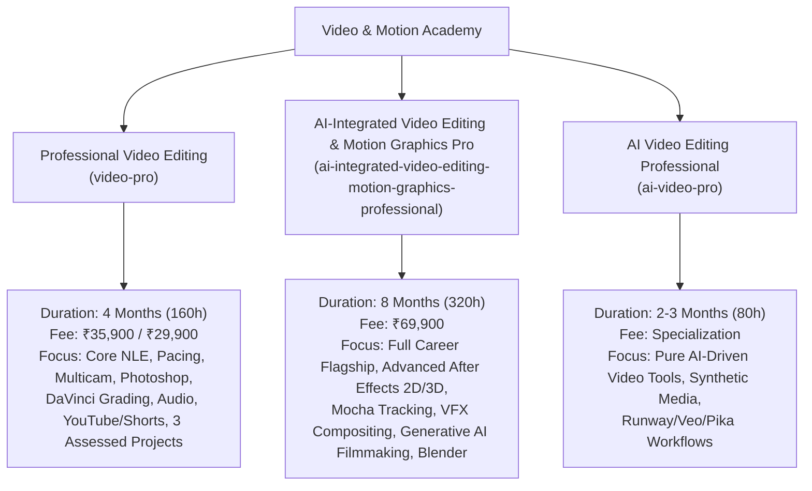
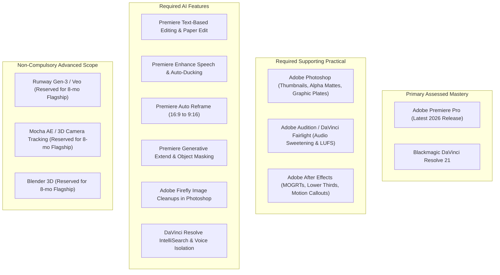
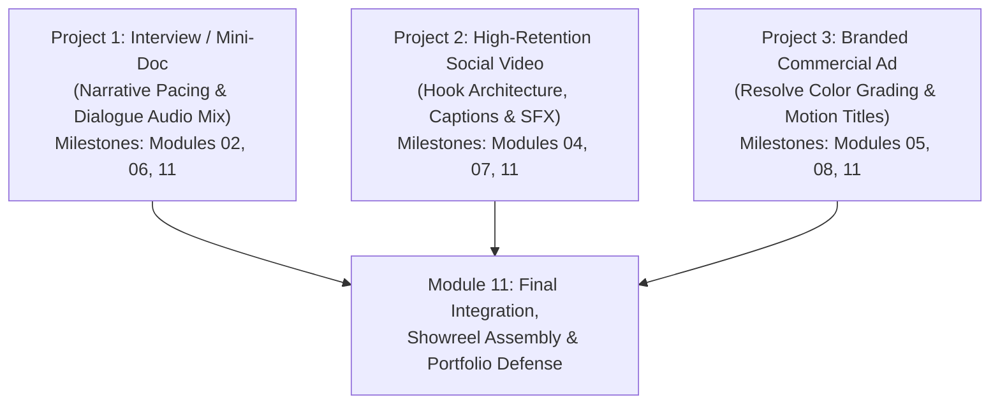

# Professional Video Editing — Authoritative Academic Specification

**Program Title:** Professional Video Editing  
**Course Identifier:** `video-pro`  
**Academy:** Video & Motion Academy (`video`, Academy ID: `video`)  
**Credential Awarded:** Professional Certificate in Video Editing & Post-Production  
**Academic Governance:** Nova Skills Academic Board | ISO 9001:2015 Standards  
**Duration:** 4 Months (16 Academic Weeks)  
**Guided Instructional Hours:** 160 Guided Hours (10 Hours / Week average)  
**Recommended Independent Practice:** 80–120 Hours (strictly demarcated from guided hours)  
**Target Level:** Beginner to Applied Commercial Professional (zero prerequisites required; progressive ladder from visual grammar to commercial delivery)  
**Authoritative Version:** 1.0.0 (October 2026 Production Standard)  

---

## 1. Executive Summary & Program Positioning

### 1.1 Course Positioning & Industry Landscape
In the Indian and global digital economy of late 2026, video editing has transitioned from an isolated technical skill into a high-velocity, commercially strategic discipline. Content-driven businesses, marketing agencies, D2C brands, media production houses, and high-growth creator enterprises require video editors who possess:
1. **Rock-solid visual storytelling grammar:** Mastering pacing, eye trace, spatial orientation (180° rule), rhythm, and cutting on action.
2. **Dual-engine NLE mastery:** Industry-standard timeline editing and proxy management in **Adobe Premiere Pro**, paired with technical node-based colour grading and finishing in **DaVinci Resolve 21**.
3. **Essential supporting creative assets:** Practical commercial graphics, high-converting thumbnail creation, title plates, and alpha-matte extraction in **Adobe Photoshop**.
4. **Professional sound engineering:** Audio restoration, dialog leveling, EQ, noise reduction, and broadcast-standard loudness mastering in **Adobe Audition** and **Resolve Fairlight**.
5. **High-retention social and commercial editing:** Hook architecture, pattern interrupts, kinetic caption animation, and multi-format delivery (16:9 widescreen, 9:16 vertical, 1:1, 4:5).
6. **Editor-focused motion design:** Dynamic linking, animated lower thirds, tracked callouts, and motion graphic templates (MOGRTs) in **Adobe After Effects**.
7. **Responsible AI editorial acceleration:** Practical implementation of Premiere Text-Based editing, Paper Edit workflows, Auto Reframe, AI Enhance Speech, Generative Extend, Adobe Firefly image cleanups, and DaVinci Resolve IntelliSearch/CineFocus.

**Professional Video Editing (`video-pro`)** is purpose-built as an intensive 4-month, 160-guided-hour vocational career program. It prepares students for immediate entry into commercial agencies, media studios, corporate communication teams, and high-ticket freelance client retainers.

---

### 1.2 Academy Architecture & Tri-Course Differentiation Matrix

The Nova Skills Video & Motion Academy maintains three distinct, non-overlapping course offerings to cater to specific career objectives without internal catalog cannibalization:

| Dimension | Professional Video Editing (`video-pro`) | AI-Integrated Video Editing & Motion Graphics Pro (`ai-integrated-...`) | AI Video Editing Professional (`ai-video-pro`) |
| :--- | :--- | :--- | :--- |
| **Duration** | **4 Months (16 Weeks)** | **8 Months (32 Weeks)** | **2–3 Months (8–12 Weeks)** |
| **Guided Hours** | **160 Guided Hours** | **320 Guided Hours** | **80 Guided Hours** |
| **Primary NLE Focus** | Premiere Pro + DaVinci Resolve 21 | Premiere Pro + DaVinci Resolve Studio | Lightweight Web/Desktop AI NLEs |
| **Photoshop Depth** | **Dedicated 16h Module** (Thumbnails, Overlays, Alpha) | Integrated across motion styleframing | Basic graphic asset import |
| **Motion Design Scope** | **Editor Foundations (10h)**: Lower thirds, MOGRTs, title callouts | **Advanced Assessed (80h+)**: Graph Editor, Expressions, Shape Rigging | Basic AI-generated motion graphics |
| **VFX & Tracking** | Essential 2D tracking & corner pins | Mocha AE, 3D Camera Tracker, Rotoscoping, Keylight, VFX Compositing | AI rotoscoping / Magic Mask only |
| **3D Scope** | Basic 2D/2.5D space in After Effects | **Blender 3D** passes & camera integration | Prompt-to-3D visual concepts |
| **Generative AI Scope** | **Editorial Acceleration**: Transcription, Enhance Speech, Generative Extend, Firefly | **Cinematic AI Filmmaking**: Google Flow/Veo, Runway Gen-3, Multi-angle generation | Pure AI generative toolchain |
| **Assessed Projects** | **3 Focused Industry Builds**: Mini-Doc, High-Retention Social, Branded Commercial | **7 Portfolio Deliverables** + Showreel Defense | AI Short Film + AI Campaign Reel |
| **Target Role** | Video Editor, Commercial Editor, YouTube Editor | Senior Motion Designer, VFX Artist, Creative Post Lead | AI Content Creator, Prompt Editor |
| **Commercial Base** | **INR 35,900** (Launch: **INR 29,900**) | **INR 69,900** | **INR 14,999** |

---

## 2. Audit of Existing Legacy Course (`video-pro`)

### 2.1 Historical Status & Limitations
The historical `video-pro` record in the repository contained:
- Inconsistent duration definitions (3 Months in `data.js` vs 4 Months in `video-pro.json`).
- Inconsistent hours allocation (120 hours in `data.js` vs 160 hours in `video-pro.json`).
- A generic 4-module outline lacking practical lesson depth, missing explicit guided hours per module, and lacking dedicated rubrics.
- Complete absence of dedicated Adobe Photoshop training (essential for modern video editors creating thumbnails and graphic overlays).
- A combined Lumetri/Resolve module that failed to teach DaVinci Resolve 21's node-based color architecture properly.
- No structured training in high-retention short-form editing (Reels, Shorts, TikTok) or YouTube content mechanics.
- Inadequate audio training that omitted broadcast loudness compliance (LUFS) and dedicated Fairlight/Audition workflows.
- Zero structured coverage of modern 2026 AI-assisted editorial workflows (Text-based editing, Paper Edit, Auto Reframe, Enhance Speech, Generative Extend).

### 2.2 Pedagogical Disposition Matrix

| Legacy Topic / Element | Disposition | Technical Action & Justification |
| :--- | :---: | :--- |
| **Premiere Pro Timeline Basics** | **KEEP & EXPAND** | Expand into **Module 02 (Core Workflows, 24h)** and **Module 03 (Advanced & Multicam, 20h)**. |
| **Trimming Tools (Ripple, Roll, Slip)** | **KEEP & EXPAND** | Integrated deeply into timeline speed drills, keyboard-only editing, and dynamic ripple trimming. |
| **J/L Cuts & Narrative Continuity** | **EXPAND & REPOSITION** | Front-loaded into **Module 01: Visual Storytelling & Grammar (12h)** to establish storytelling discipline before software buttons. |
| **B-Roll & Basic Transitions** | **EXPAND** | Replaced generic transition packs with purposeful narrative cutaways, match cuts, J-cuts, and whip/zoom wipes in Module 02. |
| **Combined Lumetri & Resolve Module** | **REMOVE & EXPAND** | Separated completely. Premiere Lumetri is taught in Module 02/03; **DaVinci Resolve 21 is given a dedicated 24h deep dive (Module 05)** covering node trees, scopes, and primaries. |
| **Generic Audio Mixing (4 lessons)** | **EXPAND** | Replaced with **Module 06: Audio Post-Production, Audition & Fairlight (16h)** covering dialogue cleanup, EQ, compression, de-noise, and LUFS mastering. |
| **Adobe Photoshop** | **ADD** | Added **Module 04: Adobe Photoshop for Video Editing & Commercial Graphics (16h)** covering thumbnails, title plates, layer cutouts, and Generative Fill. |
| **Commercial & High-Retention Social** | **ADD** | Added **Module 07: Commercial Editing, YouTube & High-Retention Social Videos (16h)** covering hook pacing, pattern interrupts, and dynamic captions. |
| **After Effects for Video Editors** | **ADD** | Added **Module 08: After Effects Fundamentals & Motion Assets for Editors (10h)** covering MOGRTs, lower thirds, and animated callouts. |
| **AI Editorial Acceleration** | **ADD** | Added **Module 09: AI-Assisted Editing & Generative Creative Workflows (8h)** covering Text-Based Editing, Paper Edit, Enhance Speech, and Generative Extend. |
| **Quality Control & Client Delivery** | **ADD** | Added **Module 10: Professional Delivery, Quality Control & Client Workflow (6h)** covering codec math, client revision cycles, and QC checklists. |
| **3 Assessed Industry Projects** | **ADD & LOCK** | Added **Module 11 (8h)** integrating P1 (Mini-Doc), P2 (High-Retention Social Package), and P3 (Branded Commercial Ad). |
| **Canva / Envato as Primary Tools** | **REMOVE** | Removed Canva/Envato from primary assessed software. Focus strictly on professional NLE and Adobe/Blackmagic suites. |
| **Obsolete Disc / DVD Workflows** | **REMOVE** | Scrubbed all legacy optical media and interlaced standard-definition export presets. |

---

## 3. October 2026 Industry Hiring & Technical Toolchain Benchmark

### 3.1 India-Focused Employer Hiring Landscape
An analysis of October 2026 job postings across major Indian production hubs (Mumbai, Bengaluru, Delhi NCR, Hyderabad, Chennai, and Pune) and global remote freelance platforms indicates demand for the following core competencies:

1. **Short-Form & Social Video Editor (CTC: ₹3.5L – ₹6.5L LPA / $20–$45/hr):**
   - High-velocity vertical video editing (Instagram Reels, YouTube Shorts, TikTok).
   - Proven ability to engineer high retention curves, design engaging animated captions, execute pattern interrupts, and integrate dynamic sound effects.
   - Rapid asset preparation in Photoshop (creating custom stickers, cutout overlays, and high-CTR YouTube thumbnails).

2. **Commercial & Brand Video Editor (CTC: ₹5.0L – ₹9.5L LPA / $35–$65/hr):**
   - Multi-camera synchronization, speed ramping, color conforming, and seamless audio mixing.
   - DaVinci Resolve color grading mastery: balancing Log footage, matching multi-cam shots, applying creative LUTs, and grading skin tones accurately using vectorscopes.
   - Professional audio cleanup (removing background noise, room echo, plosives) and mixing to -14 LUFS (web) or -24 LUFS (broadcast).

3. **Corporate & Documentary Video Editor (CTC: ₹4.5L – ₹8.0L LPA):**
   - Narrative story development from extensive raw interview takes (A-roll assembly, Paper Edit transcription workflows).
   - Organizing multi-terabyte project bins with standardized naming conventions and automated proxy workflows.
   - Comprehensive quality control: zero dropped frames, legal broadcast color limits, clean dialogue stems, and accurate codec exports.

### 3.2 Technical Vendor & Tool Tier Separation

---

## 4. Locked 11-Module Curriculum Matrix (160 Guided Hours)

The curriculum spans 4 calendar months (16 academic weeks) with an average cadence of **10 guided instructional hours per week**.

| Module ID | Module Title | Guided Hours | Academic Month | Instructional Weeks |
| :---: | :--- | :---: | :---: | :---: |
| **Module 01** | Visual Storytelling, Video Grammar & Editing Foundations | 12 Hours | Month 1 | Weeks 01–02 |
| **Module 02** | Adobe Premiere Pro: Core Editing & Media Workflows | 24 Hours | Month 1 | Weeks 02–04 |
| **Module 03** | Advanced Premiere Pro, Multicam & Efficient Editing | 20 Hours | Month 2 | Weeks 05–06 |
| **Module 04** | Adobe Photoshop for Video Editing & Commercial Graphics | 16 Hours | Month 2 | Weeks 07–08 |
| **Module 05** | DaVinci Resolve 21: Editing, Colour Correction & Grading | 24 Hours | Month 3 | Weeks 09–11 |
| **Module 06** | Audio Post-Production, Audition & Fairlight | 16 Hours | Month 3 | Weeks 11–12 |
| **Module 07** | Commercial Editing, YouTube & High-Retention Social Videos | 16 Hours | Month 4 | Weeks 13–14 |
| **Module 08** | After Effects Fundamentals & Motion Assets for Editors | 10 Hours | Month 4 | Week 14 |
| **Module 09** | AI-Assisted Editing & Generative Creative Workflows | 8 Hours | Month 4 | Week 15 |
| **Module 10** | Professional Delivery, Quality Control & Client Workflow | 6 Hours | Month 4 | Week 15 |
| **Module 11** | Industry Projects, Portfolio & Final Assessment | 8 Hours | Month 4 | Week 16 |
| **TOTAL** | **11 In-Depth Industry Modules** | **160 Hours** | **4 Months** | **16 Weeks** |

---

## 5. Comprehensive Module Competency Blueprint (Modules 01–11)

### Module 01: Visual Storytelling, Video Grammar & Editing Foundations
- **Guided Hours:** 12 Hours  
- **Placement:** Month 1, Weeks 1–2  
- **Primary Focus:** Film grammar, narrative psychology, continuity rules, pacing, shot categorization.  
- **Core Philosophy:** Great editing is rooted in narrative psychology and viewer attention, not software keystrokes. Students master the grammar of cinema before launching software.

#### Detailed Topics & Subtopics:
1. **The Language of Cinema & Shot Typology:**
   - Shot scales and their psychological impact: Extreme Long Shot (ELS), Wide Shot (WS), Medium Shot (MS), Close-Up (CU), Extreme Close-Up (ECU).
   - Camera angles and emotional perspective: Eye-level, High angle, Low angle, Dutch tilt, Bird's eye.
   - Camera movement vocabulary: Pan, Tilt, Dolly, Truck, Pedestal, Crane, Handheld vs Gimbal stability.
2. **The Rules of Continuity Editing:**
   - The 180-Degree Rule and spatial geometry: Establishing the axis of action and maintaining eyelines.
   - 30-Degree Rule and jump cut psychology (intentional vs accidental jump cuts).
   - Cut on action and match cuts: Hiding the edit within physical subject movement.
   - Screen direction consistency and crossing the line techniques.
3. **Pacing, Rhythm & Temporal Editing:**
   - Metric, rhythmic, tonal, and associative montage principles.
   - Cutting on beats vs cutting for emotional breath; micro-pacing within dialogue.
   - J-Cuts and L-Cuts: Asynchronous audio-video transitions to establish conversational naturalism.
4. **Editorial Problem Solving & Shot Selection:**
   - Analyzing director takes: Selecting the best performance over technical perfection.
   - Dealing with continuity breaks, eye-dart, and awkward pauses.
   - Script breakdown, lined scripts, and editorial logs.

#### Practical Labs & Assignments:
- **Classroom Lab (6h):** Manual timeline exercise analyzing raw rushes from a two-character dialogue scene; students identify eyeline errors, mark optimal cut points, and diagram the 180-degree axis.
- **Student Assignment (6h):** Assemble a paper/storyboard edit of a 90-second conversational sequence using contact sheets of raw footage, justifying every cut with a narrative reason.
- **Assessment Criteria:** Story continuity adherence (35%), eyeline/180-degree maintenance (35%), cutting on action accuracy (30%).

---

### Module 02: Adobe Premiere Pro: Core Editing & Media Workflows
- **Guided Hours:** 24 Hours  
- **Placement:** Month 1, Weeks 2–4  
- **Primary Focus:** Premiere Pro interface, ingest pipelines, proxy creation, 3-point editing, precision trimming, Lumetri basics.

#### Detailed Topics & Subtopics:
1. **System Setup & Ingest Architecture:**
   - Premiere Pro interface customization, dual-monitor workspaces, and keyboard shortcut mapping.
   - Storage architecture: Scratch disks, media cache management, project file organization.
   - Media Ingest: Ingest settings, auto-transcoding, and offline/online proxy generation using Adobe Media Encoder.
2. **Timeline Mechanics & 3-Point / 4-Point Editing:**
   - Source monitor navigation, In/Out points, Insert vs Overwrite edits.
   - Track targeting, source patching, sync locks, and track locks.
   - Three-point and four-point edits, replace edits, fit-to-fill speed changes.
3. **Advanced Trimming & Keyboard-Only Editing:**
   - Ripple edit, Roll edit, Slip tool, Slide tool mechanics.
   - Dynamic trimming using J-K-L keys; trimming on the fly in the Program monitor.
   - Asymmetric trimming (trimming video and audio in opposite directions).
4. **Essential Effects, Transitions & Basic Color:**
   - Fixed effects: Position, Scale, Rotation, Anchor Point, Opacity, Blend Modes.
   - Keyframing motion, spatial vs temporal interpolation, ease in / ease out curves.
   - Standard transitions vs stylistic wipes; adjustment layers architecture.
   - Basic Lumetri Color: Basic Correction tab, White Balance selector, Exposure, Contrast, Highlights, Shadows.

#### Practical Labs & Assignments:
- **Classroom Lab (12h):** Ingest 4K raw footage, generate lightweight ProRes Proxy files, configure keyboard shortcuts, and build a synchronized 2-minute dialogue scene using keyboard-only trimming.
- **Student Assignment (12h):** **Progressive Project 1 (Milestone 1):** Ingest raw interview rushes, sync audio, create proxy files, and execute a tight 3-minute rough cut establishing narrative spine.
- **Assessment Criteria:** Media organization & proxy setup (25%), cutting precision & trimming smoothness (35%), sync lock integrity (20%), pacing (20%).

---

### Module 03: Advanced Premiere Pro, Multicam & Efficient Editing
- **Guided Hours:** 20 Hours  
- **Placement:** Month 2, Weeks 5–6  
- **Primary Focus:** Multi-camera production, time remapping, nested sequences, track mattes, speed optimization.

#### Detailed Topics & Subtopics:
1. **Multi-Camera Editing Workflows:**
   - Synchronizing multi-angle shoots: Timecode sync, audio waveform matching, in-point sync.
   - Creating Multi-Camera Source Sequences and multi-cam target sequences.
   - Live multi-cam switching using the Multi-Camera Monitor; real-time angle cutting.
   - Flattening multi-cam edits, refining cut points, and color grading individual angles.
2. **Time Remapping & Dynamic Speed Effects:**
   - Clip speed/duration vs Time Remapping on the timeline.
   - Smooth speed ramps: Creating speed keyframes, velocity curves, and transition handles.
   - Optical Flow vs Frame Blending vs Frame Sampling for slow-motion interpolation.
   - Reverse motion, freeze frames, and frame hold segments.
3. **Sequence Nesting, Track Mattes & Masking:**
   - Nested sequences: Advantages, limitations, and audio routing precautions.
   - Track Matte Key effect: Using luminance and alpha mattes for creative reveal transitions.
   - Effect masking and motion tracking inside Premiere: Blurring faces, license plates, and selective exposure adjustments.
4. **High-Velocity Editorial Shortcuts & Automation:**
   - Pancake timeline workflows: Stacking selects sequences directly above master edit timelines.
   - Q and W ripple trim shortcuts, extend edit command, nudge shortcuts.
   - Project consolidation, Project Manager archiving, and relinking offline media.

#### Practical Labs & Assignments:
- **Classroom Lab (10h):** Set up a 3-camera musical/talk-show shoot, synchronize via audio waveforms, execute a live multi-camera switch, and polish cuts using roll trimming.
- **Student Assignment (10h):** Produce a 60-second high-energy sports or lifestyle promo featuring smooth speed ramps (Optical Flow), split-screen nested grids, and masked blur transitions.
- **Assessment Criteria:** Multi-cam sync accuracy (30%), speed ramp velocity curve smoothness (30%), timeline hygiene & nesting structure (20%), execution speed (20%).

---

### Module 04: Adobe Photoshop for Video Editing & Commercial Graphics
- **Guided Hours:** 16 Hours  
- **Placement:** Month 2, Weeks 7–8  
- **Primary Focus:** High-CTR YouTube thumbnails, video title plates, transparent overlays, alpha mattes, image cleanup, aspect ratio composition.

#### Detailed Topics & Subtopics:
1. **Photoshop Essentials for Video Editors:**
   - Video document presets: 1920x1080 (16:9), 1080x1920 (9:16), 1080x1350 (4:5), 3840x2160 (4K UHD).
   - Pixel aspect ratios, color modes (RGB 8-bit/16-bit), resolution standards (72/300 DPI for video/print).
   - Non-destructive layer workflows: Smart Objects, Layer Masks, Adjustment Layers, Clipping Masks.
2. **Subject Cutouts & Alpha Matte Preparation:**
   - Object Selection Tool, Select Subject, Quick Selection, and Refine Edge / Select and Mask.
   - Hair extraction, edge decontaminating, and fringe removal for transparent PNG overlays.
   - Creating black-and-white high-contrast alpha mattes for track matte transitions in Premiere.
3. **High-Converting YouTube Thumbnail Architecture:**
   - Psychological mechanics of thumbnails: Visual hierarchy, emotional expression, rule of thirds, contrast.
   - Subject enhancement: Dodge & Burn for facial drama, high-pass sharpening, rim lighting simulation.
   - High-impact typography: Custom stroke outlines, drop shadows, bevels, text contrast on busy backgrounds.
   - Color grading thumbnail elements: Harmonizing background and foreground colors using Color Balance and Curves.
4. **Video Overlays, Lower Third Plates & Generative Fill:**
   - Designing lower third title backgrounds, graphic bug plates, and commercial end-card banners.
   - Adobe Firefly Generative Fill inside Photoshop: Expanding vertical backgrounds from horizontal shots, removing unwanted background objects, generative object placement.
   - Exporting transparent assets: PNG-24 with transparency, layered PSD files for native Premiere import.

#### Practical Labs & Assignments:
- **Classroom Lab (8h):** Isolate a human subject from a complex background, clean hair edges using Select and Mask, create a dramatic rim light effect, and design a high-contrast YouTube thumbnail with title text.
- **Student Assignment (8h):** **Progressive Project 2 (Milestone 1):** Design a complete graphic asset package for a social video campaign: 1 high-CTR YouTube thumbnail (1280x720), 2 transparent lower third plates, and 1 expanded 9:16 background plate using Photoshop Generative Fill.
- **Assessment Criteria:** Cutout edge cleanliness & alpha transparency (30%), thumbnail composition & visual hierarchy (30%), typography readability (20%), color harmony (20%).

---

### Module 05: DaVinci Resolve 21: Editing, Colour Correction & Grading
- **Guided Hours:** 24 Hours  
- **Placement:** Month 3, Weeks 9–11  
- **Primary Focus:** DaVinci Resolve 21 architecture, node-based grading, color wheels, scopes, Log footage conversion, secondary corrections.

#### Detailed Topics & Subtopics:
1. **DaVinci Resolve 21 Architecture & Cut/Edit Pages:**
   - Project Manager, project settings, timeline color management (DaVinci YRGB vs Color Managed).
   - The Cut Page for rapid rough assembly; Edit Page precision editing tools.
   - XML / EDL / AAF roundtrip: Exporting timelines from Premiere Pro and conforming inside Resolve 21.
2. **Video Scopes & Primary Colour Correction:**
   - Reading video scopes: Waveform (Luma & RGB Parade), Vectorscope (Hue & Saturation), Histogram.
   - Primary Wheels (Lift, Gamma, Gain, Offset) and Primary Bars.
   - Setting black points, white points, exposure balancing, and color temperature neutralization.
   - Log vs Rec.709 color spaces; applying camera manufacturer technical LUTs (Sony S-Log3, Canon C-Log, Blackmagic RAW).
3. **Node-Based Color Grading Architecture:**
   - Serial nodes, Parallel nodes, Layer nodes, and Outside nodes.
   - Building a professional node tree: Exposure -> White Balance -> Primary Curves -> Secondary Isolations -> Look Development -> Film Grain.
   - Node labeling, node bypass, and organizing complex node structures.
4. **Secondary Colour Grading & Precision Qualifiers:**
   - HSL Curves: Hue vs Hue, Hue vs Sat, Hue vs Lum, Lum vs Sat, Sat vs Sat.
   - The Magic Wand Qualifier: Isolating skin tones using the Skin Tone Indicator line on the Vectorscope.
   - Power Windows: Circular, linear, polygon, and gradient masks with soft edges.
   - Resolve 21 Point Tracker and Cloud Tracker for locking grades onto moving subjects.
5. **Look Development & Technical Conforming:**
   - Creating cinematic looks: Teal & Orange, Bleach Bypass, Commercial Clean, High-Contrast Black & White.
   - Shot matching across multi-camera shoots using Split Screen and Reference Wipes.
   - Applying film grain, halation, and glow safely without clipping broadcast legal levels.

#### Practical Labs & Assignments:
- **Classroom Lab (12h):** Import flat Log footage, neutralize color casts using Scopes and Primaries, construct a 6-node tree, isolate skin tones with qualifiers, and match 5 different camera shots in a scene.
- **Student Assignment (12h):** **Progressive Project 3 (Milestone 1):** Grade a 30-second commercial sequence from raw Log footage: establish clean technical balance across all shots, execute skin tone protection, apply a stylized brand look, and export broadcast-safe ProRes/H.264 files.
- **Assessment Criteria:** Technical scope balance & legal luminance levels (30%), skin tone accuracy on vectorscope (30%), shot-to-shot consistency (25%), creative look execution (15%).

---

### Module 06: Audio Post-Production, Audition & Fairlight
- **Guided Hours:** 16 Hours  
- **Placement:** Month 3, Weeks 11–12  
- **Primary Focus:** Audio restoration, dialogue EQ & compression, Foley and SFX layering, loudness standards (LUFS), Audition & Fairlight.

#### Detailed Topics & Subtopics:
1. **Audio Fundamentals & Dialogue Cleanup:**
   - Decibels (dBFS vs dBU), sample rates (48 kHz 24-bit for video), mono vs stereo vs multichannel audio.
   - Common audio problems: Room reverb, HVAC hum, wind noise, mic clipping, plosives, and sibilance.
   - Spectral Frequency Display in Adobe Audition: Healing brush, lasso tool, removing sirens, coughs, and clicks.
   - De-noise, De-reverb, De-hum, De-click, and De-esser plugins in Audition and Resolve Fairlight.
2. **Equalization (EQ) & Dynamic Processing:**
   - Parametric Equalizer: High-pass filters (rumble elimination), notch filters, dialogue presence boosts (2.5 kHz–5 kHz).
   - Dynamic range compression: Threshold, Ratio, Attack, Release, Make-up gain.
   - Hard limiting and audio peak protection (preventing 0 dBFS digital distortion).
3. **Sound Design, Foley & Music Scoring:**
   - Sound design layers: Ambience / Room Tone, Foley (footsteps, clothing, object handling), SFX (impacts, whooshes, risers).
   - Audio spatialization: Panning, stereo widening, reverb matching for realistic space integration.
   - Audio Ducking: Manual sidechain compression and automated AI auto-ducking to lower music beneath dialogue.
4. **Mastering & Loudness Compliance (LUFS):**
   - Peak meters vs RMS vs Loudness Units relative to Full Scale (LUFS).
   - Industry loudness targets:
     - YouTube, Spotify, Social Media: **-14 LUFS** (True Peak -1.0 dBFS).
     - Broadcast Television / OTT: **-24 LUFS (EBU R128 / ITU-R BS.1770)**.
   - Exporting final audio stems: Dialogue, Music, Sound Effects (DME stems).

#### Practical Labs & Assignments:
- **Classroom Lab (8h):** Clean up heavily corrupted dialogue containing HVAC background noise and plosives using Audition's Spectral Editor, apply EQ and multiband compression, and mix to -14 LUFS.
- **Student Assignment (8h):** **Progressive Project 1 (Milestone 2):** Complete the full audio mix for the Interview/Mini-Doc project: balance dialogue, integrate room tone, add subtle score music with auto-ducking, and deliver -14 LUFS master with DME stems.
- **Assessment Criteria:** Dialogue clarity & noise reduction cleanliness (35%), music/effects ducking balance (25%), loudness compliance to -14 LUFS (25%), frequency separation (15%).

---

### Module 07: Commercial Editing, YouTube & High-Retention Social Videos
- **Guided Hours:** 16 Hours  
- **Placement:** Month 4, Weeks 13–14  
- **Primary Focus:** Audience retention psychology, hook architecture, 9:16 vertical video production, kinetic typography captions, pattern interrupts.

#### Detailed Topics & Subtopics:
1. **Audience Retention Psychology & Hook Architecture:**
   - Analyzing YouTube & Instagram retention graphs: Identifying drop-off spikes and viewer churn points.
   - The 0-to-3-second hook: Visual hooks, auditory hooks, and curiosity gap framing.
   - Story arcs in short-form content: Hook -> Problem -> Escalation -> Climax / Value -> CTA.
2. **Pattern Interrupts & Pacing Strategies:**
   - Visual pattern interrupts: Scale pops (punch-in from 100% to 115%), b-roll cutaways every 2–4 seconds, whip transitions.
   - Auditory pattern interrupts: Whooshes, riser drops, vinyl stops, bass drops, sound effects paired with visual motions.
   - Micro-speed ramps and kinetic zooms to maintain visual dynamism.
3. **Vertical Video Production & Re-framing (9:16):**
   - Framing for mobile: Safe zones (avoiding TikTok/Reels UI buttons, captions, and profile icons).
   - Repurposing horizontal 16:9 footage into 9:16: Pan-and-scan, stacked splits, blurred background fills.
   - Premiere Pro Auto Reframe tool: Keyframe adjustments and fine-tuning focal points.
4. **Kinetic Caption Animation & Dynamic Subtitles:**
   - Generating speech-to-text transcriptions in Premiere Pro.
   - Styling social captions: Punchy font pairings, word-by-word highlight colors (yellow/green pop), emoji integration.
   - Custom subtitle animations: Scale bounce, slide-in, typewriter effects.
   - Exporting vertical video: Bitrate optimization, H.264 profiles for mobile upload without platform compression artifacts.

#### Practical Labs & Assignments:
- **Classroom Lab (8h):** Take a raw 60-second talking-head clip, generate and style animated word-by-word captions, insert 8 pattern interrupts (punch-ins, SFX, cutaways), and optimize for Instagram Reels.
- **Student Assignment (8h):** **Progressive Project 2 (Final Package Deliverable):** Edit and deliver 3 vertical high-retention social videos (30–60s each): 1 D2C eCommerce product ad, 1 educational/finance reel, and 1 podcast highlight, complete with animated captions and sound effects.
- **Assessment Criteria:** Hook strength & visual pacing (35%), caption animation legibility & timing (25%), sound design pairing (20%), safe-zone adherence (20%).

---

### Module 08: After Effects Fundamentals & Motion Assets for Editors
- **Guided Hours:** 10 Hours  
- **Placement:** Month 4, Week 14  
- **Primary Focus:** After Effects interface, Premiere Dynamic Link, lower thirds, title callouts, motion tracking, MOGRT customization.

#### Detailed Topics & Subtopics:
1. **After Effects Workspace & Editor Workflow:**
   - The After Effects composition architecture: Compositions, Pre-comps, timeline layers.
   - Adobe Dynamic Link: Replacing clips in Premiere with After Effects compositions without rendering intermediate files.
   - Transform properties and the Graph Editor: Creating organic motion curves using Speed Graphs.
2. **Lower Thirds & Animated Text Assets:**
   - Creating custom animated lower thirds: Shape layers, track mattes, trim paths, repeater effects.
   - Kinetic title callouts for commercial products: Arrow pointers, bounding box highlights, callout text tracking.
3. **Motion Graphics Templates (MOGRTs):**
   - The Essential Graphics panel in After Effects: Exposing text properties, color pickers, and slider controls.
   - Exporting and installing MOGRT packages in Premiere Pro for repeatable client branding.
4. **Basic Motion Tracking & Alpha Channel Delivery:**
   - 2D Point Tracker inside After Effects: Tracking screen replacements and floating text tags onto moving camera shots.
   - Exporting video with alpha channel: QuickTime ProRes 4444 (RGB + Alpha) for reusable motion overlays.

#### Practical Labs & Assignments:
- **Classroom Lab (5h):** Build a branded lower third in After Effects with trim paths and easing curves, link it into Premiere Pro via Dynamic Link, and expose controls as a MOGRT.
- **Student Assignment (5h):** **Progressive Project 3 (Milestone 2):** Create 2 custom animated graphic assets for the Branded Commercial project: 1 dynamic animated product callout badge with motion tracking, and 1 branded outro logo card with alpha channel.
- **Assessment Criteria:** Animation curve smoothness & easing (35%), MOGRT usability & parameter exposure (25%), tracking accuracy (20%), technical alpha export (20%).

---

### Module 09: AI-Assisted Editing & Generative Creative Workflows
- **Guided Hours:** 8 Hours  
- **Placement:** Month 4, Week 15  
- **Primary Focus:** Premiere Pro AI tools, Text-Based Editing, Paper Edit, Enhance Speech, Generative Extend, Resolve IntelliSearch.

#### Detailed Topics & Subtopics:
1. **Text-Based Editing & Paper Edit Workflows:**
   - Automatic speech-to-text transcription in Premiere Pro.
   - Cutting video by editing text: Deleting pauses, filler words ("um", "ah"), and rearranging paragraphs on the transcript to re-cut the timeline.
   - Exporting transcriptions for client Paper Edit approvals and subtitle generation.
2. **AI Audio Enhancement & Generative Extend:**
   - Premiere Pro Enhance Speech: Adjusting mix amount, restoring low-quality smartphone audio to studio broadcast quality.
   - Generative Extend in Premiere Pro: Adding AI-generated video frames and audio ambience to extend clips that ended prematurely.
3. **AI Re-framing & Object Masking:**
   - Auto Reframe motion tracking analysis and adjusting keyframe sensitivity.
   - Premiere Object Masking: Isolating foreground actors and background elements automatically.
4. **DaVinci Resolve AI Neural Engine & Image Tools:**
   - DaVinci Resolve IntelliSearch and Smart Reframe.
   - Voice Isolation and Dialogue Leveler in Resolve Fairlight.
   - Photoshop Generative Fill for extending horizontal production photos into vertical mobile assets.
5. **Ethical AI Boundaries & Hallucination Mitigation:**
   - Client copyright compliance, watermark awareness, and avoiding over-reliance on generative AI.
   - When to use AI for editorial speed vs when to execute manual editorial craft.

#### Practical Labs & Assignments:
- **Classroom Lab (4h):** Execute a complete 5-minute interview rough cut in under 20 minutes using Premiere Text-Based editing, clean poor audio with Enhance Speech, and fix a short clip using Generative Extend.
- **Student Assignment (4h):** Apply AI editorial acceleration across an unedited raw interview shoot: transcribe, strip filler words, create an edited paper cut, and document time saved compared to manual cutting.
- **Assessment Criteria:** Transcription workflow speed & accuracy (35%), Enhance Speech naturalness without robotic artifacts (35%), ethical awareness & clean edit boundaries (30%).

---

### Module 10: Professional Delivery, Quality Control & Client Workflow
- **Guided Hours:** 6 Hours  
- **Placement:** Month 4, Week 15  
- **Primary Focus:** Codec architecture, bitrate calculation, quality control checklists, client revision cycles, cloud delivery.

#### Detailed Topics & Subtopics:
1. **Video Codecs, Containers & Compression Math:**
   - Container formats (MP4, MOV, MXF) vs Compression Codecs (H.264, H.265/HEVC, Apple ProRes 422/HQ/4444, Avid DNxHD/HR).
   - Intra-frame (all-I) vs Inter-frame (long-GOP / IPB) compression; bitrate mathematics (CBR vs VBR 1-pass/2-pass).
   - Color subsampling: 4:2:0 vs 4:2:2 vs 4:4:4 and bit depth (8-bit vs 10-bit).
2. **Quality Control (QC) Engineering Checklist:**
   - Frame-by-frame QC audit: Catching flash frames, black frames, unlinked media, and offline audio.
   - Audio QC: True Peak monitoring (preventing distortion above -1.0 dBFS), phase cancellation checks, mono compatibility.
   - Color QC: Broadcast safe luminance clamping (100 IRE / 0 IRE limits) to prevent broadcast station rejection.
3. **Client Review Workflows & Revision Management:**
   - Using Frame.io and Vimeo Review for timecoded client feedback and approval markers.
   - Version numbering conventions (`_v01`, `_v02`, `_Locked`, `_FinalMaster`).
   - Managing difficult client feedback, scope creep, and professional handover protocols.
4. **Master Archiving & Project Handoff:**
   - Project consolidation using Premiere Project Manager and DaVinci Resolve Project Archives (.dra).
   - Delivering master archives: Master video, clean video (textless), audio DME stems, and project files.

#### Practical Labs & Assignments:
- **Classroom Lab (3h):** Perform a full technical QC audit on a provided corrupted commercial timeline; identify 5 hidden errors (flash frame, audio pop, clipped peak, unlinked proxy, color clipping), correct them, and export compliant master.
- **Student Assignment (3h):** Prepare an enterprise client delivery package for an ad campaign: Master ProRes 422, web-optimized H.264, clean textless master, DME audio stems, and timecoded revision log.
- **Assessment Criteria:** QC error identification accuracy (40%), export compression quality & bitrate compliance (30%), archive package completeness (30%).

---

### Module 11: Industry Projects, Portfolio & Final Assessment
- **Guided Hours:** 8 Hours  
- **Placement:** Month 4, Week 16  
- **Primary Focus:** Portfolio integration, project defense, showreel assembly, freelance contracts, final assessment.

#### Detailed Topics & Subtopics:
1. **Showreel Assembly & Editing Rhythm:**
   - The anatomy of a high-converting editor showreel: 60 to 90 seconds maximum duration.
   - Lead with your strongest cut in the first 5 seconds; eliminate weak filler shots.
   - Music selection, rhythm matching, and displaying versatile genres (documentary, social, commercial).
   - Clear on-screen attribution: Specifying your exact role on every shot (Editor, Colorist, Sound Designer).
2. **Case Study Documentation for Behance / Personal Website:**
   - Transforming video edits into detailed case studies: Problem brief, footage challenge, creative approach, before/after color and audio comparisons.
   - Structuring client testimonials, metric outcomes (view counts, retention rates, conversion lifts).
3. **Freelancing & Employment Readiness in India:**
   - Crafting video editor resumes, Upwork / Fiverr profiles, and direct outreach to digital marketing agencies.
   - Estimating editing quotes: Hourly rate vs day rate vs flat project retainer.
   - Standard client contracts, deposit milestones (50% upfront), and copyright transfer agreements.
4. **Final Portfolio Defense & Comprehensive Assessment:**
   - Live presentation of the 3 Assessed Industry Projects and Showreel before the Academic Evaluation Panel.
   - Technical questioning on editorial choices, pacing justification, and software problem-solving.

#### Practical Labs & Assignments:
- **Classroom Lab (4h):** Assemble and polish the student's 60-second professional video editing showreel, incorporating footage from all 3 core industry projects.
- **Student Assignment (4h):** Final Portfolio Defense: Submit and present live the completed showreel, 3 polished industry projects, and case study documentation.
- **Assessment Criteria:** Showreel editing rhythm & engagement (35%), technical excellence across 3 core projects (35%), portfolio defense & communication (30%).

---

## 6. Three Assessed Progressive Industry Projects

Every student must independently produce and defend three progressive, real-world commercial video projects. These are not academic mockups—they are built from multi-gigabyte production footage packs simulating actual agency client briefs.

---

### Project 1: Interview / Mini Documentary
- **Project Title:** *Craft & Vision: Artisanal Entrepreneur Profile*  
- **Production Brief:** A client-commissioned 2.5 to 3.5 minute mini-documentary profiling an artisanal entrepreneur or tech founder. The narrative must convey passion, business struggle, and triumph without relying on a voiceover narrator.
- **Raw Footage Inventory:**
  - 4K multi-camera raw rushes (Camera A: Master tight on face; Camera B: 45-degree profile medium).
  - 15 minutes of atmospheric B-roll (product close-ups, workshop action, environment shots).
  - Separate dual-system audio: 48 kHz 24-bit lavalier mic + directional shotgun boom mic + ambient room tone.
- **Creative Plan:**
  - Transcribe and log raw dialogue; build an A-roll narrative spine in Premiere Pro.
  - Implement J and L cuts to eliminate conversational dead space and create natural dialogue pacing.
  - Intercut contextual B-roll to visualize what the subject is describing, avoiding talking-head fatigue.
- **Technical Specifications:**
  - NLE: Adobe Premiere Pro (Assembly, Trimming, Sync).
  - Audio: Adobe Audition / Fairlight (Dialogue noise reduction, EQ, multiband compression, -14 LUFS online loudness target).
  - Delivery: 16:9 3840x2160 UHD / 1920x1080 Full HD, ProRes 422 Master + H.264 Web Stream.
- **Assessment Rubric (100% Total):**
  - Narrative Arc & Cohesive Storytelling: **30%**
  - Cutting Rhythm & Pacing Consistency: **25%**
  - Audio Dialogue Clarity & Loudness Compliance (-14 LUFS): **25%**
  - Color Harmony & Basic Balance: **20%**
- **Portfolio Deliverables:** Complete 3-minute video master, 30-second teaser trailer, project breakdown case study with audio before/after audio snippet.

---

### Project 2: High-Retention Short-Form Editing Package
- **Project Title:** *Viral Retention Social Suite (3-Asset Multi-Niche Campaign)*  
- **Production Brief:** A social media agency requires three high-converting, vertical short-form video assets (9:16) targeting Gen Z and young millennial audiences across Instagram Reels and YouTube Shorts. Each video must retain over 65% of viewers past the 3-second mark.
- **Niche Asset Breakdown:**
  1. **Asset A (D2C eCommerce Product):** Fast-paced 30-second problem/solution lifestyle product ad.
  2. **Asset B (Finance/Tech Educational Reel):** 45-second high-energy talking head with animated graphic callouts and kinetic typography.
  3. **Asset C (Podcast Viral Clip):** 60-second dramatic conversational story clip with punchy multi-speaker caption animation.
- **Raw Footage Inventory:**
  - Raw vertical 9:16 phone and mirrorless camera rushes (uncut dialogue, false starts).
  - Sound design asset library: 50+ specialized SFX (whooshes, risers, paper crunches, camera shutters, pop hits).
  - Graphic elements: Transparent PNG stickers, product PNGs, emoji assets.
- **Creative Plan:**
  - Engineer a high-impact visual and auditory hook in seconds 0–3.
  - Execute scale punch-ins (100% to 115%) every 2–3 seconds to maintain dynamic pacing.
  - Produce custom animated word-by-word highlighted captions with branded font and emoji integration.
  - Use Photoshop to design high-contrast cutout assets and thumbnail cover frames.
- **Technical Specifications:**
  - Resolution: 9:16 vertical (1080x1920 pixels).
  - Software: Adobe Premiere Pro + Adobe Photoshop.
  - Safe Zones: Clean of TikTok/Instagram interactive buttons and top/bottom profile chrome.
  - Audio: Punchy, normalized to -14 LUFS, heavy use of paired SFX.
- **Assessment Rubric (100% Total):**
  - Hook Architecture & First-3-Seconds Engagement: **35%**
  - Animated Caption Typography, Legibility & Timing: **25%**
  - Pattern Interrupts & Sound Design Layering: **20%**
  - Mobile Safe-Zone Adherence & Visual Polish: **20%**
- **Portfolio Deliverables:** 3 rendered MP4 vertical videos, 3 custom thumbnail covers designed in Photoshop, retention analysis case study.

---

### Project 3: Branded Commercial Advertisement
- **Project Title:** *Aura Audio: Premium Wireless Headphones Launch Commercial*  
- **Production Brief:** A commercial post-production brief for a premium electronics brand launching high-end noise-canceling headphones. The spot must feel cinematic, aspirational, and broadcast-ready, showcasing product aesthetics, dynamic lifestyle usage, and premium brand identity.
- **Raw Footage Inventory:**
  - Multi-shot cinema camera rushes shot in Log (Sony S-Log3 / Blackmagic RAW).
  - Macro product turntable passes (360-degree spins, metallic texture close-ups).
  - Lifestyle footage: Urban runner at golden hour, commuter on busy metro, musician in studio.
  - Professional voiceover WAV (dry studio recording) + licensed commercial music stems (beats, bass, synth, melody).
- **Creative Plan:**
  - Precision commercial edit timed to musical accents and dynamic speed ramps (Optical Flow).
  - Roundtrip timeline into **DaVinci Resolve 21** for full node-based color grading:
    - Neutralize Log footage using Color Managed pipeline.
    - Isolate skin tones with qualifiers and vectorscope tracking.
    - Apply a high-end commercial look (deep cinematic blacks, clean warm highlights, product pop).
  - Integrate motion graphics created in **Adobe After Effects**: Animated product feature callouts and sleek outro logo reveal.
  - Audio conform in Fairlight / Audition to broadcast legal levels (-24 LUFS TV / -14 LUFS web).
- **Technical Specifications:**
  - Primary Software: Adobe Premiere Pro + DaVinci Resolve 21 + Adobe After Effects.
  - Format: 16:9 Master (3840x2160 UHD / 1920x1080 HD) + 9:16 Social Cutdown (1080x1920).
  - Color: Rec.709 10-bit broadcast safe, zero clipping.
  - Export: Apple ProRes 422 HQ Master + Web Delivery H.264 + Clean Textless Master.
- **Assessment Rubric (100% Total):**
  - Commercial Storytelling & Speed Ramp Pacing: **30%**
  - DaVinci Resolve Node-Based Color Grading & Skin Tone Quality: **25%**
  - After Effects Motion Graphics & Dynamic Link Polish: **25%**
  - Quality Control, Audio Mastering & Multi-Platform Delivery: **20%**
- **Portfolio Deliverables:** 30-second 16:9 broadcast master, 15-second 9:16 social cutdown, full DaVinci Resolve color grading breakdown (Before/After node progression), clean textless master.

---

## 7. Commercial & Institutional Policy Validation

### 7.1 Pricing Architecture & Statutory Guardrails
- **Academic Program Role:** Professional Career Certificate Course (Tier 2 in Video & Motion Academy).
- **Duration:** 4 Months (16 Instructional Weeks).
- **Guided Instructional Hours:** 160 Guided Hours.
- **Proposed Regular Fee:** **INR 35,900**  
- **Active Launch-Batch Selling Fee:** **INR 29,900**  
- **Statutory Taxation:** Applicable Indian Goods & Services Tax (GST @ 18%) applies extra on all transactions.
- **Transparent Commercial Breakdown:**
  - *Regular Base Fee:* ₹35,900 + 18% GST (₹6,462) = **Total Payable: ₹42,362**
  - *Launch-Batch Base Fee:* ₹29,900 + 18% GST (₹5,382) = **Total Payable: ₹35,282**
- **Truth-in-Pricing Rules:**
  - No artificial discounts (e.g. 64% off) or unsubstantiated strike-through prices (e.g. ₹74,999).
  - No invented zero-cost EMI claims without verified NBFC partner disclosures.
  - When the ₹29,900 launch fee is active, it must be substantiated as an introductory batch rate.

### 7.2 Software Licensing & Hardware Preconditions
- **Software Requirements:**
  - Adobe Creative Cloud (Premiere Pro, Photoshop, Audition, After Effects). Students utilize legitimate educational or commercial licenses.
  - Blackmagic DaVinci Resolve 21 (Free version or Studio version). The core curriculum is fully executable on the free version of DaVinci Resolve 21, ensuring zero financial barriers to professional color grading.
- **Hardware Minimum Standards:**
  - Multi-core Intel Core i5/i7 (12th Gen+) or AMD Ryzen 5/7 (5000 series+) or Apple Silicon (M1/M2/M3/M4).
  - Minimum 16 GB RAM (32 GB strongly recommended for Resolve and After Effects).
  - Dedicated GPU with minimum 4 GB VRAM (6–8 GB recommended for 4K video rendering and DaVinci Resolve neural features).
  - Fast NVMe SSD storage (minimum 500 GB free space for project caches and video rushes).

---

## 8. Summary of Validation Against Institutional Requirements

| Benchmark Parameter | Institutional Requirement | Specification Status |
| :--- | :--- | :---: |
| **Course ID** | `video-pro` (preserved canonical ID) | ✅ **CONFIRMED** |
| **Duration** | 4 Months (16 Academic Weeks) | ✅ **CONFIRMED** |
| **Guided Hours** | Exactly 160 Guided Hours | ✅ **CONFIRMED (160.0h)** |
| **Module Count** | Exactly 11 Locked Industry Modules | ✅ **CONFIRMED (11 Modules)** |
| **Assessed Projects** | 3 Assessed Industry Projects (Progressive) | ✅ **CONFIRMED (P1, P2, P3)** |
| **NLE Core Practical** | Premiere Pro (44h) + DaVinci Resolve 21 (24h) | ✅ **CONFIRMED (68h Core)** |
| **Dedicated Photoshop**| Dedicated Photoshop for Video Editing module | ✅ **CONFIRMED (Module 04, 16h)** |
| **Audio Post-Production**| Audition & Fairlight with LUFS compliance | ✅ **CONFIRMED (Module 06, 16h)** |
| **After Effects Scope**| Editor-focused motion assets & MOGRTs | ✅ **CONFIRMED (Module 08, 10h)** |
| **2026 AI Workflows** | Text-based editing, Paper Edit, Enhance Speech | ✅ **CONFIRMED (Module 09, 8h)** |
| **Client QC & Delivery**| Codec math, revision cycles, archiving | ✅ **CONFIRMED (Module 10, 6h)** |
| **Final Assessment** | Portfolio defense & showreel integration | ✅ **CONFIRMED (Module 11, 8h)** |
| **Commercial Integrity**| ₹35,900 regular / ₹29,900 launch + GST | ✅ **CONFIRMED** |
| **Data Modifications** | Website source data remains unedited | ✅ **ZERO CODE EDITED** |

---
*Authoritative Academic Blueprint locked for Academic Board approval prior to website data synchronization.*
