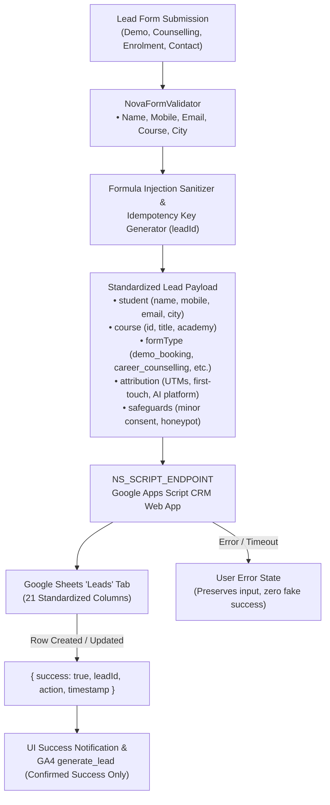

# P1-3 FORENSIC AUDIT — NOVA SKILLS ADMISSIONS CRM & LEAD CAPTURE PIPELINE

**Project:** Nova Skills Education Institute  
**Task ID:** P1-3  
**Category:** CRM Integration / Lead Management / Admissions Automation  
**Audit Target:** Complete Git Repository (`development` branch), Frontend Forms, Cloudflare Workers, and Google Apps Script CRM Web App  
**Audit Date:** November 2026  
**Status:** Completed  

---

## 1. Executive Summary & Existing CRM Architecture

A comprehensive forensic audit of all lead capture mechanisms, API endpoints, backend services, and spreadsheet CRM mappings was conducted across the Nova Skills codebase.

### Key Architectural Discoveries:
1. **Documented & Operational CRM Platform:**
   - The Privacy Policy declares a *"Google Apps Script CRM infrastructure"* operated by authorised Nova Skills admissions staff.
   - Code inspection confirmed an active, production-deployed **Google Apps Script Web App** connected to a central Google Spreadsheet named **"Leads"**.
2. **Active Web App Endpoint:**
   - The authoritative deployment URL configured in `components.js`, `cloudflare-worker/src/services/leadCaptureService.js`, and `cloudflare-worker/src/services/leadService.js` is:
     ```
     https://script.google.com/macros/s/AKfycbzRHK2n1D0WjWw4NxcwtH7FQb7eRsZxVagFnYtiz5quAFec2BLfwgJ26C0OG6FTKcPB/exec
     ```
3. **Apps Script Source Code Discovered in Repository:**
   - Located at `worker/src/scripts/googleAppsScript.js`.
   - The Web App exposes `doPost(e)` and `doGet(e)` endpoints and writes to the `"Leads"` worksheet.
   - Features built-in duplicate matching across `Lead ID`, `Session ID`, `Phone`, and `Email`.
4. **Current Submission Protocol:**
   - Website forms submit via `submitNovaForm(...)` in `components.js` using `fetch()` with `POST` and `Content-Type: text/plain;charset=utf-8` (to circumvent CORS preflight restrictions on Google Apps Script Web Apps while sending valid JSON).
   - The Cloudflare Worker (`/api/leads`) also features a `forwardLeadToAppsScript` bridge in `cloudflare-worker/src/services/leadService.js`.

---

## 2. Google Sheets CRM Schema & Field Inventory

From `worker/src/scripts/googleAppsScript.js`, the active Google Sheets `"Leads"` tab contains the following 21-column schema:

| Column Index | Column Header | Data Type | Source Field Mapping | Description |
|---|---|---|---|---|
| A (1) | **Lead ID** | String | `payload.leadId` | Unique lead record identifier |
| B (2) | **Created At** | ISO Timestamp | `payload.createdAt` | Original submission timestamp |
| C (3) | **Updated At** | ISO Timestamp | Auto-generated (`new Date().toISOString()`) | Record last-modified timestamp |
| D (4) | **Session ID** | String | `payload.sessionId` | Browser or chat session identifier |
| E (5) | **Name** | String | `payload.name` | Candidate full name |
| F (6) | **Phone** | String | `payload.phone` / `payload.mobile` | 10-digit normalized Indian mobile |
| G (7) | **Email** | String | `payload.email` | Candidate email address (optional) |
| H (8) | **City** | String | `payload.city` | Candidate location / city |
| I (9) | **State** | String | `payload.state` | State / Region |
| J (10) | **Qualification** | String | `payload.qualification` | Academic background |
| K (11) | **Current Status** | String | `payload.currentStatus` | Student, fresher, working professional |
| L (12) | **Career Goal** | String | `payload.careerGoal` | Job, freelancing, upskilling |
| M (13) | **Interest** | String | `payload.interest` / `payload.course` | Academy or primary skill interest |
| N (14) | **Budget** | String | `payload.budget` | Candidate fee budget |
| O (15) | **Preferred Mode** | String | `payload.preferredLearningMode` / `payload.preferredMode` | Online Live, Classroom, Hybrid |
| P (16) | **Recommended Course** | String | `payload.recommendedCourse` / `payload.course` | Canonical course identity |
| Q (17) | **Lead Score** | Number | `payload.leadScore` (0–100) | Algorithmic qualification score |
| R (18) | **Lead Status** | String | `payload.qualificationStatus` / `payload.status` | Default: `NEW` (`Hot`, `Warm`, `Cold`) |
| S (19) | **Conversation Summary** | Text | `payload.conversationSummary` / `payload.message` | Enquiry message & profile summary |
| T (20) | **Source** | String | `payload.leadSource` / `payload.source` | Attribution & page component source |
| U (21) | **Notes** | Text | `payload.notes` | Admissions officer follow-up remarks |

---

## 3. Website Forms Audit & Submission Destinations

All 5 form categories across the website were audited to verify whether they currently reach the central CRM:

| Form Identifier | Placement / File | Current Handler | Current Endpoint | CRM Status | Gap / Required Fix |
|---|---|---|---|---|---|
| **#demo-booking-form** (Form A) | Modal (`components.js`) | `submitNovaForm` | `NS_SCRIPT_ENDPOINT` | ✅ Reaches CRM | Needs standardized `formType: demo_booking`, unique `leadId`, idempotency key, formula injection protection |
| **#counselling-booking-form** (Form B) | Modal (`components.js`) | `submitNovaForm` | `NS_SCRIPT_ENDPOINT` | ✅ Reaches CRM | Needs standardized `formType: career_counselling`, unique `leadId`, formula injection protection |
| **#counselling-form** | Homepage inline (`index.html`, `main.js`) | `submitNovaForm` | `NS_SCRIPT_ENDPOINT` | ✅ Reaches CRM | Ensure complete field mapping with course and mode |
| **#contact-enquiry-form** | Contact page (`contact/index.html`) | `submitNovaForm` | `NS_SCRIPT_ENDPOINT` | ✅ Reaches CRM | Ensure complete field mapping with optional email/city |
| **#course-enrollment-form** | Course modal (`components.js`) | `submitNovaForm` | `NS_SCRIPT_ENDPOINT` | ✅ Reaches CRM | Needs standardized `formType: admission_enquiry` |
| **AI Career Advisor Handoff** | `nova-ai-widget.js` | Direct CTA triggers `openCounsellingModal` / `openDemoModal` | Transferred to modal forms | ✅ Reaches CRM | Contextual memory (`lastDiscussedCourse`) must be injected into submission payload |

**Audit Conclusion:** All frontend forms are already wired to `submitNovaForm` and target `NS_SCRIPT_ENDPOINT`. However, the payload structure lacks:
1. Standardized `formType` taxonomy (`demo_booking`, `career_counselling`, `admission_enquiry`, `general_enquiry`, `career_advisor_handoff`).
2. Client-generated unique `leadId` / idempotency key.
3. Spreadsheet formula injection sanitization (protecting against inputs starting with `=`, `+`, `-`, `@`).
4. Explicit minor consent tagging for `kids-tech` academy courses.

---

## 4. Duplicate Detection & Idempotency Analysis

### Current Apps Script Behavior:
- Lines 32–50 of `googleAppsScript.js`:
  ```javascript
  if (
    (leadId && rLeadId === leadId) ||
    (sessionId && rSessionId === sessionId) ||
    (phone && rPhone === phone) ||
    (email && rEmail.toLowerCase() === email.toLowerCase())
  ) {
    rowIndexToUpdate = i + 1;
    break;
  }
  ```
- **Finding:** The Apps Script matches existing rows by `phone` or `email` and performs an `UPDATE` in-place (`sheet.getRange(...).setValues(...)`) rather than blindly appending duplicate rows.
- **Risk Identified:** If a candidate submits an enquiry for Course A today, and 2 weeks later requests a demo for Course B, the script overwrites the original course interest in-place.
- **Resolution Strategy:**
  - Standardize `leadId` as an idempotency key so that rapid double-clicks or browser retries update the same submission.
  - In `message` / `conversationSummary`, append the historical timestamp and new course interest so previous interactions are preserved in the CRM record.

---

## 5. Security, Privacy & Compliance Findings

1. **Endpoint Protection:**
   - The Web App runs under the permissions of the spreadsheet owner (`Execute as: Me`) and is accessible by `Anyone` (standard Google Apps Script Web App architecture).
   - Honeypot anti-spam (`input[name="website"]`) is enforced client-side before dispatch.
2. **Spreadsheet Formula Injection:**
   - If a malicious user submits `=IMPORTXML(...)` or `=HYPERLINK(...)` in the name or message field, Google Sheets may execute it.
   - **Remediation:** Prefix any string beginning with `=`, `+`, `-`, or `@` with a single quote (`'`) to force plain-text evaluation.
3. **Kids Tech & Minors:**
   - The Privacy Policy mandates parental/guardian authorization for minors under 18.
   - For all courses in the `kids-tech` academy, tag the CRM payload with `parent_consent_required: true`.

---

## 6. Proposed Integration Architecture


