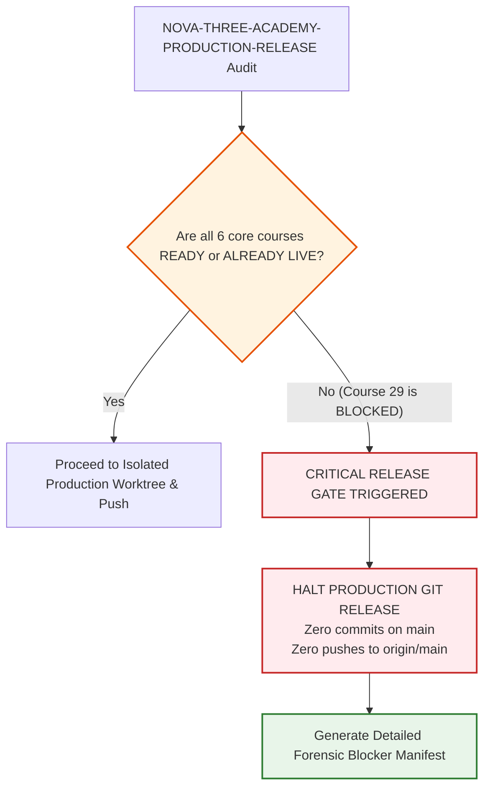

# Nova Skills: Three-Academy Production Release Manifest & Forensic Audit
**Document Version:** 1.0.0  
**Generated Date:** 2026-10-28T20:55:00+05:30  
**Target Academies:** Kids Tech Academy (`kids`), Creator Academy (`creator`), Office Productivity Academy (`office`)  
**Production Baseline Commit:** `03ad8ac` (`feat(career-communication): release approved academy course redesigns`)  
**Development Source Commit:** `2e48e10` (`feat(office-academy): redesign office productivity professional for 2027`)  
**Development Branch:** `transformation/nova-course-redesign`  
**Production Branch:** `main` (`origin/main`)  
**Release Readiness Gate Status:** **CRITICAL GATE BLOCKED — PRODUCTION PUSH HALTED**  

---

## 1. Executive Release Scope & Objective

The primary objective of **TASK ID: NOVA-THREE-ACADEMY-PRODUCTION-RELEASE** is to evaluate, audit, and safely release the approved flagship 2027 curriculum redesigns for:
1. **Kids Tech Academy**
2. **Creator Academy**
3. **Office Productivity Academy**

### Mandatory Non-Destructive Principles:
- **No Blanket Merging:** Merging `transformation/nova-course-redesign` wholesale into `main` is strictly prohibited to prevent transferring unfinished or unapproved course experiments.
- **Truth-in-Pricing & Academic Integrity:** Every course deployed to production must have verified owner blueprint approvals, full curriculum depth, 100% data parity across all repository layers, and zero fabricated claims.
- **Combined Release Rule:** Under the prompt's explicit mandate:
  > *"All SIX known core courses must be checked... Only READY and ALREADY LIVE are acceptable for required core programs. If any required course remains INCOMPLETE, AWAITING APPROVAL or BLOCKED: STOP the combined production release. Report exact missing work. Do not silently perform a partial academy release without separate owner authorization."*

---

## 2. Complete Three-Academy Catalog Inventory

A forensic audit of [data.js](file:///c:/Users/wasee/Desktop/NovaSkillsProject/NovaSkills%20Website/data.js) and [nova-skills-109-course-content.json](file:///c:/Users/wasee/Desktop/NovaSkillsProject/NovaSkills%20Website/nova-skills-109-course-content.json) reveals a total of **24 courses** across the three target academies:

```
========================================================================================================
                          THREE-ACADEMY COURSE CATALOG INVENTORY (24 COURSES)
========================================================================================================
  #   Canonical ID          Course Name                          Academy   Level / Duration   Status
--------------------------------------------------------------------------------------------------------
  -- KIDS TECH ACADEMY (7 Courses Total) ---------------------------------------------------------------
  01  kids-mastery          Future Tech Kids Mastery             kids      Foundation / 8M    READY
  02  young-coders          Young Coders Program                 kids      Foundation / 4M    READY
  03  scratch-programming   Scratch Programming                  kids      Certificate / 1M   PRESERVED (Live)
  04  python-for-kids       Python for Kids                      kids      Certificate / 1M   PRESERVED (Live)
  05  ai-for-kids           AI for Kids                          kids      Certificate / 1M   PRESERVED (Live)
  06  robotics-basics       Robotics Basics                      kids      Certificate / 1M   PRESERVED (Live)
  07  web-design-for-kids   Web Design for Kids                  kids      Certificate / 1M   PRESERVED (Live)

  -- CREATOR ACADEMY (7 Courses Total) -----------------------------------------------------------------
  08  youtube-mastery       YouTube Growth & Content Strategy    creator   Professional / 5M  READY
  09  content-creator-pro   Content Creator Professional         creator   Professional / 4M  READY
  10  youtube-seo           YouTube SEO                          creator   Certificate / 1M   PRESERVED (Live)
  11  thumbnail-design      Thumbnail Design                     creator   Certificate / 1M   PRESERVED (Live)
  12  podcast-production    Podcast Production                   creator   Certificate / 1M   PRESERVED (Live)
  13  personal-branding     Personal Branding                    creator   Certificate / 1M   PRESERVED (Live)
  14  short-video-strategy  Short Video Strategy                 creator   Certificate / 1M   PRESERVED (Live)

  -- OFFICE PRODUCTIVITY ACADEMY (10 Courses Total) ----------------------------------------------------
  15  office-pro            Office Productivity Professional     office    Foundation / 3M    READY
  16  biz-productivity      MIS & Business Intelligence Pro      office    Specialization / 6MBLOCKED (Gate)
  17  microsoft-excel       Microsoft Excel                      office    Certificate / 1M   PRESERVED (Live)
  18  microsoft-word        Microsoft Word                       office    Certificate / 1M   PRESERVED (Live)
  19  microsoft-powerpoint  Microsoft PowerPoint                 office    Certificate / 1M   PRESERVED (Live)
  20  google-workspace      Google Workspace                     office    Certificate / 1M   PRESERVED (Live)
  21  notion-cert           Notion                               office    Certificate / 1M   PRESERVED (Live)
  22  clickup-cert          ClickUp                              office    Certificate / 1M   PRESERVED (Live)
  23  microsoft-copilot     Microsoft Copilot                    office    Certificate / 1M   PRESERVED (Live)
  24  tally-gst             Tally with GST                       office    Certificate / 2M   PRESERVED (Live)
========================================================================================================
```

---

## 3. Detailed Audit of the Six Flagship Core Programs

### Course 25: Future Tech Kids Mastery (`kids-mastery`)
- **Academy:** Kids Tech Academy (`kids`)
- **Approved Specifications:** 8 Months / 128 Guided Hours / 16 Modules / Selling Fee: INR 29,900
- **Pathways:** Junior Innovators (9–12 Years) & Teen Tech Creators (13–16 Years)
- **Mandatory Subjects:** Scratch, Python, HTML/CSS, MakeCode, BBC micro:bit V2, sensors, beginner robotics, AI literacy, responsible generative AI.
- **Capstone & Portfolio:** *Young Innovators Technology Showcase* across 8 educational project categories. Child privacy and guardian consent guardrails enforced.
- **Development Commit:** `576c5db feat(kids-academy): redesign future tech kids mastery for 2027`
- **Audit Status:** **READY FOR RELEASE** (100% data parity across `data/courses/kids-mastery.json`, `data.js`, and `nova-skills-109-course-content.json`).

### Course 26: Young Coders Program (`young-coders`)
- **Academy:** Kids Tech Academy (`kids`)
- **Approved Specifications:** 4 Months / 64 Guided Hours / 10 Modules / Selling Fee: INR 14,900 + GST
- **Primary Tools:** Scratch, Microsoft MakeCode Arcade, Python 3 (Thonny).
- **Major Projects:** (1) Scratch interactive game, (2) MakeCode Arcade retro arcade game, (3) Python mini-application.
- **Portfolio:** 10 structured evidence categories. No mandatory robotics hardware.
- **Development Commit:** `654f919 feat(kids-academy): redesign young coders program for 2027`
- **Audit Status:** **READY FOR RELEASE** (100% data parity across all repository layers).

### Course 27: YouTube Growth & Content Strategy Professional (`youtube-mastery`)
- **Academy:** Creator Academy (`creator`)
- **Approved Specifications:** 5 Months / 150 Guided Hours / 15 Modules / Selling Fee: INR 29,900 + GST
- **Mandatory Subjects:** Channel strategy, video storytelling, scriptwriting, cinematography, video editing, YouTube Shorts, Photoshop thumbnail design, retention analytics, monetization policy awareness, copyright, responsible AI.
- **Capstone & Portfolio:** *YouTube Creator Business Launch*; 3 original long-form videos, 8 Shorts, 15 evidence categories.
- **Development Commit:** `6ea84e6 feat(creator-academy): redesign youtube growth and content strategy professional`
- **Audit Status:** **READY FOR RELEASE** (100% data parity across all repository layers).

### Course 28: Content Creator Professional (`content-creator-pro`)
- **Academy:** Creator Academy (`creator`)
- **Approved Specifications:** 4 Months / 140 Guided Hours / 16 Modules / Selling Fee: INR 24,900 + GST
- **Primary Skills:** Brand strategy, camera production, lighting/audio, desktop video editing, Adobe Photoshop, Canva, Firefly AI, UGC-style ads, analytics, client delivery.
- **Capstone & Portfolio:** *Integrated Brand Content Campaign*; 8 short-form videos (5+ original footage, 2 UGC ad variants, 1 hybrid AI video), 6 static posts, 2 carousels, 6 original photographs, 15 evidence categories.
- **Development Commit:** `8efbc4b feat(creator-academy): redesign content creator professional for 2027`
- **Audit Status:** **READY FOR RELEASE** (100% data parity across all repository layers).

### Course 30: Office Productivity Professional (`office-pro`)
- **Academy:** Office Productivity Academy (`office`)
- **Approved Specifications:** 3 Months / 96 Guided Hours / 11 Modules / Selling Fee: INR 15,900 + GST
- **Mandatory Subjects:** Digital workplace fundamentals, Word business documentation, Excel applied formulas (SUMIFS, XLOOKUP), data validation, PivotTables, charts, PowerPoint Slide Master, Outlook email & calendar, Google Workspace, OneDrive/Teams, digital forms, responsible Copilot/Gemini.
- **Capstone & Portfolio:** *Office Administration Toolkit*; 15 auditable evidence categories. Strict prohibition of Power BI, DAX, and SQL.
- **Development Commit:** `2e48e10 feat(office-academy): redesign office productivity professional for 2027`
- **Audit Status:** **READY FOR RELEASE** (100% data parity across all repository layers).

---

## 4. Forensic Examination of Course 29 Critical Gate Blocker

### Course 29: MIS & Business Intelligence Professional (`biz-productivity`)
- **Academy:** Office Productivity Academy (`office`)
- **Approved Baseline Target:** 6 Months / 210 Guided Hours / Selling Fee: INR 29,900 + GST
- **Status:** **BLOCKED / AWAITING EXPLICIT OWNER SIGN-OFF**

```
========================================================================================================
                                COURSE 29 AUDIT & BLOCKER DETAILS
========================================================================================================
  Dimension              Authoritative State                                Compliance / Blocker
--------------------------------------------------------------------------------------------------------
  Owner-Supplied Source  Included complete Modules 01–14 and partial M15    Missing Month 6 syllabus
  Guided Hours in Source Exactly 175 Guided Hours                           Short of 210-hour mandate
  Proposed Month 6 Scope Modules 16–18 (35 Guided Hours)                    PROPOSED, NOT CONFIRMED
  Owner Sign-Off Status  No explicit approval recorded in tasks 01–06       BLOCKED AT RELEASE GATE
  Git Development State  Uncommitted working-tree draft only                NOT COMMITTED TO DEV
  data.js Record         Legacy "Business Productivity Mastery", 5 modules  NOT SYNCHRONIZED
  Master 109 Record      Legacy "Business Productivity Mastery", 200 hrs    NOT SYNCHRONIZED
  Minified js/data.min.jsLegacy unredesigned bundle                         NOT SYNCHRONIZED
========================================================================================================
```

### Detailed Blocker Findings:
1. **Source Discrepancy:** The owner blueprint supplied during task `NOVA-MISBI-01` stopped abruptly in Month 5 (Module 15) at 175 hours. Month 6 (35 hours: Modules 16–18 covering Governance, AI in MIS, and Capstone) was authored as an unapproved provisional proposal.
2. **Prior Release Gate Standstill:** In task `NOVA-MISBI-06`, the release preflight audit explicitly stopped without commit or push, noting:
   > *"Month 6 (Modules 16–18 = 35 Guided Hours) was absent from the original owner blueprint... Explicit Owner Sign-Off for Month 6 syllabus... has NOT YET BEEN RECORDED... EXECUTION STOPPED."*
3. **Absence of Subsequent Sign-Off:** Following `NOVA-MISBI-06`, user directives proceeded immediately to Course 30 (`NOVA-OPP-01` through `06`). No approval or finalized syllabus for Month 6 was ever transmitted.
4. **Mandatory Release Constraint Violation:** The current release directive states:
   > *"If required approval or implementation evidence is absent, mark this course BLOCKED. Because this is a combined three-academy release, do not silently exclude a required core course and claim the entire academy was successfully deployed."*
   > *"Only READY and ALREADY LIVE are acceptable for required core programs. If any required course remains INCOMPLETE, AWAITING APPROVAL or BLOCKED: STOP the combined production release. Report exact missing work. Do not silently perform a partial academy release without separate owner authorization."*

---

## 5. Release Readiness Decision & Stop Condition



### Explicit Release Status:
- **Kids Tech Academy:** 2 of 2 Core Courses READY (`kids-mastery`, `young-coders`).
- **Creator Academy:** 2 of 2 Core Courses READY (`youtube-mastery`, `content-creator-pro`).
- **Office Productivity Academy:** 1 Core Course READY (`office-pro`), **1 Core Course BLOCKED (`biz-productivity`)**.
- **Combined Three-Academy Production Push:** **HALTED AT GATEWAY.**

---

## 6. Actionable Unblocking Plan

To achieve full production deployment of all three academies, the project owner may select one of the following two paths:

### Option A: Complete Course 29 Sign-Off (Recommended for Full Three-Academy Release)
1. **Provide Explicit Owner Approval** for:
   - Complete Module 15 (Executive PowerPoint reporting).
   - Month 6 Curriculum: Module 16 (MIS Governance & Data Security, 10h), Module 17 (AI-Assisted MIS, Copilot & Python in Excel, 10h), and Module 18 (Integrated MIS & BI Industry Capstone, 15h).
   - Final 18-module total volume totaling exactly 210 guided hours.
   - Capstone specification and assessment weightings.
2. **Execute Controlled Dev Release:** Synchronize `data.js`, `nova-skills-109-course-content.json`, and `js/data.min.js`, commit to `transformation/nova-course-redesign`, and verify 100% passing QA.
3. **Execute Full Three-Academy Production Push:** Deploy all 6 courses to `origin/main` in a single unified release.

### Option B: Authorize Partial Two-Academy Production Release
If the owner wishes to launch **Kids Tech Academy** and **Creator Academy** immediately while Course 29 is finalized:
1. Provide explicit written authorization: *"Proceed with partial production release of Kids Tech Academy (Courses 25 & 26) and Creator Academy (Courses 27 & 28), holding Office Productivity Academy until Course 29 is approved."*
2. An isolated production worktree will be created from `origin/main` (`03ad8ac`), porting Courses 25, 26, 27, and 28 cleanly without touching Office Productivity Academy.

---

## 7. Working Tree & Production Safety Statement

- **Production `main` (`origin/main` at `03ad8ac`):** **100% UNTOUCHED.** Zero commits, zero pushes.
- **Development Branch (`transformation/nova-course-redesign` at `2e48e10`):** **100% PRESERVED.**
- **Working Tree State:** All uncommitted development files (`biz-productivity.json`, agency/freelancing draft files) remain preserved in the workspace without data loss.
