# NOVA SKILLS — STRUCTURED DATA & SCHEMA ARCHITECTURE AUDIT (PHASE 7)

**Document ID:** NOVA-SEO-PHASE7-SCHEMA  
**Status:** 100% Implemented, Validated & Compliant  
**Total Pages Audited:** 190  
**Date:** November 2026  
**Auditor:** Nova Skills Technical & Semantic SEO Engineering Team

---

## 1. EXECUTIVE SUMMARY & SCHEMA INVENTORY

Nova Skills implements an enterprise-grade schema graph built strictly to Schema.org and Google Search Central structured data specifications. Every JSON-LD schema is embedded server-side in static HTML, ensuring instant parser extraction by Googlebot, Bingbot, and LLM search agents (SearchGPT, Perplexity, Gemini, Claude) without client-side JavaScript execution.

### Key Metrics Across 190 URLs:
- **Total Course Schemas:** 109 (100% of 109 courses validated)
- **Total FAQPage Schemas:** 125 (109 course FAQs + 12 academy FAQs)
- **Total BreadcrumbList Schemas:** 170 (Sitewide hierarchical breadcrumbs)
- **Total Organization & Campus Schemas:** 110
- **Total BlogPosting & Speakable Schemas:** 5 (5 editorial publications)
- **Schema Parse Errors:** **0** (Zero JSON syntax or nesting errors)
- **Google Policy Compliance:** **100% Strict** (Zero phantom local business schemas on online city pages; single physical campus in Siddharth Nagar).

---

## 2. DETAILED SCHEMA TYPOLOGY & IMPLEMENTATION ARCHITECTURE

```mermaid
flowchart TD
    Site[Nova Skills Domain Graph] --> Org[Organization & EducationalOrganization]
    Org --> Campus[Single Physical Campus: Siddharth Nagar]
    
    Site --> Courses[109 Course Detail Pages]
    Courses --> CSchema[schema.org/Course]
    Courses --> CInst[schema.org/CourseInstance]
    Courses --> CFaq[schema.org/FAQPage]
    Courses --> CBread[schema.org/BreadcrumbList]
    
    Site --> Academies[12 Academy Hubs]
    Academies --> AProg[schema.org/EducationalOccupationalProgram]
    Academies --> AFaq[schema.org/FAQPage]
    Academies --> ABread[schema.org/BreadcrumbList]
    
    Site --> Cities[36 City Learning Hubs]
    Cities --> CList[schema.org/ItemList: Available Online Courses]
    Cities --> CBread2[schema.org/BreadcrumbList]
    
    Site --> Blog[5 Research Articles]
    Blog --> BPost[schema.org/BlogPosting]
    Blog --> BAuthor[schema.org/Person: Waseeullah Mansoori]
    Blog --> BSpeak[schema.org/SpeakableSpecification]
```

---

## 3. CORE SCHEMA SPECIFICATIONS & VALIDATION

### A. schema.org/Course & CourseInstance (109 Courses)
Each course detail page features a complete `@graph` containing:
- `name`: Course title matching page heading.
- `description`: Concise course syllabus and career outcome summary.
- `provider`: Referenced by `@id` to `https://novaskills.in/#organization`.
- `hasCourseInstance`:
  - `courseMode`: `blended` or `online` (strictly matching delivery format).
  - `courseWorkload`: Standardized hours (e.g. `PT40H`, `PT120H`).
  - `offers`: Standardized pricing (`INR`), verified tuition starting at ₹2,900 (+ 18% GST).
  - `instructor`: Linked to verified faculty entity profile.

### B. schema.org/FAQPage (121 Pages)
- Deployed across all 109 course pages and 12 academy landing hubs.
- Every FAQ item includes plain-text questions and answers formatted to prevent formatting artifacts.
- Fully eligible for Google Search FAQ accordion rich snippets.

### C. schema.org/ItemList (36 City Landing Hubs)
- **Strict Compliance Rule:** The 36 city pages represent **online learning service areas**, NOT physical branches.
- Google Search Central strictly forbids marking service areas or online delivery hubs as `LocalBusiness`.
- City pages implement `ItemList` listing high-demand courses available to students in that city, paired with `BreadcrumbList` and `WebPage`.

### D. schema.org/BlogPosting & Speakable (Editorial & Thought Leadership)
- Deployed on all 5 research publications.
- Includes `author` linking to founder entity `https://novaskills.in/blog/waseeullah-mansoori/#person`.
- Features `SpeakableSpecification` pointing to key synopsis paragraphs for voice search (Google Assistant, Siri) and AI audio synthesis.

---

## 4. RICH RESULTS TESTING & ZERO ERROR ASSURANCE

All schemas have been audited with the following criteria:
1. **JSON-LD Validity:** All blocks parse cleanly with `JSON.parse()`.
2. **Required Fields:** All required fields for Course (`name`, `description`, `provider`) and Offers (`price`, `priceCurrency`) are present.
3. **No Mixed Content:** All image and URL references use secure `https://novaskills.in/` protocols.
4. **Self-Referential Entity Graph:** The global organization `@id` is uniformly referenced across all sub-pages, establishing an interconnected knowledge graph.

Complete URL-by-URL audit register is available in `docs/seo/21-schema-validation.csv`.
