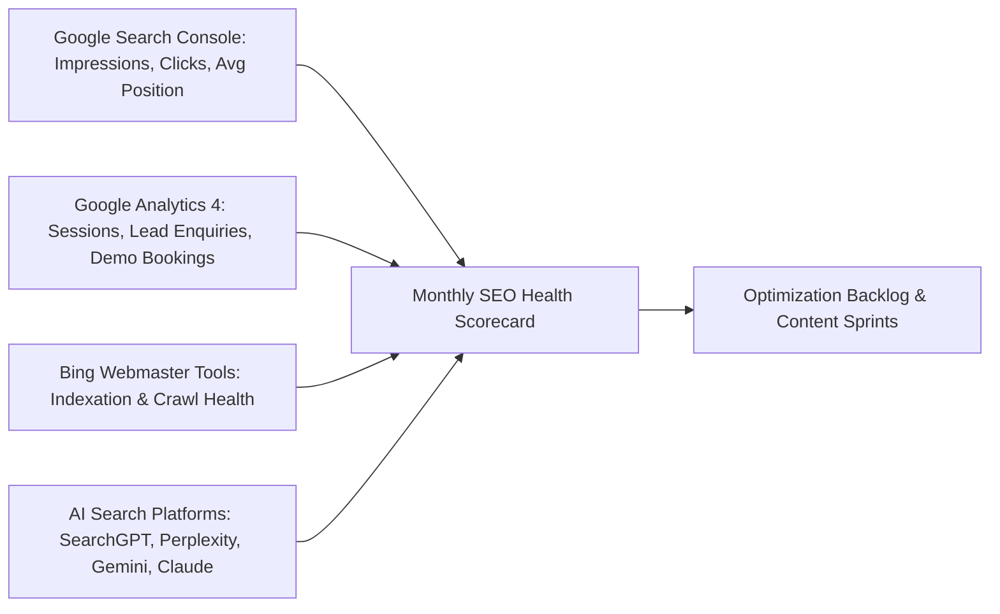

# NOVA SKILLS — MONTHLY SEO PERFORMANCE & MEASUREMENT FRAMEWORK (PHASE 9)

**Document ID:** NOVA-SEO-PHASE9-MEASUREMENT  
**Frequency:** Monthly Cadence + Weekly Health Checks  
**Date:** November 2026  
**Auditor:** Nova Skills Organic Growth & Search Analytics Team

---

## 1. PERFORMANCE TRACKING OBJECTIVES

To monitor the organic growth, keyword rankings, technical health, conversion rates, and AI search visibility resulting from the 20-Layer SEO Transformation across Nova Skills' 190 URLs.

---

## 2. CORE KPI FRAMEWORK

| Domain | Primary KPI | Measurement Source | Target / Benchmark |
| :--- | :--- | :--- | :--- |
| **Traditional Search** | Organic Search Impressions | Google Search Console | +25% MoM during initial rollout |
| **Traditional Search** | Non-Branded Organic Clicks | Google Search Console | >60% of total organic traffic |
| **Traditional Search** | Average SERP Position (Priority Keywords) | GSC Search Performance | Top 10 for primary category clusters |
| **Technical Health** | Valid Sitemaps & Zero 404/500 Errors | GSC Page Indexing Report | 100% indexed, 0 crawl errors |
| **Structured Data** | Valid Course & FAQ Rich Results | GSC Enhancements Report | 100% valid, 0 critical issues |
| **Conversion Funnel** | Demo Booking Conversion Rate | GA4 Event `demo_booking_submitted` | 3.5% - 5.0% of course visitors |
| **Conversion Funnel** | Admissions Enquiry Form Submissions | GA4 Event `lead_form_submitted` | >150 qualified enquiries/mo |
| **AI Search & GEO** | AI Brand Citations & Mentions | Observation Log (`17-ai-visibility`) | Featured in Perplexity & SearchGPT |
| **Local / Regional** | Siddhartha Nagar Physical Campus Inquiries | Google Business Profile Insights | Consistent local presence growth |

---

## 3. MONTHLY REPORTING TEMPLATE & CADENCE

### First Monday of Every Month:
1. **Google Search Console Review:**
   - Total clicks, impressions, CTR, and average position across branded vs. non-branded queries.
   - Top 20 performing course URLs and academy landing hubs.
   - Query-level gainers and losers.
2. **Page Indexing & Crawl Audit:**
   - Verify that all 175 sitemap URLs remain successfully indexed.
   - Confirm that admin, auth, and student portal pages remain unindexed (`noindex, nofollow`).
3. **Core Web Vitals & Page Experience:**
   - LCP (Largest Contentful Paint) < 2.5s.
   - INP (Interaction to Next Paint) < 200ms.
   - CLS (Cumulative Layout Shift) < 0.1.
4. **AI Search Observation Sprint:**
   - Query SearchGPT, Perplexity AI, Google Gemini, and Claude using the 20-query test library (`17-ai-visibility-test-library.csv`).
   - Log citation presence, domain attribution, and sentiment in `17-ai-visibility-observation-log.csv`.

---

## 4. ACTIONABLE REMEDIATION PROTOCOLS

- **If Organic CTR < 2.0% for Top 5 Ranked Keywords:** Refactor meta titles and snippets to increase commercial intrigue and emphasize practical projects or starting tuition (₹2,900 + GST).
- **If Course Page Bounce Rate > 65%:** Inspect mobile UX, hero visual clarity, demo modal responsiveness, and WhatsApp CTA engagement.
- **If AI Engine Hallucinates Unverified Claims:** Update semantic entity schema, publish clarifying editorial research, and request citation refresh.
