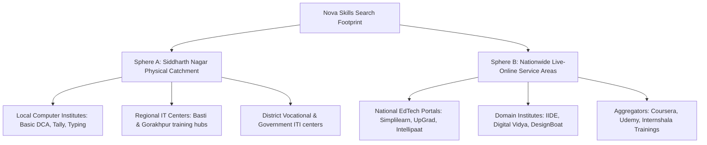

# NOVA SKILLS — LOCAL & GEOGRAPHIC COMPETITOR AUDIT (PHASE 0)

**Document ID:** NOVA-SEO-LOCAL-COMPETITOR-AUDIT  
**Focus:** Siddharth Nagar Catchment Area vs. National Online Training Competitors  
**Date:** November 2026  
**Auditor:** Nova Skills Local SEO & Market Intelligence Team

---

## 1. STRATEGIC COMPETITIVE DICHOTOMY

Nova Skills operates in two distinctly different competitive spheres that must NEVER be conflated in organic search strategy:

---

## 2. SPHERE A: SIDDHARTH NAGAR & REGIONAL CAMPUS COMPETITORS

### Catchment Characteristics:
- **Geography:** Siddharth Nagar district, Naugarh, Bansi, Shohratgarh, Domariyaganj, and adjacent border regions including Basti and Gorakhpur.
- **Learner Persona:** High school graduates, polytechnic diploma holders, local college students, and career pivoters seeking physical computer labs and classroom guidance.
- **Search Intent:** Direct physical intent (e.g. `computer institute in siddharth nagar`, `tally coaching near me`, `best computer center naugarh`).

### Competitor Landscape & Gap Analysis:

| Competitor Profile | Typical Offerings | Observed Weaknesses / Gaps | Nova Skills Strategic Advantage |
| :--- | :--- | :--- | :--- |
| **Traditional Computer Training Centers** | CCC, O-Level, DCA, Basic PGDCA, MS Office, basic Tally | Legacy syllabi, no modern AI tools, no portfolio case studies, outdated software versions | Modern AI-integrated curriculum (n8n, ChatGPT, Claude), professional portfolio outcomes |
| **Local Graphic & DTP Centers** | CorelDRAW, PageMaker, Photoshop 7.0 | Outdated print-only focus, zero UI/UX, zero Figma, zero interactive design | Industry-standard Figma, Adobe Illustrator, packaging design, and full-stack UX case studies |
| **Regional Institutes in Gorakhpur / Basti** | Basic Digital Marketing, Python programming, web development | Require daily commuting or relocation; large batch sizes with limited personal code reviews | Physical campus in Siddharth Nagar + 1-on-1 mentor code reviews + live-online flexibility |

---

## 3. SPHERE B: NATIONWIDE ONLINE EDUCATION COMPETITORS

### Scope:
- Competing in 36 target cities (Indore, Lucknow, Jaipur, Nagpur, Surat, Patna, Nashik, Rajkot, Bhopal, Raipur, etc.) for queries like `online digital marketing course in indore`, `live graphic design classes lucknow`.

### Competitor Landscape & Organic Positioning:

| Competitor Tier | Examples | Dominant Strategy | Observed Weaknesses | Nova Skills Differentiation |
| :--- | :--- | :--- | :--- | :--- |
| **Enterprise EdTech Giants** | Simplilearn, UpGrad | Massive SEO moats, high-ticket degree programs (₹1.5L - ₹3.5L) | Prohibitive pricing for tier-2/3 learners, pre-recorded lectures, impersonal support | Accessible starting price (₹2,900 + GST), live interactive cohorts, practical portfolio builds |
| **Specialized Digital Academies** | IIDE, Digital Vidya | Brand presence in Tier-1 metros, agency ties | Heavy focus on metros, higher fees (₹60k - ₹1.2L) | Transparent tier pricing, dual-track delivery, explicit Live-Online disclosures |
| **Video Aggregators** | Udemy, Coursera | Ultra-low price video self-study (₹499 - ₹3,000) | Zero live mentorship, zero two-way feedback, extremely low course completion rate (<10%) | Live two-way classes, dedicated weekend doubt clinics, personalized instructor reviews |

---

## 4. LOCAL SEARCH ENGINE VISIBILITY FINDINGS

1. **Google Business Profile Authority:** Nova Skills has a verified Google Business Profile in Siddharth Nagar with verified Place ID `ChIJzQKXiU4plzkRzeRlGyZsHnk` and CID `8727532038814819533`.
2. **Local Pack Invariants:** Nova Skills ranks strongly in Siddharth Nagar for core branded searches and has high upside for unbranded terms (`AI institute`, `digital marketing training`).
3. **No Phantom Location Spam:** Unlike deceptive competitors who create fake virtual offices in Indore or Lucknow to spam Google Maps, Nova Skills maintains 100% Google policy compliance by strictly distinguishing online service areas from its physical campus.
