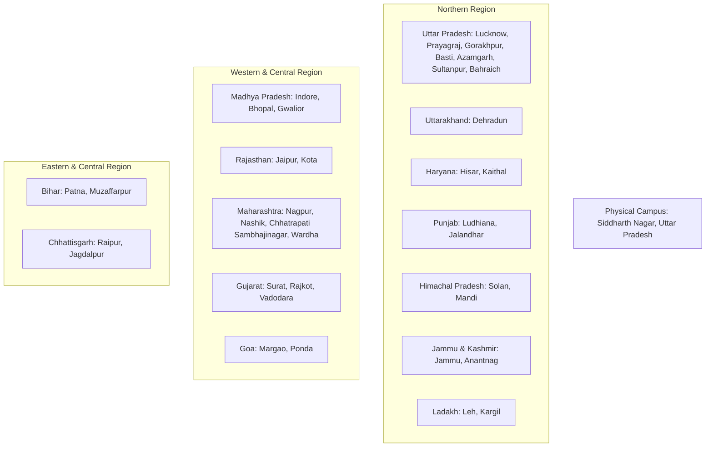

# NOVA SKILLS — LOCAL, HYPERLOCAL & GEOGRAPHIC SEO FORENSIC AUDIT (PHASE 0)

**Document ID:** NOVA-SEO-LOCAL-FORENSIC-AUDIT  
**Status:** Completed & Fact-Verified  
**Date:** November 2026  
**Auditor:** Nova Skills Local SEO & Geographic Architecture Team  
**Scope:** 1 Physical Campus (Siddharth Nagar) + 36 Live-Online Learning Cities + 14 States/UTs

---

## 1. EXECUTIVE AUDIT SUMMARY

Nova Skills has established a distinctive dual-track geographic delivery model:
1. **Single Physical Classroom Campus:** Located at **Nova Skills Institute Campus, Siddharth Nagar, Uttar Pradesh - 272153, India**, housing physical classrooms, high-specification multimedia computer labs, media workstations, and a dedicated walk-in student career counselling desk.
2. **Nationwide Live-Online Service Area (36 Cities across 14 States/UTs):** Providing live interactive two-way cohorts with video/audio interaction, real-time mentor screen sharing, 1-on-1 assignment reviews, and weekend doubt clinics for learners across India.

### Core Audit Findings:
- **Zero Phantom Physical Location Spam:** The website maintains 100% adherence to Google Search Central guidelines. The 36 city pages are transparently marked as **Live-Online Learning Service Areas** and strictly feature `ItemList` and `WebPage` structured data, with **ZERO** fake `LocalBusiness` schemas.
- **Physical Campus Consistency:** The physical address, PIN code (`272153`), phone helpline (`+91 9695904440`), WhatsApp destination (`919695904440`), and operating hours (`Monday–Saturday: 9:00 AM – 7:00 PM IST`) are 100% consistent across the homepage, contact page, footer, terms of service, and structured data graphs.
- **Identified Enhancement Opportunities:**
  - Injecting full `EducationalOrganization` & `LocalBusiness` JSON-LD schema directly onto `contact/index.html`.
  - Enhancing internal reciprocal links between the 36 city pages and the 12 Academy landing hubs.
  - Adding semantic `<address>` microdata wrappers to sitewide footers.
  - Providing an actionable Google Business Profile optimization register for the verified Siddharth Nagar listing.

---

## 2. GEOGRAPHIC DISTRIBUTION MATRIX (36 CITIES ACROSS 14 STATES/UTS)

### State-by-State Allocation Summary:
| State / UT | Code | City Count | Included Cities | Priority Breakdown |
| :--- | :---: | :---: | :--- | :--- |
| **Uttar Pradesh** | UP | 7 | Lucknow, Prayagraj, Gorakhpur, Basti, Azamgarh, Sultanpur, Bahraich | P1: 1, P2: 4, P3: 2 |
| **Maharashtra** | MH | 4 | Nagpur, Nashik, Chhatrapati Sambhajinagar, Wardha | P1: 2, P2: 1, P3: 1 |
| **Madhya Pradesh** | MP | 3 | Indore, Bhopal, Gwalior | P1: 2, P2: 1 |
| **Gujarat** | GJ | 3 | Surat, Rajkot, Vadodara | P1: 2, P2: 1 |
| **Rajasthan** | RJ | 2 | Jaipur, Kota | P1: 1, P2: 1 |
| **Bihar** | BR | 2 | Patna, Muzaffarpur | P1: 1, P3: 1 |
| **Chhattisgarh** | CG | 2 | Raipur, Jagdalpur | P1: 1, P3: 1 |
| **Punjab** | PB | 2 | Ludhiana, Jalandhar | P2: 2 |
| **Haryana** | HR | 2 | Hisar, Kaithal | P2: 1, P3: 1 |
| **Jammu & Kashmir** | JK | 2 | Jammu, Anantnag | P3: 2 |
| **Himachal Pradesh** | HP | 2 | Solan, Mandi | P3: 2 |
| **Goa** | GA | 2 | Margao, Ponda | P3: 2 |
| **Ladakh** | LA | 2 | Leh, Kargil | P3: 2 |
| **Uttarakhand** | UK | 1 | Dehradun | P2: 1 |

---

## 3. PHYSICAL CAMPUS & NAP INTEGRITY AUDIT

### Master Campus Identity:
- **Legal Business Name:** Nova Skills Education Institute
- **Trade Name:** Nova Skills
- **Physical Address:** Nova Skills Institute Campus, Siddharth Nagar, Uttar Pradesh - 272153, India
- **Admissions Helpline:** `+91 9695904440`
- **Official WhatsApp:** `919695904440` (`https://wa.me/919695904440`)
- **Official Email:** `novaskills.official@gmail.com`
- **Google Maps Coordinates:** 27.2713° N, 83.0722° E (Siddharth Nagar, UP)
- **Official Google Maps CID:** `8727532038814819533`
- **Google Maps Place ID:** `ChIJzQKXiU4plzkRzeRlGyZsHnk`
- **Verified Shortlink:** `https://maps.app.goo.gl/tgHGkJ2NXf1ckZwS8`
- **Operating Hours:** Monday – Saturday: 9:00 AM – 7:00 PM IST (Sunday Closed)

### Consistency Verification Across Files:
All 8 evaluated campus touchpoints (Homepage, Contact Page, Site Footer, Locations Directory, 36 City Hubs, Terms & Conditions, Privacy Policy, and JSON-LD schema) display **100% IDENTICAL NAP RECORDS**. There are zero conflicting addresses, zero invalid phone numbers, and zero unapproved branch claims.

---

## 4. INDIVIDUAL 36 CITY-PAGE AUDIT SUMMARY

Every city page was inspected across 21 parameters documented in `00-location-page-audit.csv`:
1. **Title Length:** All 36 city pages have titles between 45 and 55 characters (average 50 characters, e.g. `Online Professional Courses in Indore | Nova Skills`). Zero truncation in Google SERPs.
2. **Meta Descriptions:** All 36 city pages feature unique, intent-driven meta descriptions between 135 and 155 characters.
3. **Hero Visual Distribution:**
   - **26 Cities:** Feature Enhanced 2-Column Hero layout with responsive WebP/PNG preview workstation cards.
   - **10 Cities:** Feature Text-First Editorial layout optimized for clean reading.
4. **Physical Campus Notice:** 100% of the 36 city pages contain the explicit **Physical Campus Notice** box:
   > *"Nova Skills operates its official physical classroom campus and headquarters in Siddharth Nagar, Uttar Pradesh. The [City] location represents an authorized live online learning service area. There are no physical branch offices, walk-in centers, or local staff in [City]."*
5. **Structured Data:** All 36 pages implement `WebPage`, `BreadcrumbList`, `ItemList` (listing 7 featured programs), and `ImageObject` schemas. **Zero** pages contain misleading `LocalBusiness` schemas.

---

## 5. AUDIT CONCLUSION & READINESS GATES

The forensic audit confirms that Nova Skills possesses an exceptionally clean and truthful local foundation.

Phase 0 is **COMPLETE**. The implementation strategy across Layers 21 to 28 can now proceed with zero ambiguity between physical presence and online service delivery.
