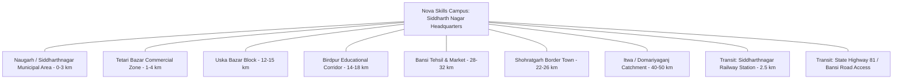

# NOVA SKILLS — HYPERLOCAL OPPORTUNITY & CATCHMENT AUDIT (LAYER 22)

**Document ID:** NOVA-HYPERLOCAL-SEO-LAYER22-REPORT  
**Catchment Area:** Siddharth Nagar District, Bansi, Naugarh, Shohratgarh, Domariyaganj, and Adjacent Border Zones  
**Date:** November 2026  
**Auditor:** Nova Skills Hyperlocal Search Intelligence Team

---

## 1. PURPOSE & BOUNDARY RULES

Hyperlocal SEO optimizes search visibility for specific neighborhoods, transit hubs, and municipal zones surrounding an actual operating physical business.

### Critical Operational Boundary:
> **Rule:** Hyperlocal SEO applies **EXCLUSIVELY** to the genuine physical campus in Siddharth Nagar and its verifiable daily commuting catchment area. It is **STRICTLY PROHIBITED** from being applied to create fake neighborhood pages in the 36 online-learning cities (e.g. creating fake "Nova Skills Campus in Vijay Nagar, Indore" or "Gomti Nagar, Lucknow").

---

## 2. SIDDHARTH NAGAR CATCHMENT LOCALITIES & TRANSIT ACCESS

### Catchment Locality Inventory:
| Locality / Zone | Geographic Type | Distance from Campus | Target Learner Profile | Commute Method |
| :--- | :--- | :---: | :--- | :--- |
| **Naugarh (Siddharth Nagar)** | District Administrative HQ | 0 – 3 km | College students, school leavers, job seekers | Walking, E-Rickshaw, 2-Wheeler |
| **Tetari Bazar** | Major Commercial Hub | 1 – 4 km | Business owners, retail staff, youth | E-Rickshaw, Auto, 2-Wheeler |
| **Uska Bazar** | Market Town / Railway node | 12 – 15 km | Polytechnic students, graduates | Train, Local Bus, 2-Wheeler |
| **Birdpur** | Educational & Rural Cluster | 14 – 18 km | Rural youth, high school graduates | State Bus, Auto |
| **Shohratgarh** | Municipal Town & Rail Station | 22 – 26 km | Career pivoters, diploma holders | Intercity Train, Bus |
| **Bansi** | Historic Tehsil & River Hub | 28 – 32 km | Higher secondary & college students | Regular Bus Service, Shared Auto |
| **Domariyaganj / Itwa** | Western District Catchment | 40 – 55 km | Professional certification seekers | Express Bus, Weekend Cohorts |

---

## 3. HYPERLOCAL SEARCH INTENT & QUERIES

Legitimate search terms exhibiting proven geographic intent in the catchment:
1. `computer training center in naugarh`
2. `computer institute tetari bazar siddharth nagar`
3. `graphic design classes near bansi siddharth nagar`
4. `tally and accounting coaching shohratgarh`
5. `digital marketing training near me siddharth nagar`
6. `best computer center near siddharthnagar railway station`

---

## 4. HYPERLOCAL ARCHITECTURAL DECISION MATRIX

To prevent thin-content doorway page penalties, Nova Skills enforces a strict classification model:

| Proposed Geographic Unit | Strategic Classification | Recommended Action | Technical Justification |
| :--- | :--- | :--- | :--- |
| **Siddharth Nagar / Naugarh** | Core Campus Hub | **Improve Existing Campus Page** | `contact/index.html` serves as the primary indexed hub for the district; enrich with transit & directions. |
| **Tetari Bazar** | Commercial Sub-locality | **Consolidate into Campus Hub** | Located within 2–4 km; separate landing page would create keyword cannibalization and thin content. |
| **Bansi / Shohratgarh / Uska Bazar** | Catchment Towns | **Consolidate with Transit Directions** | Documented on `contact/index.html` under "How to Reach Campus" and regional transport FAQ. |
| **Neighbourhoods in 36 Online Cities** | Non-Campus Service Areas | **DO NOT CREATE (STRICT)** | Zero physical presence; creating neighborhood pages in Indore or Jaipur violates Google Spam Policies. |

### Conclusion:
Consolidate all catchment transit directions and regional locality guidance directly onto the enriched `contact/index.html` page and the verified Google Business Profile. Do not create thin doorway pages.
