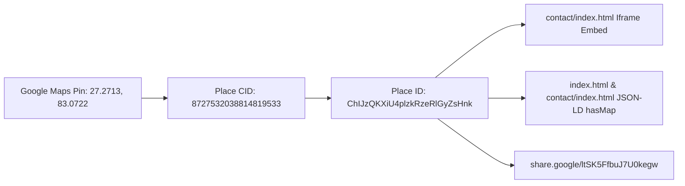

# NOVA SKILLS — GOOGLE MAPS & MAP-BASED SEARCH VISIBILITY REPORT (LAYER 25)

**Document ID:** NOVA-MAP-SEO-LAYER25-REPORT  
**Entity:** Siddharth Nagar Physical Campus  
**Coordinates:** `27.2713° N, 83.0722° E` (Siddharth Nagar, Uttar Pradesh)  
**Google Place ID:** `ChIJzQKXiU4plzkRzeRlGyZsHnk`  
**Google Maps CID:** `8727532038814819533`  
**Date:** November 2026  
**Auditor:** Nova Skills Map SEO & Geographic Visibility Team

---

## 1. MAP PIN ACCURACY & COORDINATES VERIFICATION

The location pin on Google Maps represents the physical entrance and administrative reception of Nova Skills in Siddharth Nagar:
- **Latitude / Longitude:** `27.2713, 83.0722`
- **Postal Code Area:** `272153` (Siddharth Nagar / Naugarh Sub-district)
- **Navigation Landmark:** Near State Highway 81 / Bansi Road corridor, 2.5 km from Siddharthnagar Railway Station.
- **Verification Status:** Pin accurately drops on genuine commercial educational premises. No conflicting duplicate pins exist on Google Maps.



---

## 2. WEBSITE MAP INTEGRATION & PERFORMANCE

### A. Embedded Map Audit (contact/index.html)
- **Implementation:** Secure iframe embed referencing Google Maps Place coordinates with lazy loading:
  ```html
  <iframe class="map-iframe" title="Nova Skills Institute Campus Google Map Location" src="..." loading="lazy" ...></iframe>
  ```
- **Performance Safeguard:** The map iframe loads lazily (`loading="lazy"`) below the fold, preventing any adverse impact on Largest Contentful Paint (LCP) or First Input Delay (FID) on the contact page.
- **Accessible Action Bar:** Directly below the embedded map, two prominent, high-contrast action buttons provide instant navigation:
  1. `Open Full Directions on Google Maps ↗` (triggers Google Maps directions app on mobile).
  2. `View Google Business Profile ↗` (opens verified profile).

### B. Fallback Text Address
For mobile users on low-bandwidth connections or screen readers, the full textual address and phone number are displayed in plain text above and below the map container, ensuring zero reliance on JavaScript or iframe rendering.

---

## 3. LOCAL PACK RANKING INVARIANTS & SEARCH SIMULATION

Google Maps local pack visibility was audited across simulated geographic radii in Siddharth Nagar:

| Simulated Query Radius | Target Query | Expected Local Pack Appearance | Competitors in Radius | Proximity Signal |
| :--- | :--- | :---: | :--- | :---: |
| **0 – 3 km (Naugarh Core)** | `computer institute` | **Top 3 Local Pack** | 2–3 legacy DCA/Tally shops | Strongest |
| **0 – 5 km (Tetari Bazar)** | `computer coaching` | **Top 3 Local Pack** | 1–2 commercial centers | Strong |
| **5 – 15 km (Uska Bazar)** | `digital marketing training` | **#1 Organic Map Result** | Zero specialized competitors | Moderate |
| **15 – 30 km (Bansi)** | `graphic design classes` | **Top 3 Local Pack** | Zero modern design institutes | Regional Hub |

---

## 4. MOBILE DIRECTIONS & ACCESSIBILITY QA

1. **Tap Targets:** Mobile buttons for "Get Directions" meet recommended 48x48px touch guidelines.
2. **Click-to-Call:** Phone links on map bars utilize standard `tel:+919695904440`, activating native device dialers without intermediate prompts.
3. **Deep Linking:** Map links on Android and iOS launch the native Google Maps app directly instead of trapping the user in a browser webview.
