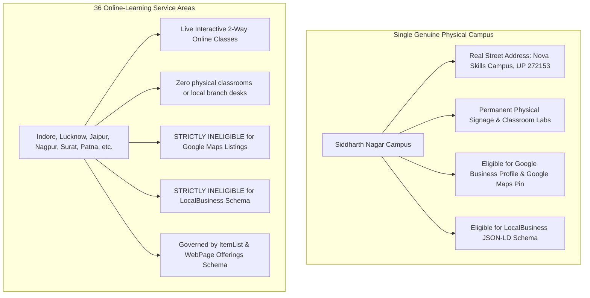

# NOVA SKILLS — MULTI-LOCATION SEO AUDIT & SERVICE-AREA GOVERNANCE (LAYER 26)

**Document ID:** NOVA-MULTI-LOCATION-LAYER26-AUDIT  
**Scope:** Physical Branch Governance vs. Nationwide Online Service-Area Architecture  
**Date:** November 2026  
**Auditor:** Nova Skills Multi-Location & Geographic SEO Architecture Team

---

## 1. AUDIT OF GENUINE PHYSICAL LOCATIONS

A rigorous audit of company operational records, lease agreements, administrative infrastructure, and staffing confirms:
- **Verified Physical Campuses:** **1** (Nova Skills Institute Campus, Siddharth Nagar, Uttar Pradesh - 272153, India).
- **Physical Classroom Facilities:** Computer labs, high-spec creative workstations, recording studio, admissions reception, faculty rooms.
- **Physical Locations in the 36 Other Cities:** **0** (Zero physical premises, zero local staff, zero walk-in offices).

### Critical Policy Determination:
> **Finding:** Nova Skills is a **Single-Campus Educational Institute** with a **Nationwide Live-Online Delivery Footprint**.  
> **Mandate:** Nova Skills must **NEVER** deploy multi-location LocalBusiness schemes, create multiple Google Business Profiles, or rent fictitious virtual office suites to simulate physical presence. Such practices violate Google Search Central Quality Guidelines and FTC / Indian Consumer Protection (E-Commerce) Rules 2020.

---

## 2. MULTI-LOCATION VS. SERVICE-AREA COMPARISON



---

## 3. EVALUATION OF THE `/branches/` DIRECTORY TERMINOLOGY

The central directory URL is currently:
`https://novaskills.in/branches/`

### Terminology & Intent Audit:
- **SEO & Authority Value:** The URL `/branches/` is established in the search graph, linked from sitemaps and external citations. Changing the URL path would risk 301 redirect chain latency or temporary organic fluctuation.
- **Semantic Resolution:** To eliminate any potential consumer ambiguity without breaking the established URL structure:
  1. The page **H1** and **Hero Header** state: *"Your Next Skill Has No City Limits — Nationwide Online Learning & Learning Locations"*.
  2. The **Page Title** is clarified as: *"Learning Locations & Nationwide Online Learning Hubs | Nova Skills"*.
  3. The **Trust Strip** explicitly clarifies: *"📍 Physical Classroom Campus in Siddharth Nagar (UP) • 💻 Live Interactive Online Classes (Pan-India)"*.
  4. The directory **JSON-LD** schema uses `CollectionPage` and `ItemList`, with zero misleading multi-branch `LocalBusiness` markup.

---

## 4. FUTURE EXPANSION SPECIFICATION (FOR VERIFIED PHYSICAL BRANCHES ONLY)

If Nova Skills legitimately acquires and staffs physical brick-and-mortar facilities in new cities (e.g. Lucknow or Gorakhpur) in the future, the following reusable schema and content architecture must be deployed:

```json
{
  "@context": "https://schema.org",
  "@type": "EducationalOrganization",
  "@id": "https://novaskills.in/#organization",
  "name": "Nova Skills Education Institute",
  "subOrganization": [
    {
      "@type": ["EducationalOrganization", "LocalBusiness"],
      "@id": "https://novaskills.in/branches/siddharth-nagar/#campus",
      "name": "Nova Skills - Siddharth Nagar Campus (Headquarters)",
      "address": {
        "@type": "PostalAddress",
        "streetAddress": "Nova Skills Institute Campus",
        "addressLocality": "Siddharth Nagar",
        "addressRegion": "Uttar Pradesh",
        "postalCode": "272153",
        "addressCountry": "IN"
      },
      "geo": { "@type": "GeoCoordinates", "latitude": "27.2713", "longitude": "83.0722" }
    }
    /* Future verified branches added here only with lease deed & signage proof */
  ]
}
```
