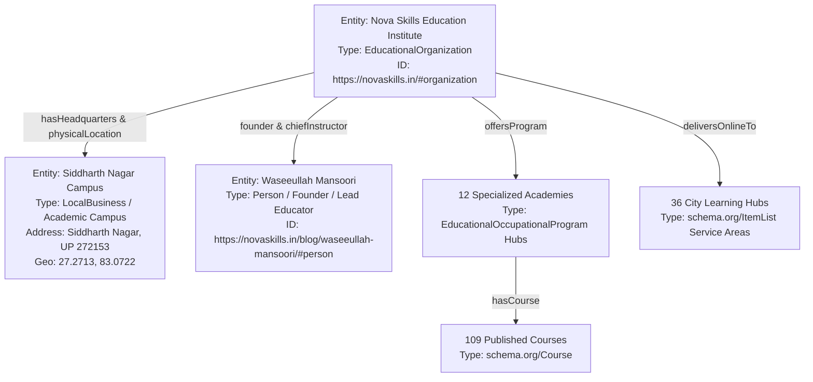

# NOVA SKILLS — LOCAL ENTITY SEO & KNOWLEDGE GRAPH AUDIT (LAYER 27)

**Document ID:** NOVA-LOCAL-ENTITY-LAYER27-AUDIT  
**Focus:** Semantic Entity Recognition, Schema Graph Triples, and Knowledge Graph Grounding  
**Date:** November 2026  
**Auditor:** Nova Skills Semantic & Local Entity SEO Specialist

---

## 1. LOCAL ENTITY KNOWLEDGE GRAPH ARCHITECTURE

Nova Skills is modeled as an interconnected semantic knowledge graph centered on its real-world educational identity and physical headquarters:



---

## 2. CORE ENTITY PROPERTIES & VERIFIED ASSERTIONS

| Entity Node | RDF / Schema.org Type | Canonical `@id` URI | Key Semantic Assertions |
| :--- | :--- | :--- | :--- |
| **Nova Skills (Root)** | `EducationalOrganization` | `https://novaskills.in/#organization` | Legal brand name, official logo, admissions phone, founding year, social authority links. |
| **Physical Campus** | `LocalBusiness`, `EducationalOrganization` | `https://novaskills.in/#campus` | PostalAddress (Siddharth Nagar, 272153), GeoCoordinates (27.2713, 83.0722), opening hours, hasMap pin. |
| **Founder / Educator** | `Person` | `https://novaskills.in/blog/waseeullah-mansoori/#person` | 11+ years experience, multimedia designer, digital marketing leader, AI educator. |
| **12 Academies** | `EducationalOccupationalProgram` | `https://novaskills.in/academies/{slug}/#program` | Discipline curriculum, prerequisite framework, career path outcomes. |
| **109 Courses** | `Course`, `CourseInstance` | `https://novaskills.in/course-detail.html?id={id}#course` | Syllabus modules, workload hours, INR starting pricing (₹2,900 + GST), mode (online/blended). |
| **36 City Hubs** | `ItemList`, `WebPage` | `https://novaskills.in/branches/{city}/#webpage` | Live online delivery cohorts, course availability lists, zero local branch claims. |

---

## 3. STRUCTURED DATA DEFECT REMEDIATION ON CONTACT PAGE

### Audit Finding:
The contact page (`contact/index.html`) previously contained only `ContactPoint` and basic `WebPage` schema, omitting the complete `EducationalOrganization` / `LocalBusiness` schema that connects the physical campus coordinates, postal address, and Google Maps pin to the page.

### Remediation Blueprint:
Inject the following verified JSON-LD block into `contact/index.html`:
```json
{
  "@context": "https://schema.org",
  "@type": ["EducationalOrganization", "LocalBusiness"],
  "@id": "https://novaskills.in/contact/#campus",
  "name": "Nova Skills Education Institute",
  "alternateName": "Nova Skills",
  "url": "https://novaskills.in/contact/",
  "logo": "https://novaskills.in/public/images/seo/og-banner.png?v=2026",
  "image": "https://novaskills.in/public/images/seo/og-banner.png?v=2026",
  "telephone": "+91-9695904440",
  "email": "novaskills.official@gmail.com",
  "address": {
    "@type": "PostalAddress",
    "streetAddress": "Nova Skills Institute Campus",
    "addressLocality": "Siddharth Nagar",
    "addressRegion": "Uttar Pradesh",
    "postalCode": "272153",
    "addressCountry": "IN"
  },
  "geo": {
    "@type": "GeoCoordinates",
    "latitude": "27.2713",
    "longitude": "83.0722"
  },
  "hasMap": "https://maps.app.goo.gl/tgHGkJ2NXf1ckZwS8",
  "openingHoursSpecification": [
    {
      "@type": "OpeningHoursSpecification",
      "dayOfWeek": ["Monday", "Tuesday", "Wednesday", "Thursday", "Friday", "Saturday"],
      "opens": "09:00",
      "closes": "19:00"
    }
  ]
}
```
